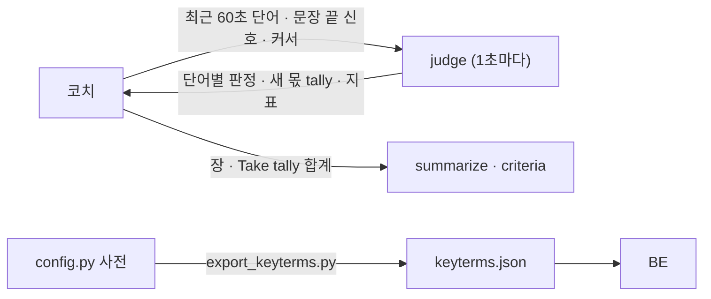

# filler-detection

STT가 확정한 단어마다 "음 · 그 · 그니까" 같은 군더더기인지 층(T1 · T2 · T3)과 함께 판정하고, 코치가 1초마다 부르는 판정 결과를 내는 모듈입니다. 장 · Take의 층별 · 단어별 횟수와 STT keyterm 단어 목록도 이 모듈이 냅니다.

- 설계: [docs/ai/features/filler.md](../../../docs/ai/features/filler.md)
- 공통 계약: [docs/ai/architecture.md](../../../docs/ai/architecture.md) 7절
- Issue: #152

## 하는 일과 하지 않는 일
전체 표는 filler.md 0절에 있습니다. 여기서는 이 폴더 코드가 하는 일만 적습니다.

| 하는 일 | 하지 않는 일 |
|---|---|
| 단어마다 사전의 층과 단어 사이 간격 · 문장 끝 신호로 군더더기인지 가른다 | LLM으로 문맥을 판단하지 않는다. 같은 입력에는 늘 같은 결과가 나온다 |
| 뒤 간격을 봐야 하는 단어는 다음 단어가 올 때까지 보류한다 | STT 중간 결과를 쓰지 않는다(확정 단어만) |
| 판정이 정해진 새 군더더기만 한 번씩 센다(두 커서) | 파일 · 환경변수 · DB를 다루지 않는다(코어 안에서) |
| 최근 60초 군더더기 수로 상태와 `FILLER_FREQUENT`를 낸다 | 말을 걸지, 좋다 · 나쁘다를 정하지 않는다(코치 · 리뷰 몫) |
| 장 · Take 합계(`summarize`), 판정 기준(`criteria`), keyterm 목록(`keyterms`)을 낸다 | "네 · 예 · 응"과 사전에 없는 군더더기("엄 · 흠")를 세지 않는다 |

## 흐름

1. 코치가 요청마다 `judge`를 부릅니다. 입력은 최근 60초의 STT 확정 단어, 문장 끝 신호, STT 상태, 시각 커서 · 단어 커서입니다.
2. `judge`는 창 안 단어마다 층과 군더더기 여부를 정하고, 판정이 정해진 새 군더더기만 `tally`에 한 번씩 셉니다. 돌려준 커서를 코치가 다음 요청에 넘기므로 겹친 창을 다시 보내도 두 번 세지 않습니다.
3. 장 · Take 끝에는 코치가 더해 둔 `tally` 합계를 `summarize`에 넘겨 군더더기 수 · 분당 수 · 층별 · 단어별 횟수를 얻습니다.
4. keyterm 목록은 BE가 STT 연결 때 Deepgram에 넘깁니다. 목록은 이 모듈의 사전에서 만든 파일(`keyterms.json`)로 전합니다.

## 판정 규칙 요약
값은 모두 `src/filler/config.py`가 원본이고 이 표에는 이름만 적습니다. 자세한 규칙과 이유는 filler.md 5-2 · 6-1입니다.

| 층 | 단어(예) | 군더더기로 세는 때 |
|---|---|---|
| T1 채움말 | 음 · 어 · 아 · 으음 | 나오면 늘 |
| T2 지시 · 대용 | 그 · 저 · 이제 · 뭐 · 자 · 이 | 앞이나 뒤 간격이 `gap_ms` 이상인 단독 단어, 또는 같은 단어가 바로 반복 |
| T3 어휘적 | 그니까 · 근데 · 진짜 · 사실 | 앞뒤 간격이 모두 `gap_ms` 이상인 단독 단어, 또는 같은 단어가 바로 반복 |

- **세는 층**: 배포 기본값은 T1만 셉니다(`counted_tiers`). 문장 끝 신호(1초 넘게 쉼) 뒤 첫 단어는 앞 간격이 늘 기준보다 커서, T2 규칙이 문장 첫 지시어("그 결과" · "자 이제")를 군더더기로 세기 때문입니다. T2 · T3 단어는 층과 이유("세지 않는 층")만 내고 `is_filler: false`이며 보류하지 않습니다. 위 표의 T2 · T3 규칙은 세 층을 모두 켠 설정(`ALL_TIERS`)에서 동작하고, 간격 규칙을 실제 리허설로 정한 뒤 켭니다.

- **보류**: T2 · T3 단어인데 뒤 간격을 아직 알 수 없으면(다음 단어도, 그 단어 끝 이후의 문장 끝 신호도, Take 끝 시각도 없음) `is_filler: null`로 두고 세지 않습니다. Take 끝 시각(`take_end_ms`)이 오면 그때까지 보류인 단어를 정합니다.
- **바로 반복**: 같은 단어(문장부호를 뗀 뒤)가 문장 끝 신호 없이 이어지면 앞의 것을 군더더기로 세고, 마지막 하나는 자기 간격으로만 판정합니다. 실제 결과는 아래 '가상 평가 결과'에 있습니다.
- **앞 간격을 모를 때**: 창의 첫 단어는 앞 단어가 없습니다. 그 단어 시작 전의 문장 끝 신호를 앞 단어의 끝으로 보고, 신호도 없으면 앞 간격 조건은 맞지 않은 것으로 칩니다(놓침보다 오탐을 피함).
- **커서**: `words_counted_until_ms`는 보류 단어 앞에서 멈추고 받은 값보다 작아지지 않습니다. `counted_until_ms`는 시간 합계를 센 시각입니다.
- **최근 창**: 60초 안에 시작하고 끝난 군더더기 수가 `frequent_count` 이상이면 `HIGH`와 `FILLER_FREQUENT`, `frequent_bad`에서 severity 1.0입니다. STT가 `ok`가 아니면 단어를 판정하지 않고 `UNKNOWN`입니다.

## 파일 지도
"생성"은 도구가 만드는 파일이라 손으로 고치지 않습니다.

| 파일 | 하는 일 | 입력 → 출력 | 부르는 곳 | 고칠 때 |
|---|---|---|---|---|
| `src/filler/core.py` | 진입 함수. 단어별 층 · 간격 판정, 보류, 새 몫과 커서, 최근 창 지표, 잦음 문제, 장 · Take 합계 | `judge(inputs, t_ms, config)` → `[JudgmentResult]`, `summarize(tally)` → `{"FILLER": ...}`, `criteria()`, `keyterms()` | 코치(`/coach/evaluate` · `/coach/finalize` · `replay`) | 규칙 · 이유 문자열의 뜻이 바뀌면 기능 버전을 올리고 filler.md 6-1 · `examples/`를 함께 고칩니다 |
| `src/filler/schemas.py` | 입출력 pydantic 모델(= 계약). 입력은 모르는 필드를 무시하고 출력은 정해진 필드만 냅니다 | `judge` 입력 dict → `FillerInput`, 결과 → `JudgmentResult` · `FillerSummary` · `IssueCriteria` | `core.py`, 테스트 | 필드 이름 · 뜻이 바뀌면 `schema_version` · filler.md 5절을 함께 고칩니다 |
| `src/filler/config.py` | 사전(T1 · T2 · T3 · keyterm)과 기준값 `FillerConfig`, 단어 정규화 `normalize`. 값의 해시가 `criteria_version`에 들어갑니다 | — → `FillerConfig` | `core.py`, 도구, 테스트 | 단어 · keyterm 순서를 바꾸면 filler.md 5-2 표를 맞추고 `keyterms.json` · 평가 결과를 다시 만듭니다 |
| `src/filler/version.py` | 기능 버전 `filler-1.0` | — → 문자열 | `core.py` | 판정 규칙 · 출력의 뜻이 바뀔 때만 올립니다 |
| `src/filler/__init__.py` | 밖에서 쓰는 이름만 내보냅니다 | — | 코치 · 도구 | 새 진입 함수를 더할 때 |
| `src/filler/keyterms.json` (생성) | STT keyterm 15개와 그 목록을 만든 `criteria_version` | `config.py` 사전 → JSON | BE(복사본으로 STT 연결 때 씀), `tests/test_keyterms.py` | 사전의 keyterm이 바뀌면 `tools/export_keyterms.py`로 다시 만들어 같은 PR에 넣습니다 |
| `src/filler/examples/` | `judge` · `summarize` · `criteria` 입력 · 출력 예시 JSON. 코치 · 말 속도가 이 예시로 먼저 개발합니다 | `src/filler/examples/judge_input*.json` ↔ `judge_output*.json`, `summarize_input.json` ↔ `summarize_output.json`, `criteria.json` | `tests/test_examples.py`, 코치 개발 | 입력만 손으로 고치고 출력(생성)은 `tools/make_examples.py`로 다시 만듭니다 |
| `tools/make_examples.py` | 예시 입력을 읽어 지금 코드로 출력 JSON을 다시 씁니다 | `examples/judge_input*.json` → `judge_output*.json`, `summarize_input.json` → `summarize_output.json`, `criteria.json` | 사람(기준값 · 규칙을 바꾼 뒤) | 출력 JSON을 손으로 고치지 않습니다 |
| `tools/export_keyterms.py` | `keyterms.json`을 지금 사전에서 다시 씁니다 | 사전 → `keyterms.json` | 사람(사전 · 기준값을 바꾼 뒤) | 커밋된 파일과 같으면 `git diff`가 빕니다 |
| `data/virtual/source.json` | 손으로 쓴 가상 발표 발화 73개. 단어에 `*`(말한 사람이 넣은 군더더기)와 쉼 표시를 달았습니다 | — → 표기 문장 목록 | `tools/make_virtual_data.py` | 정답은 규칙이 아니라 사람이 들었을 때의 뜻으로 답니다. 고치면 `words.json`을 다시 만듭니다 |
| `tools/make_virtual_data.py` | 원본에 정해진 seed의 난수로 단어 시각과 정답을 붙이고, 발화를 문장 사이 간격(1.1~1.8초)과 문장 끝 신호로 이어 Take 하나로 만듭니다 | `source.json` + `--seed` → `words.json` | 사람(원본 · 시각 분포를 바꾼 뒤) | 분포 · 난수 순서를 바꾸면 `words.json`과 평가 결과를 다시 만듭니다 |
| `data/virtual/words.json` (생성) | 발화를 하나의 Take 시간선에 이은 단어 목록: 단어마다 발화 id(`utt`) · `start_ms` · `end_ms` · 정답 군더더기 · 사전 층, 문장 끝 신호, Take 끝 시각 | 원본 + seed 0 → Take 하나 | `tools/evaluate.py`, `tests/test_virtual_data.py` | 손으로 고치지 않습니다 |
| `tools/evaluate.py` | Take를 1초 간격으로 이어 불러 층별 정밀도 · 재현율, `gap_ms` 민감도, 틀린 예, 반복 규칙 결과를 냅니다 | `words.json` → 결과 JSON | 사람(사전 · 기준값 · 규칙을 바꾼 뒤), `tests/test_evaluate.py` | 지표 정의를 바꾸면 이 README의 결과 표도 함께 고칩니다 |
| `reports/results/filler_eval.json` (생성) | 가상 평가 결과 | — | 사람, `tests/test_evaluate.py` | 사전 · 기준값 · 규칙을 바꾸면 다시 만들어 같은 PR에 넣습니다 |
| `tests/` | 규칙 · 보류 · 커서 · 지표 · 합계 · 계약 · 예시 · keyterm 파일 · 가상 데이터 · 평가 테스트 | — | pytest | 아래 '테스트' |
| `pyproject.toml` · `uv.lock` · `.python-version` | Python 3.12, 의존성은 pydantic 하나(개발용 pytest · ruff) | — | `uv sync` | 의존성을 바꾸면 `uv.lock`도 함께 |

`src/filler/`는 나중에 AI 서비스의 `features/filler/`로 폴더째 옮깁니다. 코어는 pydantic 말고는 외부 패키지를 쓰지 않고, 다른 판정 모듈을 import하지 않으며, 파일을 읽지 않습니다(평가는 `tools/`에 있는 이유입니다).

## 준비 · 실행
Python 3.12. LLM을 쓰지 않아 `ai/.env`가 필요 없습니다. 모든 명령은 `ai/research/filler-detection`에서 돌립니다. Windows에서 `pytest.exe` 같은 실행 파일이 막히면 아래처럼 `python -m`으로 부르고, 콘솔 한글이 깨지면 `PYTHONIOENCODING=utf-8`을 붙입니다.

```bash
cd ai/research/filler-detection
uv sync                                  # .venv 만들기 (처음 한 번)
```
```text
Resolved 13 packages in 30ms
Checked 13 packages in 11ms
```

```bash
uv run python -m pytest -q               # 테스트
uv run ruff check . && uv run ruff format --check .
```
```text
334 passed in 12.81s
All checks passed!
25 files already formatted
```

```bash
uv run python tools/make_examples.py     # 예시 출력 다시 만들기 (기준값 · 규칙을 바꾼 뒤)
```
```text
judge_input.json -> judge_output.json
judge_input_frequent.json -> judge_output_frequent.json
judge_input_pending.json -> judge_output_pending.json
judge_input_stt_down.json -> judge_output_stt_down.json
judge_input_take_end.json -> judge_output_take_end.json
summarize_output.json, criteria.json
```

```bash
uv run python tools/export_keyterms.py   # keyterms.json 다시 만들기 (사전이 바뀐 뒤)
```
```text
keyterms.json: 15개, filler-1.0+3e62c0c87d2a
```

```bash
uv run python tools/make_virtual_data.py --seed 0   # 가상 평가 데이터 다시 만들기
```
```text
words.json: 발화 73개, 단어 959개, seed 0
```

```bash
uv run python tools/evaluate.py --data data/virtual/words.json --out reports/results/filler_eval.json
```
```text
filler-1.0+60cd87861ea9  발화 73개 · 단어 959개 · 사전에 없는 정답 7개 · 이어 부르기 = 한 번에 부르기: True
층      tp   fp   fn      정밀도      재현율
T1     49    6    0   0.8909      1.0
T2     31   34    6   0.4769   0.8378
T3     13   27   23    0.325   0.3611
전체     93   67   29   0.5813   0.7623
-> reports\results\filler_eval.json
```
다시 만든 파일이 커밋된 것과 같으면 `git diff`가 비어야 합니다. 같은 seed면 같은 파일이 나옵니다.

## 결과를 직접 보는 법
`judge`는 입력 dict와 판정 시각을 받아 결과 하나가 든 목록을 냅니다. 아래는 "저희는 · 음 · 그니까" 세 단어가 있는 41초 창을 배포 기본값(T1만 셈)으로 판정한 것입니다.

```python
from filler.core import judge

inputs = {
    "t_ms": 41000,
    "since_ms": 40000,
    "words_since_ms": 38950,
    "stt_status": "ok",
    "utterance_ends": [36800],
    "words": [
        {"word": "저희는", "start_ms": 38000, "end_ms": 38400},
        {"word": "음", "start_ms": 40050, "end_ms": 40400},
        {"word": "그니까", "start_ms": 40450, "end_ms": 40800},
    ],
}
[r] = judge(inputs, t_ms=41000)
print(r.state, r.metrics.recent_filler_count, r.words_counted_until_ms)
for w in r.words:
    print(w.word, w.tier, w.is_filler, w.reason)
print([(i.t_ms, i.values) for i in r.tally if "filler_count" in i.values])
```
```text
NORMAL 1 40800
저희는 None False 사전에 없음
음 T1 True 채움말
그니까 T3 False 세지 않는 층
[(40050, {'filler_count': 1, 'filler_t1': 1, 'filler_word:음': 1})]
```
세 층을 모두 켜고(`judge(inputs, t_ms=41000, config=ALL_TIERS)`, `from filler.config import ALL_TIERS`) 같은 창을 판정하면 결과가 이렇게 바뀝니다.
```text
NORMAL 1 40400
저희는 None False 사전에 없음
음 T1 True 채움말
그니까 T3 None 뒤 간격을 아직 알 수 없음
[(40050, {'filler_count': 1, 'filler_t1': 1, 'filler_word:음': 1})]
```
기본값에서 "음"은 T1이라 바로 세고, "그니까"는 T3라 세지 않으므로 단어 커서가 그 끝(40800)까지 갑니다. 세 층을 켜면 "그니까"는 마지막 단어라 뒤 간격을 몰라 보류(`None`)이고, 그래서 단어 커서(`words_counted_until_ms`)가 "음"의 끝(40400)에서 멈춥니다. 다음 요청에서 다음 단어나 문장 끝 신호가 오면 정해집니다.

`src/filler/examples/`에는 같은 방식의 입력 · 출력 JSON이 있습니다. 출력은 지금 코드로 돌린 값입니다. 보류 · 문장 끝 신호 · T2 · T3 규칙을 보여 주려고, 이름에 `default`가 들어간 예시만 배포 기본값(T1만 셈)으로 판정하고 나머지는 세 층을 모두 켠 설정(`ALL_TIERS`)으로 판정합니다.

| 파일 | 보여 주는 것 |
|---|---|
| `judge_input.json` · `judge_output.json` | filler.md 5-5 첫 예시. 41초, 새 군더더기 "음" 하나만 세고 최근 창 2개 · 분당 2.93 |
| `judge_input_pending.json` · `judge_output_pending.json` | filler.md 5-5 경계 예시. 마지막 "그"가 보류 단어라 단어 커서가 그 앞에서 멈춤 |
| `judge_input_take_end.json` · `judge_output_take_end.json` | 같은 "매출은 · 그" 창에서 Take 끝 시각(`take_end_ms`)이 와 "그"가 정해져 셈 |
| `judge_input_stt_down.json` · `judge_output_stt_down.json` | `stt_status`가 `reconnecting`. 단어를 판정하지 않고 시간만 세며 `UNKNOWN` |
| `judge_input_default.json` · `judge_output_default.json` | 5-5 첫 예시와 같은 입력을 배포 기본값으로 판정. "그니까"(T3)는 세지 않는 층이라 최근 창 1개 |
| `judge_input_frequent.json` · `judge_output_frequent.json` | 최근 창에 군더더기 8개(T1 · T2 · T3 · 바로 반복). `HIGH`와 `FILLER_FREQUENT` 하나 |
| `summarize_input.json` · `summarize_output.json` | Take `tally` 합계 → 군더더기 7개 · 분당 2.4 · 측정 비율 0.97 (filler.md 5-5 값) |
| `criteria.json` | `FILLER_FREQUENT` 판정 기준 |

기준값(`config.py`)이나 규칙을 바꾸면 출력과 `criteria_version`이 달라져 `tests/test_examples.py`가 깨집니다. 그때는 입력은 그대로 두고 `tools/make_examples.py`로 출력만 다시 만들어 같은 PR에 넣습니다(architecture.md 12절). 다시 만든 뒤에도 문서 대조 테스트(상태 · 보류 등)가 깨지면 새 기준값에서 예시가 보여 주려던 상황이 달라진 것이므로 입력을 고칩니다.

## 가상 평가 결과
`tools/evaluate.py`가 만든 `reports/results/filler_eval.json`을 옮긴 것입니다(세 층을 모두 켠 설정 `ALL_TIERS`로 잼 — 간격 규칙을 재는 평가라서. `criteria_version` `filler-1.0+60cd87861ea9`, 가상 발화 73개 · 단어 959개 · seed 0).

**평가 방식.** 발화 73개를 원본 순서대로 하나의 Take 시간선(약 11분 43초)에 이어 붙입니다. 발화 사이에는 1.1~1.8초를 두고 앞 발화의 마지막 단어 끝을 문장 끝 신호로 넣어, 실제 Take처럼 발화의 첫 단어도 앞 간격과 앞 문장 끝 신호를 압니다(Take의 첫 단어만 앞 신호가 없습니다). 그 Take를 코치처럼 1초(t = 1000, 2000, …)마다 `judge`로 이어 부릅니다. 그 시각에 확정된 단어만 보냅니다: 단어는 `end_ms + 800 <= t`(STT 확정 지연), 문장 끝 신호는 `u + 1000 <= t`(UtteranceEnd는 1초 쉰 뒤 옴)이고 창은 t 앞 60초라 Take가 진행되면 창이 따라 움직입니다. 돌려받은 두 커서를 다음 요청에 넘기고, 마지막 요청만 Take 끝 시각을 넣습니다. 센 군더더기는 단어 몫의 `t_ms`(= 단어 `start_ms`)로 단어에 맞추고, 같은 단어가 두 번 세어지면 평가가 멈춥니다. 같은 Take의 모든 단어를 창 없이 한 번에 부른 결과와 센 단어가 같은지도 확인했고 같았습니다(`streaming_matches_single_call: true`). 틀린 예의 `reason`은 그 단어의 판정이 처음 정해진 요청에서의 이유입니다.

**정답 데이터.** 정답은 "규칙이 어떻게 볼지"가 아니라 "사람이 들으면 군더더기인지"로 달았습니다. 규칙이 틀릴 사례를 일부러 넣었습니다: 쉬지 않고 붙여 말한 군더더기, 쉬고 말한 정상 단어("진짜 .. 높게", "이 .. 기능은"), 문장 첫 "이제"의 정상 용법, 반복이 아닌 "그 그 방법은", 사전에 없는 군더더기("엄 · 흠 · 에또 · 그러니깐"), 문장부호가 붙은 단어("어어.").

| 층 | 정답 군더더기 | 정상 용법 |
|---|---|---|
| T1 | 49 | 6 |
| T2 | 37 | 42 |
| T3 | 36 | 61 |
| 사전에 없음 | 7 | — |

### 층별 정밀도 · 재현율 (기준값 `gap_ms` 400)
| 층 | 센 것 중 정답(tp) | 잘못 셈(fp) | 놓침(fn) | 정밀도 | 재현율 |
|---|---|---|---|---|---|
| T1 | 49 | 6 | 0 | 0.8909 | 1.0 |
| T2 | 31 | 34 | 6 | 0.4769 | 0.8378 |
| T3 | 13 | 27 | 23 | 0.325 | 0.3611 |
| 전체 | 93 | 67 | 29 | 0.5813 | 0.7623 |

사전에 없는 정답 군더더기 7개(`out_of_dictionary`)는 재현율 분모에 넣지 않고 따로 셉니다. 결과 JSON의 `errors`에는 놓치거나 잘못 센 단어 103개(사전에 없는 7개 포함)가 앞뒤 두 단어 · 간격 · 판정 이유와 함께 있습니다.

### `gap_ms` 민감도
같은 평가에서 앞 · 뒤 간격 기준(`gap_ms`)만 바꾼 결과입니다(셀은 정밀도 / 재현율).

| `gap_ms` | T1 | T2 | T3 | 전체 |
|---|---|---|---|---|
| 200 | 0.8909 / 1.0 | 0.4857 / 0.9189 | 0.3276 / 0.5278 | 0.5574 / 0.8361 |
| 300 | 0.8909 / 1.0 | 0.4928 / 0.9189 | 0.3276 / 0.5278 | 0.5604 / 0.8361 |
| **400** | 0.8909 / 1.0 | 0.4769 / 0.8378 | 0.325 / 0.3611 | 0.5813 / 0.7623 |
| 500 | 0.8909 / 1.0 | 0.4844 / 0.8378 | 0.3448 / 0.2778 | 0.6081 / 0.7377 |
| 600 | 0.8909 / 1.0 | 0.4921 / 0.8378 | 0.3333 / 0.1667 | 0.6324 / 0.7049 |
| 800 | 0.8909 / 1.0 | 0.4737 / 0.7297 | 0.5 / 0.1389 | 0.6639 / 0.6639 |

간격 기준을 키우면 전체 정밀도는 오르고 재현율은 떨어집니다. 하지만 T2의 정밀도는 0.47~0.49에서 움직이지 않습니다. T2 오탐 34개 중 25개가 문장 첫 단어(앞 간격이 문장 사이 1.1초 이상)라 `gap_ms`가 그보다 작은 한 앞 간격 조건에 걸리기 때문입니다(아래). T3는 `gap_ms`가 800이 되어서야 정밀도가 0.5로 오르고 그때 재현율은 0.14입니다.

### 틀린 예와 해석
| 예(단어 앞뒤) | 정답 | 규칙 결과 | 까닭 |
|---|---|---|---|
| "방법은 간단합니다 **[이제]** 발표 대본을" (앞 1478 ms · 뒤 723 ms) | 정상("지금부터") | 센다(T2) | 이 데이터에서 문장 첫 단어의 앞 간격은 1.1초 이상이라 정상 용법도 T2의 앞 간격 조건에 걸린다 |
| "나왔습니다 저희도 **[솔직히]** 이렇게까지" (앞 548 ms · 뒤 721 ms) | 정상(강조) | 센다(T3) | 강조하려고 앞뒤를 쉰 정상 단어도 앞뒤 간격이 모두 기준 이상이다 |
| "암호화됩니다 그 **[그]** 서비스는" (앞 8 ms · 뒤 84 ms) | 군더더기(더듬음) | 못 센다(T2) | 반복의 마지막 하나는 자기 간격만 보는데 붙여 말했다 |
| "계산합니다 어어. **[그니까]** 화면 밖을" (앞 15 ms · 뒤 780 ms) | 군더더기 | 못 센다(T3) | 앞을 붙여 말한 군더더기. T3는 앞뒤 간격이 모두 기준 이상이어야 센다 |
| "구조를 보시겠습니다 **[그니까]** 발표할 때" (앞 1763 ms · 뒤 38 ms) | 군더더기 | 못 센다(T3) | 문장을 시작하며 붙여 말한 군더더기. 앞 간격은 충분하지만 뒤가 붙어 있다 |
| "좋은 겁니다 **[아]** 맞다" | 정상(알아차림) | 센다(T1) | T1은 늘 센다 |
| "저희는 에또 **[그러니깐]** 발표의" | 군더더기 | 못 센다 | 사전에 없다(재현율 밖) |

- **잘못 센 67개**: T1 6개는 "아" 5개("아 맞다" 같은 알아차림)와 "에" 1개입니다. T2 34개 · T3 27개 가운데 49개(T2 25개 · T3 24개)는 문장 끝 신호 바로 뒤의 첫 단어, 곧 쉬었다가 문장을 시작하며 말한 정상 용법입니다("이제 · 자 · 그 · 이 · 저기" 같은 T2와 "그런데 · 그러니까 · 아니 · 글쎄" 같은 T3). 문장 사이 간격이 `gap_ms`보다 커서 앞 간격 조건은 채워지고, T2는 그것만으로 세어지며 T3는 뒤 간격도 기준 이상이거나 반복일 때 세어집니다. 그 49개 가운데 3개는 문장을 "진짜 진짜 좋았습니다"처럼 강조 반복으로 시작한 경우입니다. 나머지 12개는 문장 안에서 앞뒤를 쉬고 말한 정상 단어입니다.
- **놓침 29개(사전 안)**: T2 6개 · T3 23개이고, 모두 앞이나 뒤를 붙여 말한 군더더기입니다. 13개는 문장 첫 단어이지만 뒤를 붙여 말한 경우이고(T3는 앞뒤 모두 쉬어야 세므로 놓침), 나머지는 문장 안에서 붙여 말한 경우입니다. Take 안의 문장 첫 단어는 앞 간격을 알아서, 앞 간격을 몰라 놓친 경우는 없습니다.
- 간격만 보는 규칙으로는 "쉬고 말한 정상 단어"와 "쉬고 말한 군더더기"를 가를 수 없고, 이 데이터에서 가장 큰 오탐 원인은 문장 첫 T2 단어, 그리고 뒤 간격도 기준 이상이거나 반복된 T3 단어에서 나는 오탐입니다(filler.md 15절 한계와 같은 이야기입니다). 줄이려면 문장 첫 단어 규칙의 조건이나 사전을 다시 골라야 하고, 그 선택은 기준값 · 규칙을 다시 고르는 일입니다.

### 바로 반복 규칙(앞의 것만 셈)을 데이터로 확인한 결과
같은 T2 · T3 단어가 문장 끝 신호 없이 이어지는 쌍이 13개 있습니다. 쌍마다 두 단어의 정답 조합과 센 수입니다.

| 정답 조합(앞 · 뒤) | 예 | 쌍 수 | 앞 단어를 센 수(반복 규칙) | 뒤 단어를 센 수(자기 간격) |
|---|---|---|---|---|
| 앞 군더더기 · 뒤 정상 | "그 **그** 방법은" | 8 | 8 | 1 |
| 둘 다 군더더기 | "그 그 서비스는" | 2 | 2 | 1 |
| 둘 다 정상 | "진짜 진짜 좋았습니다" | 3 | 3 | 0 |

- 더듬은 말 뒤에 실제로 쓰인 같은 말이 오는 경우(앞 군더더기 · 뒤 정상)가 가장 흔했고, 이때 "앞의 것만 센다"는 정답과 맞습니다(8쌍 모두 앞을 세고 뒤는 1개만 잘못 셈). 뒤의 것을 센다면 이 8쌍의 앞 군더더기를 놓칩니다.
- 둘 다 군더더기인 쌍에서는 뒤의 것을 붙여 말하면 놓칩니다(2쌍 중 1개 놓침). 반복으로 센 앞 단어는 올바르지만 뒤 단어는 간격에 따라 갈립니다.
- 둘 다 정상인 강조 반복("진짜 진짜", "막 막", "아니 아니")은 3쌍 모두 앞 단어를 잘못 셉니다.
- 정리: 데이터에서는 앞의 것만 세는 규칙이 맞은 쌍이 많았고, 틀린 쌍은 강조 반복과 붙여 말한 두 번째 군더더기입니다. 그래서 규칙은 바꾸지 않았습니다. 쌍이 13개뿐이라 표본이 작으므로 실제 리허설 데이터가 생기면 다시 확인합니다.

### 가상 데이터의 한계
이 숫자는 실제 정확도가 아닙니다.
- 단어 시각은 `make_virtual_data.py`가 정한 분포(쉼 `..`은 300~900 ms)에서 나온 것이라 판정이 그 분포에 기댑니다. 실제 STT 단어 시각과 쉼의 모양은 다를 수 있습니다.
- 규칙이 틀릴 사례(쉬고 말한 정상 단어, 붙여 말한 군더더기 등)를 일부러 많이 넣었습니다. 그래서 이 숫자는 층 사이의 비교와 기준값을 바꿨을 때의 방향을 보는 용도이고, 실제 발표와 어떤 관계인지는 측정하지 않았습니다.
- 발화 사이 간격이 모두 1.1~1.8초이고 모든 발화가 문장 끝 신호로 끝납니다. 그래서 문장 첫 단어의 앞 간격이 모두 `gap_ms`보다 큽니다. 실제 문장 사이 간격의 분포는 측정하지 않았습니다.
- 한국어 발화 73개를 손으로 썼고, 정답은 한 사람이 달았습니다.
- STT가 채움말을 지우거나 없던 단어를 끼우는 일은 모사하지 않았습니다.

## keyterm 파일을 BE가 쓰는 법
BE 이미지는 `backend/` 폴더만 담으므로 AI 파일을 실행 중에 읽을 수 없습니다. 그래서 BE는 `src/filler/keyterms.json`의 복사본을 `backend/` 안에 두고 STT 연결 때 그 목록을 대본 용어와 함께 keyterm으로 넘깁니다. BE 테스트가 저장소의 이 파일과 복사본이 같은지 확인합니다. 파일의 `keyterms` 순서는 BE 목록과 같고(T1 짧은 5 → T2 7 → T1 늘인 3), `criteria_version`은 그 목록을 만든 사전의 버전입니다. 사전의 keyterm 표시가 바뀌면 같은 PR에서 `tools/export_keyterms.py`로 파일을 다시 만들고 BE에 알립니다(filler.md 9 · 11절). `tests/test_keyterms.py`가 파일이 지금 사전과 같은지 봅니다.

## 기준값
모두 잠정값이고 원본은 `config.py`입니다.

| 값 | 기본값 | 근거 |
|---|---|---|
| 세는 층 | T1만 | 문장 첫 지시어 오탐 때문. 간격 규칙을 실제 리허설로 정한 뒤 T2 · T3를 켠다 |
| 앞 · 뒤 간격 기준 | 400 ms | filler.md 5-5 예시("그니까" 뒤 간격 400 ms가 단독)와 맞춘 첫 값 |
| 문장 첫 단어 앞 간격 | 1000 ms | Deepgram `utterance_end_ms`(1초)와 같은 값 |
| 최근 창 | 60초 | BE가 보내는 창 60초 안 |
| 잦음 기준 · 아주 나쁨 | 6개 · 15개 | 코치 연구용 대역과 같은 값(코치 재생과 비교할 수 있음) |
| 분당 수를 내는 최소 관측 시간 | 10초 | 짧은 관측의 분당 수는 크게 흔들려서 |
| 문제 시작 · 끝이 늦게 잡히는 폭 | 30초 · 30초 | 대역과 같은 값 |

## 문서에 정해지지 않아 고른 것
- `issues[].persistence_sec`는 최근 창 군더더기의 끝 시각을 이른 순으로 놓고 기준 개수 번째 단어의 끝(조건이 성립한 시각)부터 지금까지입니다. 창 안 단어만으로 본, 조건이 이어진 시간의 하한입니다(그 앞에 이미 성립했다가 창 밖으로 나간 단어가 있을 수 있습니다).
- `severity`는 소수점을 자르지 않고 그대로 냅니다.
- 문장 첫 단어 규칙(T2의 마지막 조건)은 기준값과 상관없이 늘 "뒤 간격이 기준 이상" 조건에 먼저 걸려 결과를 바꾸지 않습니다(두 조건의 뒤 간격 기준이 같은 `gap_ms`라서). 기능 문서 규칙을 그대로 옮겨 두었습니다.
- `frequent_count`는 1 이상이어야 합니다(`persistence_sec`을 셀 단어가 있어야 해서).

## 테스트
`uv run python -m pytest`로 모두 돕니다.

| 파일 | 보는 것 |
|---|---|
| `test_rules.py` | 층별 규칙: T1 늘 군더더기, T2 · T3 간격 경계(기준과 같으면 단독, 1 ms 짧으면 아님), 바로 반복, 창 첫 단어의 앞 간격, 문장 첫 단어, 사전 밖 단어, 문장부호 |
| `test_pending.py` | 마지막 T2 · T3 단어의 보류, 다음 단어 · 문장 끝 신호 · Take 끝 시각으로 정해지는 경우 |
| `test_cursor.py` | 단어 커서(보류 앞에서 멈춤, 되돌아가지 않음), 새 몫, 겹친 창을 이어 불러도 한 번만 셈, 1초마다 시간 몫, 시각이 거꾸로 · 겹친 단어 |
| `test_metrics.py` | 최근 창 경계, 분당 수의 분모, `HIGH` · 심각도 · 지속 시간, STT 끊김 |
| `test_summarize.py` | 합계 → 지표, 분모 0, 단어별 정렬 |
| `test_contract.py` | 입력 · 출력 모델(모르는 필드 · 필수 필드 · `stt_status` enum), 출력 JSON 키, `criteria_version`, 사전 검증, `criteria` · `keyterms` |
| `test_examples.py` | 예시 출력이 지금 코드 출력과 같음, 예시가 filler.md 5-5 설명과 맞음 |
| `test_keyterms.py` | `keyterms.json`이 지금 사전과 같고(아니면 다시 만드는 명령을 알림), 15개이며 순서가 문서와 같음 |
| `test_virtual_tool.py` | 가상 데이터 도구: `*` 표기 · 층, 쉼 종류별 간격 범위, 문장 끝 신호, 발화를 하나의 Take로 잇기, 같은 seed 같은 결과 |
| `test_virtual_data.py` | 커밋된 `words.json`이 원본 · seed로 다시 만든 것과 같고, 발화가 한 Take에 순서대로 이어지며 층별 개수가 고름 |
| `test_evaluate.py` | 작은 손 데이터로 지표 · 틀린 예 · 요청 만들기 · 중복 집계 검사 · 반복 규칙, 60초보다 긴 Take에서 이어 부르기 = 한 번에 부르기, 커밋된 결과 파일의 `criteria_version`과 최신 여부 |
| `test_counted_tiers.py` | 배포 기본값은 T1만 셈: 문장 첫 · 쉼 뒤 지시어를 세지 않음, 보류 없음, T1은 그대로, 세 층을 켜면 지금 규칙대로 |
| `test_core_boundary.py` | 코어가 상대 import와 표준 모듈 · pydantic만 쓰고 파일 · 출력을 다루지 않음(어기면 실패) |
| `helpers.py` | 입력 도우미와 공통 계약 검사. `run()`은 판정할 때마다 공통 계약도 봅니다 |

규칙 테스트는 `helpers.CFG`(지금 기본값을 따로 적은 것)로 돕니다. 기준값을 다시 골라도 규칙 테스트는 그대로이고, 예시 · `keyterms.json` · 평가 결과만 다시 만들면 됩니다.

## 알려진 한계 · 작성 필요
- 간격과 문장 끝만 봅니다. 쉬고 말한 정상 단어는 군더더기로 셀 수 있고, 붙여 말한 군더더기는 놓칩니다(위 평가).
- 사전에 없는 군더더기와 활용형 · 띄어쓰기 변형은 세지 않습니다.
- STT 단어 시각의 정확도에 기대므로, 단어 시각이 흔들리면 간격 판정도 흔들립니다.
- keyterm으로도 채움말이 모두 전사에 남지는 않아 채움말 수는 실제보다 적게 나올 수 있습니다.

> **작성 필요** — 실제 리허설 Deepgram 확정 단어 평가 세트와 keyterm 효과(채움말 보존율 · 끼어듦) (#152)
