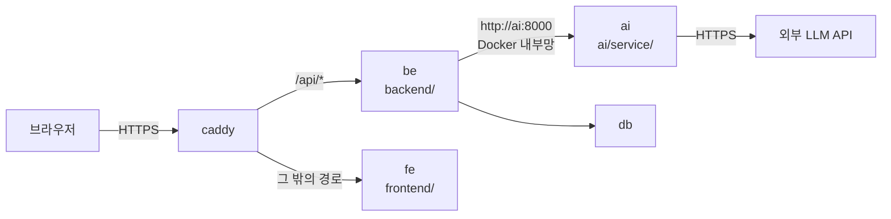
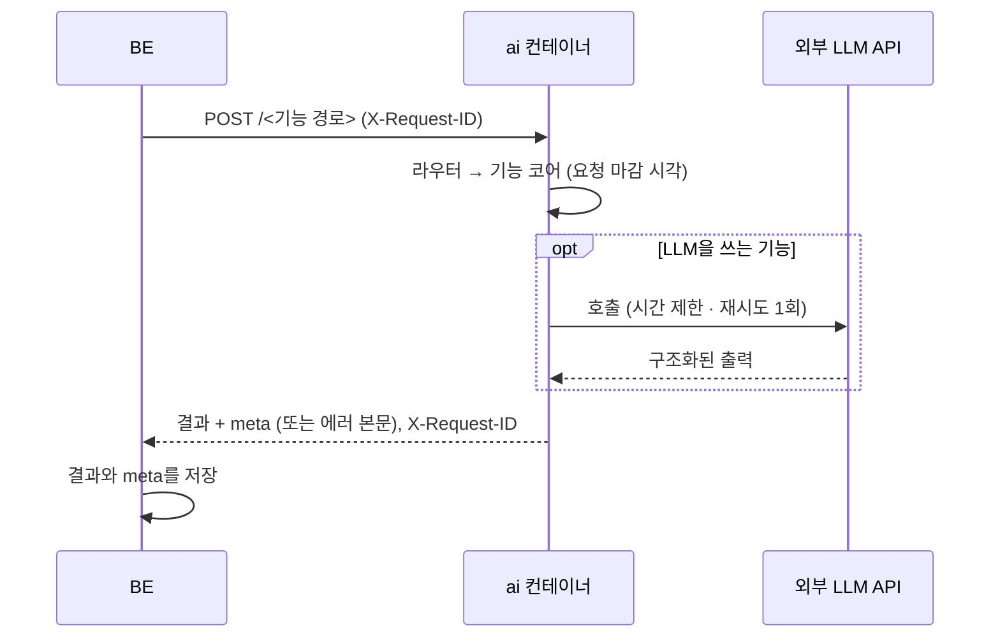

# AI 서비스 · Docker 설계

> **이 문서는** 모든 AI 기능이 올라가는 AI 서비스(`ai/service/`)의 전체 설명서다. 기능 하나의 설계를 담는 기능 문서(`features/`)가 아니라 서비스 · Docker · 배포 · 운영 문서다. 처음 보는 사람이 이 문서만 읽고 AI 서비스가 왜 따로 있고, 어떻게 만들어 기능 · 모델을 붙이고, Docker로 어떻게 빌드 · 배포 · 운영하는지 알 수 있게 쓴다. AI 담당은 기능을 붙여 배포하고, BE · 인프라 담당은 AI 서비스를 부르고 띄우고 문제를 찾을 수 있게 쓴다.
> **기준 범위**: AI 서비스의 목표 설계다. 기능 사이 공통 계약(호출 흐름 · 통신 규칙 · 시간 예산 · 에러 본문 · `meta` · LLM 규칙 · 환경변수 · CI · 배포 개요)은 `architecture.md`에 따르고, 기능마다의 입력 · 출력과 처리는 각 기능 문서(`features/<기능>.md`)에 따른다. 이 문서에는 서비스에만 있는 것(폴더 · 앱 구성 · 이미지 · compose · 운영)만 적는다. 절 번호(0–16)는 다른 문서가 "`ai-service.md` 8절"처럼 가리키므로 옮긴 뒤에도 그대로 둔다.
> **관련 Issue**: #210
> **한 줄 요약**: `ai/service/` 폴더가 곧 AI 서비스이자 배포 단위다. 이 폴더 하나로 이미지 하나를 만들고, compose의 `ai` 컨테이너 하나로 BE 옆에서 띄운다. AI를 부르는 곳은 BE뿐이고 주소는 Docker 내부망의 `http://ai:8000`이다. 실험 코드(`ai/research/`)와 과거 코드(`ai/archive/`)는 이미지에 들어가지 않는다.

# 0. 한눈에 보기
| 언제 | 받는 것 | 내는 것 | 쓰는 곳 |
|---|---|---|---|
| 컨테이너가 떠 있는 동안 (`GET /health`) | — | `{"status": "ok"}` | 배포 확인 (프로세스가 살아 있는지) |
| 컨테이너가 떠 있는 동안 (`GET /ready`) | — | 준비 전 503 `NOT_READY`, 준비 후 200 | compose 헬스체크 (서버 안 모델까지 준비됐는지) |
| 기능 호출 (`POST /<기능 경로>`) | BE가 만든 요청 JSON + 헤더 `X-Request-ID` | 결과 + `meta`, 또는 공통 에러 본문 | BE (경로 목록은 `architecture.md` 1-2) |

| 역할 | 하려는 일 | 볼 곳 |
|---|---|---|
| AI 담당 | 로컬에서 띄우고 테스트하기 | 10절 |
| AI 담당 | 기능 · 모델을 붙여 배포하기 | 6절 → 11절 |
| BE 담당 | AI 서비스를 부르는 코드 (경로 · 시간 예산 · 재시도 · 에러 처리) | `architecture.md` 2 · 3 · 4절, 12절 |
| BE 담당 | 로컬에서 BE와 AI를 같이 띄우기 | 10절 |
| 인프라 담당 (BE) | compose · 배포 · 시크릿 · 서버 자원 | 11절 · 12절 |
| 모두 | 장애가 났을 때 | 11절 '증상별 원인' |
| FE 담당 | 바뀌는 것 없음. FE는 AI 서비스를 직접 부르지 않는다 | — |

- **하는 것**: AI 기능 코어를 HTTP API로 연다. LLM 객체를 한곳에서 만들고 시간 제한 · 재시도 · 응답 모델 기록을 맡는다. 예외를 공통 상태 코드 · 에러 본문으로 바꾼다. 서버 안 모델을 시작할 때 한 번 불러온다.
- **하지 않는 것**: 저장하지 않는다(DB · Redis 없음, 결과는 BE가 저장한다). BE를 부르지 않는다. 밖에 열지 않는다(인증이 없어 내부망 격리가 유일한 보호다). 기능마다 컨테이너를 나누지 않는다. GPU를 쓰지 않는다(CPU 기준).

# 1. 왜 필요한가
## 1-1. 배경
- AI 기능(대본 분석 · 평가 기준 분류 · 대본 전달도 채점 · 실시간 코칭 판정 · 리뷰)은 LangChain · 형태소 분석기 같은 ML 라이브러리를 쓰고, BE와 다른 Python 버전이 필요하다. BE는 Python 3.14 이상, AI는 3.12다(연구 환경 일부가 3.13 미만이라 서비스를 설치해 코어를 import해야 한다).
- LLM 호출은 수십 초까지 걸린다. BE 안에서 돌리면 BE 요청 처리와 섞인다.
- 기능은 연구 폴더(`ai/research/<기능>/`)에서 만들고 검증한다. 배포할 때 코드를 다시 쓰지 않고 그대로 옮길 곳이 필요하다.

## 1-2. 목표
- AI 팀이 BE와 상관없이 고치고, 테스트하고, 이미지를 만든다.
- AI가 느리거나 죽어도 BE는 계속 동작한다. BE는 AI 호출 실패를 자기 에러 코드로 처리한다.
- 연구 폴더의 코어를 `features/<기능>/`에 폴더째 옮기면 라우터 하나로 열린다.
- 로컬 · CI · 이미지의 의존성 버전이 같다(`uv.lock` 그대로 설치).

## 1-3. 목표가 아닌 것
- 기능마다 컨테이너 나누기. 한 서비스 안의 모듈로 붙인다. 나중에 나눌 때도 기능 종류가 아니라 부하 성격으로 나눈다. 실시간 코칭의 응답 지연과 Take 종료 뒤 분석의 무거운 작업이 실제로 서로 방해할 때만 실시간용(`ai-realtime`)과 종료 뒤 분석용(`ai-worker`)으로 나누는 것을 검토한다.
- 서비스 간 인증. 내부망에만 있는 동안은 두지 않는다. 다른 서버로 옮기게 되면 그때 공유 토큰 등을 붙인다.
- GPU. GPU가 필요한 모델이 생기면 서버 구성부터 다시 정한다.
- BE와 같은 `module/<도메인>/` 구조.

# 2. 용어
| 용어 | 뜻 | 예 |
|---|---|---|
| 이미지 | 앱과 실행 환경(Python · 라이브러리 · 코드)을 묶은 실행 파일 묶음. 한 번 만들면 어디서든 같게 돈다 | `pitch-coach:ai-<sha>` |
| 컨테이너 | 이미지를 띄운 실행 중인 프로세스. 자기 파일 시스템 · 네트워크를 따로 가진다 | `ai` |
| 빌드 컨텍스트 | `docker build`가 Docker 엔진에 보내는 폴더. 이 폴더 밖의 파일은 이미지에 넣을 수 없다 | `ai/service/` |
| Dockerfile | 이미지를 만드는 순서를 적은 파일 | 11절 |
| `.dockerignore` | 빌드 컨텍스트에서 엔진에 보내지 않을 파일 목록 | `.venv/` · `.env` |
| compose | 여러 컨테이너(be · fe · ai · db …)를 한 파일로 함께 띄우는 도구. 서비스 이름이 내부 주소가 된다 | `infra/docker-compose.yml` |
| 헬스체크 | compose가 컨테이너가 요청을 받을 수 있는지 주기적으로 확인하는 명령 | `/ready` 호출 |
| uvicorn | HTTP 요청을 받아 Python 앱(FastAPI)에 넘기는 서버 | `uvicorn pitch_coach_ai.main:app` |
| 워커 | uvicorn 프로세스 하나. 워커마다 메모리 · 모델이 따로 올라간다 | `WEB_CONCURRENCY=1` |
| 스레드 풀 | `def` 라우터를 돌리는 스레드 묶음. LLM을 기다리는 요청 여러 개를 동시에 처리한다 | 기본 최대 40개 |
| lifespan | 앱이 시작 · 종료될 때 한 번 실행되는 함수. 모델을 여기서 불러온다 | `main.py` |
| `uv` | Python 패키지 · 가상환경 관리 도구 (BE와 같은 도구) | `uv sync --locked` |
| 잠금 파일 | 설치할 정확한 라이브러리 버전 목록 | `uv.lock` |
| 기능 코어 | 연구 폴더에서 옮겨 온 순수 로직 폴더(`schemas.py` · `core.py` · `config.py` · `version.py`) | `features/coach/` |
| 라우터 | 경로 하나를 받아 요청을 검사하고 기능 코어를 부르는 얇은 코드 | `api/coach.py` |
| ECR | 이미지를 올려 두는 AWS 저장소. develop · release 배포 모두 여기에 올린다 | `pitch-coach:ai-<sha>` |
| develop · release | 서버 환경 두 개. develop은 `develop-next` 브랜치, release(운영)는 `release` 브랜치가 배포된다. 같은 EC2에 폴더 · compose 프로젝트를 나눠 띄운다 | `~/pitch-coach` · `~/pitch-coach-release` |

# 3. 전체 흐름

| 컨테이너 | 이미지를 만드는 곳 | 하는 일 | 밖에서 접근 |
|---|---|---|---|
| caddy | 공식 이미지 | HTTPS 처리. `/api/*`는 be로, 나머지는 fe로 보낸다 | 80 · 443 |
| fe | `frontend/` | 화면. 시선 · 마이크 레벨 측정은 브라우저 안에서 실행 (판정은 AI) | caddy를 거쳐서 |
| be | `backend/` | API, DB 저장, 실시간 STT, AI 호출 | caddy `/api/*`를 거쳐서 |
| **ai** | `ai/service/` | AI 기능. LLM 호출과 서버 안 모델 실행 | **없음** (be만 내부망으로 부른다) |
| db | 공식 이미지 | BE 전용 저장소 | 없음 |

**요청 하나가 처리되는 길**
1. FE가 caddy를 거쳐 be(`/api/...`)를 부른다.
2. be가 AI 요청 형식으로 바꾼다(BE의 AI 호출 코드 한 곳에서만). 그리고 `POST http://ai:8000/<경로>`를 헤더 `X-Request-ID`와 함께 보낸다.
3. ai 컨테이너의 uvicorn이 HTTP 요청을 받아 `main.py`의 `app`에 넘긴다. 앱이 등록된 라우터에서 경로를 찾는다.
4. `api/<이름>.py`가 요청을 검사하고(pydantic) 기능 코어를 부른다. 라우터에는 로직이 없다.
5. `features/<기능>/`이 순수 로직을 돌린다. LLM이 필요하면 인자로 받은 LLM 객체의 `.invoke`만 쓴다.
6. LLM 객체는 `common/llm.py`가 만든다. 시간 제한 · 재시도 · 응답 모델 기록이 여기 있다. 외부 LLM API를 부른다.
7. JSON 응답(결과 + `meta`)이 be로 돌아가고, be가 저장한 뒤 FE에 전달한다. 예외는 `common/errors.py`가 공통 상태 코드 · 에러 본문으로 바꾼다.

# 4. 구성과 폴더
## 4-1. 폴더 트리
```
ktc4-pusan-2/
├── ai/
│   ├── service/          # AI 서비스. 배포 단위이자 Docker 빌드 컨텍스트
│   ├── research/         # 기능별 실험 · 평가. 이미지에 안 들어간다
│   ├── archive/          # 동결된 과거 코드. 이미지에 안 들어간다
│   └── .env.example      # LLM 환경변수 이름 (실제 ai/.env 는 git에 안 올린다)
├── infra/
│   ├── docker-compose.yml          # 공통: caddy · fe · be · db · dozzle(로그 보기) + ai
│   ├── docker-compose.dev.yml      # develop 서버용 덮어쓰기
│   └── docker-compose.release.yml  # release 서버(운영)용 덮어쓰기. 모든 서비스의 ports 를 비운다
└── .github/workflows/
    ├── ai-ci.yml                 # ai/service 검사: lint · 테스트 · 이미지 빌드
    ├── develop-deploy.yml        # develop-next push: be · fe · ai 이미지 빌드 · push · develop 서버 배포
    └── release-deploy.yml        # release push(또는 수동 실행): 같은 흐름으로 release 서버 배포
```
- `ai/`는 AI가, `infra/` · `.github/workflows/`는 BE가 관리한다. 위 트리의 `ai` 항목 · `ai-ci.yml` · 배포 워크플로의 `ai` 빌드는 BE가 만든다(12절).
```
ai/service/
├── .python-version              # 3.12
├── pyproject.toml · uv.lock     # 의존성과 정확한 버전 잠금, ruff · pytest 설정
├── Dockerfile · .dockerignore   # 이미지 레시피, 엔진에 보내지 않을 파일
├── README.md                    # 실행법 · 환경변수 표 · API 목록 (코드와 함께 고친다)
├── contracts/
│   └── openapi.json             # API 계약. 코드에서 생성한다 (손으로 고치지 않는다)
├── src/pitch_coach_ai/
│   ├── main.py                  # FastAPI 앱 생성, 라우터 · 에러 처리 등록, 시작할 때 모델 로딩
│   ├── settings.py              # 환경변수 읽기 (pydantic-settings)
│   ├── api/                     # 라우터만. 로직 없음
│   │   ├── health.py            #   GET /health · /ready
│   │   └── <이름>.py            #   기능 엔드포인트 (지금은 script_coverage.py · coach.py. coach.py 는 evaluate · finalize 를 열 때 판정 모듈을 묶어 코치에 넘긴다)
│   ├── common/                  # 기능들이 같이 쓰는 코드
│   │   ├── llm.py               #   LLM 객체는 여기서만 만든다
│   │   ├── errors.py            #   예외 → 상태 코드 · 에러 본문
│   │   ├── request_log.py       #   X-Request-ID · 요청마다 한 줄 로그
│   │   ├── meta.py              #   응답 meta (schema_version · feature_version · model · criteria_versions)
│   │   └── readiness.py         #   시작할 때 불러올 모델 · 준비 상태 (/ready · NOT_READY)
│   └── features/                # 기능별 코어. research에서 폴더째 옮겨 온다 (지금은 script_coverage · gaze · filler · coach)
│       └── <기능>/              #   schemas.py · core.py · config.py · version.py · examples/ · prompts/ (`architecture.md` 8절)
└── tests/
    ├── conftest.py · test_health.py
    ├── unit/<기능>/             # 기능 코어 단위 테스트
    └── live/                    # 실제 LLM 호출 (live 표시, 기본 실행에서 제외)
```
- 패키지 이름은 BE의 `pitch_coach_backend`에 맞춰 `pitch_coach_ai`, 실행은 `uvicorn pitch_coach_ai.main:app`이다.
- 처음 뼈대에는 `/health`, 공통(`settings.py` · `common/llm.py` · `common/errors.py` · `common/request_log.py` · `common/meta.py`), 규약 확인용 대역(`features/sample/` · `api/sample.py`)이 있었다. 첫 실제 기능(대본 전달도)을 붙이며 대역을 지우고 `contracts/` · `/ready`(`common/readiness.py`)를 만들었다. 파일마다의 역할은 `ai/service/README.md`의 파일 지도에 있다.
- **규약 확인용 대역**(지웠다): 실제 기능을 옮기기 전에 판정 모듈 · 에이전트가 같은 규약(요청 검사 · 결과와 `meta` · 공통 에러 본문 · `X-Request-ID` · 처리 시간 로그)으로 붙는지 확인하던 가짜 판정 모듈(`features/sample/` · `POST /sample/judge` · `AI_ENABLE_SAMPLE`)이다. 첫 실제 기능 엔드포인트(대본 전달도)가 붙으며 그 기능의 계약 테스트가 대신하게 되어 지웠다.

## 4-2. 진입 함수
| 함수 · 엔드포인트 | 하는 일 | 부르는 쪽 |
|---|---|---|
| `pitch_coach_ai.main:app` | FastAPI 앱. 라우터 · 예외 처리(`register_exception_handlers(app)`)를 등록하고, lifespan에서 서버 안 모델을 불러온다 | uvicorn |
| `GET /health` | 프로세스가 살아 있는지. LLM을 부르지 않는다(부를 때마다 비용 · 지연) | 배포 확인 |
| `GET /ready` | 시작할 때 불러올 모델까지 준비됐는지 | compose 헬스체크 |
| `api/<이름>.py`의 `router` | 기능 경로. 요청 검사 → 기능 코어 호출 | BE |
| `common/llm.py`의 `structured_llm(schema, model=…, deadline=…)` | 출력 스키마를 고정한 LLM 객체를 돌려준다 | 라우터 (기능 코어에 인자로 넘긴다) |
| `settings.py`의 `settings` | 환경변수를 읽은 설정 객체 | `main.py` · `common/` · 라우터 |

## 4-3. 규칙과 이유
| 위치 | 규칙 | 이유 |
|---|---|---|
| `api/` | 요청을 검사하고 코어를 불러 응답을 돌려주기만 한다. 코어가 동기(`.invoke`)이므로 라우터 함수는 `async def`가 아니라 `def`로 쓴다 | `async def` 안에서 동기 호출을 하면 서버 전체가 멈춘다. `def`는 스레드 풀에서 돈다 |
| `features/<기능>/` | 파일 · DB · 네트워크 · 환경변수 · 시계를 직접 쓰지 않는다. LLM 객체와 모델은 인자로 받는다 | research에서 옮길 때 코드를 고치지 않고, 가짜 LLM으로 테스트할 수 있다 |
| 여러 기능을 엮는 요청 | 기능 코어끼리 import하지 않는다. 1초 판정은 코치가 엮는데, 코치도 판정 모듈을 import하지 않고 라우터(`api/coach.py`)가 판정 모듈의 `judge` · `summarize` · `criteria`와 volume의 `speaking_levels` · `baseline`을 묶어 인자로 넘긴다. 그 밖에 여러 기능을 엮어야 하면 `pipelines/` 모듈에서 엮는다 | 기능 폴더는 FastAPI · 다른 기능을 모르는 순수 코드로 남는다 |
| `common/` | LLM 연결 · 에러 처리처럼 모든 기능이 같이 쓰는 것만 둔다 | 기능마다 다른 것을 두면 공통이 아니다 |
| `settings.py` | 환경변수는 여기서만 읽는다. 값이 없어도 서버가 뜨도록 기본값을 둔다 | 기능 코드는 env를 모른다. 키가 없어도 `/health`는 응답해야 한다 |
| import 방향 | research → service 한 방향만. service는 research · archive를 import하지 않는다 | 이미지에 실험 코드가 들어가지 않는다 |
| 작성 방식 | BE에 맞춘다: src 레이아웃, pydantic-settings로 만든 `settings` 객체, 기본 예외 클래스(`status_code` · `code` · `message`)와 `register_exception_handlers(app)`, 파일마다 `APIRouter(prefix=...)`, `tests/conftest.py`의 `client` fixture, uv · ruff · pytest 설정 | 팀이 한 방식으로 읽는다 |
| 이름 | BE와 다른 것은 셋뿐이다. 공통 폴더 `common/`(BE는 `core/`), 설정 파일 `settings.py`(BE는 `config.py`), 예외 · 에러 응답 형식 `common/errors.py` | 기능 폴더의 `core.py`가 "순수 로직", `config.py`가 "기준값"이라는 뜻으로 이미 쓰인다 |

# 5. 입력 · 출력 계약
## 5-1. 호출 목록
| 호출 | 언제 | 누가 |
|---|---|---|
| `GET /health` | 배포 뒤 확인할 때 | 배포 확인 명령 |
| `GET /ready` | 컨테이너가 떠 있는 동안 주기적으로 | compose 헬스체크, 배포 확인 명령 |
| 기능 엔드포인트 | `architecture.md` 1-2 표 | BE |

## 5-2. 입력
| 필드 | 타입 | 필수 | 뜻 | 예 |
|---|---|---|---|---|
| 헤더 `X-Request-ID` | string | 아니오 | BE가 요청마다 보내는 요청 ID. 없으면 AI가 만든다 | `3f2c…` |
| 본문 | JSON | 기능마다 | 각 기능 `schemas.py`의 요청 모델. 모르는 필드는 무시한다 | 각 기능 문서 5-2 |
- 경로에 버전을 붙이지 않는다(`/v1` 없음). 필드 이름은 snake_case.

## 5-3. 출력
| 필드 | 타입 | 뜻 | 예 |
|---|---|---|---|
| `/health` 본문 | object | 프로세스가 살아 있음 | `{"status": "ok"}` |
| `/ready` | 상태 코드 | 준비 전 503(`NOT_READY`), 준비 후 200 | `200` |
| 기능 응답 본문 | object | 결과 필드 + `meta` (`architecture.md` 5절) | 각 기능 문서 5-3 |
| 에러 본문 | object | `{"error": {"code", "message"}}` (`architecture.md` 4절) | `{"error": {"code": "LLM_TIMEOUT", "message": "..."}}` |
| 응답 헤더 `X-Request-ID` | string | 받은 값(없었으면 만든 값) 그대로 | `3f2c…` |

## 5-4. 문제 목록
서비스는 판정 문제를 내지 않는다. 상태 코드 · 에러 코드 목록은 `architecture.md` 4절이다.

## 5-5. 예시
```powershell
curl.exe -i http://localhost:8001/health
```
기대 응답 (본문)
```json
{"status": "ok"}
```
LLM 설정 없이 LLM 기능을 부르면 (`architecture.md` 4절)
```json
{"error": {"code": "LLM_UNAVAILABLE", "message": "<사람이 읽는 한국어 설명>"}}
```

# 6. 처리 — 안에서 어떻게 도는가
## 6-1. 기능 · 모델을 붙이는 순서 (AI 담당)
1. **코어**: research의 코어 폴더를 `src/pitch_coach_ai/features/<기능>/`에 폴더째 옮긴다. 상대 import라 코드는 그대로다.
2. **테스트**: 코어만 쓰는 테스트(계약 · 예시 · 경계 · 단위)를 `tests/unit/<기능>/`으로 옮기고 import 접두어를 `pitch_coach_ai.features.<기능>.`으로 바꾼다. 연구 폴더 경로를 읽는 테스트는 import만 바꿔서는 깨지므로 함께 고친다.
   - 예시 JSON · 사전 같은 코어 파일은 코어와 함께 옮겨지므로, 테스트는 파일 위치가 아니라 패키지 위치로 찾는다(`Path(<코어 모듈>.__file__).parent / "examples"`).
   - 코어 경계 테스트는 코어 폴더를 찾는 경로를 새 위치에 맞춘다.
   - 연구 도구 · 실험 데이터 · 결과 파일을 쓰는 테스트(평가 · 예시 생성 · 대역 판정 모듈로 돌리는 재생)는 옮기지 않고 연구 폴더에 남긴다. 그 기능 문서 11절이 어느 테스트를 옮기는지 적는다.
   - 코어 파일을 만드는 연구 도구(예: 군더더기 `keyterms.json`)는 옮긴 뒤 서비스 위치의 파일을 원본으로 읽고 쓰게 바꾼다. 원본이 두 곳이 되지 않게 연구 폴더의 사본은 지운다.
   - 연구 폴더 밖(다른 팀 테스트 등)에서 코어 파일을 경로로 읽는 곳이 있으면, 그쪽이 서비스 경로로 바꿀 때까지 그 파일만 연구 폴더에 사본으로 두고 서비스 파일과 같은지 연구 폴더 테스트가 본다. 바꾸면 사본과 그 테스트를 지운다(예: BE 테스트가 읽는 코치 `examples/`, `coach-agent.md` 11절).
3. **의존성**: 코어가 쓰는 패키지를 더한다(6-4).
4. **LLM · 모델**: LLM은 `common/llm.py`로 만들어 넘긴다(6-2). 서버 안에서 돌리는 모델이 있으면 6-3.
5. **라우터**: `api/<이름>.py`를 만들고 `main.py`에 등록한다. 경로 · 요청 · 응답 필드는 BE와 합의하고, `ai/service/README.md`의 API 목록과 `contracts/openapi.json`을 갱신한다.
   - 판정 모듈은 자기 엔드포인트가 없고 `api/coach.py`가 묶어 코치에 넘긴다(4-3). 코치 `/coach/evaluate` · `/coach/finalize`는 판정 모듈 넷이 서비스에 모두 있을 때 연다. 빈 자리를 `judge` · `summarize` · `criteria`가 예외를 내는 자리표시로 채우지 않는다. 코치는 견디지만 Take 결과의 그 영역 `measured_ratio`가 null이 되어 `architecture.md` 7절과 어긋난다(`coach-agent.md` 11절).
6. **확인**: `uv run pytest`, 필요하면 `uv run pytest -m live`, 그리고 `docker build`로 이미지가 만들어지는지 본다(10절). 출력이 긴 기능이면 걸린 시간도 잰다(`architecture.md` 3절).
7. **PR**: CI가 통과하면 merge한다. `develop-next`에 merge되면 develop 서버에 자동으로 배포되고, release 서버에는 `release` 브랜치에 들어갈 때 배포된다(11-5).

```python
# src/pitch_coach_ai/api/example.py  (경로 · 이름은 예시. 실제 경로와 필드는 BE와 정한다)
from fastapi import APIRouter

from pitch_coach_ai.common.llm import structured_llm
from pitch_coach_ai.features.example.core import run_example
from pitch_coach_ai.features.example.schemas import ExampleRequest, ExampleResponse, ExampleResult

router = APIRouter(prefix="/examples", tags=["examples"])

@router.post("/run", response_model=ExampleResponse)
def run(req: ExampleRequest) -> ExampleResponse:   # 코어가 동기라 async def 가 아니라 def
    llm = structured_llm(ExampleResult)            # LLM 은 공통 함수로만 만든다
    return run_example(req, llm=llm)               # 코어는 llm.invoke(...) 만 쓴다

# src/pitch_coach_ai/main.py 에 등록
# from pitch_coach_ai.api import example
# app.include_router(example.router)
```
- 위 예시는 줄인 것이다. 실제 라우터는 요청 예산에 맞춘 마감 시각을 만들어 `structured_llm(ExampleResult, deadline=...)`으로 넘긴다(6-2).

## 6-2. LLM을 쓰는 기능
LLM 공통 규칙(모델 고르기 · 시간 제한 · 재시도 · 요청 마감 · 실패 처리 · 예비 모델 · 테스트)은 `architecture.md` 9절이다. 서비스가 맡는 구현은 다음과 같다.
- `common/llm.py`의 `structured_llm(schema)`에 출력 pydantic 스키마를 넘기면 `with_structured_output(schema)`가 적용된 객체를 돌려준다. 기능은 역할로 모델 묶음(이름 · 주소 · 키)을 고르고, 역할 → 묶음 연결은 `settings.py` 한 곳에 둔다(`architecture.md` 9 · 10절). 기능 코드는 묶음 이름을 모른다.
- 라우터는 요청마다 마감 시각(deadline) 하나를 만들어 `structured_llm(schema, deadline=...)`으로 넘긴다. 시간 제한은 연결 · 읽기마다가 아니라 호출 하나 전체에 건다.
- `structured_llm`은 역할마다 출력 토큰 상한(필요하면 추론 강도)을 `settings.py` 상수(역할 → 묶음과 같은 곳)에서 읽어 명시한다. 게이트웨이 기본값에 기대지 않는다. 값은 그 기능 PR에서 잰 출력 길이로 정하고, 출력이 상한에서 잘리면(`LengthFinishReasonError` · 끝난 이유 `length`) `LLM_INVALID_OUTPUT`이다(`architecture.md` 9절).
- `structured_llm`은 스트리밍으로 부른다. 지금 LLM 게이트웨이는 스트리밍이 아닌 요청의 출력 상한을 2,000토큰 이하로만 받고(넘으면 400), 긴 비스트리밍 답은 생성 중에 끊는다. 결과는 다 모은 뒤 한 번에 돌려주므로 기능 코어가 받는 값은 같다.
- 실제로 응답한 모델 이름은 LangChain 콜백으로 잡아 로그에 남기고 응답 `meta.model`에 싣는다. 결과가 기본 결과(`fallback_reason`이 있음)면 `meta.model`은 null이다(`architecture.md` 5절). 코어가 받는 반환값은 바뀌지 않는다.
- 예비 모델은 아직 없다(넘어갈 조건은 15절 열린 질문). 붙일 때는 `common/llm.py` 안에서 LangChain `with_fallbacks`로 붙인다. 반환 객체가 그대로 `.invoke`를 가지므로 기능 코어는 바뀌지 않는다.
- LLM 에러(시간 초과 · 연결 실패 · 잘못된 출력)는 기능 코드에서 잡지 않고 `common/errors.py`가 상태 코드 · 에러 코드로 바꾼다. 예외는 둘이다. LLM이 결과를 보태기만 하는 기능(코칭 계획 · 리뷰 문장)은 실패를 잡아 기본 결과를 200으로 돌려준다(`fallback_reason`). 장별로 LLM을 부르는 기능(평가 기준 만들기 · 대본 전달도 채점)은 장마다 실패를 잡아 `failed`에 담고, 한 장이라도 성공하면 200을 돌려준다.
- `common/llm.py`는 LLM 실패 예외에 `code`(`LLM_TIMEOUT` · `LLM_ERROR` · `LLM_INVALID_OUTPUT` · `LLM_UNAVAILABLE`)를 달아 던진다. 기본 결과를 내는 기능의 코어는 LLM 라이브러리를 모르므로 이 `code`로 `fallback_reason`을 고르고, `common/errors.py`도 같은 `code`로 상태 코드를 고른다.
- LLM 설정(키 등)이 없어 `structured_llm`이 LLM 객체를 만들지 못하면 그 오류는 `LLM_UNAVAILABLE`이다. 기본 결과를 내는 기능(코칭 계획 · 리뷰)의 라우터는 이때 LLM 없이(`llm=None`) 코어를 불러 200 + `fallback_reason: LLM_UNAVAILABLE`을 돌려준다. 그 밖의 기능은 503이다.

## 6-3. 서버 안 모델 · 무거운 리소스를 쓰는 기능
LLM API가 아니라 서버 안에서 직접 돌리는 모델(임베딩 모델, 분류기 가중치, 형태소 분석기 사전 등)이 있을 때의 규칙이다.
- **시작할 때 한 번만 불러온다.** `main.py`의 lifespan에서 불러와 보관하고, 라우터가 그것을 코어에 넘긴다. 요청마다 불러오지 않는다.
- **`/ready`를 함께 만든다.** 로딩이 끝나기 전에는 503(`NOT_READY`)을 돌려준다. compose 헬스체크를 `/ready`로 바꾸고, 로딩 시간에 맞춰 `start_period`를 늘린다. 로딩 중에 들어온 BE 요청은 503을 받아 한 번 더 부르게 된다.
- **가중치 파일은 git에 올리지 않는다.** 이름 · 출처 · 버전 · 해시를 담은 manifest(JSON)만 커밋한다.
- **이미지에 넣는다.** 공개 모델(Hugging Face 등)은 Dockerfile에서 버전과 해시를 고정해 빌드할 때 내려받는다. 시작 시간이 일정하고 서버가 외부 네트워크에 의존하지 않는다. 대신 이미지가 커진다. 패키지 안에 사전이 들어 있는 경우(예: 형태소 분석기)는 의존성 설치만으로 된다. 팀이 만든 비공개 가중치가 생기면 저장 위치를 인프라와 정하고 이 문서를 고친다.
- **PyTorch가 필요하면 CPU 전용 빌드를 쓴다.** 기본 설치는 GPU(CUDA) 라이브러리까지 받아 이미지가 수 GB 커진다.
  ```toml
  # ai/service/pyproject.toml
  [[tool.uv.index]]
  name = "pytorch-cpu"
  url = "https://download.pytorch.org/whl/cpu"
  explicit = true

  [tool.uv.sources]
  torch = { index = "pytorch-cpu" }
  ```
- **메모리를 먼저 잰다.** 모델은 워커마다 따로 올라간다. 붙이는 PR에서 `docker stats`로 컨테이너 메모리를 재고, 잰 값의 1.5배를 compose 메모리 상한(`mem_limit`)으로 둔다.
- **잰 값 (대본 전달도의 형태소 분석기를 붙일 때, 2026-10-26)**: 이미지 374 MB → 896 MB(Kiwi 모델 · scikit-learn · scipy), 컨테이너를 띄운 뒤 요청을 받기까지 약 5초 + Kiwi 불러오기 약 1.2초(`warmup_done`), 준비된 뒤 컨테이너 메모리 약 414 MiB(워커 1개, 요청 없음). 지금 헬스체크 시작 유예 10초 안에 준비된다. 1.5배 규칙으로 compose `ai`에 `mem_limit: 620m`을 두었다(#584, 워커를 늘리면 워커 수만큼 늘린다).

## 6-4. 의존성 더하기
- 운영 의존성은 `ai/service`에서 `uv add <패키지>`, 테스트 · 도구는 `uv add --dev <패키지>`.
- `pyproject.toml`과 `uv.lock`을 **같이** 커밋한다. lock을 빠뜨리면 CI와 이미지 빌드가 `--locked`에서 실패한다.
- 실험 · 노트북 · 시각화 의존성(pandas, jupyter 등)은 research에만 둔다. 이미지가 커지고 공격 면만 늘어난다.
- 미리 빌드된 휠이 없는 패키지는 이미지에 컴파일러가 필요해진다. 가능하면 휠이 있는 버전을 고른다.
- FastAPI는 `fastapi`와 `uvicorn[standard]`만 쓴다. CLI · 템플릿 · 폼 처리는 내부 API 서버에 필요 없다.
- 기능 코어를 옮길 때는 연구 폴더 `pyproject.toml`의 운영 의존성 범위를 그대로 서비스의 직접 의존성으로 옮기고(예: script-coverage `kiwipiepy>=0.23,<0.24` · `scikit-learn>=1.8,<1.9`, coach `pydantic>=2.13,<3`), 정확한 판은 서비스 `uv.lock`이 정한다.
- 더한 뒤 `docker build`로 빌드가 되는지, 이미지 크기가 얼마나 늘었는지 본다(`docker images pitch-coach-ai`).

# 7. 실패할 때
| 상황 | 동작 | 응답 (상태 코드 · 에러 코드 · fallback_reason) | 이유 |
|---|---|---|---|
| LLM 키 · 모델 설정이 없음 | 서버는 뜨고 `/health`는 응답한다. LLM을 쓰는 요청만 실패하고, 코칭 계획 · 리뷰는 기본 결과를 낸다 | `/health` 200 · LLM 기능 503 `LLM_UNAVAILABLE` · 코칭 계획 · 리뷰 200 + `fallback_reason` | CI · 로컬 확인은 키 없이 해야 한다 |
| 요청 형식 오류 | 라우터가 거부한다 | 422 `VALIDATION_ERROR` | `architecture.md` 4절 |
| 없는 경로 · 허용되지 않는 메서드 | 거부한다 | 404 `NOT_FOUND` · 405 `METHOD_NOT_ALLOWED` | BE 경로와 배포된 AI 경로가 다를 때 바로 보이게 |
| 모델 로딩 중 | 그 모델을 쓰는 기능 요청(지금은 대본 전달도 세 경로)을 받지 않는다. 모델을 쓰지 않는 `/coach/plan` · `/health`는 받는다 | 503 `NOT_READY` (BE는 `architecture.md` 3절 표대로 다시 부름) | 반쯤 준비된 상태로 답하지 않기 위해 |
| 처리되지 않은 예외 | 내부 예외 내용(stack trace)은 AI 로그에만 남긴다 | 500 `INTERNAL_ERROR` | 내부 정보를 응답에 내보내지 않는다 |
| 시작 중 예외 (import 오류 · 모델 로딩 실패 · 메모리 부족) | 컨테이너가 재시작을 되풀이한다 | 헬스체크 실패 | 11절 '증상별 원인' |
| 배포로 컨테이너가 바뀌는 중 | 처리 중인 요청은 종료 대기(30초) 안에서 끝낸다. 새 요청은 몇 초 동안 연결 실패 | BE 쪽 `AI_UNAVAILABLE` | 백그라운드 호출은 BE가 한 번 더 부르고, 실시간 코칭은 다음 1초 요청으로 이어진다. 빠진 시간이 창보다 길면 종료 때 `replay`로 Take 결과를 다시 만든다 |

# 8. 시간 예산과 호출 규칙
API별 시간 예산 · BE 재시도는 `architecture.md` 3절이다. 서비스가 지킬 운영 값은 다음과 같다.

| 항목 | 값 | 이유 |
|---|---|---|
| 워커 | 1개로 시작 (`WEB_CONCURRENCY`로 조정) | AI는 상태가 없어 어느 워커가 받아도 된다. CPU를 많이 쓰는 기능이 붙어 느려지면 늘린다. 워커마다 모델이 따로 올라가 메모리도 그만큼 는다 |
| 스레드 풀 | `def` 라우터가 기본 최대 40개 동시 | LLM 응답을 기다리는 요청 여러 개를 동시에 처리한다 |
| 실시간 경로 보호 | `/coach/evaluate`(진행 중인 Take마다 1초에 한 번, BE 약 300 ms)가 긴 LLM 요청에 밀리지 않게, BE는 백그라운드 AI 호출의 동시 개수를 제한하고 AI는 `/coach/evaluate` 처리 시간을 로그로 남긴다 | 긴 LLM 요청이 스레드 풀을 채우면 실시간 요청이 스레드를 기다리다 시간 제한을 넘긴다 |
| LLM 호출 한 번 | 기본 12초, 요청 마감 시각 안에서만 재시도 1회 | `architecture.md` 9절 |
| 종료 대기 | 30초 (`stop_grace_period: 30s`) | Docker는 기본 10초만 기다린다. LLM 한 번짜리 요청은 예산이 약 25초라 기본값이면 배포할 때마다 처리 중인 요청이 끊긴다. 이보다 긴 요청(장별 LLM 120초, `replay`를 붙인 finalize 60초)은 배포 때 끊길 수 있고, BE는 응답을 받지 못했으므로 `architecture.md` 3절대로 다시 부른다(장별은 전체 1번) |
| 헬스체크 | `/ready`, 간격 10초 · 시간 제한 3초 · 재시도 5번 · 시작 유예 10초 | 서버 안 모델(Kiwi)을 불러와 준비되기까지 약 6초라 10초 안에 든다(6-3). 모델이 늘어 준비 시간이 길어지면 시작 유예를 그에 맞춰 늘린다 |

# 9. 버전
| 버전 | 어디에 | 언제 바뀌나 |
|---|---|---|
| 서비스(이미지) 버전 | 이미지 태그 `ai-<커밋 SHA>` | 커밋마다. 서버에 어느 코드가 떠 있는지 이 SHA로 추적한다 |
| 기능 버전 `feature_version` | `features/<기능>/version.py` → 응답 `meta` | 같은 입력에 대한 결과의 의미가 바뀔 때 (프롬프트 · 모델 변경 포함) |
| 판정 기준 버전 `criteria_version` | 기능 버전 + `config.py` 해시 → 판정 응답 `meta.criteria_versions` | 기준값을 바꿀 때 |
| 응답 모양 버전 `schema_version` | 응답 `meta` | BE가 깨지는 변경을 할 때 |
| 계약 파일 | `contracts/openapi.json` (코드에서 생성) | 엔드포인트 · 필드가 바뀔 때 같은 PR에서 다시 만든다 |

# 10. 실행 · 테스트
**준비**
- **uv**: Python 3.12는 uv가 필요할 때 알아서 설치한다.
- **Docker Desktop**: 이미지를 확인할 때만 필요하다. 실행한 뒤 `docker version`에서 `Server` 블록이 나오면 준비된 것이다.
- **LLM 키** (LLM 기능을 실제로 부를 때만): `ai/.env.example`을 `ai/.env`로 복사해 값을 채운다. 값은 따옴표와 줄 끝 주석 없이 적는다(`architecture.md` 10절). 서버를 띄우고 `/health`를 보는 데는 필요 없다.

**코드로 실행 (개발할 때)**
```powershell
cd ai/service
uv sync --locked            # .venv 를 만들고 uv.lock 그대로 설치한다 (lock 을 바꾸지 않는다, 테스트 도구 포함)
uv run python -m pytest     # 테스트. 실제 LLM 호출 테스트는 기본으로 빠진다
uv run ruff check .         # 코드 검사
uv run python -m uvicorn pitch_coach_ai.main:app --reload --port 8001
```
- `http://localhost:8001/health` → `{"status":"ok"}`
- `http://localhost:8001/docs` → API 목록과 요청 · 응답 형식(Swagger). 여기서 직접 요청을 보내 볼 수 있다.
- `--reload`는 코드를 저장하면 서버가 다시 뜨게 한다. 개발할 때만 쓴다.
- 환경변수는 `settings.py`가 `ai/.env`를 읽어 채운다(pydantic-settings의 env 파일). 파일이 없으면 환경변수만 쓰고, LLM이 필요 없는 기능은 그대로 돈다.
- Windows에서 실행 파일(`pytest.exe` 등)이 막히면 `uv run python -m …`으로 부른다.

**Docker 이미지로 실행 (배포와 같은 이미지)** — 저장소 맨 위에서
```powershell
docker build -t pitch-coach-ai:local ai/service
docker run --rm -p 8001:8000 --env-file ai/.env pitch-coach-ai:local
```
`docker run`은 창을 차지한 채 로그를 낸다(`Uvicorn running on http://0.0.0.0:8000`). 다른 창에서:
```powershell
curl.exe http://localhost:8001/health                               # {"status":"ok"}
```
- `-p 8001:8000`은 내 PC의 8001번을 컨테이너의 8000번에 연결한다. 컨테이너는 자기 네트워크를 쓰므로 이 연결이 없으면 밖에서 들어갈 수 없다.
- 키 없이 뜨는지만 볼 때는 `--env-file`을 빼도 된다. `--rm`은 종료할 때 컨테이너를 지운다. Ctrl+C로 끈다.
- **대본 전달도 확인**: 키 없이 띄운 컨테이너에서 `curl.exe -i http://localhost:8001/ready`(형태소 분석기를 다 불러오면 200)와 `features/script_coverage/examples/rescore/request.json`을 `POST /takes/rescore`로 보내 예시 응답과 같은지 본다(LLM 없음). 명령과 기대 출력은 `ai/service/README.md` '대본 전달도 확인'.
- macOS · Linux에서는 `curl.exe` 대신 `curl`을 쓴다.

**BE와 같이 띄우기 (BE 담당)**
- BE의 `AI_BASE_URL` 기본값이 `http://localhost:8001`이다. 위 방법으로 AI를 8001번에 띄우고 BE를 평소처럼 띄우면 바로 연결된다.
- AI를 띄우지 않으면 BE의 AI 호출은 연결 실패(`AI_UNAVAILABLE`)로 끝난다. BE의 다른 기능에는 영향이 없다.

**테스트**
- `tests/conftest.py`의 `client` fixture로 앱을 띄워 `/health`와 각 기능 경로를 본다. 기능 테스트는 가짜 LLM으로 한다.
- 계약 테스트가 각 기능 `examples/`의 요청을 넣어 예시 응답과 같은지 본다.
- 실제 LLM 호출은 `tests/live/`에 `live` 표시로 두고 `uv run python -m pytest -m live`로 따로 돌린다(과금).

# 11. 배포
## 11-1. 이미지
```docker
FROM python:3.12-slim

# uv 실행 파일만 공식 이미지에서 가져온다 (로컬 uv와 같은 0.11 계열. lock 형식이 같은 계열에서 맞는다)
COPY --from=ghcr.io/astral-sh/uv:0.11 /uv /bin/uv

WORKDIR /app

# 로그를 바로 출력하고, .pyc 파일을 만들지 않는다.
# PYTHONPATH: 프로젝트를 설치하지 않으므로(--no-install-project) src 아래 pitch_coach_ai 패키지를 찾게 한다
# UV_PYTHON_DOWNLOADS=0: 이미지에 있는 Python 3.12만 쓰고 uv가 Python을 따로 받지 않게 한다
ENV PYTHONUNBUFFERED=1 PYTHONDONTWRITEBYTECODE=1 PYTHONPATH=/app/src UV_PYTHON_DOWNLOADS=0
# CMD 의 uvicorn 을 .venv 에서 찾는다
ENV PATH="/app/.venv/bin:$PATH"

# 1) 의존성 먼저 설치한다. 소스만 바뀌면 이 단계는 캐시를 다시 써서 빌드가 빠르다
#    --locked: uv.lock 과 pyproject.toml 이 어긋나면 실패한다 (로컬 · CI · 이미지 버전 일치)
#    --no-dev: pytest · ruff 같은 개발 도구는 넣지 않는다
COPY pyproject.toml uv.lock ./
RUN uv sync --locked --no-dev --no-install-project --no-cache

# 2) 소스를 복사한다
COPY src ./src

# 3) root가 아닌 사용자로 실행한다 (LLM 키를 다루는 서버라 권한을 줄인다)
RUN useradd --create-home app
USER app

# 컨테이너 안에서 8000번으로 듣는다. --host 0.0.0.0 이 없으면 컨테이너 밖(-p 연결)에서 닿지 않는다.
# --reload 는 넣지 않는다 (개발용)
EXPOSE 8000
CMD ["uvicorn", "pitch_coach_ai.main:app", "--host", "0.0.0.0", "--port", "8000"]
```
`.dockerignore`는 줄 맨 앞의 `#`만 주석으로 본다. 줄 끝에 단 주석은 패턴의 일부가 되어 그 줄이 아무것도 거르지 못하므로, 주석은 늘 자기 줄에 쓴다.
```
# ai/service 안에서도 엔진에 보내지 않을 것
# 주석은 줄 맨 앞 # 만 주석이다. 줄 끝에 달면 패턴의 일부가 되어 그 줄이 아무것도 거르지 못한다
# 로컬 가상환경. 크고, Windows용이라 Linux 이미지에서 못 쓴다
.venv/
**/__pycache__/
**/*.py[cod]
.pytest_cache/
.ruff_cache/
# 비밀값은 이미지에 넣지 않는다. 패턴은 맨 위 폴더에만 맞으므로 src/ 아래 .env 까지 거르려고 **/ 를 붙인다
**/.env
**/.env.*
# 테스트 · 계약 파일 · 도구는 이미지에 필요 없다
tests/
contracts/
tools/
```
| 이미지에 들어간다 | 들어가지 않는다 |
|---|---|
| Python 3.12, `uv.lock` 기준 운영 의존성(`.venv`), `src/`(기능별 `examples/` 포함), 기능이 쓰는 공개 모델 파일(6-3) | `tests/`, `contracts/`, `tools/`(OpenAPI 내보내기), 개발 도구(pytest · ruff), `ai/research/`, `ai/archive/`, `.env`(키), 브라우저 엔진 |

| 항목 | AI 이미지 | 이유 |
|---|---|---|
| Python | 3.12 | research 환경(일부는 3.13 미만)이 service를 설치해 코어를 import해야 한다 |
| 의존성 설치 | `uv sync --locked` (lock 그대로) | 로컬 · CI · 이미지의 의존성 버전이 같아진다 |
| 실행 사용자 | `app` (root 아님) | LLM 키를 다루는 서버라 권한을 줄인다 |
| `.dockerignore` | `.venv` · `.env` · 캐시 · `tests` · `contracts` 제외 | 빌드가 빠르고 비밀값이 엔진에 가지 않는다 |
| 경로 접두어 | 없음 | 외부에 열지 않는 내부 전용이다 (BE는 Caddy가 `/api/*`만 넘기므로 `/api`를 붙인다) |

## 11-2. 환경별 구성
| 환경 | 실행 방법 | 주소 | 환경변수 |
|---|---|---|---|
| 로컬 개발 | `uv run uvicorn ... --reload --port 8001` (10절) | `http://localhost:8001` | `ai/.env` |
| 로컬 Docker 확인 | `docker build` 뒤 `docker run -p 8001:8000` (10절) | `http://localhost:8001` | `--env-file ai/.env` |
| develop 서버 | `~/pitch-coach`에서 compose(`docker-compose.yml`에 `docker-compose.dev.yml`을 덮어서). CI가 만든 이미지를 받아 띄운다 | 내부망 `http://ai:8000`만 | `~/pitch-coach/ai/.env` (시크릿 `AI_ENV`) |
| release 서버(운영) | develop과 같은 EC2의 `~/pitch-coach-release`에서 compose(`docker-compose.yml`에 `docker-compose.release.yml`을 덮어서, 프로젝트 이름 `pitch-coach-release`) | 내부망 `http://ai:8000`만 | `~/pitch-coach-release/ai/.env` (시크릿 `RELEASE_AI_ENV`) |

## 11-3. compose 연결
```yaml
# infra/docker-compose.yml 에 추가하는 ai 서비스 (be · fe 와 같은 방식)
services:
  ai:
    restart: unless-stopped
    logging: *default-logging       # 파일 맨 위 x-logging: 컨테이너 로그를 10MB × 3개까지만 (모든 서비스 같음)
    image: ${IMAGE_REPO:-pitch-coach}:ai-${IMAGE_TAG:-latest}   # be- · fe- 와 같은 태그 규칙
    build:
      context: ../ai/service        # 빌드 컨텍스트는 ai/service 하나
      dockerfile: Dockerfile
    env_file:
      - ../ai/.env                  # LLM 키. 서버에서는 배포 워크플로가 만든다
    stop_grace_period: 30s          # 배포로 재시작할 때 처리 중인 요청을 끝내고 내린다
    healthcheck:                    # 슬림 이미지에 curl 이 없어 Python 으로 확인
      test: ["CMD", "python", "-c", "import urllib.request; urllib.request.urlopen('http://localhost:8000/ready')"]
      interval: 10s                 # /ready 는 준비 전 503 이라 그동안 healthy 가 되지 않는다
      timeout: 3s
      retries: 5
      start_period: 10s             # 준비까지 약 6초 (6-3). 모델이 늘어 길어지면 그에 맞춰 늘린다
    mem_limit: 620m                 # 준비 뒤 잰 값 414 MiB × 1.5 (6-3). 워커를 늘리면 워커 수만큼 늘린다
    # ports 없음: 서버 밖으로 열지 않는다. 같은 compose 의 be 만 http://ai:8000 으로 부른다
```
- **서비스 이름이 주소다.** 같은 compose 안에서는 서비스 이름 `ai`가 내부 DNS 이름이 되어, be가 `http://ai:8000`으로 부른다. 서버의 BE 환경변수는 `AI_BASE_URL=http://ai:8000`.
- **`be`의 `depends_on`에 `ai`를 넣지 않는다.** BE는 AI 없이도 뜨게 만들어져 있다. 넣으면 AI가 실패할 때 BE도 못 뜬다.
- **헬스체크는 `/ready`를 부른다.** `/health`는 프로세스가 살아 있으면 200이라, 서버 안 모델을 불러오기 전인 컨테이너도 healthy로 보인다. `/ready`는 준비 전 503이라 준비가 끝나야 healthy가 된다(#584).
- **메모리 상한**: AI와 BE · DB가 같은 서버에 있다. 무거운 모델을 붙인 AI가 메모리를 다 쓰면 BE나 DB가 같이 죽을 수 있으므로 `mem_limit`을 둔다. 지금 값은 620m(대본 전달도의 형태소 분석기를 붙일 때 잰 값의 1.5배, #584)이고, 서버 안 모델을 더 붙이면 6-3대로 다시 잰다.
- **`docker-compose.dev.yml` · `docker-compose.release.yml`은 서버의 설정이다.** 여기에 소스 마운트나 `--reload`를 넣으면 서버에는 소스 폴더가 없어 AI가 뜨지 못한다. 로컬 개발은 10절로 한다.
- **compose의 `env_file`은 파일이 없으면 실패한다.** 그래서 CI가 빌드 전에 만드는 빈 env 파일에 `ai/.env`를 더하고, 서버의 env 파일을 쓰는 단계에 `AI_ENV`(release 배포는 `RELEASE_AI_ENV`)를 더한다.

## 11-4. 환경변수
변수 목록 · 작성 규칙 · 비밀값이 가는 길은 `architecture.md` 10절이다. 서비스에서는 `settings.py`만 환경변수를 읽고, 값이 없어도 서버가 뜨도록 기본값을 둔다. 새 변수를 더하는 순서도 `architecture.md` 10절을 따른다.

## 11-5. CI와 배포
- **CI** (`.github/workflows/ai-ci.yml`): `ai/service/**`나 이 워크플로 파일이 바뀐 PR과 push(push는 main · develop · release · develop-next. backend · frontend CI와 같은 브랜치, #584)에서 job `ai` 하나가 `uv sync --locked` → ruff → 앱 import 확인 → pytest(계약 테스트 포함) → `docker build ai/service`를 돈다. 실제 LLM은 부르지 않으므로 키 없이 통과해야 한다. `ai/research/`만 바뀐 PR에서는 돌지 않는다. 실패한 PR을 막으려면 저장소 관리자가 브랜치 보호의 필수 체크에 `ai`를 넣는다(`backend`와 같은 방식). 이때 워크플로를 경로 필터(`paths`)로 아예 돌리지 않으면, `ai/service/`를 건드리지 않은 PR에서 필수 체크가 대기에 머물러 병합이 막힌다. 필수 체크로 두려면 워크플로는 모든 PR에서 돌고, 바뀐 경로에 따라 검사 단계만 건너뛰게 만든다.
- **배포** (`develop-deploy.yml` · `release-deploy.yml`. 빌드 · 서버 배포 흐름은 같고, 트리거 브랜치 · compose 덮어쓰기 파일 · 서버 폴더 · 시크릿이 다르며, release에는 배포 뒤 PR 만들기 단계가 더 있다. 배포 순서 · hotfix는 `docs/be/release.md`)
```
develop-next push (merge)                     release push
(둘 다 Actions에서 수동 실행도 된다)
  ▼                                             ▼
GitHub Actions
  ├─ 빌드용 빈 env 파일 만들기 (backend · frontend · ai)
  ├─ docker compose build be fe ai
  ├─ docker compose push  be fe ai    ──▶ ECR  pitch-coach:be-<sha> · fe-<sha> · ai-<sha> (두 배포 같음)
  ├─ compose 파일을 서버에 복사하고, 시크릿을 SSH stdin으로 서버의 .env 에 쓴다
  │     develop: BACKEND_ENV · FRONTEND_ENV · AI_ENV                          → ~/pitch-coach/<폴더>/.env
  │     release: RELEASE_BACKEND_ENV · RELEASE_FRONTEND_ENV · RELEASE_AI_ENV  → ~/pitch-coach-release/<폴더>/.env
  ▼
서버 (EC2, 두 배포가 같은 서버)
  ├─ docker compose pull                         이미지를 받는다
  ├─ docker compose run --rm be alembic upgrade head   새 BE 이미지로 DB 스키마를 올린다 (실패하면 멈춘다)
  └─ docker compose up -d --no-build             받은 이미지로 띄운다 (서버에서 빌드하지 않는다)
```
- 서버는 이미지를 직접 빌드하지 않고 받아서 띄우기만 한다. 그래서 compose에 `ai`를 넣으면 **두 배포 워크플로의 build · push 대상에도 `ai`를 같이 넣어야 한다.** 빠뜨리면 서버의 `pull`이 없는 이미지를 찾다가 배포 전체가 실패한다.
- **release 배포 뒤**: `release-deploy.yml`은 배포를 마치고 `release` → `develop-next` PR을 만든다(이미 열려 있거나 `develop-next`가 `release`를 다 담고 있으면 만들지 않는다). 이 PR은 만들어지기만 하고, 승인 · merge되어야 `develop-next`에 들어간다. `main` 브랜치는 배포 워크플로 없이 수동으로 배포하기로 했다(#380).
- **되돌리기**: develop 서버는 문제가 생긴 커밋을 `git revert`해 `develop-next`에 merge하면 `develop-deploy.yml`이 다시 배포한다. release 서버는 `docs/be/release.md`의 hotfix대로 `release`에서 브랜치를 갈라 되돌리고 PR로 `release`에 merge하면 `release-deploy.yml`이 다시 배포한다. 그 수정은 위 `release` → `develop-next` PR이 merge되어야 `develop-next`에도 들어간다.

## 11-6. 운영과 문제 해결
develop 서버는 `~/pitch-coach/infra`, release 서버는 `~/pitch-coach-release/infra`에서(같은 EC2이고 `FILES`만 다르다):
```bash
FILES="-f docker-compose.yml -f docker-compose.dev.yml"       # develop
# release 서버에서는 위 줄 대신: FILES="-f docker-compose.yml -f docker-compose.release.yml"
docker compose $FILES ps ai                     # 상태. (healthy) 인지 본다
docker compose $FILES logs -f --tail=200 ai     # 로그
docker compose $FILES exec be python -c "import urllib.request as u; print(u.urlopen('http://ai:8000/health').read())"
                                                # BE 컨테이너에서 AI가 보이는지
docker compose $FILES exec be python -c "import urllib.request as u; print(u.urlopen('http://ai:8000/ready').status)"
                                                # 200 이면 서버 안 모델까지 준비됨 (준비 전이면 503 오류)
docker inspect --format '{{.HostConfig.Memory}}' $(docker compose $FILES ps -q ai)
                                                # 메모리 상한. 650117120 (= 620m). 0 이면 상한 없음 (12절 '지금 상태'의 release 차이)
docker stats --no-stream                        # 컨테이너별 CPU · 메모리 (두 환경의 컨테이너가 함께 보인다)
docker compose $FILES restart ai                # AI만 다시 띄우기
```
**증상별 원인**

| 증상 | 흔한 원인 | 확인 · 해결 |
|---|---|---|
| BE 로그에 `AI_UNAVAILABLE` (연결 실패) | ai 컨테이너가 꺼져 있거나 재시작 중, BE의 `AI_BASE_URL`이 틀림 | `ps ai` · `logs ai`, BE 환경변수 |
| 배포 직후 몇 초 동안만 `AI_UNAVAILABLE` | 새 이미지로 컨테이너가 바뀌는 중 | 정상. 백그라운드 호출은 BE가 한 번 더 부르고, 실시간 코칭은 다음 1초 요청으로 이어진다. 계속되면 위 줄처럼 확인 |
| BE 로그에 `AI_REJECTED`와 404 | 그 경로가 배포된 AI에 없음 (기능 미배포 · 경로 불일치) | `contracts/openapi.json` · 로컬 `/docs`의 경로와 BE 호출 경로 비교 |
| 422 `VALIDATION_ERROR` | BE 요청 형식이 스키마와 다름 | AI 로그의 검증 오류, `features/<기능>/schemas.py` |
| 503 `LLM_UNAVAILABLE` · `NOT_READY` | LLM 키 · 모델 설정 없음, `.env` 값에 따옴표나 줄 끝 주석이 붙음, LLM 일시 장애, 모델 로딩 중 | 서버 `ai/.env`, AI 로그 |
| 504 `LLM_TIMEOUT` · BE의 `AI_TIMEOUT` | LLM 응답이 느림, 입력이 너무 김 | AI 로그의 걸린 시간 · 응답한 모델 |
| `/coach/evaluate` 시간 초과가 잦음 | 긴 LLM 요청이 스레드 풀을 채움, CPU를 많이 쓰는 기능 | AI 로그의 `/coach/evaluate` 처리 시간, BE 백그라운드 호출 동시 개수, `docker stats` |
| ai 컨테이너가 계속 재시작 | 시작 중 예외(import 오류, 모델 로딩 실패 `warmup_failed`), 메모리 부족(`mem_limit` 620m을 넘음) | `logs ai`, `docker inspect`의 `OOMKilled` |
| `ps ai`가 `(unhealthy)`에 머묾 | `/ready`가 503에서 바뀌지 않음(모델 준비가 끝나지 않음) | `logs ai`에 `warmup_done`이 있는지, 위 `/ready` 명령 |
| 배포가 `docker compose pull`에서 실패 | ai 이미지를 push하지 않음 | 배포 워크플로의 build · push 대상 |
| CI의 `uv sync --locked` 실패 | `pyproject.toml`을 고치고 `uv.lock`을 안 올림 | `uv lock` 뒤 함께 커밋 |

- **로그**: 표준 출력으로만 낸다(파일에 쓰지 않는다). Docker가 모으고 `docker compose logs ai`로 본다. 남기는 것 · 남기지 않는 것은 `architecture.md` 11절이다.

# 12. FE · BE · DB 연결과 저장

FE는 AI를 부르지 않는다. 기능별로 누가 언제 무엇을 부르는지는 `architecture.md` 1-2 · 1-3이다.

**누가 무엇을 만드나** — 폴더로 나눈다. `ai/`는 AI가, `backend/` · `infra/` · `.github/workflows/`는 BE가 관리한다. 예외는 하나뿐이다: AI 기능 결과의 DB 값(무엇을 · 어느 테이블 · 칸에 · 어떤 형식으로)은 AI가 정하고, 마이그레이션 · 구현은 BE가 한다.

| 대상 | 만드는 팀 | 리뷰 · 협의 |
|---|---|---|
| `ai/service/` 전체 (코드 · Dockerfile · `.dockerignore` · 의존성 · 계약 파일 · README) | AI | — |
| API 경로와 요청 · 응답 필드 | AI (`schemas.py`) | BE와 합의 |
| AI 기능 결과의 저장 설계(테이블 · 칸 · JSON 형식) | AI가 정한다 (`architecture.md` 1-1 · 각 기능 문서 12-1) | BE (마이그레이션 · 구현) |
| BE의 AI 호출 코드 (변환 · 시간 예산 · 재시도 · `X-Request-ID` · 백그라운드 동시 개수 · 결과와 `meta` 저장) | BE | AI |
| `.github/workflows/ai-ci.yml`, `infra/docker-compose*.yml`의 `ai` 서비스, 배포 워크플로(`develop-deploy.yml` · `release-deploy.yml`)의 `ai` 빌드 · push, GitHub 시크릿 `AI_ENV` · `RELEASE_AI_ENV`, 서버 `ai/.env` · 자원, BE `AI_BASE_URL` | BE. AI는 11-3 · 11-5의 내용(그대로 쓸 수 있는 파일 내용 포함)을 BE에 전달한다 | AI |

**BE에 요청하는 것과 받는 값**

| 요청하는 것 | 받는 값 · 확인 |
|---|---|
| compose에 `ai` 서비스 (11-3 그대로: 헬스체크 `/ready` · `mem_limit: 620m`, `ports` 없음, `be.depends_on`에 넣지 않음) | 서버의 be 컨테이너에서 `http://ai:8000/ready` 200, `ps ai`가 `(healthy)`, 메모리 상한 650117120 (11-6 명령) |
| 두 배포 워크플로의 build · push 대상에 `ai`, 빈 env 파일에 `ai/.env`, 서버 env 단계에 `AI_ENV` · `RELEASE_AI_ENV`. release 배포에도 develop과 같은 마이그레이션 단계 | 이미지 `pitch-coach:ai-<sha>`가 ECR에 올라감 |
| `.github/workflows/ai-ci.yml` (11-5, push 트리거 `[main, develop, release, develop-next]`) | `ai/service/**`가 바뀐 PR과 그 브랜치 push에서 job `ai` 통과 |
| GitHub 시크릿 `AI_ENV` · `RELEASE_AI_ENV` (내용 = `ai/.env` 전체, 따옴표 없이) | 서버 `~/pitch-coach/ai/.env` · `~/pitch-coach-release/ai/.env` |
| 서버 BE 환경변수 `AI_BASE_URL=http://ai:8000` | BE가 내부망으로 AI를 부름 |
| (권장) 배포의 `docker compose up`이 `ai`가 healthy가 될 때까지 기다리게 함(예: `--wait --wait-timeout 120`) | AI가 뜨지 못하면 배포 워크플로가 실패로 끝남 |
| BE의 AI 호출: 경로 버전 없음, `X-Request-ID`, `architecture.md` 3절 시간 예산 · 재시도, 백그라운드 동시 개수 제한, 결과와 `meta` 저장 | BE의 AI 호출 코드가 `architecture.md` 2 · 3 · 5절대로 동작함 |

**지금 상태** (2026-10-27 `develop-next`)
- 반영됨(#380, #564): compose `ai`(`env_file` · 헬스체크 · 종료 대기 30초, `ports` 없음), 두 배포 워크플로의 `ai` 빌드 · push · 빈 env 파일 · 서버 env 단계(`AI_ENV` · `RELEASE_AI_ENV`), release 배포의 마이그레이션 단계, `ai-ci.yml`.
- 반영됨(#584, `develop-next` `13d3fd5e`): 헬스체크 `/health` → `/ready`, `ai`의 `mem_limit: 620m`, `ai-ci.yml` push 트리거 `[main, develop]` → `[main, develop, release, develop-next]`.
- `release`와 다른 곳: `release`(2026-10-27 `017fa228`)에는 위 #584 변경이 아직 없다(헬스체크 `/health`, 메모리 상한 없음, push `[main, develop]`). release 배포는 `release`의 compose 파일을 서버에 복사하므로 release 서버도 이 설정일 것이고(서버에서 확인한 기록은 없다), 그러면 모델 준비 전에도 healthy로 보인다. `release` push에서는 AI CI가 돌지 않는다. `release`를 이 변경이 든 `develop-next` 커밋까지 올리면(`docs/be/release.md`) 같아진다.
- BE가 확인함: 두 시크릿(`AI_ENV` · `RELEASE_AI_ENV`)에 `SCRIPT_COVERAGE_LLM_TIMEOUT_SECONDS=20` 줄이 있다(2026-10-27, #584 완료 표시 · #588 리뷰). AI는 시크릿 내용을 볼 수 없어 BE 확인을 따른다.
- 확인하지 못한 것: 서버에서 11-6 명령(`(healthy)` · `/ready` 200 · 메모리 상한)을 돌린 기록이 아직 없다(#584 완료 조건).
- 요청 중: #585 — BE 테스트가 읽는 코치 예시 경로를 서비스 폴더로.
- 아직 요청하지 않음: 위 표의 (권장) 배포의 `up` 대기.

- **순서**: compose의 `ai` 항목과 두 배포 워크플로의 `ai` 빌드 · push는 같은 PR에서, 첫 AI 서비스 PR이 merge된 뒤에 넣었다(#380). compose에만 넣으면 서버의 `pull`이 없는 이미지를 찾다가 배포 전체가 실패하고, `ai/service/`가 없으면 빌드가 실패한다.

## 12-1. 저장 (DB)
AI 서비스는 아무것도 저장하지 않는다(DB · Redis · 파일 없음). 기능 결과의 저장 위치는 `architecture.md` 1-1(저장 지도)과 각 기능 문서 12-1에 있다.

| 데이터 | 언제 생기나 | 저장 위치(테이블.칸) | 형식(JSON · 칸, 크기 상한) | 쓰는 쪽 · 읽는 쪽 | 덮어쓰기 막기 | 보관 기간 · 개인정보 |
|---|---|---|---|---|---|---|
| (없음) | — | — | — | — | — | AI 로그에 사용자 입력 원문 · 키를 남기지 않는다 (`architecture.md` 11절) |

## 12-2. 저장 규칙
- 서비스는 결과를 JSON 응답으로 돌려주기만 한다. 저장과 다시 부를지 판단은 BE가 한다.
- 결과는 `meta`와 함께 저장되게 응답에 늘 `meta`를 싣는다.
- 저장 모양 · 마이그레이션은 기능 문서 12절과 `architecture.md` 1-1을 따른다.

# 13. 품질 검증
| 평가 데이터 | 지표 | 중점 | 검증 방법 |
|---|---|---|---|
| `tests/` (가짜 LLM) | 단위 · 계약 테스트 통과 | 키 없이 CI가 통과하고, 각 기능 예시 응답과 같은 것 | `ai-ci.yml` |
| 로컬 이미지 | `docker build` 성공 · 컨테이너 `/health` 200 | 배포와 같은 이미지가 뜨는 것 | 10절 Docker 실행 |
| develop · release 서버 | be 컨테이너에서 `http://ai:8000/ready` 200, `ps ai` `(healthy)`, 메모리 상한 650117120 (release 서버는 #584 변경이 `release`에 들어가 배포된 뒤) | 내부망 연결, 모델 준비, 메모리 상한 | 11-6 명령 |
| 실제 LLM (live) | 기능별 실제 호출 1회 성공 · 걸린 시간 | 모델 설정이 맞고 시간 제한 안에 끝나는 것 | `pytest -m live` (과금) |
| 재생 중 측정 | `/coach/evaluate` 처리 시간 | 백그라운드 LLM 요청이 몰려도 실시간 경로가 BE 시간 제한 안에 끝나는 것 | AI 로그 · 부하 확인 |

# 14. 지표 정의
- **`/health` 응답**: 컨테이너 안에서 `http://localhost:8000/health`가 200과 `{"status": "ok"}`를 돌려주면 성공이다. LLM을 부르지 않으므로 모델이 실제로 응답하는지는 live 테스트로 따로 본다.
- **`/ready` 응답**: 컨테이너 안에서 `http://localhost:8000/ready`가 200과 `{"status": "ready"}`를 돌려주면 시작할 때 불러오는 서버 안 모델까지 준비된 것이다(compose 헬스체크 · 13절 서버 확인의 기준). 준비 전에는 503 `NOT_READY`(공통 에러 본문)다. 불러오기에 실패하면 프로세스가 끝나 다시 뜨므로(`main.py`), 503이 이어지면 불러오기가 끝나지 않은 것이다(11-6 증상 표의 `(unhealthy)`). 걸린 시간은 AI 로그의 `warmup_done ... duration_ms`로 본다. `/health`처럼 LLM 연결은 보지 않는다.
- **기능 처리 시간**: 라우터가 요청을 받은 때부터 응답을 보낸 때까지. AI 로그에 경로 · 상태 코드 · 걸린 시간 · `X-Request-ID`와 함께 남긴다.
- **컨테이너 메모리**: `docker stats --no-stream`의 MEM USAGE. 서버 안 모델을 붙일 때 이 값의 1.5배를 `mem_limit`으로 둔다(지금 620m, 6-3).
- **이미지 크기**: 로컬은 `docker images pitch-coach-ai`(10절에서 만든 `pitch-coach-ai:local`), 서버는 `docker compose $FILES images ai`의 SIZE. 의존성을 더할 때 전후를 비교한다.

# 15. 열린 질문 · 알려진 한계
**정한 값**
- **모델 설정 칸**: 모델마다 이름 · 주소 · 키 묶음(`OPENAI_*` 기본 · `OPENAI_SOL_*`), `architecture.md` 10절. 서비스가 이 묶음을 읽는 설정은 `settings.py`이고, 묶음이 반만 차 있으면 시작 오류다.
- **역할 → 묶음 연결**: `settings.py`의 상수 한 곳에 둔다(환경변수가 아니다). 지금은 모든 역할이 기본 묶음이다.
- **만드는 쪽**: 아래 표의 최소 서버 · 공통(과 지금은 지운 규약 확인용 대역, 4-1)은 AI가 만들고 로컬 컨테이너로 확인한다. CI · compose · 배포는 BE가 만들고, AI는 그 내용을 BE에 전달한다.
- **release 배포의 마이그레이션 단계**: release 배포(`release-deploy.yml`)에도 develop 배포와 같은 마이그레이션 단계(`alembic-git-revisions` · `alembic upgrade head`)가 있다. BE가 넣었다(#564).

| 구성 | 만드는 것 | 누가 | 다 됐는지 확인 |
|---|---|---|---|
| 최소 서버 | FastAPI 앱 · `/health` · `pyproject.toml` · `uv.lock` · Dockerfile · `.dockerignore` · 테스트 · README | AI | 로컬 `docker run` 뒤 `/health` 200 |
| CI | `ai-ci.yml` | BE (내용은 11-5) | PR에서 통과 |
| 공통 | `settings.py` · `common/llm.py`(호출 시간 제한 · 요청 마감) · `common/errors.py` · `X-Request-ID` · 처리 시간 로그 · 테스트 | AI | 키 없이 뜸, 첫 기능(대본 전달도)의 계약 · 엔드포인트 테스트로 결과 · `meta` · 에러 본문 확인, live 테스트로 실제 호출 (처음에는 규약 확인용 대역으로 확인했고 지금은 지웠다) |
| compose · 배포 | compose `ai` 서비스, 배포 워크플로(develop · release)의 `ai` 빌드 · push, 시크릿 `AI_ENV` · `RELEASE_AI_ENV` | BE (내용은 11-3 · 11-5) | 서버의 be 컨테이너에서 `http://ai:8000/ready` 200 |
| 기능 엔드포인트 | 기능별 코어와 엔드포인트, `contracts/openapi.json`(기능이 하나라도 있으면), `/ready`(서버 안 모델을 쓰는 기능이 있으면) | AI | 기능별 |

**열린 질문**
- 요청 본문 크기 상한: 코치의 요청 배열 한도와 함께 정한다. 그 전에는 BE만 부르는 내부망 서비스라 상한을 두지 않는다.
- 키 · 인증 오류 때 다른 모델로 넘어갈지: 아직 정하지 않았다.
- 기능마다 쓸 모델 고르기(역할별 묶음, 측정 조건): 아직 정하지 않았다. 그 전에는 모든 역할이 기본 묶음이다.

**알려진 한계**
- 이 문서의 명령 · 출력 중 실행해 확인한 것은 10절의 코드 실행 · 테스트(live 포함) · Docker 이미지 실행 · 대본 전달도 확인(처음에는 규약 확인용 대역)과 11-1의 이미지 파일(Dockerfile · `.dockerignore`)이다(로컬 Windows · Docker Desktop, #210). 11-3 compose · 11-5 CI · 배포는 BE가 만들어 `infra/docker-compose*.yml`과 두 배포 워크플로 · `ai-ci.yml`에 들어가 있다. 지금 구성은 그 파일이 기준이고, 11-3 · 11-5의 주석 · 문단에 적은 권장 · 앞으로의 설정(필수 체크 등)은 아직 파일에 없을 수 있다. 헬스체크 `/ready` · 메모리 상한 · CI push 트리거는 `develop-next`에 들어갔고 `release`에는 아직 없다(12절 '지금 상태'). 10절 'BE와 같이 띄우기'와 11-6 운영 명령은 이 문서에서 실행해 확인한 기록이 없다.
- 인증이 없어 내부망을 벗어나면 안전하지 않다.
- 워커마다 모델이 따로 올라가 워커를 늘리면 메모리가 그만큼 는다.
- LLM 호출 시간 제한은 서비스가 그 호출을 기다리지 않게 할 뿐, 이미 보낸 생성을 멈추지는 못한다. 시간 초과로 버린 호출은 출력 상한까지 생성을 마칠 때까지 LLM 호출 스레드(40개) 하나를 쓰고 토큰 비용도 든다. BE가 백그라운드 AI 호출을 합쳐 동시에 4개로 제한하므로(대본 등록은 그 안에서 2개, `architecture.md` 3절) 스레드가 모자랄 가능성은 낮다. 시간 초과가 잦아 모자라면 버린 호출의 스트림을 닫도록 고친다.

# 16. 확정 값 한눈에
| 항목 | 값 | 어디서 정하나 |
|---|---|---|
| 배포 단위 · 빌드 컨텍스트 | `ai/service/` | 4절 |
| 이미지 | `pitch-coach:ai-<커밋 SHA>` (BE · FE와 같은 ECR 저장소. develop · release 배포 같음) | 9절 · 11-5 |
| 컨테이너 · 주소 | `ai`, 내부망 `http://ai:8000` (로컬 `http://localhost:8001`). 외부 공개 없음 | 11-2 · 11-3 |
| Python · 패키지 · 실행 | 3.12, `pitch_coach_ai`, `uvicorn pitch_coach_ai.main:app`, uv `0.11` (이미지의 `ghcr.io/astral-sh/uv:0.11`) | 4절 · 11-1 |
| 헬스체크 | `/ready` (간격 10초 · 시간 제한 3초 · 재시도 5 · 시작 유예 10초). `/health`는 배포 확인용 | 8절 · 11-3 |
| 워커 · 종료 대기 | 워커 1 (`WEB_CONCURRENCY`로 조정), 종료 대기 30초 | 8절 |
| 역할 → 모델 묶음 | `settings.py` 상수, 지금은 모두 기본 묶음 | 15절 · `architecture.md` 9절 |
| 메모리 상한 | `mem_limit: 620m` (준비 뒤 잰 값 414 MiB × 1.5, 워커 1). 서버 안 모델을 더 붙이면 다시 재서 1.5배 | 6-3 · 11-3 |
| 모델 파일 | git 밖, manifest만 커밋. 공개 모델은 빌드할 때 이미지에 넣는다 | 6-3 |
| 서버 시크릿 | GitHub 시크릿 `AI_ENV` → develop 서버 `~/pitch-coach/ai/.env`, `RELEASE_AI_ENV` → release 서버 `~/pitch-coach-release/ai/.env` | `architecture.md` 10절 |
| 에러 본문 · `meta` · 시간 예산 · 환경변수 | `architecture.md` 4 · 5 · 3 · 10절 | `architecture.md` |
