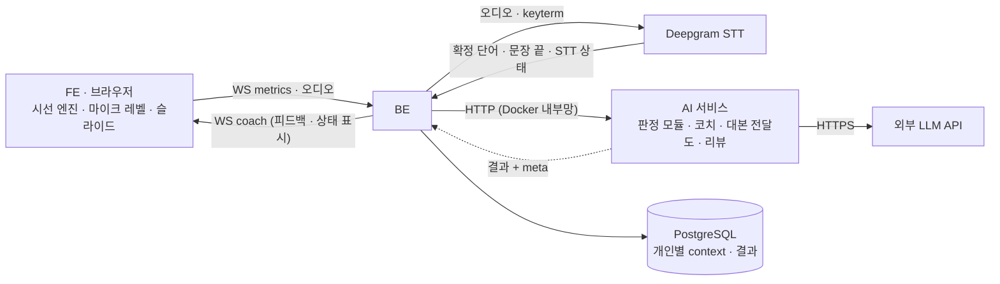
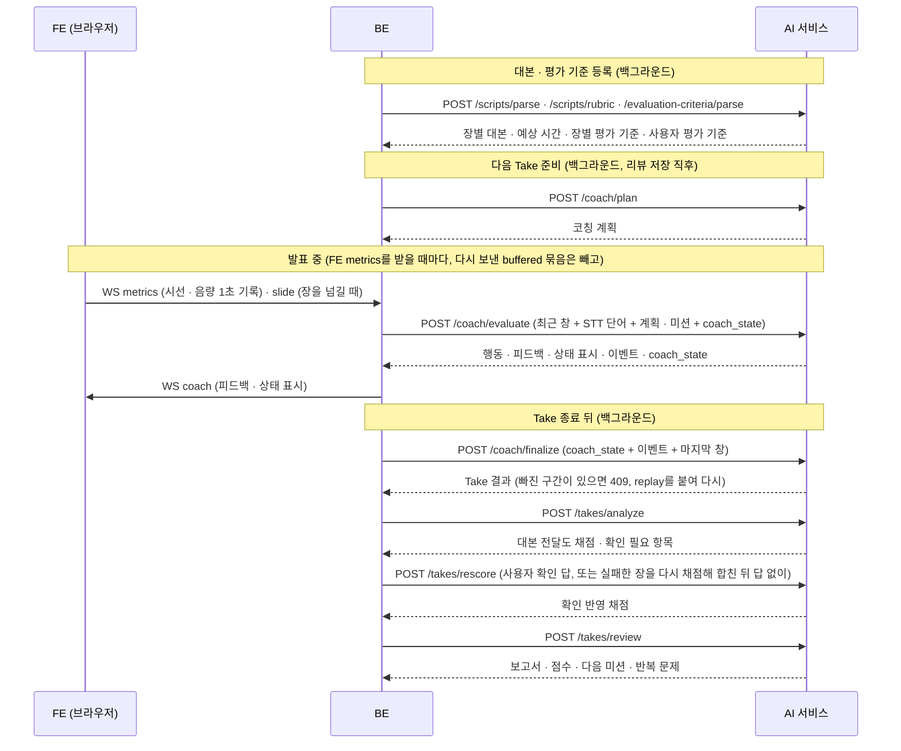

# 피치코치 아키텍처
> **이 문서는** 전체 기능 구성, 기능 사이 입출력 계약, 공통 데이터 모양, DB 저장 지도의 기준이다. 기능 문서(`features/<기능>.md`)나 서비스 문서(`ai-service.md`)와 다르면 이 문서가 이긴다. 이 문서를 바꾸면 모든 기능이 영향을 받으므로 12절의 승인 규칙을 따른다.
> **한 줄 요약**: BE만 AI를 부르고, AI는 아무것도 저장하지 않으며, 모든 판정 모듈은 같은 1초 판정 결과를 내고, 기능의 성공 응답은 `meta`를, 모든 에러는 `{"error": {"code", "message"}}`를 싣는다.
> **기준값**: 이 문서에 남은 숫자는 BE와 맞춰야 하는 통신 · 운영 값(시간 예산 · 창 길이 · 포트)과 예시뿐이다. 판정 기준값 · 아주 나쁨 값 · 판정 창 길이는 각 모듈 `config.py`에만 두고, 바꾸면 그 모듈의 `criteria_version`이 바뀐다. JSON 예시의 `<...>`는 실제 값이 들어갈 자리다.

# 0. 목적과 범위
이 문서는 피치코치 AI 기능 모두가 따르는 공통 흐름 · 통신 규칙 · 단위 · 1초 판정 결과 · 에러 · `meta` · 시간 예산 · 환경변수 · 저장 지도 · 담당을 정한다. 기능마다의 입력 · 출력과 처리는 각 기능 문서(`features/<기능>.md`, 13절 담당 지도)에 있다. 모든 기능이 올라가는 AI 서비스의 폴더 · 앱 구성 · 이미지 · compose · 운영은 서비스 문서 [ai-service.md](ai-service.md)에 있다.

| 이 문서에 있는 것 | 기능 문서에 있는 것 |
|---|---|
| 여러 기능 · 팀(FE · BE · AI)이 함께 지키는 모양과 규칙 | 그 기능의 요청 · 응답 필드, 처리 순서, 실패 처리, 배포, 품질 검증 |
| 공통 이름(영역 · 지표 · 문제 · 상태)의 목록 | 그 기능이 그 이름을 언제 어떻게 내는지 |
| 저장 지도(어느 테이블 · 칸을 어느 기능이 쓰고 읽는지 한 장으로) | 그 기능 결과의 칸 형식 · 크기 · 유일 제약 · 덮어쓰기 막기(12-1 · 12-2) |

## 0-1. 용어
| 용어 | 뜻 | 예 |
|---|---|---|
| Take | 발표 연습 한 번 | `take-123` |
| 발표(pitch) | 한 대본으로 여러 번 연습하는 단위. 미션 · 반복 문제 · 코칭 계획은 발표 안에서만 이어진다 | `p-1` |
| 판정 모듈 | 원자료로 한 영역의 상태를 1초마다 판정하는 모듈 | `gaze` · `pace` · `volume` · `filler` · `timing` |
| 에이전트 | 판정 결과를 모아 말하거나 결론을 내는 기능 | 코치 `coach` · 리뷰 `review` |
| 원자료 | 가공하지 않은 1초 측정 기록과 STT 기록 | 시선 1초 기록 `{t_ms, state, ...}` |
| 말한 1초 | 음량 1초 기록에서 `voiced_ms`가 기준 이상이고 `audio_live`가 true인 1초(6-2) | `voiced_ms: 820` |
| 1초 판정 결과 | 판정 모듈이 1초마다 내는 결과 하나(7절) | `JudgmentResult` |
| `tally` | 판정 모듈이 새로 센 몫(더할 수 있는 값). 코치가 장 · Take 합계에 더한다 | `{"script_ms": 1000}` |
| 커서 | 판정 모듈이 어디까지 셌는지 가리키는 시각. 시각 커서 · 단어 커서 두 가지 | `since_ms: 40000` |
| `coach_state` | 코치의 기억. 코치가 응답에 담아 내보내고 BE가 다음 요청에 그대로 붙인다 | `{"v": 2, "last_t_ms": 92000, ...}` |
| Take 결과 | Take가 끝난 뒤 코치가 만드는 사실 묶음(지표 · 문제 구간 · 개입 · 판정 기준) | `take_result` |
| keyterm | STT(Deepgram)에 "이 단어는 꼭 받아 적어라"고 넘기는 단어 목록 | 대본 용어 · 채움말 "음" |
| `meta` | 모든 AI 응답에 붙는 버전 · 모델 정보(5절) | `{"schema_version": "1.0", ...}` |

## 0-2. 판정 · 모음 · 결론을 나눈다
- **판정 기준은 기능이 갖는다.** 기준값 · 아주 나쁨 값 · 측정 가능 조건은 각 판정 모듈의 `config.py`에만 있다. 코치 · 리뷰 · FE · BE는 같은 판정을 다시 하거나 기준값을 따로 두지 않고, 기능이 낸 `issues` · `state` · `metrics`를 그대로 쓴다. 판정 기준을 한곳에서 관리하기 위해서다.
- **기능은 실시간 결과와 최종 결과를 같은 기준으로 낸다.** 실시간 결과는 1초마다 `judge`가 내는 1초 판정 결과이고, 최종 결과는 장 · Take 동안의 `tally` 합계로 `summarize`가 계산한 지표다. 기능은 최종 결과를 BE에 따로 보내지 않는다.
- **최종 결과는 코치가 모아 돌려준다.** 코치는 1초마다 각 기능의 `tally`를 장 · Take 합계에 더하고, Take가 끝나면(`/coach/finalize`) 기능별 `summarize`로 Take 결과 하나를 만든다. 대본 전달도만 Take 전체 발화가 있어야 해서 `/takes/analyze`가 따로 돌려준다.
- **결론은 리뷰가 낸다.** Take 결과는 사실(지표 · 문제 구간 · 개입 · 판정 기준)만 담는다. 차원 상태 · 점수 · 미션 판정 · 다음 미션 · 반복 문제는 리뷰가 낸다.
- **에이전트끼리 부르지 않는다.** 모두 BE가 부르고, 앞 단계의 결과는 BE가 저장한 것을 입력으로 받는다.
- **숫자는 입력에 있는 것만 쓴다.** LLM이 숫자를 계산하거나 만들지 않고, 코드가 LLM 출력의 숫자를 입력과 대조한다. 같은 값으로 보는 표기는 ① 비율과 퍼센트(0.62 ↔ 62% ↔ 62퍼센트. 단위 없는 62는 같은 값이 아니다) ② 시간 ms ↔ 초 ↔ 분(88000 ↔ 88초 ↔ 1분 28초. 이어 쓴 "N분 M초"는 한 값이다) ③ 보여 준 자리까지 반올림한 값(0.6248 ↔ 0.62 ↔ 62%) ④ 정수 개수 · 점수는 그대로이고, ⑤ 음수는 크기로 본다(`voice_diff_db` −1.5 ↔ "1.5dB 작게". "작게 · 줄었다" 같은 방향 말은 검사하지 않는다). 장 번호 · Take 번호 · 날짜는 입력에 있으면 입력에 있는 숫자로 본다. 한글로 쓴 수("세 번")는 검사하지 않으므로 프롬프트가 숫자를 아라비아 숫자로 쓰게 한다. 숫자 검사를 하는 리뷰는 이 규칙을 아래 예시 표(통과 · 걸림)로 계약 테스트한다(LLM 문장 속 숫자를 검사하는 기능이 더 생기면 같은 표를 쓴다. 모듈끼리 import하지 않으므로 공용 코드가 아니라 공용 규칙 · 공용 시험). 숫자는 정수 · 소수와 뒤에 붙은 단위(% · 퍼센트 · ms · 초 · 분 · 번 · 개 · 점 · 자 · dB, 퍼센트는 %와 같다)로 뽑고, 이어 쓴 "N분 M초"는 한 값으로 뽑는다. 검사에 걸렸을 때의 처리는 9절.

**숫자 검사 예시 표** (리뷰가 이 표로 계약 테스트한다)

| 입력 값 | 문장 속 숫자 | 판정 |
|---|---|---|
| `script_ratio` 0.6248 | 62% · 0.62 · 62퍼센트 | 같음 |
| `script_ratio` 0.6248 | 62 (단위 없음) · 63% | 다름 |
| `duration_ms` 88000 | 88초 · 1분 28초 | 같음 |
| `filler_count` 5 | 5번 | 같음 |
| `filler_count` 5 | 4번 · 6번 | 다름 |
| `voice_diff_db` −1.5 | 1.5dB ("평소보다 1.5dB 작게") | 같음 (음수는 크기) |
| `voice_diff_db` −1.5 | 3dB | 다름 |
| `slide_number` 3 | 3장 | 같음 |
| 없음 | 4장 (입력에 없는 장) | 다름 |
| — | 세 번 (한글 수) | 검사하지 않음 |

## 0-3. 두지 않는 것
| 두지 않는 것 | 이유 · 대신 하는 것 |
|---|---|
| FE · BE의 판정 | FE는 시선 · 음량을 1초 기록으로 재서 보내기만 하고 영역을 묶거나 문제를 고르지 않는다. BE는 군더더기를 판정하지 않는다. BE가 STT keyterm에 넣는 군더더기 단어는 군더더기 사전에서 keyterm 표시가 된 것만 가져온다 |
| AI의 저장 · BE 호출 | AI 서비스는 DB · Redis를 쓰지 않고 BE를 부르지 않는다. 필요한 값은 모두 요청으로 받는다 |
| 기능별 최종 결과 전송 | Take 값은 `/coach/finalize` 하나로 나온다 |
| Take 뒤 다시 분석 | 대본 전달도를 빼면 Take 값은 1초 판정의 `tally` 합계로만 만든다. 처음부터 다시 돌리는 것은 Take 중 합계를 잃었을 때의 복구(2절)와, 원자료 사용에 동의한 Take를 원자료로 다시 판정할 때(1-1 '원자료 사용 동의', `gaze-tracking.md` 12-2)뿐이다 |
| STT 중간 결과 | 확정 단어만 쓴다 |
| 발표 중 내용 누락 지적 | 내용 전달은 Take 뒤 대본 전달도가 채점한다 |
| 대본 의존의 LLM 판단 | 대본 의존은 시선의 `reading_ratio` · `reading_runs`로 잰다 |
| 기능 · 코치가 미션을 정하는 것 | 미션 · 반복 문제는 리뷰가 정하고, 코치는 읽어서 우선순위에만 쓴다 |
| 소리로 하는 피드백 | 피드백은 화면에 글자로만 띄운다. 소리를 내면 마이크에 들어가 STT · 음량 판정을 흐린다 |
| 발표 시작을 막는 LLM 호출 | 코칭 계획은 미리 만들어 두고, Take 시작 때 쓸 수 있는 계획이 없으면 계획 없이 시작한다 |
| 1초 판단의 LLM | 1초 판단은 규칙으로 하고, LLM은 다음 Take 준비의 코칭 계획에만 쓴다 |
| AI의 개인 기억 | AI는 사용자 · 발표 · Take 정보를 저장하지 않는다. 개인별 context는 BE가 저장하고 요청마다 싣는다(1-1) |

# 1. 전체 구성과 호출 흐름

1. **FE**는 재고 보여 주기만 한다. 시선 · 마이크 레벨을 브라우저에서 1초 기록으로 만들어 BE에 보낸다. 판정 · 피드백 문구는 모두 AI 응답에서 온다.
2. **BE**는 FE · Deepgram에서 받은 것과 저장해 둔 개인별 context를 모아 AI에 보내고, AI 응답을 저장하고, FE에 전달한다. 판정은 하지 않는다.
3. **AI**는 요청만 받는다. DB · Redis · FE · Deepgram을 모르고, 아무것도 기억하지 않는다. 같은 입력에는 같은 결과를 낸다(LLM 단계 제외).

**모듈 한눈에 보기** (계약을 바꾸면 '쓰는 곳' 모듈 담당을 PR 리뷰어로 지정한다)

| 모듈 | 언제 | 받는 것 | 내는 것 | 쓰는 곳 |
|---|---|---|---|---|
| `script_parser` | 대본 등록 · 수정 | 대본 원문, 발표 제한 시간 | 장별 `script` · `script_chars` · `keywords` · `expected_ms`, `terms` | 코치 계획 · 시간 판정, 코칭 계획, STT keyterm, 대본 전달도 |
| `evaluation_criteria` | 평가 기준 등록 · 수정 | 기준 문장 | `display_criteria` · `values`(대본 사용 설정 `values.script_used` 포함) · `targets` · `excluded` | 코치, 리뷰 |
| `gaze` | 발표 중 1초 | 시선 1초 기록, 발화 시간 | 1초 판정 (시선 상태 · 대본 응시 · 대본 의존) | 코치 → Take 결과 → 리뷰 |
| `filler` | 발표 중 1초 | STT 확정 단어, 문장 끝 신호 | 단어별 판정, 1초 판정 (빈도) | 말 속도, 코치 → Take 결과 |
| `pace` | 발표 중 1초 | STT 확정 단어, 군더더기 판정 | 1초 판정 (CPM · 멈춤) | 시간 판정, 코치 → Take 결과 |
| `volume` | 발표 중 1초 | 음량 1초 기록, 기준 음량 | 1초 판정 두 개 (`VOLUME` 음량 · `PAUSE` 침묵), Take 안에서 잡은 기준 음량 | 코치 → Take 결과 |
| `timing` (코치 안) | 발표 중 1초 | 계획, 지금 장, 장별 말한 글자 수, 말 속도 | 1초 판정 (진행 · 장 시간) | 코치 → Take 결과 |
| `script_coverage` | 대본 등록, Take 종료 뒤, 사용자 확인 뒤 | 장별 대본 / 장별 STT 텍스트 / 확인 답 | 장별 평가 기준 / 장별 · Take 채점, 확인 필요 항목 | 리뷰, FE 확인 화면 |
| `coach` | 다음 Take 준비, 발표 중, 종료 | 대본 · 미션 · 반복 문제 · 직전 Take, 1초 원자료 | 코칭 계획, 피드백 · 상태 표시 · 이벤트, Take 결과 | FE, 리뷰 |
| `review` | Take 종료 뒤 | Take 결과 · 대본 전달도 · 이전 Take · 미션 · 평가 기준 | 보고서 · 점수 · 차원 상태 · 미션 결과 · 다음 미션 · 반복 문제 | 리포트, 다음 Take 코치 |

## 1-1. 저장 지도 (DB)
AI는 개인 context를 저장하지 않는다. BE가 사용자 · 발표 · Take 단위로 저장하고, 에이전트를 부를 때 필요한 만큼 골라 요청에 싣는다. AI 기능 결과의 저장 설계(무엇을 · 어느 테이블 · 칸에 · 어떤 형식으로)는 AI가 하고, 마이그레이션 · 구현 · 운영은 BE가 한다(`backend/`는 BE 폴더라, 이것이 폴더 담당의 유일한 예외다 — 13절). 저장 모양도 계약이다(바꾸면 계약 변경).

이 표는 어느 테이블 · 칸을 어느 기능이 쓰고 읽는지의 지도다. 칸 형식 · 크기 · 유일 제약 · 덮어쓰기 막기는 '상세'의 기능 문서 12-1 · 12-2가 기준이다.

| 범위 | 담는 것 | 저장 위치 (테이블 · 칸) | 만드는 기능 | 읽는 기능 | 상세 |
|---|---|---|---|---|---|
| 사용자 | 계정, 사용자의 발표 목록, 원자료 사용 동의 설정 | `users`, `pitches.user_id`. 동의 설정을 담는 칸은 BE가 정한다 | BE (동의는 사용자 설정 화면에서 FE 입력) | — (AI 요청에는 싣지 않는다. 동의는 Take 시작 때 `takes.raw_data_consent`로 복사한다) | 아래 '원자료 사용 동의' |
| 발표 | 제한 시간 · 허용 범위 | `pitches` (`time_limit_sec` · `upper_deviation` · `lower_deviation`, 모두 초) | FE 입력 | 코치 `plan`의 `min_ms` · `max_ms`, 대본 파싱 `target_ms`, 코칭 계획 `plan.target_ms` | 초 단위 칸. AI 요청에는 ms로 바꿔 싣는다 |
| 발표 | 대본 · 장별 대본 · 예상 시간 · 용어 | `script_versions` (`parse_status` · `segmented` · `terms` · `parse_meta` · `parse_error`), `script_slides` (`full_content` · `keywords` · `highlights` · `script_chars` · `expected_ms`) | `/scripts/parse`. `parse_error`는 BE(같은 버전 재파싱 결과가 저장본과 다를 때, 1-7) | 코치 `plan.slides` · `scripts`, STT keyterm | [script-parser.md](features/script-parser.md) 12-1 |
| 발표 | 장별 평가 기준 (대본 전달도) | `script_slides.rubric` · `rubric_meta`, `script_versions` (`rubric_status` · `rubric_requested_at` · `rubric_retry_used`) | `/scripts/rubric`. 상태 · 작업 기록 칸은 BE(1-7) | `/takes/analyze` · `/takes/rescore`의 `rubrics` | [script-coverage-evaluation.md](features/script-coverage-evaluation.md) 12-1 |
| 발표 | 사용자 평가 기준 | `standards`, `standard_analyses` (버전마다 한 행) | `/evaluation-criteria/parse` | 리뷰 `user_criteria`, 코치 `script_used`. 둘 다 Take의 `takes.standard_version`이 가리키는 버전에서 만든다(1-3) | [evaluation-criteria.md](features/evaluation-criteria.md) 12-1 · 12-2 |
| 발표 | 미션 이력 · 상태 | `missions` (`pitch_id` 포함), `takes.mission_ids` (Take를 시작할 때 실은 미션 id 목록) | 리뷰 `next_missions` · `mission_results`, BE(Take 시작 때 `take_id` · `takes.mission_ids`) | 코칭 계획 · 코치 `missions`, 리뷰 `missions`(`takes.mission_ids`로 읽음) | [review-agent.md](features/review-agent.md) 12-1. 판정은 행의 `take_id`와 같은 Take의 리뷰만 덮는다(1-3) |
| 발표 | 반복 문제 | 그 발표에서 `REVIEW` 결과(`take_ai_results`)가 있는 Take 중 가장 늦게 끝난 Take(순서는 1-3 'Take 상태')의 리뷰의 `recurring_issues`. 가장 늦게 끝난 Take의 리뷰가 실패했거나 부르지 않았으면 그 앞 리뷰의 것을 쓴다(1-3 4번) | 리뷰 | 코칭 계획 · 코치 `recurring_issues`, 리뷰 `previous_recurring_issues` | [review-agent.md](features/review-agent.md) 12-1 |
| 발표 | 코칭 계획 (응답마다 한 행) | `coaching_plans` (기본 계획 포함, 응답마다 한 행) | `/coach/plan` | 코치 `coaching_plan`. Take를 시작할 때 바탕 값이 지금 것과 같은 행 중 `requested_at`이 가장 늦은 것만 싣는다 | [coach-agent.md](features/coach-agent.md) 12-1 · 12-2 |
| Take | 목표 시간 · 모드 · 대본 보기 | `takes` (`goal_time_sec` · `mode` · `script_mode`) | FE 입력 (Take를 만들 때) | 코치 `plan.target_ms` · `mode`, finalize `script_mode` | — |
| Take | Take를 시작할 때 고정하는 값 | `takes` (`mission_ids` · `standard_version` · `raw_data_consent`) | BE (Take 시작 때, 1-3 1번) | 리뷰 `missions`, 코치 `script_used` · 리뷰 `user_criteria`, 기준값 다시 고르기 · 원자료로 다시 판정하기(동의한 Take만) | 1-3, 아래 '원자료 사용 동의' |
| Take | Take 상태 · 분석 단계 · 재시도 기록 | `takes` (`status` · `analysis_stage` · `analysis_stage_at` · `review_status` · `analysis_hold_reason` · `completed_at` · `coverage_retry_used` · `coverage_rescore_retry_used` · `coverage_requested_at`) | BE | FE 분석 대기 · 리포트 화면, BE가 재시작할 때 이어 갈 작업 고르기 | 1-3 · 1-7, [script-coverage-evaluation.md](features/script-coverage-evaluation.md) 12-1 (재시도 기록 · 보류 사유) |
| Take | 발표 전 점검 | `calibrations` (`base_level_db` · `face_detected` · `mic_detected` · `gaze_confidence` · `result`) | FE 발표 전 점검 | 코치 `calibration` | [volume.md](features/volume.md) 12-1 (기준 음량), [gaze-tracking.md](features/gaze-tracking.md) 12-1 (보정) |
| Take | Take 결과 · 대본 전달도 확정 채점 · 리뷰 | `take_ai_results` (`take_id` · `kind` = `TAKE_RESULT` · `SCRIPT_COVERAGE` · `REVIEW` · `payload` · `meta` · `revision`) | `/coach/finalize` · `/takes/analyze` · `/takes/rescore` · `/takes/review` | 리뷰 `take_result` · `script_coverage` · `previous_takes`(`take_number`가 이번 Take보다 작은 `COMPLETED` Take 중 번호가 큰 3개), 코칭 계획 `previous_take_result` · `previous_review`(`source_take_id`의 것) | `(take_id, kind)`마다 하나. `revision`은 그 행의 `payload`를 바꾼 횟수다([script-coverage-evaluation.md](features/script-coverage-evaluation.md) 12-1). [coach-agent.md](features/coach-agent.md) · [script-coverage-evaluation.md](features/script-coverage-evaluation.md) · [review-agent.md](features/review-agent.md) 12-1 |
| Take | 대본 전달도 병합 후보 (BE 내부용) | `take_ai_results` (`take_id` · `kind`=`SCRIPT_COVERAGE_PENDING` · `payload`) | BE (재채점한 장을 최초 채점에 병합) | `/takes/rescore`의 복구 입력. FE·리뷰·결과 조회에는 확정 채점으로 제공하지 않는다 | [script-coverage-evaluation.md](features/script-coverage-evaluation.md) 12-1 · 12-2, 이 문서 1-7 |
| Take | 리포트 요약 | `take_summaries` (아래 대응 표, 값 칸은 모두 nullable) | BE (Take 결과 · 대본 전달도 · 리뷰에서) | FE 리포트 목록 · Take 비교 (에이전트는 읽지 않는다) | 아래 대응 표 |
| Take | 1초 원자료 (시선 · 음량 기록, 슬라이드 번호(참고값), STT 상태) | `take_metric_seconds` (`take_id` · `t_ms` · `slide_number` · `gaze` · `voice` · `stt_status`) | WS `metrics` | `/coach/finalize`의 `replay`, 기준값 다시 고르기(`takes.raw_data_consent`가 true인 Take만) | [coach-agent.md](features/coach-agent.md) 12-1 (복구용 원자료). 같은 1초가 또 오면 먼저 저장한 것을 둔다(6-2). 동의 없는 Take는 아래 '지우기 · 보관'대로 지운다 |
| Take | 장 변경 | `take_slide_events` (`take_id` · `slide_number` · `started_ms`) | WS `slide` | `/coach/evaluate`의 `inputs.slide`, `/coach/finalize`의 `replay.slides`, `/takes/analyze`의 장 구간 나누기 | [coach-agent.md](features/coach-agent.md) 12-1 (복구용 원자료) |
| Take | STT 확정 단어 · 확정된 시각 · 문장 끝 | `take_transcript_segments` (`words` · `final_at_ms`), `takes.utterance_ends` (Take 종료 때 한 번에 쓴다, 1-3 3번) | Deepgram | `/takes/analyze`(장별 텍스트), `replay` | [coach-agent.md](features/coach-agent.md) 12-1 (복구용 원자료) |
| Take | 코치 이벤트 (코치가 한 말 `INTERVENTION` 포함) | `coach_events`. `live_feedbacks`에는 쓰지 않는다 | `/coach/evaluate` · `/coach/finalize` | `/coach/finalize`의 `events`, 리포트 | [coach-agent.md](features/coach-agent.md) 12-1 · 12-2 |
| Take 진행 중 | 1초 창 · `coach_state` · 그 Take의 문장 끝 신호 | Take를 맡은 BE 프로세스 메모리 (BE를 여러 프로세스로 늘리면 Redis `coach_state:{take_id}` 등으로 옮긴다) | BE · 코치 | `/coach/evaluate`의 `inputs` · `coach_state` | [coach-agent.md](features/coach-agent.md) 12-1. Take가 끝나면 지운다(문장 끝은 그 전에 `takes.utterance_ends`에 쓴다) |

**리포트 요약 칸 대응** (`take_summaries`)

| 칸 | 값 |
|---|---|
| `average_cpm` | SPEED `cpm` (FE는 '분당 글자 수'로 보인다) |
| `filler_count` | FILLER `filler_count` |
| `audience_gaze` · `slide_gaze` · `script_gaze` | GAZE `audience_ratio` · `screen_ratio` · `script_ratio` × 100 (반올림) |
| `script_dependency_count` | GAZE `reading_runs` |
| `volume` | VOLUME `voice_diff_db` |
| `total_intermission` | SPEED `pause_count` |
| `speak_accuracy` | 대본 전달도 `content_coverage` × 100 |
| `overall_confidence` | Take 결과의 `GAZE` · `SPEED` · `VOLUME` · `PAUSE` · `FILLER` 다섯 영역 중 `measured_ratio`가 null이 아닌 영역의 평균 × 100. 다섯 모두 null이면 null |
| `summary` · `score` | 리뷰 `overall_summary` · `score` |

**반올림**: 비율 × 100으로 넣는 칸(`audience_gaze` · `slide_gaze` · `script_gaze` · `speak_accuracy` · `overall_confidence`), 개수 칸(`filler_count` · `script_dependency_count` · `total_intermission`), `takes.duration_sec`(Take 결과 `duration_ms` ÷ 1000)은 소수 첫째 자리에서 .5를 올려 정수로 저장한다(예: 62.5 → 63, 62.4 → 62). null은 그대로 null이다. `average_cpm` · `volume`은 받은 값 그대로 넣는다(`volume`은 칸이 소수 둘째 자리다).

`take_summaries`는 나눠 채운다. 측정 칸은 Take 결과를 저장할 때, `speak_accuracy`는 대본 전달도 뒤에, `summary` · `score`는 리뷰 뒤에 채운다. 그래서 리뷰가 늦거나 실패해도 리포트 목록에 측정값이 보인다. 아직 계산하지 않은 값과 잴 수 없던 값(`NOT_EVALUABLE`, 대본 전달도 실패)은 null이다. `score`는 모든 차원이 판단 불가면 null이고, 리뷰가 끝내 실패했으면(`takes.review_status` = `FAILED`) `summary` · `score` 모두 null이다(1-3).

**에이전트끼리의 공유**

| 에이전트 | 읽는 context (BE가 요청에 실어 줌) | 만드는 context (BE가 저장) |
|---|---|---|
| 코치 — 다음 Take 준비 | 대본 · 시간 계획, 미션, 반복 문제, 직전 Take 결과 · 리뷰 | 코칭 계획 |
| 코치 — 발표 중 · 종료 | 시간 계획, 미션, 반복 문제, 코칭 계획, 기준 음량, 대본 사용 설정, 대본 보기 | `coach_state`(Take 동안만), 코치 이벤트, 코치가 한 말, Take 결과 |
| 리뷰 | Take 결과, 대본 전달도 채점, 이전 Take 결과(최근 3개), 직전 반복 문제, 이번 미션, 사용자 평가 기준 | 리뷰 결과, 미션 결과 · 다음 미션, 반복 문제 |

- **공유 방식**: 개인별 context는 BE DB 한 곳에만 있고, 항목마다 만드는 곳은 하나다(저장 지도의 '만드는 기능'). 다른 에이전트는 BE가 요청에 실어 준 사본을 읽기만 한다. 그래서 두 에이전트가 같은 값을 다르게 고칠 일이 없다.
- **이어지는 범위는 발표 단위다.** 미션 · 반복 문제 · 코칭 계획 · 이전 Take 비교는 같은 발표 안에서만 이어진다. 다른 발표의 것은 가져오지 않는다(대본 · 목표 시간이 달라서).
- **원자료 사용 동의**: 1초 원자료(`take_metric_seconds`)를 Take가 끝난 뒤에도 남겨 다시 쓰는 것에 대한 동의다. BE는 사용자 설정(마이페이지)에서 한 번 받은 동의 값을 Take를 시작할 때(1-3 1번) `takes.raw_data_consent`(Boolean, NOT NULL, 기본 false)에 복사하고, 그 Take 동안과 뒤에는 이 칸만 본다. 그래서 동의를 철회하면 철회한 뒤에 시작하는 Take부터 적용된다(이미 끝난 Take의 값은 바뀌지 않는다). 동의가 거는 제한은 기준값 다시 고르기와 원자료로 다시 판정하기([gaze-tracking.md](features/gaze-tracking.md) 12-2) 두 가지뿐이다. Take 결과를 만드는 finalize와 `replay` 복구는 동의와 상관없이 한다.
- **지우기 · 보관**: 저장 지도의 AI 결과 · 원자료는 그 발표 · Take와 함께 보관하고 따로 기한을 두지 않는다. 예외는 동의 없는 Take(`takes.raw_data_consent` = false)의 `take_metric_seconds` 하나다.
  - 그 Take의 Take 결과(`TAKE_RESULT`)를 저장하는 트랜잭션에서 함께 지운다(Take 결과가 생기면 `replay`에 쓸 일이 없다).
  - Take가 `FAILED`로 끝나 Take 결과가 없으면 `takes.ended_at`(없으면 `takes.created_at`)부터 7일 동안 둔다(나중에 `replay`로 Take 결과를 다시 만들 수 있게). 7일이 지나면 BE의 주기 작업이 지운다. 지우기 직전에 그 Take가 아직 `FAILED`인지 다시 본다(그사이 다시 분석된 Take의 원자료를 지우지 않게).
  - 확정 전사(`take_transcript_segments`) · 문장 끝(`takes.utterance_ends`) · 장 변경(`take_slide_events`)은 동의와 상관없이 Take와 함께 보관한다. Take 뒤 분석(대본 전달도 장 구간 나누기)이 읽기 때문이다.
- **발표 · Take를 지울 때**: 사용자가 발표나 Take를 지우면 BE는 그 Take의 실시간 STT 연결을 바로 끊는다. 진행 중인지는 Take 상태가 아니라 STT 연결이 열려 있는지로 본다(탭을 닫고 떠나 `RUNNING`으로 남은 Take도 지울 수 있게). 그다음 저장 지도의 해당 행을 함께 지운다(`SCRIPT_COVERAGE_PENDING` · `take_slide_events` · 발표를 지우면 `coaching_plans` 포함). 백그라운드 작업(finalize · 채점 · 리뷰 · 계획)은 결과를 저장하기 직전에 그 Take(계획은 발표)가 아직 있는지 보고, 없으면 저장하지 않고 끝낸다. AI 쪽에는 지울 것이 없다.
- 1초 원자료는 얼굴 영상 · 랜드마크 같은 생체 정보가 아니라 시선 구역 · 음량 같은 파생값만 담는다. AI 로그에는 대본 · STT 원문을 남기지 않는다(11절).
- **크기**: JSON 칸(JSONB)에 DB 크기 제약은 두지 않는다. 기능 문서 12-1에 잰 크기를 적고, BE는 크기가 그보다 크게 벗어나면 로그로 남긴다.
- **모든 AI 결과는 `meta`와 함께 저장한다.** 결과가 어느 버전 · 모델에서 나왔는지 추적하기 위해서다.
- **`takes.event_logs`는 FE 화면 이벤트 기록용으로 둔다.** FE가 이 칸을 통째로 다시 쓰므로 코치 이벤트를 섞지 않는다.
- **스키마 변경**: 저장 지도의 테이블 · 칸 변경은 BE 마이그레이션으로 만들고, develop · release 배포 모두 새 이미지를 띄우기 전에 적용한다(11절).

## 1-2. API 목록과 호출 시점


| 시점 | API | AI 안에서 하는 일 | 돌려주는 것 | BE 호출 방식 | 다음에 쓰는 곳 |
|---|---|---|---|---|---|
| 대본 등록 · 수정 | `POST /scripts/parse` | 대본 파싱 | 장별 대본 · 키워드 · 예상 시간, 용어 | 백그라운드, LLM 1번 | 코치 계획, STT keyterm |
| 대본 등록 · 수정 | `POST /scripts/rubric` | 대본 전달도 평가 기준 만들기 | 장별 평가 기준 | 백그라운드, 장마다 LLM 여러 번 (장은 동시에 처리) | Take 종료 뒤 채점 |
| 평가 기준 등록 · 수정 | `POST /evaluation-criteria/parse` | 평가 기준 분석 | 표시 기준 · 숫자 목표 · 대본 사용 설정 | 요청 안 동기, LLM 1번 | 코치, 리뷰 |
| 리뷰 저장 직후(리뷰가 끝내 실패해도 `previous_review` null로), 대본 · 제한 시간이 바뀌었을 때 (첫 Take는 대본 파싱 직후) | `POST /coach/plan` | 코칭 계획 | 코칭 계획 | 백그라운드, LLM 1번. Take 시작은 기다리지 않는다 | 다음 Take 코치 |
| 발표 중 FE `metrics`를 받을 때마다 (`buffered: true`인 것은 빼고, 2절) | `POST /coach/evaluate` | 시선 · 말 속도 · 소리 크기 · 군더더기 · 시간 판정 → 코치 | 행동 · 피드백 · 상태 표시 · 이벤트 · `coach_state` | 동기, LLM 없음, 재시도 없음 | FE 화면, BE 저장 |
| Take 종료 뒤 | `POST /coach/finalize` | 남은 1초를 마저 세고, 합계 · 이벤트로 Take 결과 만들기 | Take 결과 | 백그라운드, LLM 없음 | 리뷰, 리포트 |
| Take 종료 뒤 | `POST /takes/analyze` | 대본 전달도 채점 | 장별 채점, 사용자 확인 필요 항목 | 백그라운드, 장마다 LLM 1–2번 | FE 확인 화면, 리뷰 |
| 사용자 확인 뒤 (확인할 것이 있을 때만), 실패한 장을 다시 채점해 합친 뒤 (답 없이) | `POST /takes/rescore` | 확인 답 · 합친 채점으로 Take 값 다시 계산 | 확인 반영 채점 | 동기, LLM 없음 | 리뷰 |
| 채점 · 확인이 끝난 뒤 (확인을 건너뛰거나 화면을 떠나거나 확인을 기다린 지 10분이 지나도, 1-3) | `POST /takes/review` | 리뷰 에이전트 | 보고서 · 점수 · 미션 결과 · 다음 미션 · 반복 문제 | 백그라운드, LLM 1번 | 리포트, 다음 Take 준비 |

## 1-3. Take 한 번의 순서 (BE 기준)
1. **Take 시작**: FE가 WS `/api/ws/takes/{take_id}`에 붙어 `auth`를 보낸다. BE는 Take 상태를 `RUNNING`으로 바꾸고 `ready`를 보낸다. Take 생성 때 저장한 `script_version_id`의 장별 대본을 읽고 코칭·채점·재계산에 같은 버전을 계속 사용한다(발표의 최신 버전으로 대신하지 않는다). 평가 기준 생성이 PENDING이면 생성 종료 후 같은 버전의 보존된 기준을 읽어 최초 채점에 사용하고, rescore에는 실제 채점에 쓴 기준을 그대로 싣는다. 이때 BE는 그 Take에 쓸 값 셋을 `takes`에 고정하고, 뒤에 발표의 값이 바뀌어도 이 칸은 바꾸지 않는다.
   - `mission_ids`: 실은 미션 id 목록(아래 '다음 Take가 먼저 시작되면').
   - `standard_version`(Integer, nullable): 그 발표의 최신 `standard_analyses` 버전 번호. 기준이 없으면 null이고, 그 Take는 끝까지 '기준 없음'이다(Take 도중이나 뒤에 기준을 등록해도 바꾸지 않는다). 코치 `script_used`와 리뷰 `user_criteria`는 이 버전에서 만든다(기준 없음이면 `script_used` null).
   - `raw_data_consent`: 사용자 설정의 원자료 사용 동의 값(1-1 '원자료 사용 동의').

   그리고 발표의 개인별 context(최신 미션 · 반복 문제, 1-1의 기준으로 고른 코칭 계획)와 Take의 목표 시간 · 모드 · 기준 음량을 읽어 Take 동안 들고 있는다. FE는 이어서 첫 장을 `slide`로 보낸다(1-4). 1초 루프는 WS 연결이 아니라 Take 단위로 돈다(새로고침이나 다른 탭 이어받기로 연결이 바뀌어도 이어진다).
2. **발표 중**: FE가 `metrics` · `slide`와 오디오 프레임을 보낸다.
   - BE는 `metrics`를 받을 때마다 창(시선 · 음량 30초, 확정 단어와 문장 끝 60초)을 갱신하고 1초 원자료를 쌓은 뒤 `/coach/evaluate`를 부른다. `buffered: true`인 `metrics`(다시 붙은 뒤 몰아 온 것)는 창 · 원자료에만 넣고 부르지 않는다(2절 '재연결 뒤 몰아 온 `metrics`').
   - 앞 요청의 응답을 받기 전에는 다음 요청을 보내지 않고(그동안 온 `metrics`는 창 · 원자료에만 반영하고 그 1초의 AI 호출은 건너뛴다. 쌓아 두었다가 보내지 않는다), 시간 제한을 넘겨 늦게 온 응답은 버린다(`coach_state`가 꼬이지 않게).
   - `slide`는 받는 대로 `take_slide_events`에 넣는다(`coach-agent.md` 12-1). 요청의 `inputs.slide`는 `started_ms`가 요청 `t_ms` 이하인 이벤트 중 가장 늦은 것의 `{number, started_ms}`다. `metrics.slide_number`는 참고값이라 장을 정하는 데 쓰지 않는다. 요청 사이에 장이 여러 번 바뀌면 중간 장은 실시간 판정에서 빠질 수 있다(알려진 한계. `replay` 없이 만든 Take 결과의 장별 값에서도 빠질 수 있다). 장 구간 나누기(`/takes/analyze`)와 `replay`에는 이벤트 전체를 넣는다.
   - 문장 끝 신호는 Take 동안 BE가 메모리에 들고 있다가 창에 싣고, DB에는 3번 ③에서 한 번에 쓴다(Take 동안 `takes` 행을 계속 고치지 않게).
   - 응답의 `coach_state`는 진행 중 상태에, `events`는 `coach_events`에 저장한다(`INTERVENTION`도 여기에만 둔다. `live_feedbacks`에는 쓰지 않는다). `COACHING` 모드에서 `INTERVENE`이거나 `indicators`가 바뀌면 FE에 `coach`를 보낸다(빈 `indicators`는 '바뀌지 않음'이라 보내지 않는다). 1초 원자료는 몇 초씩 모아 저장한다.
3. **Take 종료**: FE는 마지막 1초 조각을 실제 `duration_ms`로 담은 `metrics`를 보내고 `stop`을 보낸다(자동 종료면 BE가 `auto_end`를 보낸 뒤 같은 순서로 끝낸다, 1-4). BE는 순서대로 ① 새 `/coach/evaluate`를 보내지 않고, 진행 중인 요청은 시간 제한까지 기다려 응답을 반영하거나 버린다 ② Deepgram을 닫아 마지막 확정 단어를 받고, FE에 `stt_status: closed`를 보내 연결을 끝낸다 ③ 원자료 · 이벤트를 저장하고, Take 동안 들고 있던 문장 끝 신호를 `takes.utterance_ends`에 한 번에 쓰고, Take 상태를 `ANALYZING`, 분석 단계를 `FINALIZING`으로 바꾼다 ④ 그때의 `coach_state` · 이벤트 · 마지막 창으로 백그라운드 `/coach/finalize`를 부른다(409면 `replay`를 붙여 다시). 마지막 창의 `stt_status`에는 닫기 직전의 상태(정상 종료면 `ok`)를 싣는다. 그 뒤 Take 결과와 `take_summaries` 측정 칸을 저장하고(동의 없는 Take면 같은 트랜잭션에서 `take_metric_seconds`를 지운다, 1-1) 진행 중 상태를 지운다. Take 도중 BE가 재시작하면 메모리의 문장 끝 신호를 잃는다. 그 Take는 문장 끝 없이 `replay`로 판정되어 군더더기 · 코치의 문장 끝 판단이 부정확해진다(알려진 한계).
4. **Take 종료 뒤 (백그라운드)**: Take 결과를 저장하면 분석 단계를 `SCORING`으로 바꾸고, 확정 전사를 장 구간(`take_slide_events` 전체)으로 나눠 `/takes/analyze`를 부른다. 최초 200의 완전한 채점·요약을 먼저 저장하고, 1-7의 허용 오류 장만 1회 다시 채점한다. 새 성공 장이 있으면 병합 후보를 보존하고 답 없이 `/takes/rescore`로 Take 값을 다시 받는다. rescore가 끝내 실패하면 확정본과 후보를 보존하고 리뷰를 보류한다(아래 '리뷰 보류'). 허용된 호출이 모두 끝나도 확정본이 없으면(재시도하지 않는 입력 오류 포함) 확인을 건너뛰고 `speak_accuracy`는 null로 둔 채 `script_coverage` null로 리뷰한다(`script-coverage-evaluation.md` 7절).
   - 확인할 것이 있으면 분석 단계를 `AWAITING_CONFIRMATION`으로 바꾸고 FE 확인 화면을 띄운다. 답하면 `/takes/rescore`를 부르고, 건너뛰거나 화면을 떠나거나 `analysis_stage_at`부터 10분이 지나면 그대로 다음으로 간다.
   - 그다음 분석 단계를 `REVIEWING`으로 바꾸고 `/takes/review` → 리뷰 · `missions` · `take_summaries` 저장 → `/coach/plan` 순서로 간다. 확인 답은 리뷰를 부르기 전까지만 받는다(채점 · 리뷰 · 미션이 서로 다른 채점을 바탕으로 남지 않게).
   - 리뷰를 저장하면 분석 단계 `DONE` · `review_status` `DONE` · Take 상태 `COMPLETED` · `completed_at`(timestamptz, nullable. `COMPLETED` 전에는 null)을 그 시각으로 한 트랜잭션에서 바꾼다. 리뷰가 끝내 실패하면(재시도를 다 쓰고도 200을 받지 못했거나, 다시 부르지 않는 4xx를 받았으면) `review_status`만 `FAILED`로 하고 나머지는 같다. 이때 `/coach/plan`은 `previous_review` null과 이전 `ACTIVE` 미션 · 반복 문제로 부른다. Take 결과 · 대본 전달도는 있으므로 리포트의 측정값은 보인다. Take 결과를 만들지 못하면 Take 상태를 `FAILED`로 바꾼다.
5. **리포트**: FE는 BE에서 `take_summaries` · 리뷰 · Take 결과를 읽어 보여 준다. Take 상태가 `ANALYZING`이면 분석 중(`analysis_stage`로 어디까지 왔는지)이고, `COMPLETED`면 `review_status`로 리뷰가 있는지 본다.

**분석 단계 (`takes.analysis_stage` · `analysis_stage_at`)**: `analysis_stage_at`은 단계를 바꾼 시각(timestamptz, DB 시계)이다. 단계는 아래 순서로 앞으로만 바뀐다. 확인할 것이 없으면 `AWAITING_CONFIRMATION`을 건너뛰고, 리뷰를 부르지 않는 배포에서는 `REVIEWING`을 건너뛰어 `DONE`으로 간다(아래 'Take 상태').

| 단계 | 언제 바꾸나 | 다음 |
|---|---|---|
| `FINALIZING` | 3번 ③에서 Take 상태를 `ANALYZING`으로 바꿀 때 | Take 결과를 저장하면 `SCORING`. 만들지 못하면 Take 상태 `FAILED`(단계는 그대로) |
| `SCORING` | Take 결과를 저장하고 `/takes/analyze`를 부르기 전 | 확인할 것이 있으면 `AWAITING_CONFIRMATION`, 없으면 `REVIEWING`. 리뷰를 보류하면 그대로 둔다 |
| `AWAITING_CONFIRMATION` | 채점 결과에 확인할 것(`confirmations`)이 있을 때 | 답을 반영했거나, 건너뛰었거나, 화면을 떠났거나, 이 단계의 `analysis_stage_at`부터 10분이 지나면 `REVIEWING` |
| `REVIEWING` | `/takes/review`를 부르기 전(리뷰를 부르는 배포만) | `DONE` |
| `DONE` | 리뷰를 저장했거나, 리뷰가 끝내 실패했거나, 리뷰를 부르지 않는 배포에서 분석이 끝났을 때 | — |

**리뷰 상태 (`takes.review_status`)**: null = 아직 리뷰 전 · `DONE` = 리뷰를 저장함 · `FAILED` = 리뷰가 끝내 실패함 · `SKIPPED` = 리뷰를 부르지 않는 배포라 부르지 않음.

**리뷰 보류**: 병합 rescore가 허용된 재시도 뒤에도 실패하면(1-7) Take 상태는 `ANALYZING`, 분석 단계는 `SCORING`으로 두고 `takes.analysis_hold_reason`(String, nullable)을 `COVERAGE_RESCORE_FAILED`로 바꾼다. null은 보류가 아니라는 뜻이다. 사람이 정한 복구가 성공하면 null로 되돌리고 확인 · 리뷰로 이어 간다(1-7).

**BE가 재시작할 때**: BE는 시작할 때 Take 상태가 `ANALYZING`인 Take를 `analysis_stage`부터 이어 간다. `analysis_hold_reason`이 null이 아닌 Take는 빼고(사람의 복구를 기다린다), 재시도는 1-7의 재시도 기록 칸으로 남은 한도만 쓴다.
- `FINALIZING`: 진행 중 상태(`coach_state`)가 없으므로 `replay`를 붙여 finalize를 부른다(2절 '복구').
- `SCORING`: 앞 프로세스의 채점 작업 표식(`coverage_requested_at`, 1-7)을 이어받은 뒤 저장된 것을 보고 1-7의 다음 걸음부터 한다. 확정본(`SCRIPT_COVERAGE`)이 없으면 `/takes/analyze`를 남은 한도 안에서 부르고, 병합 후보(`SCRIPT_COVERAGE_PENDING`)가 있으면 analyze를 다시 부르지 않고 그 후보와 고정 rubric으로 병합 rescore를 남은 한도 안에서 부른다. `coverage_rescore_retry_used`가 이미 true인데 결과를 반영하지 못했으면 다시 부르지 않고 후보 · 확정본을 보존한 채 `COVERAGE_RESCORE_FAILED`로 보류한다. 확정본만 있으면 허용 오류 장이 남았고 `coverage_retry_used`가 false일 때만 부분 재시도를 하고, 아니면 확인 · 리뷰로 간다.
- `AWAITING_CONFIRMATION`: 그 단계의 `analysis_stage_at`부터 10분이 지날 때까지 확인 답을 기다린다(이미 지났으면 바로 리뷰로).
- `REVIEWING`: `/takes/review`를 다시 부른다.

- **다음 Take가 먼저 시작되면**: 리뷰 · 계획이 아직 없으면 그때 저장된 최신 미션 · 반복 문제를 쓴다. BE는 Take를 시작할 때 실은 미션(코칭 계획을 싣는지와 상관없이 그때의 최신 `ACTIVE` 미션)의 id 목록을 `takes.mission_ids`에 고정하고, 리뷰는 이 목록으로만 그 Take의 미션을 읽는다. 그래서 리뷰 전에 다음 Take가 시작돼 `missions.take_id`가 바뀌어도 앞 Take의 리뷰가 미션을 찾는다. 같은 `ACTIVE` 미션이 두 Take에 실리면 `missions.take_id`는 나중 Take로 바뀌고, 그 행의 `status` · `observed`는 `take_id`와 같은 Take의 리뷰만 덮는다(앞 Take의 판정은 그 리뷰의 `mission_results`에 남는다). 미션 내용(목표 · 설명)은 Take에 실린 뒤에는 바꾸지 않는다. 목록의 미션이 지워졌으면 리뷰는 그 미션을 판정하지 않고 건너뛴다(`review-agent.md` 12-1). 코칭 계획은 `coaching_plans`에서 바탕 값(`source_take_id` · `script_version_id` · 제한 시간)이 지금 것과 같은 행 중 `requested_at`이 가장 늦은 것을 싣고, 없으면 null로 시작한다(`coach-agent.md` 12-2).
- **Take 상태**: `READY` → `RUNNING`(WS 연결) → `ANALYZING`(종료) → `COMPLETED`(리뷰 저장, 또는 리뷰가 끝내 실패함) 또는 `FAILED`. `FAILED`는 Take 결과를 만들지 못했을 때와, BE가 사용자가 떠난 Take를 끝냈을 때(`takes.end_reason` `CLOSED` 창을 닫음 · `ABANDONED` 끊긴 채 돌아오지 않음)다. 떠난 Take는 Take 결과를 만들지 않는다. 언제 떠난 것으로 보고 언제 되살리는지는 [Take 연결 문서](../be/take-lifecycle.md) 0절이다. 분석 단계는 위 표다. 리뷰를 부르지 않는 배포에서도 필요한 분석이 끝나고 미해결 `SCRIPT_COVERAGE_PENDING`이 없을 때 `COMPLETED`(`review_status` `SKIPPED`, 분석 단계 `DONE`, `completed_at` 채움)로 둔다. 후보가 남으면 1-7에 따라 `ANALYZING`을 유지한다. 오디오는 `READY` · `RUNNING`일 때만 받는다. '가장 늦게 끝난 Take'(코칭 계획의 바탕 Take · 반복 문제를 읽을 리뷰)는 `completed_at DESC NULLS LAST, take_number DESC` 순서의 첫 Take다(칸을 만들기 전에 끝나 `completed_at`이 null인 Take는 뒤로 가고, 같은 시각이면 번호가 큰 것).
- **Take 최대 길이는 1시간이다.** BE가 말 없음 · 최대 1시간으로 Take를 자동 종료하고(종료 흐름은 3번과 같다. 종료 이유는 WS `auto_end`로 FE에 알린다, 1-4), AI 요청의 `t_ms` 상한(3,660,000 ms = 1시간 + 60초 여유)이 이 값에 맞춰져 있다. 자동 종료 없이 1시간 1분을 넘기면 `/coach/evaluate` · `/coach/finalize`가 422로 거절되어 Take 결과를 만들 수 없다. 한 시간 Take의 복구(`replay`)가 `replay`를 붙인 finalize의 시간 제한(60초, 3절) 안에 드는 것도 이 길이 기준이다.

## 1-4. FE ↔ BE 메시지 (WebSocket `/api/ws/takes/{take_id}`)
BE와 FE 사이의 계약이고, AI 입력의 출처라 여기에 둔다. BE가 경로 앞에 `/api`를 붙이고, Caddy는 `/api/*`만 BE로 넘긴다.

| 방향 | 메시지 | 내용 |
|---|---|---|
| FE → BE | `auth` | `{type, token}`. 연결 인증 |
| FE → BE | 바이너리 오디오 프레임 | `[seq u32 LE][offset_ms u32 LE][PCM s16le 16kHz mono]`. `offset_ms`는 Take 시작 기준이라 STT 단어 시각과 1초 기록이 같은 시간축이 된다 |
| FE → BE | `metrics` | `{type, t_ms, gaze, voice, slide_number, buffered}`. 1초마다 시선 · 음량 1초 기록(6-2), 지금 슬라이드 번호(참고값. 장은 `slide`로 정한다, 1-3), 잴 수 없으면 null. `stop` 직전에 마지막 1초 조각을 한 번 더. `buffered`는 선택 bool이고 없으면 false다. 끊긴 동안 쌓아 둔 `metrics`를 다시 붙은 뒤 보낼 때만 true로 붙인다(2절) |
| FE → BE | `slide` | `{type, slide_number, t_ms}`. `t_ms`는 그 장으로 넘어온 Take 시각(ms)이다. 보내는 때: Take 시작(1번 장, `t_ms: 0`) · 장을 넘길 때마다 · 새로고침이나 다른 탭에서 이어 갈 때(이어받은 장과 그 장으로 넘어온 원래 시각). 끊긴 동안 넘긴 장은 `metrics`처럼 쌓아 두었다가 다시 붙으면 시각 순서대로 보낸다. 늦게 와도 `t_ms`는 실제로 넘긴 시각이다. 한 1초 안에 여러 번 넘겨도 넘길 때마다 보낸다 |
| FE → BE | `stop` | `{type}`. Take 종료 |
| BE → FE | `ready` | `{type, take_id, stt_session_no, stt_state}`. 받을 준비가 됨 |
| BE → FE | `transcript` | `{type, segment_id, is_final, speech_final, start_ms, end_ms, text, confidence, words}`. 실시간 자막 |
| BE → FE | `stt_status` | `{type, state, stt_session_no, frames, dropped_frames, silence_ms, lost_ms}`. `state`는 `connecting` · `ok` · `reconnecting` · `degraded` · `closed` |
| BE → FE | `coach` | `{type, t_ms, action, feedback, indicators}`. `COACHING` 모드에서 말을 걸 때와 상태 표시가 바뀔 때만 |
| BE → FE | `auto_end` | `{type, reason, message}`. BE가 Take를 자동으로 끝낼 때(1-3). `reason`은 `SILENCE`(오래 말이 없음) · `TIME_LIMIT`(1시간), `message`는 FE가 그대로 보여 줄 한국어 문장이다. BE는 보낸 뒤 `stop`을 받은 것과 같은 순서로 Take를 끝낸다(1-3 3번). 끝난 Take에 FE가 다시 붙으면 한 번 더 보낸다 |
| BE → FE | `error` | `{type, code, message}` |

```json
{
  "type": "metrics",
  "t_ms": 41000,
  "gaze": {"t_ms": 40000, "duration_ms": 1000, "state": "BOTTOM", "direction": null, "confidence": 0.83, "reliability": 0.95, "issues": [], "frames": 12},
  "voice": {"t_ms": 40000, "duration_ms": 1000, "level_db": -31.2, "voiced_ms": 820, "silence_ms": 0, "audio_live": true},
  "slide_number": 3
}
```
```json
{"type": "slide", "slide_number": 4, "t_ms": 59390}
```
```json
{
  "type": "coach",
  "t_ms": 92000,
  "action": "INTERVENE",
  "feedback": {"area": "GAZE", "instruction": "LOOK_AT_CAMERA", "message": "대본보다 청중을 조금 더 바라보세요", "priority": 72, "confidence": 0.86},
  "indicators": {"GAZE": "SCRIPT", "SPEED": "NORMAL", "VOLUME": "NORMAL", "PAUSE": "NORMAL", "FILLER": "NORMAL", "TIME": "ON_TRACK"}
}
```

## 1-5. 기능 값이 에이전트로 들어가는 길
| 기능 값 | 코치 (발표 중) | Take 결과 | 리뷰 |
|---|---|---|---|
| 대본 파싱: 장별 `expected_ms` · `script_chars` · `script` | 계획의 장별 목표 → 시간 판정, 코칭 계획 | 장별 목표 시간 | 장별 시간 비교 |
| 시선 1초 판정 | 시선 지적, 상태 표시, 개입 효과 | `audience_ratio` · `script_ratio` · `reading_ratio` · `reading_runs` … | `audience_gaze` · `script_independence` |
| 말 속도 1초 판정 | 속도 지적, 상태 표시, 시간 판정의 진행도 | `cpm` · `pause_count` | `pacing_rhythm` |
| 소리 크기 1초 판정 (`VOLUME` · `PAUSE`) | 음량 · 침묵 지적, 상태 표시 | `voice_diff_db` · `low_ratio` · `base_level_source` · `long_silence_count` | `vocal_delivery` · `pacing_rhythm` |
| 군더더기 1초 판정 | 군더더기 지적, 말 속도 글자 수에서 제외 | `filler_count` · `filler_per_min` · 단어별 횟수 | `fluency` |
| 시간 1초 판정 | 늦음 · 빠름 · 장 초과 · 마무리 지적, 상태 표시 | `duration_ms` · 장별 `slide_duration_ms` | `pacing_rhythm` |
| 기능별 판정 기준 (`criteria()`) | — | `criteria` (그 Take를 판정한 기준), 문제 구간 되돌리기 | 근거 설명 |
| 대본 전달도 | — | — | `content_delivery`, 장별 빠진 내용 |
| 평가 기준 분석 | `script_used`면 대본 응시를 지적하지 않음 | — | 사용자 기준 판정 (`targets` · `script_used`) |

**리뷰 → 다음 Take**: 리뷰의 `next_missions`는 다음 Take의 `missions`, `recurring_issues`는 다음 Take의 `recurring_issues`와 다음 리뷰의 `previous_recurring_issues`가 되어 코칭 계획 · 코치의 우선순위 · 다음 리뷰에 들어간다. `recurring_issues` 항목은 `{area, slide_number, dimension}`이고(`review-agent.md` 5-3) BE는 항목을 고치지 않고 그대로 싣는다. `GAZE` 한 영역에 차원이 둘이라 다음 리뷰는 `dimension`으로 반복된 차원을 찾고, 코치는 `area` · `slide_number`만 쓴다. `next_missions`에는 `mission_id`가 없다. BE가 `missions`에 저장하며 붙이고, 다음 Take의 코칭 계획·실시간 코치 요청에는 `{mission_id, area, slide_number, target}`과 저장된 `priority`·`description`을 선택으로 싣는다. `priority`가 없으면 1이고 명시적 null은 허용하지 않는다. `description`은 누락·null 모두 설명 없음으로 처리하며 영역·대상·목표를 사용한다. 리뷰가 설명을 500자 이하로 내고 `/coach/plan`의 요청 검증은 문자열 설명이 500자(Python `len`의 코드 포인트 수)를 넘으면 422 `VALIDATION_ERROR`로 거절한다. 이 AI 계약은 그대로이고, BE는 부르기 전에 500자를 넘는 미션의 `description`만 빼고(빼면 설명 없음으로 처리된다) 부를 수 있다. 빼지 않고 불러 422를 받으면 그 Take는 계획 없이 코칭한다. evaluate·finalize에 plan의 길이 제한을 확대하지 않는다. 현재 연구 코치의 PlanRequest에는 이 500자 검사가 없으므로 서비스에 붙일 때 구현·확인한다. 현재 planner는 priority를 LLM 입력에 싣지 않으며 이 문서 정비로 새 순위 알고리즘을 추가하지 않는다.

## 1-6. 기능별 연결 (FE · BE · AI · DB)
| 기능 | FE | BE | AI | DB · 진행 중 상태 |
|---|---|---|---|---|
| 대본 파싱 | 대본 입력 · 수정 (REST), 파싱 상태 폴링 | 대본 버전을 저장하고 백그라운드로 AI를 부른다. 결과로 장별 대본을 저장하고 STT keyterm(대본 용어 `terms`와 군더더기 사전의 keyterm 단어)을 만든다. AI의 `status: fail`(장을 나누지 못함)은 처리 실패가 아니므로 처리 상태는 `DONE`, `segmented`는 false로 둔다 | `/scripts/parse` | `script_versions` (`parse_status` · `segmented` · `terms`), `script_slides` (장별 대본 `full_content` · `keywords` · `highlights` · `script_chars` · `expected_ms`) |
| 대본 전달도 평가 기준 | — | 새 대본 버전의 파싱 결과를 저장한 뒤 처음 한 번 모든 장으로 부른다. 같은 버전의 성공 기준·meta는 보존한다. 첫 생성의 허용 오류 장만 `slide_numbers`로 1회 다시 부른다(3절·1-7) | `/scripts/rubric` | `script_slides.rubric` (장별 평가 기준), `script_versions` (`rubric_status` · `rubric_requested_at` · `rubric_retry_used`) |
| 평가 기준 분석 | 평가 기준 입력 (REST) | 요청 안에서 AI를 부르고(DB 세션을 쥐지 않고 기다린다), 표시 기준과 응답 전체를 버전으로 저장 | `/evaluation-criteria/parse` | `standards` (표시 기준 한 줄씩), `standard_analyses` (버전마다 `values` · `targets` · `script_used` · `excluded`) |
| 발표 전 점검 | 얼굴 · 마이크 확인, 시선 보정, 평소 목소리를 읽게 해 기준 음량(Leq, dBFS) 측정 (REST) | 저장하고, Take 동안 `/coach/evaluate`의 `calibration`으로 싣는다 | — | `calibrations` (`base_level_db` · `face_detected` · `mic_detected` · `gaze_confidence` · `result`) |
| 시선 | 브라우저 엔진으로 1초 기록을 만들어 WS `metrics.gaze` | Take 진행 중 창에 쌓아 `/coach/evaluate`에 싣고, 1초 원자료로 보관 | `gaze.judge` (`/coach/evaluate` 안) | 진행 중 창, `take_metric_seconds.gaze` |
| 소리 크기 · 침묵 | 마이크 레벨로 1초 기록을 만들어 WS `metrics.voice` (시선 기록과 같은 `t_ms`) | 시선과 같음 | `volume.judge` | 진행 중 창, `take_metric_seconds.voice` |
| STT (말 속도 · 군더더기 · 시간 · 대본 전달도의 입력) | WS 바이너리 오디오 프레임. 받은 `transcript` · `stt_status`로 자막 · 연결 상태 표시 | Deepgram에 넘긴다(keyterm). 확정 단어 · 문장 끝 · STT 상태를 Take 기준 ms로 창에 쌓아 `/coach/evaluate`에 싣는다 | `filler` · `pace` · `timing` judge, `/takes/analyze` | 진행 중 창, `take_transcript_segments` (확정 단어 `words`와 확정된 시각), `takes.utterance_ends` (Take 종료 때 한 번에) |
| 슬라이드 | WS `slide` (Take 시작 · 장을 넘길 때마다 · 이어 갈 때, 1-4). `metrics.slide_number`는 참고값 | `take_slide_events`에 저장하고, 요청 시각 이하의 가장 늦은 이벤트를 `inputs.slide`로 싣는다. 종료 뒤 이벤트 전체로 확정 전사를 장 구간으로 나누고 `replay.slides`를 만든다(1-3) | `timing.judge`, `/takes/analyze` | `take_slide_events` |
| 실시간 코칭 | WS `coach`를 받아 피드백(글자) · 상태 표시 | FE `metrics`를 받을 때마다(`buffered`는 빼고) `/coach/evaluate`. `coach_state`는 진행 중 상태로, 이벤트(`INTERVENTION` 포함)는 `coach_events`로. `COACHING` 모드에서 `INTERVENE`이거나 상태 표시가 바뀌면 WS `coach` | `/coach/evaluate` | 진행 중 `coach_state`, `coach_events` |
| Take 결과 | 종료 (WS `stop`, 자동 종료면 `auto_end`를 받음) | Deepgram을 닫아 마지막 확정 단어를 받고 FE에 `closed`를 보낸 뒤, 백그라운드로 `/coach/finalize`(마지막 창 포함, 409면 `replay`를 붙여 다시) | `/coach/finalize` | `take_ai_results` (`TAKE_RESULT`), `takes.duration_sec` · `analysis_stage`, `take_summaries` 측정 칸 |
| 대본 전달도 채점 · 확인 | 확인 화면에서 항목마다 `as_script` · `as_stt` 답 (REST) | 백그라운드로 `/takes/analyze`를 부른다. 최초 성공본을 저장하고 허용 오류 장만 1회 다시 채점하며, 새 성공 장이 있을 때만 병합 후보를 보존하고 답 없이 `/takes/rescore`로 Take 값을 받는다(1-7). rescore가 끝내 실패하면 확정본·후보를 보존하고 리뷰를 보류한다. 확인할 것이 있으면 FE에 알리고, 답을 받으면 `/takes/rescore`. 답은 리뷰를 부르기 전까지만 받고(채점 · 리뷰 · 미션이 서로 다른 채점을 바탕으로 남지 않게), 같은 답이 두 번 오면 한 번만 반영한다 | `/takes/analyze` · `/takes/rescore` | `take_ai_results` (`SCRIPT_COVERAGE`, rescore 성공 때만 확정본 교체하고 `revision`을 올림; `SCRIPT_COVERAGE_PENDING`, 병합 후보), `take_summaries.speak_accuracy`, `takes` (`coverage_retry_used` · `coverage_rescore_retry_used` · `analysis_hold_reason` · `coverage_requested_at`) |
| 리뷰 | 리포트 화면 (REST 조회) | 채점 · 확인이 끝나면(확인을 건너뛰거나 화면을 떠나거나 확인을 기다린 지 10분이 지나도) 백그라운드로 `/takes/review`. 리뷰 · 미션을 저장하고 `take_summaries`의 `summary` · `score`를 채운다(미션 판정은 행의 `take_id`가 이 Take일 때만 덮는다. 끝내 실패하면 1-3) | `/takes/review` | `take_ai_results` (`REVIEW`), `take_summaries`, `missions`, `takes` (`review_status` · `completed_at`) |
| 다음 Take 준비 | — | 리뷰를 저장한 직후(리뷰가 끝내 실패해도 `previous_review` null로) 백그라운드로 `/coach/plan`. 응답마다 한 행을 넣는다 | `/coach/plan` | `coaching_plans` |

## 1-7. 평가 기준 보존과 장별 재시도·병합 (BE 기준)

**대본 버전과 평가 기준**
- 새 버전의 유효한 파싱 결과를 저장한 뒤 모든 장으로 첫 `/scripts/rubric` 작업을 시작한다. 원문은 버전 안에서 바꾸지 않는다. 저장된 유효한 장별 파싱 결과가 없는 최초 파싱 실패의 유효한 복구 응답은 비교 대상 부재로 구분해 최초 결과로 저장한다. 유효한 저장본이 있으면 전체 장 번호·대본 비교 규칙을 적용한다. 기준 생성 이력이 없을 때만 첫 생성 작업을 시작하며 기존 작업의 호출·재시도 한도·성공 기준·meta·종료 상태는 초기화하지 않는다. AI의 `status: fail`만으로 최초 파싱 실패 복구 대상으로 판단하지 않는다.
- 재파싱 요청의 유효성을 확인하고 저장된 전체 `(slide_number, script)`와 새 결과를 번호순으로 비교한다. 문자열은 추가 정규화 없이 비교한다. 장 추가·삭제·번호·대본이 같으면 기존 기준을 재사용하고, 다르면 새 결과를 적용하거나 rubric을 부르지 않고 새 버전 등록을 사람에게 안내한다. 이때 그 버전의 `script_versions.parse_error`(String, nullable. null은 차이 없음)를 `REPARSE_MISMATCH`로 남긴다(`script-parser.md` 12-1). 자동으로 새 버전을 만들지 않는다. 유효성 확인·비교·적용은 원자적으로 하고 기존 Take의 버전 참조는 유지한다.
- 버전별 생성 작업은 하나만 실행한다. BE는 `script_versions.rubric_status`를 null에서 `PENDING`으로 바꾸는 조건부 갱신(`UPDATE … SET rubric_status = 'PENDING', rubric_requested_at = now() WHERE id = :id AND rubric_status IS NULL`)이 한 행을 바꿨을 때만 작업을 시작한다. `rubric_requested_at`(timestamptz)은 그 작업을 가리키는 표식이다. 최초 호출과 허용 재시도가 같은 한도를 사용하고, 재시도를 보내기 전에 `rubric_retry_used`(Boolean, NOT NULL, 기본 false)를 true로 저장한다(BE가 재시작해도 같은 재시도를 다시 보내지 않게). 버전·장별 첫 성공 rubric과 그 응답의 meta를 한 트랜잭션에서 조건부 저장한다. 조건은 그 버전이 아직 `PENDING`이고 `rubric_requested_at`이 작업을 시작할 때의 값과 같은 것이다. 이미 성공한 기준·meta는 다시 만들거나 덮지 않는다. 생성·재시도를 마치면 상태를 `DONE`(모든 장 성공) · `PARTIAL`(실패한 장이 남음) · `FAILED`(모든 장 실패)로 확정한다. `PENDING`이 아닌 버전이나 표식이 바뀐 버전에 늦게 도착한 출력은 반영하지 않고 버린다. BE가 재시작해 `PENDING`인 버전을 이어 갈 때는 `rubric_requested_at`을 새 시각으로 바꾸는 조건부 갱신(`… WHERE rubric_status = 'PENDING' AND rubric_requested_at = :읽은 값`)이 한 행을 바꿨을 때만 이어 가고, 그 뒤의 재시도 기록 · 출력 저장 · 상태 확정에도 새 표식과 `PENDING`을 조건으로 건다(앞 작업의 늦은 출력은 표식이 달라 버려진다). 이어받기는 BE가 시작할 때 하므로, BE 프로세스가 하나인 지금 구성에서는 앞 작업이 이미 끝난 것이다. BE를 여러 프로세스로 늘리면 이어받기 전에 앞 실행자가 끝났는지 확인하는 방법을 함께 정한다(표식 교체만으로는 두 프로세스가 차례로 이어받는 것을 막지 못한다). 이어 갈 때는 `rubric_retry_used`로 남은 한도만 쓰고, 한도를 이미 썼으면 다시 부르지 않고 저장된 장별 기준으로 `DONE` · `PARTIAL` · `FAILED`를 확정한다.
- Take 생성 때 저장한 `script_version_id`를 코칭·채점·재계산에 계속 사용한다. rescore의 rubrics는 저장된 채점에 실제 사용한 기준이며, 같은 rubric_id의 새 출력으로 대신하지 않는다.

**한 번의 장별 재시도**
- 최초 200의 failed에서 `LLM_TIMEOUT`·`LLM_ERROR`·`LLM_INVALID_OUTPUT`·`LLM_UNAVAILABLE`인 장만 slide_numbers로 1회 부른다. 전체 문맥 입력은 그대로 보내고 대상 번호만 고른다. `RUBRIC_MISSING` 같은 알려진 입력 오류 장은 제외한다. 성공 결과·입력 오류 실패는 보존하며 재시도 대상만 교체한다. 부분 재시도가 에러·무응답이면 최초 응답을 보존한다.
- 최초 호출이 모든 장 실패의 408·429·5xx 또는 무응답이면 failed 목록을 알 수 없으므로 전체 1회 재시도를 유지한다. subset과 전체 재시도는 같은 작업의 1회 한도를 공유하며 전송할 때 한도를 사용한다. 전체 재시도 뒤 subset 추가 호출이나 subset 실패 뒤 전체 호출을 하지 않는다. AI 내부 재시도·rescore 재시도는 별도 규칙이다(3절).
- 한도를 썼는지는 DB에 남긴다. 평가 기준 만들기는 위 `rubric_retry_used`, Take 채점은 `takes.coverage_retry_used`(Boolean, NOT NULL, 기본 false)이고, 둘 다 재시도를 보내기 전에 true로 저장한다. BE가 재시작하면 이 칸으로 남은 한도만 쓴다.

**최초 채점과 병합 후보**
- 최초 호출 또는 허용된 전체 재시도에서 처음 받은 200의 완전한 payload·meta와 요약을 확정본으로 저장한다. 전체 재시도에서 받은 200의 failed에는 추가 재시도를 하지 않는다. Take별 최초 analyze와 허용 재시도는 하나의 작업으로 실행한다. 최초 저장도 Take별 직렬화에 포함하고, 확정본이 없으며 응답이 유효하고 리뷰 전일 때만 조건부 저장한다. 중복·시간 제한을 넘긴 응답으로 기존 확정본·meta·요약을 덮지 않는다. 새 성공 장을 최초 evaluations에 합치고, 남은 failed 전체와 처음 채점에 쓴 rubric을 rescore에 보낸다. Take별 병합·확인 답·리뷰 전환은 직렬화하고 입력 저장본이 최신이며 리뷰 전일 때만 반영한다. 기존 확인 답을 보존한다.
- Take별 채점 작업은 `takes.coverage_requested_at`(timestamptz, nullable. 그 작업을 시작한 시각이자 표식)을 잡은 작업 하나만 한다. BE는 `SCORING`이고 보류가 아니며 표식이 null이거나 BE가 정한 기한(지금 10분)보다 오래됐을 때만 조건부 갱신으로 표식을 잡는다. 재시도 기록 · 확정본 저장 · 후보 저장 · 병합 반영 · 보류 · 단계 전환은 표식이 같을 때만 반영하고, 작업이 끝나면(단계 전환 · 보류) 표식을 비운다. BE가 다시 뜨면 앞 프로세스의 표식을 기한과 관계없이 이어받는다(평가 기준 이어받기와 같은 한계: BE를 여러 프로세스로 늘리면 앞 실행자가 끝났는지 확인하는 방법을 함께 정한다).
- rescore 전에 `take_ai_results`의 같은 take_id·별도 kind `SCRIPT_COVERAGE_PENDING`에 후보를 보존한다. payload는 `{script_version_id, base_revision, evaluations, failed, retry_meta}`다. `base_revision`은 후보를 만들 때 읽은 확정본(`SCRIPT_COVERAGE` 행)의 `revision`이고, retry_meta는 재채점 응답 meta다. 후보의 버전은 Take의 저장 버전과 같아야 한다. 후보를 저장할 때도 확정본의 `revision`이 `base_revision`과 같은지 확인한다. `revision`과 payload의 형식은 `script-coverage-evaluation.md` 12-1이다.
- 후보 저장으로 기존 확정 payload·meta·요약을 바꾸지 않는다. 후보는 BE 내부 복구용이며 FE·리뷰·Take 결과 조회에 확정 채점으로 제공하지 않는다. 후보 보관·삭제는 기존 Take 결과와 같고 대본·STT 원문을 로그에 남기지 않는다.
- 확인 답 rescore는 병합 후보 없이, 요청을 만들 때 읽은 확정본의 `revision`이 반영할 때도 같은지(최신성) · 요청 유효성 · 리뷰 전 조건을 확인해 반영한다.
- 병합·확인 rescore도 응답 반영 시 요청 유효성을 확인한다. 시간 제한을 넘겼거나 종료된 요청의 늦은 응답은 확정본 교체·후보 삭제·리뷰 재개에 사용하지 않는다.
- 병합 후보를 확정하는 rescore가 성공하면 확정본의 `revision`이 후보의 `base_revision`과 같을 때만 확정본·meta·요약 교체(`revision`은 1 올림)와 후보 삭제를 한 트랜잭션으로 한다(조건부 갱신은 `script-coverage-evaluation.md` 12-2). 병합 rescore의 재시도는 보내기 전에 `takes.coverage_rescore_retry_used`(Boolean, NOT NULL, 기본 false)를 true로 저장한다. 허용 재시도 뒤에도 실패하면 기존 확정본·후보를 보존하고 리뷰를 보류한다(`ANALYZING` 유지, `takes.analysis_hold_reason` = `COVERAGE_RESCORE_FAILED`, 1-3). BE가 재시작할 때 보류된 Take는 이어 가지 않는다. 사람이 결정한 복구 작업은 후보와 고정 rubric으로 LLM 없는 rescore부터 재개하고 원래 재시도 한도를 임의로 리셋하지 않는다(재시도 기록 칸을 false로 되돌리지 않는다). 복구가 성공하면 `analysis_hold_reason`을 null로 되돌린다.

# 2. 통신 규칙
| 규칙 | 내용 | 이유 |
|---|---|---|
| BE만 AI를 부른다 | FE는 AI를 부르지 않는다. AI는 BE를 부르지 않고 DB · Redis를 쓰지 않는다. 필요한 값은 모두 요청으로 받고, 돌려준 값은 BE가 저장한다 | AI를 상태 없이 두어 재시작 · 워커 증설에도 결과가 같게 하고, 저장 · 재시도 판단을 BE 한 곳에 모은다 |
| AI는 내부망에만 | AI 서비스는 Docker 내부망 `http://ai:8000`에서만 받는다. 인증이 없으므로 서버 포트를 열거나 Caddy 경로를 만들지 않는다 | 내부망 격리가 유일한 보호다. 다른 서버로 옮기게 되면 그때 서비스 간 인증(공유 토큰 등)을 붙인다 |
| 경로에 버전이 없다 | `/v1` 같은 접두어 없이 `/coach/evaluate`처럼 부른다. 필드 이름은 snake_case | BE 하나만 부르는 내부 API다. 버전은 `meta.schema_version`으로 알린다 |
| 요청 ID | BE는 요청마다 `X-Request-ID` 헤더를 보낸다. 같은 요청을 다시 부를 때(3절의 재시도)는 처음과 같은 값을 쓰고, 409 뒤 `replay`를 붙인 호출처럼 본문이 다른 요청은 새 값을 쓴다. AI는 이 값을 로그에 남기고 응답 헤더로 그대로 돌려준다. 헤더가 없으면 AI가 만든다 | BE 로그와 AI 로그를 같은 요청으로 묶어 보고, 재시도를 같은 요청으로 알아본다 |
| 계약의 원본은 코드 | 요청 · 응답 형식은 각 기능 `schemas.py`의 pydantic 모델이다. 실행 중인 서비스의 `/docs`에서 보고, 첫 기능 엔드포인트부터 `contracts/openapi.json`으로 생성해 커밋한다 | 문서와 코드가 어긋나지 않게 생성한다 |
| 모르는 필드 | 입력 모델은 모르는 필드를 무시하고, 출력 모델은 정해진 필드만 낸다. BE도 응답의 모르는 필드를 무시한다 | 한쪽이 선택 필드를 먼저 더해도 깨지지 않는다 |
| 발표 중 FE → BE | 1초마다 WS `metrics` 메시지 1개, 장이 바뀔 때마다 WS `slide` 메시지(1-4). `metrics`는 시선 1초 기록과 음량 1초 기록, 지금 슬라이드 번호(참고값)를 담는다. 잴 수 없는 값은 null이다. 바깥 `t_ms`는 그 1초가 끝난 시각이고, `gaze.t_ms` · `voice.t_ms`는 그 1초가 시작한 시각이다. 음량 기록은 시선 기록과 같은 `t_ms`로 만든다. `stop` 직전에는 마지막 1초 조각을 실제 `duration_ms`로 한 번 더 보낸다. 새로고침 · 재연결 뒤에도 `t_ms`는 Take 시간축을 이어 간다(되돌아간 `t_ms`는 코치가 `STALE_TICK`으로 건너뛴다) | 두 기록을 1초 단위로 맞춰 쓰고, Take 끝의 짧은 조각도 센다 |
| STT (BE) | Deepgram 한국어는 채움말(음 · 어)을 기본으로 지우고 군더더기를 남기는 설정이 없다. 그래서 군더더기 사전에서 keyterm 표시가 된 단어를 대본 용어(`terms`)와 함께 keyterm으로 넘긴다. keyterm에는 개수 · 길이 한도가 있어, 넘치면 `terms`의 뒤쪽(덜 중요한 용어)부터 뺀다. BE는 확정 단어(단어별 시작 · 끝 시각), 문장 끝 신호(Deepgram이 말이 끝났다고 알린 시각), STT 연결 상태를 Take 기준 ms로 들고 있다가 요청에 싣는다 | 군더더기 판정과 말 속도에 채움말이 전사에 남아야 한다 |
| 발표 중 BE → AI | FE의 `metrics`를 받을 때마다(`buffered: true`인 것은 빼고, 아래 줄) `/coach/evaluate`를 **한 번만** 부른다. 기능마다 따로 부르지 않는다. 요청의 `t_ms`는 그 `metrics`의 `t_ms`이고 3,660,000 ms 이하여야 한다(Take 최대 1시간에 60초 여유, 1-3. 넘으면 422 `VALIDATION_ERROR`). 지난 응답이 처리한 시각보다 정해진 시간(60초) 넘게 앞선 요청은 코치가 처리하지 않고 기억을 새로 시작하므로(200 `WAIT` · `T_MS_JUMP`, `coach-agent.md` 5-2), BE는 따로 처리하지 않고 응답의 `coach_state`를 평소처럼 붙인다. 요청에는 최근 창(시선 · 음량 30초, STT 확정 단어와 문장 끝 신호 60초), Take 동안 바뀌지 않는 값(계획 · 미션 · 반복 문제 · 코칭 계획 · 기준 음량 · 대본 사용 설정), 지난 응답의 `coach_state`를 싣는다 | 창 길이는 BE와의 통신 규약이고, 각 기능의 판정 창은 이 안에서 `config.py`로 정한다. 시선 판정이 같은 30초의 발화 시간을 쓰므로 음량도 30초다 |
| 재연결 뒤 몰아 온 `metrics` | FE는 연결이 끊긴 동안 `metrics` · `slide`를 최대 5분 치 쌓아 두었다가, 다시 붙으면 시각 순서대로 보낸다. 다시 보내는 `metrics`에는 `buffered: true`를 붙인다. BE는 `buffered: true`인 `metrics`를 창 · 원자료에만 넣고 `/coach/evaluate`를 부르지 않는다. 표시가 없는 다음 실시간 `metrics`에서 평소처럼 부른다(그 요청의 창에 몰아 온 값이 들어 있으므로 묶음의 끝을 따로 알리지 않는다). 몰아 보낸 직후 `stop`이 오면 finalize의 마지막 창이 그 값을 센다. 공백이 60초를 넘으면 코치가 기억을 새로 시작하고(`T_MS_JUMP`), 창(30초)보다 길면 종료 때 `replay`로 복구된다 | 받을 때마다 부르면 이미 지난 시각으로 코칭하고 지난 개입을 FE에 보내게 된다 |
| AI가 없을 때 (`/coach/evaluate`) | evaluate가 연결 거부 · 404 · 503이면 BE는 10초 동안 evaluate를 부르지 않는다. 그동안 `coach_state`는 그대로 두고, 창 · 원자료는 계속 쌓는다. 10초가 지난 뒤 오는 `metrics`부터 평소처럼 부른다(그 사이가 60초를 넘으면 위 `T_MS_JUMP`대로 이어진다) | AI 재시작 · 배포 중에 1초마다 실패할 요청을 보내지 않는다 |
| 창은 겹쳐 보낸다 | 한 번 실패해도 빠진 1초는 다음 요청에 실려 간다. AI는 이미 센 것을 다시 세지 않는다. 1초 기록과 시간 합계는 시각 커서로, STT 단어는 센 단어 `end_ms` 중 가장 큰 값(단어 커서, 7절)으로 가리고, 두 커서는 `coach_state`에 있다. 같은 요청을 두 번 보내도 상태는 한 번만 바뀐다 | STT 단어는 말한 뒤 늦게 확정되므로 요청 시각으로 거르면 빠지거나 두 번 센다 |
| `coach_state`는 BE가 해석하지 않는다 | Take 동안 가장 최근 것 하나만 보관해 다음 요청에 그대로 붙이고, Take가 끝나면 지운다 | 코치의 기억 모양이 바뀌어도 BE를 고치지 않는다. 닫힌 문제 구간 · 개입은 이벤트로 나가므로 크기는 Take 길이에 따라 크게 늘지 않고, 장마다 남는 값만 장 수에 비례해 는다 |
| 이벤트는 BE가 쌓는다 | 응답의 `events`를 받은 순서대로 저장하고, Take 종료 때 `/coach/finalize`에 그대로 넘긴다 | 이벤트 id는 종류와 대상으로 만들므로, 같은 이벤트가 두 번 저장돼도 코치가 걸러 낸다 |
| 발표 중 BE → FE | 코치가 말을 걸 때와 상태 표시가 바뀔 때 WS `coach` 메시지를 보낸다. `EXAM` 모드에서는 보내지 않는다 | 실전 모드는 실전처럼 화면에 아무것도 띄우지 않는다 |
| Take 종료 | BE는 Deepgram을 마무리해 마지막 확정 단어까지 받은 뒤 `/coach/finalize`에 마지막 창(`inputs`)과 Take 동안 바뀌지 않는 값을 `/coach/evaluate`와 같은 모양으로 보낸다 | 코치가 Take 끝 시각을 STT 모듈에 `take_end_ms`로 넘겨(문장 끝 신호에 섞지 않는다, 7절) 보류한 단어까지 판정해, 아직 세지 않은 1초 · 단어를 마저 더한다(말은 걸지 않는다) |
| 복구 | BE는 Take 동안 1초 원자료(시선 · 음량 기록과 그 1초의 STT 상태, STT 확정 단어와 각 단어가 확정된 시각, 문장 끝 신호, 장 변경 `take_slide_events`)를 보관한다. 확정된 시각은 BE가 그 확정 결과를 받기 직전의 마지막 `metrics.t_ms`이고, `replay`의 모양과 첫 시각 규칙은 `coach-agent.md` 5-2 · 12-1이다. 응답이 창보다 오래 빠졌거나 상태를 새로 시작해 Take 합계가 Take 전체를 덮지 못하면 `/coach/finalize`가 409 `REPLAY_REQUIRED`를 돌려준다. BE는 원자료 전체(`replay`)를 붙여 다시 부른다. `coach_state`를 잃었으면 처음부터 `replay`를 붙인다 | 단어가 확정된 시각이 있어야 복구할 때 단어를 원래 들어온 순서대로 다시 넣을 수 있다 |
| AI 응답을 BE 형식으로 바꾸는 곳 | BE의 AI 호출 코드 한 곳에서만 한다 | AI 응답 모양이 바뀌어도 BE는 그 한 곳만 고친다 |

# 3. 시간 예산과 재시도
API마다 요청 하나의 시간 예산이 있다. AI는 LLM 호출 한 번마다 시간 제한을 두고, 남은 예산 안에서만 한 번 더 시도한다(9절). 장별로 LLM을 부르는 API는 예산 안에 끝내지 못한 장을 실패로 돌려준다.

| 호출 종류 | API | AI 예산 | BE 시간 제한 | BE 재시도 |
|---|---|---|---|---|
| 실시간 | `/coach/evaluate` | — | 약 300 ms | 없음 (다음 1초 요청이 대신한다) |
| LLM 없음 | `/coach/finalize` · `/takes/rescore` | — | 10초. `replay`를 붙인 `/coach/finalize`만 60초(복구는 Take 길이만큼 다시 판정하므로. 줄이는 것은 복구 성능을 고친 뒤 따로 승인받는 계약 변경으로 한다) | 연결 실패 · 시간 초과 · 408 · 429 · 5xx면 1번. finalize는 409면 `replay`를 붙여 1번 더 부르고, 그 `replay` 호출도 일시 오류면 1번 다시 부른다(두 횟수는 따로 센다). `replay`를 붙였는데도 409면 실패로 끝낸다 |
| 요청 안 동기 LLM | `/evaluation-criteria/parse` | 25초 | 30초 | 없음. FE가 다시 시도를 안내한다 |
| 백그라운드 LLM | `/scripts/parse` · `/coach/plan` · `/takes/review` | 25초 | 30초 | 연결 실패 · 시간 초과 · 408 · 429 · 5xx면 1번 |
| 백그라운드 장별 LLM | `/scripts/rubric` · `/takes/analyze` | 120초 | 130초 | 최초 200의 `failed` 중 `LLM_TIMEOUT` · `LLM_ERROR` · `LLM_INVALID_OUTPUT` · `LLM_UNAVAILABLE`인 장만 1번. 최초 408 · 429 · 5xx 또는 무응답이면 전체 1번. subset·전체가 같은 작업의 1회 한도를 공유한다. 다시 부른 뒤에는 더 부르지 않는다(1-7) |

- **AI 예산을 BE 시간 제한보다 짧게 둔다.** AI는 처리가 끝난 뒤 응답을 한 번에 보내므로 BE 시간 제한이 사실상 AI 처리 시간 전체의 상한이다. 넘으면 BE가 끊고 다시 불러 LLM 호출이 두 배가 된다. AI 예산은 라우터가 요청을 받은 때부터 응답을 보낼 때까지이고(요청 마감 시각 하나를 모든 LLM 호출이 같이 쓴다, 9절), 스레드를 기다린 시간 · 네트워크는 BE 시간 제한과의 차이(5 · 10초)가 맡는다.
- **입력 오류는 다시 부르지 않는다.** 4xx는 다시 불러도 같다. 예외는 408 · 429와 409 `REPLAY_REQUIRED`다. `/coach/finalize`의 409는 `replay`를 붙여 한 번 다시 부른다.
- **동기 API(평가 기준 분석)는 BE가 다시 부르지 않는다.** AI가 이미 한 번 더 시도했으므로, BE까지 다시 부르면 사용자가 두 배로 기다린다.
- **`/coach/evaluate`는 한 Take에서 한 번에 하나만.** 앞 요청의 응답을 받기 전에는 다음 요청을 보내지 않고, 늦게 온 응답은 버린다(`coach_state`가 꼬이지 않게).
- **백그라운드 호출은 BE가 동시 개수를 제한한다.** 코치 plan · finalize, Take 분석, 대본 등록(`/scripts/rubric`), 리뷰를 BE 전체 합계로 센다(권장 4. BE 프로세스를 늘리면 합계가 넘지 않게 나눈다). 그 안에서 `/scripts/rubric`은 동시에 2개까지다(요청 하나가 장마다 LLM을 동시에 12개 부르기 때문, `script-coverage-evaluation.md` 8절). 넘는 요청은 실패시키지 않고 BE에서 기다린다. 긴 LLM 요청이 AI의 스레드 풀(40)을 채우면 1초마다 오는 `/coach/evaluate`가 시간 제한을 넘긴다(`ai-service.md` 8절).
- **출력이 긴 기능**은 출력 길이에 비례해 오래 걸린다. 기능 PR에서 실제 데이터로 걸린 시간을 재서 LLM 호출 한 번이 시간 제한 안에 끝나는지 확인한다.
- **요청 하나의 시간**: `/coach/evaluate`는 BE 시간 제한 안에 여유 있게 끝나야 한다. 판정 모듈은 1초 판정에 LLM · 네트워크를 쓰지 않고, LLM은 대본 · 평가 기준 등록, 다음 Take 준비, Take 종료 뒤 분석에만 쓴다.

# 4. 에러 본문과 상태 코드
BE는 성공 · 실패를 상태 코드로 가르고, 에러 본문은 로그에만 남긴다. 200 응답에서는 `fallback_reason`(코칭 계획 · 리뷰)과 `failed`(장별 API)만 본문에서 읽는다.

| 상황 | 상태 코드 | `error.code` | BE가 다시 부를까 |
|---|---|---|---|
| 요청 형식이 스키마와 다름 | 422 | `VALIDATION_ERROR` | 아니오 |
| 형식은 맞지만 기능이 처리할 수 없는 입력 | 422 | 기능이 정한 코드 (예: `INSUFFICIENT_TRANSCRIPT`) | 아니오 |
| `/coach/finalize`에 빠진 구간이 있는데 `replay`가 없음 | 409 | `REPLAY_REQUIRED` | 예, `replay`를 붙여 1회 |
| 없는 경로 · 허용되지 않는 메서드 | 404 · 405 | `NOT_FOUND` · `METHOD_NOT_ALLOWED` | 아니오 |
| LLM 시간 초과 | 504 | `LLM_TIMEOUT` | 3절 표를 따름 |
| LLM 호출 실패 | 502 | `LLM_ERROR` | 3절 표를 따름 |
| LLM 출력이 스키마와 다름 | 502 | `LLM_INVALID_OUTPUT` | 3절 표를 따름 |
| LLM 설정 없음 · LLM이 일시적으로 받지 않음 | 503 | `LLM_UNAVAILABLE` | 3절 표를 따름 |
| 모델 로딩 중 | 503 | `NOT_READY` | 3절 표를 따름 |
| 처리되지 않은 예외 | 500 | `INTERNAL_ERROR` | 3절 표를 따름 |

```json
{"error": {"code": "LLM_TIMEOUT", "message": "LLM 응답 시간이 초과되었습니다"}}
```
- **에러 본문**: 모든 에러는 `{"error": {"code": "...", "message": "..."}}` 하나로 돌려준다. `message`는 사람이 읽는 한국어 설명이다. 내부 예외 내용(stack trace)은 응답에 넣지 않고 AI 로그에만 남긴다.
- **재시도 기준**: 4xx는 재시도하지 않는다(408 · 429와 409 `REPLAY_REQUIRED` 제외). 5xx · 408 · 429 · 연결 실패 · 시간 초과는 3절 표의 'BE 재시도'를 따른다.
- **LLM이 실패해도 200인 기능**: 코칭 계획 · 리뷰는 LLM이 실패해도 기본 결과를 200으로 돌려주고 `fallback_reason`(`LLM_*`)을 단다(9절). BE는 이 응답을 정상 결과로 저장한다. 리뷰 다시 부르기는 선택이다(부르지 않아도 계약은 맞다). 부를 때는 `fallback_reason`이 있는 리뷰만, 다음 Take가 시작되기 전(그 Take의 `takes.mission_ids`를 고정하기 전)에만 한 번 부른다. 같은 입력이라 규칙 단계 결과(점수 · 상태 · 미션 판정)는 같지만 문장과 다음 미션 고르기는 LLM이 하므로, 200이 오면 `REVIEW` 결과 · `take_summaries.summary` · 그 리뷰가 만든 `ACTIVE` 미션을 새 결과로 바꾸고 `/coach/plan`을 다시 부른다. 계획 응답은 요청마다 `coaching_plans`에 한 행씩 쌓이고, 다음 Take에는 바탕 값이 같은 행 중 `requested_at`(요청을 보낸 시각)이 가장 늦은 것을 싣는다(`coach-agent.md` 12-2). 그래서 같은 Take로 만든 계획 요청이 둘 이상이어도 먼저 보낸 요청의 응답이 늦게 와서 새 계획을 대신하는 일이 없다. 저장 직전에 다음 Take가 이미 시작됐으면 새 결과를 버리고, 다시 불러도 `fallback_reason`이 오면 처음 결과를 그대로 둔다(다음 Take가 시작된 뒤에는 실린 미션이 바뀌지 않게). 그래서 다음 Take의 시작(`takes.mission_ids` 고정)과 다시 부른 리뷰의 결과 저장은 같은 발표 행을 먼저 잠가 하나씩 하고, 잠근 뒤에 다음 Take가 시작됐는지 다시 본다.
- **장별 API**: 한 장이라도 성공하면 200이고, 실패한 장은 `failed[{slide_number, error{code, message}}]`에 담긴다. 모든 장이 실패하면 에러 상태 코드다. 장마다 실패 원인이 다르면 다시 부를 수 있는 오류(LLM 5xx)를 먼저, 그중에서는 장 번호가 가장 작은 장의 오류를 돌려준다. 모든 장이 입력 오류(422)일 때만 422다. BE는 최초 200에서 네 LLM 오류 코드의 장만 `slide_numbers`로 1회 다시 부른다(1-7). 알려진 입력 오류 장과 성공 장은 다시 부르지 않는다. 최초 에러·무응답에는 3절의 전체 1회 규칙을 적용한다. 재채점 실패가 최초 성공본을 지우지 않도록 1-7의 저장·병합 절차를 따른다.
- **실시간 코치의 내부 예외는 에러가 아니다.** `/coach/evaluate`는 코치 안의 예외를 200 `WAIT`(`INTERNAL_ERROR` 이유 코드)로 돌려준다. 발표 중에 멈추지 않기 위해서다(`coach-agent.md` 7절). 지난 처리 시각보다 크게 앞선 요청도 에러가 아니라 200 `WAIT`(`T_MS_JUMP`)이고, `t_ms`가 상한(1-3)을 넘은 요청만 422 `VALIDATION_ERROR`다.

# 5. meta와 버전 체계
기능의 성공 응답(200)은 결과 필드 옆에 `meta`를 싣는다. 결과 필드는 기능마다 다르다. 에러 응답은 `error` 객체만 싣고(4절), `/health`는 `{"status": "ok"}`만 돌려준다.
```json
{
  "<기능 결과 필드>": "...",
  "meta": {
    "schema_version": "1.0",
    "feature_version": "<모듈>-<버전>",
    "criteria_versions": {"<모듈>": "<모듈>-<버전>+<config 해시 12자리>"},
    "model": "<실제로 응답한 모델 이름, LLM을 쓰지 않았으면 null>"
  }
}
```
| `meta` 필드 | 뜻 | 언제 오르나 |
|---|---|---|
| `schema_version` | 응답 모양의 버전 | 필드 이름 변경 · 삭제 · 뜻 변경처럼 BE가 깨지는 변경을 할 때 |
| `feature_version` | `features/<기능>/version.py`의 값, `<모듈>-<버전>` 꼴 (예: `gaze-1.1`, `coach-1.2`) | 같은 입력에 대한 결과의 의미가 바뀔 때 (프롬프트 · 모델 · 판단 규칙 변경 포함) |
| `criteria_versions` | 판정이 들어간 응답만. 기능별 `criteria_version` = `<feature_version>+<config 해시 12자리>`. 코치 · 리뷰는 자기 규칙의 버전(`coach` · `review`)도 싣는다 | 기준값(`config.py`)을 바꾸면 해시가 바뀐다 |
| `model` | 실제로 응답한 LLM 모델. 예비 모델로 넘어갔으면 예비 모델 이름. 결과가 LLM 출력이 아니라 기본 결과(코칭 계획 · 리뷰의 `fallback_reason`)면 null이다(응답한 모델과 토큰 수는 로그에 남는다) | 호출마다 |

- **서비스(이미지) 버전**은 커밋 SHA다(이미지 태그 `ai-<sha>`, 11절).
- BE는 결과와 `meta`를 같이 저장한다. DB에 쌓인 결과가 어느 버전 · 모델에서 나왔는지 알기 위해서다.
- BE는 응답 `meta.schema_version`의 major(점 앞 숫자, `1.0`이면 `1`)가 BE가 아는 값과 다르면 그 호출을 실패로 보고 다시 부르지 않는다(필드 이름 · 뜻이 바뀐 응답을 잘못 읽지 않게). 그래서 major를 올리는 AI 배포는 BE 호출 코드의 변경과 같이 한다(12절).
- 판정 응답의 `criteria_versions`가 Take 도중 바뀌면(배포) 코치가 Take 결과에 `criteria_changed: true`를 단다.

# 6. 공통 단위와 이름
## 6-1. 단위
- **시간**은 ms, Take 시작이 0이다. 1초 기록의 `t_ms`는 그 1초의 **시작** 시각이다. 1초 격자는 FE 시선 엔진의 첫 프레임에서 시작하므로 `t_ms`가 1000의 배수가 아닐 수 있다(예: `59390`).
- **비율 · 신뢰도**는 0–1이다. **음량**은 A 가중 dBFS(0 이하)다. **말 속도**는 CPM이다: 공백 · 문장부호 · 군더더기를 뺀 글자 수 ÷ 단어 발화 시간(분). **글자 수**는 공백과 문장부호(유니코드 P 범주: 쉼표 · 마침표 · `%` 등)를 뺀 코드 포인트 수다. 대본 파싱 `script_chars`와 말 속도 `chars`가 같은 정의라 시간 판정의 장 진행 비율(말한 글자 ÷ `script_chars`)이 맞는다(STT 단어에는 문장부호가 없다).
- **이름**: 필드는 snake_case, 고정 값은 대문자 snake_case(`GAZE_ON_SCRIPT`), 경로에 버전을 붙이지 않는다.
- **모드**: `COACHING`(코칭) · `EXAM`(실전, 말하지 않고 기록만). Take를 만들 때 FE가 정한 값을 그대로 쓴다.
- **대본 보기**: `HIGHLIGHT` · `KEYWORD` · `OFF`(발표 화면에 대본을 어떻게 보여 줬나). 판정은 바꾸지 않고 Take 결과에 남긴다.
- **장 번호** `slide_number`는 1부터다. 장이 없는 값(Take 전체 미션 · 반복 문제 · 개선점 · 장이 없는 이벤트)은 null로 둔다. 0을 "전체"로 쓰지 않는다.
- **글자 위치**: 대본 속 글자 위치(예: 대본 파싱의 `highlights`)는 유니코드 코드 포인트 기준(Python 문자열 위치)이고 `[start, end)`다. JS 문자열(UTF-16)에서 쓸 때는 위치를 바꿔 쓴다.

## 6-2. 1초 원자료 모양
FE · BE · 코치 · 판정 모듈이 같은 모양을 주고받는다. 판정 모듈은 이 모양을 받아 판정하고, 각 필드를 어떻게 재는지는 측정 기능(시선 · 소리 크기) 문서에 있다.

| 기록 | 필드 | 뜻 |
|---|---|---|
| 시선 1초 기록 (`gaze_records[]`) | `t_ms` · `duration_ms` | 그 1초의 시작 · 길이 (보통 1000) |
|  | `state` | `CAMERA` 청중 · `SCREEN` 화면 · `BOTTOM` 대본 · `OTHER` 그 밖 · `UNCERTAIN` 판정 보류 · `UNMEASURED` 얼굴이 잡힌 프레임이 기준 개수 미만이거나 보정 전 |
|  | `direction` | `OTHER`일 때 8방향(`RIGHT` · `UP_RIGHT` · `UP` · `UP_LEFT` · `LEFT` · `DOWN_LEFT` · `DOWN` · `DOWN_RIGHT`), 아니면 null |
|  | `confidence` · `reliability` | 0–1. 최다 득표 비율(`UNMEASURED`면 0) · 촬영 조건 신뢰도 평균 |
|  | `issues` | 촬영 조건 이슈 목록 (`TOO_FAR` · `TOO_CLOSE` · `OFF_CENTER` · `LOW_VALID_RATIO` · `NOISY_TRACKING` · `FACE_LOST` · `FACE_REPLACED` · `MOVED_TOO_FAR` · `HEAD_TURNED`). 모르는 값은 무시한다 |
|  | `frames` | 그 1초의 프레임 수 |
| 음량 1초 기록 (`voice_records[]`) | `t_ms` · `duration_ms` | 시선 1초 기록과 같은 시간축 (같은 `t_ms`) |
|  | `level_db` | 그 1초 동안 말한 구간의 Leq(dBFS). 말하지 않았으면 null |
|  | `voiced_ms` · `silence_ms` | 그 1초 중 말한 ms · 그 1초 끝의 연속 무음 길이 |
|  | `audio_live` | 오디오가 흐르는지 |
| STT 확정 단어 (`words[]`) | `word` · `start_ms` · `end_ms` | 확정 단어와 단어별 시작 · 끝 시각. 복구용 원자료에는 확정된 시각 `final_at_ms`도 있다 |
| 문장 끝 신호 (`utterance_ends[]`) | ms 목록 | Deepgram `UtteranceEnd` 이벤트가 알린 마지막 단어의 끝 시각(Take 기준 ms). 뜻은 "이 시각 뒤로 정해진 시간 넘게 말이 없었다"이고, 그 단어의 끝과 같은 시각이라 받는 쪽은 신호까지의 차이를 쉼의 길이로 재지 않는다. 군더더기(문장 첫 단어 · 보류 풀기)와 코치(문장 끝 기다리기)가 쓰고, 말 속도는 받지만 쓰지 않는다. Take 끝은 이 목록에 넣지 않고 STT 모듈 입력 `take_end_ms`로 따로 준다(7절. 같은 시각이면 실제 `UtteranceEnd`와 구분되지 않으므로) |
| STT 상태 (`stt_status`) | enum | `connecting` · `ok` · `reconnecting` · `degraded` · `closed`. `ok`가 아니면 단어 기반 판정(말 속도 · 군더더기)은 잴 수 없음 |
| 슬라이드 (`slide`) | `{number, started_ms}` | 지금 장과 그 장이 시작된 시각. BE가 `take_slide_events`에서 고른다(1-3) |

- 같은 1초 기록이 두 번 오면 먼저 온 것을 쓴다. 기록이 오지 않은 1초는 시선에서 `UNMEASURED`로 본다.
- **말한 1초**는 `voiced_ms`가 기준 이상이고 `audio_live`가 true인 1초다. 소리 크기의 평활 창 · 기준 음량 표본과 시선의 발화 시간이 모두 이 기준을 쓴다(시선에는 `audio_live`가 가지 않으므로, 코치가 시선에 넘기는 `voiced`에서 오디오가 끊긴 1초를 뺀다). 기준값은 시선 · 소리 크기 `config.py`에 같은 값으로 두고(정의는 `volume.md` 2절) 계약 테스트로 같은지 본다. 두 판정이 '말함'을 다르게 보거나 짧은 발화가 기준 음량을 흔들지 않게 하기 위해서다.

## 6-3. 영역 · 지표 · 문제 · 상태
**영역 (`area`)**: `GAZE` 시선 · `SPEED` 말 속도 · `VOLUME` 소리 크기 · `PAUSE` 침묵 · `FILLER` 군더더기 · `CONTENT` 내용 전달 · `TIME` 시간

**지표**: 지표 이름은 영역을 통틀어 하나뿐이다. 미션 · 사용자 기준 판정은 지표 이름으로 값을 찾는다.

| 지표 | 단위 | 모듈 | Take 값 (`summarize`) | 미션 목표로 쓰나 |
|---|---|---|---|---|
| `audience_ratio` | 0–1 | gaze | `camera_ms ÷ measured_ms` | 예 |
| `script_ratio` | 0–1 | gaze | `script_ms ÷ measured_ms` | 예 |
| `screen_ratio` · `away_ratio` | 0–1 | gaze | 각 ms ÷ `measured_ms` | 아니오 |
| `reading_ratio` | 0–1 | gaze | `reading_ms ÷ speaking_ms` (대본 의존) | 예 |
| `reading_runs` | 개 | gaze | 합 | 예 |
| `cpm` | 글자/분 | pace | `chars ÷ speak_ms × 60000` | 예 |
| `pause_count` | 개 | pace | 합 | 예 |
| `level_db` | dBFS | volume | `10·log10(voiced_energy ÷ voiced_ms)` | 아니오 |
| `voice_diff_db` | dB | volume | Take `level_db` − 기준 음량 | 예 |
| `low_ratio` | 0–1 | volume | `low_ms ÷ voiced_ms` | 예 |
| `long_silence_count` | 개 | volume (PAUSE) | 합 | 예 |
| `filler_count` | 개 | filler | 합 | 예 |
| `filler_per_min` | 개/분 | filler | `filler_count ÷ elapsed_ms × 60000` (`elapsed_ms`는 STT가 `ok`였던 시간) | 예 |
| `duration_ms` · `slide_duration_ms` | ms | timing | Take 길이 · 장에 실제로 머문 시간 (다시 온 장은 합친다) | 예 |
| `content_coverage` · `critical_fact_accuracy` | 0–1 | script_coverage | 장별 채점의 Take 점수 | 예 |
| `measured_ratio` | 0–1 | 모든 판정 모듈 | 영역별 측정 비율. 분모는 모듈마다 다르다(각 기능 문서) | 아니오 (데이터 품질) |

**문제 (`issue_type`)**

| 문제 | 영역 | 모듈 |
|---|---|---|
| `GAZE_ON_SCRIPT` · `GAZE_ON_SCREEN` · `GAZE_AWAY` · `GAZE_LOW_EYE_CONTACT` · `GAZE_UNMEASURABLE` | GAZE | gaze |
| `PACE_FAST` · `PACE_SLOW` | SPEED | pace |
| `VOLUME_LOW` | VOLUME | volume |
| `LONG_SILENCE` | PAUSE | volume |
| `FILLER_FREQUENT` | FILLER | filler |
| `BEHIND_SCHEDULE` · `AHEAD_OF_SCHEDULE` · `SLIDE_OVER` · `FINAL_MINUTE` · `TIME_OVER` | TIME | timing |

**차원 (`dimension`)**: 리뷰가 결론을 내는 여섯 묶음 `audience_gaze` · `script_independence` · `pacing_rhythm` · `vocal_delivery` · `fluency` · `content_delivery`. 리뷰 `dimensions`의 키와 반복 문제의 `dimension`에 쓴다. 영역 · 문제와의 대응은 `review-agent.md` 5-3 차원 표다(`GAZE`는 `audience_gaze` · `script_independence` 둘, `SPEED` · `PAUSE` · `TIME`은 `pacing_rhythm` 하나)

**상태 (`state`)**: gaze `AUDIENCE` · `SCRIPT` · `SCREEN` · `AWAY` · `UNMEASURABLE` / pace `SLOW` · `NORMAL` · `FAST` · `UNKNOWN` / volume VOLUME `LOW` · `NORMAL` · `UNKNOWN`, PAUSE `SILENT` · `NORMAL` · `UNKNOWN` / filler `NORMAL` · `HIGH` · `UNKNOWN` / timing `AHEAD` · `ON_TRACK` · `BEHIND` · `OVER` · `UNKNOWN`

- 고정 값은 한 스키마 버전 안에서 **추가**만 한다. 이름을 바꾸거나 빼면 `schema_version`을 올린다(12절).

# 7. 공통 결과 형식
발표 중 판정 모듈(시선 · 말 속도 · 소리 크기 · 군더더기 · 시간)은 모두 같은 함수 세 개를 가진다(volume은 기준 음량을 잡는 `speaking_levels` · `baseline`도 가진다).
```python
def judge(inputs: <모듈>Input, t_ms: int, config: <모듈>Config = DEFAULT) -> list[JudgmentResult]
def summarize(tally: dict[str, dict[str, float]], config: <모듈>Config = DEFAULT) -> dict[str, dict[str, float | dict[str, float] | None]]
def criteria(config: <모듈>Config = DEFAULT) -> dict[str, IssueCriteria]
def speaking_levels(records: list[dict]) -> list[float]   # volume만: 음량 1초 기록 → 그중 말한 1초(6-2)의 level_db
def baseline(levels: list[float]) -> float | None   # volume만: 말한 1초의 level_db 표본 → 기준 음량(표본이 모자라면 None)
```
- **`judge`**는 1초마다 부르고, 문제가 없어도 결과를 낸다. 결과 하나는 영역 하나다. 대부분의 모듈은 결과 하나를 내고, volume은 `VOLUME` · `PAUSE` 두 개를 낸다(두 영역은 잴 수 있는 조건이 다르다).
- **커서**: `tally`에는 지난번까지 센 위치 뒤의 새 몫만 넣는다. 시각 커서 `inputs.since_ms`는 1초 기록과 시간 합계(`total_ms` 등)용으로, `t_ms`가 이 값 이상인 1초가 새것이다. 단어 커서 `inputs.words_since_ms`는 STT 모듈(군더더기 · 말 속도)만 쓰고, `end_ms`가 이 값보다 큰 단어가 새것이다. 말이 없는 동안에도 시간은 흐르므로 두 커서를 나눈다. 판정이 다음 단어에 달린 단어 중 뒤 간격을 봐야 하는 군더더기는 다음 단어나 그 뒤의 문장 끝 신호가, 단어 사이 멈춤은 다음 단어가 와서 판정이 정해질 때 센다(문장 끝 신호는 다음 단어까지의 간격을 주지 않는다. 다음 단어가 없는 마지막 단어 뒤(Take 끝)의 침묵은 멈춤이 아니고(문장 끝 신호 뒤라도 다음 단어가 오면 그 간격은 센다), 긴 침묵은 소리 크기 `PAUSE`가 센다). 한 번 센 몫은 바꾸지 않는다. 이번에 센 끝은 `counted_until_ms` · `words_counted_until_ms`로 돌려주고, 코치가 다음 요청의 두 커서로 넘긴다. 커서는 되돌아가지 않는다. 단어 커서는 그 요청에서 센(또는 넘긴) 단어 `end_ms` 중 가장 큰 값이고 받은 커서보다 작아지지 않는다(시각이 거꾸로인 단어 하나가 커서를 되돌려 같은 단어를 두 번 세지 않게). STT 모듈은 새 단어를 `start_ms` 순서로 보고, 보류 단어를 만나면 거기서 멈춘다. 앞 단어(이미 센 단어 포함 — 곧 단어 커서)의 끝보다 일찍 시작하는 단어는 시간이 겹친 단어로 보고, 시각이 거꾸로인 단어처럼 판정에서 빼고 커서만 넘긴다(Deepgram 단어는 겹치지 않으므로 드문 경우다). 그래서 받아들인 단어는 시작 순서와 끝 순서가 같아 앞뒤 간격이 바르고, 커서보다 끝이 이른 보류 단어가 남지 않아 빠뜨리거나 두 번 세지 않는다.
- **`tally`**는 새 몫을 시각과 함께 `[{t_ms, values}]`로 낸다. 1초 기록과 시간 합계는 그 1초의 `t_ms`, 단어 몫은 단어의 `start_ms`다. 코치는 각 몫을 그 시각이 속한 장에 더한다(단어는 늦게 확정되므로 받은 때가 아니라 말한 때의 장에 넣어야 한다).
- **STT 모듈 입력**(군더더기 · 말 속도): 최근 확정 단어 `words`, 문장 끝 신호 `utterance_ends`, finalize 마지막 창의 Take 끝 시각 `take_end_ms`(evaluate에서는 null. 군더더기는 아직 보류인 단어의 뒤 간격을 `take_end_ms − end_ms`로 재서 정하고, 말 속도는 쓰지 않는다), STT 상태 `stt_status`, STT가 마지막으로 `ok`가 된 시각 `stt_ok_since_ms`(코치가 `coach_state`에서 넣는다. 끊긴 적이 없으면 0)와 두 커서를 받는다. `start_ms`가 `stt_ok_since_ms`보다 이른 단어는 창에서 빼고, 그 시각 앞 단어와의 간격은 멈춤으로 세지 않는다(STT가 불안정했던 동안의 듬성한 단어로 '빠르다'가 나오지 않게). 말 속도는 같은 요청의 군더더기 단어 판정 `fillers`도 받고, 군더더기 판정이 실패했으면 `fillers: null`을 받아 새 단어를 세지 않는다. 말 속도는 `utterance_ends`를 받지만 쓰지 않는다(멈춤은 뒤 단어가 와야 길이가 정해진다).
- **`summarize`**는 장 끝 · Take 끝에 그 기간의 `tally` 합계(영역 → 이름 → 합)로 영역별 최종 지표를 계산한다. 그 영역의 `measured_ratio`도 낸다. 값은 숫자 · null, 또는 이름 → 숫자 묶음이다. 묶음은 군더더기의 층별 `by_tier` · 단어별 `by_word`처럼 Take 결과에 그대로 들어가는 집계에 쓰고, 코치는 `summarize` 결과를 고치지 않고 Take 결과에 담는다. 그래서 Take 값은 다시 분석하지 않고도 정확하고, 발표 중 판정과 같은 기준에서 나온다. 분모가 0인 지표는 null이다. 다만 `measured_ratio`는 null로 두지 않는다. 분모가 0이면(잴 시간 · 발화가 없었으면) 0이고, 코치가 측정 비율 기준 미만(`LOW_MEASURED_RATIO`)으로 본다.
- **`criteria`**는 문제마다 `{metric, direction, threshold, bad, onset_lag_ms, offset_lag_ms}`를 돌려준다. `direction`은 `HIGHER_IS_WORSE` · `LOWER_IS_WORSE`다. `onset_lag_ms` · `offset_lag_ms`는 판정 창 때문에 문제의 시작 · 끝이 늦게 잡히는 폭으로, 코치가 Take 결과의 문제 구간을 되돌릴 때 쓴다. 코치가 Take 결과에 그 Take를 판정한 기준으로 함께 남기고, 리뷰가 '왜'를 설명할 때 읽는다.

**`judge` 출력 (`JudgmentResult` 목록)**
```json
[
  {
    "evaluator": "gaze",
    "area": "GAZE",
    "t_ms": 41000,
    "counted_until_ms": 41000,
    "criteria_version": "gaze-1.1+<config 해시>",
    "measurable": true,
    "state": "SCRIPT",
    "metrics": {"script_ratio": 0.62, "script_ratio_short": 0.8, "audience_ratio": 0.31, "script_run_ms": 4000},
    "tally": [{"t_ms": 40000, "values": {"script_ms": 1000, "measured_ms": 1000, "total_ms": 1000, "speaking_ms": 1000, "reading_ms": 1000}}],
    "issues": [
      {"issue_type": "GAZE_ON_SCRIPT", "area": "GAZE", "severity": 0.57, "confidence": 0.86, "persistence_sec": 4.0,
       "threshold": "<기준값>", "bad": "<아주 나쁨 값>", "evidence": {"script_run_ms": 4000, "script_ratio_short": 0.8}, "actionable": true}
    ]
  }
]
```
**`criteria()` 출력**
```json
{
  "GAZE_ON_SCRIPT": {"metric": "script_run_ms", "direction": "HIGHER_IS_WORSE", "threshold": "<기준값>", "bad": "<아주 나쁨 값>", "onset_lag_ms": "<값>", "offset_lag_ms": "<값>"},
  "GAZE_LOW_EYE_CONTACT": {"metric": "audience_ratio", "direction": "LOWER_IS_WORSE", "threshold": "<기준값>", "bad": "<아주 나쁨 값>", "onset_lag_ms": "<값>", "offset_lag_ms": "<값>"}
}
```
| 필드 | 타입 | 뜻 |
|---|---|---|
| `evaluator` | str | 모듈 이름 `gaze` · `pace` · `volume` · `filler` · `timing` |
| `area` | enum | 이 결과의 영역 (6-3) |
| `t_ms` | int | 판정 시각 |
| `counted_until_ms` · `words_counted_until_ms` | int | 이번까지 센 위치(시각 커서 · 단어 커서). 코치가 다음 요청의 `since_ms` · `words_since_ms`로 넘긴다. 단어 커서는 STT 모듈만 |
| `criteria_version` | str | `<모듈>-<기능 버전>+<config 해시 12자리>` |
| `measurable` | bool | 이 1초에 이 영역을 잴 수 있었나. false면 `state`는 `UNKNOWN`(시선은 `UNMEASURABLE`), `issues`는 측정 불가 신호만 |
| `state` | enum | 지금 상태 (6-3). 화면 상태 표시에 그대로 쓴다 |
| `metrics` | dict 이름 → 숫자 또는 null | 판정에 쓴 최근 창의 값. 코치가 개입 전후를 비교하고 문구 숫자로 쓴다 |
| `tally` | list `{t_ms, values}` | 새로 센 몫을 시각별로. `values`에는 더할 수 있는 값만 넣는다 (ms, 개수, 글자 수, 에너지 합) |
| `issues[]` | list | 지금 걸린 문제. 없으면 빈 목록 |
| `issues[].issue_type` | str | 문제 이름 (6-3) |
| `issues[].area` | enum | 문제의 영역. 늘 결과의 `area`와 같다 |
| `issues[].severity` | 0–1 | 기준값에서 0.5, 아주 나쁨 값에서 1.0, 그 사이는 직선, 1.0에서 자른다. 모든 모듈이 같은 규칙을 쓴다 |
| `issues[].confidence` | 0–1 | 이 측정을 믿을 수 있는 정도. 모듈마다 기능 문서에 정한다 |
| `issues[].persistence_sec` | float | 이 창 안에서 문제 조건이 이어진 시간. 코치가 말을 걸 때의 지속 요구는 이것이 아니라, 문제 구간에서 측정을 믿을 수 있던 시간으로 따로 잰다 |
| `issues[].threshold` · `bad` | 숫자 | 기준값 · 아주 나쁨 값 (지표 단위, `config.py`의 값) |
| `issues[].evidence` | dict | 판정 근거. 키는 지표 이름, 판정 창이 다르면 `_short` 같은 접미사 |
| `issues[].actionable` | bool | 이걸로 말을 걸어도 되나. 측정 불가 신호는 false |
| `words` (filler만) | list | 단어별 판정 `{start_ms, end_ms, word, tier, is_filler, reason}`. `is_filler`가 null이면 보류. 말 속도가 글자 수에서 뺄 때 쓴다 |

# 8. 모듈 폴더 규약
연구 폴더(`ai/research/<기능>/`)에서 만든 코어는 고치지 않고 AI 서비스의 `features/<기능>/`로 옮긴다. 그래서 연구 단계부터 아래 모양을 지킨다.
```
features/<모듈>/
├── schemas.py   # 입력 · 출력 pydantic 모델 = 계약
├── core.py      # 순수 함수 (judge · summarize · criteria 또는 그 모듈의 진입 함수)
├── config.py    # 기준값. 해시가 criteria_version(<feature_version>+<해시>)에 들어간다
├── version.py   # 기능 버전 (출력의 뜻이 바뀌면 올림)
├── examples/    # 입력 · 출력 예시 (계약 테스트가 읽는다)
└── prompts/     # LLM 을 쓰는 모듈만
```
| 규칙 | 이유 |
|---|---|
| 코어는 파일 · DB · 네트워크 · 환경변수 · 시계를 쓰지 않는다. 시간은 입력의 `t_ms`뿐이다 | 같은 입력에는 같은 결과가 나오고, 서비스로 옮길 때 코드를 고치지 않는다 |
| LLM 클라이언트와 캐시는 인자로 받는다 | 코어는 키 · 네트워크를 모르고, 가짜 LLM으로 테스트할 수 있다. LLM 실패 처리는 9절 |
| 모듈 안은 상대 import만 쓴다. 모듈끼리 import하지 않는다. 코치도 판정 모듈을 import하지 않는다 | API 라우터가 판정 모듈의 `judge` · `summarize` · `criteria`(volume은 `speaking_levels` · `baseline`도)를 묶어 코치에 인자로 넘긴다. 그래서 옮길 때 import를 고치지 않는다 |
| 입력 모델은 모르는 필드를 무시하고, 출력 모델은 정해진 필드만 낸다 | 2절 '모르는 필드' |
| 테스트는 모듈과 함께 `tests/unit/<모듈>/`로 옮긴다. 실제 LLM 호출 테스트는 기본 실행에서 뺀다(`live` 표시) | 실제 호출은 과금된다 |
| 입력 · 출력 JSON 예시를 모듈의 `examples/`에 두고 계약 테스트가 검사한다 | 다른 모듈 · BE는 이 예시로 먼저 개발한다 |
| import 방향은 research → service 한 방향만. service는 research · archive를 import하지 않는다 | 이미지에 실험 코드가 들어가지 않는다 |

| 모듈 | 하는 일 | 진입 함수 |
|---|---|---|
| `script_parser` | 대본을 장으로 나누고 예상 시간을 낸다 | `parse_script` |
| `evaluation_criteria` | 자유 서술 평가 기준을 요소 · 숫자 목표로 | `analyze_criteria` |
| `gaze` | 시선 · 대본 의존 판정 | `judge` · `summarize` · `criteria` |
| `pace` | 말 속도 · 멈춤 판정 | `judge` · `summarize` · `criteria` |
| `volume` | 소리 크기 · 침묵 판정, 기준 음량 잡기 | `judge` · `summarize` · `criteria` · `speaking_levels` · `baseline` |
| `filler` | 군더더기 판정 | `judge` · `summarize` · `criteria` |
| `script_coverage` | 대본 내용을 얼마나 전달했는지 채점 | `analyze_script` · `evaluate_take` · `rescore_evaluation` |
| `coach` (시간 판정 `timing` 포함) | 코칭 계획, 1초 개입 결정, Take 결과 | `plan_coaching` · `decide` · `finalize` |
| `review` | 보고서 · 점수 · 다음 미션 · 반복 문제 | `review_take` |

# 9. LLM 공통 규칙
- **LLM 객체는 서비스의 `common/llm.py`에서만 만든다.** 기능 코드는 `ChatOpenAI`를 직접 만들지 않는다. `structured_llm(schema)`에 출력 pydantic 스키마를 넘기면 `with_structured_output(schema)`가 적용된 객체를 돌려준다. 코어는 그 객체의 `.invoke`만 쓴다.
- **모델 고르기**: 모델마다 엔드포인트 주소 · 키가 다르므로 모델 하나 = 이름 · 주소 · 키 한 묶음이다(10절). 기본 묶음은 `OPENAI_*`이고 다른 모델은 `OPENAI_<계열>_*` 묶음이다(예: `OPENAI_SOL_*`). 기능은 계열 이름이 아니라 역할로 묶음을 고르고(예: "코칭 계획은 성능이 좋은 모델"), 역할 → 묶음 연결은 서비스 `settings.py`의 상수 한 곳에 둔다(환경변수로 두지 않는다. 바꾸는 것은 측정을 함께 실은 PR로 한다). 그래서 모델을 바꿔도 기능 코드는 그대로다. 지금은 모든 역할이 기본 묶음을 쓴다. 모델을 바꾸기 전에는 연구 폴더에서 먼저 잰다.
- **출력 한도**: `structured_llm`은 역할마다 출력 토큰 상한(필요하면 추론 강도)을 서비스 `settings.py` 상수로 명시해 쓰고, 게이트웨이 기본값에 기대지 않는다. 값은 기능 PR에서 잰 출력 길이로 정한다. 출력이 상한에서 잘리면 `LLM_INVALID_OUTPUT`이다. 상한을 정하지 않은 호출이 추론에 출력 한도를 다 써 잘린 적이 있다(대본 파싱).
- **시간 제한 · 재시도**: 호출 한 번은 기본 12초에서 끊고(`LLM_TIMEOUT_SECONDS`, 기능마다 다르면 `<기능>_LLM_TIMEOUT_SECONDS`), 재시도는 1회(`LLM_MAX_RETRIES`)다. 시간 제한은 연결 · 읽기마다가 아니라 호출 하나 전체에 건다. 예비 모델이 있으면 모델마다 한 번씩만 시도한다.
- **요청 마감 시각**: 라우터는 요청마다 마감 시각(deadline) 하나를 만들어 `structured_llm(schema, deadline=...)`으로 넘긴다. 첫 호출 · 재시도 · 예비 모델 · 뒤이은 호출(장별 · 단계별 호출)이 모두 이 마감을 같이 쓰고, 남은 시간이 호출 한 번의 시간 제한보다 짧으면 새 호출을 시작하지 않는다. 3절의 AI 예산 안에 끝내기 위해서다.
- **LLM 실패는 API 성격에 따라 나눈다.**

| API 성격 | 기능 | 실패할 때 |
|---|---|---|
| LLM이 결과의 본체 | 대본 파싱 · 평가 기준 분석 | 에러 상태 코드(`LLM_TIMEOUT` · `LLM_ERROR` · `LLM_INVALID_OUTPUT` · `LLM_UNAVAILABLE`, 4절). LLM 없이는 낼 결과가 없다. 기능 코드는 LLM 에러를 잡지 않고 `common/errors.py`가 상태 코드로 바꾼다. |
| 장별로 LLM을 부름 | 평가 기준 만들기 · 대본 전달도 채점 | 장마다 성공 · 실패를 나눠 돌려준다. 한 장이라도 성공하면 200이고 실패한 장은 `failed`에 담는다 |
| LLM이 결과를 보탬 | 코칭 계획 · 리뷰 문장 | 기능이 실패를 잡아 LLM 없이 만든 기본 결과를 200으로 돌려주고, `fallback_reason`에 실패 원인의 에러 코드 이름(`LLM_TIMEOUT` · `LLM_ERROR` · `LLM_INVALID_OUTPUT` · `LLM_UNAVAILABLE`)을 단다. LLM 키가 없을 때도 같다. 리뷰는 규칙 단계 결과가 본체라 LLM 장애로 리포트 · 다음 Take가 끊기면 안 되고, 코칭 계획은 없어도 코칭이 돌아간다 |

- **`fallback_reason`**은 LLM 결과 대신 기본 결과를 낸 이유다. 코칭 계획 · 리뷰는 LLM 실패 코드(`LLM_*`)만 쓴다. BE가 다시 부를 수 있는 것은 리뷰의 `LLM_*`뿐이다(선택, 4절).
- **기능이 직접 알려야 하는 실패**(예: 분석할 발화가 너무 적음)만 `common/errors.py`의 기본 예외를 상속해 422로 올린다.
- **응답한 모델 기록**: 실제로 응답한 모델 이름을 LangChain 콜백으로 잡아 로그에 남기고 응답 `meta.model`에 싣는다(결과가 기본 결과면 `meta.model`은 null, 5절). 코어가 받는 반환값은 바뀌지 않는다.
- **예비 모델(fallback)**: 모델 하나가 실패할 때 다른 묶음으로 넘기는 기능은 `common/llm.py` 안에서 LangChain `with_fallbacks`로 붙인다. 넘어갈 때는 그 묶음의 주소 · 키를 쓰고, 다른 묶음의 주소 · 키를 빌리지 않는다. 설정되지 않은 묶음은 건너뛴다. 넘어갈 오류 종류와 순서는 이 기능을 만들 때 정한다. 반환 객체가 그대로 `.invoke`를 가지므로 기능 코어는 바뀌지 않는다.
- **프롬프트**는 `features/<기능>/prompts/`에 둔다. 프롬프트를 바꿔 결과가 달라지면 기능 버전을 올린다.
- **숫자 검사**: LLM 문장 속 숫자는 코드가 입력 · 규칙 단계 결과와 0-2의 표기 규칙으로 대조한다. 리뷰는 맞지 않는 문장만 기본 문장으로 바꾸고 `fallback_reason`을 달지 않는다(바꾼 문장 수는 로그). LLM을 다시 부르지 않는다.
- **테스트**: 단위 테스트는 가짜 LLM(`.invoke`가 정해진 스키마 객체를 돌려주는 객체)으로 한다. 실제 호출은 `tests/live/`에 `live` 표시를 달아 따로 돌린다.
- **모델을 바꾸기 전에 연구 폴더에서 먼저 잰다.** 프롬프트와 기준값은 잰 모델에 맞춰 골랐기 때문이다.

# 10. 환경변수와 비밀값
| 변수 | 필수 | 기본값 | 설명 |
|---|---|---|---|
| `OPENAI_BASE_URL` · `OPENAI_API_KEY` · `OPENAI_MODEL` | LLM 기능에 필요 | 없음 | 기본 묶음 (6 luna, 예: `openai/gpt-6-luna`). 주소 · 키(비밀값) · 모델 이름 |
| `OPENAI_SOL_BASE_URL` · `OPENAI_SOL_API_KEY` · `OPENAI_SOL_MODEL` | 선택 | 없음 | sol 묶음 (6.1 sol, 예: `openai/gpt-6.1-sol`). 쓰지 않으면 세 줄을 주석으로 둔다 |
| `<서비스>_<계열>_MODEL` · `_BASE_URL` · `_API_KEY` | 선택 | 없음 | 모델을 더할 때의 이름 규칙. 변수 이름에는 계열만 쓰고 버전은 값에 둔다(판이 바뀌어도 값만 바꾼다). 묶음은 셋이 다 있거나 다 없어야 하고, 하나만 비면 서비스가 시작할 때 오류를 낸다. 다 비면 설정되지 않은 모델이다 |
| `LLM_TIMEOUT_SECONDS` | 선택 | 12 | LLM 호출 한 번의 시간 제한 |
| `<기능>_LLM_TIMEOUT_SECONDS` | 선택 | `LLM_TIMEOUT_SECONDS` | 그 기능만 시간 제한이 다를 때 (예: 출력이 긴 기능). 그 기능 PR에서 잰 시간과 함께 더한다 |
| `LLM_MAX_RETRIES` | 선택 | 1 | LLM 호출 재시도 횟수. 요청 예산 안에서만 쓴다. 예비 묶음으로 넘어가면 무시하고 묶음마다 한 번씩 시도한다 |
| `WEB_CONCURRENCY` | 선택 | 1 | uvicorn 워커 수 (`ai-service.md` 8절) |
| `AI_BASE_URL` (BE) | BE에 필요 | 로컬 `http://localhost:8001` | BE가 AI를 부르는 주소. 서버에서는 `http://ai:8000` |

- research와 service가 같은 이름을 쓴다. 로컬에서는 `ai/.env` 하나를 함께 쓴다.
- **값은 따옴표와 줄 끝 주석 없이 `이름=값`으로 적는다.** `docker run --env-file`은 따옴표와 줄 끝 주석을 값에 그대로 넣어서, 주소나 키가 틀어져 LLM 연결이 실패한다. 주석은 자기 줄에 쓴다. 서버의 시크릿(`AI_ENV` · `RELEASE_AI_ENV`)도 같다.
- **`ai/.env.example`을 그대로 복사해 키만 비운 묶음은 일부만 채운 묶음이라 서비스가 시작할 때 오류를 낸다.** 쓰지 않는 묶음은 세 줄을 주석으로 두고, 키 없이 띄워 볼 때는 `--env-file` 없이 띄운다.
- **키가 없어도 서버는 뜨고 `/health`는 응답한다**(CI · 로컬 확인용, 묶음 값이 아예 없을 때). LLM을 쓰는 요청은 503(`LLM_UNAVAILABLE`)으로 실패하고, 코칭 계획 · 리뷰는 기본 결과를 200으로 돌려준다(`fallback_reason`).
- **비밀값이 가는 길**: 로컬은 `ai/.env`(git 제외) → `uv run` · `docker run --env-file`. 서버는 GitHub 시크릿(내용 = `ai/.env` 전체. develop 서버는 `AI_ENV`, release 서버는 `RELEASE_AI_ENV`) → 배포 워크플로가 SSH stdin으로 서버에 쓴다(`develop-deploy.yml` · `release-deploy.yml` 같음) → 서버 `~/pitch-coach/ai/.env` · `~/pitch-coach-release/ai/.env` → compose `env_file`. BE의 `BACKEND_ENV`와 같은 방식이다.
- 키는 이미지에 COPY하지 않고, Dockerfile `ENV`에 적지 않고, 로그에 남기지 않는다. 키를 커밋하거나 채팅 · Issue에 붙여 넣지 않는다.

**새 환경변수를 더할 때**
1. 서비스 `settings.py`에 필드를 더한다. 기본값을 두어 값이 없어도 서버가 뜨게 한다.
2. `ai/.env.example`에 이름을 더한다. 비밀값은 이름만 적고 값은 비운다. 기본값이 있는 선택 변수는 주석 줄로 적는다(예: `# LLM_TIMEOUT_SECONDS=12`). 빈 값을 넣으면 숫자 · 참거짓 변수는 읽을 때 오류가 난다.
3. `ai/service/README.md`의 환경변수 표에 더한다.
4. 서버에도 값이 필요하면 인프라 담당(BE)에게 GitHub 시크릿 두 개(`AI_ENV` · `RELEASE_AI_ENV`)에 추가를 요청한다. 시크릿이 바뀌면 다음 배포 때 반영된다.

# 11. CI와 배포 개요
자세한 파일 내용(Dockerfile · compose · 워크플로 변경)은 `ai-service.md` 11절에 있다. 배포 단계는 요약이고, 정확한 단계(서버 env 파일 지정 · 마이그레이션 revision 만들기 등)는 BE가 관리하는 배포 워크플로 파일이 기준이다.

| 단계 | 무엇을 | 누가 |
|---|---|---|
| CI | `ai/service/**`나 `.github/workflows/ai-ci.yml`이 바뀐 PR, 그리고 main · develop push에서 job `ai` 하나: `uv sync --locked` → ruff → 앱 import 확인 → pytest(계약 테스트 포함) → `docker build ai/service`. 실제 LLM은 부르지 않아 키 없이 통과해야 한다. `ai/research/`만 바뀐 PR에서는 돌지 않는다 | BE가 만든다(`.github/workflows/`는 BE 관리). AI는 내용을 BE에 요청한다 |
| 이미지 | `ai/service/` 폴더 하나가 빌드 컨텍스트이고 이미지 하나를 만든다. 태그는 커밋 SHA(`pitch-coach:ai-<sha>`). develop · release 배포 모두 ECR | AI(`ai/service/Dockerfile`). 빌드 · push는 BE의 배포 워크플로 |
| 배포 | `develop-next` push(merge) → `develop-deploy.yml` → develop 서버(`~/pitch-coach`), `release` push → `release-deploy.yml` → release 서버(운영, 같은 EC2의 `~/pitch-coach-release`). 두 워크플로 모두 Actions에서 수동 실행도 된다. `main`은 워크플로 없이 수동으로 배포하기로 했다(#380). 두 워크플로가 `be` · `fe` · `ai` 이미지를 빌드 · push하고, compose 파일 · 시크릿(develop `BACKEND_ENV` · `FRONTEND_ENV` · `AI_ENV`, release는 같은 이름 앞에 `RELEASE_`)을 서버에 복사한 뒤, 서버에서 `docker compose pull` → `docker compose run --rm be alembic upgrade head` → `docker compose up -d --no-build` | 인프라(BE) |
| DB 마이그레이션 | AI 결과를 저장하는 테이블 · 칸이 바뀌면 BE 마이그레이션으로 만든다. 두 워크플로 모두 새 이미지를 띄우기 전에 `alembic upgrade head`를 돌리고, 실패하면 컨테이너를 바꾸지 않는다 | BE |
| 되돌리기 | 문제가 생긴 커밋을 `git revert`해 develop 서버는 `develop-next`에 merge한다. release 서버는 `docs/be/release.md`의 hotfix대로 `release`에서 브랜치를 갈라 PR로 `release`에 merge한다. 그 브랜치의 배포 워크플로가 같은 흐름으로 다시 배포한다 | 그 커밋의 담당 |

- 서버는 이미지를 직접 빌드하지 않고 받아서 띄우기만 한다. 그래서 compose에 `ai`를 넣으면 **두 배포 워크플로의 build · push 대상에도 `ai`를 같이 넣어야 한다.** 빠뜨리면 서버의 `pull`이 없는 이미지를 찾다가 배포 전체가 실패한다.
- **로그 규칙**: 남기는 것은 `X-Request-ID` · 경로 · 상태 코드 · 걸린 시간 · 응답한 모델 · 토큰 수다. 대본 · STT · 질문 같은 사용자 입력 원문(일부도)과 LLM 키는 남기지 않는다. 필요하면 입력 길이 · 장 수 같은 크기 정보만 남긴다.

# 12. 변경 규칙과 공통 시험
| 무엇을 바꾸나 | 어떻게 |
|---|---|
| 이 문서 | 필드 · 값 · 저장 모양 · 의미 · 호출 시점이 바뀌면 모든 기능이 영향을 받으므로 크기 · 배포 여부와 상관없이 AI 팀 회의에서 정하고, JWK0395 · jinn-ie 두 사람의 합의를 Issue 댓글로 남긴 뒤 고친다. PR은 두 사람 중 작성자가 아닌 쪽의 승인 리뷰를 받아 merge한다. FE · BE와 주고받는 값이 걸리면 그 팀과도 합의한다. 이것들을 바꾸지 않는 오탈자 · 설명 보완은 회의 · 결정 댓글 없이 일반 PR 리뷰로 고치고, PR 본문의 Issue 링크는 그대로 둔다 ([문서 수정 규칙](README.md#수정-규칙)) |
| 기능 문서 (`features/`) | 기능 안에서 끝나는 변경은 담당이 바로 고친다. FE · BE와 주고받는 값이 바뀌면 그 팀과 Issue에서 합의한다(배포 전 기능은 고치고 알린다). 다른 팀은 바꿀 곳을 Issue로 남긴다 ([문서 수정 규칙](README.md#수정-규칙)) |
| 서비스 문서 (`ai-service.md`) | 서비스 안에서 끝나는 변경은 서비스 담당이 바로 고친다. 모든 기능 담당이 따르는 것(기능을 붙이는 순서 · 공통 모듈 쓰는 법)이 바뀌면 다른 기능 담당을 PR 본문 @멘션으로 알린다. 이 알림 때문에 리뷰어로 지정하거나 승인을 기다리지 않는다. 다른 필수 합의·승인 요건은 유지한다. BE · 인프라가 하는 일(compose · 배포 워크플로 · 시크릿 · 헬스체크 · AI 주소)이 바뀌면 그 팀과 Issue에서 합의한다. 공통 계약이 바뀌면 이 문서를 먼저 바꾼다 ([문서 수정 규칙](README.md#수정-규칙)) |
| 기능 계약(`schemas.py`) — 선택 필드 추가 | FE · BE와 주고받는 값이면 호환되는 선택 필드 추가도 [문서 수정 규칙](README.md#수정-규칙)을 따른다(배포된 기능은 그 팀과 먼저 합의, 배포 전 기능은 고치고 알림). 다른 AI 기능과 주고받는 선택 필드도 공통 계약 여부·상대 동의·배포 전 알림을 [문서 수정 규칙](README.md#수정-규칙)으로 확인한다. 받는 쪽이 모르는 필드를 거부하면 아래 줄과 같은 절차를 따른다 |
| 기능 계약 — 이름 변경 · 삭제 · 뜻 변경 · 필수 입력 추가 | 받는 쪽(BE · 다른 기능)과 먼저 맞추고, 기능 버전과 `meta.schema_version`을 올리고, 1절 모듈 표의 '쓰는 곳' 담당을 PR 리뷰어로 지정한다. BE 호출 코드는 같은 PR이나 바로 다음 PR에서 함께 바꾼다 |
| 기준값(`config.py`) | `criteria_version`이 바뀐다. 그 모듈의 결과 JSON을 다시 만들어 같은 PR에 넣는다 |
| 저장 모양(1-1) | 계약 변경이다. 테이블 · 칸 변경은 배포 전에 BE 마이그레이션으로 |

- **예시 파일**: 모듈마다 `examples/`에 입력 · 출력 JSON을 두고 계약 테스트가 검사한다. 다른 모듈은 이 예시로 먼저 개발한다.
- **품질 결과**: 모듈은 자기 평가 데이터로 지표를 잰 결과 JSON을 함께 갖고 나온다. 평가 데이터에는 가상 발표와 실제 리허설을 함께 둔다. 모듈마다의 평가 데이터 · 지표는 각 기능 문서 13절에 있다.
- **공통 기준 Take**: 한 발표의 1초 원자료(시선 · 음량 기록, STT 단어, 슬라이드)와 정답 라벨을 한 묶음으로 둔다. 모든 모듈과 에이전트를 같은 Take로 처음부터 끝까지 돌려 연결과 성능을 확인한다. 가상 발표(잡음 없음 · 보통 · 심함) Take와 실제 리허설 Take를 함께 둔다.

# 13. 기능 담당 지도
**폴더 담당**: `ai/`(서비스 `ai/service/` · 연구 `ai/research/` · `ai/.env.example`)는 AI가, `backend/` · `infra/` · `.github/workflows/`는 BE가, `frontend/`는 FE가 관리한다. 다른 팀 폴더에 필요한 변경은 그 팀에 요청한다. 예외는 하나뿐이다: **AI 기능 결과의 DB 값**(무엇을 · 어느 테이블 · 칸에 · 어떤 형식으로 저장할지, 1-1)은 AI가 정하고, 마이그레이션 · 구현 · 운영은 BE가 한다.

기능의 담당·상태·활성 연구 코드와 기능 문서 링크는 [README의 기능 지도](README.md#기능-지도)에서 확인한다. 이 문서에 담당 표를 중복하지 않는다. 서비스 담당은 README, 서비스의 실행·구성은 [ai-service.md](ai-service.md)가 기준이다.

- 기능은 담당이 개발한다. 문서를 고치는 규칙은 [문서 수정 규칙](README.md#수정-규칙)을 따른다.
- 코치 연구 폴더의 시험용 대역은 실제 기능 구현으로 세지 않는다. 실제 기능 상태는 기능 지도에서 확인한다.

# 14. 확정 값 한눈에
| 항목 | 값 | 어디서 정하나 |
|---|---|---|
| 호출 방향 | BE만 AI를 부른다. AI는 DB · Redis · BE를 쓰지 않는다 | 2절 |
| AI 주소 | 내부망 `http://ai:8000` (로컬 `http://localhost:8001`). 외부 공개 없음 | 2절 · `ai-service.md` |
| 경로 | 버전 접두어 없음 (예: `/coach/evaluate`) | 2절 |
| 요청 ID | 헤더 `X-Request-ID` (BE가 보내고 AI가 로그 · 응답 헤더에 남긴다) | 2절 |
| 발표 중 창 | 시선 · 음량 30초, STT 확정 단어 · 문장 끝 60초 | 2절 |
| 시간 단위 | ms, Take 시작이 0. 1초 기록의 `t_ms`는 그 1초의 시작 | 6-1 |
| Take 최대 길이 · `t_ms` 상한 | 1시간 (BE 자동 종료) · AI 요청 `t_ms` ≤ 3,660,000 ms (넘으면 422). 지난 처리 시각보다 60초 넘게 앞선 evaluate는 200 `WAIT` · `T_MS_JUMP` | 1-3 · 2 · 4절, `coach-agent.md` 5-2 |
| 저장 중복 막기 · 보관 | `take_ai_results (take_id, kind)` · `coach_events (take_id, event_id)` · `(take_id, seq)` · `take_metric_seconds (take_id, t_ms)` 유일 제약 · `take_slide_events (take_id, started_ms)` 기본 키. 발표 · Take와 함께 보관(동의 없는 Take의 `take_metric_seconds`만 Take 결과 저장 때 지우고, `FAILED`면 7일 뒤 지움), DB 크기 제약 없음. `live_feedbacks`는 쓰지 않음 | 1-1 · 각 기능 문서 12-1 |
| 원자료 사용 동의 | 사용자 설정에서 한 번 받아 Take 시작 때 `takes.raw_data_consent`(기본 false)로 복사. 기준값 다시 고르기 · 원자료로 다시 판정하기에만 건다 | 1-1 |
| 분석 단계 · 리뷰 상태 | `takes.analysis_stage` `FINALIZING` → `SCORING` → (`AWAITING_CONFIRMATION`) → `REVIEWING` → `DONE`, `review_status` `DONE` · `FAILED` · `SKIPPED`, 리뷰 보류 `analysis_hold_reason` `COVERAGE_RESCORE_FAILED` | 1-3 |
| 확인 화면 기다림 | `AWAITING_CONFIRMATION`의 `analysis_stage_at`부터 10분 | 1-3 |
| 재연결 뒤 몰아 온 `metrics` | `buffered: true`(FE가 붙임)는 창 · 원자료에만, evaluate는 표시 없는 다음 `metrics`에서. FE는 최대 5분 치를 쌓는다 | 1-4 · 2절 |
| AI가 없을 때 | evaluate가 연결 거부 · 404 · 503이면 10초 쉼(`coach_state`는 둠) | 2절 |
| 재시도 기록 · 병합 후보 최신성 | `script_versions.rubric_retry_used` · `takes.coverage_retry_used` · `coverage_rescore_retry_used`(보내기 전에 true), 후보 `base_revision` = 확정본 `take_ai_results.revision` | 1-7 |
| 요청 시간 예산 | `/coach/evaluate` BE 약 300 ms · LLM 없음 BE 10초(`replay`를 붙인 finalize 60초) · LLM 요청 AI 25초 / BE 30초 · 장별 LLM AI 120초 / BE 130초 | 3절 |
| BE 재시도 | 실시간 · 요청 안 동기 LLM은 없음. 백그라운드는 연결 실패 · 시간 초과 · 408 · 429 · 5xx면 1번, 장별은 `failed`에 담긴 장만 1번(모든 장이 실패해 408 · 429 · 5xx를 받았거나 응답을 받지 못했으면 전체 1번), 409 `REPLAY_REQUIRED`는 `replay`를 붙여 1번(일시 오류 재시도와 따로 센다). 입력 오류는 다시 부르지 않는다 | 3절 |
| 에러 본문 | `{"error": {"code", "message"}}` | 4절 |
| 응답 메타 | `meta.schema_version` · `meta.feature_version`(`<모듈>-<버전>`) · `meta.model`, 판정 응답은 `meta.criteria_versions` | 5절 |
| `schema_version` | `1.0`. major가 다르면 BE는 그 호출을 실패로 보고 다시 부르지 않는다 | 5절 |
| LLM 시간 제한 | 호출 한 번 기본 12초, 요청 마감 시각 안에서만 재시도 1회 (예비 모델이 있으면 모델마다 1번) | 9절 |
| LLM 실패 코드 | `LLM_TIMEOUT` · `LLM_ERROR` · `LLM_INVALID_OUTPUT` · `LLM_UNAVAILABLE` | 4절 · 9절 |
| `fallback_reason` | LLM 결과 대신 기본 결과를 낸 이유. 코칭 계획 · 리뷰 `LLM_*`. BE는 리뷰의 `LLM_*`일 때만 다음 Take 전에 한 번 다시 부를 수 있다(선택) | 4절 · 9절 |
| 숫자 검사 | 0-2의 표기 규칙(리뷰가 예시 표로 계약 테스트) | 0-2 · 9절 |
| 리뷰가 끝내 실패하면 | Take `COMPLETED` · `review_status` `FAILED`(리뷰 없음) + `/coach/plan`의 `previous_review` null | 1-3 |
| 실린 미션 | `takes.mission_ids`(Take 시작 때 고정)로 읽고, 미션 행의 판정은 그 행의 `take_id`와 같은 Take의 리뷰만 덮는다. 실린 뒤 미션 내용은 바꾸지 않고, 지운 미션은 리뷰가 건너뛴다 | 1-1 · 1-3 |
| Take 시작 때 고정 | `takes.mission_ids` · `standard_version`(없으면 null = 기준 없음) · `raw_data_consent` | 1-3 |
| 코칭 계획 | `coaching_plans`에 응답마다 한 행, 바탕 값이 같은 행 중 `requested_at`이 가장 늦은 것을 싣는다 | 1-1 · 4절 |
| 글자 수 · 말한 1초 | 공백 · 문장부호를 뺀 코드 포인트 수 · `voiced_ms` ≥ 기준(시선 · 소리 크기 config에 같은 값)이고 `audio_live` true | 6-1 · 6-2 |
| LLM 환경변수 | 모델 묶음 `OPENAI_*`(기본 6 luna) · `OPENAI_SOL_*`(6.1 sol), 이름 규칙 `<서비스>_<계열>_MODEL` · `_BASE_URL` · `_API_KEY`, `LLM_TIMEOUT_SECONDS` · `<기능>_LLM_TIMEOUT_SECONDS` · `LLM_MAX_RETRIES` | 10절 |
| 역할 → 모델 묶음 | 서비스 `settings.py` 상수. 지금은 모든 역할이 기본 묶음 | 9절 |
| LLM 출력 한도 | 역할마다 출력 토큰 상한을 서비스 `settings.py` 상수로(잘리면 `LLM_INVALID_OUTPUT`) | 9절 |
| 문장 끝 신호 · 커서 | `utterance_ends` = Deepgram `UtteranceEnd`의 마지막 단어 끝 시각(말 속도는 쓰지 않음) · 커서는 되돌아가지 않음 | 6-2 · 7절 |
| 그 밖의 서비스 환경변수 | `WEB_CONCURRENCY`(1) | 10절 |
| `.env` 작성 | 따옴표 · 줄 끝 주석 없이 `이름=값` | 10절 |
| 서버 시크릿 | GitHub 시크릿 `AI_ENV` → develop 서버 `~/pitch-coach/ai/.env`, `RELEASE_AI_ENV` → release 서버 `~/pitch-coach-release/ai/.env` | 10절 |
| 이미지 태그 | `pitch-coach:ai-<커밋 SHA>` | 11절 |
| DB 마이그레이션 | 배포 전 `alembic upgrade head`, 실패하면 멈춤 (BE) | 11절 |
