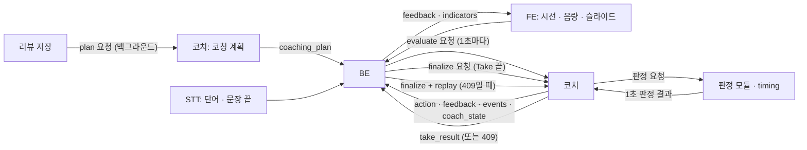
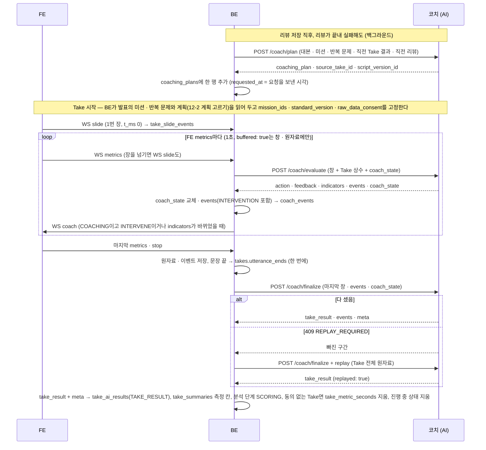

# 코치 (실시간 코치) 설계

> **이 문서는** 실시간 코치의 전체 설명서다. 처음 보는 사람이 이 문서만 읽고 이 기능이 왜 있고, 무엇을 받아 무엇을 내며, 안에서 어떻게 돌고, 어떻게 실행 · 배포하는지 알 수 있게 쓴다.
> **기준 범위**: 코치의 목표 설계다. 기능 사이 공통 계약(판정 결과 형식 · 에러 · meta · 시간 예산)은 `architecture.md`에 따르고, 이 문서에는 이 기능에만 있는 규칙 · 예외만 적는다.
> **관련 Issue**: #162 · #187
> **한 줄 요약**: 발표 중 1초마다 판정 결과를 보고 "지금 말을 걸지, 걸면 무엇 하나를 말할지"를 정하고, Take가 끝나면 사실만 담은 Take 결과를 만든다. 다음 Take를 위해 리뷰가 저장된 뒤 코칭 계획을 세운다.
> **기준값**: 판단 수치(간격 · 쿨다운 · 가중치 · 개입 기준 점수 · 허용치)는 서비스 `features/coach/config.py`에만 두고 이 문서에는 지표와 방향만 쓴다. 문서의 숫자는 BE와 맞춰야 하는 통신 값과 예시뿐이다.

# 0. 한눈에 보기
| 언제 | 받는 것 | 내는 것 | 쓰는 곳 |
|---|---|---|---|
| 발표 중 1초마다 (`/coach/evaluate`) | 원자료(시선 · 음량 기록, 단어) · Take 상수 · 지난 `coach_state` | `action` · `feedback` · `indicators` · `events` · 새 `coach_state` · `meta` | BE가 부르고, FE가 `feedback` · `indicators`를 화면에 띄운다 |
| Take 종료 때 한 번 (`/coach/finalize`) | 마지막 창 · 쌓인 이벤트 · 마지막 `coach_state` (잃었으면 Take 전체 원자료 `replay`) | `take_result` · `events` · `meta` | 리뷰 에이전트 · 리포트 · 다음 Take의 코칭 계획 |
| 리뷰 저장 뒤 (`/coach/plan`) | 대본 · 시간 계획 · 미션 · 반복 문제 · 직전 Take 결과 · 직전 리뷰 | `coaching_plan` (먼저 챙길 것 · 봐줄 것 · 개입 상한) | BE가 발표에 보관했다가 다음 Take의 evaluate 요청마다 싣는다 |

- **하는 것**: 말할 때를 정한다(개입). 말한 뒤 행동이 바뀌었는지 보고 같은 방법을 유지할지 · 바꿀지 · 그만둘지 고른다. 판정 모듈의 `tally`를 모아 Take 결과를 만든다. 계획 대비 시간(`timing`)을 판정한다.
- **하지 않는 것**: 시선 · 속도 · 음량 · 군더더기를 직접 판정하지 않는다(판정 모듈이 한다 — 판정 기준을 한곳에서 관리하기 위해). 좋았다 · 나빴다는 결론을 내지 않는다(결론은 리뷰 에이전트가 낸다). 1초 판단에는 LLM을 쓰지 않는다(느리고 같은 입력에 다른 답이 나올 수 있어서). 아무것도 저장하지 않는다(저장은 BE가 한다).

# 1. 왜 필요한가
## 1-1. 배경
발표 연습 서비스는 발표가 끝난 뒤 리뷰를 준다. 그런데 연습 중에 바로 한마디 해 주면 고칠 기회가 더 빠르다.
다만 아무 때나 말하면 방해가 된다. 말하는 도중에 끼어들거나, 같은 말을 되풀이하거나, 고치기 어려운 것을 계속 지적하면 안 된다.

## 1-2. 목표
- 발표를 방해하지 않을 때(문장 끝, 문제가 계속될 때)만 한 번에 한 가지를 말한다.
- 말한 뒤 효과를 재서, 효과가 없으면 다른 방법을 쓰거나 그만둔다.
- Take가 끝나면 지표 · 문제 구간 · 개입 · 판정 기준을 사실만으로 정리해 리뷰가 쓸 수 있게 한다.
- 응답이 빠지거나 기억(`coach_state`)을 잃어도 Take 지표가 정상 진행과 같게 만든다(원자료로 다시 판정). 문제 구간은 응답이 빠진 동안 코치가 판단하지 못한 만큼 다를 수 있다.
- 직전 리뷰 · Take 결과를 바탕으로 다음 Take에서 먼저 챙길 것과 봐줄 것을 미리 정해 둔다(코칭 계획). 계획이 없어도 코칭은 돈다.

## 1-3. 목표가 아닌 것
- 판정 값(예: 대본 응시가 얼마나 길면 문제인지)을 코치가 정하는 것. 판정 모듈이 기준을 갖는다.
- 발표 점수 · 결론 · 다음 미션. 리뷰 에이전트의 몫이다.
- 코치가 데이터를 저장하는 것. 저장은 BE가 한다(코치를 서버 어디로든 옮길 수 있게 하려고).
- 발표 중 내용 누락 지적. 내용 전달은 Take 뒤 대본 전달도가 채점한다.
- 소리로 하는 피드백. 마이크에 들어가 STT · 음량 판정을 흐리므로 글자로만 띄운다.

# 2. 용어
| 용어 | 뜻 | 예 |
|---|---|---|
| Take | 발표 연습 한 번 | `take-123` |
| 개입 | 코치가 화면으로 한마디 건네는 것 | "대본보다 청중을 조금 더 바라보세요" |
| 판정 모듈 | 원자료로 한 영역(시선 · 속도 · 음량 · 군더더기)의 상태를 1초마다 판정하는 별도 모듈. 결과 모양은 `architecture.md` 7절 | `gaze` · `pace` · `volume` · `filler` |
| `Judges` 묶음 | 판정 모듈 넷과 기준 음량 함수 둘(volume `speaking_levels` · `baseline`)을 묶어 코치에 넘기는 인자. 코치는 판정 모듈을 import하지 않는다 | `Judges(gaze=…, pace=…, volume=…, filler=…, speaking_levels=…, baseline=…)` |
| 시간 판정 `timing` | 계획 대비 진행을 판정하는 모듈. 계획이 필요해 코치 안에 있고, 다른 판정 모듈과 같은 결과 모양을 낸다 | `BEHIND_SCHEDULE` |
| 원자료 | 가공하지 않은 센서 · STT 기록 (`architecture.md` 6-2) | 시선 1초 기록 `{t_ms, state, ...}` |
| `coach_state` | 코치의 기억. 코치가 내보내고 BE가 다음 요청에 그대로 붙인다 | 마지막 처리 시각 `last_t_ms: 92000` |
| 커서 | 판정 모듈별로 어디까지 셌는지 (`since_ms` · `words_since_ms`). `coach_state`에 있다 | `since_ms: 91000` |
| 이벤트 | 코치가 응답에 남기는 기록 한 줄. BE가 받은 순서대로 쌓는다 | 개입 `iv-92000` |
| 문제 구간 | 같은 문제가 이어진 시간 범위 | 3번 장에서 88초 ~ 92초 대본 응시 |
| 사다리 | 문제마다 정해 둔 지시의 순서. 효과가 없으면 다음 칸으로 가고, 끝까지 가면 그 범위에서 그만둔다 | `SLOW_DOWN` → `SLOW_DOWN`(문장 끝 쉬기) → 그만둠 |
| 효과 판정 | 개입 뒤 정해진 시간이 지나 지표가 회복됐는지 재는 것 | `EFFECTIVE` · `INEFFECTIVE` · `NOT_MEASURED` |
| 적격성 | 지금 말해도 되는지 거르는 규칙. '버림'과 '기다림' 이유가 있다 | `COOLDOWN` |
| Take 상수 | Take 동안 바뀌지 않는 요청 값. 매 요청에 실린다 | `plan` · `missions` · `coaching_plan` |
| 코칭 계획 | 다음 Take에서 먼저 챙길 것(`focus`) · 봐줄 것(`relax`) · 개입 상한. LLM 초안을 코드가 검증한 것 | `{"focus": [...], "relax": [], "max_interventions": null}` |
| 기본 계획 | LLM 없이 만든, 아무것도 바꾸지 않는 계획 (`focus` · `relax` 빈 목록, 상한 null) | `fallback_reason: "LLM_TIMEOUT"` |
| Take 결과 | Take가 끝난 뒤 코치가 만드는 사실 묶음 (지표 · 문제 구간 · 개입 · 포기 · 판정 기준) | `take_result` |
| `replay` | 코치가 Take를 다 세지 못했을 때 BE가 보내는 Take 전체 원자료. 코치는 이것으로 0초부터 다시 판정한다 | 409 `REPLAY_REQUIRED` 뒤 다시 부름 |
| 문장 끝 신호 | Deepgram `UtteranceEnd`가 알린 마지막 단어의 끝 시각(`architecture.md` 6-2). 코치는 말하는 도중이면 이 신호까지 기다린다 | `utterance_ends: [89400]` |
| 연구용 판정 대역 | 연구 폴더(`coach_lab/judges/`)에서 판정 모듈 대신 쓰는 모듈. 재생 · 채점 · 복구 실험은 서비스의 실제 판정 모듈 넷을 묶은 `real_judges()`를, 대역 시험은 대역 넷인 `lab_judges()`를 쓴다 | `real_judges()` · `lab_judges()` |

# 3. 전체 흐름

1. **리뷰 저장 뒤**: BE가 직전 리뷰 · Take 결과 · 대본 · 미션을 실어 백그라운드로 `/coach/plan`을 부른다. 코치는 LLM 초안을 검증한 `coaching_plan`을 돌려주고, BE가 발표에 보관한다. Take 시작은 이 호출을 기다리지 않는다(발표 시작을 막지 않기 위해).
2. **발표 중**: FE가 시선 · 음량 1초 기록을 BE에 보낸다. 코치가 가공된 값이 아니라 원자료를 받아야 판정 기준이 바뀌어도 FE를 고치지 않기 때문이다.
3. BE가 최근 기록(시선 · 음량 30초, 단어 · 문장 끝 60초)에 Take 상수(계획 · 미션 · 반복 문제 · 코칭 계획 · 기준 음량 · 대본 사용 설정)와 지난 `coach_state`를 붙여 1초마다 `/coach/evaluate`를 부른다.
4. 코치가 판정 모듈을 불러 1초 판정 결과를 받고, `tally`를 장 · Take 합계에 더한다.
5. 코치가 개입 규칙(효과 판정 → 문제 구간 → 후보 → 적격성 → 우선순위)으로 `action`을 정한다.
6. 코치가 `events`와 새 `coach_state`를 돌려준다. BE는 `events`를 받은 순서대로 쌓고 `coach_state`를 다음 요청에 붙인다.
7. **Take 종료**: BE가 `/coach/finalize`를 한 번 부른다. 코치가 마지막 창을 판정하고 열린 것을 닫아 `take_result`를 만든다. 센 구간이 Take를 덮지 못하면 409 `REPLAY_REQUIRED`를 돌려주고, BE는 Take 전체 원자료를 `replay`에 실어 다시 부른다.

# 4. 구성과 폴더
## 4-1. 폴더 트리
```
ai/research/coach-agent/
├─ README.md                              폴더 · 파일 지도, 실행법, 실험 결과
├─ pyproject.toml · uv.lock               패키지 하나: coach_lab(실험), 서비스를 editable로 설치해 코어를 씀, Python 3.12
├─ (서비스 ai/service/src/pitch_coach_ai/features/coach/)  판단 코어 (연구 폴더 src/coach/에서 폴더째 옮김, 테스트는 서비스 tests/unit/coach/)
├─ src/coach_lab/                         재생 · 실험 도구 (가상 발표자 · 연구용 판정 대역 · 채점 · 예시 생성). 연구에만 남는다. 예시는 서비스 features/coach/examples/ 한 곳(BE 테스트도 읽는다)
├─ scenarios/                             가상 발표 시나리오 (+ plan/ 코칭 계획 실험용)
├─ tests/{lab,live}/                      실험 도구 · 실제 LLM (코어 단위 · 계약 테스트는 서비스 tests/unit/coach/)
└─ reports/results/                       커밋하는 실험 결과 (take_result · recovery · coaching_plan)
```
파일마다의 역할은 `ai/research/coach-agent/README.md` 3절의 파일 지도에 있다.

## 4-2. 진입 함수
| 함수 · 엔드포인트 | 하는 일 | 부르는 쪽 |
|---|---|---|
| `decide_safe(request, judges)` → `POST /coach/evaluate` | 1초 판단. 코치 안의 예외를 `WAIT` + `INTERNAL_ERROR`로 바꾸고 그 창을 건너뛴다. 요청 형식 오류(`ValidationError`)는 그대로 올린다 | API 라우터 (연구에서는 `coach_lab`의 재생) |
| `decide(request, judges)` | 예외를 잡지 않는 1초 판단. 테스트 · 재생용 | 테스트 · `decide_safe` |
| `finalize(request, judges)` → `POST /coach/finalize` | 마지막 창 판정 · 닫기 · Take 결과. 다 세지 못했으면 `ReplayRequired`(빠진 구간 `missing`)를 올린다 → 라우터가 409 | API 라우터 |
| `plan_coaching(request, llm=…, model=…, cache=…)` → `POST /coach/plan` | 코칭 계획. LLM 클라이언트와 캐시는 인자로 받고, LLM 실패는 기본 계획 + `fallback_reason` | API 라우터 (연구에서는 `coach_lab.plan_eval`) |
| `Judges` | 판정 모듈 묶음 (`judge` · `summarize` · `criteria` 세 함수를 가진 모듈 넷 + volume `speaking_levels` · `baseline`) | 라우터 `api/coach.py`가 앱을 불러올 때 한 번 만든다(`JUDGES`, 11절) |
| `initial_state()` | 빈 `coach_state` | 테스트 · 재생 |

## 4-3. 규칙과 이유
| 규칙 | 이유 |
|---|---|
| 패키지 안에서는 상대 import만 | 서비스로 옮겨 폴더 이름이 바뀌어도 고칠 import가 없다 |
| 파일 · DB · 네트워크 · 환경변수를 쓰지 않는다 | 서버는 상태를 두지 않는다. 저장은 BE가 맡는다 |
| 시계 · 난수를 쓰지 않는다. 시간은 요청의 `t_ms`뿐이다 | 같은 요청에 같은 응답이 나와야 재생 · 복구 결과와 배포 결과가 같다 |
| 기억은 `coach_state`로 주고받는다 | 서버를 재시작하거나 워커를 늘려도 판단이 같다 |
| 판정 모듈을 import하지 않고 `Judges` 묶음을 인자로 받는다 | 판정 모듈이 바뀌면 묶음만 바꿔 끼운다 (`architecture.md` 8절) |
| 의존성은 pydantic 하나 | 서비스로 옮길 때 가져갈 라이브러리가 하나뿐이다 |
| LLM · 캐시는 인자로 받는다 | 코어는 키 · 네트워크를 모른다. LLM 객체는 서비스 `common/llm.py`가 만든다 |
| 위 규칙은 서비스 `tests/unit/coach/test_core_boundary.py`가 코어 파일을 읽어 검사한다 | 어기면 테스트가 실패한다 (허용 표준 라이브러리 목록 · 금지 호출 `print` · `open` 등) |

# 5. 입력 · 출력 계약
요청 · 응답의 원본은 서비스 `features/coach/schemas.py`다. 요청은 모르는 필드를 무시하고, 응답은 정해진 필드만 낸다(`architecture.md` 2절). 시각은 모두 Take 시작 기준 ms다.

## 5-1. 호출 목록
| 호출 | 언제 | 누가 |
|---|---|---|
| `POST /coach/evaluate` | 발표 중 FE `metrics`를 받을 때마다 (1초마다). 한 Take에서 앞 응답을 받기 전에는 다음 요청을 보내지 않는다 | BE |
| `POST /coach/finalize` | Take 종료 뒤 한 번 (백그라운드). 409면 `replay`를 붙여 한 번 더 | BE |
| `POST /coach/plan` | 리뷰가 저장된 직후(리뷰가 끝내 실패해도 `previous_review` null로, 첫 Take는 대본 파싱이 끝난 직후), 그리고 대본 · 제한 시간이 바뀌었을 때 (백그라운드). Take 시작은 기다리지 않는다 | BE |

## 5-2. 입력
**`/coach/evaluate`**

| 필드 | 타입 | 필수 | 뜻 | 예 |
|---|---|---|---|---|
| `take_id` | string | 예 | Take 구분 | `take-123` |
| `t_ms` | int | 예 | 이 판단의 시각(FE `metrics`의 `t_ms`). 0 이상 3,660,000 이하(Take 최대 1시간 + 60초, `architecture.md` 1-3. 넘으면 422. 상한은 evaluate · finalize가 상수 하나를 함께 쓴다). 이미 처리한 시각 이하면 처리하지 않고(`STALE_TICK`), 지난 처리 시각보다 60,000 ms 넘게 앞서도 처리하지 않는다(`T_MS_JUMP`, 아래) | `92000` |
| `mode` | enum | 아니오 | `COACHING`(말을 건다) · `EXAM`(기록만 하고 말하지 않는다). 없으면 `COACHING` | `COACHING` |
| `plan` | object | 아니오 | 시간 계획 `{target_ms, min_ms, max_ms, slides[{slide_number, target_ms, script_chars}]}`. `target_ms`는 Take 목표 시간, `min_ms` = 발표 제한 시간 − 허용 미달(0 이하가 되면 BE가 null로 싣는다), `max_ms` = 발표 제한 시간 + 허용 초과, 장별 `target_ms`는 대본 파싱 `expected_ms`. 장마다 `slide_number` · `target_ms`는 필수, `script_chars`는 그 장 대본의 글자 수(공백 · 문장부호를 뺀 코드 포인트 수, `architecture.md` 6-1)이고 없으면 0. 장 목표가 `0`이면 그 장의 `SLIDE_OVER`를 내지 않는다. `target_ms`가 없으면 시간 판정은 잴 수 없음 | `{"target_ms": 300000, "min_ms": 270000, "max_ms": 330000, "slides": [...]}` |
| `missions` | list | 아니오 | 이번 Take 미션 `[{mission_id, area, slide_number, target{metric, operator, value}, priority, description}]`(`priority` · `description`은 선택). priority는 누락하면 1, 명시적 null은 허용하지 않는다. description은 누락·null 모두 설명 없음으로 처리하고 영역·대상·목표를 사용한다. `operator`는 `LT` · `LTE` · `GT` · `GTE`, `slide_number`가 null이면 Take 전체. `area`는 `GAZE` · `SPEED` · `VOLUME` · `PAUSE` · `FILLER` · `TIME` · `CONTENT`(`architecture.md` 6-3) | `[{"mission_id": "m-2", "area": "GAZE", ...}]` |
| `recurring_issues` | list | 아니오 | 직전 리뷰가 꼽은 반복 문제 `[{area, slide_number, dimension}]`(`review-agent.md` 5-3. `area`는 미션과 같은 일곱 값). 코치는 `area` · `slide_number`로 가중을 걸고, `dimension`(리뷰 차원 이름)은 쓰지 않는다 | `[{"area": "GAZE", "slide_number": 3, "dimension": "script_independence"}]` |
| `coaching_plan` | object · null | 아니오 | `/coach/plan` 응답의 `coaching_plan`(`why`는 빼고 싣는다, 와도 쓰지 않음). 계획 고르기(12-2)로 고른 행이 있을 때만 싣고 아니면 null | `{"focus": [{"area": "GAZE", "slide_number": 3, "weight": 1.5}], "relax": [], "max_interventions": null}` |
| `script_used` | bool · null | 아니오 | 사용자 평가 기준의 대본 사용 설정. `true`면 대본 응시(`GAZE_ON_SCRIPT`)는 말하지 않는다 | `true` |
| `calibration.base_level_db` | float · null | 아니오 | 평소 목소리 Leq(dBFS). null이면 코치가 Take 첫 발화 표본으로 volume `baseline`이 정한 값을 `coach_state`에 두고 쓴다. 처음부터 작게 말하면 기준도 낮게 잡히므로 발표 전 점검에서 재 두는 편이 정확하다 | `-29.5` |
| `inputs.gaze_records` | list | 아니오 | 최근 30초 시선 1초 기록 (`architecture.md` 6-2) | 아래 5-5 |
| `inputs.voice_records` | list | 아니오 | 최근 30초 음량 1초 기록. 시선 판정이 같은 30초의 발화 시간을 쓴다 | 아래 5-5 |
| `inputs.words` | list | 아니오 | 최근 60초 STT 확정 단어 `{word, start_ms, end_ms}`. 60초 창에 넣을지는 단어가 끝난 시각 `end_ms`로 정한다 | `[{"word": "매출은", "start_ms": 91100, "end_ms": 91600}]` |
| `inputs.utterance_ends` | list int | 아니오 | 최근 60초 문장 끝 신호 시각 | `[89400]` |
| `inputs.stt_status` | enum | 아니오 | STT 상태 `connecting` · `ok` · `reconnecting` · `degraded` · `closed`. `ok`가 아니면 단어 기반 판정(속도 · 군더더기)은 잴 수 없음. 모르는 값 · null은 `degraded`로 읽는다 | `ok` |
| `inputs.slide` | object | 아니오 | 지금 장 `{number, started_ms}`. BE가 장 변경 기록(12-1 `take_slide_events`) 중 `started_ms`가 요청 `t_ms` 이하인 것 가운데 가장 늦은 것으로 만든다(`architecture.md` 1-3). 없으면 마지막으로 알던 장 | `{"number": 3, "started_ms": 59390}` |
| `coach_state` | object · null | 아니오 | 지난 응답의 값 그대로. Take 첫 요청은 null | `{"v": 2, "last_t_ms": 91000, ...}` |

- `take_id` · `t_ms`가 없거나 타입이 틀리거나 `t_ms`가 상한을 넘으면 요청 전체가 거부된다(422 `VALIDATION_ERROR`). BE는 그 1초를 건너뛰고 `coach_state`를 바꾸지 않는다.
- **배열 한도**: `inputs.gaze_records` · `inputs.voice_records` 각 120개, `inputs.words` 1,000개, `inputs.utterance_ends` 300개를 넘으면 요청 전체가 422 `VALIDATION_ERROR`다(finalize의 `inputs`도 같다). 창(30 · 60초)에 정상으로 실리는 수의 몇 배로 잡은 정책상 한도라, 정상 흐름에서는 닿지 않고 BE의 창 버그 · 비정상 입력만 막는다. 장 수에는 한도를 두지 않는다(plan의 장 100개 한도는 `/coach/plan`에만 건다. evaluate · finalize에 걸면 장이 많은 발표가 매초 거부된다).
- **읽을 수 없는 기록**: 한도 안의 배열에서 기록 하나가 읽을 수 없으면 그 기록만 버리고 나머지로 판정한다(요청 전체를 거부하지 않는다). 시선 기록은 `t_ms`가 음수 · `duration_ms`가 0 이하 · `state`가 없으면 버리고 `issues`가 null이면 빈 목록으로 본다(값 검사는 시선 모듈이 한 번 더 한다, `gaze-tracking.md` 5-2). 음량 기록은 `t_ms` · `voiced_ms` · `silence_ms`가 음수이거나 `voiced_ms`가 `duration_ms`보다 크면, 단어는 `word`가 50자를 넘거나 `start_ms` · `end_ms`가 음수이거나 `end_ms − start_ms`가 0 미만 · 10초 초과이면(10초는 늦게 확정된 단어가 말한 장을 찾도록 장 전환을 남겨 두는 여유와 같다, 6-1), 문장 끝 시각은 음수 · 정수가 아니면 버린다. `replay`는 같은 규칙에 장 변경 · STT 상태 변경도 하나씩 버리고(모르는 STT 상태는 `degraded`). 같은 1초가 되풀이돼 와도 지우지 않고, 실시간과 같이 판정 모듈이 읽을 수 있는 기록 중 먼저 온 것을 쓴다(복구가 다시 만드는 1초 요청에는 창 배열 한도를 걸지 않는다). 버린 1초는 기록이 오지 않은 1초와 같다. 이 버림은 422가 아니다.
- **크게 앞선 시각 (`T_MS_JUMP`)**: 받은 `coach_state`가 유효하고 이미 한 번 이상 처리한 상태인데 `t_ms − last_t_ms > 60000`이면, 코치는 그 요청을 처리하지 않고 200 `WAIT` · `reason_codes: ["T_MS_JUMP"]`와 **빈 `coach_state`**(`initial_state()`)를 돌려준다(이벤트 · `indicators` 없음). BE는 따로 처리하지 않고 평소처럼 이 `coach_state`를 다음 요청에 붙인다. 다음 요청부터 새로 시작하므로, 이미 처리한 상태에서 60초 넘게 앞선 잘못된 시각 하나가 `last_t_ms`를 올려 그 Take의 이후 요청을 모두 `STALE_TICK`으로 막는 일이 없고(검사하지 않는 새로 시작한 상태의 첫 요청과 60초 안쪽의 잘못된 시각은 막지 못한다 — 15절 알려진 한계), 정상적인 긴 공백(AI 재시작 · 장애) 뒤에도 1초 만에 코칭이 이어진다. 새로 시작했으므로 Take 앞부분 합계가 없어 종료 때 409 → `replay`로 Take 결과를 만든다(센 구간은 요청마다 `[max(지난 커서, t_ms − 30초), t_ms]`만 표시되므로 빈 상태 뒤의 덮임 확인에서 빠진 구간이 남는다). **새로 시작한 상태(`last_t_ms`가 없는 상태 — Take 첫 요청, `STATE_RESET`, `T_MS_JUMP` 뒤)의 첫 요청은 모듈마다 시각 커서를 `max(0, t_ms − 30000)`에서 시작한다.** 창 밖은 셀 원자료가 없고 센 구간에도 넣지 않으며 종료 때 `replay`로 다시 만들기 때문이다. 다만 시간 판정의 '지금 장에 머문 시간'은 `max(커서, 장 시작)`부터 세므로(`timing.py`), 이때 지금 장의 창 밖 몫(`max(0, (t_ms − 30000) − 장 시작)`)을 머문 시간에 미리 넣어 둔다(새로 시작한 뒤에도 `SLIDE_OVER` · 진행도가 늦어지지 않게). 그래서 evaluate 하나가 세는 1초 조각은 늘 60개 안팎으로 묶이고 Take 길이에 비례하지 않는다(커서가 0에서 시작하면 Take 후반의 첫 요청이 수천 조각을 세어 BE 시간 제한을 넘기고, 응답이 버려져 다음 요청도 다시 0부터 세는 일이 되풀이될 수 있다). 60초는 보통의 배포 재시작 공백(컨테이너 교체와 시작 유예 10초)보다 넉넉하게 잡은 값이고(측정한 값은 아니다), 이미 처리한 상태에서 60초 안쪽으로 앞선 잘못된 시각이 코칭을 막는 시간을 1분 안으로 묶는다. 공백이 60초를 넘으면 위처럼 새로 시작한다. Take 첫 요청(`coach_state` null)과 finalize에는 이 검사를 하지 않는다.
- 창은 BE가 매번 겹쳐 보내도 된다. 코치가 판정 모듈별 커서로 이미 센 시간을 건너뛰므로 두 번 세지 않는다. 같은 1초 기록이 두 번 오면 먼저 온 것만 쓴다.
- 재연결 뒤 FE가 몰아 보낸 `metrics`(`buffered: true`)로는 BE가 evaluate를 부르지 않는다(`architecture.md` 2절). 그 1초 기록은 표시가 없는 다음 실시간 요청의 창에 함께 실려 오고, 코치는 그 요청 하나에서 창 안의 새 1초를 모두 센다. 그래서 지난 시각으로 새로 말을 걸지 않는다.
- Take 상수를 매 요청에 싣는 이유: `coach_state`가 깨져 새로 시작해도 계획 · 미션 · 반복 문제는 그대로 이어지게 하려는 것이다.

**`/coach/finalize`** — `/coach/evaluate`와 같은 Take 상수에 아래를 더한다.

| 필드 | 타입 | 필수 | 뜻 | 예 |
|---|---|---|---|---|
| `take_id` · `t_ms` | string · int | 예 | `t_ms`는 Take가 끝난 시각(마지막 `metrics`의 바깥 `t_ms` — 그 조각이 끝난 시각, `architecture.md` 2절). BE가 종료에 들어갈 때 고정하고, STT 마무리 · 대기 시간을 더하지 않는다. 0 이상 3,660,000 이하 (넘으면 422) | `182000` |
| `mode` · `plan` · `missions` · `recurring_issues` · `coaching_plan` · `script_used` · `calibration` | | 아니오 | evaluate에 실은 것과 같다 (마지막 판정과 `replay`에 쓴다) | |
| `script_mode` | enum · null | 아니오 | 대본 보기 `HIGHLIGHT` · `KEYWORD` · `OFF`. 판정은 바꾸지 않고 Take 결과에 남긴다 | `HIGHLIGHT` |
| `coach_state` | object · null | 아니오 | 마지막 응답의 것. 잃었으면 null | |
| `events` | list | 아니오 | 이 Take에서 BE가 쌓은 코치 이벤트 전부, 받은 순서대로 | |
| `inputs` | object | 아니오 | 마지막 창. evaluate의 `inputs`와 같은 모양. FE가 `stop` 전에 보낸 마지막 1초 조각과 STT를 닫은 뒤의 마지막 확정 단어까지 담는다. `words`에는 `Take 끝 − 60,000 < end_ms ≤ Take 끝`(Take 끝 = 이 요청의 `t_ms`)인 확정 단어를 모두 싣고, `end_ms`가 Take 끝보다 늦은 단어는 싣지 않는다. 마지막 evaluate가 이미 Take 끝 시각이었어도 코치는 이 단어 중 아직 세지 않은 것을 센다(6-3 1번). `stt_status`에는 STT를 닫기 직전의 상태(정상 종료면 `ok`)를 싣고, 닫은 뒤의 `closed`를 싣지 않는다(`ok`가 아니면 마지막 단어를 세지 못한다) | |
| `replay` | object | 아니오 | 409 `REPLAY_REQUIRED`를 받았거나 `coach_state`가 null일 때만. Take 전체 원자료 `{gaze_records, voice_records, stt_status_changes[{t_ms, status}], words[{word, start_ms, end_ms, final_at_ms}], utterance_ends, slides[{number, started_ms}]}`. `slides`는 장 변경 기록(12-1 `take_slide_events`) 전체를 시각 순서로 싣는다. BE가 처음 알게 된 STT 상태와 장은 `t_ms` · `started_ms`를 0으로 싣는다(그 앞의 상태를 모르므로 Take 시작부터 그 값으로 본다). `final_at_ms`는 단어가 확정된 시각(12-1)이고, Take 끝보다 늦으면 Take 끝으로 잘라 싣는다. 코치는 다시 만든 1초 요청마다 `final_at_ms`가 그 요청 `t_ms`보다 작은 단어만 넣는다(6-3). STT 상태 이력이 없으면 Take 내내 `connecting`(믿지 않음)으로 본다 | 아래 5-5 |

**`/coach/plan`**

| 필드 | 타입 | 필수 | 뜻 | 예 |
|---|---|---|---|---|
| `pitch_id` | string | 예 | 어느 발표인지 | `p-1` |
| `source_take_id` | string · null | 아니오 | 이 계획의 바탕이 된 Take(그 Take의 리뷰, 리뷰가 끝내 실패했으면 그 Take 결과만). 그 발표에서 가장 늦게 끝난 `COMPLETED` Take(순서는 `architecture.md` 1-3 'Take 상태')이고, 첫 Take면 null. 응답에 그대로 돌려준다 | `take-122` |
| `script_version_id` | string · null | 아니오 | 바탕이 된 대본 버전. 응답에 그대로 돌려준다 | `sv-3` |
| `plan` | object | 아니오 | evaluate와 같은 모양. Take 전이라 `target_ms`는 발표 제한 시간이다 | `{"target_ms": 300000, ...}` |
| `scripts` | list | 아니오 | 장별 대본 `[{slide_number, script}]` | `[{"slide_number": 3, "script": "지난 분기 매출은 37% 늘었습니다."}]` |
| `missions` | list | 아니오 | 다음 Take 미션 (직전 리뷰의 `next_missions`에 BE가 `mission_id`를 붙인 것). evaluate와 같은 모양 | |
| `recurring_issues` | list | 아니오 | 직전 리뷰의 반복 문제 `[{area, slide_number, dimension}]` (evaluate와 같은 모양) | |
| `previous_take_result` | object · null | 아니오 | 직전 Take 결과(5-3의 `take_result`). 개입 수 · 효과 · 포기한 문제는 코치가 여기서 직접 센다 | |
| `previous_review` | object · null | 아니오 | 직전 Take 리뷰 결과(리뷰 에이전트의 출력). 쓰는 필드: `overall_summary` · `dimensions`(차원 → `IMPROVED` · `PRIORITY` · `STABLE` · `STRENGTH` · `NOT_EVALUABLE`) · `improvements[{area, slide_number, text}]` · `mission_results[{mission_id, status, metric, slide_number}]`. 반복 문제는 이 안의 `recurring_issues`가 아니라 요청 최상위 `recurring_issues`로 받는다 | |

- 요청에 모드가 없다. 계획은 Take가 시작되기 전에 만들고, 실전 모드 Take는 evaluate에서 말하지 않으므로 계획이 영향을 주지 않는다.
- **입력 크기 상한**: `plan.slides` · `scripts` 100개, `missions` 20개, `recurring_issues` 20개, `missions[].description` 500자. 넘으면 422 `VALIDATION_ERROR`이고 BE는 다시 부르지 않는다(계획 없이 코칭한다). BE는 부르기 전에 500자를 넘는 `description`만 빼고 부를 수 있다(`architecture.md` 1-5). 대본은 장마다 1,500자까지만 LLM에 넘긴다(`config.py`의 `PlannerConfig`, 요청 크기 상한이 아니라 LLM 입력을 자르는 것이다). `previous_take_result` · `previous_review` · 대본 원문의 크기는 따로 묶지 않고, 요청 본문 크기 상한으로 정한다(아직 정하지 않았다, 15절 열린 질문). 문자열 description의 500자는 Python `len`의 코드 포인트 수다. 누락·null은 길이 검사 대상이 아니다. 현재 planner는 priority를 LLM 입력에 싣지 않으며 순위 반영 알고리즘 추가는 이번 문서 정비 범위가 아니다. 이 상한은 plan 요청에만 건다(공유 모델 `Plan` · `Mission`은 그대로 두고, plan 요청 전용 하위 모델이나 plan 요청의 검증 함수로 건다. 검증 오류는 `ValidationError` → 422). 리뷰의 다음 미션이 20개 · 설명 500자를 넘으면 계획이 없으므로, `review-agent.md` 5-3이 같은 한도로 낸다. evaluate · finalize의 같은 필드 한도는 요청 배열 한도와 함께 정한다(15절 열린 질문. evaluate에서 거절하면 그 Take의 코칭이 멈추므로 같은 값을 그대로 걸지 않는다). BE에는 장 수 상한이 없으므로(대본 전체 50,000자 이하) 100장을 넘는 발표는 계획 없이 코칭한다.

## 5-3. 출력
**`/coach/evaluate`**

| 필드 | 타입 | 뜻 | 예 |
|---|---|---|---|
| `action` | enum | `WAIT`(지금은 보기만) · `IGNORE`(문제는 있지만 이번엔 버림) · `INTERVENE`(지금 말함) | `INTERVENE` |
| `feedback` | object · null | `INTERVENE`일 때만 객체 `{area, instruction, message, priority(0–100), confidence(0–1), evidence}`, 그 밖에는 null. `evidence`에는 문제 구간 `start_ms` · `end_ms` · `slide_number`와 판정 모듈이 준 근거 값이 든다. `message`는 템플릿 문장이고 LLM이 만들지 않는다 | `{"area": "GAZE", "instruction": "LOOK_AT_CAMERA", ...}` |
| `indicators` | object | 영역(`GAZE` · `SPEED` · `VOLUME` · `PAUSE` · `FILLER` · `TIME`) → 그 판정 모듈의 `state`. 화면 상태 표시용 (`COACHING` 모드만 FE에 보낸다). 판단하지 않은 응답(`STALE_TICK` · `T_MS_JUMP` · `INTERNAL_ERROR`)은 빈 객체이고 '바뀌지 않음'이라는 뜻이다(BE는 이전 표시를 그대로 둔다, `architecture.md` 1-3) | `{"GAZE": "SCRIPT", "TIME": "AHEAD"}` |
| `reason_codes` | list | 왜 이 행동인가(6-1의 이유 코드). `INTERVENE`이면 첫 값이 문제 코드(`issue_type`) | `["GAZE_ON_SCRIPT", "PLAN_FOCUS"]` |
| `events` | list | 이번 응답에서 생긴 이벤트(아래 표). BE가 받은 순서대로 쌓는다 | `[{"event_id": "iv-92000", ...}]` |
| `coach_state` | object | 다음 요청에 그대로 붙인다. 내용은 몰라도 된다 | `{"v": 2, "last_t_ms": 92000, ...}` |
| `meta` | object | `schema_version` · `feature_version` · `criteria_versions`(판정 모듈별 + `coach`) · `model`(항상 null) | `{"schema_version": "1.0", "feature_version": "coach-1.3", ...}` |

`instruction`: `LOOK_AT_CAMERA` · `SLOW_DOWN` · `SPEED_UP` · `SPEAK_LOUDER` · `RESUME` · `REDUCE_FILLER` · `CONDENSE` · `MOVE_ON` · `WRAP_UP` · `CONTINUE`(효과가 있을 때 "지금처럼" 유지 격려).

**이벤트** — 모든 이벤트는 `kind` · `event_id` · `t_ms`(생긴 시각)를 갖는다.

| `kind` | 언제 | 필드 (공통 외) | `event_id` |
|---|---|---|---|
| `INTERVENTION` | 말을 걸었을 때 | `intervention_id`(= `event_id`) · `issue_type` · `area` · `instruction` · `message` · `priority` · `confidence` · `reason_codes` · `slide_number` · `evidence`(같은 응답 `feedback.evidence`와 같은 값: 문제 구간 `start_ms` · `end_ms` · `slide_number`와 판정 근거 값). 코치가 한 말의 기록은 이 이벤트 하나뿐이다(BE는 `live_feedbacks`에 따로 쓰지 않는다, 12-1) | `iv-<t_ms>` |
| `OUTCOME` | 효과를 잴 시점 | `intervention_id` · `outcome`(`EFFECTIVE` · `INEFFECTIVE` · `NOT_MEASURED`) · `metric` · `before` · `after` | `oc-<intervention_id>` |
| `EPISODE` | 문제 구간이 끝났을 때 (개입했든 안 했든) | `issue_type` · `area` · `slide_number` · `start_ms` · `end_ms` · `peak_severity` · `mean_severity` · `intervention_ids` · `suppressed_reasons` · `reliable_ms` · `unreliable_ms` | `ep-<issue_type>-<장>-<start_ms>` |
| `SLIDE` | 장 방문 하나가 끝나고 그 장의 단어가 다 확정됐을 때 (또는 Take가 끝났을 때) | `slide_number` · `start_ms` · `end_ms` · `target_ms` · `tally`(그 방문의 영역별 합계: 영역 → 이름 → 합) | `sl-<장>-<start_ms>` |
| `STRATEGY` | 효과가 없어 사다리를 옮겼거나(`ESCALATED`) 그만뒀을 때(`GAVE_UP`) | `issue_type` · `area` · `slide_number` · `change` · `from_instruction` · `from_variant` · `to_instruction` · `to_variant` · `intervention_id` | `st-<issue_type>-<장>-<t_ms>` |
| `SUPPRESSED` | 걸렸지만 말하지 않았을 때 (같은 문제는 정해진 간격으로 한 번) | `issue_type` · `area` · `slide_number` · `instruction` · `status`(`WAITING` · `IGNORED`) · `priority` · `reasons` | `su-<issue_type>-<t_ms>` |

- `<장>`은 장 번호이고, 장이 없으면 `none`이다.
- `event_id`는 종류와 대상으로 만들고 번호를 세지 않는다. 같은 이벤트를 다시 처리해도 같은 id가 나오므로 BE가 두 번 저장해도 `finalize`가 id로 걸러 낸다. 한 응답 안에서 같은 모양의 id가 또 나오면 뒤의 것에 `-2`, `-3` …을 붙인다. 다른 이벤트는 evaluate와 finalize 사이에서도 id가 겹치지 않는다.
- `SLIDE`는 장을 떠난 직후가 아니라 단어 커서가 방문 끝을 지난 뒤(단어 확정이 늦을 수 있어서) 나온다. 그래서 `t_ms`가 `end_ms`보다 늦다. 다시 돌아온 장은 방문마다 하나씩 낸다.

**`/coach/finalize`** — `{take_result, events, meta}`. `events`는 이번에 닫은 이벤트(효과 · 문제 구간 · 장)만이고, BE는 이것도 평소처럼 쌓는다. `meta`는 evaluate와 같은 모양이다.

| `take_result` 필드 | 뜻 |
|---|---|
| `take_id` · `duration_ms` · `script_mode` | Take 구분 · 길이(요청의 `t_ms`) · 대본 보기 |
| `plan` | 이 Take를 판정한 시간 계획 `{target_ms, min_ms, max_ms}`(요청 `plan`에서 장 목록을 뺀 것. 장 목표는 `areas.TIME.slides[].target_ms`). 요청에 계획이 없으면 null. 리뷰가 시간 지표의 좋은 방향을 정할 때 쓴다 |
| `replayed` | 원자료(`replay`)로 다시 판정해 만들었는가 |
| `criteria_changed` | Take 도중 어느 판정 모듈의 기준 버전이 바뀌었는가 (배포 등. 지표를 해석할 때 주의) |
| `areas` | 영역(`GAZE` · `SPEED` · `VOLUME` · `PAUSE` · `FILLER` · `TIME`) → `{measured_ratio, take, slides, unmeasured_reason}`. `take`는 그 모듈 `summarize` 결과(`measured_ratio` 제외), `VOLUME`은 기준 음량 출처 `base_level_source`(`CALIBRATION` · `TAKE`)도 든다. `slides`는 장 번호별 `{slide_number, start_ms, end_ms, target_ms, measured_ratio, metrics}`이고 다시 온 장은 합친다(시작은 첫 방문, 끝은 마지막 방문). `TIME`의 장 `metrics`는 `slide_duration_ms`다 |
| `areas.<영역>.unmeasured_reason` | 측정 비율이 기준 미만이면 `LOW_MEASURED_RATIO`이고 `take` · `slides`를 비운다. 그 장만 기준 미만이면 그 장의 `metrics`만 null |
| `problem_segments[]` | 문제 구간 `{area, issue_type, slide_number, start_ms, end_ms, mean_severity, reliable, coached}` (정리 규칙 6-3). `mean_severity`는 구간 평균 심각도(0–1). 말했든 안 했든 모두 넣는다 |
| `interventions[]` | 말을 건 기록과 효과 `{intervention_id, t_ms, area, issue_type, instruction, message, outcome, metric, before, after}` (효과 기록(`OUTCOME`)이 없으면 `outcome` null, 효과가 없었다고 쟀으면 `INEFFECTIVE`) |
| `gave_up[]` | 사다리 끝까지 가서 그만둔 문제 `{issue_type, slide_number}` (Take 전체 범위면 `slide_number` null, 같은 문제 · 장은 한 번) |
| `criteria` | 영역 → `{criteria_version, issues{issue_type → 기준}}`. 그 Take를 판정한 기준(`architecture.md` 7절의 `criteria()`). volume 모듈의 문제는 원인 영역(`VOLUME` · `PAUSE`)으로 나눠 담는다 |

- Take 결과에는 결론(다음 미션 · 이전 Take 비교 · 차원 순위)을 넣지 않는다. 리뷰가 낸다.
- 영역별 Take 지표 이름은 `architecture.md` 6-3의 지표 표와 같다(예: FILLER는 `filler_count` · `filler_per_min` · `by_tier` · `by_word`).

**`/coach/plan`**

| 필드 | 타입 | 뜻 | 예 |
|---|---|---|---|
| `coaching_plan` | object | `{focus[{area, slide_number, weight, why}], relax[{area, slide_number, why}], max_interventions}`. `weight`는 코치가 정해진 범위로 자른다. `relax`는 `GAZE` · `FILLER`만, 장을 지정해야 한다. `max_interventions`는 null이면 상한 없음 | 아래 5-5 |
| `source_take_id` · `script_version_id` | string · null | 요청 값 그대로 (계획 고르기용, 12-2) | `take-122` · `sv-3` |
| `fallback_reason` | enum · null | 기본 계획으로 돌아간 이유 `LLM_TIMEOUT` · `LLM_ERROR` · `LLM_INVALID_OUTPUT` · `LLM_UNAVAILABLE`. 성공이면 null | `null` |
| `dropped` | list | 검증에서 뺀 항목과 이유 | `["relax TIME 3: 봐줄 수 없는 영역"]` |
| `planner_hash` | string | 프롬프트 · 출력 스키마 · 요청한 모델 이름(역할의 묶음)의 해시 (캐시 무효화 · 추적용). 실제로 응답한 모델은 `meta.model` | `<해시>` |
| `meta` | object | `schema_version` · `feature_version` · `model`(응답한 모델, 기본 계획이면 null). 코어는 성공했을 때 넘겨받은 `model` 인자를 넣고, 서비스 라우터는 `fallback_reason`이 null인 성공 응답에서만 콜백으로 잡은 실제 응답 모델로 바꿔 싣는다(예비 모델이 없는 지금은 같다). 기본 계획이면 LLM이 응답했어도 null이다 | `{"schema_version": "1.0", "feature_version": "coach-1.3", "model": "<모델>"}` |

- `coach_state`를 돌려주지 않는다. 계획은 evaluate 요청의 `coaching_plan`으로만 들어간다.
- `coaching_plan`의 키는 `focus` · `relax` · `max_interventions`뿐이다(`source`는 두지 않는다 — LLM인지 기본 계획인지는 `fallback_reason`이 말한다).
- 계획이 1초 판단에 쓰이는 곳은 세 곳뿐이다: 우선순위 가중(`PLAN_FOCUS`), 봐주기(`PLAN_RELAXED`), 개입 상한(`BUDGET_EXHAUSTED`). 1초 판단은 규칙으로 하고, LLM은 이 계획에만 쓴다.

## 5-4. 문제 목록
코치가 스스로 판정하는 문제는 시간 판정(`timing`)의 다섯 가지다. 그 밖의 문제(시선 · 속도 · 음량 · 침묵 · 군더더기)는 판정 모듈이 내고(`architecture.md` 6-3), 코치는 6-1의 사다리 표대로 말하거나 기록만 한다. 판정 기준값은 `config.py`의 `TimingConfig`에 있고 여기에는 쓰지 않는다.

| 문제 | 조건 | 판정 지표와 나쁜 방향 |
|---|---|---|
| `TIME_OVER` | 경과가 `max_ms`(없으면 목표)를 넘음 | `elapsed_ratio`(경과 ÷ 한계) — 클수록 나쁨 |
| `FINAL_MINUTE` | 남은 시간이 마무리 구간 기준 이하이고, 남은 장이 정해진 개수 이상(장 계획이 없으면 통과)이며, 계획 대비 진행을 모르거나 늦을 때 | `remaining_ms` — 작을수록 나쁨 |
| `BEHIND_SCHEDULE` | 남은 내용을 남은 시간에 끝내려면 필요한 속도 배율이 기준 이상 | `required_ratio`(남은 내용 ÷ (목표 − 경과)) — 클수록 나쁨 |
| `SLIDE_OVER` | 한 장에 장 목표보다 오래 머뭄. 마지막 장 · 장 목표가 `0`인 장은 내지 않음 | `slide_time_ratio`(장 체류 ÷ 장 목표) — 클수록 나쁨 |
| `AHEAD_OF_SCHEDULE` | 이 속도면 `min_ms`(없으면 목표의 정해진 비율)보다 일찍 끝남 (초반 제외) | `projected_end_ratio`(예상 종료 ÷ 이른 한계) — 작을수록 나쁨 |

## 5-5. 예시
예시 파일은 서비스 `features/coach/examples/`에 있고(BE 테스트도 이 경로를 읽는다) `python -m coach_lab.examples`로 다시 만든다(바이트까지 같다). 판정 모듈은 서비스의 실제 모듈 넷이라, 예시 응답은 같은 요청에 서비스가 내는 응답과 같다(서비스 계약 테스트 `test_examples.py` · `test_finalize_examples.py`). 아래는 발췌다.

**evaluate 요청** (`examples/evaluate/request.json` 발췌. 시선 기록 30개 · 단어 74개 중 한 줄씩만 싣는다)
```json
{"take_id": "take-123", "t_ms": 92000, "mode": "COACHING",
 "plan": {"target_ms": 300000, "min_ms": 270000, "max_ms": 330000,
          "slides": [{"slide_number": 3, "target_ms": 90000, "script_chars": 450}]},
 "missions": [{"mission_id": "m-2", "area": "GAZE", "slide_number": 3,
               "target": {"metric": "script_ratio", "operator": "LTE", "value": 0.4}}],
 "coaching_plan": {"focus": [{"area": "GAZE", "slide_number": 3, "weight": 1.5}], "relax": [], "max_interventions": null},
 "inputs": {"gaze_records": [{"t_ms": 62000, "duration_ms": 1000, "state": "CAMERA", "confidence": 0.88, "reliability": 0.95, "issues": [], "frames": 12}],
            "voice_records": [{"t_ms": 62000, "duration_ms": 1000, "level_db": -29.5, "voiced_ms": 400, "silence_ms": 0, "audio_live": true}],
            "words": [{"word": "가나다", "start_ms": 31680, "end_ms": 32280}],
            "utterance_ends": [33000, 38270, 43070],
            "stt_status": "ok", "slide": {"number": 3, "started_ms": 59390}},
 "calibration": {"base_level_db": -29.5},
 "coach_state": {"v": 2, "last_t_ms": 91000, "...": "..."}}
```
**evaluate 응답** (`examples/evaluate/response.json` 발췌)
```json
{"action": "INTERVENE",
 "feedback": {"area": "GAZE", "instruction": "LOOK_AT_CAMERA", "message": "대본보다 청중을 조금 더 바라보세요",
              "priority": 100, "confidence": 1.0,
              "evidence": {"start_ms": 86000, "end_ms": 92000, "slide_number": 3, "script_run_ms": 9000, "script_ratio_short": 1.0}},
 "indicators": {"GAZE": "SCRIPT", "SPEED": "NORMAL", "VOLUME": "NORMAL", "PAUSE": "NORMAL", "FILLER": "NORMAL", "TIME": "AHEAD"},
 "reason_codes": ["GAZE_ON_SCRIPT", "MISSION_RELEVANT", "RECURRING", "PLAN_FOCUS", "WORSENING"],
 "events": [{"event_id": "iv-92000", "t_ms": 92000, "kind": "INTERVENTION", "intervention_id": "iv-92000", "...": "..."}],
 "coach_state": {"v": 2, "last_t_ms": 92000, "...": "..."},
 "meta": {"schema_version": "1.0", "feature_version": "coach-1.3", "model": null,
          "criteria_versions": {"gaze": "<모듈 기준 버전>", "timing": "timing-1.1+<config 해시>", "coach": "coach-1.3+<config 해시>", "...": "..."}}}
```
`reason_codes`의 `MISSION_RELEVANT`(미션과 관련) · `RECURRING`(반복 문제) · `PLAN_FOCUS`(코칭 계획이 먼저 챙기라고 함) · `WORSENING`(나빠지는 중)은 "왜 말했는가"를 설명한다.

**경계 — 이미 처리한 시각** (`t_ms`가 `coach_state`의 `last_t_ms` 이하. 아무것도 바꾸지 않는다)
```json
{"action": "WAIT", "feedback": null, "indicators": {}, "reason_codes": ["STALE_TICK"], "events": [],
 "coach_state": "<받은 coach_state 그대로>", "meta": {"schema_version": "1.0", "feature_version": "coach-1.3", "...": "..."}}
```

**경계 — 크게 앞선 시각** (`last_t_ms`가 91000인데 `t_ms`가 160000. 처리하지 않고 빈 상태를 돌려준다)
```json
{"action": "WAIT", "feedback": null, "indicators": {}, "reason_codes": ["T_MS_JUMP"], "events": [],
 "coach_state": "<빈 coach_state (initial_state)>", "meta": {"schema_version": "1.0", "feature_version": "coach-1.3", "...": "..."}}
```

**finalize 요청에 실리는 이벤트** (`examples/finalize/request.json` 발췌)
```json
{"event_id": "oc-iv-73000", "t_ms": 83000, "kind": "OUTCOME", "intervention_id": "iv-73000", "outcome": "INEFFECTIVE", "metric": "cpm_short", "before": 300.0, "after": 300.0}
{"event_id": "st-AHEAD_OF_SCHEDULE-3-83000", "t_ms": 83000, "kind": "STRATEGY", "issue_type": "AHEAD_OF_SCHEDULE", "area": "TIME", "slide_number": 3, "change": "GAVE_UP", "from_instruction": "SLOW_DOWN", "from_variant": "time_ahead", "to_instruction": null, "to_variant": null, "intervention_id": "iv-73000"}
{"event_id": "su-AHEAD_OF_SCHEDULE-60000", "t_ms": 60000, "kind": "SUPPRESSED", "issue_type": "AHEAD_OF_SCHEDULE", "area": "TIME", "slide_number": 3, "instruction": "SLOW_DOWN", "status": "WAITING", "priority": 99, "reasons": ["NOT_PERSISTENT"]}
```
**finalize 응답** (`examples/finalize/response.json` 발췌)
```json
{"take_result": {
   "take_id": "take-123", "duration_ms": 92000, "script_mode": "HIGHLIGHT", "replayed": false, "criteria_changed": false,
   "plan": {"target_ms": 300000, "min_ms": 270000, "max_ms": 330000},
   "areas": {
     "GAZE": {"measured_ratio": 0.9674,
              "take": {"audience_ratio": 0.764, "script_ratio": 0.236, "reading_runs": 0, "...": "..."},
              "slides": [{"slide_number": 3, "start_ms": 59390, "end_ms": 92000, "target_ms": 90000, "measured_ratio": 1.0,
                          "metrics": {"audience_ratio": 0.625, "script_ratio": 0.375, "...": "..."}}],
              "unmeasured_reason": null},
     "TIME": {"measured_ratio": 1.0, "take": {"duration_ms": 92000.0}, "slides": ["..."]},
     "VOLUME": {"take": {"level_db": -29.5, "base_level_source": "CALIBRATION", "...": "..."}, "...": "..."}},
   "problem_segments": [
     {"area": "TIME", "issue_type": "AHEAD_OF_SCHEDULE", "slide_number": 3, "start_ms": 60000, "end_ms": 92000, "mean_severity": 1.0, "reliable": true, "coached": true},
     {"area": "GAZE", "issue_type": "GAZE_ON_SCRIPT", "slide_number": 3, "start_ms": 83000, "end_ms": 92000, "mean_severity": 0.7143, "reliable": true, "coached": false}],
   "interventions": [{"intervention_id": "iv-73000", "t_ms": 73000, "area": "TIME", "issue_type": "AHEAD_OF_SCHEDULE", "instruction": "SLOW_DOWN",
                      "message": "시간 여유가 있어요. 천천히 말해도 돼요", "outcome": "INEFFECTIVE", "metric": "cpm_short", "before": 300.0, "after": 300.0}],
   "gave_up": [{"issue_type": "AHEAD_OF_SCHEDULE", "slide_number": 3}],
   "criteria": {"GAZE": {"criteria_version": "<모듈 기준 버전>", "issues": {"GAZE_ON_SCRIPT": {"metric": "script_run_ms", "direction": "HIGHER_IS_WORSE", "threshold": "<기준값>", "bad": "<아주 나쁨 값>", "onset_lag_ms": "<값>", "offset_lag_ms": "<값>"}}}, "...": "..."}},
 "events": [{"event_id": "ep-AHEAD_OF_SCHEDULE-3-60000", "kind": "EPISODE", "...": "..."}, {"event_id": "ep-GAZE_ON_SCRIPT-3-86000", "kind": "EPISODE", "...": "..."}, {"event_id": "sl-3-59390", "kind": "SLIDE", "...": "..."}],
 "meta": {"...": "..."}}
```
**경계 — 다 세지 못함** (응답이 창보다 오래 빠졌거나 `coach_state`를 잃음. 공통 에러 본문, `architecture.md` 4절)
```json
{"error": {"code": "REPLAY_REQUIRED", "message": "센 구간이 Take 를 덮지 못했다. 빠진 구간 [60000, 100000)"}}
```
**finalize 다시 부르기 — `replay`** (`examples/finalize/request_replay.json` 발췌. `coach_state`는 null이어도 된다)
```json
{"words": [{"word": "가나다", "start_ms": 0, "end_ms": 600, "final_at_ms": 1800}],
 "stt_status_changes": [{"t_ms": 0, "status": "ok"}],
 "slides": [{"number": 1, "started_ms": 0}, {"number": 2, "started_ms": 29400}, {"number": 3, "started_ms": 59390}]}
```
**plan 요청**
```json
{"pitch_id": "p-1", "source_take_id": "take-122", "script_version_id": "sv-3",
 "plan": {"target_ms": 300000, "min_ms": 270000, "max_ms": 330000,
          "slides": [{"slide_number": 1, "target_ms": 60000, "script_chars": 300},
                     {"slide_number": 2, "target_ms": 60000, "script_chars": 300},
                     {"slide_number": 3, "target_ms": 90000, "script_chars": 450}]},
 "scripts": [{"slide_number": 3, "script": "지난 분기 매출은 37% 늘었습니다. 신규 고객이 늘어난 덕분입니다."}],
 "missions": [{"mission_id": "m-2", "area": "GAZE", "slide_number": 3, "target": {"metric": "script_ratio", "operator": "LTE", "value": 0.4}}],
 "recurring_issues": [{"area": "GAZE", "slide_number": 3, "dimension": "script_independence"}],
 "previous_take_result": "<직전 Take 결과 또는 null>",
 "previous_review": "<직전 리뷰 결과 또는 null>"}
```
**plan 응답 — 성공**
```json
{"coaching_plan": {"focus": [{"area": "GAZE", "slide_number": 3, "weight": "<가중치>", "why": "직전 Take에서 3번 장 대본 응시가 가장 길었다"}],
                   "relax": [{"area": "FILLER", "slide_number": 1, "why": "인사 장이라 짧은 군더더기는 넘어간다"}],
                   "max_interventions": null},
 "source_take_id": "take-122", "script_version_id": "sv-3",
 "fallback_reason": null, "dropped": [],
 "planner_hash": "<프롬프트 · 출력 스키마 · 모델 이름의 해시>",
 "meta": {"schema_version": "1.0", "feature_version": "coach-1.3", "model": "<응답한 모델>"}}
```
**plan 응답 — 경계: LLM 시간 초과로 기본 계획** (200)
```json
{"coaching_plan": {"focus": [], "relax": [], "max_interventions": null},
 "source_take_id": "take-122", "script_version_id": "sv-3",
 "fallback_reason": "LLM_TIMEOUT", "dropped": [],
 "planner_hash": "<해시>",
 "meta": {"schema_version": "1.0", "feature_version": "coach-1.3", "model": null}}
```

# 6. 처리 — 안에서 어떻게 도는가
## 6-1. evaluate 요청 하나가 도는 과정
1. **상태 읽기**: `coach_state`를 읽는다. null이면 새로 시작하고, 버전(`v`)이 다르거나 모양이 깨졌으면 버리고 새로 시작한 뒤 `STATE_RESET`을 남긴다. 기억이 틀린 채 판단하는 것보다 쿨다운이 한 번 풀리는 쪽이 낫기 때문이다.
2. **중복 막기 · 큰 점프 막기**: `t_ms`가 `coach_state`의 `last_t_ms` 이하이면 `WAIT` + `STALE_TICK`을 돌려주고 끝낸다. BE가 재시도하거나 순서가 뒤바뀌어도 같은 1초를 두 번 세지 않게 하려는 것이다. 이미 처리한 적이 있는 상태에서 `t_ms − last_t_ms`가 60초를 넘으면 `WAIT` + `T_MS_JUMP`와 빈 `coach_state`를 돌려주고 끝낸다(5-2). 잘못된 미래 시각 하나가 `last_t_ms`를 올리지 못하게 하고, 한 번에 세는 1초 조각 수를 묶기 위해서다.
3. **판정 모듈 호출**: 한 요청에서 `filler` → `pace` → `gaze` → `volume` → `timing` 순서로 부른다. 각 모듈의 `since_ms` · `words_since_ms`는 `coach_state`에 있는 그 모듈의 커서다(새로 시작한 상태의 첫 요청은 시각 커서를 `max(0, t_ms − 30000)`에서 시작한다, 5-2). 군더더기 판정이 정해진 단어를 말 속도가 글자 수에서 빼야 해서 `filler`가 먼저이고, `pace`가 센 글자 수를 `timing`이 장 진행도에 같은 요청 안에서 쓰게 하려고 `pace`를 `timing` 앞에 둔다. STT 모듈(`filler` · `pace`)에는 BE의 `stt_status`를 넘기되, 오디오가 멈췄으면(가장 늦은 음량 기록이 `audio_live` false) `ok`여도 `degraded`로 넘긴다(오디오가 멈추면 STT도 못 듣는다. 옛 단어로 '빠르다'가 남거나 STT를 믿은 시간이 늘지 않게). finalize의 마지막 창에는 이 바꾸기를 하지 않는다(BE가 닫기 직전 상태를 싣고, 더 말을 걸지 않으므로 마지막 확정 단어를 세는 쪽이 낫다). `gaze`에는 같은 창의 음량 기록에서 `{t_ms, voiced_ms}`를 골라 `voiced`로 넘기되, 오디오가 끊긴 1초(`audio_live` false)는 뺀다. `voiced_ms`가 기준 이상인지는 시선이 정한다(말한 1초, `architecture.md` 6-2). 예외가 난 모듈은 그 영역만 `measurable: false`로 두고 커서를 이번 창 끝으로 넘긴 뒤 나머지는 계속한다(아래 '판정 모듈이 실패할 때').
4. **누적**: 각 판정의 `tally` 몫을 그 시각이 속한 장과 Take 합계에 더한다(`coach_state`). 단어 몫은 말한 시각(`start_ms`)의 장에 들어간다(최근 장 전환을 `coach_state`에 둔다). 장이 바뀌면 앞 장의 단어가 다 확정된 뒤(두 STT 모듈 `filler` · `pace`의 단어 커서가 모두 장 끝을 지난 뒤) 그 방문의 합계로 `SLIDE` 이벤트를 낸다. 기준 음량은 3번(판정 모듈 호출)에서 `volume`을 부르기 전에 정한다. `calibration.base_level_db`가 없으면 새 음량 기록(같은 1초는 처음 온 것)을 volume `speaking_levels`에 넘겨 말한 1초의 `level_db`를 받아 표본에 더하고 volume `baseline`을 부르고(말한 1초를 고르는 기준값은 소리 크기가 갖는다, `architecture.md` 0-2 · 6-2), 값이 나오면 고정해 이번 `volume` 판정부터 쓴다(출처 `TAKE`). 값이 안 나오거나 예외면 다음 요청에서 다시 시도한다.
5. **개입 효과**: 효과를 잴 때가 된 개입을 아래 '효과 판정' 표대로 잰다. 효과가 있으면 유지 격려(`CONTINUE`) 후보가 될 수 있고, 없으면 사다리 다음 칸으로, 마지막 칸도 효과가 없으면 그 범위에서 그만둔다(`STRATEGY` 이벤트, `STRATEGY_EXHAUSTED`). 잴 수 없었으면 `NOT_MEASURED`이고 사다리 칸과 포기는 바꾸지 않는다(잡음 때문에 멀쩡한 방법을 포기하지 않게). 같은 1초의 후보가 이 결과를 따르도록 후보보다 먼저 한다.
6. **문제 구간**: `issues`에 같은 문제가 이어지는 동안 하나의 구간으로 묶고, 정해진 시간 넘게 끊기면 닫아 `EPISODE` 이벤트를 낸다. 짧고 개입이 없던 구간은 이벤트로 내지 않는다. 닫힌 구간은 `coach_state`에서 지운다. 지속은 측정을 믿을 수 있던 시간만 센다(센서가 나빠지면 다시 센다).
7. **후보**: `actionable` 문제마다 지시 후보를 만든다. 지시는 문제별 사다리의 지금 칸이다. 유지 격려는 효과가 있던 시선 · 속도 · 음량 · 군더더기 문제만, 정해진 시간 안에서만 후보가 되고, 그 문제가 다시 나타나면 버린다.
8. **적격성**: 아래 이유가 하나라도 걸리면 이번엔 말하지 않는다. 걸린 이유는 모두 `EPISODE.suppressed_reasons`에 남기고, `SUPPRESSED` 이벤트는 같은 문제마다 정해진 간격으로 한 번만 낸다(매초 걸리는 문제가 기록을 덮지 않게). '버림' 이유가 하나라도 있으면 그 후보는 버리고, '기다림' 이유만 있으면 기다린다. 처음부터 후보가 없으면 `WAIT`(`NO_CANDIDATE`), 후보가 모두 버려지면 `IGNORE`, 기다리는 후보만 남으면 `WAIT`다.
9. **우선순위와 선택**: `severity × confidence × 지속 × 미션 × 반복 × 계획 × 시간 × 악화 × 새로움 × 100`을 100에서 자른다(0–100). 최고 점수가 개입 기준 점수 미만이면 `IGNORE`(`LOW_PRIORITY`), 이상이면 `INTERVENE`. 한 번에 하나만 말한다. 한 번에 한 가지만 말해야 발표자가 따라갈 수 있기 때문이다. 나머지 후보는 다음 요청에서 다시 겨룬다.
10. **문장 끝 기다리기**: 말하는 도중이면 문장 끝(최근의 문장 끝 신호 또는 짧은 무음)까지 정해진 시간 동안 기다리고(`WAIT`, `WAITING_FOR_PAUSE`), 그 시간이 지나면 말한다(`PAUSE_TIMEOUT`). 문장 끝을 판단할 신호가 없으면 기다리지 않는다. `EXAM` 모드에서는 말하지 않고 기록만 남긴다.
11. **응답 만들기**: 고른 후보가 있으면 지시 + 사다리 칸으로 템플릿을 골라 `feedback`(숫자는 그 문제의 `evidence`에서)과 `INTERVENTION` 이벤트를 만든다. `last_t_ms`를 `t_ms`로 갱신하고 새 `coach_state`를 내보낸다.

**문제별 사다리**

| 문제 | 지시 사다리 | 지속 요구 | 효과 측정 |
|---|---|---|---|
| `GAZE_ON_SCRIPT` · `GAZE_AWAY` · `GAZE_LOW_EYE_CONTACT` | `LOOK_AT_CAMERA` → `LOOK_AT_CAMERA`(문장 시작) → 그 장에서 그만둠. 세 문제는 장마다 사다리 하나를 같이 쓴다(함께 걸려 같은 말을 두 갈래로 올리지 않게) | 있음 | 있음 |
| `PACE_FAST` | `SLOW_DOWN` → `SLOW_DOWN`(문장 끝 쉬기) → 그만둠 | 있음 | 있음 |
| `VOLUME_LOW` | `SPEAK_LOUDER` → `SPEAK_LOUDER`(뒷자리 기준) → 그만둠 | 있음 | 있음 |
| `LONG_SILENCE` | `RESUME` (그만두지 않음) | 없음 | 있음 |
| `FILLER_FREQUENT` | `REDUCE_FILLER` → `REDUCE_FILLER`(숨 쉬기) → 그만둠 | 없음 | 있음 |
| `BEHIND_SCHEDULE` | `SPEED_UP` → `CONDENSE` → `WRAP_UP` (마지막 칸에 머묾). 따라잡는 데 필요한 말 속도가 `PACE_FAST` 기준을 넘으면(말 속도를 모르면 `required_ratio`가 기준 초과) `CONDENSE`부터(`SPEED_LIMIT_EXCEEDED`) | 없음 | 있음 |
| `AHEAD_OF_SCHEDULE` | `SLOW_DOWN`(시간 여유) | 있음 | 있음 |
| `SLIDE_OVER` | `MOVE_ON` → `MOVE_ON`(단호하게) → 그 장에서 그만둠 | 없음 | 있음 |
| `FINAL_MINUTE` · `TIME_OVER` | `WRAP_UP` (각 1번) | 없음 | 없음 |
| `PACE_SLOW` · `GAZE_ON_SCREEN` · `GAZE_UNMEASURABLE` | 말하지 않음 (문제 구간에만 남김). `GAZE_ON_SCREEN`은 슬라이드를 가리키며 설명하는 정상 행동과 가릴 근거가 없다 | — | — |

**효과 판정** — 효과는 문제마다 정해진 시간 뒤에, 정해진 지표의 짧은 평균으로 잰다. 문제 표시가 사라졌는지로 재지 않는다. 연속 응시처럼 한 번에 끊기는 조건이나 긴 창의 개수로 재면 효과가 거짓으로 보이거나(시선) 늦게 보여(속도 · 군더더기) 사다리가 잘못 움직이기 때문이다. 개입 전후 값(`before` · `after`)도 짧은 평균이다.

| 문제 | 효과 지표 | `EFFECTIVE` |
|---|---|---|
| `GAZE_ON_SCRIPT` | `script_ratio_short` | 탐지 기준보다 엄격한 회복 기준 아래로 내려옴 (개입은 측정값이 잡음으로 튄 순간에 일어나기 쉬워, 저절로 돌아오는 것을 거른다) |
| `GAZE_AWAY` | `away_ratio_short` | 회복 기준 아래로 내려옴 |
| `GAZE_LOW_EYE_CONTACT` | `audience_ratio_short` | 회복 기준 위로 올라옴 |
| `PACE_FAST` | `cpm_short` | 빠름 기준 아래로 내려옴 (긴 창에는 개입 전 단어가 남아 효과가 늦게 보인다) |
| `VOLUME_LOW` | `voice_diff_db` | 작음 기준 위로 올라옴 |
| `FILLER_FREQUENT` | 개입 뒤 정해진 길이 구간의 군더더기 수 | 개입 앞 같은 길이 구간보다 정해진 비율 이하로 줄어듦 |
| `BEHIND_SCHEDULE` | `required_ratio` | 기준 아래로 내려오거나 정해진 폭 이상 줄어듦 |
| `AHEAD_OF_SCHEDULE` | `cpm_short` | 정해진 비율 이상 느려짐 (예상 종료는 짧은 시간에 거의 움직이지 않는다) |
| `SLIDE_OVER` | 장 번호 | 다음 장으로 넘어감 |
| `LONG_SILENCE` | 지금 침묵이 시작된 시각 | 개입 뒤 다시 말함 |

**적격성**

| 이유 | 조건 | 결과 |
|---|---|---|
| `EXAM_MODE` | 실전 모드 (기록만 남김) | 버림 |
| `SENSOR_UNUSABLE` | 그 영역 `measurable` false 또는 문제 `actionable` false | 버림 |
| `LOW_CONFIDENCE` | `confidence`가 기준 미만 | 버림 |
| `SCRIPT_ALLOWED` | `script_used`가 true인데 문제가 `GAZE_ON_SCRIPT` | 버림 |
| `TIME_PRESSURE` | 늦는 중(`BEHIND_SCHEDULE`)인데 지시가 `SLOW_DOWN` | 버림 |
| `STRATEGY_EXHAUSTED` | 사다리 마지막 칸도 효과가 없어 그 범위에서 그만둔 문제 | 버림 |
| `ALREADY_DELIVERED` | 한 번만 하는 지시(`FINAL_MINUTE` · `TIME_OVER`의 `WRAP_UP`)를 이미 함 | 버림 |
| `PLAN_RELAXED` | `coaching_plan.relax`가 그 장에서 봐주기로 한 영역. 요청의 `missions`와 겹치는 relax는 무시한다(계획이 미션보다 오래됐을 때를 막는다) | 버림 |
| `BUDGET_EXHAUSTED` | 이 Take의 개입 수가 `coaching_plan.max_interventions`에 닿음. 개입 수에는 모든 개입(유지 격려 `CONTINUE` · 시간 마무리 포함)을 세고, 시간 마무리(`FINAL_MINUTE` · `TIME_OVER`의 `WRAP_UP`)는 상한에 닿아도 막지 않는다(상한은 잔소리를 줄이려는 것이고, 시간 초과가 가장 비싼 실패다). 계획 검증의 '직전 Take 개입 수(격려 포함)'와 같은 셈이다 | 버림 |
| `NOT_PERSISTENT` | 지속 요구 시간 미달 | 기다림 |
| `MIN_GAP` | 직전 메시지 뒤 최소 간격 안 | 기다림 |
| `COOLDOWN` | 같은 지시 뒤 쿨다운 안 | 기다림 |

**우선순위 가중**

| 가중 | 값 |
|---|---|
| 지속 | 지속 요구를 넘긴 시간만큼 커짐 (상한 있음) |
| 미션 | `missions`의 영역(· 장)이면 커지고, 지금 값이 미션 목표를 벗어나면 더 커짐. 지금 값은 지금까지의 Take(장 미션이면 그 장) 합계를 그 모듈의 `summarize`로 계산한 값이다(리뷰의 미션 판정과 같은 값). `CONTENT` 미션은 발표 중 지금 값 · 후보가 없어 가중에 쓰지 않는다(받아 두고, 판정은 Take 뒤 리뷰가 한다) |
| 반복 | `recurring_issues`에 같은 영역(· 장)이 있으면 커짐(`dimension`은 보지 않는다). `CONTENT` 반복 문제는 발표 중 후보가 없어 가중이 걸리지 않는다 |
| 계획 | `coaching_plan.focus`의 가중치 |
| 시간 | 시간 문제만, 발표가 진행될수록 커짐 (상한 있음) |
| 악화 | 일정 시간 전보다 지표가 정해진 폭 이상 나빠졌으면 커짐 (`script_ratio` · `cpm` · `voice_diff_db` · `required_ratio` · `recent_filler_count`) |
| 새로움 | 같은 문제로 말한 횟수가 늘수록 작아짐 (하한 있음) |

**이유 코드**

| 행동 | 이유 코드 |
|---|---|
| `INTERVENE` | 문제 이름(`issue_type`)과 함께: `PERSISTENT` 지속 요구보다 충분히 오래 이어짐 · `WORSENING` 지표가 나빠지는 중 · `MISSION_RELEVANT` 이번 미션 영역 · `MISSION_AT_RISK` 지금 값이 미션 목표를 벗어남 · `RECURRING` 반복 문제 · `PLAN_FOCUS` 코칭 계획의 `focus` · `TIME_CRITICAL` 마무리 구간 · `ESCALATED` 사다리 다음 칸 · `SPEED_LIMIT_EXCEEDED` 속도로는 못 따라잡아 줄이기부터 · `AFTER_EFFECTIVE_FEEDBACK` 효과 뒤 유지 격려 · `PAUSE_TIMEOUT` 문장 끝을 정해진 시간까지 기다린 뒤 말함 |
| `WAIT` | `NO_CANDIDATE` · `NOT_PERSISTENT` · `MIN_GAP` · `COOLDOWN` · `WAITING_FOR_PAUSE` · `STALE_TICK` 이미 처리한 시각 · `T_MS_JUMP` 지난 처리 시각보다 크게 앞섬(처리하지 않고 빈 `coach_state`) |
| `IGNORE` | 적격성의 '버림' 이유 · `LOW_PRIORITY` 최고 점수가 개입 기준 점수 미만 |
| 운영 (행동과 함께) | `INTERNAL_ERROR` 코치 안의 예외 · `STATE_RESET` 상태를 새로 시작함 |

- 유지 격려(`CONTINUE`)의 문제 이름은 `IMPROVED_AFTER_FEEDBACK`이고, 교정했던 영역을 물려받는다.
- 고정 값(영역 · 지시 · 문제 · 이유 코드)은 한 스키마 버전 안에서 추가만 한다. 이름을 바꾸거나 빼면 `schema_version`을 올린다.

**판정 모듈이 실패할 때** (모듈이 예외를 내거나, 결과가 `JudgmentResult` 검증에 실패하거나, 내야 할 영역과 다르거나, filler의 단어 판정이 깨졌을 때)
- 그 영역은 `measurable: false`, `state`는 시선이면 `UNMEASURABLE`, 그 밖에는 `UNKNOWN`이다. 코치는 그 영역에 대해 말하지 않는다.
- 커서를 이번 창 끝까지 넘긴다(순수 코드의 예외는 같은 입력에서 되풀이되므로, 건너뛰어야 빠져나온다). 그 시간은 영역 합계의 `total_ms`(timing은 `elapsed_ms`)에만 센다.
- 그 모듈의 `criteria_version`은 기록하지 않는다(모듈이 낸 버전이 아니다).
- 군더더기 판정이 실패하면 코치는 `pace`에 `fillers: null`을 넘긴다. `pace`는 이때 새 단어를 세지 않고(군더더기가 글자 수에 섞이지 않게) 단어 커서도 그대로 두며 잴 수 없음으로 낸다(판정 모듈 쪽 계약). 코치는 `timing`에 속도를 모르는 것으로 넘기고, 그 시간을 장별 STT 신뢰 시간(`slide_stt_ok_ms`)에 넣지 않는다. 그래서 STT를 믿은 시간이 머문 시간보다 짧아지면 그 장의 진행도는 머문 시간으로 대신 잰다(6-2).
- `summarize` · `criteria`가 예외를 내면 해당 지표(미션 가중 · Take 결과의 그 영역 값)나 기준만 빠진다.

**`coach_state`가 이어지는 방식**
- 코치는 아무것도 저장하지 않는다. 같은 요청에는 같은 응답이 나온다(시계 · 파일 · 네트워크를 쓰지 않아서).
- `coach_state`에 두는 것: 모듈별 커서(`counted_until_ms` · `words_counted_until_ms`), 이 Take에서 처음 본 `criteria_versions`와 도중에 바뀐 적이 있는지(`criteria_changed`, A → B → A도 바뀐 것), 장 전환(아직 늦게 확정될 수 있는 단어의 시각 — 지금 − 60초 − 단어 길이 상한 10초 — 에 보이던 장부터)과 장별 첫 시작 · 마지막 끝, STT가 `ok`가 된 시각, 열린 문제 구간, 효과를 기다리는 개입, 사다리 칸 · 포기, 쿨다운 · 직전 메시지 시각, 개입 수, Take · 장 합계, 악화 · 효과 비교용 최근 지표(최근 60초), 기준 음량 표본과 값, 지금까지 센 구간(복구 판단용), `coach_state` 버전(`v`).
- 닫힌 문제 구간 · 개입은 이벤트로 나가므로 크기는 Take 길이에 따라 크게 늘지 않고, 장마다 남는 값만 장 수에 비례해 는다. BE는 이 값을 읽지 않고 최신 하나만 저장해 다음 요청에 붙인다.
- 계획은 `coach_state`에 두지 않는다. 매 요청의 `coaching_plan`에서 읽는다.
- 합계는 `coach_state`에 쌓이고 Take 결과가 이것을 쓴다. 그래서 `coach_state`를 잃으면 Take 결과를 합계로 못 만든다(finalize 409 → `replay`).

## 6-2. 시간 판정 `timing`
계획 대비 진행을 판정한다. 계획이 있어야 하는 판정이라 코치 안(서비스 `features/coach/timing.py`)에 두되, 결과는 `architecture.md` 7절의 1초 판정 결과 모양으로 낸다. 상태를 갖지 않고, 코치가 장별 누적을 들고 매번 넘긴다.

- **입력**: 계획 `{target_ms, min_ms, max_ms, slides[...]}`, 지금 장 `{number, started_ms}`, 장별 누적 말한 글자 수 `slide_chars`(pace의 `tally`), 장별 머문 시간 `slide_dwell_ms`, 장별 STT가 `ok`였던 시간 `slide_stt_ok_ms`, 지금 말 속도 `pace{cpm, measurable, fast_threshold}`(`SPEED_LIMIT_EXCEEDED` 판단용, 코치가 pace의 `metrics` · `criteria()`에서 넣는다), `since_ms`. `pace.measurable`은 pace가 잴 수 있고 STT를 믿을 수 있고(`stt_status`가 `ok`이고 오디오가 살아 있음) filler · pace가 실패하지 않았을 때만 true다.
- **계산**:
  - 장별 `target_ms` 합이 `plan.target_ms`와 다르면 비율로 맞춰 쓴다. 장별 값은 대본 파싱 때 발표 제한 시간으로 나눈 것이고, Take 목표는 Take마다 다를 수 있기 때문이다.
  - 지금 장 진행 비율 = 말한 글자 수 ÷ `script_chars`(1을 넘지 않는다). STT가 끊겨 글자 수를 믿을 수 없거나 `script_chars`가 0인 장은 그 장에 머문 시간 ÷ 장 목표로 대신 잰다. '믿을 수 없음'은 그 장에 머무는 동안 한 번이라도 믿지 못한 요청이 있었던 것이고, 끊긴 바로 그 요청부터 머문 시간으로 잰다(코치가 이번 요청의 신뢰 여부 `stt_trusted`를 넘긴다: `stt_status`가 `ok`이고 오디오가 살아 있고 filler · pace가 실패하지 않았을 때 true. `pace.measurable`은 여기에 pace 자체가 잴 수 있는지를 더한 값이다).
  - 진행도 = 앞 장들의 `target_ms` 합 + 지금 장 `target_ms` × 지금 장 진행 비율. '앞 장'은 지금 장보다 번호가 작은 장이다.
  - 남은 내용 = 지금 장 `target_ms` × (1 − 지금 장 진행 비율) + 뒤 장들의 `target_ms` 합.
  - `required_ratio` = 남은 내용 ÷ (목표 − 경과). `projected_end_ms` = 경과 + 남은 내용 × 경과 ÷ 진행도.
  - 분모가 0이면 그 값은 null이다. 목표 시간이 지나면 `required_ratio` · `projected_end_ms`는 null이고 마무리 · 시간 초과 판정만 한다.
- **출력**

| 출력 | 값 |
|---|---|
| `metrics` | `required_ratio` · `projected_end_ms` · `required_cpm` · `slide_elapsed_ms` · `slide_expected_ms` · `remaining_ms` · `elapsed_ratio` · `projected_end_ratio` · `slide_time_ratio` |
| `tally` | 1초 조각 `{elapsed_ms, planned_ms}` (장 시작에서 자른다. 장 · Take 길이는 장 이벤트로 잰다) |
| `state` | `AHEAD` · `ON_TRACK` · `BEHIND` · `OVER`. 목표 시간이 없으면 `UNKNOWN` |
| `measurable` | 목표 시간이 있을 때. 장별 문제는 장별 목표가 있을 때만 |
| `confidence` | 진행도를 글자로 쟀으면 높게, 시간으로 대신했으면 낮게 |
| `summarize` | `{"TIME": {"duration_ms", "measured_ratio"}}`. `duration_ms`는 `elapsed_ms` 합, `measured_ratio`는 `planned_ms ÷ elapsed_ms`(목표 시간이 있던 시간의 비율, Take 내내 목표가 있으면 1 · 없으면 0). `elapsed_ms`가 0이면 0(`architecture.md` 7절) |

- 문제와 판정 지표는 5-4. 예시는 서비스 `features/coach/examples/timing/`(`judge_input.json` · `judge_output.json` · `criteria.json` · `summarize_input.json` · `summarize_output.json`).

## 6-3. finalize — Take 결과를 만드는 과정
0. **경로 고르기**: `replay`가 있으면 아래 '`replay`로 다시 만들기'로 간다. 없는데 `coach_state`가 null이거나 새로 시작한 상태(버전이 다르거나 깨짐)면 마지막 창을 보지 않고 바로 `ReplayRequired`(빠진 구간 `[0, t_ms)`)를 올린다 → 409. 유효한 `coach_state`만 1~5로 간다.
1. **마지막 창**: evaluate와 같은 판정 · 누적을 한 번 더 하되 말은 걸지 않는다. Take 끝 시각을 STT 모듈 입력 `take_end_ms`로 넘겨 뒤 간격을 기다리던 군더더기 단어까지 판정한다(`utterance_ends`에 섞지 않는다 — 같은 시각이면 실제 `UtteranceEnd`와 구분되지 않으므로, `architecture.md` 7절). 말 속도의 멈춤은 다음 단어가 와야 정해지므로 마지막 단어 뒤는 세지 않는다(`architecture.md` 7절). 그 시각을 이미 evaluate에서 처리했어도 STT를 닫은 뒤 확정된 단어와 Take 끝 신호는 판정하고, 시간 몫은 시각 커서로 다시 세지 않는다. 마지막 창이 예외를 내면 그 창을 잴 수 없던 시간으로 넘기고 이미 센 합계로 Take 결과를 낸다.
2. **닫기**: 재지 못한 효과는 `OUTCOME`(`NOT_MEASURED`), 열린 문제 구간은 `EPISODE`, 남은 장 방문은 `SLIDE`로 낸다.
3. **덮임 확인**: 센 구간이 `[0, t_ms)`를 덮지 못했으면 `ReplayRequired`(빠진 구간 `[시작, 끝)` 목록)를 올린다 → 409 `REPLAY_REQUIRED`. 짧은 Take라도 마지막 창으로 덮지 않고 원자료로 다시 만든다(계약을 하나로 두기 위해).
4. **지표**: Take 합계와 장 번호별 합계를 각 모듈의 `summarize`에 넣어 `areas`를 만든다(다시 온 장은 장 번호별로 합친다). 측정 비율이 기준 미만인 영역 · 장은 값을 비운다. 모듈의 `criteria()`를 `criteria`에 남긴다. Take 중 배포로 `criteria_versions`가 바뀌었으면(`coach_state`의 처음 본 버전과 다르면) `criteria_changed: true`.
5. **목록**: 받은 이벤트 + 이번 이벤트에서(`event_id` 중복은 처음 것 하나만) 문제 구간 · 개입 · 포기를 만든다.

Take 지표를 이벤트에서 다시 계산하지 않고 `summarize`로 만드는 이유: 발표 중 판정과 같은 기준에서 나오고, Take 뒤에 다시 분석하지 않아도 정확하기 때문이다.

**문제 구간 정리** (`EPISODE` → `problem_segments`, 순서대로). 이 정리가 없으면 근거 없는 지적이 늘고, 문제의 시작이 판정 창만큼 늦게 찍힌다.

| 규칙 | 설명 |
|---|---|
| 본 시간 | `EPISODE`의 끝은 마지막으로 본 판정 시각이라, 그 1초를 덮도록 1초를 더해 쓴다 |
| 신뢰도 | 측정을 믿을 수 있던 시간 비율이 기준 미만이면 `reliable: false`. 리뷰는 이 구간을 문제로 말하지 않는다 |
| 합치기 | 같은 문제 · 같은 장 · 같은 신뢰도이고 간격이 정해진 값 이하면 한 구간으로. 다른 문제는 합치지 않는다(문제마다 되돌리는 폭과 리뷰 차원이 다르다). 평균 심각도는 각 조각이 지켜본 시간으로 가중한다 |
| 짧은 잡음 | 합친 구간이 정해진 길이보다 짧고 말을 건 적이 없으면 뺀다(보정 전 길이로 잰다) |
| 판정 지연 보정 | 시작을 그 문제의 `onset_lag_ms`만큼, 끝을 `offset_lag_ms`만큼 앞으로 당긴다(기준이 없으면 그대로) |
| 자르기 | Take 안으로 자르고, 구간에 장 번호가 있으면 문제 종류와 상관없이 그 장에 머문 시간(첫 방문 시작 ~ 마지막 방문 끝) 안으로도 자른다. 길이가 0 이하가 되면 뺀다 |
| `coached` | 그 구간에 그 문제로 말을 걸었는가 |

결과는 시작 시각 순이다. 정리 설정값은 `config.py`의 `TakeResultConfig`에 있고 실시간 판단에는 쓰이지 않는다.

**`replay`로 다시 만들기**
- BE가 1초마다 보냈을 evaluate 요청을 다시 만들어 처음부터 판정한다. 요청 시각은 실시간과 같게 원자료 1초 기록의 끝(`t_ms + duration_ms`, 실시간 `metrics`의 바깥 `t_ms`)이고, 기록이 없는 구간(첫 기록 전 포함)은 1,000 ms 간격으로 채워 Take 끝 직전까지 만든다. 1초 격자가 1000의 배수가 아닐 수 있어(`architecture.md` 6-1), `0, 1000, …`으로 부르면 아직 끝나지 않은 기록을 커서가 건너뛰기 때문이다. 창 길이는 evaluate와 같고(시선 · 음량 30초, 단어 · 문장 끝 60초), 단어는 확정된 시각이 그 요청 시각보다 이른 것(`final_at_ms < t_ms`)만 넣는다. 실시간에서 BE는 확정 결과를 받기 직전의 마지막 `metrics.t_ms`를 `final_at_ms`로 두고 그 단어를 다음 `metrics`의 요청부터 싣기 때문이다(12-2). 문장 끝 신호는 받은 시각이 저장되지 않아 신호 시각(마지막 단어 끝)부터 넣는다. 실시간보다 일찍 들어가 보류 단어가 조금 일찍 정해질 수 있다. 신호는 정해진 시간 넘게 말이 없었을 때만 오므로 판정 결과는 대부분 같지만, 실시간에서 신호보다 다음 단어가 먼저 확정된 드문 경우(바로 반복 판정 등)에는 다를 수 있다(받은 시각을 저장하지 않으므로). 그래서 단어가 원래 들어온 순서대로 다시 들어간다. 첫 STT 상태 · 장의 시각과 STT 상태 이력이 없을 때의 처리는 5-2 `replay`를 따른다.
- 말은 걸지 않도록 `EXAM` 모드로 돌린다(새 개입을 만들지 않는다). 코치 예외가 난 1초는 실제 진행처럼 넘긴다. 끝에 평소처럼 마지막 창을 판정하고 닫는다.
- 지표 · 문제 구간 · 판정 기준은 다시 판정한 결과에서, `interventions` · 효과 · `gave_up`은 받은 `events`(실제로 한 코칭)에서 가져온다.
- 다시 판정할 때는 개입이 없어 짧은 `EPISODE`를 거르지 않고 냈으므로, 실제 개입과 겹치지 않는 짧은 구간은 정리 단계에서 뺀다. 문제 구간의 `coached`는 같은 문제(장 단위 문제면 같은 장)의 실제 `INTERVENTION`이 구간 안에 있었는가로 정한다.
- 응답의 `events`에는 다시 판정한 이벤트를 내지 않는다. 실제 개입 중 효과 기록이 없는 것만 `OUTCOME`(`NOT_MEASURED`)로 낸다(유지 격려와 효과를 재지 않는 문제는 제외).
- `take_result.replayed = true`. 같은 입력이면 같은 결과다.

## 6-4. plan — 코칭 계획을 세우는 과정
1. **LLM 입력 정리**: 코드가 아래를 정리해 LLM에 넘긴다. 같은 요청이면 같은 LLM 입력이 된다.
   - 장마다(시간 계획 · 대본에 있는 장. 장별 시간 계획이 없으면 대본의 장) 정해진 길이까지만 자른 대본
   - 장마다 센 대본 속 수치 개수(수치가 많은 장을 LLM이 놓치지 않게)
   - 직전 Take 결과에서 센 개입 수(유지 격려 포함) · 효과 있던 비율 · 포기한 문제 · 영역별 문제 구간 길이
   - 직전 리뷰의 차원 상태 · 개선점 · 미션 결과
2. **LLM 초안**: LLM이 대본 · 미션 · 직전 Take 결과 · 직전 리뷰를 읽고 초안(먼저 챙길 영역 `focus`, 장 단위로 봐줄 영역 `relax`, 개입 상한)을 낸다. 출력 모양은 출력 스키마로 고정한다.
3. **검증**: 코드가 초안을 그대로 쓰지 않고 검증하고 자른다. 뺀 항목과 이유는 `dropped`에 남긴다.
   - 계획 · 대본에 없는 장 번호를 가리키는 항목은 뺀다. 같은 (영역, 장)은 하나만 둔다.
   - `focus`: `CONTENT`는 발표 중 후보가 없어 개수를 세기 전에 뺀다. 개수 상한까지 두고, 가중치는 정해진 범위로 자른다.
   - `relax`: 장을 지정해야 하고, `GAZE` · `FILLER`만 둔다(발표 중에는 내용 지적이 없으므로 `CONTENT`는 두지 않는다). 이번 미션 영역이나 `focus`와 겹치면 뺀다(Take 전체 미션은 모든 장과 겹친다). 개수 상한까지 둔다.
   - `why`: 정해진 길이에서 자른다.
   - 개입 상한: 직전 Take 개입 수(격려 포함)보다 적게 말하게 할 때만 둔다. 정해진 최솟값보다 작으면 최솟값으로 올리고, 올린 값이 직전 개입 수 이상이면 뺀다. 직전 Take 결과가 없으면 근거가 없으므로 두지 않는다.
4. **기본 계획**: LLM이 없거나 실패하면 기본 계획(아무것도 바꾸지 않음)을 200으로 돌려주고 `fallback_reason`을 단다. 계획이 없어도 코칭은 돌아가기 때문이다.
5. **실패 원인 가르기**: 코어는 LLM 클라이언트를 만들지 않고 인자로 받는다. 예외가 `code`(`fallback_reason` 네 값 중 하나)를 가지면 그 값을 쓴다 — 서비스 `common/llm.py`가 시간 초과 · 출력 검증 실패 · 설정 없음 예외에 이 `code`를 달아 던지는 것이 계약이다(코어는 LLM 라이브러리의 예외 종류를 import하지 않으므로). 초안 검증 단계에서 난 예외도 기본 계획(`LLM_INVALID_OUTPUT`)으로 돌린다. 없으면 시간 초과 예외 → `LLM_TIMEOUT`, 출력 검증 예외 → `LLM_INVALID_OUTPUT`, 그 밖 → `LLM_ERROR`, LLM 없음 → `LLM_UNAVAILABLE`이다.
6. **캐시**: LLM 응답 캐시는 인자로 받는다(연구에서만 쓴다). 키는 LLM 입력이고, `planner_hash`가 바뀌면 무효가 된다.

# 7. 실패할 때
| 상황 | 동작 | 응답 (상태 코드 · 에러 코드 · fallback_reason) | 이유 |
|---|---|---|---|
| 필수 필드 누락 · 타입 불일치 (세 호출 공통) | 요청을 거부한다. evaluate면 BE는 그 1초를 건너뛰고 `coach_state`를 바꾸지 않는다 | 422 `VALIDATION_ERROR` (코어는 pydantic `ValidationError`를 올리고 라우터가 바꾼다) | 틀린 입력으로 판단하면 잘못된 말을 걸 수 있다 |
| evaluate 시간 초과 · 실패 (BE 쪽) | BE는 그 1초를 건너뛰고 다시 부르지 않는다. 다음 요청의 겹친 창으로 이어진다. 늦게 온 응답은 버린다 | — | 실시간 경로는 재시도보다 다음 1초가 낫다 |
| AI가 없음 (BE 쪽, evaluate가 연결 거부 · 404 · 503) | BE는 10초 동안 evaluate를 부르지 않고 `coach_state`를 그대로 둔다. 창 · 원자료는 계속 쌓고, 10초 뒤 오는 `metrics`부터 다시 부른다(`architecture.md` 2절) | — | AI 재시작 · 배포 중에 1초마다 실패할 요청을 보내지 않는다. 쉬는 동안의 1초는 다음 요청의 창(30초)에 실린다 |
| 응답 `meta.schema_version`의 major가 BE가 아는 값과 다름 (BE 쪽, 세 호출 공통) | BE는 그 호출을 실패로 보고 다시 부르지 않는다(`architecture.md` 5절). evaluate면 그 1초를 건너뛴 것과 같다 | — | 필드 이름 · 뜻이 바뀐 응답을 잘못 읽지 않게. major를 올리는 배포는 BE 호출 코드와 같이 한다 |
| 코치 안 예외 (evaluate) | 그 창을 건너뛴다. 모든 모듈 커서를 이번 창 끝으로 넘기고 그 시간은 "잴 수 없던 시간"으로 센다. 같은 요청을 다시 보내면 `STALE_TICK`이라 같은 예외를 되풀이하지 않는다 | 200 · `action: WAIT` · `reason_codes: ["INTERNAL_ERROR"]`. 에러 코드 · `fallback_reason` 없음. `events` · `indicators`는 빔 | 발표 중에 예외로 멈추면 안 된다. 순수 코드의 예외는 같은 입력에서 되풀이되므로 되돌려 다시 하면 빠져나오지 못한다 |
| 건너뛰기마저 실패 (evaluate) | 받은 `coach_state`가 유효하면 그대로 돌려주고, null이거나 깨졌거나 버전이 다르면 빈 상태를 돌려준다 | 200 · `WAIT` · `INTERNAL_ERROR` | 최소한 기억은 잃지 않기 위해 |
| `t_ms`가 이미 처리한 시각 이하 (evaluate) | 아무것도 바꾸지 않고 이벤트도 없다 | 200 · `WAIT` · `STALE_TICK` | 재시도 · 순서 뒤바뀜을 안전하게 받기 위해 |
| `t_ms`가 지난 처리 시각보다 60초 넘게 앞섬 (evaluate) | 그 요청은 처리하지 않고 빈 `coach_state`를 돌려준다. 다음 요청부터 새로 시작하고, 종료 때 409 → `replay` | 200 · `WAIT` · `T_MS_JUMP` | 미래 시각 하나로 Take가 막히지 않고, 정상적인 긴 공백 뒤에도 BE가 따로 처리하지 않아도 이어지게 |
| `t_ms`가 상한(3,660,000)을 넘음 (evaluate · finalize) | 요청을 거부한다 | 422 `VALIDATION_ERROR` | 값 하나로 수십 초 · 수 GB를 쓰지 않게. Take 최대 1시간은 BE 자동 종료가 지킨다 |
| `coach_state` 버전이 다르거나 깨짐 (evaluate) | 새로 시작한다. 계획 · 미션 등은 요청에 있어 그대로 이어진다 | 200 · `reason_codes`에 `STATE_RESET` | 모르는 모양의 기억을 믿지 않기 위해. Take 앞부분 합계가 없어 종료 때 409가 된다 |
| 판정 모듈 하나가 예외 (evaluate) | 그 영역만 "잴 수 없음"으로 두고 나머지는 계속한다(6-1) | 200 (정상 응답 안에서 처리) | 한 영역 고장으로 나머지 코칭을 멈추지 않기 위해 |
| STT 연결이 끊김 (`stt_status`가 `ok`가 아님) 또는 오디오가 멈춤 (가장 늦은 음량 기록이 `audio_live` false) | 오디오가 멈췄으면 STT 모듈에 `degraded`를 넘기고 시선 `voiced`에서 그 1초를 뺀다(6-1). 말 속도 · 군더더기는 그동안 `measurable: false`로 말하지 않고, 시선 · 소리 크기 코칭은 계속한다. STT가 돌아오면 그 전 단어는 말 속도 창에서 빼고, 끊긴 장의 진행도는 머문 시간으로 대신 잰다 | 200 | 듬성한 단어로 '빠르다'가 나오지 않게 |
| 응답 여러 개가 빠져 합계가 Take를 못 덮음 (finalize) | `take_result`를 만들지 않고 빠진 구간 `[시작, 끝)` 목록을 알린다. BE가 Take 전체 원자료를 `replay`에 실어 다시 부르면 0초부터 다시 판정한다 | 409 · `REPLAY_REQUIRED` | 합계가 비면 지표가 틀리므로 처음부터 다시 계산하는 쪽이 정확하다 |
| `coach_state`가 null이거나 새로 시작된 상태 (finalize) | 위와 같다. 빠진 구간은 Take 전체 | 409 · `REPLAY_REQUIRED` | 앞부분 합계가 없어서 |
| finalize의 마지막 창이 예외 | 그 창을 잴 수 없던 시간으로 넘기고 이미 센 합계로 Take 결과를 낸다(덮지 못하면 409) | 200 또는 409 | 마지막 몇 초 때문에 Take 결과를 잃지 않기 위해 |
| 배열이 한도를 넘음 (evaluate · finalize · `replay`, 5-2 · 8절) | 요청을 거부한다 | 422 `VALIDATION_ERROR` | 비정상 입력 하나로 시간 예산 · 메모리를 넘기지 않게. 배열을 잘라 성공처럼 돌려주지 않는다 |
| 한도 안의 기록 하나를 읽을 수 없음 (evaluate · finalize · `replay`) | 그 기록만 버리고 나머지로 판정한다(5-2) | 200 | 기록 하나 때문에 그 1초의 모든 판정을 잃지 않게 |
| finalize가 422 (BE 쪽) | 같은 요청으로 다시 부르지 않고 Take를 `FAILED`로 표시한다. 원자료 · 이벤트는 그대로 보관하고(원자료 사용에 동의하지 않은 Take의 1초 원자료는 `takes.ended_at`(없으면 `takes.created_at`)부터 7일 동안만 남는다, `architecture.md` 1-1), 원인(BE가 보낸 값 · 한도)을 고친 뒤 `replay`를 실어 다시 만든다(수동 복구. 동의하지 않은 Take는 그 7일 안에 해야 한다) | 422 | 같은 입력은 같은 422가 된다. 결과를 잃지 않는 길은 원자료 보관이다 |
| finalize 실패 (BE 쪽, 409 외) | BE가 한 번 다시 부른다. 그래도 실패하면 Take를 `FAILED`로 표시하고 원자료는 보관한다(나중에 `replay`로 다시 만들 수 있다) | 5xx · 시간 초과 | Take 결과는 리뷰 · 리포트의 입력이다 |
| plan LLM 시간 초과 · 실패 · 잘못된 출력 · LLM 없음 | 기본 계획을 돌려준다 | 200 · `fallback_reason`: `LLM_TIMEOUT` · `LLM_ERROR` · `LLM_INVALID_OUTPUT` · `LLM_UNAVAILABLE` | 계획이 없어도 코칭은 돌아간다 |
| 다음 Take 시작 때 쓸 계획이 없음 · 오래됨 | BE가 `coaching_plan` null로 시작한다 (12-2 계획 고르기) | — | 발표 시작을 막지 않기 위해 |

# 8. 시간 예산과 호출 규칙
| 호출 | AI 예산 | BE 시간 제한 | 재시도 | 이유 |
|---|---|---|---|---|
| `/coach/evaluate` | — | 약 300 ms | 없음 (다음 1초 요청이 대신한다). 한 Take에서 앞 응답을 받기 전에는 다음 요청을 보내지 않는다 | 실시간 경로. 늦은 응답은 `coach_state`를 꼬이게 한다 |
| `/coach/finalize` | — | 10초. `replay`를 붙인 호출만 60초 | 연결 실패 · 시간 초과 · 408 · 429 · 5xx면 1번. 409 `REPLAY_REQUIRED`는 `replay`를 붙여 1번. 일반 호출과 `replay` 호출의 일시 오류 재시도는 각각 1번이고 409 뒤 `replay` 호출과 따로 센다. `replay`를 붙였는데도 409면 실패로 끝낸다 | LLM이 없는 백그라운드 호출. 복구는 Take 길이만큼 다시 판정해 한 시간 Take가 약 15초 걸리므로 그 호출만 늘린다. 복구 성능을 고칠 때도 60초를 그대로 두고, 줄이는 것은 잰 값을 근거로 따로 승인받는 계약 변경으로 한다(15절 열린 질문). 그동안 BE의 백그라운드 동시 개수 제한을 지킨다 |
| `/coach/plan` | 25초 | 30초 | 연결 실패 · 시간 초과 · 408 · 429 · 5xx면 1번 | 백그라운드 LLM 호출. LLM 호출 한 번의 시간 제한(기본 12초)과 재시도는 서비스의 공통 LLM 함수가 요청 마감 시각 안에서 맡는다(`architecture.md` 9절) |

- **잰 값** (연구 폴더 · 연구용 판정 대역 · 한 대의 Windows 노트북에서 한 번 잰 값. 절대값보다 늘어나는 모양을 본다):
  - 한 시간 Take를 1초 요청으로 진행: 요청당 평균 2.3 ms, `coach_state` 약 14.3–14.7 KB로 일정, 요청 약 30 KB
  - `replay` 한 번: 합성 Take 900초 2.4초 · 1800초 5.7초 · 3600초 15.1초. 한 시간 Take의 복구는 BE 시간 제한 10초를 넘어, `replay`를 붙인 호출만 60초로 둔다. 빠르게 고치는 일은 15절 열린 질문
  - 실제 판정 모듈 넷으로 한 시간 Take `replay`(서비스 `tests/unit/coach/test_extremes.py`, `pytest -m slow`, 같은 노트북): 24.7초 · `take_result` 약 30 KB
  - 서비스 컨테이너(evaluate · finalize를 연 판, 2026-10-29, 로컬 Windows Docker Desktop, `--memory 620m` · 워커 1, 키 없음): 동시 Take 10개가 가상 발표자로 1초마다 evaluate를 3분 동안 부르고(1,811건), 그 사이 한 시간 Take `replay` finalize 1번(요청 약 1.2 MB)과 `/coach/plan` · `/evaluation-criteria/parse`를 함께 불렀다. evaluate 처리 시간(AI 요청 로그 `duration_ms`) p50 10 ms · p95 27 ms · p99 47 ms · 최대 114 ms(같은 컨테이너 밖에서 잰 왕복은 p95 57 ms · 최대 159 ms, 300 ms 넘은 것 0건). 한 시간 Take `replay` 14.4초. 메모리는 `ai-service.md` 6-3. 서버 CPU에서는 다를 수 있다
  - 코칭 계획(기본 묶음 `openai/gpt-6-luna`, 시나리오 5개 × 5번): 유효율 1.0 · 기대 통과율 1.0 · 일관성 0.95, 지연 중앙값 3.1초 · 최대 7.8초 (`reports/results/coaching_plan.json`). 계획 입력을 직전 Take 결과 · 리뷰 모양으로 바꾼 뒤 잰 값이고, 이 값이 기준선이다(모델 · 프롬프트를 바꾸면 같은 시나리오로 다시 재 비교한다). `coach-1.2`에서 쟀고, `coach-1.3`은 1초 판단 · Take 결과 쪽 규칙만 바뀌어 `planner_hash`(프롬프트 · 출력 스키마 · 모델)가 같다
  - 코칭 계획의 출력 토큰(같은 시나리오 5개 × 5번, 서비스처럼 스트리밍 · 추론 강도 보내지 않음 · 캐시 없음, `python -m coach_lab.plan_eval --usage`, `reports/results/plan_output_tokens.json`): 25번 모두 `finish_reason` `stop`, 출력 토큰(추론 포함) 중앙값 154 · p95 427 · 최대 486. 역할 `coach.plan`의 출력 토큰 상한은 2,048이다(잰 최대 × 2를 1,024 단위로 올린 값의 최소). 이 역할과 값은 서비스 `settings.LLM_ROLES`에 있다. 잘리면 기본 계획 + `fallback_reason: LLM_INVALID_OUTPUT`이다(7절). 시나리오 다섯 개의 계획 입력만 쟀고, 직전 Take 결과 · 리뷰가 긴 실제 이력은 재지 않았다(최소 2,048이라 잰 최대의 4배 넘는 여유가 있다)
- **입력 한도**: `t_ms` 0 이상 3,660,000 이하(evaluate · finalize), 한 번에 앞설 수 있는 시간 60초(evaluate, 넘으면 `T_MS_JUMP`), 코칭 계획 입력 크기(5-2 plan). evaluate가 한 번에 세는 1초 조각은 새로 시작한 상태의 첫 요청에서 30개 안팎(커서를 `t_ms − 30초`에서 시작, 5-2), 그 밖에는 60개 이하다(10만 조각을 잰 2.95초에 비례로 어림하면 60조각은 수 ms). finalize에는 앞섬 검사가 없고, `replay`의 처리 시간은 Take 길이와 원자료 수에 따라 늘어난다(한 시간 약 15초). `t_ms` 상한은 배열 크기를 묶지 않으므로 코치가 배열 길이를 직접 검사한다(넘으면 422): evaluate · finalize `inputs`의 시선 · 음량 기록 각 120개 · 단어 1,000개 · 문장 끝 300개, finalize `events` 20,000개, `replay`의 시선 · 음량 기록 각 4,000개(읽을 수 있는 `t_ms`를 같은 것끼리 하나로 센 수 — 한 시간 + 60초는 3,660개. 배열 전체는 16,000개까지) · 단어 61,000개 · 문장 끝 18,300개 · STT 상태 변경 5,000개 · 장 변경 5,000개(`replay`의 단어 · 문장 끝은 60초 창 한도를 Take 최대 61분만큼 늘린 값이라, 창으로 받은 발표를 복구에서 거절하지 않는다). 모두 정상으로 실리는 수보다 넉넉한 정책상 한도이고(창의 단어 1,000개는 초당 16어절 남짓), 실제 발표 데이터로 잰 상한은 아니다. 단어 하나의 글자 수(50자) · 길이(10초)는 넘으면 그 단어만 버린다(422 아님, 5-2). 요청 본문 바이트 상한은 두지 않았다(15절).

# 9. 버전
| 버전 | 지금 값 | 어디에 | 언제 오르나 |
|---|---|---|---|
| `schema_version` | `1.0` | `version.py` → 응답 `meta` | 요청 · 응답 필드 이름 변경 · 삭제 · 뜻 변경처럼 BE가 깨지는 변경 |
| `feature_version` | `coach-1.3` | `version.py` → 응답 `meta` | 판단 규칙 · 프롬프트 · 결과의 의미가 바뀔 때 |
| `criteria_versions.coach` | `coach-1.3+<config 해시 12자리>` | `config_hash()` → 응답 `meta` | `config.py`의 판단 수치를 바꾸면 해시가 바뀐다 |
| `criteria_versions.timing` | `timing-1.1+<설정 해시>` | `version.py`의 시간 판정 버전 + `TimingConfig` 해시 | 시간 판정 규칙(버전) · 기준값(해시)이 바뀔 때 |
| `criteria_versions.<판정 모듈>` | 그 모듈의 `criteria_version` | 판정 결과 → `coach_state` → 응답 `meta` | 그 모듈이 정한다 (`architecture.md` 5절) |
| `coach_state`의 `v` | `2` | `version.py` | `coach_state` 모양이 바뀔 때. 배포된 적이 있는 버전이면 올려야 이전 상태가 `STATE_RESET`으로 버려진다 |
| `planner_hash` | 프롬프트 · 출력 스키마 · 모델 이름의 해시 12자리 | `plan` 응답 | 프롬프트 · 출력 스키마 · 모델 중 하나가 바뀔 때 (캐시가 함께 무효가 된다) |

# 10. 실행 · 테스트
준비 (Python 3.12, `ai/research/coach-agent`에서. `.venv`는 git에 없어 처음 한 번 만든다)
```bash
cd ai/research/coach-agent
uv sync
```
- Windows에서는 `pytest.exe` 같은 실행 파일이 막힐 수 있어 `uv run python -m …`으로 부른다. 콘솔 한글이 깨지면 `PYTHONIOENCODING=utf-8`.
- 1초 판단 · 재생 · Take 결과 실험은 LLM을 쓰지 않아 `ai/.env`가 필요 없다. 코칭 계획 실험과 live 테스트만 `ai/.env`의 `OPENAI_API_KEY` · `OPENAI_MODEL` · `OPENAI_BASE_URL`을 쓰고 과금된다.

| 하는 일 | 명령 | 기대 결과 |
|---|---|---|
| 코어 테스트 (`ai/service`에서, 실제 LLM 제외) | `uv run python -m pytest tests/unit/coach` | 통과 (517 passed, 1 deselected(`slow`), 2026-10-29) |
| 실험 도구 테스트 (연구 폴더에서, 실제 LLM 제외) | `uv run python -m pytest` | 통과, live 1개 제외 (143 passed, 1 deselected, 2026-10-29) |
| 실제 LLM으로 계획 한 번 (과금) | 연구 폴더에서 `uv run python -m pytest -m live`(`tests/live/test_live_planner.py`), 서비스 `/coach/plan` 경로는 `ai/service`에서 `uv run python -m pytest -m live tests/live/test_coach_plan_live.py` | 유효한 계획 |
| 한 시간 Take 복구 규모 (`ai/service`에서) | `uv run python -m pytest -m slow tests/unit/coach/test_extremes.py` | 시간 · `take_result` 크기 (12-1) |
| 린트 | `uv run ruff check . && uv run ruff format --check .` | 지적 없음 |
| 시나리오 재생 | `uv run python -m coach_lab.replay` (하나만: `… replay scenarios/05_time_behind.json -v`) | 16개 PASS |
| Take 결과 채점 | `uv run python -m coach_lab.evaluate --sweep --out reports/results/take_result.json` | 결과 파일이 커밋된 것과 같으면 `git diff`가 빈다 |
| 복구 실험 | `uv run python -m coach_lab.recovery_eval` | `reports/results/recovery.json` |
| 예시 파일 다시 만들기 | `uv run python -m coach_lab.examples` | 서비스 `features/coach/examples/`가 바이트까지 그대로 (실제 판정 모듈로 만든다. 생성 결과라 직접 고치지 않는다) |
| 코칭 계획 실험 (과금) | `uv run python -m coach_lab.plan_eval --out reports/results/coaching_plan.json` | 유효율 · 기대 통과율 · 일관성 · 지연 |

- 설정은 `config.py`에만 있다. 재생에서는 바꿀 값만 JSON으로 덮어쓰고(`--config`), 코어에서는 `load_config(policy={...})`처럼 키워드로 넘긴다(코어는 파일을 읽지 않는다).
- 계약 테스트(서비스 `tests/unit/coach/`): `test_contract.py`(응답 필드 · 모르는 요청 필드 무시 · 음수 시각 거부 · 모르는 상태 리셋), `test_examples.py`(예시 요청을 넣은 응답이 예시 응답과 같음), `test_finalize_examples.py`(실제 판정 모듈 넷으로 finalize 예시를 다시 판정해도 같음 · 영역마다 측정 비율 · 판정 기준이 참), `tests/lab/test_examples_build.py`(예시를 다시 만들어도 같음).

# 11. 배포
**어디서 도는가**: 코어(`examples/` · `prompts/` 포함)는 AI 서비스의 `features/coach/`에 있다(연구 폴더 `src/coach/`에서 폴더째 옮겼다). 라우터 `api/coach.py`가 엔드포인트를 연다(`ai-service.md`). `/coach/evaluate` · `/coach/finalize` · `/coach/plan` 셋이 열려 있다. evaluate · finalize는 판정 모듈 넷(시선 · 말 속도 · 소리 크기 · 군더더기)이 서비스에 모두 들어온 뒤 열었다(#673). 넷이 모두 있어야 하는 까닭: 빈 자리를 `judge` · `summarize` · `criteria`가 예외를 내는 자리표시로 채우면 코어는 그 영역을 잴 수 없음(시선은 `UNMEASURABLE`, 나머지는 `UNKNOWN`)으로 두고 견디지만, Take 결과의 그 영역 `measured_ratio`가 null이 되고 판정 기준 · 기준 버전이 비어 공통 계약(`architecture.md` 7절)과 어긋나기 때문이다. 재생 · 실험 도구(`coach_lab`)와 연구용 판정 대역은 옮기지 않는다. 의존성은 pydantic 하나다.

**옮기는 조건**: 서비스의 Python 3.12와 `pydantic>=2.13,<3`(서비스 `uv.lock`이 정한 판, 연구 폴더는 서비스를 editable로 설치해 같은 판을 쓴다). 옮기는 시점은 입력 위험(`t_ms` 상한 · 크게 앞선 시각, 5-2)과 복구 비용(`replay` 한 번이 Take 길이만큼 다시 판정함)을 막은 뒤이고, 아래 '옮긴 뒤 같은 결과인지 확인' 1~5를 모두 통과해야 한다. 서비스로 옮겨 BE 연동을 확인한 뒤, 배포할 그 판으로 배포 직전 점검을 통과하면 배포한다.

| 라우터가 할 일 | 설명 |
|---|---|
| `Judges` 묶음 만들기 | 앱을 불러올 때 한 번(`api/coach.py`의 `build_judges()` → `JUDGES`). 판정 모듈 넷(`judge` · `summarize` · `criteria`)과 volume `speaking_levels` · `baseline`. `timing`은 코어 안에 있어 넘기지 않는다. 판정 모듈은 상태가 없어 요청 · 스레드 사이에 함께 쓴다 |
| 호출 | `/coach/evaluate` → `decide_safe(req, judges)`, `/coach/finalize` → `finalize(req, judges)`, `/coach/plan` → `plan_coaching(req, llm=…, model=…)`. 라우터는 요청마다 마감 시각(AI 예산 25초)을 만들어 `structured_llm(<출력 스키마>, deadline=…)`으로 LLM 객체를 받는다(서비스 `common/llm.py`, 역할 → 묶음은 `settings.py`). `model`은 그 역할 묶음의 모델 이름이다(`planner_hash`). LLM 설정이 없어 객체를 만들 수 없으면 `llm=None`을 넘겨 코어가 기본 계획 + `LLM_UNAVAILABLE`을 200으로 돌려준다. 연구 도구의 고정 값(시간 제한 20초 · 재시도 0)은 쓰지 않는다 |
| 오류 매핑 | 요청 형식 오류는 422 `VALIDATION_ERROR`. `ReplayRequired`는 409 `REPLAY_REQUIRED`(공통 에러 본문, 메시지에 빠진 구간) |
| 로그 | 요청 본문 · 단어 · 대본 원문은 남기지 않는다(`architecture.md` 11절). evaluate는 1초마다 오므로 정상 응답은 요청 로그(`duration_ms`)에만 남고, `STATE_RESET` · `T_MS_JUMP` · `INTERNAL_ERROR`가 난 응답만 `coach_evaluate take_id=… t_ms=… reasons=… duration_ms=…` 한 줄을 더 남긴다(`INTERNAL_ERROR`는 WARNING). finalize는 형식 검사를 통과한 요청마다 `coach_finalize take_id=… t_ms=… replay=… result=… duration_ms=…`(`result`는 `OK` · `REPLAY_REQUIRED` · `INTERNAL_ERROR`, 마지막은 500). 코어의 예외 로그는 서비스 로그 형식이 예외 종류 · 위치만 찍는다(예외 메시지에 단어가 섞일 수 있어서) |
| 동기 함수 | 판단은 CPU만 쓰는 짧은 계산이라 `def` 라우터로 두면 스레드 풀에서 돈다(`async def` 안에서 동기 호출을 하면 서버 전체가 멈춘다) |
| 옮긴 뒤 테스트 | `ai-service.md` 6-1 2번대로 했다. `tests/unit/`을 서비스 `tests/unit/coach/`로 옮기고, `test_examples.py` · `test_core_boundary.py`는 예시 · 코어 폴더를 패키지 위치로 찾게 고쳤다. `tests/lab/test_examples_build.py`는 예시를 다시 만들어도 같은지만 보며 연구 폴더에 남겼다(예시 생성 `coach_lab.examples`). 그 파일에 있던 finalize 예시 대조 검사(`test_finalize_response_matches_example` · `test_finalize_example_judges_the_last_window_with_stt_closed` · `test_finalize_examples_show_normal_and_replay`)는 실제 판정 모듈을 묶은 서비스 계약 테스트 `tests/unit/coach/test_finalize_examples.py`로 옮겼다(예시도 실제 모듈로 다시 만들었다. 대역은 서비스에 넣지 않는다). |

**환경변수**: 코치 코어는 환경변수를 읽지 않는다. 코칭 계획의 LLM 설정은 서비스 공통 환경변수(`architecture.md` 10절)를 쓴다.

**옮긴 뒤 같은 결과인지 확인**
1. 단위 테스트 통과 (코어 경계 테스트 포함).
2. 연구 폴더가 서비스를 editable 의존성으로 설치하고 `coach_lab`의 import를 새 패키지 이름으로 바꾼다.
3. 연구용 판정 대역을 그대로 둔 채 `python -m coach_lab.replay`가 전부 통과하고, `python -m coach_lab.evaluate --sweep --out reports/results/take_result.json` · `python -m coach_lab.recovery_eval` 뒤 `git diff`가 비어 있는지 본다. 그 뒤 대역을 서비스에 있는 실제 판정 모듈로 바꿔 끼워 다시 돌리고, 달라진 판정을 연구 폴더 README에 적는다(넷 모두 바꿨다. 소리 크기가 마지막으로 2026-10-29).
4. `python -m pytest -m live`(실제 LLM 1회)와 `python -m coach_lab.plan_eval`이 커밋된 `reports/results/coaching_plan.json`과 비슷한지 본다(LLM 답이라 바이트까지 같지는 않다).
5. 연구 폴더의 `src/coach/`를 지운다. 이후 코어는 서비스에서만 고친다. BE 테스트가 경로로 읽는 `examples/`는 BE가 서비스 경로(`ai/service/src/pitch_coach_ai/features/coach/examples/`)로 바꿀 때까지 연구 폴더에 사본으로 남겼고, BE가 바꾼 뒤(#585) 사본과 사본 비교 테스트를 지웠다(`ai-service.md` 6-1 2번).

**증상별 원인**

| 증상 | 원인 | 확인 · 해결 |
|---|---|---|
| 한 Take의 응답이 계속 `STALE_TICK` | BE가 보낸 `t_ms`가 뒤로 갔음(새로고침 · 재연결 뒤 Take 시간축을 잇지 않음), 또는 60초 안쪽의 미래 시각이 한 번 들어와 `last_t_ms`가 올라감(그 시각을 지나면 풀린다) | BE가 보낸 `t_ms`가 줄지 않는지 (`architecture.md` 2절) |
| 응답에 `T_MS_JUMP` | `t_ms`가 지난 처리 시각보다 60초 넘게 앞섬. AI 장애 · 재시작으로 evaluate가 오래 빠졌거나 FE · BE의 시각이 튐 | 그 앞의 evaluate 실패 시간, `metrics.t_ms`. 다음 요청부터 새로 시작하고 종료 때 `replay`로 Take 결과를 만든다 |
| evaluate · finalize가 422이고 `t_ms`가 큼 | `t_ms`가 상한 3,660,000을 넘음. Take가 1시간 1분을 넘어도 BE가 자동 종료하지 않았음 | BE의 Take 자동 종료(`architecture.md` 1-3) |
| finalize가 자주 409 | 창(30초)보다 오래 evaluate 응답이 빠짐, Take 중 `STATE_RESET`, BE가 `coach_state`를 잃음 | AI 로그 `coach_finalize … result=REPLAY_REQUIRED missing_ms=…`, evaluate 시간 초과 빈도, `STATE_RESET` 수, BE의 진행 중 상태 보관 |
| 응답에 `STATE_RESET`이 반복 | BE가 `coach_state`를 바꿔 보냄, 배포로 `coach_state` 버전이 바뀜 | AI 로그 `coach_evaluate … reasons=STATE_RESET` 줄 수(Take별 `take_id`), BE가 응답의 `coach_state`를 그대로 붙이는지, 배포 시각 |
| 응답에 `INTERNAL_ERROR` | 코치 코어 예외 | AI 로그 `coach_evaluate … reasons=INTERNAL_ERROR`, 같은 `take_id` · `t_ms`의 `coach decide failed` 줄과 그 다음 줄의 `error=<예외 종류> at <파일:줄>`(동시 요청의 로그가 섞일 수 있다. 같은 입력으로 재현), 그 시간은 Take 결과에서 잴 수 없음으로 남는다 |
| 한 영역 `indicators`가 계속 `UNKNOWN` · `UNMEASURABLE` | 그 판정 모듈의 예외 · 계약 위반, STT 끊김, 오디오 없음 | AI 로그, `inputs.stt_status`, 원자료 |
| evaluate 시간 초과가 잦음 | 긴 LLM 요청이 스레드 풀을 채움, 큰 요청 | AI 요청 로그의 `path=/coach/evaluate … duration_ms`, BE 백그라운드 호출 동시 개수 (`ai-service.md` 8절) |
| plan이 늘 `fallback_reason` | `LLM_UNAVAILABLE`: 키 · 모델 설정 없음 / `LLM_TIMEOUT`: 느린 모델 · 긴 입력 / `LLM_INVALID_OUTPUT`: 모델이 출력 스키마를 못 지킴 | 서버 `ai/.env`, AI 로그의 응답 모델 · 걸린 시간 |

# 12. FE · BE · DB 연결과 저장

BE가 요청을 만드는 법과 Take 한 번의 순서는 `architecture.md` 1-3 · 2절에 있다.

## 12-1. 저장 (DB)
저장 설계는 AI가 하고, 마이그레이션 · 구현 · 운영은 BE가 한다. 공통 저장 지도는 `architecture.md` 1-1이다. 아래는 코치가 만드는 것만이다.

| 데이터 | 언제 생기나 | 저장 위치(테이블.칸) | 형식(JSON · 칸, 크기 상한) | 쓰는 쪽 · 읽는 쪽 | 덮어쓰기 막기 | 보관 기간 · 개인정보 |
|---|---|---|---|---|---|---|
| 코칭 계획 (응답마다 한 행) | `/coach/plan` 응답 (기본 계획 포함) | `coaching_plans` 테이블: `id` · `pitch_id` · `source_take_id` · `script_version_id` · `target_ms` · `min_ms` · `max_ms` · `requested_at` · `payload` · `meta`. 인덱스 (`pitch_id`, `requested_at`) | `id` UUID PK. `pitch_id` UUID NOT NULL, `pitches.id` 외래 키(발표를 지우면 함께 지움, ON DELETE CASCADE). `source_take_id` · `script_version_id`는 요청 값(UUID, nullable)이고 외래 키로 묶지 않는다(Take를 지워도 계획 행은 발표와 함께 남고, 이 값은 바탕 값 비교에만 쓴다). `target_ms` · `min_ms` · `max_ms`는 요청 `plan`의 값(Integer ms, nullable). `requested_at`은 BE가 그 계획 요청을 보낸 시각(timestamptz, NOT NULL). `payload`(JSONB, NOT NULL) = 응답의 `{coaching_plan, fallback_reason, dropped, planner_hash}`, `meta`(JSONB, NOT NULL) = 응답의 `meta`. 크기: 행 하나 수 KB(`focus` · `relax` 각 3개 이하) | BE가 쓴다 · BE가 다음 Take 시작 때 골라 evaluate에 싣는다(12-2 계획 고르기) | 덮어쓰지 않고 응답마다 행을 더한다. 유일 제약은 두지 않는다 | 발표와 함께. 옛 행도 따로 기한을 두지 않고 발표를 지울 때 함께 지운다(행 수는 계획 요청 수만큼만 는다) |
| `coach_state` | evaluate 응답마다 | Take를 맡은 BE 프로세스 메모리 (여러 프로세스면 Redis `coach_state:{take_id}` 등) | 응답의 JSON 그대로. 잰 크기: 공백 없는 JSON 약 16 KB(예시 92초 Take), 한 시간 Take를 1초 요청으로 돌려도 14.3–14.7 KB로 일정 | BE가 쓰고 다음 요청에 붙인다. BE는 해석하지 않는다 | 최신 하나만 둔다 | Take가 끝나면 지운다 |
| 코치 이벤트 (코치가 한 말 `INTERVENTION` 포함) | evaluate · finalize 응답마다 | `coach_events` (`take_id` · `seq` · `kind` · `event_id` · `t_ms` · `payload` JSONB · `meta` JSONB) | 이벤트 JSON 그대로 `payload`(`INTERVENTION`이면 `evidence`도 그 안에, 5-3), 그 응답의 `meta`를 `meta`에. 코치가 한 말은 이 테이블에만 두고 `live_feedbacks`에는 쓰지 않는다(리포트도 여기서 읽는다). `seq`는 BE가 받은 순서로 매긴다(12-2). 잰 크기: 이벤트 하나 약 0.3–0.4 KB(예시 finalize 요청 이벤트 11개 3.7 KB) | BE가 받은 순서대로 추가만 · finalize의 `events`, 리포트 | `(take_id, event_id)` · `(take_id, seq)` 유일 제약, 같은 `event_id`가 이미 있으면 건너뛴다. `event_id`가 같으면 같은 이벤트다(그래도 finalize가 한 번 더 거른다) | Take와 함께 |
| Take 결과 | finalize 응답 | `take_ai_results` (`take_id` · `kind`=`TAKE_RESULT` · `payload` JSONB · `meta` JSONB) | 응답의 `take_result`를 `payload`에, 응답의 `meta`를 `meta`에. 잰 크기: 공백 없는 JSON 약 7.0 KB(예시 92초 Take, 3장, 실제 판정 모듈). 크기는 Take 길이가 아니라 장 수 · 문제 구간 수(하나 약 0.15 KB) · 개입 수(하나 약 0.3 KB)에 비례한다. 한 시간 Take(30장, 합성 원자료, 실제 판정 모듈 넷)를 `replay`로 만든 결과는 공백 없는 JSON 약 30 KB였다(말 속도 · 소리 크기를 가짜로 쓸 때는 약 18 KB)(서비스 `tests/unit/coach/test_extremes.py`, `pytest -m slow`) | BE가 쓴다 · 리뷰 `take_result` · `previous_takes`, 코칭 계획 `previous_take_result` | `(take_id, kind)` 유일 제약. Take마다 하나 (`replay`로 다시 만들면 덮는다) | Take와 함께 |
| 리포트 요약 측정 칸 | finalize 응답 | `take_summaries` (`architecture.md` 1-1 대응 표) | 칸, 값 칸은 모두 nullable | BE · FE 리포트 목록 | Take마다 한 행 | Take와 함께 |
| 복구용 원자료 | Take 동안 (`utterance_ends`는 Take 종료 때) | `take_metric_seconds` (`take_id` · `t_ms` · `slide_number` · `gaze` JSONB · `voice` JSONB · `stt_status`), `take_slide_events` (`take_id` UUID NOT NULL, `takes.id` 외래 키 ON DELETE CASCADE · `slide_number` Integer NOT NULL · `started_ms` Integer NOT NULL. 기본 키 (`take_id`, `started_ms`), 다른 테이블이 참조하지 않으므로 `id` 칸은 두지 않는다), `take_transcript_segments` (확정 단어 `words`와 `final_at_ms` Integer), `takes.utterance_ends` (JSONB, ms 목록) | Take 기준 ms. 1초 원자료는 몇 초씩 모아 쓴다. `take_metric_seconds.slide_number`는 FE가 보낸 참고값이고, 장은 `take_slide_events`로 정한다. `take_slide_events`는 WS `slide` 하나가 한 행이다(`started_ms` = 메시지의 `t_ms`, `architecture.md` 1-4). `final_at_ms`는 BE가 그 확정 결과를 받기 직전의 마지막 `metrics.t_ms`(아직 `metrics`가 없으면 0)다. STT는 구간 단위로 확정되므로 확정 시각은 구간마다 한 칸이고, `replay`에 실을 때 구간 안의 단어마다 그 구간의 `final_at_ms`를 붙인다(Take 끝보다 늦으면 Take 끝으로 자른다, 5-2). `utterance_ends`는 Take 동안 BE 메모리에 두고 창에 싣다가, Take 종료 때(`architecture.md` 1-3 3번 ③) 한 번에 쓴다. 한 시간 Take의 `replay` 요청은 합성 Take에서 약 1.9 MB | BE가 쓴다 · 409 때 `replay`. `take_slide_events`는 evaluate `inputs.slide`와 `/takes/analyze`의 장 구간 나누기에도 쓴다 | `take_metric_seconds`는 `(take_id, t_ms)`, `take_slide_events`는 기본 키 `(take_id, started_ms)`. 같은 키가 또 오면 먼저 저장한 것을 둔다. 늦게 온 이벤트도 키가 새로우면 그대로 넣는다 | Take와 함께 (`architecture.md` 1-1. 1초 기록은 생체 정보가 아닌 파생값이다). 동의 없는 Take의 `take_metric_seconds` 예외는 `architecture.md` 1-1 '지우기 · 보관' |

## 12-2. 저장 규칙
- 결과는 `meta`와 함께 저장한다(어느 버전 · 모델에서 나왔는지 추적).
- 같은 결과를 두 번 저장해도 같게 한다. DB 유일 제약으로 막고 이미 있으면 건너뛴다: 이벤트는 `(take_id, event_id)`, 1초 원자료는 `(take_id, t_ms)`, 장 변경은 `(take_id, started_ms)`. Take 결과는 `(take_id, kind)`로 하나만 두고 다시 만들면 덮는다(`revision`을 1 올린다, `script-coverage-evaluation.md` 12-1).
- JSON 칸은 JSONB이고 DB 크기 제약은 두지 않는다. 12-1의 잰 크기보다 크게 벗어나면 BE가 로그로 남긴다.
- 한 evaluate 응답의 이벤트는 한 트랜잭션으로 저장한다. 한 finalize 응답의 이벤트 · Take 결과 · `take_summaries` 측정 칸 · `takes.duration_sec` · 분석 단계(`SCORING`, `architecture.md` 1-3) · 동의 없는 Take의 `take_metric_seconds` 삭제는 한 트랜잭션으로 한다(일부만 남지 않게). Take 종료 뒤 분석 흐름(처음 부른 finalize와 BE 재시작 뒤의 이어 가기)에서 이 트랜잭션은 Take 행을 잠근 뒤 Take 상태가 `ANALYZING`이고 분석 단계가 `FINALIZING`일 때만 커밋하고, 아니면 응답을 버린다(재시작한 BE와 앞 작업의 응답이 겹쳐도 이미 앞으로 간 단계를 되돌리지 않게). 동의한 Take를 원자료로 다시 판정하는 일(`gaze-tracking.md` 12-2)은 이 흐름 밖이고, Take 결과를 바꾸더라도 분석 단계 · 완료 시각은 바꾸지 않는다. `take_summaries`는 `take_id`로 덮어쓰되 단계마다 자기 칸만 바꾼다.
- `coach_events.seq`는 BE가 Take마다 받은 순서대로 매긴다(같은 Take의 이벤트 저장은 한 번에 하나, 저장된 가장 큰 `seq` 다음부터, `(take_id, seq)` 유일). 이벤트 행에는 그 응답의 `meta`도 둔다.
- **확정 시각을 맞추는 법**: BE는 `metrics`의 시각을 갱신하는 일과 그 시각의 evaluate 요청 창을 만드는 일을 한 번에(같은 잠금 안에서, 그 사이에 새 확정 결과가 끼지 않게) 한다. 잠금을 기다린 확정 결과는 갱신된 시각을 `final_at_ms`로 받고 다음 요청부터 실린다. 그래야 실시간 요청에 실린 단어는 모두 `final_at_ms`가 그 요청 `t_ms`보다 작고, `replay`가 `final_at_ms < t_ms`인 단어만 넣어(6-3) evaluate를 1초마다 부른 구간에서는 실시간과 같은 1초에 같은 단어를 다시 넣는다. evaluate를 건너뛴 구간(앞 응답 대기 · `buffered` · AI가 없을 때)에서는 `replay`가 실시간보다 일찍 단어를 넣을 수 있다. 예: `metrics.t_ms` 41000을 처리한 뒤 확정된 구간은 `final_at_ms` 41000이고, 실시간에서는 42000 요청부터 실리며 `replay`에서도 42000 요청부터 들어간다.
- 새로 저장하는 확정 구간의 `final_at_ms`와 1초 원자료의 `stt_status`는 늘 채운다(기존 행 때문에 칸은 NULL 허용). `takes.utterance_ends`가 null이면 빈 목록으로 읽는다. 확정 시각이 없는 Take(마이그레이션 전)는 `replay`로 다시 만들 수 없다.
- **계획 고르기(BE)**: `/coach/plan` 응답은 기본 계획(`fallback_reason`이 있는 것)도 받은 대로 `coaching_plans`에 한 행으로 넣는다. 넣을 때는 최신인지 검사하지 않고, 저장 직전에 발표가 지워졌으면 넣지 않는다. 다음 Take를 시작할 때 BE는 그 발표의 행 중 바탕 값 — `source_take_id` · `script_version_id` · 제한 시간(`target_ms` · `min_ms` · `max_ms`) — 이 지금 것과 모두 같은 행을 찾고, 그중 `requested_at`이 가장 늦은 행의 `payload.coaching_plan`을 evaluate에 싣는다(`why`는 빼고). 같은 행이 없으면 null로 시작한다. '지금 것'은 Take를 시작할 때의 값이다: 그 발표에서 가장 늦게 끝난 `COMPLETED` Take(리뷰가 끝내 실패한 Take 포함, 순서는 `architecture.md` 1-3 'Take 상태', 없으면 null) · 시작하는 Take의 `takes.script_version_id`(발표의 최신 대본 버전으로 대신하지 않는다, `architecture.md` 1-3) · 지금 제한 시간과 허용 범위로 만든 `plan`의 `target_ms` · `min_ms` · `max_ms`(5-2 plan과 같은 계산). null끼리는 같은 값으로 본다. 그래서 응답이 늦게 와도 더 새 요청의 계획을 대신하지 않고, 리뷰를 다시 불러 같은 바탕 값으로 계획을 다시 만들면 나중 요청의 계획이 실린다(`architecture.md` 4절). 코치는 두 id를 그대로 돌려주기만 한다.
- `takes.event_logs`는 FE 화면 이벤트 기록용이다. FE가 통째로 다시 쓰므로 코치 이벤트를 섞지 않는다.
- 테이블 · 칸이 바뀌면 배포 전에 BE 마이그레이션으로 만든다(`coaching_plans` · `take_slide_events`를 만들고, 대신하게 된 `pitches.coaching_plan` 칸은 지운다). 저장 모양이 바뀌면 계약 변경이다.

# 13. 품질 검증
공통 기준 Take(`architecture.md` 12절)와 연구 폴더의 가상 발표 시나리오로 잰다. 결과 파일은 `reports/results/`에 커밋한다.

| 평가 데이터 | 지표 | 중점 | 검증 방법 |
|---|---|---|---|
| 공통 기준 Take · 가상 발표 시나리오 16개(잡음 `clean` · `noisy` · `harsh`) | 불필요한 개입률 | 실제 문제가 없을 때 말하지 않는 것 | 재생 (`coach_lab.replay`, `coach_lab.evaluate`) |
| 같음 | 개입 효과 판정 정확도 | 효과를 잘못 판정해 사다리를 잘못 옮기지 않는 것 | 같음 |
| 같음 | 문제 구간 F1 · 구간 시작 오차 · 근거 없는 지적 / Take (연구 보조: 구간 IoU · 조각남 · 장별 오차) | 리뷰가 믿고 쓸 수 있는 문제 구간 | `coach_lab.evaluate --sweep` → `take_result.json` |
| 같은 Take를 정상 · 일부 응답 누락 · `replay`로 | `replay` 차이 | 응답이 빠져도 Take 값이 달라지지 않는 것 | `coach_lab.recovery_eval` → `recovery.json` |
| 실제 리허설 | 개입 뒤 행동이 바뀐 비율 | 기록 (코칭 효과의 최종 지표) | 실제 리허설의 `OUTCOME` 이벤트 |
| 재생 중 측정 | `/coach/evaluate` 지연 | BE 시간 제한 안에 여유 있게 끝나는 것 | 재생 중 측정 (규모 테스트: 10분 Take 상태 크기 · 요청 p95) |
| 장 전환 시각과 진행 정답을 단 발표 재생 | 장 시간 오차 · 늦음 판정 시작 오차 (`timing`) | 장 시간이 정답과 맞고, 늦음을 늦지 않게 알아채는 것 | 재생 |
| 코칭 계획 시나리오(`scenarios/plan/`)마다 여러 번 | 유효율 · 기대 통과율 · 일관성 · 지연 · 첫 계획으로 재생했을 때의 개입 변화 | 기본 계획으로 돌아가지 않고 시나리오가 기대한 계획을 내는 것 | `coach_lab.plan_eval` → `coaching_plan.json` (실제 LLM, 과금) |

- 판정 모듈 넷을 서비스의 실제 모듈로 바꿔 재생 · 실험을 다시 돌렸다(연구 폴더 README 7절. 말 속도로 바꾸며 구간 · 개입 지표는 같고 장별 CPM 오차만 줄었다. 소리 크기로 바꾸며 작은 목소리 구간이 조금 늦게 잡혀 시작 오차가 조금 늘었다. 판정 방식 차이 중 무엇 때문인지는 따로 재지 않았다).
- 모델을 바꾸면 같은 시나리오로 이전 모델과 비교한 뒤 바꾼다(프롬프트 · 검증 범위는 잰 모델에 맞춰 골랐다).

# 14. 지표 정의
- **불필요한 개입률**: 문제 지적 개입(유지 격려 제외) 중, 개입 시각 앞 정해진 시간 안에 정답 라벨의 같은 문제 구간이 없던 비율.
- **개입 효과 판정 정확도**: `OUTCOME`이 `EFFECTIVE` · `INEFFECTIVE`인 것 중 정답(정답 라벨에 6-1 효과 판정 표의 지표 · 조건을 적용한 결과)과 같은 비율. `NOT_MEASURED`는 뺀다.
- **문제 구간 F1**: Take 결과의 `reliable` 문제 구간과 정답 구간을 같은 문제 · 시간 겹침으로 짝지어 낸 정밀도와 재현율의 F1.
- **구간 시작 오차**: 짝지은 문제 구간의 시작 시각과 정답 시작 시각의 차이 평균.
- **근거 없는 지적 / Take**: 정답 구간과 하나도 겹치지 않는 `reliable` 문제 구간 수 ÷ Take 수.
- **구간 IoU · 조각남** (연구 보조): 짝지은 구간의 겹친 길이 ÷ 합친 길이의 평균 · 정답 문제 하나당 Take 결과 구간 조각 수.
- **`replay` 차이**: 같은 Take를 정상으로 돌린 Take 결과와 `replay`로 만든 Take 결과의 영역별 지표 차이 · 문제 구간 일치율.
- **개입 뒤 행동이 바뀐 비율**: 실제 리허설에서 효과를 잰 개입 중 `OUTCOME`이 `EFFECTIVE`인 비율.
- **`/coach/evaluate` 지연**: BE가 요청을 보내고 응답을 받기까지의 시간, Take 전체 요청의 p95.
- **코칭 계획 유효율 · 기대 통과율 · 지연**: 기본 계획으로 돌아가지 않고(`fallback_reason` 없음) 검증을 통과한 비율 · 시나리오가 기대한 `focus` · `relax` · 개입 수 조건을 만족한 비율 · `/coach/plan` 응답 시간 중앙값.
- **코칭 계획 일관성**: 같은 입력으로 여러 번 세운 계획끼리 `focus` · `relax`가 같은 정도.
- Take 결과의 영역 지표(`audience_ratio` 등)의 정의는 `architecture.md` 6-3이다. 분모가 0이면 null이고(측정 비율 `measured_ratio`만 0, `architecture.md` 7절), null은 계산할 수 없다는 뜻이다.

# 15. 열린 질문 · 알려진 한계
**정한 값**
1. `t_ms`는 0 이상 3,660,000 이하(evaluate · finalize, 넘으면 422). 지난 처리 시각보다 60초 넘게 앞선 evaluate는 처리하지 않고 200 `WAIT` · `T_MS_JUMP`와 빈 `coach_state`를 돌려준다(5-2). BE는 따로 처리하지 않는다. 전제: BE의 Take 자동 종료(최대 1시간, `architecture.md` 1-3).
2. 복구 속도: `replay`를 붙인 finalize만 BE 시간 제한 60초(임시). 복구를 이동 창으로 빠르게 고쳐 다시 줄이는 일은 아래 '아직 정하지 않은 것'에 있다.
3. 코칭 계획 입력 크기 상한(5-2 plan): 장 · 대본 100, 미션 20, 반복 문제 20, 미션 설명 500자.
4. 409 `REPLAY_REQUIRED`는 공통 에러 본문만 쓰고 빠진 구간은 `message`에 담는다.
5. 저장 설계: 12-1(유일 제약 · JSONB · 크기 · 보관). 마이그레이션은 BE가 한다.
6. `/coach/plan` 호출 흐름은 12절 그림 · 12-2대로다. 리뷰를 부르지 않는 배포에서는 대본 파싱 직후와 대본 · 제한 시간 · 허용 범위가 바뀌었을 때만 부른다. `plan.min_ms` · `max_ms`의 기준(발표 제한 시간)은 BE가 맞춘다.
7. 코어를 서비스로 옮기는 조건: Python 3.12 · `pydantic>=2.13,<3` · 입력 위험(`t_ms` 상한 · 크게 앞선 시각)과 복구 비용을 막은 뒤 · 11절 '옮긴 뒤 같은 결과인지 확인' 통과. 엔드포인트는 `/coach/plan`을 먼저 열고, evaluate · finalize는 판정 모듈 넷이 서비스에 모두 있을 때 연다(11절).
8. 공통 계약(`architecture.md`)에 맞춤: 기준 음량 표본은 volume `speaking_levels`가 고른 말한 1초, 시선 `voiced`에서 오디오가 끊긴 1초를 뺌, 오디오가 멈추면 STT 모듈에 `degraded`, Take 끝에 멈춤을 세지 않음, 미션 · 반복 문제 영역 일곱(`CONTENT`는 가중 없음).
9. evaluate · finalize · `replay`의 배열 한도와 기록 값 범위(5-2 · 8절): 배열 개수가 넘으면 422, 한도 안에서 읽을 수 없는 기록(단어 50자 · 10초 초과 포함)은 그 기록만 버림, `replay`의 되풀이된 1초는 판정 모듈이 읽을 수 있는 것 중 먼저 온 것, 모르는 `stt_status`는 `degraded`. plan의 장 · 미션 한도는 evaluate · finalize에 걸지 않는다. finalize 422는 다시 부르지 않고 원자료로 수동 복구한다(7절).

**아직 정하지 않은 것**
- 요청 본문 바이트 상한. 배열 · 단어 한도로 원자료 크기는 묶이지만 `coach_state` · `events`의 근거 값 · 미션 설명(evaluate)처럼 묶이지 않는 값이 있다. 서비스 공통으로 정한다(`ai-service.md` 15절)
- 복구를 이동 창으로 빠르게 하고 `replay` 시간 제한(60초)을 다시 줄이기
- `coach_state` 정합성 검사 또는 서명
- 코칭 계획의 사용자별 호출 횟수 제한 · 캐시
- 동의한 Take의 1초 원자료와 그 밖의 결과 · 원자료에 발표 · Take와 따로 보관 기한을 둘지(동의 없는 Take는 `architecture.md` 1-1 '지우기 · 보관'에 정했다)
- 반복 문제 가중을 `dimension`으로 좁힐지. 지금은 영역(· 장)으로만 걸어, `script_independence` 반복 문제가 같은 장의 `GAZE_LOW_EYE_CONTACT` · `GAZE_AWAY`도 키운다(6-1 가중 표). 좁히려면 문제 이름 → 차원 대응(`review-agent.md` 5-3 차원 표)이 필요하다

**알려진 한계**
- `T_MS_JUMP`는 이미 처리한 상태에서 60초 넘게 앞선 시각만 막는다. 새로 시작한 상태의 첫 요청(Take 첫 요청 · `STATE_RESET` · `T_MS_JUMP` 직후)에 잘못된 미래 시각이 오면 그 시각까지 `STALE_TICK`이 이어질 수 있고(상한 3,660,000까지), 60초 안쪽의 잘못된 시각은 그만큼 코칭을 멈추게 한다. BE가 Take 시간축을 이어 가는 것(`architecture.md` 2절)이 이를 막는다.
- 새로 시작하면(`T_MS_JUMP` · `STATE_RESET`) 쿨다운뿐 아니라 개입 수 · 사다리 칸 · 포기도 처음부터다. 그 Take의 개입 상한은 새로 시작한 뒤부터 다시 센다.
- 리뷰의 다음 미션 · 반복 문제는 `review-agent.md` 5-3이 이 입력 한도(20개 · 설명 500자 · 20개) 안으로 낸다. 리뷰 출력 예시(`review-agent.md` 5-5)로 계획 입력을 시험한다.
- BE가 재기동해 finalize를 원자료로 다시 할 때 Take 상수는 저장된 값으로 다시 만든다. Take 시작 뒤 발표의 제한 시간 · 허용 범위 · 장별 값이 바뀌었으면 시간 판정의 기준이 원래 Take와 달라질 수 있다. 그래서 원자료를 보관해도 복구 결과가 원래 결과와 같다고 보장하지 않는다. 고치려면 BE가 Take 시작 당시의 시간 계획을 Take에 함께 보관해 복구에 싣는다(저장 설계 변경이라 따로 정한다).
- 가상 발표자로만 확인했다. 판정 모듈 넷은 서비스의 실제 모듈로 재생 · 실험을 돌렸다(연구 폴더 README 7절). 판정 기준값은 실제 연습 데이터로 검증하지 않았다. 예전 시선 대역은 `GAZE_LOW_EYE_CONTACT` · `GAZE_ON_SCREEN`을 내지 않았다(실제 시선 모듈은 `GAZE_LOW_EYE_CONTACT`를 `GAZE_ON_SCRIPT`와 겹쳐 낸다).
- 요청이 30초보다 길게 빠지면 합계로는 Take 결과를 만들 수 없고 `replay`가 필요하다. `replay`는 BE가 Take 전체 원자료를 보관해야 쓸 수 있다.
- Take 도중 BE가 재시작하면 메모리에 있던 문장 끝 신호를 잃어, 그 Take의 `replay`는 문장 끝 없이 판정된다(군더더기 보류 풀기 · 문장 끝 기다리기가 부정확해진다, `architecture.md` 1-3 3번).
- 요청 사이에 장이 여러 번 바뀌면 중간 장은 실시간 판정(시간 판정 · 장 방문)에서 빠질 수 있다. Take 결과를 `replay`로 만들 때는 장 변경 전체를 쓴다(`architecture.md` 1-3 2번).
- 효과 판정은 실시간 지표(짧은 창)로 잰다. 개입이 잡음으로 튄 순간에 일어나기 쉬워, 시선은 "기준선으로 돌아옴"만 효과로 인정한다.
- `GAZE_ON_SCREEN` · `GAZE_UNMEASURABLE` · `PACE_SLOW`는 정상 행동과 가릴 근거가 없어 말하지 않고 문제 구간에만 남긴다.
- 개입 규칙이 아직 판정 결과를 직접 읽지 않고 한 번 옮긴 지표(`measure.py`의 `Tick`)를 읽는다.
- 오디오가 멈춘 동안 확정된 단어(멈추기 직전에 말한 단어 포함)는 STT 모듈이 세지 않는다(`degraded`). 옛 단어로 지적하지 않는 대신 1초 안팎의 글자 수 · 발화 시간을 잃는다. 오디오 정지는 가장 늦은 음량 기록으로만 판단하므로, evaluate를 건너뛰어 한 요청에 여러 1초가 새로 들어오면 그 사이의 짧은 정지는 놓칠 수 있다.
- 입력 신뢰성의 남은 한계: 모르는 필드를 무시하므로 요청 필드 이름의 오타가 조용히 무시되고 기본값이 쓰인다. 예시 요청에 그런 필드가 없는지는 계약 테스트(서비스 `tests/unit/coach/test_example_fields.py`)가 본다. `STATE_RESET`이 난 응답은 AI 로그 `coach_evaluate … reasons=STATE_RESET` 한 줄로 남아 셀 수 있다(11절). 그 비율로 알리는 경보는 아직 없다. 배열 한도 + 1 · 음수 시각 · 범위 밖 기록 · 위조한 `coach_state`(예외 없이 계약대로 응답) · 한 시간 Take 복구(시간 · `take_result` 크기, `pytest -m slow`)는 테스트한다. 음량 `level_db` · 시선 `reliability`의 NaN · 무한대는 지금 걸러지지 않는다(값 범위 검사는 아직 정하지 않았다). 한도 가까운 큰 요청은 재지 않았다.

# 16. 확정 값 한눈에
| 항목 | 값 | 어디서 정하나 |
|---|---|---|
| 경로 | `POST /coach/evaluate` · `/coach/finalize` · `/coach/plan` | 5-1 |
| 발표 중 창 | 시선 · 음량 30초, 단어 · 문장 끝 60초 | `architecture.md` 2절, `judges.py`의 창 상수 |
| 판정 모듈 호출 순서 | `filler` → `pace` → `gaze` → `volume` → `timing` | 6-1 |
| 기본 모드 | `COACHING` (`EXAM`은 말하지 않음) | 5-2 |
| `event_id` | `iv-<t_ms>` · `oc-<intervention_id>` · `ep-<issue_type>-<장>-<start_ms>` · `sl-<장>-<start_ms>` · `st-<issue_type>-<장>-<t_ms>` · `su-<issue_type>-<t_ms>`, 한 응답 안 중복은 `-2` … | 5-3 |
| 시간 예산 | evaluate BE 약 300 ms (재시도 없음) · finalize BE 10초 (1번 + 409 때 `replay` 1번, `replay`를 붙인 호출은 60초) · plan AI 25초 / BE 30초 (1번) | 8절 |
| 409 | `REPLAY_REQUIRED`, `replay`를 붙여 한 번 다시 | 7절 |
| 입력 한도 | `t_ms` 0 ~ 3,660,000 (evaluate · finalize, 넘으면 422) · 앞섬 60초 초과면 200 `WAIT` · `T_MS_JUMP` + 빈 `coach_state` · plan 입력 장 · 대본 100 / 미션 20 / 반복 문제 20 / 미션 설명 500자 · evaluate · finalize `inputs` 시선 · 음량 120 / 단어 1,000 / 문장 끝 300 · finalize `events` 20,000 · `replay` 시선 · 음량 4,000(같은 `t_ms`는 하나, 배열 전체 16,000) / 단어 61,000 / 문장 끝 18,300 / STT 상태 · 장 변경 5,000 (넘으면 422). 한도 안에서 읽을 수 없는 기록(단어 50자 · 10초 초과 포함)은 그 기록만 버림 | 5-2 · 8절 |
| LLM 출력 토큰 상한 (plan) | 역할 `coach.plan` 2,048 (잰 최대 486의 2배를 1,024 단위로 올린 값의 최소, 8절) | 8절 |
| `fallback_reason` (plan) | `LLM_TIMEOUT` · `LLM_ERROR` · `LLM_INVALID_OUTPUT` · `LLM_UNAVAILABLE` · null | 5-3 |
| `relax` 허용 영역 | `GAZE` · `FILLER` | 6-4 |
| 오디오가 멈춘 1초 | STT 모듈에 `stt_status` `degraded`, 시선 `voiced`에서 뺌 | 6-1 |
| 미션 · 반복 문제 영역 | 일곱(`CONTENT` 미션 · 반복 문제는 발표 중 가중 없음) | 5-2 · 6-1 |
| 버전 | `schema_version` `1.0` · `feature_version` `coach-1.3` · `coach_state` `v` `2` · `timing-1.1` | 9절 |
| 저장 | 코칭 계획 `coaching_plans`(응답마다 한 행, `requested_at`이 가장 늦은 것을 고름), 이벤트 `coach_events` (`take_id`, `event_id`, 코치가 한 말 포함), Take 결과 `take_ai_results` (`take_id`, `kind`=`TAKE_RESULT`), 1초 원자료 `take_metric_seconds` (`take_id`, `t_ms`), 장 변경 `take_slide_events` (`take_id`, `started_ms`), 문장 끝 `takes.utterance_ends`(Take 종료 때 한 번에) — 괄호는 유일 제약. JSONB, Take · 발표와 함께 보관(동의 없는 Take의 1초 원자료는 예외). `coach_state`는 BE 메모리 | 12-1 · 12-2 |
| 의존성 · 옮기는 조건 | pydantic 하나(`>=2.13,<3`), Python 3.12. 입력 위험 · 복구 비용을 막고 11절 확인을 통과한 뒤 서비스로 | 4-3 · 11절 |
