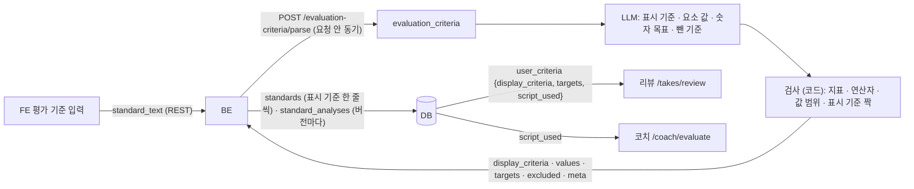
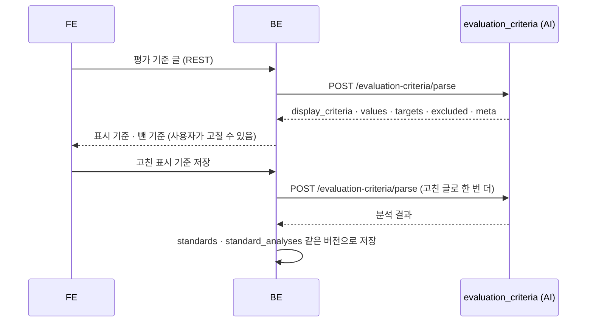

# 평가 기준 분석 (evaluation_criteria) 설계

> **이 문서는** 평가 기준 분석 기능의 전체 설명서다. 처음 보는 사람이 이 문서만 읽고 이 기능이 왜 있고, 무엇을 받아 무엇을 내며, 안에서 어떻게 돌고, 어떻게 실행 · 배포하는지 알 수 있게 쓴다.
> **기준 범위**: 평가 기준 분석 모듈(`POST /evaluation-criteria/parse`)의 목표 설계다. 기능 사이 공통 계약(에러 · `meta` · 시간 예산 · LLM 공통 규칙 · 지표 이름 · 저장 지도)은 `architecture.md`에 따르고, 이 문서에는 이 기능에만 있는 규칙 · 예외만 적는다.
> **관련 Issue**: #159
> **한 줄 요약**: 사용자가 자유롭게 적은 발표 평가 기준을 화면에 보일 짧은 기준 문장, 요소별 값, 숫자로 판정할 수 있는 목표(`targets`), 대본 사용 설정(`script_used`)으로 바꾼다. 리뷰가 `targets`로 사용자 기준을 판정하고, 코치가 `script_used`로 대본 응시 지적을 끈다.
> **기준값**: 표시 문장 길이 상한 · 요소 → 지표 연결 · 개수 상한은 `src/evaluation_criteria/config.py`에만 둔다. 이 문서에는 BE · 리뷰와 맞춰야 하는 값(요소 · 지표 이름 · 연산자 · 50자 · 입력 한도 · 시간 예산)과 예시만 적는다.

# 0. 한눈에 보기
| 언제 | 받는 것 | 내는 것 | 쓰는 곳 |
|---|---|---|---|
| 평가 기준 등록 · 수정 (`POST /evaluation-criteria/parse`, BE 요청 안 동기) | 평가 기준 문장 `standard_text` | 표시 기준 `display_criteria`, 요소별 값 `values`, 숫자 목표 `targets`, 요소에 없는 기준 `excluded`, `meta` | FE 평가 기준 화면(표시 기준 · 뺀 기준), 리뷰 `user_criteria`(사용자 기준 판정), 코치 `script_used`(대본 응시 봐주기) |

- **하는 것**: 문장을 측정할 수 있는 요소(말 속도 · 말 사이 멈춤 · 긴 침묵 · 소리 크기 · 군더더기 · 시선 · 대본 의존 · 대본 내용 전달, 대본 사용 허용)로 나누고, 숫자로 읽히는 기준만 지표 이름 · 연산자 · 값으로 옮긴다.
- **하지 않는 것**:
  - 기준을 판정하지 않는다. 판정은 리뷰가 Take 결과로 한다(`architecture.md` 0-2).
  - 숫자를 지어내지 않는다. "너무 빠르지 않게"처럼 숫자가 없는 기준은 목표로 만들지 않고 표시만 한다.
  - 발표 시간을 다루지 않는다. 제한 시간은 발표 정보(`pitches`)에서 따로 정하므로 `excluded`로 보낸다.
  - 판정 기준값(예: 긴 침묵이 몇 초부터인지)을 바꾸지 않는다. 그 값은 각 판정 모듈의 `config.py`에 있다.

# 1. 왜 필요한가
## 1-1. 배경
사용자(또는 발표 대회 · 수업)는 "추임새는 5번 이하로, 청중을 자주 보면서, 대본은 봐도 된다"처럼 평가 기준을 글로 준다. 리포트가 이 기준을 지켰는지 보여 주려면 기준을 판정 모듈의 지표 이름과 숫자 목표로 바꿔야 하고, 코치가 대본 응시를 지적할지도 이 글에서 정해진다.
지금 구현은 표시 문장 · 요소별 값 · 뺀 항목 이름만 내고 숫자 목표와 `meta`가 없다. BE는 표시 문장만 `standards`에 저장하고(뺀 항목은 문자열로 합쳐 응답에만 쓰고, 요소 값은 버린다), 그래서 리뷰의 사용자 기준 판정과 코치의 대본 사용 설정이 입력을 받지 못한다.

## 1-2. 목표
- 숫자로 적힌 기준을 지표 이름 · 연산자 · 값으로 정확히 옮긴다(예: "추임새 5번 이하" → `filler_count` `LTE` 5).
- 숫자가 없는 기준은 목표로 만들지 않고 사용자 표현대로 표시한다.
- 측정할 수 없는 기준은 사용자 표현 그대로 `excluded`에 남겨 FE가 "평가 기준에 넣지 않은 내용"으로 보인다.

## 1-3. 목표가 아닌 것
- 기준값을 사용자마다 바꾸기(예: 사용자가 "3초 침묵"이라 해도 긴 침묵 판정 기준은 소리 크기 모듈의 값이다, 15절).
- 발표 내용 · 논리 · 자세 · 질의응답 같은 측정하지 않는 항목의 판정.

# 2. 용어
| 용어 | 뜻 | 예 |
|---|---|---|
| 표시 기준 (`display_criteria`) | 사용자 표현을 살린 짧은 기준 문장, 한 줄 50자 이내 | `추임새 5번 이하` |
| 요소 (`values`의 키) | 측정할 수 있는 기준의 종류 | `filler` |
| 숫자 목표 (`targets[]`) | 숫자로 읽히는 기준 `{display, metric, operator, value}` | `{"display": "추임새 5번 이하", "metric": "filler_count", "operator": "LTE", "value": 5}` |
| 연산자 | `LTE`(이하) · `GTE`(이상) · `LT`(미만) · `GT`(초과) | `LTE` |
| 대본 사용 설정 (`script_used`) | 대본을 봐도 되는가. 지표가 아니라 설정이다 | `true` |
| 뺀 기준 (`excluded`) | 요소에 없는 기준, 사용자 표현 구절 그대로 | `발표는 5분 안에 끝내기` |

# 3. 전체 흐름

1. **BE**: 사용자가 기준 글을 보내면 요청 안에서 `/evaluation-criteria/parse`를 부른다(DB 세션을 쥐지 않고 기다린다). 결과를 FE에 보여 주고, 사용자가 표시 기준을 고쳐 저장하면 고친 글로 한 번 더 분석해 같은 버전으로 저장한다.
2. **LLM 한 번**: 표시 기준 · 요소 값 · 숫자 목표 · 뺀 기준을 고정 필드 스키마로 낸다.
3. **검사** (코드): 지표 이름 · 연산자가 정해진 목록(enum)에 있는지는 스키마가 막는다. 값 범위 · `display` 짝을 코드가 다시 보고 맞지 않는 목표를 뺀다(표시 기준은 남는다).
4. **쓰는 곳**: 리뷰가 `targets`를 미션처럼 판정해 `criteria_results`에 싣고, 코치는 `script_used`가 true면 대본 응시(`GAZE_ON_SCRIPT`)를 말하지 않는다.

# 4. 구성과 폴더
## 4-1. 폴더 트리
```
ai/research/evaluation-criteria/
├─ README.md                                폴더 · 파일 지도, 실행법, 실험 결과
├─ pyproject.toml · uv.lock                 Python 3.12. 코어는 pydantic 하나, 연구 도구만 LLM 라이브러리
├─ src/evaluation_criteria/                 코어 → 서비스 features/evaluation_criteria/로 폴더째 옮긴다
│   ├─ schemas.py                           요청 · 응답 · LLM 출력 pydantic 모델(지표 · 연산자 enum) = 계약
│   ├─ core.py                              analyze_criteria(): LLM → 검사
│   ├─ config.py · version.py               표시 문장 길이 상한 · 요소 → 지표 연결 · 개수 상한, 기능 버전
│   ├─ prompts/                             요소 표 · 단위 규칙 · 예시가 든 프롬프트
│   └─ examples/                            요청 · 응답 예시 (계약 테스트가 읽는다)
├─ run.py                                   실험 도구: ai/.env로 LLM을 만들어 data를 돌림 (build_llm은 여기로)
├─ data/                                    기준 문장 예시 세트와 정답(values · targets · excluded)
├─ tests/ · tests/live/                     스키마 · 검사 · 계약(가짜 LLM) / 실제 LLM(live 표시)
└─ reports/results/                         평가 결과 JSON
```
파일 이름은 담당자가 정하고 README의 파일 지도에 둔다.

## 4-2. 진입 함수
| 함수 | 하는 일 | 부르는 쪽 |
|---|---|---|
| `analyze_criteria(request, llm)` | 요청 하나를 처리해 응답 모델을 돌려준다. `llm`은 LLM 출력 스키마가 걸린 객체(`.invoke`만 씀)로 필수 인자다. LLM 예외는 잡지 않고 올린다 | 서비스 라우터 `POST /evaluation-criteria/parse` · `run.py` |
| `check_targets(targets, display_criteria, config)` | 숫자 목표 검사(LLM 없음) | `analyze_criteria` · 테스트 |

## 4-3. 규칙과 이유
| 규칙 | 이유 |
|---|---|
| LLM 출력 스키마는 고정 필드다(요소마다 필드, 자유 키 dict 없음). 지표 · 연산자는 enum이다 | 구조화 출력의 strict 모드가 자유 키 dict를 받지 않고, 없는 지표 이름이 나오지 않게 |
| 숫자 목표는 코드가 다시 검사하고, 맞지 않으면 빼되 표시 기준은 남긴다 | 판정할 수 없는 목표가 리뷰에 들어가지 않게, 사용자는 기준을 그대로 본다 |
| 코어는 상대 import와 pydantic만 쓰고 파일 · 환경변수 · 네트워크 · 시계를 쓰지 않는다 (`architecture.md` 8절) | 서비스로 옮겨도 코드를 고치지 않는다 |
| 지표 이름은 `architecture.md` 6-3 그대로 쓴다 | 리뷰가 지표 이름으로 Take 결과에서 값을 찾는다 |

# 5. 입력 · 출력 계약
요청 · 응답의 원본은 `src/evaluation_criteria/schemas.py`의 pydantic 모델이다. 요청은 모르는 필드를 무시하고, 응답은 정해진 필드만 낸다(`architecture.md` 2절).

## 5-1. 호출 목록
| 호출 | 언제 | 누가 | 방식 |
|---|---|---|---|
| `POST /evaluation-criteria/parse` | 평가 기준을 입력 · 수정할 때, 사용자가 고친 표시 기준을 저장할 때 | BE | 요청 안 동기, LLM 1번(재시도는 요청 마감 안에서만). BE는 다시 부르지 않는다 |

## 5-2. 입력
| 필드 | 타입 | 필수 | 뜻 | 예 |
|---|---|---|---|---|
| `standard_text` | string | 예 | 평가 기준 문장 | `추임새는 5번 이하로 하고, 청중을 자주 보면서 말하고 싶어요. 발표는 5분 안에 끝내기.` |

- 입력 한도: 앞뒤 공백을 뺀 길이 1~2,000자. 비거나 넘으면 422 `VALIDATION_ERROR`이고 LLM을 부르지 않는다. BE 입력 검사도 같은 값으로 둔다.

## 5-3. 출력
| 필드 | 타입 | 뜻 |
|---|---|---|
| `display_criteria` | list string | 사용자 표현을 살린 짧은 기준, 한 줄 50자 이내, 사용자 입력 순서. 요소 값이 있는 기준마다 한 줄. "~하기 · ~않게 · ~이하"로 맺는다 |
| `values` | object | 요소마다 str 또는 null(`script_used`만 bool 또는 null). 언급이 없으면 null. 값은 사용자 표현의 짧은 명사구(숫자 · 단위는 입력 그대로) |
| `targets[]` | list `{display, metric, operator, value}` | 숫자로 읽히는 기준만. `display`는 그 기준의 `display_criteria` 문장, `metric`은 아래 요소 → 지표 표의 지표, `operator`는 `LTE` · `GTE` · `LT` · `GT`, `value`는 지표 단위의 숫자 |
| `excluded` | list string | 요소에 없는 기준. 사용자 표현 구절 그대로(예: "발표는 5분 안에 끝내기"). 없으면 빈 목록 |
| `meta` | object | `{schema_version, feature_version: "evaluation_criteria-<버전>", model}` (`architecture.md` 5절) |

**요소 → 지표** (`config.py`가 원본, 지표 이름은 `architecture.md` 6-3)

| 요소 (`values` 키) | 뜻 | 지표 · 단위 |
|---|---|---|
| `speed` | 말 속도 | `cpm` (글자/분) |
| `pause` | 말 사이 멈춤 | `pause_count` (개) |
| `silence` | 지나치게 긴 침묵 | `long_silence_count` (개) |
| `volume` | 목소리 크기 | `voice_diff_db` (평소 목소리 대비 dB) |
| `filler` | 군더더기(추임새) | 횟수면 `filler_count`(개), 분당이면 `filler_per_min`(개/분) |
| `gaze` | 청중을 보는 정도 | `audience_ratio` (0–1) |
| `script_dependency` | 발표 중 대본을 보는 정도 | `reading_ratio` (0–1) |
| `script_similarity` | 대본 내용을 얼마나 전달했나 | `content_coverage` (0–1) |
| `script_used` | 대본을 봐도 되는가 (지표가 아닌 설정) | — (`true` · `false` · null) |

- `pause` · `silence`는 둘로 나눈다(말 사이 멈춤은 `pause_count`, 긴 침묵은 `long_silence_count`). 긴 침묵 요소의 이름은 `silence`다.
- **단위 규칙**: 퍼센트는 0–1 비율로 바꾼다(70% → 0.7). "분당 N번"은 `filler_per_min`, "N번"은 `filler_count`다. "초당 N자"는 60을 곱해 `cpm`으로 바꾼다. 지표 단위로 바꿀 수 없는 숫자(절대 dB, 침묵 길이 "3초" 같은 판정 기준값)는 `targets`에 넣지 않고 `values`에만 남긴다.
- 숫자로 읽히지 않는 기준(예: "청중을 자주 보기")은 판정하지 않고, 리포트는 `display_criteria`를 그대로 보여 준다.
- 근사("300자 정도")는 방향이 없어 목표로 만들지 않는다. 범위("250~350자")는 같은 `display`의 목표 두 개(`GTE` · `LTE`)다. 길이 조건이 붙은 횟수 기준("3초 넘게 끊기는 일 2번 이하")은 판정 모듈의 기준값과 다를 수 있어 목표로 만들지 않는다.
- 표시 기준은 10개까지다. 넘으면 앞에서부터 10개를 쓴다. `targets`는 검사 단계(6절 2번)가 20개 이하로 맞춘다(표시 기준 10개 × 범위 목표 2개, 리뷰 입력 한도와 같다).

## 5-4. 상태와 에러
| 상황 | 결과 |
|---|---|
| 정상 (목표가 없어도) | 200 |
| 형식이 틀림 | 422 `VALIDATION_ERROR` |
| LLM 실패 | 504 `LLM_TIMEOUT` · 502 `LLM_ERROR` · 502 `LLM_INVALID_OUTPUT` · 503 `LLM_UNAVAILABLE` (`architecture.md` 4 · 9절) |

## 5-5. 예시
**요청**
```json
{"standard_text": "추임새는 5번 이하로 하고, 청중을 자주 보면서 말하고 싶어요. 발표는 5분 안에 끝내기."}
```
**응답**
```json
{
  "display_criteria": ["추임새 5번 이하", "청중 자주 보기"],
  "values": {"speed": null, "pause": null, "silence": null, "volume": null, "filler": "5번 이하", "gaze": "청중을 자주 보기",
             "script_dependency": null, "script_similarity": null, "script_used": null},
  "targets": [{"display": "추임새 5번 이하", "metric": "filler_count", "operator": "LTE", "value": 5}],
  "excluded": ["발표는 5분 안에 끝내기"],
  "meta": {"schema_version": "1.0", "feature_version": "evaluation_criteria-1.0", "model": "<응답한 모델>"}
}
```
- 긴 침묵 요소의 키는 `silence`다.
**경계 — 긴 침묵 · 말 속도 · 대본 사용**
```json
{"standard_text": "말이 3초 넘게 끊기는 일은 2번 이하로, 말 속도는 1분에 300자 이하로 해 주세요. 대본은 봐도 됩니다."}
```
```json
{"display_criteria": ["3초 넘게 끊기는 일 2번 이하", "말 속도 1분에 300자 이하", "대본 봐도 됨"],
 "values": {"speed": "1분에 300자 이하", "pause": null, "silence": "3초 넘게 끊김 2번 이하", "volume": null, "filler": null, "gaze": null,
            "script_dependency": null, "script_similarity": null, "script_used": true},
 "targets": [{"display": "말 속도 1분에 300자 이하", "metric": "cpm", "operator": "LTE", "value": 300}],
 "excluded": [],
 "meta": {"schema_version": "1.0", "feature_version": "evaluation_criteria-1.0", "model": "<응답한 모델>"}}
```
- 사용자가 길이 조건("3초 넘게")을 붙인 횟수 기준은 판정 모듈의 기준(긴 침묵은 소리 크기 모듈의 값)과 다를 수 있어 목표로 만들지 않고 표시 기준 · `values`에만 남긴다. 목표로 만들면 3~5초 침묵을 세지 않은 채 "이뤘다"고 판정할 수 있다.

**경계 — 숫자 목표 없음**: "발표 주제는 창의적이어야 하고 발표 시간은 7분입니다" → `display_criteria` · `targets` 빈 목록, `excluded` = `["발표 주제는 창의적이어야", "발표 시간은 7분"]`.

# 6. 처리 — 안에서 어떻게 도는가
1. **LLM 한 번**: 요소 표 · 단위 규칙 · 예시가 든 프롬프트와 기준 문장으로 출력 스키마 `{display_criteria, values, targets, excluded}`를 받는다. 규칙: 언급이 없는 요소는 null, 추측 금지. `script_used`는 "대본 없이 · 보면 안 된다" → false, "봐도 된다 · 참고만" → true, 단서가 없으면 null. 같은 요소가 여러 번 나오면 더 구체적인 기준을 쓴다(프롬프트 규칙이고 계약에는 없다). 표시 기준은 사용자 표현을 그대로 살리고 요소 이름(영어)을 쓰지 않는다.
2. **검사** (코드, `check_targets`):
   - `metric` · `operator`가 enum에 없으면 그 목표를 뺀다(스키마가 막지만 다시 확인).
   - `value` 범위: 비율 지표(`audience_ratio` · `reading_ratio` · `content_coverage`)는 0–1, 개수 지표는 0 이상, `cpm`은 0보다 큼. 범위 밖이면 뺀다.
   - `display`가 `display_criteria` 중 하나와 같아야 한다. 아니면 뺀다.
   - 같은 `display` · `metric` · `operator`의 목표가 둘 이상이면 앞의 것만 둔다. 다 거른 뒤 20개를 넘으면 앞에서부터 20개만 두고 뺀 수를 로그에 남긴다(리뷰 입력 한도 `targets` 20).
   - 표시 기준이 50자를 넘으면 자르지 않고 출력 스키마 위반으로 본다(숫자 · 조건이 잘리거나 `targets[].display` 짝이 깨지지 않게). 공통 재시도 뒤에도 넘으면 502 `LLM_INVALID_OUTPUT`이다.
3. **응답**: `meta.model`에는 실제로 응답한 모델을 싣는다(서비스 라우터가 넣는다).

# 7. 실패할 때
| 상황 | 동작 | 응답 | 이유 |
|---|---|---|---|
| 형식 오류 | 처리하지 않는다 | 422 `VALIDATION_ERROR`, BE는 다시 부르지 않음 | `architecture.md` 4절 |
| LLM 시간 초과 · 실패 · 스키마 위반 (재시도도 실패) | 코어는 예외를 잡지 않는다 | 504 `LLM_TIMEOUT` · 502 `LLM_ERROR` · 502 `LLM_INVALID_OUTPUT` · 503 `LLM_UNAVAILABLE`. BE는 다시 부르지 않고 FE가 다시 시도를 안내한다 | LLM이 결과의 본체다. 요청 안 동기라 사용자가 두 배로 기다리지 않게 |
| 목표가 검사에 걸림 | 그 목표만 뺀다 | 200 | 표시 기준은 남아 리포트에 보인다 |
| 측정할 수 있는 기준이 하나도 없음 | 표시 기준 · 목표 빈 목록 | 200, 기준은 `excluded`에 | 처리 실패가 아니다 |

# 8. 시간 예산과 호출 규칙
| 호출 | AI 예산 | BE 시간 제한 | BE 재시도 | 이유 |
|---|---|---|---|---|
| `/evaluation-criteria/parse` | 25초 (호출 한 번 기본 12초, 남은 예산 안에서만 1번 더) | 30초 (호출 전체) | 없음. FE가 다시 시도를 안내 | `architecture.md` 3절 '요청 안 동기 LLM' |

- 잰 시간 (2026-10-12, 기본 묶음 6 luna, 지금 구현): 기준 문장 7개가 2.3~4.3초, 응답 0.3 KB 안팎이었다. 목표 설계는 재지 않았다. 지금 출력이 짧은 것으로 보아 시간 제한 안에 들 것으로 보지만, 추론 토큰이 늘면 달라질 수 있어 목표 설계로 다시 재고, 출력 한도는 그 값으로 정한다(`architecture.md` 9절).
- 모델: 기본 묶음(역할 `evaluation_criteria` → 기본 묶음, `architecture.md` 9절).

# 9. 버전
| 버전 | 값 | 어디에 | 언제 오르나 |
|---|---|---|---|
| `feature_version` | `evaluation_criteria-<버전>` (첫 판 `evaluation_criteria-1.0`) | `src/evaluation_criteria/version.py` | 요소 · 지표 연결 · 프롬프트 · 출력의 뜻이 바뀔 때 |
| `schema_version` | `1.0` | 응답 `meta` (`architecture.md` 5절) | 필드 이름 변경 · 삭제 · 뜻 변경 |

# 10. 실행 · 테스트
준비 (`ai/research/evaluation-criteria`에서. Python 3.12, `.venv`는 git에 없어 처음 한 번 만든다. 실제 LLM을 부르는 일만 `ai/.env`의 기본 묶음이 필요하다)
```bash
cd ai/research/evaluation-criteria
uv sync
```
| 하는 일 | 명령 | 기대 결과 |
|---|---|---|
| 테스트 | `uv run python -m pytest` | 스키마 · 목표 검사 · 계약(`examples/`, 가짜 LLM) 통과 |
| 실제 LLM 테스트 | `uv run python -m pytest -m live` | 예시 문장이 스키마를 통과 (과금) |
| 문장 실행 | `uv run python run.py --all` | `results/` (과금) |
| 평가 | `uv run python run.py --eval --out reports/results/evaluation_criteria_eval.json` | 요소 분류 정확도 · 숫자 목표 추출 정확도 (13절, 과금) |

- 테스트가 볼 것: 요소마다 · 단위 바꾸기(% · 분당 · 초당), 숫자 없는 기준은 목표 없음, `display` 짝이 틀린 목표 빼기, 값 범위, `script_used` 세 값, 50자 넘는 표시 기준은 스키마 위반(502 `LLM_INVALID_OUTPUT`), 측정할 수 없는 기준만 있을 때.

# 11. 배포
**어디서 도는가**: 코어 `src/evaluation_criteria/`(`prompts/` · `examples/` 포함)를 AI 서비스의 `features/evaluation_criteria/`로 폴더째 옮기고, 라우터가 `POST /evaluation-criteria/parse`를 연다. 라우터는 요청 마감 시각을 만들고 `structured_llm(LLM 출력 스키마, deadline)`을 넘긴다. LLM 에러는 `common/errors.py`가 상태 코드로 바꾼다. 서비스로 옮기려면 서비스 뼈대(`ai-service.md`)가 먼저 있어야 한다.

**BE와 함께 바꿀 것**: `X-Request-ID`, 호출 전체 30초, 응답의 `targets` · `script_used` · `excluded` · `values` · `meta`를 `standard_analyses`에 저장, 고친 표시 기준을 다시 분석해 같은 버전으로 저장. 새 필드(`targets` · `meta` · `silence`)는 BE가 모르는 필드로 무시하므로 AI가 먼저 내도 깨지지 않는다.

**환경변수**: 서비스 공통의 LLM 묶음과 시간 제한을 쓴다.

**로그**: 기준 문장 원문은 남기지 않는다. 길이 · 목표 수만 남긴다(`architecture.md` 11절).

**증상별 원인**

| 증상 | 원인 | 확인 · 해결 |
|---|---|---|
| 리포트에 사용자 기준 판정이 비어 있음 | `targets`가 없음(숫자가 없는 기준), BE가 `standard_analyses`에 저장하지 않음 | 응답의 `targets`, BE가 `standard_analyses`에 저장하는지(12절) |
| 대본을 봐도 된다고 했는데 대본 응시를 지적함 | `script_used`가 null로 나옴, BE가 `script_used`를 evaluate에 싣지 않음 | 응답의 `values.script_used`, 코치 요청의 `script_used` |
| 표시 기준과 저장된 기준 문장이 다름 | 사용자가 고친 문장을 다시 분석하지 않고 저장함 | BE가 고친 글로 다시 분석해 같은 버전으로 저장하는지(12-2) |
| 긴 침묵 기준이 말 사이 멈춤으로 판정됨 | 요소 → 지표 연결이 옛 것(`pause` → `pause_count`만) | `silence` 요소 · `long_silence_count` 연결이 들어갔는지(5-3) |

# 12. FE · BE · DB 연결과 저장

## 12-1. 저장 (DB)
저장 설계는 AI가 하고, 마이그레이션 · 구현 · 운영은 BE가 한다. 공통 저장 지도는 `architecture.md` 1-1이다.

| 데이터 | 언제 생기나 | 저장 위치(테이블.칸) | 형식(JSON · 칸, 크기) | 쓰는 쪽 · 읽는 쪽 | 덮어쓰기 막기 | 보관 기간 · 개인정보 |
|---|---|---|---|---|---|---|
| 표시 기준 | 저장할 때의 분석 응답 | `standards` (`pitch_id` · `version` · `position` · `title` String(50)) | 표시 기준 한 줄에 한 행, `title`은 50자 이내 | BE가 쓴다 · FE 평가 기준 화면, 리뷰 `user_criteria.display_criteria` | `(pitch_id, version, position)` 유일 제약. 새 저장은 새 버전 | 발표와 함께. 사용자가 쓴 글이다 |
| 분석 결과 | 같음 | `standard_analyses` (새 테이블) | 아래 설계. 잰 크기: 응답 전체 0.3 KB 안팎(기준 문장 7개) | BE가 쓴다 · 리뷰 `user_criteria.targets` · `script_used`, 코치 `script_used` | `(pitch_id, version)` 유일 제약 | 발표와 함께 |

**`standard_analyses` 설계**

| 칸 | 타입 · null | 뜻 |
|---|---|---|
| `pitch_id` | Uuid FK `pitches.id` CASCADE NOT NULL | 발표 |
| `version` | Integer NOT NULL | `standards`와 같은 버전 |
| `targets` | JSONB NOT NULL | 숫자 목표 목록(빈 목록 가능) |
| `script_used` | Boolean NULL | 대본 사용 설정(응답의 `values.script_used`, 언급이 없으면 null). 코치 `script_used` · 리뷰 `user_criteria.script_used`가 이 칸을 읽는다 |
| `excluded` | JSONB NOT NULL | 뺀 기준 목록(문자열 배열, 합치지 않는다) |
| `values` | JSONB NULL | 요소별 값 |
| `meta` | JSONB NOT NULL | 응답의 `meta` |
| 제약 | UQ(`pitch_id`, `version`) | 버전마다 하나 |

## 12-2. 저장 규칙
- 표시 기준(`standards`)과 분석 결과(`standard_analyses`)는 같은 버전 번호로 한 트랜잭션에 저장한다. BE는 Take를 시작할 때 그 발표의 최신 버전 번호를 `takes.standard_version`에 고정하고(없으면 null = 기준 없음), 리뷰 `user_criteria` · 코치 `script_used`는 그 버전에서 만든다. Take 도중이나 뒤에 기준을 다시 등록해도 그 Take의 버전은 바꾸지 않는다(`architecture.md` 1-3 1번).
- `targets[].display`는 저장된 표시 기준 문장과 같아야 한다. 그래서 사용자가 고친 표시 기준은 다시 분석한 결과의 문장으로 저장한다.
- `excluded`는 목록 그대로 저장한다. 쉼표로 합치면 구절 안의 쉼표 때문에 다시 나눌 수 없다.
- 결과는 `meta`와 함께 저장한다(`architecture.md` 1-1).

# 13. 품질 검증
| 평가 데이터 | 지표 | 중점 | 검증 방법 |
|---|---|---|---|
| 기준 문장 예시 세트와 정답(`values` · `targets` · `excluded`) — 요소마다, 단위 바꾸기(% · 분당 · 초당), 숫자 없는 기준, 측정할 수 없는 기준, 여러 기준이 섞인 문장, 긴 침묵 · 말 사이 멈춤 구분 | 요소 분류 정확도, 숫자 목표 추출 정확도(`metric` · `operator` · `value`가 모두 정답과 같은 비율) | 숫자 목표를 지표 이름 · 연산자로 정확히 옮기는 것 | `run.py --eval` → 결과 JSON |
| 같은 세트 | 지어낸 목표 수(정답에 없는 목표), 표시 기준이 사용자 표현을 살린 비율(사람이 봄) | 숫자를 지어내지 않는 것 | 같음 |

- 지금 `data/examples.json`은 정답 없는 5문장이다.

# 14. 지표 정의
- **요소 분류 정확도**: 문장마다 요소 9개(`script_used` · `silence` 포함)의 값이 null인지 아닌지, `script_used`의 값이 정답과 같은 비율.
- **숫자 목표 추출 정확도**: 정답 목표 중 `metric` · `operator` · `value`가 모두 같은 목표가 나온 비율(재현율)과, 나온 목표 중 정답에 있는 비율(정밀도).
- **지어낸 목표 수**: 정답에 없는 목표 수 ÷ 문장 수.

# 15. 열린 질문 · 알려진 한계
**정한 것**
- 새 요소 이름 `silence`, 숫자 목표 규칙(근사 · 범위 · 길이 조건 · 코드 검사 · 50자 넘으면 스키마 위반), 입력 한도 2,000자, `standard_analyses.values` 칸, 표시 기준 10개까지.

**열린 질문**
- 아직 정하지 않았다: BE 저장 쪽 세 가지 — FE가 고친 표시 기준을 저장하는 호출, `standards.title`(50자)에 맞춘 BE 입력 길이 검사, FE 화면이 표시 기준 개수를 자르지 않는다는 전제를 BE 저장 방식(고친 글을 다시 분석해 같은 버전으로 저장)과 맞추기.

**알려진 한계**
- 사용자가 말한 기준값(예: "3초 넘는 침묵")은 판정에 쓰지 않는다. 긴 침묵 판정은 소리 크기 모듈의 기준(예: 5초)으로 센다. 그래서 길이 조건이 붙은 횟수 기준은 목표로 만들지 않고 표시만 한다. 목표로 만들면 표시 기준(3초)과 판정(5초)이 다르게 보인다.
- `voice_diff_db`는 평소 목소리 대비라, "크게 말하기" 같은 기준은 대부분 숫자가 없어 표시만 된다.
- 지금 평가 데이터에 정답이 없다.

# 16. 확정 값 한눈에
| 항목 | 값 | 어디서 정하나 |
|---|---|---|
| 경로 | `POST /evaluation-criteria/parse` (요청 안 동기) | 5-1 |
| 입력 | `standard_text` | 5-2 |
| 출력 | `display_criteria`(한 줄 50자 이내) · `values`(요소 9개) · 표시 기준 10개까지 · `targets[{display, metric, operator, value}]` · `excluded`(사용자 표현 구절) · `meta` | 5-3 |
| 요소 → 지표 | `speed` `cpm` · `pause` `pause_count` · `silence` `long_silence_count` · `volume` `voice_diff_db` · `filler` `filler_count`/`filler_per_min` · `gaze` `audience_ratio` · `script_dependency` `reading_ratio` · `script_similarity` `content_coverage` · `script_used` 설정 | 5-3 |
| 연산자 | `LTE` · `GTE` · `LT` · `GT` | 5-3 |
| 시간 예산 | AI 25초 / BE 30초, BE 재시도 없음 | 8절 |
| 버전 | `evaluation_criteria-1.0` · `schema_version` `1.0` | 9절 |
| 저장 | `standards`(표시 기준) · `standard_analyses`(버전마다 `targets` · `script_used` · `excluded` · `values` · `meta`) | 12-1 |
| 입력 한도 | `standard_text` 1~2,000자 (넘으면 422) | 5-2 |
