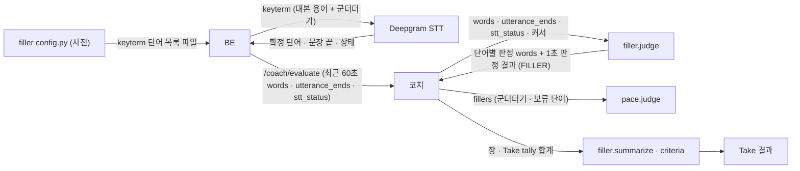
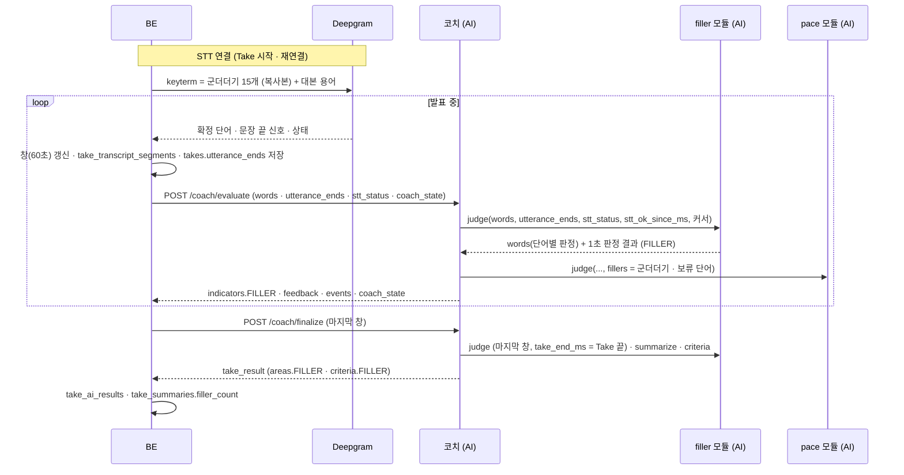

# 군더더기 (filler) 설계

> **이 문서는** 군더더기 판정 기능의 전체 설명서다. 처음 보는 사람이 이 문서만 읽고 이 기능이 왜 있고, 무엇을 받아 무엇을 내며, 안에서 어떻게 돌고, 어떻게 실행 · 배포하는지 알 수 있게 쓴다.
> **기준 범위**: 군더더기 판정 모듈의 목표 설계다. 기능 사이 공통 계약(1초 원자료 모양 · 1초 판정 결과 형식 · 커서 · 에러 · meta · 시간 예산 · 저장 지도)은 `architecture.md`에 따르고, 이 문서에는 이 기능에만 있는 규칙 · 예외만 적는다.
> **한 줄 요약**: STT가 확정한 단어마다 "음 · 그 · 그니까" 같은 군더더기인지 층(T1 · T2 · T3)과 함께 판정하고, 최근 빈도로 1초 판정 결과를 낸다. 군더더기 사전의 원본을 이 모듈이 갖고, BE는 여기서 STT keyterm 단어만 가져간다.
> **기준값**: 판정 수치(앞 · 뒤 간격 기준, 문장 첫 단어 간격 기준, 잦음 기준, 판정 창 길이)와 사전은 `src/filler/config.py`에만 두고 이 문서에는 지표와 나쁜 방향만 쓴다. 사전의 단어 목록은 BE · STT와 맞춰야 하는 값이라 이 문서에도 적는다(5-2). 문서의 숫자는 BE와 맞춰야 하는 통신 값과 예시뿐이다.
> **관련 Issue**: #152

# 0. 한눈에 보기
| 언제 | 받는 것 | 내는 것 | 쓰는 곳 |
|---|---|---|---|
| 발표 중 1초마다 (`filler.judge`, `/coach/evaluate` 안) | 최근 60초 STT 확정 단어, 문장 끝 신호, STT 상태, 두 커서 | 단어별 판정 `words`, 1초 판정 결과 하나 (영역 `FILLER`) | 코치: 군더더기 지적 · 상태 표시 · 개입 효과. 말 속도: 군더더기를 글자 수에서 뺌 |
| 장 끝 · Take 끝 (`filler.summarize` · `criteria`, `/coach/finalize` 안) | 장 · Take 동안의 `tally` 합계 | 군더더기 수 · 분당 수 · 층별 · 단어별 횟수, 판정 기준 | Take 결과 → 리뷰 · 리포트 |
| 대본 등록 · STT 연결 때 (BE) | — | keyterm 단어 목록 파일 | BE가 대본 용어와 함께 Deepgram keyterm으로 넘김 |

- **하는 것**: 사전의 층별 규칙과 단어 사이 간격 · 문장 끝 신호로 단어마다 군더더기인지 판정한다. 뒤 간격을 봐야 하는 단어는 다음 단어가 올 때까지 판정을 미룬다(보류). 최근 창의 군더더기 수가 많으면 `FILLER_FREQUENT`를 낸다. 장 · Take의 층별 · 단어별 횟수를 낸다.
- **하지 않는 것**:
  - LLM으로 문맥을 판단하지 않는다. 1초마다 부를 수 없고 같은 입력에 다른 답이 나올 수 있다(`architecture.md` 0-3).
  - STT 중간 결과를 쓰지 않는다. 확정 단어만 쓴다.
  - "네 · 예 · 응"을 세지 않는다. 청중에게 답하는 말과 가릴 수 없다.
  - 말을 걸지 결정하지 않는다(코치 몫). 좋다 · 나쁘다는 결론을 내지 않는다(리뷰 몫).
  - BE는 군더더기를 판정하지 않는다. BE는 이 모듈의 keyterm 단어 목록만 가져간다(`architecture.md` 0-3).

# 1. 왜 필요한가
## 1-1. 배경
"음 · 어"나 "그 · 이제 · 그니까"를 습관처럼 넣으면 발표가 덜 준비된 것처럼 들린다. 스스로는 몇 번 넣는지 알기 어렵다.
같은 단어라도 군더더기일 때와 아닐 때가 있다. "그 사람"의 "그"는 정상 단어이고, 말이 멈춘 뒤 혼자 나온 "그..."는 군더더기다. 그래서 단어 목록만으로는 안 되고, 단어 사이 간격과 문장 끝을 함께 봐야 한다.
STT(Deepgram) 한국어는 채움말("음 · 어")을 기본으로 지우고, 군더더기를 남기는 설정이 없다. 그래서 군더더기 단어를 keyterm(꼭 받아 적을 단어)으로 넘겨야 전사에 남는다.
지금은 군더더기 사전이 BE · 코치 연구용 대역 · 대본 전달도 STT 정리에 따로 있고, 문맥을 보는 판정 규칙이 없다.

## 1-2. 목표
- STT 확정 단어마다 군더더기인지, 어느 층인지, 왜인지(`reason`)를 판정해 말 속도와 코치가 같은 판정을 쓰게 한다.
- 군더더기 사전의 원본을 한 곳에 두고, BE의 keyterm 목록이 그 원본에서 나오게 한다.
- 장 · Take마다 어떤 말을 몇 번 썼는지 리포트에 보일 수 있게 층별 · 단어별 횟수를 낸다.
- 놓침보다 오탐을 피한다. 정상 단어를 군더더기로 세면 사용자가 판정을 믿지 않는다.

## 1-3. 목표가 아닌 것
- 사전에 없는 군더더기 찾기(예: "엄 · 흠"). 사전에 넣어야 센다.
- 말을 더듬거나 단어를 반복하는 것 자체의 평가. 같은 단어 바로 반복은 사전의 T2 · T3 단어일 때만 군더더기 판정에 쓴다.
- STT가 놓친 채움말 복원. keyterm으로도 채움말이 모두 남지는 않으므로 채움말 수는 실제보다 적게 나올 수 있다(15절).

# 2. 용어
| 용어 | 뜻 | 예 |
|---|---|---|
| 군더더기 | 뜻 없이 말 사이에 넣는 말 | "음", 혼자 나온 "그..." |
| 층 (tier) | 군더더기 사전의 세 묶음. 층마다 판정 규칙이 다르다 | `T1` 채움말 · `T2` 지시 · 대용 · `T3` 어휘적 |
| 사전 | 층별 단어 목록과 keyterm 표시. 이 모듈의 `config.py`가 원본이다 | T1 "음" (keyterm 넣음) |
| keyterm | STT(Deepgram)에 "이 단어는 꼭 받아 적어라"고 넘기는 단어 목록. 대본 용어와 자리를 나눠 쓴다 | "음 · 어 · 그 · 이제" |
| 확정 단어 | STT가 더 바꾸지 않는다고 확정한 단어와 단어별 시작 · 끝 시각 | `{"word": "음", "start_ms": 40050, "end_ms": 40400}` |
| 문장 끝 신호 | Deepgram `UtteranceEnd`가 알린 마지막 단어의 끝 시각 (`utterance_ends`, `architecture.md` 6-2) | `[37600]` |
| 앞 간격 · 뒤 간격 | 앞 단어의 끝 ~ 이 단어의 시작 · 이 단어의 끝 ~ 다음 단어의 시작 | "그" 앞 0.8초 쉼 |
| 단독 단어 | 앞이나 뒤(T3는 앞뒤 모두) 간격이 기준 이상인 단어 | "... (쉼) 그니까 (쉼) ..." |
| 문장 첫 단어 | 직전 문장 끝 신호 뒤의 첫 단어, 또는 앞 단어와의 간격이 기준 이상인 단어 | 문장 끝 뒤 "이제 ..." |
| 바로 반복 | 같은 단어가 연달아 나옴 | "그 그 사람이" |
| 보류 | 뒤 간격을 봐야 판정할 수 있는데 아직 다음 단어가 오지 않은 상태. `is_filler: null` | 창의 마지막 단어 "그" |
| 단어 커서 (`words_since_ms`) | 어디까지 단어를 셌는지. `end_ms`가 이 값보다 큰 단어가 새것이다(`architecture.md` 7절) | `38950` |
| 시각 커서 (`since_ms`) | 시간 합계(`elapsed_ms` · `total_ms`)를 어디까지 셌는지 | `40000` |
| STT 정상 시간 (`elapsed_ms`) | STT 상태가 `ok`였던 시간. 분당 수의 분모다 | `1000` |

# 3. 전체 흐름

1. **keyterm (BE)**: BE가 이 모듈의 keyterm 단어 목록을 가져와 대본 용어(`terms`)와 함께 Deepgram에 넘긴다. 개수 · 길이 한도가 넘치면 대본 용어 뒤쪽부터 뺀다(`architecture.md` 2절). 채움말이 전사에 남아야 판정할 수 있기 때문이다.
2. **STT (BE)**: BE가 확정 단어 · 문장 끝 신호 · STT 상태를 Take 기준 ms로 들고 있다가, FE `metrics`를 받을 때마다 최근 60초를 `/coach/evaluate`에 싣는다. 복구(`replay`)용으로 단어가 확정된 시각도 함께 보관한다(`architecture.md` 2절, `coach-agent.md` 12-1).
3. **코치 → `filler.judge`**: 코치가 요청마다 판정 모듈 중 군더더기를 가장 먼저 부른다. 말 속도가 같은 요청 안에서 군더더기 판정을 받아야 하기 때문이다(`coach-agent.md` 6-1).
4. **`filler.judge`**: 창 안 단어마다 층과 군더더기 여부를 판정하고(뒤 간격이 필요한데 다음 단어가 없으면 보류), 판정이 정해진 새 단어만 `tally`에 센다. 최근 창의 군더더기 수로 `state`와 `FILLER_FREQUENT`를 정한다.
5. **코치 → 말 속도**: 코치가 `words` 중 군더더기(true)와 보류(null) 단어를 `fillers`로 말 속도에 넘긴다. 말 속도는 군더더기를 글자 수에서 빼고 보류 단어부터는 다음에 센다. 모듈끼리 import하지 않으므로 코치가 옮겨 준다.
6. **코치**: `state`를 상태 표시에, `FILLER_FREQUENT`를 지적 후보에 쓰고, `tally`를 단어가 말해진 장의 합계에 더한다.
7. **Take 끝**: 코치가 Take 끝 시각을 `take_end_ms`로 넘겨 보류한 단어까지 판정하게 한 뒤(6-2), `summarize`로 장 · Take 지표를 만들어 Take 결과에 담는다.

# 4. 구성과 폴더
## 4-1. 폴더 트리
```
ai/research/filler-detection/
├─ README.md                                폴더 · 파일 지도, 실행법, 실험 결과
├─ pyproject.toml · uv.lock                 Python 3.12, 의존성은 pydantic 하나
├─ src/filler/                              판정 모듈 → 서비스 features/filler/로 폴더째 옮긴다
│   ├─ schemas.py · core.py · config.py · version.py
│   ├─ keyterms.json                        keyterm 단어 목록 (config.py 사전에서 만든 생성 파일, BE가 가져간다)
│   └─ examples/                            judge · summarize · criteria 입력 · 출력 예시 (계약 테스트가 읽는다)
├─ data/                                    평가 데이터: 층 · 군더더기 여부를 단어마다 표시한 발화 세트
├─ tools/                                   keyterm 파일 다시 만들기 · 평가 스크립트
├─ tests/                                   판정 규칙 · 커서 · 계약 · keyterm 파일 최신 검사
└─ reports/results/                         평가 결과 JSON (층별 정밀도 · 재현율)
```
파일마다의 역할은 연구 폴더를 만들 때 README의 파일 지도에 둔다.

## 4-2. 진입 함수
| 함수 | 하는 일 | 부르는 쪽 |
|---|---|---|
| `judge(inputs, t_ms, config)` | 1초 판정. 단어별 판정 `words`를 담은 `JudgmentResult` 하나(영역 `FILLER`)를 목록으로 낸다(`architecture.md` 7절) | 코치(`/coach/evaluate` · `/coach/finalize` · `replay`) |
| `summarize(tally, config)` | 장 · Take의 `tally` 합계 → 군더더기 지표 | 코치(장 끝 · Take 끝) |
| `criteria(config)` | `FILLER_FREQUENT`의 판정 기준 | 코치(Take 결과의 `criteria`) |
| `keyterms(config)` | 사전에서 keyterm 표시가 된 단어 목록. `keyterms.json`을 만들고, 테스트가 파일과 같은지 본다 | 도구 · 테스트 |

## 4-3. 규칙과 이유
| 규칙 | 이유 |
|---|---|
| 사전도 판정 기준이므로 `config.py`에 두어 `criteria_version` 해시에 들어가게 한다 | 단어를 하나 더하거나 빼도 결과가 바뀌므로 버전으로 추적한다 |
| keyterm 단어 목록 파일은 사전에서 만든 생성 파일이고 손으로 고치지 않는다. 테스트가 사전에서 다시 만들어 같은지 본다 | BE가 가져가는 목록과 판정 사전이 갈라지지 않게 |
| 코어는 상대 import와 pydantic만 쓰고 파일 · DB · 네트워크 · 환경변수 · 시계를 쓰지 않는다. 다른 모듈을 import하지 않는다 (`architecture.md` 8절) | 같은 입력에 같은 결과, 서비스로 폴더째 옮겨도 코드를 고치지 않는다 |
| 판정이 정해진 단어만 센다. 한 번 센 몫은 바꾸지 않는다 | 겹쳐 오는 창에서 두 번 세거나, 보류를 잘못 센 뒤 고칠 일이 없게 |
| 입력 모델은 모르는 필드를 무시하고, 출력 모델은 정해진 필드만 낸다 | `architecture.md` 2절 '모르는 필드' |

# 5. 입력 · 출력 계약
입력 · 출력의 원본은 `src/filler/schemas.py`의 pydantic 모델이다. 시각은 모두 Take 시작 기준 ms다. 1초 판정 결과의 공통 필드와 STT 모듈 입력 · 커서 규칙은 `architecture.md` 7절이 기준이고, 아래는 군더더기에만 있는 값이다.

## 5-1. 호출 목록
| 호출 | 언제 | 누가 |
|---|---|---|
| `filler.judge` | `/coach/evaluate` 요청마다 한 번(판정 모듈 중 가장 먼저), `/coach/finalize`의 마지막 창(Take 끝 시각을 `take_end_ms`로 받음), `replay`의 1초마다 | 코치 (API 라우터가 묶어 넘긴 `Judges`로) |
| `filler.summarize` | 장이 끝날 때 · Take가 끝날 때 | 코치 |
| `filler.criteria` | Take 결과를 만들 때 | 코치 |
| keyterm 단어 목록 | 목록이 바뀔 때 (BE가 가져가 STT 연결 때 넘긴다) | BE |

군더더기는 자기 HTTP 엔드포인트가 없다.

## 5-2. 입력
**사전** (이 모듈의 `config.py`가 원본)

| 층 | 단어 | keyterm | 판정 |
|---|---|---|---|
| T1 채움말 | 음 · 어 · 아 · 에 · 으 · 음음 · 어어 · 으음 | 모두 넣는다 | 나오면 늘 군더더기 |
| T2 지시 · 대용 | 그 · 저 · 이제 · 인제 · 뭐 · 자 · 저기 · 이 · 인자 · 저기요 · 아아 | 그 · 저 · 이제 · 인제 · 뭐 · 자 · 저기만 넣는다 | 다음 중 하나면 군더더기: 앞이나 뒤 간격이 기준 이상인 단독 단어 / 같은 단어가 바로 반복 / 문장 첫 단어이고 뒤 간격이 기준 이상 |
| T3 어휘적 | 그니까 · 그러니까 · 그니깐 · 근데 · 그런데 · 그래서 · 그래가지고 · 그래갖고 · 뭐지 · 뭐냐 · 뭐더라 · 뭔가 · 뭐랄까 · 그게 · 막 · 좀 · 약간 · 그냥 · 되게 · 진짜 · 완전 · 솔직히 · 사실 · 이렇게 · 저렇게 · 그렇게 · 이런 · 그런 · 있잖아 · 있잖아요 · 아무튼 · 어쨌든 · 하여튼 · 아니 · 글쎄 · 글쎄요 | 넣지 않는다 | 앞뒤 간격이 모두 기준 이상인 단독 단어, 또는 같은 단어가 바로 반복 |

- keyterm은 T1 8개와 T2 7개, 모두 15개다. T3와 T2 일부를 넣지 않는 이유는 둘이다. 평범한 단어까지 끌어당겨 말하지 않은 단어가 전사에 낄 수 있다. 개수 한도가 있는 keyterm 자리를 대본 용어와 나눠 써야 한다.
- "네 · 예 · 응"은 청중 응답과 구분할 수 없어 넣지 않는다.
- 사전과 맞출 때 단어는 앞뒤 공백 · 문장부호를 떼고 그대로 비교한다(활용형 · 띄어쓰기 변형은 사전에 따로 넣어야 센다). BE가 싣는 `word`는 Deepgram의 문장부호 없는 어절이고(`punctuated_word`가 아님), `filler_word:<단어>` 키에도 뗀 단어를 쓴다(15절 열린 질문).
- keyterm 목록의 순서는 BE 목록과 같게 둔다: T1 짧은 채움말(음 · 어 · 아 · 에 · 으) → T2 일곱 개 → T1 늘인 채움말(음음 · 어어 · 으음). 군더더기 keyterm 15개는 모두 남기고, 한도가 넘치면 대본 용어 뒤쪽부터 뺀다(`architecture.md` 2절).

**`judge(inputs, t_ms, config)`의 `inputs`** (코치가 만든다. `architecture.md` 7절 STT 모듈 입력)

| 필드 | 타입 | 필수 | 뜻 | 예 |
|---|---|---|---|---|
| `t_ms` | int | 예 | 판정 시각 | `41000` |
| `since_ms` | int | 예 | 시각 커서. 시간 합계(`elapsed_ms` · `total_ms`)를 이 시각부터 센다 | `40000` |
| `words_since_ms` | int | 예 | 단어 커서. `end_ms`가 이 값보다 큰 단어가 새것이다 | `38950` |
| `words` | list | 아니오 | 최근 60초 STT 확정 단어 `[{word, start_ms, end_ms}]`. BE가 매 요청 겹쳐 보낸다 | 아래 5-5 |
| `utterance_ends` | list int | 아니오 | 창 안의 문장 끝 신호 시각. 값은 Deepgram `UtteranceEnd` 이벤트가 알린 마지막 단어의 끝 시각이다(그 뒤로 정해진 시간 넘게 말이 없었다는 뜻) | `[36800]` |
| `take_end_ms` | int · null | 아니오 | finalize 마지막 창의 Take 끝 시각(evaluate에서는 null). 그때까지 보류인 단어의 뒤 간격을 `take_end_ms − end_ms`로 재서 정한다(`architecture.md` 7절, 6-2) | `92000` |
| `stt_status` | enum | 아니오 | `connecting` · `ok` · `reconnecting` · `degraded` · `closed`. `ok`가 아니면 잴 수 없음 | `ok` |
| `stt_ok_since_ms` | int | 아니오 | STT가 마지막으로 `ok`가 된 시각. 코치가 `coach_state`에서 넣는다. 끊긴 적이 없으면 0. `start_ms`가 이보다 이른 단어는 창에서 뺀다 | `0` |

## 5-3. 출력
**`judge` → `JudgmentResult` 하나를 담은 목록** (`evaluator: "filler"`, `area: "FILLER"`). 공통 필드는 `architecture.md` 7절이다.

| 필드 | 값 | 예 |
|---|---|---|
| `words` (이 모듈만) | 창 안 단어별 판정 `{start_ms, end_ms, word, tier, is_filler, reason}`. `tier`는 사전에 없으면 null. `is_filler`가 null이면 보류. `reason`은 사람이 읽는 판정 이유 | `{"word": "음", "tier": "T1", "is_filler": true, "reason": "채움말"}` |
| `metrics` | `recent_filler_count`(최근 창의 군더더기 수) · `filler_per_min`(최근 창의 군더더기 수 ÷ 최근 창 안에서 STT가 정상이던 시간 × 60000. 그 시간이 기준보다 짧으면 null). 잴 수 없으면 둘 다 null | `{"recent_filler_count": 2, "filler_per_min": 2.93}` |
| `tally` | 판정이 정해진 새 군더더기 단어마다 `{t_ms: 그 단어의 start_ms, values: {filler_count, filler_t1 · filler_t2 · filler_t3 중 하나, "filler_word:<단어>"}}`, 새 1초마다 `{t_ms: 그 1초의 시작, values: {elapsed_ms, total_ms}}` | 아래 5-5 |
| `state` | `NORMAL` · `HIGH`(최근 창 군더더기 수가 기준 이상). 잴 수 없으면 `UNKNOWN` | `NORMAL` |
| `measurable` | STT 상태가 `ok`면 true | `true` |
| `issues[].confidence` | 잴 수 있으면 1 | `1.0` |
| `counted_until_ms` · `words_counted_until_ms` | 이번까지 센 시각 · 단어 커서. 단어 커서는 판정이 정해진 단어 `end_ms` 중 가장 큰 값이고(받은 커서보다 작아지지 않는다, `architecture.md` 7절), 보류 단어가 있으면 그 앞에서 멈춘다 | `41000` · `40980` |

**`summarize(tally)` → `{"FILLER": {...}}`** (장 · Take 값, 분모가 0이면 null. `measured_ratio`만 분모가 0이면 0, `architecture.md` 7절)

| 지표 | 계산 |
|---|---|
| `filler_count` | 합 |
| `filler_per_min` | `filler_count ÷ elapsed_ms × 60000` |
| `by_tier` | 층별 횟수 묶음 `{"T1", "T2", "T3"}` (`filler_t1` · `filler_t2` · `filler_t3` 합) |
| `by_word` | 단어별 횟수 묶음 (`filler_word:<단어>` 합에서 접두어를 뗀 것). 센 단어만 들어간다 |
| `measured_ratio` | `elapsed_ms ÷ total_ms` (군더더기의 측정 비율) |

**`criteria()`** → `{"FILLER_FREQUENT": {metric: "recent_filler_count", direction: "HIGHER_IS_WORSE", threshold, bad, onset_lag_ms, offset_lag_ms}}`

## 5-4. 문제 목록
| 문제 | 조건 | 판정 지표 (나쁜 방향) | `actionable` |
|---|---|---|---|
| `FILLER_FREQUENT` | 최근 창 군더더기 수가 기준 이상 | `recent_filler_count` (많을수록) | true |

- 잴 수 없으면(`stt_status`가 `ok`가 아님) `state`는 `UNKNOWN`이고 `issues`는 빈 목록이다. 군더더기에는 측정 불가 문제 이름이 없다(`architecture.md` 6-3).
- `severity`는 공통 규칙(기준값에서 0.5, 아주 나쁨 값에서 1.0, 그 사이 직선, 1.0에서 자름)을 따른다.
- 코치는 `FILLER_FREQUENT`에 `REDUCE_FILLER` → `REDUCE_FILLER`(숨 쉬기) → 그만둠 사다리를 쓰고, 개입 효과는 개입 뒤 정해진 구간의 군더더기 수를 개입 앞 같은 길이 구간과 `tally`의 시각으로 비교한다(`coach-agent.md` 6-1).

## 5-5. 예시
**`judge` 입력**
```json
{
  "t_ms": 41000,
  "since_ms": 40000,
  "words_since_ms": 38950,
  "stt_status": "ok",
  "stt_ok_since_ms": 0,
  "utterance_ends": [36800],
  "words": [
    {"word": "그니까", "start_ms": 37900, "end_ms": 38300},
    {"word": "지난", "start_ms": 38700, "end_ms": 38950},
    {"word": "음", "start_ms": 40050, "end_ms": 40400},
    {"word": "분기", "start_ms": 40700, "end_ms": 40980}
  ]
}
```
**`judge` 출력** (기준값은 `config.py`의 값으로 정해진다는 가정의 설명용. 실제 값은 `examples/`)
```json
[
  {
    "evaluator": "filler", "area": "FILLER", "t_ms": 41000, "counted_until_ms": 41000, "words_counted_until_ms": 40980,
    "criteria_version": "filler-<버전>+<config 해시>",
    "measurable": true, "state": "NORMAL",
    "words": [
      {"start_ms": 37900, "end_ms": 38300, "word": "그니까", "tier": "T3", "is_filler": true, "reason": "앞뒤 간격이 기준 이상인 단독 단어"},
      {"start_ms": 38700, "end_ms": 38950, "word": "지난", "tier": null, "is_filler": false, "reason": "사전에 없음"},
      {"start_ms": 40050, "end_ms": 40400, "word": "음", "tier": "T1", "is_filler": true, "reason": "채움말"},
      {"start_ms": 40700, "end_ms": 40980, "word": "분기", "tier": null, "is_filler": false, "reason": "사전에 없음"}
    ],
    "metrics": {"recent_filler_count": 2, "filler_per_min": 2.93},
    "tally": [{"t_ms": 40050, "values": {"filler_count": 1, "filler_t1": 1, "filler_word:음": 1}},
              {"t_ms": 40000, "values": {"elapsed_ms": 1000, "total_ms": 1000}}],
    "issues": []
  }
]
```
- "그니까"(37,900 ms)는 지난 요청에서 이미 센 단어라(`end_ms` 38,300 ≤ 단어 커서 38,950) `tally`에 다시 나오지 않는다. `words`에는 창 안 단어가 모두 나온다.
- "그니까"는 창의 첫 단어라 앞 단어가 없지만, 앞선 문장 끝 신호(36,800)가 있어 앞 간격을 1,100 ms로 본다(6-1).
- `filler_per_min`은 최근 창 안에서 STT가 정상이던 시간으로 나눈다. Take 41초째이고 창보다 짧으므로 2 ÷ 41초 × 60 = 2.93이다(15절 열린 질문).

**경계 상황: 창의 마지막 단어가 보류됨**. "그"(T2)는 뒤 간격을 봐야 하는데 다음 단어가 아직 없어 보류(`is_filler: null`)이고, 단어 커서는 그 앞("매출은"의 `end_ms`)에서 멈춘다. 다음 요청에서 다음 단어가 오면 판정해 센다.
```json
{"t_ms": 52000, "since_ms": 51000, "words_since_ms": 50200, "stt_status": "ok", "stt_ok_since_ms": 0, "utterance_ends": [],
 "words": [{"word": "매출은", "start_ms": 50300, "end_ms": 50800}, {"word": "그", "start_ms": 51500, "end_ms": 51650}]}
```
```json
[
  {
    "evaluator": "filler", "area": "FILLER", "t_ms": 52000, "counted_until_ms": 52000, "words_counted_until_ms": 50800,
    "criteria_version": "filler-<버전>+<config 해시>",
    "measurable": true, "state": "NORMAL",
    "words": [
      {"start_ms": 50300, "end_ms": 50800, "word": "매출은", "tier": null, "is_filler": false, "reason": "사전에 없음"},
      {"start_ms": 51500, "end_ms": 51650, "word": "그", "tier": "T2", "is_filler": null, "reason": "뒤 간격을 아직 알 수 없음"}
    ],
    "metrics": {"recent_filler_count": 0, "filler_per_min": 0.0},
    "tally": [{"t_ms": 51000, "values": {"elapsed_ms": 1000, "total_ms": 1000}}],
    "issues": []
  }
]
```

**`summarize` 출력 (Take)**
```json
{"FILLER": {"filler_count": 7, "filler_per_min": 2.4, "by_tier": {"T1": 4, "T2": 0, "T3": 3}, "by_word": {"음": 4, "그니까": 2, "좀": 1}, "measured_ratio": 0.97}}
```

**keyterm 단어 목록 파일** (`keyterms.json`, 생성 파일)
```json
{"criteria_version": "filler-<버전>+<config 해시>", "keyterms": ["음", "어", "아", "에", "으", "그", "저", "이제", "인제", "뭐", "자", "저기", "음음", "어어", "으음"]}
```

# 6. 처리 — 안에서 어떻게 도는가
## 6-1. `judge` 요청 하나가 도는 과정
1. **창 고르기**: `start_ms`가 `stt_ok_since_ms`보다 이른 단어는 뺀다. STT가 불안정했던 동안의 듬성한 단어를 믿지 않고, 그 시각 앞 단어와의 간격도 쓰지 않는다(`architecture.md` 7절).
2. **사전 맞추기**: 단어마다 앞뒤 공백 · 문장부호를 떼고 사전에서 층을 찾는다. 없으면 `tier: null`, `is_filler: false`, `reason: "사전에 없음"`.
3. **층별 판정**:
   - T1은 늘 군더더기다.
   - T2는 다음 중 하나면 군더더기다: 앞이나 뒤 간격이 기준 이상인 단독 단어 / 같은 단어가 바로 반복 / 문장 첫 단어이고 뒤 간격이 기준 이상.
   - T3는 앞뒤 간격이 모두 기준 이상인 단독 단어이거나, 같은 단어가 바로 반복이면 군더더기다.
   - 문장 첫 단어는 직전 문장 끝 신호 뒤의 첫 단어, 또는 앞 단어와의 간격이 기준 이상인 단어다.
   - 앞 단어가 창에 없으면(창의 첫 단어, STT가 돌아온 뒤 첫 단어) 그 단어 시작 전이면서 `stt_ok_since_ms` 이상인 문장 끝 신호를 앞 단어의 끝으로 보고 앞 간격을 잰다(STT가 불안정했던 동안의 신호는 쓰지 않는다). 그런 신호가 없으면 앞 간격을 모르는 것으로 보고 앞 간격 조건은 맞지 않은 것으로 친다(놓침보다 오탐을 피한다, 15절 열린 질문).
   - 바로 반복은 T2 · T3 단어에만 쓰는 조건이다. 같은 단어가 바로 반복되면 앞의 것들은 군더더기로 세고, 마지막 하나는 반복 조건으로는 세지 않고 간격 · 문장 첫 단어 규칙으로 따로 판정한다("그 그 사람" → 앞의 "그"는 군더더기, 뒤의 "그"는 간격으로 판정). 뒤의 것이 실제로 쓰인 말일 수 있어서다. T1은 반복과 관계없이 모두 군더더기다. 이 규칙은 평가 데이터로 확인해 README에 적는다(15절 열린 질문).
4. **보류**: 뒤 간격을 봐야 하는 단어(T2 · T3)인데 다음 단어도, 그 단어 끝 이후(같은 시각 포함)의 문장 끝 신호도, `take_end_ms`도 아직 없으면 `is_filler: null`로 둔다. 보류는 창의 마지막 단어에만 생긴다. 그 단어 끝 이후(같은 시각 포함)의 문장 끝 신호가 오면 판정한다.
   - 신호 시각이 그 단어의 `end_ms`와 같으면 Deepgram `UtteranceEnd`(그 단어 뒤로 정해진 시간 넘게 말이 없었음)이므로 뒤 간격이 기준 이상인 것으로 본다. 신호까지의 차이(0)로 재지 않는다.
   - 신호 시각이 그 단어의 `end_ms`보다 늦으면 신호 시각 − `end_ms`를 뒤 간격으로 잰다.
   - finalize의 마지막 창에서 `take_end_ms`가 오면, 그때까지 보류인 단어는 `take_end_ms − end_ms`를 뒤 간격으로 재서 정한다(같은 시각이면 0, 6-2).
5. **새 몫 세기 (`tally`)**: 판정이 정해진 단어 중 `end_ms`가 `words_since_ms`보다 큰 군더더기만 센다. 몫의 `t_ms`는 그 단어의 `start_ms`다(코치가 말한 때의 장에 넣도록). 시간 합계는 `since_ms`부터 `t_ms`까지 1초마다 `total_ms`, 그중 STT가 `ok`였던 부분(이번 요청의 `stt_status`가 `ok`이고 `stt_ok_since_ms` 이후)을 `elapsed_ms`로 낸다.
6. **지표 · 상태 · 문제**: 최근 창의 군더더기 수와 분당 수를 계산하고, 기준 이상이면 `state: HIGH`와 `FILLER_FREQUENT`를 낸다. STT가 `ok`가 아니면 `measurable: false` · `state: UNKNOWN` · 빈 `issues`다.
7. **커서**: `counted_until_ms = max(t_ms, since_ms)`. 단어는 `start_ms` 순서로 보고 보류 단어에서 멈추며, 앞 단어와 시간이 겹친 단어는 빼고 커서만 넘긴다(`architecture.md` 7절). `words_counted_until_ms`는 판정이 정해진 단어 `end_ms` 중 가장 큰 값(보류 단어 앞에서 멈춤, 받은 커서보다 작아지지 않음 — 시각이 거꾸로인 단어가 커서를 되돌리지 않게)이고, 새로 정해진 단어가 없으면 받은 `words_since_ms` 그대로다. 같은 입력을 두 번 넣으면 같은 결과가 나오고, 돌려준 커서로 겹친 창을 다시 부르면 이미 센 단어는 다시 나오지 않는다.

## 6-2. Take 끝의 보류 단어
`/coach/finalize`에서 코치는 Take 끝 시각을 `take_end_ms`로 넘겨 마지막 창을 판정하게 한다(문장 끝 신호에 섞지 않는다 — 같은 시각이면 실제 `UtteranceEnd`와 구분되지 않으므로). 그래서 창의 마지막 단어도 뒤 간격(Take 끝 − 그 단어의 `end_ms`)이 정해져 판정되고, 보류로 남는 단어가 없다(`coach-agent.md` 6-3). 마지막 단어 직후에 Take가 끝났으면 뒤 간격이 짧아 군더더기로 세지 않을 수 있다(오탐보다 놓침).

## 6-3. 말 속도와의 연결
코치는 `words` 중 `is_filler`가 true이거나 null(보류)인 단어를 `fillers[{start_ms, end_ms, is_filler}]`로 같은 요청의 말 속도에 넘긴다. 말 속도는 군더더기를 글자 수에서 빼고 보류 단어부터는 다음 요청에서 센다. 군더더기 판정이 실패하면(예외 · `words` 모양이 틀림) 코치는 `fillers: null`을 넘기고, 말 속도는 새 단어를 세지 않는다(`architecture.md` 7절, `coach-agent.md` 6-1). 말 속도의 계약은 `pace.md`가 기준이다.

## 6-4. `summarize` · `criteria`
- `summarize`는 코치가 장 · Take 동안 더한 `tally` 합계를 받아 5-3 표대로 지표를 계산한다. `by_tier` · `by_word`는 Take 결과에 그대로 들어가는 묶음 값이다(`architecture.md` 7절). 코치는 결과를 고치지 않고 Take 결과의 `areas.FILLER`에 담는다.
- `criteria`는 `FILLER_FREQUENT`의 기준을 돌려준다.

# 7. 실패할 때
| 상황 | 동작 | 결과 · 응답 | 이유 |
|---|---|---|---|
| STT 상태가 `ok`가 아님 (`connecting` · `reconnecting` · `degraded` · `closed`) | 단어를 판정하지 않고 시간만 센다(`total_ms`만, `elapsed_ms` 없음) | `measurable: false`, `state: UNKNOWN`, `issues` 빈 목록 | 끊긴 동안 듬성한 단어로 잘못 세지 않게 |
| STT가 돌아옴 | `stt_ok_since_ms`보다 이른 단어는 창에서 뺀다 | 돌아온 뒤 단어부터 센다 | 같음 |
| 뒤 간격이 필요한 창의 마지막 T2 · T3 단어에 다음 단어도, 그 단어 끝 이후의 문장 끝 신호도 아직 없음 | 보류(`is_filler: null`), 단어 커서는 그 앞에서 멈춤 | 다음 요청에서 판정 · 센다. Take 끝에서는 코치가 넣는 Take 끝 신호로 판정 | 뒤 간격을 모르고 정하면 틀린다 |
| `words` 없음 · 빈 목록 | 시간만 센다 | `recent_filler_count` 0, `state: NORMAL` | 말이 없으면 군더더기도 없다 |
| 단어의 `end_ms`가 `start_ms`보다 이름 · 시각이 거꾸로, 또는 앞 단어와 시간이 겹침(앞 단어 끝보다 일찍 시작) | 그 단어는 판정에서 빼고 커서만 넘긴다 | 나머지는 그대로 | 단어 하나 때문에 요청 전체를 잃지 않게 |
| 판정 모듈 예외 · `words` 모양이 틀림 | 코치가 그 영역만 잴 수 없음으로 두고 커서를 이번 창 끝으로 넘긴다. 말 속도에는 `fillers: null` | evaluate 200, `indicators.FILLER`는 `UNKNOWN` | 한 영역 고장으로 나머지 코칭을 멈추지 않게 |
| keyterm 한도 초과 (BE) | BE가 대본 용어 뒤쪽부터 뺀다. 군더더기 keyterm은 빼지 않는다 | — | 채움말이 전사에 남아야 판정할 수 있다 |

# 8. 시간 예산과 호출 규칙
| 호출 | AI 예산 | BE 시간 제한 | 재시도 | 이유 |
|---|---|---|---|---|
| `filler.judge` (`/coach/evaluate` 안) | evaluate 전체가 BE 약 300 ms 안. 판정은 창 안 단어 수(60초 분량)에 비례하는 규칙 계산이다 | `/coach/evaluate`를 따른다 | 없음 (다음 요청의 겹친 창이 대신한다) | 실시간 경로. LLM · 네트워크를 쓰지 않는다 |
| `filler.judge` · `summarize` (`/coach/finalize` · `replay` 안) | finalize를 따른다 | 10초, `replay`를 붙인 호출은 60초 | finalize를 따른다 | `coach-agent.md` 8절 |

- **창**: BE는 확정 단어 · 문장 끝 신호를 최근 60초씩 보낸다(`architecture.md` 2절). 최근 창(잦음 판정)은 이 60초 안에서 `config.py`로 정한다. STT 단어는 말한 뒤 늦게 확정되므로 요청 시각이 아니라 단어 커서로 새 단어를 가린다.

# 9. 버전
| 버전 | 값 | 어디에 | 언제 오르나 |
|---|---|---|---|
| `feature_version` | `filler-<버전>` (첫 판 `filler-1.0`) | `src/filler/version.py` | 판정 규칙 · 출력의 뜻이 바뀔 때 |
| `criteria_version` | `filler-<버전>+<config 해시 12자리>` | `judge` 출력 → `coach_state` → 응답 `meta.criteria_versions.filler`, `keyterms.json` | 사전 · 간격 기준 · 잦음 기준을 바꾸면 해시가 바뀐다 |
| `schema_version` | `1.0` | 코치 응답 `meta` (`architecture.md` 5절) | 판정 결과 · `words`의 필드 이름 변경 · 삭제 · 뜻 변경 |

- keyterm 단어가 바뀌면 BE의 keyterm 목록도 바꿔야 한다. 그래서 `keyterms.json`에 그 목록을 만든 `criteria_version`을 함께 적는다.

# 10. 실행 · 테스트
준비 (`ai/research/filler-detection`에서. Python 3.12, `.venv`는 git에 없어 처음 한 번 만든다. LLM을 쓰지 않아 `ai/.env`가 필요 없다)
```bash
cd ai/research/filler-detection
uv sync
```
- Windows에서는 `pytest.exe` 같은 실행 파일이 막힐 수 있어 `uv run python -m …`으로 부른다. 콘솔 한글이 깨지면 `PYTHONIOENCODING=utf-8`.

| 하는 일 | 명령 | 기대 결과 |
|---|---|---|
| 테스트 | `uv run python -m pytest` | 판정 규칙 · 커서 · 계약(`examples/`) · keyterm 파일 최신 검사 통과 |
| keyterm 파일 다시 만들기 | `uv run python tools/export_keyterms.py` | 사전에서 `src/filler/keyterms.json`을 다시 만든다. 커밋된 것과 같으면 `git diff`가 빈다 |
| 평가 | `uv run python tools/evaluate.py --out reports/results/filler_eval.json` | 층별 정밀도 · 재현율, keyterm 효과 (13절) |
| 린트 | `uv run ruff check . && uv run ruff format --check .` | 지적 없음 |

- 판정 테스트가 볼 것: T1 · T2 · T3 각 규칙과 경계(간격이 기준과 같을 때), 문장 첫 단어(문장 끝 신호 뒤 · 큰 앞 간격), 바로 반복, 보류와 다음 요청에서의 판정, Take 끝(`take_end_ms`로 보류 단어 정하기, 마지막 단어 끝과 같은 시각이면 뒤 간격 0), `stt_ok_since_ms` 앞 단어 제외, STT가 `ok`가 아님, 사전에 없는 단어 · 문장부호가 붙은 단어. 커서: 보류 단어 앞에서 멈춤, 같은 입력이면 같은 결과, 돌려준 커서로 겹친 창을 다시 부르면 중복 집계 없음, 요청이 빠져 새 1초가 여러 개면 1초마다 시간 몫. 테스트 이름은 동작을 문장으로 짓는다(예: `test_t2_word_is_pending_until_next_word_arrives`).

# 11. 배포
**어디서 도는가**: 판정 모듈 `src/filler/`(`examples/` · `keyterms.json` 포함)를 AI 서비스의 `features/filler/`로 폴더째 옮기고, 테스트는 `tests/unit/filler/`로 옮긴다. 자기 HTTP 엔드포인트는 없고, 라우터가 앱 시작 때 만드는 `Judges` 묶음에 `judge` · `summarize` · `criteria`를 넣어 코치에 넘긴다(`coach-agent.md` 11절). 의존성은 pydantic 하나다. 서비스로 옮기려면 서비스 뼈대(`ai-service.md`)가 먼저 있어야 한다.

**keyterm 목록이 BE로 가는 길** (15절 열린 질문): BE 이미지는 `backend/` 폴더만 담으므로 AI 파일을 실행 중에 읽을 수 없다. 그래서 BE가 `keyterms.json`의 복사본을 `backend/` 안에 두고 STT 연결 때 그 목록을 쓴다. BE 테스트가 저장소의 AI 파일(`ai/.../filler/keyterms.json`)과 복사본이 같은지 확인한다. 사전의 keyterm 표시가 바뀌면 AI가 같은 PR에서 파일을 다시 만들고 BE에 알린다.

**환경변수**: 군더더기 판정 모듈은 환경변수를 읽지 않는다. 서비스 공통 환경변수는 `architecture.md` 10절이다.

**옮긴 뒤 같은 결과인지 확인**
1. 서비스: 옮긴 `tests/unit/filler/`가 그대로 통과하고, 코어 경계 테스트가 새 위치를 본다.
2. 코치 연구 폴더: 연구용 대역 대신 이 모듈을 `Judges`에 넣어 재생 · 실험을 다시 돌리고, 달라진 판정(T2 · T3 · 보류가 생김)을 기록한다(`coach-agent.md` 13절).
3. BE: keyterm 복사본이 서비스의 `keyterms.json`과 같다는 BE 테스트가 통과한다.

**증상별 원인**

| 증상 | 원인 | 확인 · 해결 |
|---|---|---|
| `indicators.FILLER`가 계속 `UNKNOWN` | STT 상태가 `ok`가 아님(재연결 · 저하), 오디오가 멈춤 | evaluate 요청의 `inputs.stt_status`, BE의 STT 상태 기록 |
| 채움말("음 · 어")이 거의 세지지 않음 | keyterm에 군더더기 단어가 빠짐(BE 목록이 다름), Deepgram이 채움말을 지움 | BE가 Deepgram에 넘긴 keyterm 목록, keyterm 복사본 테스트 |
| "그 · 이제"가 거의 군더더기로 세지지 않음 | 문장 끝 신호가 오지 않아 신호를 쓰는 판정(문장 끝 뒤 첫 단어 · 보류 해소)이 빠짐, 단어 시각이 이상함 | `inputs.utterance_ends`가 비었는지(BE가 신호를 버리는지), 단어 `start_ms` · `end_ms`. 큰 앞 간격 · 단독 · 바로 반복 조건으로 세지는지도 함께 본다 |
| 말 속도가 군더더기를 빼지 못함 · 말 속도가 잴 수 없음 | 군더더기 판정 실패로 코치가 `fillers: null`을 넘김 | AI 로그의 filler 예외, `words` 모양 |
| 같은 단어가 두 번 세짐 | 코치가 단어 커서를 넘기지 않음, BE가 단어 시각을 바꿔 보냄 | `coach_state`의 filler 커서, 같은 단어의 `end_ms`가 요청마다 같은지 |

# 12. FE · BE · DB 연결과 저장

BE가 요청을 만드는 법과 Take 한 번의 순서는 `architecture.md` 1-3 · 2절, 코치 쪽 저장은 `coach-agent.md` 12절에 있다.

## 12-1. 저장 (DB)
저장 설계는 AI가 하고 AI 리드가 정하며, 마이그레이션 · 구현 · 운영은 BE가 한다. 공통 저장 지도는 `architecture.md` 1-1이다. 군더더기 모듈은 원자료(STT 단어 · 문장 끝 신호)를 받기만 하고, 단어별 판정(`words`)은 저장하지 않는다(요청마다 다시 만들고, Take 결과에는 횟수만 남는다).

| 데이터 | 언제 생기나 | 저장 위치(테이블.칸) | 형식(JSON · 칸, 크기) | 쓰는 쪽 · 읽는 쪽 | 덮어쓰기 막기 | 보관 기간 · 개인정보 |
|---|---|---|---|---|---|---|
| 군더더기 Take 지표 · 판정 기준 | `/coach/finalize` 응답 | `take_ai_results.payload`(`kind` = `TAKE_RESULT`)의 `areas.FILLER`(`take` · `slides`) · `criteria.FILLER` | 코치가 `summarize` · `criteria` 결과를 고치지 않고 담는다. 잰 크기: 서로 다른 군더더기 단어 20개면 Take 또는 장 하나에 약 0.33 KB(장 10개면 약 3.7 KB). `by_word`의 키는 사전 단어뿐이라 개수에 상한이 있다(사전 55개) | 코치가 만들고 BE가 쓴다 · 리뷰(`fluency`) · 리포트 | `coach-agent.md` 12-1 (`(take_id, kind)` 유일) | Take와 함께 |
| 리포트 요약 군더더기 칸 | `/coach/finalize` 응답을 저장할 때 | `take_summaries.filler_count` (Integer, nullable) | FILLER `filler_count`(정수). `filler_per_min` · 층별 · 단어별은 칸이 없고 Take 결과에서 읽는다. STT를 잴 수 없었으면(`measured_ratio`가 0) null | BE가 쓴다 · FE 리포트 목록 · Take 비교 | Take마다 한 행 | Take와 함께 |
| 군더더기 개입 | `/coach/evaluate` 응답이 `INTERVENE`이고 영역이 `FILLER`일 때 | `live_feedbacks` (`type` = `FILLER`) | `coach-agent.md` 12-1 | 코치 | `coach-agent.md` 12-1 | Take와 함께 |
| STT 확정 단어 · 문장 끝 신호 (원자료, 이 모듈의 입력) | Take 동안 | `take_transcript_segments.words` · `takes.utterance_ends` | `architecture.md` 1-1, `coach-agent.md` 12-1. 문장 끝 신호에는 Deepgram `UtteranceEnd`의 마지막 단어 끝 시각을 넣는다(5-2) | BE가 쓴다 · `replay` · 대본 전달도 | `coach-agent.md` 12-1 | Take와 함께. 사용자 발화다 |
| keyterm 단어 목록 | 사전이 바뀔 때 | DB가 아니다. AI `keyterms.json`(원본, 생성 파일)과 BE 안의 복사본 | `{criteria_version, keyterms[]}`, 0.2 KB 안팎 | AI가 만들고 BE가 복사 · BE가 STT 연결 때 읽는다 | 원본은 사전에서만 만든다 | — |

## 12-2. 저장 규칙
- 군더더기 결과는 코치 응답의 `meta`(`criteria_versions.filler` 포함)와 함께 저장된다(`coach-agent.md` 12-2).
- `take_summaries.filler_count`는 `summarize`의 `filler_count`를 정수로 넣는다. 아직 계산하지 않았거나 잴 수 없던 Take는 null이다(0과 구별한다).
- BE는 군더더기를 판정하거나 세지 않는다. keyterm 목록만 복사해 쓴다.
- 테이블 · 칸이 바뀌면 배포 전에 BE가 마이그레이션한다(`take_summaries`의 nullable 칸 · `takes.utterance_ends` 포함). 저장 모양이 바뀌면 계약 변경이다.

# 13. 품질 검증
평가 데이터에는 가상 발표와 실제 리허설을 함께 둔다(`architecture.md` 12절). 결과 파일은 `reports/results/`에 커밋한다.

| 평가 데이터 | 지표 | 중점 | 검증 방법 |
|---|---|---|---|
| 서비스와 같은 keyterm 설정으로 Deepgram을 돌린 발화의 확정 단어에, 단어마다 층과 군더더기 여부를 표시한 세트 (가상 발표 · 실제 리허설) | 층별 정밀도 · 재현율 | 놓침보다 오탐을 피한다. 채움말(T1)이 가장 엄격하고, 재현율은 기록한다 | `tools/evaluate.py` → 결과 JSON |
| 같은 발화의 녹음과 사람이 받아 적은 채움말 | keyterm 채움말 보존율, keyterm 끼어듦 | keyterm이 채움말을 얼마나 남기는지, 말하지 않은 평범한 단어가 끼는지 기록 | 같은 평가 스크립트 |
| 판정 모듈 단위 시나리오 | 계약 · 경계 테스트 통과 | 같은 입력 같은 결과, 보류 · 커서로 두 번 세지 않음 | `tests/` · `examples/` |
| 코치 재생 시나리오 (군더더기 많음 등) | 코치 쪽 지표 (불필요한 개입률 등) | 이 모듈로 바꿔도 코칭이 나빠지지 않는 것 | `coach-agent.md` 13절 |

- 기준값 · 사전을 바꾸면 `criteria_version`이 바뀌므로 결과 JSON과 `keyterms.json`을 다시 만들어 같은 PR에 넣는다.
- 바로 반복 규칙(어느 쪽을 셀지)은 평가 데이터로 확인해 README에 적는다.

# 14. 지표 정의
- **`recent_filler_count`**: 최근 창(판정 시각에서 창 길이만큼 앞까지) 안에 시작하고 끝난, 판정이 정해진 군더더기 단어 수.
- **`filler_per_min`** (판정 결과): `recent_filler_count ÷ 최근 창 안에서 STT가 정상이던 시간 × 60000`. 그 시간이 기준보다 짧으면 null.
- **`filler_count`** (Take · 장): 그 기간에 센 군더더기 단어 수의 합.
- **`filler_per_min`** (Take · 장): `filler_count ÷ elapsed_ms × 60000`. `elapsed_ms`가 0이면 null.
- **`by_tier` · `by_word`**: 층별 · 단어별 군더더기 횟수.
- **`measured_ratio`**: `elapsed_ms ÷ total_ms`. STT가 정상이던 시간의 비율이다.
- **층별 정밀도**: 그 층의 군더더기로 판정한 단어 중 정답도 그 층의 군더더기인 비율.
- **층별 재현율**: 정답이 그 층의 군더더기인 단어 중 군더더기로 판정한 비율.
- **keyterm 채움말 보존율**: 사람이 들은 채움말 중 STT 확정 단어로 남은 비율.
- **keyterm 끼어듦**: 말하지 않았는데 전사에 생긴 keyterm 단어 수 ÷ 발화 분.

# 15. 열린 질문 · 알려진 한계
**열린 질문** (아직 정하지 않았다)
- 판정 결과 `filler_per_min`의 분모: 추천은 최근 창 안에서 STT가 정상이던 시간.
- 판정 세부 규칙: 단어 정규화, 앞 단어가 없을 때의 앞 간격, 바로 반복에서 앞의 것만 세기.
- keyterm 목록을 BE가 가져가는 방법: 추천은 BE 안 복사본 + 같은지 BE 테스트.

**알려진 한계**
- keyterm으로도 채움말이 모두 전사에 남지는 않아 채움말 수는 실제보다 적게 나올 수 있다.
- 사전에 없는 군더더기는 세지 않는다. 활용형 · 띄어쓰기 변형도 사전에 넣어야 센다.
- 규칙은 간격과 문장 끝만 본다. "진짜 좋았다"의 "진짜"가 앞뒤로 쉬어 말해지면 군더더기로 셀 수 있다(T3는 앞뒤 간격이 모두 기준 이상이거나 바로 반복될 때만 세어 오탐을 줄인다).
- STT 단어 시각의 정확도에 기대므로, 단어 시각이 흔들리면 간격 판정도 흔들린다.
- 평가 데이터가 아직 없고, 기준값은 초기값이다. 코치 재생은 T1만 세는 연구용 대역으로 해 왔다.

# 16. 확정 값 한눈에
| 항목 | 값 | 어디서 정하나 |
|---|---|---|
| 사전 | T1 8개 · T2 11개 · T3 36개 (5-2 표), "네 · 예 · 응" 제외. 원본은 `config.py` | 5-2 |
| keyterm | T1 8개 + T2 7개 = 15개, 우선순위 순서 T1 짧은 5 → T2 7 → T1 늘인 3. BE는 군더더기 15개를 늘 남긴다 | 5-2 · 11절 |
| 입력 | `words` · `utterance_ends` · `take_end_ms`(finalize 마지막 창만, evaluate에서는 null) · `stt_status` · `stt_ok_since_ms` · `since_ms` · `words_since_ms` (BE 창 60초) | 5-2, `architecture.md` 2 · 7절 |
| 진입 함수 | `judge` · `summarize` · `criteria` (자기 HTTP 엔드포인트 없음), `keyterms` | 4-2 |
| 영역 · 상태 · 문제 | `FILLER`, `NORMAL` · `HIGH` · `UNKNOWN`, `FILLER_FREQUENT`(`recent_filler_count`, 많을수록) | 5-3 · 5-4 |
| 단어별 판정 | `words[{start_ms, end_ms, word, tier, is_filler(true · false · null 보류), reason}]`, 말 속도에는 true · null 단어를 `fillers`로 | 5-3 · 6-3 |
| Take 지표 | `filler_count` · `filler_per_min` · `by_tier` · `by_word` · `measured_ratio` | 5-3 |
| 버전 | `feature_version` `filler-1.0` · `criteria_version` `filler-1.0+<config 해시 12자리>` (사전 포함) | 9절 |
| 저장 | Take 지표 `take_ai_results`(`TAKE_RESULT`) `areas.FILLER`, 리포트 `take_summaries.filler_count`. 단어별 판정은 저장하지 않음 | 12-1 |
| 의존성 | pydantic 하나, Python 3.12 | 4-3 · 11절 |
