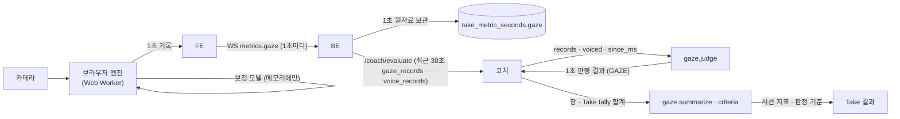
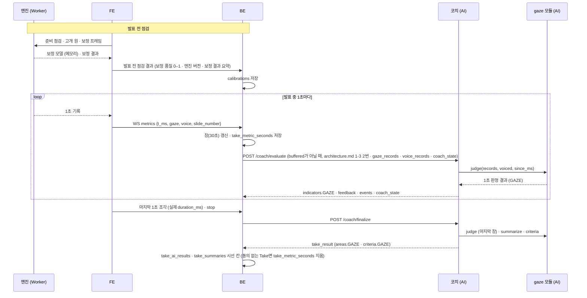

# 시선 (gaze) 설계

> **이 문서는** 시선 기능의 전체 설명서다. 처음 보는 사람이 이 문서만 읽고 이 기능이 왜 있고, 무엇을 받아 무엇을 내며, 안에서 어떻게 돌고, 어떻게 실행 · 배포하는지 알 수 있게 쓴다.
> **기준 범위**: 시선 기능의 목표 설계다. 브라우저 엔진(카메라 → 1초 기록)과 서버 판정 모듈(1초 기록 → 1초 판정 결과 · Take 지표)을 함께 다룬다. 기능 사이 공통 계약(1초 원자료 모양 · 1초 판정 결과 형식 · 에러 · meta · 시간 예산 · 저장 지도)은 `architecture.md`에 따르고, 이 문서에는 이 기능에만 있는 규칙 · 예외만 적는다.
> **한 줄 요약**: 브라우저가 카메라로 발표자가 청중 · 화면 · 대본 · 그 밖 중 어디를 보는지 1초마다 기록하고, 서버 판정 모듈이 그 기록으로 대본 응시 · 눈맞춤 부족 같은 시선 문제와 말하면서 대본을 읽는 습관(대본 의존)을 판정한다.
> **기준값**: 판정 수치(창 길이 · 이어짐 기준 시간 · 비율 기준 · 측정 불가 기준 · 1초 기록을 만드는 프레임 수 · 득표율)는 서버는 `src/gaze/config.py`, 브라우저 엔진은 `configs/*.yaml`에서 만든 `defaults.generated.ts`에만 두고, 이 문서에는 지표와 나쁜 방향만 쓴다. 문서의 숫자는 BE · FE와 맞춰야 하는 통신 · 운영 값과 예시뿐이다.
> **관련 Issue**: #153

# 0. 한눈에 보기
| 언제 | 받는 것 | 내는 것 | 쓰는 곳 |
|---|---|---|---|
| 발표 전 점검 (브라우저 엔진) | 카메라 프레임, 사용자가 청중(카메라 렌즈) · 화면 중앙 · 대본 세 곳을 하나씩 보는 동작 | 보정 모델(브라우저 메모리에만), 보정 품질 0–1 · 보정 결과 요약 | FE 화면, BE `calibrations` |
| 발표 중 1초마다 (브라우저 엔진) | 카메라 프레임 (초당 8장) | 시선 1초 기록 `{t_ms, duration_ms, state, direction, confidence, reliability, issues, frames}` | FE가 WS `metrics.gaze`로 BE에 보낸다 |
| 발표 중 1초마다 (`gaze.judge`, `/coach/evaluate` 안) | 최근 30초 시선 1초 기록, 같은 1초들의 발화 시간, 시각 커서 | 1초 판정 결과 하나 (영역 `GAZE`) | 코치: 시선 지적 · 상태 표시 · 개입 효과 |
| 장 끝 · Take 끝 (`gaze.summarize` · `gaze.criteria`, `/coach/finalize` 안) | 장 · Take 동안의 `tally` 합계 | 장 · Take 시선 지표, 다섯 문제의 판정 기준 | Take 결과 → 리뷰 · 리포트 · 다음 코칭 계획 |

- **하는 것**: 카메라 프레임으로 고개 방향을 재서 사용자마다 보정한 기준점과 비교하고, 1초마다 상태 하나로 모은다(브라우저). 1초 기록으로 청중 · 화면 · 대본 · 그 밖의 응시 비율, 지금 이어지는 응시, 대본 의존을 재고 다섯 시선 문제를 판정한다(서버). 잴 수 없으면 "측정 불가"라고 알린다.
- **하지 않는 것**:
  - 얼굴 영상 · 랜드마크 · 보정 모델을 기기 밖으로 보내거나 저장하지 않는다. 기기를 떠나는 값은 발표 중의 1초 기록과 발표 전의 보정 결과 요약(보정 품질 · 엔진 버전)뿐이다(얼굴에서 나온 값은 민감 정보이기 때문이다).
  - 발표를 막지 않는다. 카메라가 없거나 조건이 나쁘면 그 시간을 "잴 수 없음"으로 남기고 발표는 이어진다.
  - 말을 걸지 결정하지 않는다. 말할지 · 무엇을 말할지는 코치가, 좋다 · 나쁘다는 결론은 리뷰가 낸다(`architecture.md` 0-2).
  - 사용자 평가 기준의 대본 사용 허용(`script_used`)에 따라 결과를 바꾸지 않는다. 시선 모듈은 늘 같은 결과를 내고, 대본 응시를 지적하지 않는 판단은 코치 · 리뷰가 한다.
  - 대본 의존을 LLM으로 판단하지 않는다. 시선과 발화 시간으로만 잰다(`architecture.md` 0-3).
  - 이전 Take와의 비교 · 개입 효과 계산을 하지 않는다. 비교는 리뷰가, 개입 효과는 코치가 이 모듈의 짧은 창 지표로 잰다.
  - 카메라 화면 · 보정 화면의 디자인을 정하지 않는다. 화면(UI)은 FE 담당이다.

# 1. 왜 필요한가
## 1-1. 배경
발표 연습에서 가장 흔한 문제는 대본을 내려다보며 읽느라 청중을 보지 못하는 것이다. 사람 코치는 이것을 바로 알아채지만, 혼자 연습할 때는 스스로 알기 어렵다.
웹캠 하나로 시선을 재려면 얼굴 영상을 다뤄야 한다. 얼굴 영상과 얼굴 측정값은 민감 정보라 서버로 보내거나 저장하면 안 된다. 그래서 판정의 앞부분(프레임 → 1초 기록)을 사용자 브라우저 안에서 돌리고, 서버에는 1초마다 상태 하나만 보낸다.
같은 사람이라도 카메라 위치 · 자세 · 화면 크기가 매번 다르다. 그래서 고정된 각도 기준 대신 발표 전에 사용자마다 청중(카메라 렌즈) · 화면 중앙 · 대본을 보는 자세를 기준점으로 잡는다(보정).

## 1-2. 목표
- 발표 중 1초마다 발표자가 청중(카메라) · 화면 · 대본 · 그 밖 중 어디를 보는지 판정한다.
- 대본을 오래 보거나, 화면만 보거나, 딴 곳을 보거나, 청중을 적게 보는 문제를 같은 기준으로 판정해 코치가 바로 말할 수 있게 한다.
- 말하는 동안 대본을 이어 보는 습관(대본 의존)을 따로 잰다. 쉬는 동안 대본을 보는 것은 정상이라 문제로 보지 않는다.
- 잴 수 없는 시간(얼굴이 안 보임 · 카메라 끊김 · 보정 전)을 "청중을 안 봤다"로 읽지 않는다. 모든 비율을 측정된 시간으로 나눈다.
- 발표 중 판정과 Take 지표가 같은 기준에서 나오게 한다(`architecture.md` 0-2).

## 1-3. 목표가 아닌 것
- 눈동자로 보는 정밀한 시선 추적. 고개 방향으로 판정한다. 눈 기반 모델(L2CS · GazeTR · MediaPipe 홍채 기하)은 비교 실험용으로만 둔다.
- 누구인지 알아보는 얼굴 인식. 다른 얼굴로 바뀐 것 같으면 신뢰도만 낮춘다.
- 원본 얼굴 영상의 녹화 · 저장. 정답 데이터를 모으는 일은 동의 · 보관 · 삭제 절차를 정한 뒤 따로 한다(13절).
- 서버에서 프레임을 처리하는 것. 프레임은 기기를 떠나지 않는다.

# 2. 용어
| 용어 | 뜻 | 예 |
|---|---|---|
| 브라우저 엔진 | 사용자 브라우저의 Web Worker 안에서 프레임을 받아 1초 기록을 만드는 TS 코드. DOM 없이 돈다 | `GazeEngine` |
| 서버 판정 모듈 | 1초 기록으로 1초 판정 결과 · Take 지표를 내는 Python 코어. AI 서비스의 `features/gaze/`로 간다 | `gaze.judge` |
| 보정 | 발표 전에 청중(카메라 렌즈) · 화면 중앙 · 대본 세 곳을 하나씩 보게 해 사용자마다 기준점 세 개를 잡는 것. 안내 순서는 카메라 화면(FE)이 정한다 | 지점마다 약 2초 |
| 보정 모델 | 보정 결과(기준점의 고개 방향 + 얼굴 위치 · 크기 · 홍채 크기 · 거리). 얼굴 측정값이라 그 세션의 메모리에만 둔다 | `CalibrationModel` |
| 보정 품질 | 보정이 얼마나 잘 됐는지 0–1. 실패면 0. BE가 발표 전 점검 결과로 저장한다 | `0.82` |
| 1초 기록 | 1초 동안의 프레임 판정을 다수결로 모은 상태 하나와 그 근거. 발표 중에 기기를 떠나는 시선 값이다(발표 전에는 보정 결과 요약만 떠난다) | `{"t_ms": 40000, "state": "BOTTOM", ...}` |
| 엔진 상태 (`state`, 1초 기록) | `CAMERA` 청중 · `SCREEN` 화면 · `BOTTOM` 대본(화면 아래 대본 띠) · `OTHER` 그 밖 · `UNCERTAIN` 판정 보류 · `UNMEASURED` 잴 수 없음 | `BOTTOM` |
| 판정 상태 (`state`, 1초 판정 결과) | 짧은 창에서 가장 많이 본 곳 `AUDIENCE` · `SCREEN` · `SCRIPT` · `AWAY`, 측정 불가면 `UNMEASURABLE`. 화면 상태 표시에 쓴다 | `SCRIPT` |
| 방향 (`direction`) | `OTHER`일 때 발표자 기준 8방향 | `LEFT` |
| 촬영 조건 이슈 | 측정 환경이 나쁘다는 신호(멀다 · 가깝다 · 벗어남 · 떨림 등). 시선 문제와 다르다 | `TOO_FAR` |
| 시선 문제 (`issue_type`) | 판정 모듈이 내는 문제. 다섯 가지(5-4) | `GAZE_ON_SCRIPT` |
| 측정된 시간 (`measured_ms`) | `CAMERA` · `SCREEN` · `BOTTOM` · `OTHER` 1초의 합. `UNCERTAIN` · `UNMEASURED`는 넣지 않는다. 비율의 분모다 | 30초 창에서 26,000 ms |
| 이어짐 (run) | 같은 상태의 1초가 빈틈없이 이어진 것. 다른 상태 · `UNCERTAIN` · 빈 1초가 끼면 끊긴다. `OTHER`는 방향이 달라도 이어진다 | 대본 응시 4초 이어짐 `script_run_ms: 4000` |
| 말한 1초 | 같은 1초의 음량 기록 `voiced_ms`가 기준 이상이고 오디오가 흐른 1초(`architecture.md` 6-2). 오디오가 끊긴 1초는 코치가 `voiced`에서 빼고 넘긴다. 기준값은 `config.py`에 두고 소리 크기 `config.py`와 같은 값인지 계약 테스트로 본다 | `voiced_ms: 820` |
| 대본 의존 | 말하는 동안 대본을 이어 보는 것. 말한 1초 동안 대본 응시가 기준 시간 이상 이어진 구간 하나가 `reading_runs` 1개다 | `reading_runs: 4` |
| 짧은 창 · 최근 창 | 판정에 쓰는 두 창. 길이는 `config.py`에 있고, BE가 보내는 30초 안에서 정한다. 짧은 창 지표에는 `_short`를 붙인다 | `script_ratio_short` |
| 시각 커서 (`since_ms`) | 어디까지 셌는지. `t_ms`가 이 값 이상인 1초가 새것이다(`architecture.md` 7절) | `since_ms: 40000` |
| Take 시작 직후 억제 | Take 시작 뒤 정해진 시간 동안 `GAZE_UNMEASURABLE` 말고는 시선 문제를 내지 않는 것 | 표본이 적어 비율이 튀는 초반 |
| 엔진 버전 | 브라우저 엔진의 판정 버전 문자열. 1초 기록의 뜻이 엔진에 따라 다르므로 함께 저장한다 | `gaze_v1.1.0+head_pose+reference_anchor_v1` |

# 3. 전체 흐름

1. **발표 전 점검 (브라우저 엔진)**: 엔진이 한 명인지 · 화면 가운데인지 · 인식할 수 있는 크기와 밝기인지 점검하고(준비 점검), 고개를 천천히 돌려 원을 채우게 해 어느 방향에서도 얼굴을 따라가는지 본다(고개 원, 막지 않음). 이어 청중(카메라 렌즈) · 화면 중앙 · 대본 세 곳을 하나씩 보게 해 기준점 세 개를 잡는다(보정, 안내 순서는 카메라 화면이 정한다). 보정은 발표할 그 브라우저 화면 배치에서 한다. 보정 모델은 그 세션의 메모리에만 두고, FE는 보정 품질(0–1)과 보정 결과 요약(엔진 버전 · 보정 상태)만 BE에 보낸다. 사용자마다 자세가 달라 고정 각도로는 판정할 수 없기 때문이다.
2. **발표 중 (브라우저 엔진)**: 엔진이 프레임마다 고개 방향을 기준점과 비교해 상태를 정하고, 촬영 조건 감시가 신뢰도를 붙인다. 1초 동안의 프레임을 다수결로 모아 1초 기록 하나를 만든다. 얼굴이 잡힌 프레임이 기준 개수 미만이면 `UNMEASURED`, 이긴 상태의 득표율이 기준 미만이면 `UNCERTAIN`이다.
3. **FE → BE**: FE는 엔진이 낸 1초 기록을 바꾸지 않고 1초마다 WS `metrics.gaze`에 싣는다(`architecture.md` 1-4 · 2절). 화면에 보이는 구역은 FE가 따로 묶어 보여 줘도 되지만 보내는 값은 엔진 값 그대로다.
4. **BE**: 1초 기록을 진행 중 창(30초)에 쌓고 1초 원자료로 저장한 뒤, 같은 30초의 음량 기록과 함께 `/coach/evaluate`에 싣는다. 판정은 하지 않는다.
5. **코치 → `gaze.judge`**: 코치가 요청마다 시선 모듈을 한 번 부른다. 모듈은 최근 창의 응시 비율 · 지금 이어지는 응시 · 대본 의존을 재고 다섯 문제를 판정해 1초 판정 결과 하나를 돌려준다. 새로 센 몫은 `tally`로 낸다.
6. **코치**: `state`를 상태 표시에, 문제를 지적 후보에, 짧은 창 지표를 개입 효과에 쓰고, `tally`를 장 · Take 합계에 더한다.
7. **Take 끝 (`gaze.summarize` · `criteria`)**: 코치가 장 · Take 합계로 시선 지표를 계산하고, 그 Take를 판정한 기준과 함께 Take 결과에 담는다. 리뷰는 이 값으로 청중 응시와 대본 의존을 판단한다.

# 4. 구성과 폴더
## 4-1. 폴더 트리
```
ai/research/gaze-tracking/
├─ README.md                               폴더 · 파일 지도, 실행법, 실험 결과
├─ pyproject.toml · uv.lock                 Python 3.12, mediapipe 정확히 고정 (uv)
├─ configs/                                 엔진 · 평가의 기준값 원본 YAML (서버 판정 기준값은 src/gaze/config.py)
├─ src/gaze/                                서버 판정 모듈 → 서비스 features/gaze/로 폴더째 옮긴다
│   ├─ schemas.py · core.py · config.py · version.py
│   └─ examples/                            judge · summarize · criteria 입력 · 출력 예시 (계약 테스트가 읽는다)
├─ src/gaze_lab/                            Python 기준 구현(프레임 → 1초 기록) · 데이터셋 · 평가. 연구에 남는다
├─ tools/ · experiments/                    데모 · 자산 받기 · 생성기 · 비교 실험
├─ tests/{unit,lab}/                        서버 판정 모듈 · 기준 구현과 생성 파일
├─ reports/results/                         평가 결과 JSON (평가 데이터가 생기면)
└─ web/                                     브라우저 엔진 개발 사본 · Worker · 카메라 화면 · 데모 · bench (Node 24)
frontend/src/vendor/gaze/                   배포되는 브라우저 엔진 · Worker · 카메라 화면 (FE 폴더. 엔진 계약은 AI, 화면은 FE)
```
파일마다의 역할은 `ai/research/gaze-tracking/README.md` 3절의 파일 지도에 있다.

## 4-2. 진입 함수
| 함수 · 메서드 | 하는 일 | 부르는 쪽 |
|---|---|---|
| `judge(inputs, t_ms, config)` | 1초 판정. 최근 창의 1초 기록과 발화 시간으로 `JudgmentResult` 하나(영역 `GAZE`)를 담은 목록을 낸다(`architecture.md` 7절) | 코치(`/coach/evaluate` · `/coach/finalize` · `replay`) |
| `summarize(tally, config)` | 장 · Take의 `tally` 합계 → 시선 지표 | 코치(장 끝 · Take 끝) |
| `criteria(config)` | 다섯 문제의 판정 기준 `{metric, direction, threshold, bad, onset_lag_ms, offset_lag_ms}` | 코치(Take 결과의 `criteria`) |
| `checkSupport()` | 카메라 권한을 묻기 전에 브라우저 지원을 확인 `{ok, missing}` | FE (발표 전) |
| `createClassifier(opts)` | 모델 · 런타임을 불러 엔진을 만든다. 실패하면 `EngineInitError(reason)` | FE Worker |
| `GazeEngine` 보정 · 판정 메서드 | 준비 점검 · 고개 원 · 보정 · 프레임 판정 (`checkPreconditions` · `startSweep` · `startCue` · `finishCalibration` · `classify` 등) | FE Worker · 카메라 화면 |
| `GazeEvidenceRecorder.record(decision)` · `flush(t_end_ms)` | 프레임 판정 → 끝난 1초 기록. Take 끝에서 마지막 조각을 닫는다 | FE Worker |
| `sampleToDict(sample)` | 1초 기록의 전송 모양 (`confidence` · `reliability` 소수 4자리) | FE Worker |

엔진 메서드의 인자 · 반환값과 Worker 메시지는 5-6에 있다(엔진 계약의 원본은 `engine/contract.ts`).

## 4-3. 규칙과 이유
| 규칙 | 이유 |
|---|---|
| 얼굴에서 나온 값(프레임 · 랜드마크 · 얼굴 측정값 · 보정 모델)은 기기 메모리에만 두고 저장 · 전송 · 로그하지 않는다. 엔진 코드가 저장 · 전송 API를 쓰면 테스트가 실패한다 | 민감 정보다. 기기를 떠나는 값을 1초 기록과 보정 결과 요약 두 가지로 묶어 두면 지켜야 할 곳이 적다 |
| 발표를 막지 않는다. 이상한 1초 기록은 그 1초만 버리고, 조건이 나쁘면 "잴 수 없음"으로 남긴다 | 시선은 정보를 얻는 기능이지 발표를 통제하는 기능이 아니다 |
| 서버 판정 모듈은 상대 import와 pydantic만 쓰고 파일 · DB · 네트워크 · 환경변수 · 시계를 쓰지 않는다. 시간은 입력의 `t_ms`뿐이다 (`architecture.md` 8절) | 같은 입력에 같은 결과가 나오고, 서비스로 폴더째 옮겨도 코드를 고치지 않는다 |
| 판정 모듈은 다른 모듈 · 코치를 import하지 않는다. 발화 시간은 코치가 음량 기록에서 골라 `voiced`로 넘긴다 | 모듈끼리 묶이면 하나를 바꿀 때 다른 것이 깨진다 |
| 서버 판정 기준값은 `src/gaze/config.py` 한 곳, 엔진 기준값은 `configs/*.yaml` → 생성 파일 `defaults.generated.ts` 한 곳이다. 생성 파일이 낡으면 테스트가 실패한다 | 기준이 두 벌이면 발표 중 판정과 리포트가 어긋난다 |
| 엔진은 자기 폴더와 MediaPipe만 import하고 DOM 없이(Worker 전역만) 컴파일된다 | FE로 폴더째 옮겨도 엔진 안을 고치지 않는다 |
| 1초 기록 이후의 계산(문제 · 지표)은 서버에만 둔다. 엔진 · 데모에는 사본을 두지 않는다 | 같은 로직이 두 벌이면 맞추는 비용이 계속 든다 |
| 받는 쪽은 모르는 `issues` 값 · 모르는 필드를 무시한다 | 엔진이 촬영 조건 이슈를 더해도 서버가 깨지지 않는다 |

# 5. 입력 · 출력 계약
서버 판정 모듈의 입력 · 출력 원본은 `src/gaze/schemas.py`의 pydantic 모델이다. 입력은 모르는 필드를 무시하고, 출력은 정해진 필드만 낸다(`architecture.md` 2절). 시각은 모두 Take 시작 기준 ms다. 1초 판정 결과의 공통 필드는 `architecture.md` 7절이 기준이고, 아래는 시선에만 있는 값이다.

## 5-1. 호출 목록
| 호출 | 언제 | 누가 |
|---|---|---|
| WS `metrics.gaze` (FE → BE) | 발표 중 1초마다. `stop` 직전에 마지막 1초 조각을 실제 `duration_ms`로 한 번 더 | FE (엔진의 1초 기록을 그대로) |
| `gaze.judge` | `/coach/evaluate` 요청마다 한 번, `/coach/finalize`의 마지막 창, `replay`의 1초마다 | 코치 (API 라우터가 묶어 넘긴 `Judges`로) |
| `gaze.summarize` | 장이 끝날 때 · Take가 끝날 때 | 코치 |
| `gaze.criteria` | Take 결과를 만들 때 | 코치 |

시선은 자기 HTTP 엔드포인트가 없다. BE는 `/coach/evaluate` · `/coach/finalize` 하나로 부르고, 코치가 판정 모듈을 부른다(`architecture.md` 2절 "기능마다 따로 부르지 않는다").

## 5-2. 입력
**시선 1초 기록** (브라우저 엔진이 만들고 FE · BE · 코치가 그대로 넘긴다). 모양의 기준은 `architecture.md` 6-2이고, 아래는 각 필드를 어떻게 재는지다.

| 필드 | 타입 | 필수 | 뜻 · 재는 법 | 예 |
|---|---|---|---|---|
| `t_ms` | int | 예 | 그 1초의 시작 시각. 1초 격자는 엔진의 첫 프레임에서 시작하므로 1000의 배수가 아닐 수 있다. FE는 프레임 시각을 Take 시작 기준(지금 − Take 시작)으로 엔진에 넘긴다 | `40000` |
| `duration_ms` | int | 예 | 그 조각의 길이. 보통 1000, Take 끝의 마지막 조각만 짧다(`flush`) | `1000` |
| `state` | enum | 예 | 그 1초 프레임 판정의 다수결. 얼굴이 잡힌 프레임이 기준 개수 미만이면 `UNMEASURED`, 이긴 상태의 득표율이 기준 미만이면 `UNCERTAIN`. 득표가 같으면 `CAMERA` · `SCREEN` · `BOTTOM` · `OTHER` 순으로 앞선다. 보정 전의 1초도 `UNMEASURED`다 | `BOTTOM` |
| `direction` | enum · null | 아니오 | `OTHER`일 때 그 1초에서 가장 많이 나온 방향(발표자 기준 `RIGHT` · `UP_RIGHT` · `UP` · `UP_LEFT` · `LEFT` · `DOWN_LEFT` · `DOWN` · `DOWN_RIGHT`), 아니면 null | `LEFT` |
| `confidence` | 0–1 | 아니오 | 얼굴이 잡힌 프레임 중 이긴 상태에 투표한 비율. `UNMEASURED`면 0. 없으면 0 | `0.83` |
| `reliability` | 0–1 | 아니오 | 그 1초 프레임들의 촬영 조건 신뢰도 평균. 없으면 0 | `0.95` |
| `issues` | list str | 아니오 | 그 1초 프레임에서 엔진의 채택 기준을 넘게 나온 촬영 조건 이슈 `TOO_FAR` · `TOO_CLOSE` · `OFF_CENTER` · `LOW_VALID_RATIO` · `NOISY_TRACKING` · `FACE_LOST` · `FACE_REPLACED` · `MOVED_TOO_FAR` · `HEAD_TURNED`. 모르는 값은 무시한다. null이면 빈 목록 | `["OFF_CENTER"]` |
| `frames` | int | 아니오 | 그 1초에 들어온 프레임 수. 없으면 0 | `8` |

**`judge(inputs, t_ms, config)`의 `inputs`** (코치가 만든다)

| 필드 | 타입 | 필수 | 뜻 | 예 |
|---|---|---|---|---|
| `t_ms` | int | 예 | 판정 시각. 그 요청의 `t_ms`(마지막 1초가 끝난 시각) | `41000` |
| `since_ms` | int | 예 | 시각 커서. `t_ms`가 이 값 이상인 1초가 새것이다. 코치가 `coach_state`에서 지난 `counted_until_ms`를 넣는다. 새로 시작한 코치 상태(Take 첫 요청 · 상태 재시작)의 첫 요청은 코치가 `max(0, t_ms − 30000)`을 넣는다(`coach-agent.md` 5-2) | `40000` |
| `records` | list | 아니오 | 최근 시선 1초 기록 (BE가 최근 30초를 매 요청 겹쳐 보낸다) | 아래 5-5 |
| `voiced` | list | 아니오 | 같은 1초들의 발화 시간 `[{t_ms, voiced_ms}]`. 코치가 같은 30초의 음량 1초 기록에서 골라 넣는다. `voiced_ms`가 기준 이상이면 말한 1초다. 오디오가 끊긴 1초는 코치가 빼고 넣으므로, 없는 1초와 같이 말하지 않은 것으로 본다(`architecture.md` 6-2) | `[{"t_ms": 40000, "voiced_ms": 820}]` |

- **읽는 규칙**: `records`의 기록 하나가 이상하면 그 1초만 버리고 나머지는 쓴다(요청 전체를 거절하지 않는다). 버리는 경우: `state`가 없거나 모르는 값, `confidence` · `reliability`가 0–1 밖, `t_ms` · `frames`가 음수, `duration_ms`가 0 이하, 기록이 객체가 아님. `OTHER`가 아닌데 `direction`이 있거나 모르는 방향이면 방향만 null로 읽는다.
- **빈 시간**: 기록이 오지 않은 1초(카메라 끊김 · 탭 숨김 · 전송 유실 · 버린 기록)는 `UNMEASURED`로 본다. 같은 1초가 두 번 오면(앞 기록과 겹치면) 먼저 온 것을 쓴다(`architecture.md` 6-2).
- 코치의 요청 모델은 `state`를 문자열로만 받으므로, 모르는 상태 값이 와도 evaluate 요청이 422가 되지 않고 이 모듈이 그 1초만 버린다.

## 5-3. 출력
**`judge` → `JudgmentResult` 하나를 담은 목록** (`evaluator: "gaze"`, `area: "GAZE"`). 공통 필드(`t_ms` · `counted_until_ms` · `criteria_version` · `issues[]`의 모양)는 `architecture.md` 7절이다.

| 필드 | 값 | 예 |
|---|---|---|
| `metrics` | 최근 창: `audience_ratio` · `screen_ratio` · `script_ratio` · `away_ratio` · `reading_ratio`(말한 시간 중 대본을 본 비율). 짧은 창(개입 효과용): `audience_ratio_short` · `script_ratio_short` · `away_ratio_short` · `measured_ratio` · `mean_reliability`. 지금 이어지는 응시: `script_run_ms` · `screen_run_ms` · `away_run_ms`(이어지지 않으면 0). 분모가 0인 비율은 null(`measured_ratio`만 0) | `{"script_ratio": 0.62, "script_ratio_short": 0.8, "script_run_ms": 4000}` |
| `tally` | 새로 센 1초마다 `{t_ms, values}`. `values`의 키: `camera_ms` · `screen_ms` · `script_ms` · `away_ms` · `uncertain_ms` · `unmeasured_ms` · `measured_ms` · `total_ms` · `speaking_ms` · `reading_ms` · `reading_runs`. 0인 키는 빼도 된다 | `[{"t_ms": 40000, "values": {"script_ms": 1000, "measured_ms": 1000, "total_ms": 1000, "speaking_ms": 1000, "reading_ms": 1000}}]` |
| `state` | 짧은 창에서 가장 많이 본 곳 `AUDIENCE`(`CAMERA`) · `SCREEN` · `SCRIPT`(`BOTTOM`) · `AWAY`(`OTHER`). 짧은 창의 대본 응시 비율이 기준 이상이면 `SCRIPT`. 측정 불가면 `UNMEASURABLE`. 마지막 1초로 정하지 않는다(매초 깜빡이지 않게) | `SCRIPT` |
| `measurable` | 측정 비율과 평균 신뢰도가 모두 기준 이상이면 true. 측정 비율은 지금 짧은 창과 최근 창 평균 중 나쁜 쪽을 쓴다(잡음으로 잠깐 좋아진 1초에 판정을 다시 열지 않게) | `true` |
| `issues[].confidence` | 측정 비율이 높을수록 크다(`UNCERTAIN`이 많으면 작다). 입력 1초 기록의 `confidence`(최다 득표 비율)와 다른 값이다 | `0.86` |
| `issues[].evidence` | 키는 지표 이름이고 짧은 창 값은 `_short`를 붙인다. 창 길이를 키 이름에 넣지 않는다 | `{"script_run_ms": 4000, "script_ratio_short": 0.8}` |
| `counted_until_ms` | 이번까지 센 시각(= `max(t_ms, since_ms)`, 6-2 8번). 코치가 다음 요청의 `since_ms`로 넘긴다 | `41000` |

**`summarize(tally)` → `{"GAZE": {...}}`** (장 · Take 값, 분모가 0이면 null. `measured_ratio`만 분모가 0이면 0, `architecture.md` 7절)

| 지표 | 계산 |
|---|---|
| `audience_ratio` | `camera_ms ÷ measured_ms` |
| `script_ratio` | `script_ms ÷ measured_ms` |
| `screen_ratio` | `screen_ms ÷ measured_ms` |
| `away_ratio` | `away_ms ÷ measured_ms` |
| `reading_ratio` | `reading_ms ÷ speaking_ms` (대본 의존) |
| `reading_runs` | 합 |
| `measured_ratio` | `measured_ms ÷ total_ms` (시선의 측정 비율) |

**`criteria()` → 문제마다 `{metric, direction, threshold, bad, onset_lag_ms, offset_lag_ms}`** (`architecture.md` 7절). `onset_lag_ms` · `offset_lag_ms`는 판정 창 때문에 그 문제의 시작 · 끝이 늦게 잡히는 폭이고, 문제마다 `config.py`의 판정 규칙에서 정한다. 코치가 Take 결과의 문제 구간을 되돌릴 때 쓴다.

**Take 지표를 쓰는 쪽**: 리뷰는 `audience_ratio`로 청중 응시(`audience_gaze` 차원)를, `script_ratio` · `reading_ratio` · `reading_runs`로 대본 의존(`script_independence` 차원)을 판단한다. 사용자 평가 기준의 `gaze`는 `audience_ratio`로, `script_dependency`는 `reading_ratio`로 판정한다(평가 기준 분석의 요소 → 지표 대응). 대본 사용 허용(`script_used`)이면 대본 응시를 문제로 보지 않는 판단은 코치 · 리뷰가 한다.

## 5-4. 문제 목록
| 문제 | 조건 | 판정 지표 (나쁜 방향) | `actionable` |
|---|---|---|---|
| `GAZE_ON_SCRIPT` | 대본 응시가 기준 시간 넘게 이어지고, 짧은 창의 대본 응시 비율도 기준 이상 (라벨이 흔들려 우연히 생긴 연속을 거른다) | `script_run_ms` (길수록) | true |
| `GAZE_ON_SCREEN` | 화면 응시가 기준 시간 넘게 이어짐 | `screen_run_ms` (길수록) | true |
| `GAZE_AWAY` | 그 밖을 본 시간이 기준 시간 넘게 이어짐 (방향이 바뀌어도 한 이어짐) | `away_run_ms` (길수록) | true |
| `GAZE_LOW_EYE_CONTACT` | 최근 창의 측정 시간이 충분할 때, 청중 응시 비율이 기준 미만 | `audience_ratio` (낮을수록) | true |
| `GAZE_UNMEASURABLE` | 측정 비율 또는 평균 신뢰도가 기준 미만. 평균 신뢰도 `mean_reliability`는 `evidence`에 함께 싣는다 | `measured_ratio` (낮을수록) | false |

- **Take 시작 직후**: Take 시작 뒤 정해진 시간 동안은 `GAZE_UNMEASURABLE` 말고는 시선 문제를 내지 않는다. 표본이 적은 초반에는 두 번만 봐도 비율이 크게 튄다.
- **측정 불가일 때**: `measurable`이 false면 `state`는 `UNMEASURABLE`이고 `issues`에는 `GAZE_UNMEASURABLE`만 있다(`architecture.md` 7절).
- **`severity`**: 공통 규칙(기준값에서 0.5, 아주 나쁨 값에서 1.0, 그 사이 직선, 1.0에서 자름)을 따른다.
- 코치가 이 문제들을 어떻게 쓰는지(사다리 · 효과 판정 · 말하지 않는 문제)는 `coach-agent.md` 6-1에 있다. 요약하면 `GAZE_ON_SCRIPT` · `GAZE_AWAY` · `GAZE_LOW_EYE_CONTACT`는 장마다 사다리 하나를 같이 쓰고, `GAZE_ON_SCREEN` · `GAZE_UNMEASURABLE`은 말하지 않고 문제 구간에만 남긴다.

## 5-5. 예시
**1초 기록** (왼쪽을 본 1초)
```json
{"t_ms": 12000, "duration_ms": 1000, "state": "OTHER", "direction": "LEFT", "confidence": 0.75, "reliability": 0.91, "issues": ["OFF_CENTER"], "frames": 8}
```

**`judge` 입력 · 출력 (대본을 이어 보며 말함)**. 입력은 창의 일부만 적었고, `metrics`는 창 전체로 계산한 값이라는 가정의 설명용 예시다. 실제 값은 `examples/`에 있다.
```json
{
  "t_ms": 41000,
  "since_ms": 40000,
  "records": [
    {"t_ms": 39000, "duration_ms": 1000, "state": "BOTTOM", "direction": null, "confidence": 0.9, "reliability": 0.96, "issues": [], "frames": 12},
    {"t_ms": 40000, "duration_ms": 1000, "state": "BOTTOM", "direction": null, "confidence": 0.83, "reliability": 0.95, "issues": [], "frames": 12}
  ],
  "voiced": [{"t_ms": 39000, "voiced_ms": 760}, {"t_ms": 40000, "voiced_ms": 820}]
}
```
```json
[
  {
    "evaluator": "gaze", "area": "GAZE", "t_ms": 41000, "counted_until_ms": 41000,
    "criteria_version": "gaze-<버전>+<config 해시>",
    "measurable": true, "state": "SCRIPT",
    "metrics": {"script_ratio": 0.62, "script_ratio_short": 0.8, "audience_ratio": 0.31, "script_run_ms": 4000},
    "tally": [{"t_ms": 40000, "values": {"script_ms": 1000, "measured_ms": 1000, "total_ms": 1000, "speaking_ms": 1000, "reading_ms": 1000}}],
    "issues": [
      {"issue_type": "GAZE_ON_SCRIPT", "area": "GAZE", "severity": 0.57, "confidence": 0.86, "persistence_sec": 4.0,
       "threshold": "<기준값>", "bad": "<아주 나쁨 값>", "evidence": {"script_run_ms": 4000, "script_ratio_short": 0.8}, "actionable": true}
    ]
  }
]
```

**경계 상황: 카메라가 끊겨 기록이 오지 않음**. 24초 뒤로 기록이 없어 그 시간은 `UNMEASURED`로 센다. 짧은 창이 모두 측정되지 않았으므로 측정 불가이고, 다른 문제는 내지 않는다(`persistence_sec` 등 값은 짧은 창 길이에 따라 달라지는 설명용 값이다).
```json
{"t_ms": 30000, "since_ms": 29000, "records": [{"t_ms": 24000, "duration_ms": 1000, "state": "CAMERA", "direction": null, "confidence": 0.9, "reliability": 0.95, "issues": [], "frames": 8}], "voiced": []}
```
```json
[
  {
    "evaluator": "gaze", "area": "GAZE", "t_ms": 30000, "counted_until_ms": 30000,
    "criteria_version": "gaze-<버전>+<config 해시>",
    "measurable": false, "state": "UNMEASURABLE",
    "metrics": {"measured_ratio": 0.0, "mean_reliability": 0.0, "audience_ratio_short": null, "script_run_ms": 0},
    "tally": [{"t_ms": 29000, "values": {"unmeasured_ms": 1000, "total_ms": 1000}}],
    "issues": [
      {"issue_type": "GAZE_UNMEASURABLE", "area": "GAZE", "severity": 1.0, "confidence": 1.0, "persistence_sec": 5.0,
       "threshold": "<기준값>", "bad": "<아주 나쁨 값>", "evidence": {"measured_ratio": 0.0, "mean_reliability": 0.0}, "actionable": false}
    ]
  }
]
```

**`summarize` 입력 · 출력** (설명용, 값은 반올림)
```json
{"GAZE": {"camera_ms": 52000, "script_ms": 28000, "screen_ms": 6000, "away_ms": 4000, "uncertain_ms": 4000, "unmeasured_ms": 2000,
          "measured_ms": 90000, "total_ms": 96000, "speaking_ms": 70000, "reading_ms": 15000, "reading_runs": 4}}
```
```json
{"GAZE": {"audience_ratio": 0.578, "script_ratio": 0.311, "screen_ratio": 0.067, "away_ratio": 0.044,
          "reading_ratio": 0.214, "reading_runs": 4, "measured_ratio": 0.938}}
```

**`criteria()` 출력** (형식 설명용, 실제 값은 `config.py`)
```json
{
  "GAZE_ON_SCRIPT": {"metric": "script_run_ms", "direction": "HIGHER_IS_WORSE", "threshold": "<기준값>", "bad": "<아주 나쁨 값>", "onset_lag_ms": "<값>", "offset_lag_ms": "<값>"},
  "GAZE_ON_SCREEN": {"metric": "screen_run_ms", "direction": "HIGHER_IS_WORSE", "threshold": "<기준값>", "bad": "<아주 나쁨 값>", "onset_lag_ms": "<값>", "offset_lag_ms": "<값>"},
  "GAZE_AWAY": {"metric": "away_run_ms", "direction": "HIGHER_IS_WORSE", "threshold": "<기준값>", "bad": "<아주 나쁨 값>", "onset_lag_ms": "<값>", "offset_lag_ms": "<값>"},
  "GAZE_LOW_EYE_CONTACT": {"metric": "audience_ratio", "direction": "LOWER_IS_WORSE", "threshold": "<기준값>", "bad": "<아주 나쁨 값>", "onset_lag_ms": "<값>", "offset_lag_ms": "<값>"},
  "GAZE_UNMEASURABLE": {"metric": "measured_ratio", "direction": "LOWER_IS_WORSE", "threshold": "<기준값>", "bad": "<아주 나쁨 값>", "onset_lag_ms": "<값>", "offset_lag_ms": "<값>"}
}
```

## 5-6. 브라우저 엔진 API (FE ↔ 엔진)
FE와 브라우저 엔진 사이의 계약이다. 원본은 엔진의 `engine/contract.ts` · `worker/protocol.ts`이고, 문서와 다르면 코드가 맞다. 엔진은 DOM 없이 Web Worker 안에서 돈다. 엔진 안에서 쓰는 값(프레임 · 랜드마크 · 프레임 판정 · 보정 모델)은 기기를 떠나지 않고, 밖으로 나가는 것은 1초 기록(5-2)과 보정 결과 요약(12-1)뿐이다.

**시작** `createClassifier(opts): Promise<GazeEngine<ImageBitmap>>`

| 옵션 | 기본값 | 뜻 |
|---|---|---|
| `assetDir` | 필수 | `face_landmarker.task`와 MediaPipe wasm 파일을 서빙하는 경로. CDN이 아니라 부르는 쪽이 서빙한다(11절) |
| `delegate` | `'CPU'` | 운영은 CPU다(Python 기준 구현과 같은 값인지 CPU에서만 확인했다). GPU는 벤치마크용 |
| `initTimeoutMs` | `60000` (`DEFAULT_INIT_TIMEOUT_MS`) | 모델 · 런타임을 이 시간 안에 못 불러오면 포기한다. 첫 로딩은 약 16 MB |
| `otherAs` | `'UNCERTAIN'` | 프레임 판정의 FE 구역(`label`)에서 `OTHER`를 어디로 보낼지. `'BOTTOM'`도 된다 |
| `config` | 내장 기본값 | 구역별 부분 덮어쓰기(`ConfigOverrides`). 바꾸면 보정 모델과 맞지 않을 수 있다 |
| `reuseScreenFromPlacement` | `true` | 카메라 위치 점검의 화면 중앙 프레임을 `SCREEN` 보정 자료로 다시 쓴다 |

- `checkSupport()`는 카메라 권한을 묻기 전에 불러도 될 만큼 가볍고 `{ok, missing}`을 돌려준다. 필수는 `WebAssembly` · `createImageBitmap`이고, `OffscreenCanvas`가 없으면 밝기 검사만 건너뛴다(`Worker`는 부르는 쪽이 확인한다).
- 시작하지 못하면 `EngineInitError`를 던지고 `reason`을 붙인다. 부르는 쪽은 어느 이유든 '시선 분석 불가'로 처리하고 발표는 계속한다(7절). 이유는 로그용이다.

| `reason` | 언제 |
|---|---|
| `UNSUPPORTED_BROWSER` | `checkSupport()`가 실패 (`missing`에 이름이 들어감) |
| `TIMEOUT` | `initTimeoutMs` 안에 모델 · 런타임을 못 불러옴 |
| `INIT_FAILED` | 불러오다 오류가 남 (파일을 못 받음 등) |

**`GazeEngine` 메서드** — 보정 → 판정. `FrameDecision` · 보정 결과의 키는 snake_case이고, `version` 키는 camelCase다.

| 메서드 | 하는 일 |
|---|---|
| `checkPlacement(camera, screen)` | 렌즈를 본 프레임들과 화면 중앙을 본 프레임들로 카메라 위치를 점검한다 (`PlacementResultDict`) |
| `fitCalibration(camera, bottom)` | 렌즈 · 대본 영역을 본 프레임들로 보정한다. `{quality, model}` (`model`은 만들지 못하면 null) |
| `calibrate(model)` | 이번 세션에서 만든 보정 모델을 받아 판정을 시작한다. 모델 모양이 아니면 false |
| `classify(frame, tMs)` | 프레임 하나를 판정해 `FrameDecision`을 돌려준다 (평활화 전) |
| `dispose()` | 감지기를 닫는다. 여러 번 불러도 된다 |
| `version` | `{modelVersion, gazeBackbone, gazeClassifier}` (9절) |

카메라 화면이 쓰는 보정 · 점검 흐름(6-1)의 메서드:

| 메서드 | 하는 일 |
|---|---|
| `checkPreconditions(frame, tMs)` | 촬영 전 조건(얼굴 유무 · 크기 · 밝기 등) 점검 결과 |
| `startSweep(tMs)` · `offerSweepFrame(frame, tMs)` | 고개 원 점검 시작 · 프레임 입력 |
| `startCue(cue, tMs, checkDirection?)` | 보정 지점(`CAMERA` · `SCREEN` · `BOTTOM`) 하나 시작 |
| `offerCalibrationFrame(frame, tMs)` | 보정 프레임 입력. `{status, observation}`(게이지 상태와 프레임 관측)을 돌려준다 |
| `estimatePlacement()` | 지금까지 모은 프레임으로 카메라 위치를 판단한다 |
| `finishCalibration()` | 보정을 마치고 `{quality, model}`을 돌려준다 |
| `beginReanchor(tMs)` | 발표 중 자세가 바뀐 뒤 기준점을 다시 잡는 수집을 시작한다 (보정 전에 부르면 오류) |

**프레임 판정 `FrameDecision`** — `classify`와 카메라 화면 `live` 모드가 돌려준다. 1초 기록의 재료일 뿐 서버로 보내지 않는다.

| 필드 | 타입 | 용도 |
|---|---|---|
| `label` | `'CAMERA'` · `'BOTTOM'` · `'UNCERTAIN'` | FE 구역. 구역 확률을 FE 묶음(`CAMERA` · `SCREEN`+`BOTTOM` · `OTHER`)으로 더해 정한다. 확신이 낮거나 `OTHER`가 이기면(`otherAs: 'UNCERTAIN'`) `UNCERTAIN` |
| `p_camera` · `p_bottom` | number | FE 구역 확률. `p_bottom`은 `SCREEN`+`BOTTOM`(`otherAs: 'BOTTOM'`이면 `OTHER`도) |
| `face_valid` | boolean | false면 1초 기록에서 `UNMEASURED`로 센다 |
| `t_ms` | number | 프레임 시각 |
| `state` | `CAMERA` · `SCREEN` · `BOTTOM` · `OTHER` · `UNCERTAIN` | 엔진의 4구역 판정. 1초 기록의 `state`는 이 값의 다수결이다 |
| `direction` | 8방향 · null | `OTHER`일 때만. 1초 기록 `direction`의 재료 |
| `condition` | `ConditionState` · null | 촬영 조건. 1초 기록 `reliability` · `issues`의 재료. 보정 전에는 null |
| `probs` | 구역별 확률 · null | 표시용 |
| `uncertain_reason` | string · null | 표시용. 판정을 보류한 이유 |
| `head_yaw_deg` · `head_pitch_deg` | number | 표시용. 고개 각도 |
| `offset_deg` | `[오른쪽도, 위쪽도]` · null | 표시용. 보정한 화면 영역 밖으로 벗어난 각도 |
| `aim_deg` | `[오른쪽도, 위쪽도]` · null | 표시용. 화면 중앙을 본 자세에서 벗어난 각도 |

**보정 모델 `CalibrationModel`** — `fitCalibration` · `finishCalibration`이 만든다. 구역별 기준 자세에 `scene`(얼굴 중심 · 면적, 홍채 픽셀 크기, 밝기, 고개 방향, 카메라까지 거리 같은 얼굴 측정값)과 `configHash`가 붙는다. 메모리에만 두고 브라우저 저장소 · 서버 어디에도 두지 않는다(4-3). 일반 데이터라 `structuredClone`을 통과하므로, 같은 세션에서 새 Worker를 만들면 `calibrate(model)`이나 Worker 메시지 `restore`로 넘겨 이어받는다. 받는 쪽은 보정 모델의 모양(스키마 · 필수 구조)만 확인하고 설정 해시(`configHash`)는 비교하지 않는다.

**1초 기록 만들기** — `GazeEvidenceRecorder.record(decision)`은 프레임 판정을 받아 끝난 1초 조각을 돌려준다(없으면 빈 목록). `flush(tEndMs)`는 Take 끝의 마지막 짧은 조각을 닫으며 Take가 끝나면 꼭 부른다. `reset()`은 비운다. `sampleToDict(sample)`이 전송 모양(5-2, `confidence` · `reliability`는 소수 4자리)을 만들고 FE는 그대로 보낸다. FE는 Take마다 새 기록기를 쓰고 `tMs`를 Take 시작 기준으로 넘긴다(6-1). 엔진은 시각을 되돌리지 않는다: 프레임 시각은 `max(반올림한 tMs, 앞 프레임 시각 + 1)`이고 이 값이 `FrameDecision.t_ms`가 된다. 그래서 보정 때 쓴 엔진에 Take 시작 기준 시각(0부터)을 이어 넘기면 시각이 밀린다(15절 열린 질문).

**Worker 메시지** (`worker/protocol.ts`, 카메라 화면 ↔ Worker)

| 방향 | 메시지 | 뜻 |
|---|---|---|
| → Worker | `init {assetDir, otherAs?, delegate?}` | 엔진 시작 (`createClassifier`) |
| → Worker | `frame {bitmap, tMs, mode}` | 프레임 한 장. `mode`는 `preview` · `check` · `sweep` · `calibrate` · `live` |
| → Worker | `startSweep {tMs}` · `startCue {cue, tMs, checkDirection?}` | 고개 원 점검 시작 · 보정 지점 시작 |
| → Worker | `estimatePlacement` · `finishCalibration` | 카메라 위치 판단 요청 · 보정 마감 |
| → Worker | `resetCalibration` · `resetPreconditions` | 보정 · 준비 점검 초기화 |
| → Worker | `reanchor {tMs}` | 기준점 다시 잡기 시작 |
| → Worker | `restore {model}` | 이번 세션의 보정 모델 이어받기. 보정 모델 모양이 아니면 `restored {ok: false}`로 답하고 아무것도 바꾸지 않는다(설정 해시는 비교하지 않는다) |
| ← Worker | `ready {version, isolated}` | 시작 완료. `version`은 엔진 버전 문자열(9절), `isolated`는 `crossOriginIsolated` 값 |
| ← Worker | `failed {message, reason?}` | 시작 실패 또는 프레임 실패 |
| ← Worker | `frame {frame, check?, sweep?, gauge?, baseline?, decision?, reanchor?}` | 프레임 하나의 결과. 프레임마다 반드시 한 번 답한다. `decision`은 `live` 모드에서만 |
| ← Worker | `placement {result}` | 카메라 위치 판단 결과 (null 가능) |
| ← Worker | `calibrated {quality, model, placement, classes}` | 보정 결과 (`model`은 null 가능) |
| ← Worker | `restored {ok, classes}` | `restore`의 결과 |

실패 이유(`failed.reason`, 카메라 화면의 `error` 이벤트)와 뒤처리는 7절 표다: 엔진 시작 실패(`UNSUPPORTED_BROWSER` · `TIMEOUT` · `INIT_FAILED`), 프레임 처리 예외(`FRAME_FAILED`), Worker 종료(`WORKER_FAILED`), 카메라 끊김(`CAMERA_LOST`).

**촬영 조건 이슈** (1초 기록 `issues`의 값, `engine/condition.ts`의 `ConditionIssue`) — 시선 문제(5-4)와 달리 "측정 환경이 나쁘다"는 뜻이다. 서버 판정 모듈은 이름을 해석하지 않는다.

| 이름 | 뜻 |
|---|---|
| `TOO_FAR` · `TOO_CLOSE` | 보정 때보다 카메라에서 멀다 · 가깝다 (얼굴이 너무 작다 · 크다 포함) |
| `OFF_CENTER` | 보정 때의 위치에서 옆으로 벗어남 |
| `LOW_VALID_RATIO` | 최근 프레임 중 얼굴을 잡은 비율이 낮음 |
| `NOISY_TRACKING` | 고개 방향이 심하게 떨림 (랜드마크가 흔들림) |
| `FACE_LOST` | 얼굴이 일정 시간 사라짐 |
| `FACE_REPLACED` | 얼굴 위치 · 크기가 갑자기 바뀐 채 이어져 다른 얼굴이 잡힌 것으로 보임 (누구인지 알아보는 얼굴 인식은 하지 않는다) |
| `MOVED_TOO_FAR` | 보정 위치에서 너무 멀리 이동해 계속 머묾 |
| `HEAD_TURNED` | 고개가 돌아감. 눈을 보는 엔진에서만 나온다. 지금 엔진(`head_pose`)은 내지 않지만 타입에는 있으므로 받는 쪽은 모르는 이름도 견딘다 |

`SECOND_FACE`(다른 얼굴이 보임)도 타입에는 있지만 신뢰도를 낮추지 않는 알림이라 `issues`로 가지 않는다.

# 6. 처리 — 안에서 어떻게 도는가
## 6-1. 브라우저 엔진: 프레임 → 1초 기록
1. **준비 점검** (`checkPreconditions`): 얼굴이 한 명인지, 화면 가운데인지, 인식할 수 있는 크기 · 밝기인지 본다. 결과는 화면 안내용이고 발표를 막지 않는다.
2. **고개 원** (`startSweep` · `offerSweepFrame`): 고개를 천천히 돌려 원을 채우게 해, 어느 방향에서도 얼굴을 따라가는지 확인하고 정면 기준을 잡는다.
3. **보정** (`startCue` · `offerCalibrationFrame` · `finishCalibration`): 청중(카메라 렌즈) · 화면 중앙 · 대본 세 곳을 하나씩 보게 해 기준점 세 개(구역별 고개 방향)를 잡는다. 엔진은 지점(`cue`)마다 따로 받으므로 안내 순서는 카메라 화면이 정한다(연구 카메라 화면은 카메라 위치 점검에서 본 화면 중앙 프레임을 화면 보정에 다시 써서 화면 중앙 → 렌즈 → 대본 순으로 안내한다). 보정은 발표할 그 브라우저 화면 배치에서 하고, 화면 배치가 바뀌면 다시 보정한다. 화면을 다른 구역과 가를 수 없으면 화면 구역을 합치고, 그 Take에서는 `SCREEN`이 나오지 않을 수 있다. 결과는 보정 모델(메모리)과 보정 품질(0–1)이다. 카메라가 화면 위에 있고 대본이 화면 아래쪽 띠에 있다고 본다. 그래서 `BOTTOM`은 "화면 아래 대본 띠를 봄"이다.
4. **프레임 판정** (`classify`): MediaPipe Face Landmarker의 변환 행렬에서 고개 yaw · pitch를 구해 세 기준점과 비교하고, 구역별 확률과 상태(`CAMERA` · `SCREEN` · `BOTTOM` · `OTHER` + 방향 · `UNCERTAIN`)를 정한다. 촬영 조건 감시가 보정 때와 비교해 신뢰도와 촬영 조건 이슈를 붙인다. 초당 8프레임이다.
5. **1초 기록** (`GazeEvidenceRecorder`): 첫 프레임에서 시작하는 1초 격자로 프레임을 모아 다수결로 상태 하나를 정한다. 얼굴이 잡힌 프레임이 기준 개수 미만이면 `UNMEASURED`, 이긴 상태의 득표율이 기준 미만이면 `UNCERTAIN`이다. 프레임 사이가 1초 넘게 비었다가 다시 들어오면 그 사이도 `UNMEASURED` 조각으로 만든다. 프레임이 아예 끊기면 조각이 나오지 않고, 그 시간은 서버가 `UNMEASURED`로 본다. Take마다 새 기록기를 쓰고, Take 끝에서 `flush(Take 길이)`로 마지막 짧은 조각을 닫는다.
6. **발표 중 자세가 크게 바뀌면** (`beginReanchor`): 기준점을 다시 잡는 수집을 시작할 수 있다. 그동안의 1초는 신뢰도가 낮게 나온다.

## 6-2. `judge` 요청 하나가 도는 과정
1. **기록 읽기**: `records`를 읽어 이상한 기록은 그 1초만 버린다(5-2 읽는 규칙). 시각 순으로 정렬하고, 앞 기록과 겹치는 기록은 버린다(먼저 온 것이 남는다).
2. **타임라인**: 창의 시작부터 `t_ms`까지 기록 사이의 빈 시간을 `UNMEASURED`로 채운다. 빈 시간은 길이와 상관없이 조각 하나로 채워 계산량이 늘지 않는다.
3. **새 몫 세기 (`tally`)**: `since_ms` 이상인 1초마다 상태별 ms(`camera_ms` · `screen_ms` · `script_ms` · `away_ms` · `uncertain_ms` · `unmeasured_ms`)와 `measured_ms` · `total_ms`를 그 1초의 `t_ms`로 낸다. 같은 1초의 `voiced_ms`가 기준 이상이면 `speaking_ms`를, 그 1초가 대본 응시이기도 하면 `reading_ms`를 더한다. 대본 의존 구간이 이번에 끝났으면 `reading_runs` 1을 그 구간이 끝난 1초에 더한다(6-3). 한 번 센 몫은 바꾸지 않는다.
4. **지표 (`metrics`)**: 최근 창과 짧은 창의 상태별 비율(분모 `measured_ms`), 짧은 창의 측정 비율 · 평균 신뢰도, 지금 이어지는 대본 · 화면 · 그 밖 응시 길이, 최근 창의 `reading_ratio`를 계산한다.
5. **잴 수 있나 (`measurable`)**: 측정 비율(짧은 창과 최근 창 평균 중 나쁜 쪽)과 평균 신뢰도가 모두 기준 이상이어야 true다.
6. **상태 (`state`)**: 잴 수 없으면 `UNMEASURABLE`. 아니면 짧은 창의 대본 응시 비율이 기준 이상이면 `SCRIPT`, 아니면 짧은 창에서 가장 많이 본 곳이다.
7. **문제 (`issues`)**: 5-4의 조건으로 판정하고, Take 시작 직후에는 `GAZE_UNMEASURABLE`만 남긴다. `severity`는 공통 규칙, `confidence`는 측정 비율에서 정한다.
8. **커서**: `counted_until_ms = max(t_ms, since_ms)`로 돌려주어 커서를 되돌리지 않는다(`architecture.md` 7절). 같은 입력을 두 번 넣으면 같은 결과가 나오고, 돌려준 커서로 다시 부르면 이미 센 몫은 나오지 않는다. 요청이 빠져 새 1초가 여러 개면 한 번에 모두 센다.

## 6-3. 대본 의존 (`reading_ms` · `reading_runs`)
- 말한 1초이면서 대본 응시(`BOTTOM`)인 1초의 ms가 `reading_ms`다.
- 말한 1초 동안 대본 응시가 이어진 구간이 기준 시간 이상이었고 그 구간이 끝나면 `reading_runs` 1개를 센다. 말하지 않은 1초나 다른 상태가 끼면 구간이 끊긴다.
- 구간 길이는 받은 창 안에서만 확인한다. 요청이 창(30초)보다 오래 빠져 합계가 Take를 덮지 못하면 코치의 복구(`replay`, 원자료 전체로 다시 계산)로 다시 센다.
- Take 끝까지 이어진 구간은 끝나지 않았으므로 세지 않는다.
- 쉬는 동안(말하지 않는 1초) 대본을 보는 것은 다음 말을 확인하는 정상 행동이라 대본 의존으로 세지 않는다. 그래서 `reading_ratio`의 분모는 말한 시간이다.

## 6-4. `summarize` · `criteria`
- `summarize`는 코치가 장 · Take 동안 더한 `tally` 합계(영역 → 이름 → 합)를 받아 5-3 표대로 지표를 계산한다. 코치는 결과를 고치지 않고 Take 결과의 `areas.GAZE`에 담는다(`architecture.md` 7절). 그래서 Take 지표는 다시 분석하지 않고도 발표 중 판정과 같은 기준에서 나온다.
- `criteria`는 다섯 문제의 기준을 돌려준다. 코치가 그 Take를 판정한 기준으로 Take 결과의 `criteria.GAZE`에 남기고, 리뷰가 '왜'를 설명할 때 읽는다.

# 7. 실패할 때
| 상황 | 동작 | 결과 · 응답 | 이유 |
|---|---|---|---|
| 지원하지 않는 브라우저 (WebAssembly · `createImageBitmap` 없음) | `checkSupport()`가 카메라 권한을 묻기 전에 알려 준다. FE는 시선만 빼고 발표를 진행한다 | 1초 기록 없음 → 서버는 `UNMEASURED`로 봄 | 시선은 발표를 막지 않는다 |
| 모델 · 런타임 로딩 실패 · 지연 | `EngineInitError` (`TIMEOUT`: 기본 60초 안에 못 불러옴 / `INIT_FAILED`) | 위와 같음. 사유는 로그용 | 같음 |
| 보정 실패 · 보정 전 | 보정 품질 0. 보정 전의 1초는 `UNMEASURED` | 그 시간은 측정 불가, `GAZE_UNMEASURABLE` | 기준점 없이 판정하면 틀린 지적이 나간다 |
| 프레임 처리 중 예외 | 그 프레임은 얼굴 없음으로 답하고 다음 프레임 계속. 연속 실패 중에는 첫 번째만 알림 (`FRAME_FAILED`) | 그 1초의 신뢰도 · 상태에 반영 | 한 프레임 때문에 엔진을 멈추지 않는다 |
| Worker 종료 | 카메라 화면이 `WORKER_FAILED`를 한 번 알리고 프레임 전송을 멈춤 | 이후 1초 기록 없음 → `UNMEASURED` | 발표는 계속 |
| 발표 중 카메라 끊김 | 카메라 화면이 `CAMERA_LOST`를 한 번 알리고 캡처를 멈춤. 끊기기 전까지 잰 1초 기록은 버리지 않는다 | 끊긴 시간만 `UNMEASURED`. 길어지면 `GAZE_UNMEASURABLE` | Take 전체의 시선을 잃지 않게 |
| 탭 숨김 · 전송 유실 | 그 시간의 1초 기록이 없다 | 서버가 빈 시간을 `UNMEASURED`로 채움. 오래된 문제를 내지 않는다 | 마지막 상태가 이어진 것처럼 읽히지 않게 |
| 얼굴이 안 보임 · 다른 사람 · 자세가 크게 바뀜 | 엔진이 `UNMEASURED` · `UNCERTAIN`으로 두거나 신뢰도를 낮춘다(촬영 조건 감시) | 측정 비율 · 평균 신뢰도가 떨어지면 측정 불가 | 틀린 지적을 하지 않게 |
| 읽을 수 없는 1초 기록 | 그 1초만 버린다(5-2) | 그 1초는 `UNMEASURED` | 기록 하나 때문에 요청 전체를 잃지 않게 |
| 창 안 기록이 모두 버려짐 · `records` 없음 | 창 전체가 `UNMEASURED` | `measurable: false`, `GAZE_UNMEASURABLE` | 같음 |
| `voiced`가 없음 (음량 기록이 오지 않음) | 모든 1초를 말하지 않은 것으로 본다 | `speaking_ms` 0 → `reading_ratio` null, `reading_runs` 0. 나머지 판정은 그대로 | 발화 시간 없이 대본 의존을 추측하지 않는다 |
| 판정 모듈 예외 · 결과가 계약에 맞지 않음 | 코치가 그 영역만 잴 수 없음으로 두고 커서를 이번 창 끝으로 넘긴다(`coach-agent.md` 6-1) | evaluate 200, `indicators.GAZE`는 `UNMEASURABLE` | 한 영역 고장으로 나머지 코칭을 멈추지 않게 |

# 8. 시간 예산과 호출 규칙
| 호출 | AI 예산 | BE 시간 제한 | 재시도 | 이유 |
|---|---|---|---|---|
| `gaze.judge` (`/coach/evaluate` 안) | evaluate 전체가 BE 약 300 ms 안. 시선 판정 자체는 밀리초 단위(Python 표준 라이브러리 + pydantic) | `/coach/evaluate`를 따른다 | 없음 (다음 1초 요청의 겹친 창이 대신한다) | 실시간 경로. 판정 모듈은 LLM · 네트워크를 쓰지 않는다(`architecture.md` 3절) |
| `gaze.judge` · `summarize` (`/coach/finalize` · `replay` 안) | finalize를 따른다 | 10초, `replay`를 붙인 호출은 60초 | finalize를 따른다 | `coach-agent.md` 8절 |
| 브라우저 엔진 첫 로딩 | 초기화 제한 시간 기본 60초 | — | — | 모델 · 런타임 약 16 MB(압축 시 약 7 MB). 그 뒤는 브라우저 캐시 |
| 브라우저 프레임 판정 | 한 프레임 예산 125 ms (초당 8프레임) | — | — | 1초 기록이 판정하려면 1초에 얼굴 프레임이 기준 개수 이상 있어야 한다 |

- **잰 값** (개발 PC · Chrome · 640×480에서 잰 값. 절대값보다 기기에 따른 차이를 본다): Worker 한 프레임 중앙값 약 22 ms(MediaPipe 약 19 ms), p95 약 30–38 ms. 같은 PC를 배터리(절전)로 돌리면 중앙값 약 100–113 ms(MediaPipe 약 89–101 ms), p95 약 142–147 ms로 예산을 넘는다. 1초 기록은 약 150 B다(30분 Take 약 270 KB).
- **창**: BE는 시선 1초 기록과 음량 1초 기록을 최근 30초씩 보낸다(`architecture.md` 2절). 시선 판정 창(짧은 창 · 최근 창)은 이 30초 안에서 `config.py`로 정한다. 시선 판정이 같은 30초의 발화 시간을 쓰므로 음량 창도 30초다.

# 9. 버전
| 버전 | 값 | 어디에 | 언제 오르나 |
|---|---|---|---|
| `feature_version` | `gaze-1.2` | `src/gaze/version.py` → `criteria_version` · Take 결과의 `criteria.GAZE` | 같은 입력에 대한 결과의 의미가 바뀔 때(판정 규칙 · 출력 필드의 뜻) |
| `criteria_version` | `gaze-<버전>+<config 해시 12자리>` | `judge` 출력 → `coach_state` → 응답 `meta.criteria_versions.gaze` | `config.py`의 판정 기준값을 바꾸면 해시가 바뀐다 |
| `schema_version` | `1.0` | 코치 응답 `meta` (`architecture.md` 5절) | 1초 기록 · 판정 결과의 필드 이름 변경 · 삭제 · 뜻 변경 |
| 엔진 버전 | 엔진 `version`은 객체 `{modelVersion, gazeBackbone, gazeClassifier}`, Worker `ready.version`은 세 값을 `+`로 이은 문자열 (예: `gaze_v1.1.0+head_pose+reference_anchor_v1`) | 그 문자열을 FE가 발표 전 점검 결과와 함께 BE에 보낸다(`calibrations.result.engine_version`) | 엔진의 판정(모델 · 백본 · 분류 방식)이 바뀔 때. 엔진이 바뀌면 같은 시선도 다른 상태로 판정될 수 있다 |
| 엔진 설정 해시 `CONFIG_HASH` | 12자리 | `defaults.generated.ts` | 엔진 기준값이 바뀔 때. 설정이 다른 엔진과 보정 모델은 호환되지 않아, 보정 모델을 새로 만든다 |

- 엔진 상태 · 방향 · 촬영 조건 이슈 · 시선 문제 이름은 한 스키마 버전 안에서 **추가**만 한다(`architecture.md` 6-3). 값을 더해도 값으로 분기하는 쪽이 새 값을 처리하지 못할 수 있으므로, 더하기 전에 받는 쪽(BE · 코치 · 리뷰)에 알린다.
- Take끼리 시선 값을 비교할 때는 같은 엔진 버전끼리 하는 것이 안전하다. 그래서 엔진 버전을 Take마다 남긴다(12-1).

# 10. 실행 · 테스트
준비 (`ai/research/gaze-tracking`에서. Python 3.12, `.venv`는 git에 없어 처음 한 번 만든다. 브라우저 쪽은 Node 24)
```bash
cd ai/research/gaze-tracking
uv sync                                  # Python 3.12, mediapipe 1.0.1 고정
uv run python tools/fetch_assets.py      # 모델 · 테스트 얼굴(합성, git 밖)을 받고 sha256 확인
cd web && npm ci
```
- Windows에서는 `pytest.exe` 같은 실행 파일이 막힐 수 있어 `uv run python -m …`으로 부른다. 콘솔 한글이 깨지면 `PYTHONIOENCODING=utf-8`.
- 서버 판정 모듈과 그 테스트는 pydantic과 pytest만 있으면 돈다. 기준 구현(`tests/lab`)은 mediapipe · numpy · opencv와 테스트 얼굴이 필요하고, 얼굴 사진이 필요한 테스트는 `fetch_assets.py`를 돌리지 않으면 이유를 보이고 건너뛴다.
- 시선은 LLM을 쓰지 않아 `ai/.env`가 필요 없다.

| 하는 일 | 명령 | 기대 결과 |
|---|---|---|
| 서버 판정 모듈 테스트 | `uv run python -m pytest tests/unit` | 모두 통과 |
| 전체 Python 테스트 | `uv run python -m pytest` | 서버 판정 모듈 + 기준 구현 · 생성 파일 최신 검사 통과 |
| 린트 | `uv run ruff check src tests tools experiments` | 지적 없음 |
| 엔진 · Worker 테스트 | `cd web && npm test` · `npm run typecheck` · `npm run lint` | 엔진(Python 기준 답과 일치) · FE 계약 · 경계 테스트 통과 |
| 실제 브라우저 확인 | `cd web && npm run smoke` · `npm run smoke:prod`(격리 헤더 없이) | 준비 점검 → 고개 원 → 보정 → 실시간 → 1초 기록, 카메라 끊김 항목 통과 (Chrome) |
| 프레임 지연 재기 | `cd web && npm run bench` | Worker 한 프레임 중앙값 · p95 (8절 예산과 비교) |
| 기준값 · 기준 답 다시 만들기 | `cd web && npm run fixtures` | `configs/`나 `gaze_lab`을 바꾼 뒤 `defaults.generated.ts` · parity 기준 답을 다시 만든다. 낡으면 `tests/lab/test_web_engine_sources.py`가 실패한다 |
| 데모 | `run_demo.bat`(Python, 웹캠) · `cd web && npm run dev` (브라우저 `http://localhost:5180`) | 준비 점검 → 보정 → 실시간 판정 화면 |

- 계약 테스트: `examples/`의 `judge` 입력(판정 창 전체) · 출력, `criteria()` 출력(다섯 문제), `summarize` 입력 · 출력을 공통 계약 테스트 틀로 검사한다. 예시는 `config.py`의 실제 기준값으로 만든다.
- 판정 테스트가 볼 것: 문제 없는 1초, 측정 불가(`UNCERTAIN` · `UNMEASURED` · 기록 누락 · 같은 1초 두 번), 이어짐 끊김(`UNCERTAIN` · 빈 1초 · `OTHER` 방향 변화), Take 시작 직후 억제, 대본 의존 기준 시간 경계와 구간이 끝날 때 세기, 분모 0, 커서(요청이 빠져 1초가 여러 개, 같은 입력 두 번 = 같은 결과, 돌려준 커서로 다시 부르면 이미 센 몫이 나오지 않음). 테스트 이름은 동작을 문장으로 짓는다(예: `test_reading_run_counts_when_spoken_script_run_ends`).

# 11. 배포
**어디서 도는가**: 두 곳에 배포된다.
- **서버 판정 모듈** `src/gaze/`(`examples/` 포함)는 AI 서비스의 `features/gaze/`로 폴더째 옮기고, 테스트는 `tests/unit/gaze/`로 옮긴다(import 접두어만 바꾼다). 자기 HTTP 엔드포인트는 없고, 라우터가 앱 시작 때 만드는 `Judges` 묶음에 `judge` · `summarize` · `criteria`를 넣어 코치에 넘긴다(`coach-agent.md` 11절). 의존성은 pydantic 하나다.
- **브라우저 엔진** `web/src/engine/`(원본)은 FE가 `frontend/src/vendor/gaze/`로 Worker · 카메라 화면과 함께 복사해 쓴다. FE는 엔진의 `index.ts` · `contract.ts`만 import하고, 복사한 기준 커밋을 `vendor/gaze/README.md`에 적는다. 엔진 안은 고치지 않고, 고칠 것은 연구 폴더에서 고쳐 다시 복사한다. 화면(카메라 화면 · 보정 안내)은 FE가 고친다.

**옮기는 조건**: 서비스의 Python 3.12와 pydantic 판(서비스 `uv.lock`)을 쓴다. `judge` · `summarize` · `criteria`와 `examples/` 계약 테스트가 생긴 뒤, 아래 '옮긴 뒤 확인'을 통과하면 옮긴다. 서비스로 옮기려면 서비스 뼈대(`ai-service.md`)가 먼저 있어야 한다.

**환경변수**: 시선 판정 모듈은 환경변수를 읽지 않는다. 서비스 공통 환경변수는 `architecture.md` 10절이다.

**브라우저 자산 · 인프라** (FE · BE 담당, AI가 요청)

| 항목 | 정한 것 | 이유 |
|---|---|---|
| 모델 · 런타임 파일 | `face_landmarker.task`와 MediaPipe wasm을 빌드 단계에서 해시를 확인한 뒤 `public/models/`에 넣는다. 경로나 파일 이름에 버전을 붙인다. CDN은 쓰지 않는다 | 다른 판의 모델이면 랜드마크가 달라져 판정이 바뀐다 |
| `@mediapipe/tasks-vision` | `1.0.1` 정확히 고정 | 연구 Python(mediapipe 1.0.1)과 같은 판이어야 기준 답과 같다 |
| 기존 보정 모델 지우기 | FE가 지금 IndexedDB(`zoneRefs`)에 보정 모델을 저장한다. 저장을 멈추고, 브라우저 DB 버전을 올리며 기존 `zoneRefs`를 지운다 | 보정 모델에 얼굴 측정값이 들어 있다(4-3) |
| 생성 파일 | `defaults.generated.ts`와 엔진 `__tests__/fixtures/`는 FE의 prettier · oxlint 대상에서 뺀다. 생성은 연구 폴더 `tools/`가 계속 한다 | 손으로 고치지 않는 파일이다 |
| 압축 · 캐시 | Caddy에서 정적 파일 압축(`encode`)을 켠다(wasm 11.8 MB → 압축 3.4 MB). `/models/`에 긴 캐시 헤더 | 첫 로딩 약 16 MB를 줄인다 |
| 격리 헤더 | COOP/COEP는 넣지 않는다 | 엔진은 교차 출처 격리 없이 돈다(`smoke:prod`). COEP는 Safari 미지원 · OAuth 팝업 등에 영향을 준다 |
| CSP를 쓸 때 | `script-src 'wasm-unsafe-eval'`, `worker-src 'self'` | wasm · Worker 실행 |

**옮긴 뒤 같은 결과인지 확인**
1. 서비스: 옮긴 `tests/unit/gaze/`가 그대로 통과하고, 코어 경계 테스트가 새 위치를 본다.
2. 코치 연구 폴더: 연구용 판정 대역과 이 모듈에 같은 입력을 넣어 판정을 비교하고 달라진 점을 연구 폴더 README에 적는다. 그 뒤 대역 대신 이 모듈을 `Judges`에 넣어 재생 · 실험을 다시 돌린다(`coach-agent.md` 13절).
3. FE: `tsc -b` · `oxlint --max-warnings=0` · `vitest`(엔진 테스트 포함)가 통과하고, FE 빌드로 `smoke:prod`와 같은 흐름(격리 없이 준비 점검 → 실시간 → 카메라 끊김)을 확인한다. Chrome 말고 지원할 브라우저에서도 본다.
4. 연구 폴더: `tools/export_config.py` · `make_fixtures.py`가 만든 파일과 FE 사본의 기준 커밋이 같은지 본다.

**증상별 원인**

| 증상 | 원인 | 확인 · 해결 |
|---|---|---|
| `indicators.GAZE`가 Take 내내 `UNMEASURABLE` | FE가 `metrics.gaze`를 보내지 않음(null), 보정 전 · 보정 실패, 카메라 권한 거부 · 엔진 초기화 실패 | BE의 1초 원자료 `take_metric_seconds.gaze`가 null인지, FE 로그의 `EngineInitError.reason` · 보정 결과 |
| 1초 기록이 모두 버려짐 | FE가 엔진 상태가 아닌 화면용 구역(3구역)을 보냄, `t_ms`가 Take 시작 기준이 아님(음수 · 다른 단위) | `metrics.gaze.state` 값, `t_ms`가 `metrics.t_ms` − 1000 근처인지 |
| `reading_runs`가 늘 0 · `reading_ratio`가 늘 null | 음량 1초 기록(`voice_records`)이 오지 않아 `voiced`가 빔 | `take_metric_seconds.voice`, FE `metrics.voice` |
| `SCREEN`이 한 번도 나오지 않음 | 보정에서 화면과 렌즈를 가를 수 없어 화면 구역을 합침(`SCREEN_MERGED`) | 보정 결과의 경고(`calibrations.result`) |
| 대본 사용을 허용했는데 대본 응시 지적이 나옴 | 코치에 `script_used`가 실리지 않음 (시선 모듈은 늘 같은 결과를 낸다) | evaluate 요청의 `script_used` (`coach-agent.md` 5-2) |
| Take 결과 시선 `measured_ratio`가 낮음 | 카메라 끊김 · 탭 숨김 · 얼굴이 자주 벗어남 · 저사양 기기에서 프레임 부족 | 1초 기록의 `UNMEASURED` 비율 · `frames` · `issues` |
| 엔진이 시작하지 않음 | 자산 경로 · 해시 불일치, CSP, 지원하지 않는 브라우저 | `EngineInitError.reason`(`UNSUPPORTED_BROWSER` · `TIMEOUT` · `INIT_FAILED`), `checkSupport().missing` |

# 12. FE · BE · DB 연결과 저장

BE가 요청을 만드는 법과 Take 한 번의 순서는 `architecture.md` 1-3 · 2절, 코치 쪽 저장은 `coach-agent.md` 12절에 있다.

## 12-1. 저장 (DB)
저장 설계는 AI가 하고, 마이그레이션 · 구현 · 운영은 BE가 한다. 공통 저장 지도는 `architecture.md` 1-1이다. 아래는 시선이 만들거나 시선에서 나온 것만이다.

| 데이터 | 언제 생기나 | 저장 위치(테이블.칸) | 형식(JSON · 칸, 크기) | 쓰는 쪽 · 읽는 쪽 | 덮어쓰기 막기 | 보관 기간 · 개인정보 |
|---|---|---|---|---|---|---|
| 시선 1초 기록 (원자료) | WS `metrics`마다 | `take_metric_seconds.gaze` (JSONB, nullable) | 엔진의 1초 기록 그대로(5-2), BE는 해석하지 않는다. 잰 크기: 한 행 약 0.14 KB(방향 · 이슈가 있으면 약 0.18 KB), 한 시간 Take(3,600행) 약 0.5–0.65 MB | BE가 몇 초씩 모아 쓴다 · BE가 `replay`(`gaze_records`)로 읽는다 | `(take_id, t_ms)` 유일 제약, 같은 1초가 또 오면 먼저 저장한 것을 둔다 | Take와 함께. 얼굴 영상 · 랜드마크가 아닌 파생값(시선 구역 · 신뢰도)이다. 동의 없는 Take의 예외는 `architecture.md` 1-1 '지우기 · 보관' |
| 보정 결과 요약 | 발표 전 점검 때 | `calibrations.gaze_confidence` (Float, 0–1, 보정 실패면 0), `calibrations.result` (JSONB) | `result`: `{engine_version, status, separability, loo_accuracy, warnings}`(`separability`는 보정 표본에서 카메라 · 대본 시선 무리의 중심 사이 거리 ÷ 무리 안 흩어짐으로 클수록 잘 갈린다, `loo_accuracy`는 보정 표본을 하나씩 빼고 나머지로 맞힌 비율 0–1) (예: `{"engine_version": "gaze_v1.1.0+head_pose+reference_anchor_v1", "status": "OK", "separability": "<엔진 값>", "loo_accuracy": 0.93, "warnings": []}`). `gaze_confidence`는 보정이 `OK`면 `loo_accuracy`, 아니면 0 (15절 열린 질문). 크기 0.3 KB 안팎 | FE가 보내고 BE가 쓴다 · 리포트, Take끼리 비교할 때 엔진 버전 확인 | Take마다 하나 | Take와 함께. **보정 모델(얼굴 위치 · 크기 · 홍채 · 거리)은 저장하지 않는다** |
| 시선 Take 지표 · 판정 기준 | `/coach/finalize` 응답 | `take_ai_results.payload`(`kind` = `TAKE_RESULT`)의 `areas.GAZE` · `criteria.GAZE` | 코치가 `summarize` · `criteria` 결과를 고치지 않고 담는다. 잰 크기: Take · 장마다 지표 7개 약 0.16 KB(장 10개면 약 1.8 KB), `criteria` 다섯 문제 약 0.8 KB | 코치가 만들고 BE가 쓴다 · 리뷰 · 코칭 계획 | `coach-agent.md` 12-1 (`(take_id, kind)` 유일) | Take와 함께 |
| 리포트 요약 시선 칸 | `/coach/finalize` 응답을 저장할 때 | `take_summaries.audience_gaze` · `slide_gaze` · `script_gaze` (Integer, nullable), `script_dependency_count` (Integer, nullable) | `audience_ratio` · `screen_ratio` · `script_ratio` × 100 반올림, `reading_runs` (`architecture.md` 1-1 대응 표). 세 비율의 합은 100이 아니다(그 밖 응시 `away_ratio`는 칸이 없다). 시선을 잴 수 없었으면(지표가 null) null | BE가 쓴다 · FE 리포트 목록 · Take 비교 | Take마다 한 행 | Take와 함께 |
| 시선 개입 | `/coach/evaluate` 응답이 `INTERVENE`이고 영역이 `GAZE`일 때 | `coach_events`의 `INTERVENTION` 이벤트(`area` = `GAZE`). `live_feedbacks`에는 쓰지 않는다 | `coach-agent.md` 12-1 | 코치 | `coach-agent.md` 12-1 | Take와 함께 |
| 진행 중 창 | Take 동안 | Take를 맡은 BE 프로세스 메모리 | 최근 30초 시선 · 음량 1초 기록 | BE | 같은 1초는 먼저 온 것 | Take가 끝나면 지운다 |
| 보정 모델 | 발표 전 점검 때 | **저장하지 않는다**. 같은 브라우저 탭의 메모리에만 두고, 새 Worker에는 `restore`(구조 복제)로 넘긴다. 보정한 화면 배치와 같을 때만 이어받는다 (15절 열린 질문) | — | 엔진 | — | 탭을 닫거나 새로고침하거나 화면 배치가 바뀌면 다시 보정한다 |

## 12-2. 저장 규칙
- 1초 기록은 엔진 값을 그대로 저장한다. 화면용 구역으로 바꾸거나 구간으로 접지 않는다(FE · BE 모두). 판정 기준이 바뀌어도 원자료로 다시 판정할 수 있게 하기 위해서다.
- 원자료로 다시 판정하기와 기준값 다시 고르기는 원자료 사용에 동의한 Take의 1초 기록으로만 한다(동의 조건과 `replay` 예외는 `architecture.md` 1-1 '원자료 사용 동의').
- 카메라가 끊기거나 권한이 없어도 그때까지 잰 1초 기록은 버리지 않는다. 잴 수 있었는지는 판정 모듈이 측정 비율로 정한다.
- 엔진 버전은 Take마다 `calibrations.result.engine_version`에 남긴다. 엔진이 바뀌면 같은 시선도 다른 상태로 판정될 수 있어, Take끼리 비교할 때 확인한다.
- 시선 결과는 코치 응답의 `meta`(`criteria_versions.gaze` 포함)와 함께 저장된다(`coach-agent.md` 12-2).
- 얼굴에서 나온 값(프레임 · 랜드마크 · 보정 모델)은 어느 테이블에도 저장하지 않는다. 브라우저 저장소(IndexedDB · localStorage)에도 두지 않는다.
- 테이블 · 칸이 바뀌면 배포 전에 BE가 마이그레이션한다(`take_metric_seconds` · `calibrations` · `take_summaries`의 nullable 칸 포함). 저장 모양이 바뀌면 계약 변경이다.

# 13. 품질 검증
평가 데이터에는 가상 발표와 실제 리허설을 함께 둔다(`architecture.md` 12절). 얼굴 영상을 녹화하는 정답 데이터는 동의 · 보관 기간 · 삭제 방법을 정한 뒤에만 모으고, 정하기 전에는 녹화 · 저장하지 않는다.

| 평가 데이터 | 지표 | 중점 | 검증 방법 |
|---|---|---|---|
| 1초마다 시선 정답(엔진 상태)을 단 발표 녹화 (가상 발표 · 실제 리허설, 여러 사람) | 상태 macro F1, 대본(`BOTTOM`) 재현율, 사람별 F1, `UNCERTAIN` 비율, 보정 실패율, 프레임 처리 지연(p95) | 대본 응시를 놓치지 않고, 사람이 달라도 성능이 고른 것 | `gaze_lab.evaluation`(평가 · 릴리스 게이트, 기준값은 `configs/release_gate.yaml`) → `reports/results/` 결과 JSON |
| 같은 녹화의 1초 기록 + 문제 구간 정답 | 문제 구간 F1 · 구간 시작 오차 (코치가 Take 결과에서 잰다) | 리뷰가 믿고 쓸 문제 구간 | 코치 재생 · 채점 (`coach-agent.md` 13절) |
| 판정 모듈 단위 시나리오 | 계약 · 경계 테스트 통과 | 같은 입력 같은 결과, 커서로 두 번 세지 않음 | `tests/unit/` · `examples/` |

- 서버 판정 기준값(`config.py`)을 바꾸면 `criteria_version`이, 엔진 기준값(`configs/*.yaml` → `defaults.generated.ts`)을 바꾸면 엔진 설정 해시(`CONFIG_HASH`)가 바뀐다. 어느 쪽이든 평가 결과 JSON을 다시 만들어 같은 PR에 넣는다.
- 임계값은 모두 초기값이다. 여러 사람의 실측으로 평가하기 전에는 테스트 얼굴 하나에 맞춰 바꾸지 않는다(과적합).

# 14. 지표 정의
- **`audience_ratio` · `screen_ratio` · `script_ratio` · `away_ratio`**: `camera_ms` · `screen_ms` · `script_ms` · `away_ms` ÷ `measured_ms`. 판정 결과에서는 최근 창(짧은 창은 `_short`), Take 결과에서는 장 · Take 합계로 계산한다. `measured_ms`가 0이면 null.
- **`reading_ratio`**: `reading_ms ÷ speaking_ms`. 말한 시간 중 대본을 본 비율. 말한 1초가 없으면 null.
- **`reading_runs`**: 말한 1초 동안 대본 응시가 기준 시간 이상 이어졌다가 끝난 구간의 수. Take 끝까지 이어진 구간은 세지 않는다.
- **`script_run_ms` · `screen_run_ms` · `away_run_ms`**: 판정 시각까지 지금 이어지는 대본 · 화면 · 그 밖 응시의 길이. 이어지지 않으면 0.
- **`measured_ratio`**: 판정 결과에서는 짧은 창의 측정된 시간 ÷ 창 길이, Take 결과에서는 `measured_ms ÷ total_ms`. 시선 데이터의 품질이다.
- **`mean_reliability`**: 짧은 창 1초 기록들의 `reliability` 평균.
- **상태 macro F1**: 1초마다 엔진 상태(`CAMERA` · `SCREEN` · `BOTTOM` · `OTHER`)를 정답과 비교해 상태별 F1을 낸 뒤 평균한 것. 정답이 `UNCERTAIN` · `UNMEASURED`인 1초는 뺀다.
- **대본 재현율**: 정답이 `BOTTOM`인 1초 중 엔진도 `BOTTOM`이라고 한 비율.
- **사람별 F1**: 발표자마다 낸 macro F1 중 가장 낮은 값(사람이 달라도 고른지).
- **`UNCERTAIN` 비율**: 측정된 1초 + `UNCERTAIN` 1초 중 `UNCERTAIN`의 비율.
- **보정 실패율**: 보정을 시도한 횟수 중 `RETRY_REQUIRED`로 끝난 비율.
- **프레임 처리 지연**: Worker가 프레임 하나를 받아 판정을 돌려줄 때까지의 시간, p95.

# 15. 열린 질문 · 알려진 한계
**열린 질문** (아직 정하지 않았다)
- 보정 품질 0–1(`calibrations.gaze_confidence`)을 엔진의 보정 결과로 정하는 법: 추천은 보정이 `OK`면 `loo_accuracy`, 아니면 0.
- 보정 모델을 장치 점검 화면에서 발표 화면으로 넘기는 법: 추천은 같은 탭의 메모리 + `restore`, 브라우저 저장소는 쓰지 않음.
- 실측 평가 데이터를 모으는 정책(동의 · 보관 기간 · 삭제). 정하기 전에는 얼굴 영상을 녹화 · 저장하지 않는다.
- 보정 실패 사유 `ANCHOR_AMBIGUOUS`(보정 지점 하나를 주변 영역과 가를 수 없음)를 FE 실패 목록에 넣을지와 화면 안내를 FE와 정한다.
- Take 시간축과 엔진 시계를 맞추는 법(5-6): 보정한 엔진을 발표에 이어 쓸 때 Take마다 새 엔진 · Worker를 쓸지, 엔진에는 늘 늘어나는 시각을 넘기고 기록기에 넣기 전에 Take 시작 기준으로 바꿀지 FE 연결 때 정한다.

**알려진 한계**
- 정확도를 실제 발표자 녹화로 잰 적이 없다. 테스트 영상 · 합성 얼굴로만 확인했고, 임계값은 모두 초기값이다.
- PnP 대체 경로(변환 행렬이 없을 때 얼굴 점과 3D 얼굴 모형으로 머리 자세를 푸는 방식)의 상수는 한 사람의 얼굴 기하에서 유도했다. 브라우저 엔진에는 이 경로가 없다.
- GPU delegate는 Python과 같은 값인지 확인하지 않았다. 운영은 CPU다.
- 브라우저는 Chrome에서만 확인했다(Edge · Safari · Firefox는 확인 전).
- 프레임 지연은 개발 PC 기준이다. 같은 PC도 배터리 절전에서는 한 프레임 예산(125 ms)을 넘는다. 저사양 대응(초당 프레임을 줄이는 모드)이 필요한지는 실제 사용자 기기로 정한다. 초당 프레임이 줄어도 1초 기록이 판정하려면 1초에 얼굴 프레임이 기준 개수 이상이어야 한다.
- 보정에서 화면과 렌즈를 가를 수 없으면(카메라와 화면 중앙이 가까움) 그 Take에서는 `SCREEN`이 나오지 않고 화면 응시가 청중 응시로 읽힐 수 있다.
- 음량 1초 기록(`voiced_ms`)이 없으면 대본 의존을 잴 수 없다(`reading_ratio` null, `reading_runs` 0).

# 16. 확정 값 한눈에
| 항목 | 값 | 어디서 정하나 |
|---|---|---|
| 기기를 떠나는 값 | 발표 중 시선 1초 기록(8필드), 발표 전 보정 결과 요약(보정 품질 · 엔진 버전 · 보정 상태). 얼굴 영상 · 랜드마크 · 보정 모델은 기기 메모리에만 | 0 · 4-3 · 12-1절 |
| 1초 기록 모양 | `{t_ms, duration_ms, state, direction, confidence, reliability, issues, frames}`, 엔진 상태 6개 · 방향 8개 · 촬영 조건 이슈 9개 | `architecture.md` 6-2 · 이 문서 5-2 |
| FE → BE | WS `metrics.gaze` 1초마다, `stop` 직전 마지막 조각 한 번 더 | `architecture.md` 1-4 · 2절 |
| BE → AI 창 | 시선 · 음량 1초 기록 최근 30초 (`/coach/evaluate` 안) | `architecture.md` 2절 |
| 진입 함수 | `judge` · `summarize` · `criteria` (자기 HTTP 엔드포인트 없음) | 4-2 · 5-1 |
| 영역 · 상태 | `GAZE`, `AUDIENCE` · `SCREEN` · `SCRIPT` · `AWAY` · `UNMEASURABLE` | 5-3 |
| 문제 | `GAZE_ON_SCRIPT` · `GAZE_ON_SCREEN` · `GAZE_AWAY` · `GAZE_LOW_EYE_CONTACT` · `GAZE_UNMEASURABLE`(`actionable` false) | 5-4 |
| Take 지표 | `audience_ratio` · `screen_ratio` · `script_ratio` · `away_ratio` · `reading_ratio` · `reading_runs` · `measured_ratio` (Take · 장별) | 5-3 |
| 버전 | `feature_version` `gaze-1.2` · `criteria_version` `gaze-1.2+<config 해시 12자리>` · 엔진 버전 `gaze_v1.1.0+head_pose+reference_anchor_v1` | 9절 |
| 시간 · 크기 | 판정 밀리초 단위(evaluate BE 약 300 ms 안), 엔진 첫 로딩 약 16 MB · 초기화 제한 60초 · 프레임 예산 125 ms(초당 8프레임), 1초 기록 약 0.14 KB | 8절 |
| 저장 | 1초 원자료 `take_metric_seconds.gaze` (`take_id`, `t_ms`), 보정 결과 `calibrations.gaze_confidence` · `result`, Take 지표 `take_ai_results`(`TAKE_RESULT`), 리포트 `take_summaries` 시선 칸 — 괄호는 유일 제약. 보정 모델은 저장하지 않음 | 12-1 |
| 의존성 | 서버 판정 모듈 pydantic 하나 · Python 3.12, 엔진 `@mediapipe/tasks-vision` 1.0.1 | 4-3 · 11절 |
