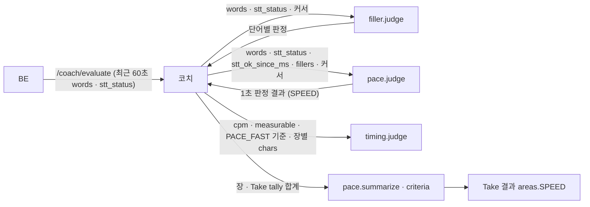

# 말 속도 · 멈춤 (pace) 설계

> **이 문서는** 말 속도 · 멈춤 판정 기능의 전체 설명서다. 처음 보는 사람이 이 문서만 읽고 이 기능이 왜 있고, 무엇을 받아 무엇을 내며, 안에서 어떻게 돌고, 어떻게 실행 · 배포하는지 알 수 있게 쓴다.
> **기준 범위**: 말 속도 판정 모듈의 목표 설계다. 기능 사이 공통 계약(1초 판정 결과 형식 · 커서 · STT 모듈 입력 · 단위 · 저장 지도)은 `architecture.md`에 따르고, 이 문서에는 이 기능에만 있는 규칙 · 예외만 적는다.
> **관련 Issue**: #154
> **한 줄 요약**: STT가 확정한 단어로 최근 말 속도(CPM, 군더더기를 뺀 글자 수 ÷ 단어 발화 시간)를 재고, 단어 사이 긴 멈춤을 세어 1초 판정 결과(영역 `SPEED`)를 낸다. 시간 판정이 장별 말한 글자 수와 말 속도를 받아 진행도를 잰다.
> **기준값**: 빠름 · 느림 기준과 아주 나쁨 값, 최근 창 · 짧은 창 길이, 측정 가능 최소 발화 시간 · 단어 수, 멈춤 기준 시간은 `src/pace/config.py`에만 두고 이 문서에는 지표와 나쁜 방향만 쓴다. 문서의 숫자는 BE와 맞춰야 하는 통신 값과 예시뿐이다.

# 0. 한눈에 보기
| 언제 | 받는 것 | 내는 것 | 쓰는 곳 |
|---|---|---|---|
| 발표 중 1초마다 (`pace.judge`, `/coach/evaluate` 안, 군더더기 다음) | 최근 60초 STT 확정 단어, STT 상태 · 마지막으로 `ok`가 된 시각, 같은 요청의 군더더기 판정 `fillers`, 두 커서 | 1초 판정 결과 하나 (영역 `SPEED`): `cpm` · `cpm_short`, 새로 센 글자 수 · 발화 시간 · 멈춤 | 코치: 빠름 지적 · 상태 표시 · 개입 효과. 시간 판정: 장별 글자 수 · 말 속도 |
| 장 끝 · Take 끝 (`pace.summarize` · `criteria`, `/coach/finalize` 안) | 장 · Take 동안의 `tally` 합계 | `cpm` · `pause_count` · `measured_ratio`, 판정 기준 | Take 결과 → 리뷰(`pacing_rhythm`) · 리포트(`average_wpm` · `total_intermission`) |

- **하는 것**: 최근 창의 CPM으로 `SLOW` · `NORMAL` · `FAST`를 정하고 `PACE_FAST` · `PACE_SLOW`를 낸다. 군더더기 단어는 글자 수에서 빼고, 군더더기 판정이 보류된 단어부터는 다음 요청에서 센다. 단어 사이 간격이 기준 시간을 넘으면 멈춤 하나로 센다.
- **하지 않는 것**:
  - 군더더기를 판정하지 않는다. 같은 요청의 군더더기 판정을 코치가 넘겨준다(모듈끼리 import하지 않는다).
  - 말을 걸지 결정하지 않는다(코치 몫). 느림은 문제 구간에만 남고 코치가 말하지 않는다.
  - 긴 침묵을 따로 세지 않는다. 오디오가 흐르는 동안 말하지 않는 긴 침묵은 소리 크기 모듈의 `PAUSE` 영역(`LONG_SILENCE` · `long_silence_count`)이 판정하고, 오디오가 끊기면 `PAUSE`는 잴 수 없음이다. 말 속도는 두 확정 단어 사이 간격이 멈춤 기준을 넘으면 길이와 관계없이 멈춤 하나로 센다(긴 침묵 뒤에 단어가 오면 `pause_count`에도 들어간다). 단어가 뒤따르지 않은 침묵은 세지 않는다.
  - STT 중간 결과를 쓰지 않는다. 확정 단어만 쓴다.
  - 옛 노트북의 연속 경고 조건은 옮기지 않는다. 코치가 말을 걸기 위한 지속 조건은 코치가 문제 구간에서 측정을 믿을 수 있던 시간으로 따로 잰다(`architecture.md` 7절).

# 1. 왜 필요한가
## 1-1. 배경
긴장하면 말이 빨라진다. 너무 빠르면 청중이 따라오지 못하고, 시간이 남는다. 반대로 너무 느리면 시간이 모자란다. 말 속도는 STT 단어 시각으로 잴 수 있지만, STT가 끊긴 동안의 듬성한 단어나 "음 · 어" 같은 군더더기를 그대로 세면 속도가 틀린다.
지금은 같은 규칙이 코치 연구 폴더 안의 연구용 대역(`coach_lab/judges/pace.py`, `pace-0.2`)에만 있고, 정식 모듈 · 평가 데이터가 없다.

## 1-2. 목표
- 사람이 단어 시각으로 잰 CPM과 맞는 말 속도를 낸다.
- 군더더기 판정 · STT 상태와 어긋나지 않게 센다(보류 단어 · STT 회복 직후).
- 시간 판정이 같은 요청 안에서 장별 말한 글자 수와 말 속도를 쓸 수 있게 한다.

## 1-3. 목표가 아닌 것
- 문장 단위 억양 · 리듬 평가.
- 대본 대비 진행도(시간 판정 몫).

# 2. 용어
| 용어 | 뜻 | 예 |
|---|---|---|
| CPM | 분당 글자 수: 공백 · 문장부호 · 군더더기를 뺀 글자 수 ÷ 단어 발화 시간(분) (`architecture.md` 6-1) | `319.4` |
| 단어 발화 시간 | 단어의 `end_ms − start_ms` 합 | `12400` |
| 최근 창 · 짧은 창 | 판정 시각 앞으로 정해진 길이의 구간. 최근 창은 상태 · 문제에, 짧은 창은 개입 효과에 쓴다 | `config.py` |
| 멈춤 | 연속한 두 확정 단어 사이 간격이 기준 시간을 넘는 것. 뒤 단어가 와야 정해진다 | 2.3초 쉼 |
| 보류 단어 | 군더더기 판정이 아직 정해지지 않은 단어(`is_filler: null`) | 창의 마지막 "그" |
| 단어 커서 (`words_since_ms`) | 어디까지 단어를 셌는지. `end_ms`가 이 값보다 큰 단어가 새것이다(`architecture.md` 7절) | `39300` |
| 시각 커서 (`since_ms`) | 시간 합계(`ok_ms` · `total_ms`)를 어디까지 셌는지 | `40000` |
| STT 정상 시간 (`ok_ms`) | STT 상태가 `ok`이고 `stt_ok_since_ms` 뒤이며 군더더기 판정이 성공한(`fillers`가 null이 아닌) 시간. 측정 비율의 분자 | `1000` |

# 3. 전체 흐름

1. **BE**: 확정 단어 · STT 상태를 Take 기준 ms로 들고 있다가 FE `metrics`를 받을 때마다 최근 60초를 `/coach/evaluate`에 싣는다(`architecture.md` 2절).
2. **코치 → 군더더기 → 말 속도**: 코치가 군더더기를 먼저 부르고, 단어별 판정 중 군더더기(true)와 보류(null) 단어를 `fillers`로 말 속도에 넘긴다. 군더더기 판정이 실패하면 `fillers: null`이다(`coach-agent.md` 6-1).
3. **`pace.judge`**: 새 단어를 세어 `tally`에 내고(글자 수 · 발화 시간 · 멈춤), 최근 창 · 짧은 창 CPM으로 상태와 문제를 정한다.
4. **코치 → 시간 판정**: 같은 요청 안에서 말 속도의 `cpm` · `measurable`과 `criteria()`의 `PACE_FAST` 기준값, 장별 `chars` 합을 시간 판정에 넘긴다(`coach-agent.md` 6-2).
5. **Take 끝**: 코치가 장 · Take `tally` 합계로 `summarize`를 불러 Take 결과의 `areas.SPEED`에 담는다.

# 4. 구성과 폴더
## 4-1. 폴더 트리
```
ai/research/speech-pace/
├─ README.md                                폴더 · 파일 지도, 실행법, 실험 결과, 대역과 달라진 점
├─ pyproject.toml · uv.lock                 Python 3.12, 의존성은 pydantic 하나
├─ src/pace/                                판정 모듈 → 서비스 features/pace/로 폴더째 옮긴다
│   ├─ schemas.py · core.py · config.py · version.py
│   └─ examples/                            judge · summarize · criteria 입력 · 출력 예시 (계약 테스트가 읽는다)
├─ data/                                    평가 데이터: 단어 시각을 사람이 확인한 발화 세트
├─ tools/                                   평가 스크립트
├─ tests/                                   판정 규칙 · 커서 · 보류 · 계약
└─ reports/results/                         평가 결과 JSON (CPM 오차 · 상태 일치율 · 멈춤 재현율)
```
폴더 이름은 `speech-pace`다. 연구 폴더가 생기기 전에는 같은 규칙이 코치 연구 폴더의 연구용 대역 `ai/research/coach-agent/src/coach_lab/judges/pace.py`에 있고, 이 모듈이 생기면 코치 재생 · 실험은 대역 대신 이 모듈을 쓴다.

## 4-2. 진입 함수
| 함수 | 하는 일 | 부르는 쪽 |
|---|---|---|
| `judge(inputs, t_ms, config)` | 1초 판정. `JudgmentResult` 하나(영역 `SPEED`)를 목록으로 낸다(`architecture.md` 7절) | 코치(`/coach/evaluate` · `/coach/finalize` · `replay`) |
| `summarize(tally, config)` | 장 · Take의 `tally` 합계 → `{"SPEED": {cpm, pause_count, measured_ratio}}` | 코치(장 끝 · Take 끝) |
| `criteria(config)` | `PACE_FAST` · `PACE_SLOW`의 판정 기준 | 코치(Take 결과의 `criteria`, 시간 판정의 빠름 기준) |

## 4-3. 규칙과 이유
| 규칙 | 이유 |
|---|---|
| 코어는 상대 import와 pydantic만 쓰고 파일 · DB · 네트워크 · 환경변수 · 시계를 쓰지 않는다. 다른 모듈(군더더기)을 import하지 않는다 (`architecture.md` 8절) | 같은 입력에 같은 결과, 서비스로 폴더째 옮겨도 코드를 고치지 않는다 |
| 판정이 정해진 단어만 센다. 한 번 센 몫은 바꾸지 않는다 | 겹쳐 오는 창에서 두 번 세지 않게 |
| 기준값은 `config.py`에만 두고 해시가 `criteria_version`에 들어간다 | 기준을 바꾸면 결과가 바뀌므로 버전으로 추적한다 |
| 입력 모델은 모르는 필드를 무시하고, 출력 모델은 정해진 필드만 낸다 | `architecture.md` 2절 |

# 5. 입력 · 출력 계약
입력 · 출력의 원본은 `src/pace/schemas.py`의 pydantic 모델이다. 시각은 모두 Take 시작 기준 ms다. 1초 판정 결과의 공통 필드와 STT 모듈 입력 · 커서 규칙은 `architecture.md` 7절이 기준이고, 아래는 말 속도에만 있는 값이다.

## 5-1. 호출 목록
| 호출 | 언제 | 누가 |
|---|---|---|
| `pace.judge` | `/coach/evaluate` 요청마다 한 번(군더더기 다음, 시간 판정 앞), `/coach/finalize`의 마지막 창, `replay`의 1초마다 | 코치 (API 라우터가 묶어 넘긴 `Judges`로) |
| `pace.summarize` | 장이 끝날 때 · Take가 끝날 때 | 코치 |
| `pace.criteria` | Take 결과를 만들 때, 시간 판정에 빠름 기준을 넘길 때 | 코치 |

말 속도는 자기 HTTP 엔드포인트가 없다.

## 5-2. 입력
**`judge(inputs, t_ms, config)`의 `inputs`** (코치가 만든다. `architecture.md` 7절 STT 모듈 입력)

| 필드 | 타입 | 필수 | 뜻 | 예 |
|---|---|---|---|---|
| `since_ms` | int | 예 | 시각 커서. 시간 합계를 이 시각부터 센다 | `40000` |
| `words_since_ms` | int | 예 | 단어 커서. `end_ms`가 이 값보다 큰 단어가 새것이다 | `39300` |
| `words` | list | 아니오 | 최근 60초 STT 확정 단어 `[{word, start_ms, end_ms}]`. BE가 매 요청 겹쳐 보낸다 | 아래 5-5 |
| `stt_status` | enum | 아니오 | `connecting` · `ok` · `reconnecting` · `degraded` · `closed`. `ok`가 아니면 잴 수 없음 | `ok` |
| `stt_ok_since_ms` | int | 아니오 | STT가 마지막으로 `ok`가 된 시각. 코치가 `coach_state`에서 넣는다. 끊긴 적이 없으면 0. `start_ms`가 이보다 이른 단어는 창에서 빼고, 그 시각 앞 단어와의 간격은 멈춤으로 세지 않는다 | `0` |
| `fillers` | list · null | 예 | 같은 요청의 군더더기 판정 중 군더더기 · 보류 단어 `[{start_ms, end_ms, is_filler}]`. `is_filler`가 true면 군더더기, null이면 보류. 빈 목록은 군더더기 없음, **null은 군더더기 판정 실패**다 | `[{"start_ms": 38900, "end_ms": 39300, "is_filler": true}]` |

- 입력 목록에는 `utterance_ends`가 없다. `architecture.md` 7절은 STT 모듈 입력에 `utterance_ends` · `take_end_ms`를 넣되, 말 속도는 받아도 쓰지 않고 단어 사이 멈춤은 다음 단어가 왔을 때만 센다고 적는다.
- 군더더기 단어와 말 속도 단어는 `(start_ms, end_ms)`로 맞춘다(코치가 같은 확정 단어에서 만든다).

## 5-3. 출력
**`judge` → `JudgmentResult` 하나를 담은 목록** (`evaluator: "pace"`, `area: "SPEED"`). 공통 필드는 `architecture.md` 7절이다.

| 필드 | 값 | 예 |
|---|---|---|
| `metrics` | `cpm`(최근 창), `cpm_short`(짧은 창, 개입 효과용), `speak_ms`(최근 창 안 단어 발화 시간 합). `cpm` · `cpm_short`는 각 창의 최소 발화 시간 · 단어 수를 채울 때만 값이 있다. 최근 창이 모자라 `measurable`이 false여도 짧은 창 조건을 채우면 `cpm_short`는 값이 있을 수 있다. STT가 `ok`가 아니거나 군더더기 판정이 실패하면 둘 다 null | `{"cpm": 319.4, "cpm_short": 324.0, "speak_ms": 12400}` |
| `tally` | 새로 판정이 정해진 단어마다 `{t_ms: 그 단어의 start_ms, values: {chars, speak_ms, pause_count?, pause_ms?}}`, 새 1초마다 `{t_ms: 그 1초의 시작, values: {ok_ms, total_ms}}`. 값이 0인 키는 뺀다 | 아래 5-5 |
| `state` | `SLOW` · `NORMAL` · `FAST`. 잴 수 없으면 `UNKNOWN` | `NORMAL` |
| `measurable` | STT 상태가 `ok`이고, 군더더기 판정이 실패하지 않았고, 최근 창 안 발화 시간과 단어 수가 기준 이상 | `true` |
| `issues[].confidence` | 최근 창 안 발화 시간이 길수록 크다(식은 `config.py`) | `0.9` |
| `counted_until_ms` · `words_counted_until_ms` | 이번까지 센 시각 · 단어 커서. 단어 커서는 센(또는 넘긴) 단어 `end_ms` 중 가장 큰 값이고(받은 커서보다 작아지지 않는다), 보류 단어가 있으면 그 앞에서 멈춘다 | `41000` · `40600` |

- `tally`의 `chars`는 그 단어의 공백 · 문장부호를 뺀 글자 수(코드 포인트, 대본 파싱 `script_chars`와 같은 정의. BE가 싣는 `word`에는 문장부호가 없지만 실려 와도 같게 센다)이고 군더더기 단어는 0이다. `speak_ms`는 그 단어의 발화 시간이다. 군더더기 단어는 발화 시간도 `speak_ms`에 넣지 않는다(최근 창 계산과 같은 규칙).
- `pause_count` · `pause_ms`는 앞 단어와의 간격이 멈춤 기준 시간을 넘을 때 뒤 단어의 몫에 1 · 그 간격으로 든다. 앞 단어가 `stt_ok_since_ms`보다 이르면 세지 않는다.
- `total_ms`는 그 시간 조각의 길이다. `ok_ms`는 이번 요청의 STT 상태가 `ok`일 때 그 조각 중 `stt_ok_since_ms` 이후 부분의 길이이고(1초 중간에 회복했으면 회복 뒤 부분만), `ok`가 아니거나 `fillers`가 null이면(군더더기 판정 실패, 단어를 세지 못함) 0이다.

**`summarize(tally)` → `{"SPEED": {...}}`** (장 · Take 값, 분모가 0이면 null. `measured_ratio`만 분모가 0이면 0, `architecture.md` 7절)

| 지표 | 계산 |
|---|---|
| `cpm` | `chars ÷ speak_ms × 60000` |
| `pause_count` | 합 |
| `measured_ratio` | `ok_ms ÷ total_ms` (말 속도의 측정 비율) |

**`criteria()`** → `{"PACE_FAST": {metric: "cpm", direction: "HIGHER_IS_WORSE", threshold, bad, onset_lag_ms, offset_lag_ms}, "PACE_SLOW": {metric: "cpm", direction: "LOWER_IS_WORSE", ...}}`

## 5-4. 문제 목록
| 문제 | 조건 | 판정 지표 (나쁜 방향) | `actionable` |
|---|---|---|---|
| `PACE_FAST` | 최근 창 `cpm`이 빠름 기준 초과 | `cpm` (높을수록) | true |
| `PACE_SLOW` | 최근 창 `cpm`이 느림 기준 미만 | `cpm` (낮을수록) | true (코치가 말하지 않고 문제 구간에만 남긴다) |

- 잴 수 없으면 `state`는 `UNKNOWN`, `issues`는 빈 목록이다. 말 속도에는 측정 불가 문제 이름이 없다(`architecture.md` 6-3).
- `severity`는 공통 규칙(기준값에서 0.5, 아주 나쁨 값에서 1.0, 그 사이 직선, 1.0에서 자름)을 따른다. `evidence`에는 `cpm`과 창 길이를 싣는다.
- 코치는 `PACE_FAST`에 `SLOW_DOWN` → `SLOW_DOWN`(문장 끝 쉬기) → 그만둠 사다리를 쓰고, 개입 효과는 `cpm_short`로 잰다(`coach-agent.md` 6-1).

## 5-5. 예시
**`judge` 입력** (창의 일부만 적었다. `metrics`는 창 전체로 계산한 값이다)
```json
{
  "t_ms": 41000,
  "since_ms": 40000,
  "words_since_ms": 39300,
  "stt_status": "ok",
  "stt_ok_since_ms": 0,
  "words": [
    {"word": "지난", "start_ms": 38200, "end_ms": 38450},
    {"word": "음", "start_ms": 38900, "end_ms": 39300},
    {"word": "분기", "start_ms": 39700, "end_ms": 40050},
    {"word": "매출은", "start_ms": 40100, "end_ms": 40600}
  ],
  "fillers": [{"start_ms": 38900, "end_ms": 39300, "is_filler": true}]
}
```
**`judge` 출력** (기준값은 `config.py`의 값으로 정해진다는 가정의 설명용, 실제 값은 `examples/`)
```json
[
  {
    "evaluator": "pace", "area": "SPEED", "t_ms": 41000, "counted_until_ms": 41000, "words_counted_until_ms": 40600,
    "criteria_version": "pace-1.0+<config 해시>",
    "measurable": true, "state": "NORMAL",
    "metrics": {"cpm": 319.4, "cpm_short": 324.0, "speak_ms": 12400},
    "tally": [{"t_ms": 39700, "values": {"chars": 2, "speak_ms": 350}},
              {"t_ms": 40100, "values": {"chars": 3, "speak_ms": 500}},
              {"t_ms": 40000, "values": {"ok_ms": 1000, "total_ms": 1000}}],
    "issues": []
  }
]
```
- "지난" · "음"은 지난 요청에서 센 단어라(`end_ms` ≤ 단어 커서 39,300) 다시 나오지 않는다. "분기" 앞 간격(39,300 → 39,700, 400 ms)은 멈춤 기준보다 짧아 멈춤이 아니다.
- `metrics`는 최근 창 전체의 군더더기가 아닌 글자 수 66, 발화 시간 12,400 ms라는 가정이다(66 ÷ 12,400 × 60,000 = 319.4).
- `fillers` 항목에 `is_filler`가 없으면 보류(null)로 읽힌다. 이 예시에서 `is_filler`를 빼면, "음"은 이미 단어 커서까지 센 단어라 커서는 멈추지 않지만, 보류인 동안 창 CPM에서는 빠진다. 새 보류 단어일 때만 커서가 그 앞에서 멈춘다. 그래서 군더더기 단어에는 `is_filler: true`를 적는다.

**경계 — 보류 단어**: `fillers`에 `{"start_ms": 51500, "end_ms": 51650, "is_filler": null}`이 있으면 그 단어부터는 세지 않고 단어 커서를 그 앞 단어의 `end_ms`에서 멈춘다. 다음 요청에서 판정이 정해지면 센다.

**경계 — 군더더기 판정 실패** (`fillers: null`)
```json
[{"evaluator": "pace", "area": "SPEED", "t_ms": 52000, "counted_until_ms": 52000, "words_counted_until_ms": 50200,
  "criteria_version": "pace-1.0+<config 해시>", "measurable": false, "state": "UNKNOWN",
  "metrics": {"cpm": null, "cpm_short": null, "speak_ms": null},
  "tally": [{"t_ms": 51000, "values": {"ok_ms": 0, "total_ms": 1000}}], "issues": []}]
```
새 단어를 세지 않고 단어 커서를 받은 값(50,200) 그대로 둔다. 그 1초는 `total_ms`에만 넣고 `ok_ms`에는 넣지 않는다(단어를 세지 못한 시간이라 측정 비율이 낮아지게. STT가 `ok`여도 같다).

**`summarize` 출력 (Take)**
```json
{"SPEED": {"cpm": 312.4, "pause_count": 6, "measured_ratio": 0.97}}
```

# 6. 처리 — 안에서 어떻게 도는가
## 6-1. `judge` 요청 하나가 도는 과정
1. **창 고르기**: `start_ms`가 `stt_ok_since_ms`보다 이른 단어는 뺀다. STT가 불안정했던 동안의 듬성한 단어로 '빠르다'가 나오지 않게 한다. STT가 돌아온 지 최근 창 길이가 안 됐으면 창을 돌아온 뒤로 줄인다.
2. **군더더기 맞추기**: `fillers`의 `(start_ms, end_ms)`로 군더더기 · 보류 단어를 표시한다. `fillers`가 null이면 6번(시간 몫)으로 바로 간다(새 단어를 세지 않음).
3. **새 단어 세기 (`tally`)**: `end_ms`가 `words_since_ms`보다 큰 단어를 `start_ms` 순서로 본다. 앞 단어의 끝보다 일찍 시작하는 단어(시간이 겹친 단어)는 시각이 거꾸로인 단어처럼 빼고 커서만 넘긴다(`architecture.md` 7절). STT가 `ok`가 아니거나 `stt_ok_since_ms` 앞 단어는 세지 않고 커서만 넘긴다. 보류 단어를 만나면 거기서 멈춘다. 센 단어마다 `chars` · `speak_ms`(군더더기면 둘 다 0, 시각이 거꾸로인 단어는 세지 않음), 앞 단어와의 간격이 기준을 넘으면 `pause_count` · `pause_ms`를 그 단어의 `start_ms`로 낸다.
4. **창 지표**: 최근 창 · 짧은 창 안 단어(군더더기 제외)의 글자 수 ÷ 발화 시간으로 `cpm` · `cpm_short`를 낸다. 발화 시간 · 단어 수가 기준 미만이면 null이다. 보류 단어는 판정이 정해질 때까지 창 계산에서도 뺀다.
5. **상태 · 문제**: `cpm`이 느림 기준 미만이면 `SLOW`와 `PACE_SLOW`, 빠름 기준 초과면 `FAST`와 `PACE_FAST`, 그 밖은 `NORMAL`이다. 기준과 같으면 `NORMAL`이다.
6. **시간 몫**: `since_ms`부터 `t_ms`까지 1초마다 `ok_ms` · `total_ms`를 그 1초의 시작 시각으로 낸다(요청이 빠졌으면 여러 개). 코치는 몫 전체를 그 시작 시각이 속한 장에 더하므로, 1초씩 나누면 빠진 긴 구간이 한 장에 몰리는 일이 줄어든다(1초 중간의 장 전환은 그 1초 안에서 나뉘지 않는다).
7. **커서**: `counted_until_ms = max(t_ms, since_ms)`로 돌려주어 커서를 되돌리지 않는다. `words_counted_until_ms`는 지금까지 센(또는 넘긴) 단어의 `end_ms` 중 가장 큰 값이고(받은 커서보다 작아지지 않는다. 시각이 거꾸로인 단어가 커서를 되돌리지 않게), 보류 단어 앞에서 멈추며, `fillers`가 null이면 받은 값 그대로다. 같은 입력을 두 번 넣으면 같은 결과가 나오고, 돌려준 커서로 겹친 창을 다시 부르면 이미 센 단어는 다시 나오지 않는다.

## 6-2. 시간 판정과의 연결
코치는 같은 요청 안에서 `metrics.cpm` · `measurable`(STT를 믿을 수 있고 군더더기 · 말 속도가 실패하지 않았을 때만 true로 넘김) · `criteria()["PACE_FAST"].threshold`와, 이번 `tally`의 `chars`를 단어를 말한 장에 더한 장별 글자 수를 시간 판정에 넘긴다(`coach-agent.md` 6-2). 시간 판정은 장 진행 비율 = 말한 글자 수 ÷ 대본 파싱의 `script_chars`로 잰다. 그래서 `chars`와 `script_chars`는 같은 정의(공백 · 문장부호를 뺀 코드 포인트 수)다.

## 6-3. `summarize` · `criteria`
- `summarize`는 코치가 장 · Take 동안 더한 `tally` 합계로 5-3 표의 지표를 계산한다. 코치는 결과를 고치지 않고 Take 결과의 `areas.SPEED`에 담고, 측정 비율이 코치의 기준 미만이면 값을 비운다(`coach-agent.md` 6-3).
- `criteria`는 두 문제의 기준을 돌려준다. `onset_lag_ms` · `offset_lag_ms`는 최근 창 때문에 빠름 · 느림이 늦게 잡히는 폭이다.

# 7. 실패할 때
| 상황 | 동작 | 결과 · 응답 | 이유 |
|---|---|---|---|
| STT 상태가 `ok`가 아님 | 새 단어를 세지 않고 커서만 넘긴다. 시간은 `total_ms`만 | `measurable: false`, `state: UNKNOWN`, `issues` 빈 목록 | 끊긴 동안 듬성한 단어로 틀린 속도가 나오지 않게 |
| STT가 돌아옴 | `stt_ok_since_ms` 앞 단어는 빼고, 그 앞 단어와의 간격은 멈춤으로 세지 않는다 | 돌아온 뒤 단어부터 센다 | 같음 |
| 군더더기 판정 실패 (`fillers: null`) | 새 단어를 세지 않고 단어 커서를 그대로 둔다 | `measurable: false`, `state: UNKNOWN`, 시간 몫은 `total_ms`만(`ok_ms` 0) | 군더더기가 글자 수에 섞이지 않게(`architecture.md` 7절) |
| 보류 단어 | 그 단어부터 세지 않는다 | 다음 요청에서 판정이 정해지면 센다 | 군더더기인지 모르고 세면 틀린다 |
| `words` 없음 | 시간 몫만 센다 | `cpm` null, `measurable: false`, `UNKNOWN` | 말이 없다 |
| 최근 창 발화가 측정 기준 미만 | 판정이 정해진 새 단어의 `tally`와 단어 커서는 그대로 처리한다 | `cpm` null, `measurable: false`, `UNKNOWN` | 짧은 발화로 속도를 단정하지 않되, 시간 판정이 쓰는 글자 수는 잃지 않게 |
| 단어 시각이 거꾸로(`end_ms < start_ms`)이거나 앞 단어와 시간이 겹침(앞 단어 끝보다 일찍 시작) | 그 단어는 글자 수 · 발화 시간 · 멈춤 계산에서 빼고(앞뒤 단어의 간격은 그 단어를 건너뛰어 잰다) 단어 커서는 넘긴다 | 나머지는 그대로 | 단어 하나 때문에 요청 전체를 잃지 않게 |
| 판정 모듈 예외 | 코치가 그 영역만 잴 수 없음으로 두고 커서를 이번 창 끝으로 넘긴다 | evaluate 200, `indicators.SPEED`는 `UNKNOWN`, 시간 판정은 속도를 모르는 것으로 | 한 영역 고장으로 나머지 코칭을 멈추지 않게 (`coach-agent.md` 6-1) |

# 8. 시간 예산과 호출 규칙
| 호출 | AI 예산 | BE 시간 제한 | 재시도 | 이유 |
|---|---|---|---|---|
| `pace.judge` (`/coach/evaluate` 안) | evaluate 전체가 BE 약 300 ms 안. 창 안 단어 수(60초 분량)에 비례하는 규칙 계산 | `/coach/evaluate`를 따른다 | 없음 (다음 요청의 겹친 창이 대신한다) | 실시간 경로. LLM · 네트워크를 쓰지 않는다 |
| `pace.judge` · `summarize` (`/coach/finalize` · `replay` 안) | finalize를 따른다 | 10초, `replay`를 붙인 호출은 60초 | finalize를 따른다 | `coach-agent.md` 8절 |

- **창**: BE는 확정 단어를 최근 60초씩 보낸다(`architecture.md` 2절). 최근 창 · 짧은 창은 이 안에서 `config.py`로 정한다. STT 단어는 말한 뒤 늦게 확정되므로 요청 시각이 아니라 단어 커서로 새 단어를 가린다.

# 9. 버전
| 버전 | 값 | 어디에 | 언제 오르나 |
|---|---|---|---|
| `feature_version` | `pace-<버전>` (첫 판 `pace-1.0`, 지금 대역은 `pace-0.2`) | `src/pace/version.py` | 판정 규칙 · 출력의 뜻이 바뀔 때 |
| `criteria_version` | `pace-<버전>+<config 해시 12자리>` | `judge` 출력 → `coach_state` → 응답 `meta.criteria_versions.pace` | 기준값을 바꾸면 해시가 바뀐다 |
| `schema_version` | `1.0` | 코치 응답 `meta` (`architecture.md` 5절) | 판정 결과의 필드 이름 변경 · 삭제 · 뜻 변경 |

# 10. 실행 · 테스트
준비 (`ai/research/speech-pace`에서. Python 3.12, `.venv`는 git에 없어 처음 한 번 만든다. LLM을 쓰지 않아 `ai/.env`가 필요 없다)
```bash
cd ai/research/speech-pace
uv sync
```
| 하는 일 | 명령 | 기대 결과 |
|---|---|---|
| 테스트 | `uv run python -m pytest` | 판정 규칙 · 커서 · 보류 · 계약(`examples/`, 공통 계약 테스트 틀) 통과 |
| 평가 | `uv run python tools/evaluate.py --out reports/results/pace_eval.json` | CPM 오차 · 상태 일치율 · 멈춤 재현율 (13절) |
| 린트 | `uv run ruff check . && uv run ruff format --check .` | 지적 없음 |

- 연구 폴더가 생기기 전에는 같은 규칙이 코치 연구 폴더의 연구용 대역에 있다. 그 테스트(`tests/lab/test_judge_pace.py`, 코치 쪽 연결 `tests/unit/test_judges.py`)는 `cd ai/research/coach-agent` 뒤 `PYTHONPATH=src python -m pytest tests/lab/test_judge_pace.py tests/lab/test_judge_volume.py tests/lab/test_judges_package.py tests/lab/test_judges_run.py tests/unit/test_judges.py`로 돈다.
- 테스트가 볼 것: 빠름 · 느림 · 기준과 같을 때, 군더더기 글자 빼기, 보류에서 커서 멈춤, `fillers: null`, `stt_ok_since_ms` 앞 단어 빼기와 그 간격은 멈춤 아님, 멈춤은 뒤 단어가 와야 셈, 요청이 빠져 새 1초가 여러 개면 1초마다 시간 몫, 같은 입력이면 같은 결과, 돌려준 커서로 겹친 창을 다시 부르면 중복 없음. 테스트 이름은 동작을 문장으로 짓는다.

# 11. 배포
**어디서 도는가**: 판정 모듈 `src/pace/`(`examples/` 포함)를 AI 서비스의 `features/pace/`로 폴더째 옮기고, 테스트는 `tests/unit/pace/`로 옮긴다. 자기 HTTP 엔드포인트는 없고, 라우터가 앱 시작 때 만드는 `Judges` 묶음에 `judge` · `summarize` · `criteria`를 넣어 코치에 넘긴다(`coach-agent.md` 11절). 의존성은 pydantic 하나다. 서비스로 옮기려면 서비스 뼈대(`ai-service.md`)가 먼저 있어야 한다.

**환경변수**: 말 속도 모듈은 환경변수를 읽지 않는다.

**옮긴 뒤 같은 결과인지 확인**
1. 서비스: 옮긴 `tests/unit/pace/`가 그대로 통과한다.
2. 코치 연구 폴더: 연구용 대역 대신 이 모듈을 `Judges`에 넣어 재생 · 실험을 다시 돌리고 달라진 판정을 README에 기록한다.

**증상별 원인**

| 증상 | 원인 | 확인 · 해결 |
|---|---|---|
| `indicators.SPEED`가 계속 `UNKNOWN` | STT 상태가 `ok`가 아님, 군더더기 판정 실패(`fillers: null`), 말이 적음 | evaluate 요청의 `inputs.stt_status`, AI 로그의 filler 예외 |
| 말이 끊긴 뒤 한동안 '빠르다'가 남음 | 오디오가 멈춘 동안에도 STT 상태가 `ok`로 와서 최근 창의 옛 단어로 계산 | 코치가 오디오가 멈춘 1초에 STT 모듈에 `ok`가 아닌 상태(`degraded`)를 넘긴다 |
| CPM이 사람이 잰 값보다 높음 | 군더더기가 STT에서 지워져 글자 수 · 시간이 둘 다 빠짐, 단어 시각이 좁게 찍힘 | 같은 발화의 사람 표시와 STT 단어 시각 |
| 같은 단어가 두 번 세짐 | 코치가 단어 커서를 넘기지 않음, BE가 단어 시각을 바꿔 보냄 | `coach_state`의 pace 커서, 같은 단어의 `end_ms`가 요청마다 같은지 |

# 12. FE · BE · DB 연결과 저장
말 속도는 원자료(STT 단어)를 받기만 하고, 결과는 코치의 Take 결과에 담겨 저장된다. BE가 요청을 만드는 법과 Take 한 번의 순서는 `architecture.md` 1-3 · 2절, 코치 쪽 저장은 `coach-agent.md` 12절에 있다.

## 12-1. 저장 (DB)
저장 설계는 AI가 하고 AI 리드가 정하며, 마이그레이션 · 구현 · 운영은 BE가 한다. 공통 저장 지도는 `architecture.md` 1-1이다.

| 데이터 | 언제 생기나 | 저장 위치(테이블.칸) | 형식(JSON · 칸, 크기) | 쓰는 쪽 · 읽는 쪽 | 덮어쓰기 막기 | 보관 기간 · 개인정보 |
|---|---|---|---|---|---|---|
| 말 속도 Take 지표 · 판정 기준 | `/coach/finalize` 응답 | `take_ai_results.payload`(`kind` = `TAKE_RESULT`)의 `areas.SPEED`(`take` · `slides`) · `criteria.SPEED` | 코치가 `summarize` · `criteria` 결과를 고치지 않고 담는다. Take 또는 장 하나에 0.1 KB 안팎(지표 두 개 + 측정 비율) | 코치가 만들고 BE가 쓴다 · 리뷰(`pacing_rhythm`) · 리포트 | `coach-agent.md` 12-1 (`(take_id, kind)` 유일) | Take와 함께 |
| 리포트 요약 칸 | `/coach/finalize` 응답을 저장할 때 | `take_summaries.average_wpm`(SPEED `cpm`, 칸 이름은 그대로 두고 CPM을 넣는다) · `take_summaries.total_intermission`(SPEED `pause_count`) | 숫자. 잴 수 없었으면 null | BE가 쓴다 · FE 리포트 목록 · Take 비교 | Take마다 한 행 | Take와 함께 |
| 말 속도 개입 | `/coach/evaluate` 응답이 `INTERVENE`이고 영역이 `SPEED`일 때 | `live_feedbacks` (`type` = `SPEED`) | `coach-agent.md` 12-1 | 코치 | `coach-agent.md` 12-1 | Take와 함께 |
| STT 확정 단어 (원자료, 이 모듈의 입력) | Take 동안 | `take_transcript_segments.words` | `architecture.md` 1-1, `coach-agent.md` 12-1 | BE가 쓴다 · `replay` | `coach-agent.md` 12-1 | Take와 함께. 사용자 발화다 |

## 12-2. 저장 규칙
- 말 속도 결과는 코치 응답의 `meta`(`criteria_versions.pace` 포함)와 함께 저장된다(`coach-agent.md` 12-2).
- `take_summaries`의 두 칸은 `summarize` 값을 그대로 넣고, 아직 계산하지 않았거나 잴 수 없던 Take는 null이다(0과 구별한다). FE는 `average_wpm`을 '분당 글자 수'로 보인다(`architecture.md` 1-1).

# 13. 품질 검증
평가 데이터에는 가상 발표와 실제 리허설을 함께 둔다(`architecture.md` 12절). 결과 파일은 `reports/results/`에 커밋한다.

| 평가 데이터 | 지표 | 중점 | 검증 방법 |
|---|---|---|---|
| 서비스와 같은 설정으로 Deepgram을 돌린 발화의 확정 단어에, 단어 시각 · 군더더기 · 멈춤을 사람이 확인한 세트 (빠름 · 보통 · 느림, 군더더기 많음, STT 끊김) | CPM 오차, 상태 일치율, 멈춤 재현율 | CPM이 사람이 잰 값과 맞고, 빠름 · 느림 상태가 일치하는 것 | `tools/evaluate.py` → 결과 JSON |
| 판정 모듈 단위 시나리오 | 계약 · 경계 테스트 통과 | 같은 입력 같은 결과, 보류 · 커서로 두 번 세지 않음 | `tests/` · `examples/` |
| 코치 재생 시나리오 | 코치 쪽 지표 (불필요한 개입률 등) | 이 모듈로 바꿔도 코칭이 나빠지지 않는 것 | `coach-agent.md` 13절 |

- 기준값(빠름 · 느림 · 멈춤 기준)은 옛 노트북 값이거나 손으로 고른 잠정값이다. 이 세트로 다시 고른다.

# 14. 지표 정의
- **`cpm`** (판정 결과): 최근 창 안 군더더기가 아닌 단어의 공백 · 문장부호를 뺀 글자 수 ÷ 그 단어들의 발화 시간 × 60000. 발화 시간 · 단어 수가 기준 미만이면 null.
- **`cpm_short`**: 같은 계산을 짧은 창으로.
- **`cpm`** (Take · 장): `chars ÷ speak_ms × 60000`. `speak_ms`가 0이면 null.
- **`pause_count`**: 연속한 두 확정 단어 사이 간격이 멈춤 기준 시간을 넘은 횟수의 합(앞 단어가 STT 회복 전이면 세지 않음).
- **`measured_ratio`**: `ok_ms ÷ total_ms`. STT가 정상이던 시간의 비율이다.
- **CPM 오차**: 평가 발화마다 `|모듈 cpm − 사람이 잰 cpm|`의 평균(Take · 장 값).
- **상태 일치율**: 평가 1초마다 모듈 `state`와 사람이 정한 상태가 같은 비율(`UNKNOWN` 제외, 그 비율은 따로 기록).
- **멈춤 재현율**: 사람이 표시한 멈춤 중 모듈이 센 비율.

# 15. 열린 질문 · 알려진 한계
**정한 것**
- 창과 `tally`가 같은 규칙(군더더기는 글자 · 시간 모두 빼고, 보류 단어는 창에서도 아직 세지 않음), 문장 끝 신호를 쓰지 않음, 시각이 거꾸로인 단어는 계산에서 빼고 커서는 넘김.
- 오디오가 멈춘 동안의 STT 정상 시간은 코치 쪽에서 정했다(코치가 오디오가 멈춘 1초에 `degraded`를 넘김). 말 속도 계약은 그대로다.

**열린 질문**
- 없음.

**알려진 한계**
- STT가 지운 군더더기는 글자 수와 시간에서 둘 다 빠지므로, 군더더기가 많은 발화의 CPM은 실제 체감보다 조금 높게 나올 수 있다.
- 숫자 · 영어 약어는 STT 표기에 따라 글자 수가 달라진다(예: "37%" ↔ "삼십칠 퍼센트").
- 같은 `(start_ms, end_ms)`를 가진 서로 다른 단어는 군더더기 판정과 구분하지 못한다(실제 STT에서는 드물다).
- 평가 데이터가 아직 없고, 기준값은 잠정값이다.

# 16. 확정 값 한눈에
| 항목 | 값 | 어디서 정하나 |
|---|---|---|
| 입력 | `words` · `stt_status` · `stt_ok_since_ms` · `fillers`(null = 군더더기 판정 실패) · `since_ms` · `words_since_ms` (BE 창 60초) | 5-2, `architecture.md` 2 · 7절 |
| 진입 함수 | `judge` · `summarize` · `criteria` (자기 HTTP 엔드포인트 없음) | 4-2 |
| 영역 · 상태 · 문제 | `SPEED`, `SLOW` · `NORMAL` · `FAST` · `UNKNOWN`, `PACE_FAST` · `PACE_SLOW`(지표 `cpm`) | 5-3 · 5-4 |
| 판정 결과 | `metrics{cpm, cpm_short, speak_ms}`, `tally` 단어 몫 `{chars, speak_ms, pause_count?, pause_ms?}` · 1초 몫 `{ok_ms, total_ms}` | 5-3 |
| Take 지표 | `cpm` · `pause_count` · `measured_ratio` | 5-3 |
| 버전 | `pace-1.0` · `criteria_version` `pace-1.0+<config 해시 12자리>` | 9절 |
| 저장 | Take 결과 `areas.SPEED`, 리포트 `take_summaries.average_wpm`(CPM) · `total_intermission` | 12-1 |
| 의존성 | pydantic 하나, Python 3.12, 폴더 `ai/research/speech-pace/` | 4절 · 11절 |
