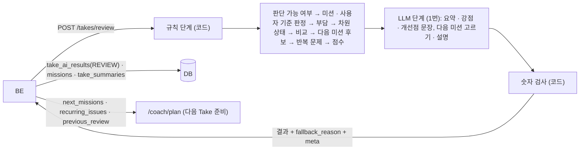
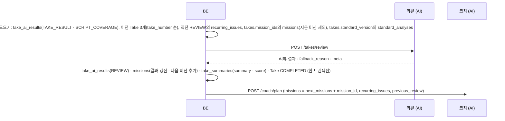

# 리뷰 에이전트 (review) 설계

> **이 문서는** 리뷰 에이전트의 전체 설명서다. 처음 보는 사람이 이 문서만 읽고 이 기능이 왜 있고, 무엇을 받아 무엇을 내며, 안에서 어떻게 돌고, 어떻게 실행 · 배포하는지 알 수 있게 쓴다.
> **기준 범위**: 리뷰 에이전트(`POST /takes/review`)의 목표 설계다. 기능 사이 공통 계약(에러 · `meta` · 시간 예산 · LLM 공통 규칙 · 지표 · 문제 이름 · 숫자 검사 원칙 · 저장 지도)은 `architecture.md`에 따르고, 이 문서에는 이 기능에만 있는 규칙 · 예외만 적는다.
> **관련 Issue**: #211
> **한 줄 요약**: Take 결과 · 대본 전달도 채점 · 이전 Take · 미션 · 사용자 평가 기준을 받아, 규칙으로 차원 상태 · 점수 · 미션 판정 · 다음 미션 · 반복 문제를 정하고, LLM 한 번으로 요약 · 강점 · 개선점 문장과 다음 미션 설명을 쓴다. 숫자 · 상태 · 점수는 LLM이 바꾸지 못하고, 코드가 문장의 숫자를 검사한다.
> **기준값**: 부담 기준 · 1순위 차원 수 · 중요도별 부담 · 허용치 · 지표별 한 걸음 폭과 최종 목표 · 장 집중 비율 · 상태별 점수 · 채점 비율 기준은 `src/review/config.py`에만 두고, 이 문서에는 BE · 코치와 맞춰야 하는 값(개수 · 길이 한도 · 시간 예산)과 예시만 적는다.

# 0. 한눈에 보기
| 언제 | 받는 것 | 내는 것 | 쓰는 곳 |
|---|---|---|---|
| Take 종료 뒤, 대본 전달도 채점 · 확인이 끝난 뒤 (`POST /takes/review`, BE 백그라운드) | Take 결과, 대본 전달도 채점(없으면 null), 같은 발표의 이전 Take 3개, 직전 반복 문제, 이번 Take 미션, 사용자 평가 기준 | 요약 · 점수 · 차원 상태 · 강점 · 개선점 · 이전 Take 비교 · 미션 결과 · 사용자 기준 판정 · 다음 미션 · 반복 문제 · `fallback_reason` · `meta` | FE 리포트, BE(`missions` · `take_summaries`), 다음 Take의 코칭 계획 · 코치 · 다음 리뷰 |

- **하는 것**: 결론을 낸다. 차원 여섯 개의 상태(`PRIORITY` 등)와 점수, 미션 · 사용자 기준을 이뤘는지, 다음 Take에 무엇을 목표로 할지(다음 미션)와 계속 남은 문제(반복 문제)를 정한다. LLM은 이 결론을 사람이 읽을 문장으로 쓰고 다음 미션 후보 중 고른다.
- **하지 않는 것**:
  - 지표를 다시 계산하지 않는다. Take 결과 · 대본 전달도 값을 읽기만 한다(`architecture.md` 0-2).
  - 판정 기준값을 따로 두지 않는다. 측정 비율이 낮은 영역 · 믿을 수 없는 문제 구간은 코치가 Take 결과에 표시한 대로 따른다.
  - LLM이 숫자 · 상태 · 점수를 정하지 않는다. LLM 문장의 숫자는 코드가 규칙 단계 결과와 대조한다.
  - 다른 에이전트를 부르지 않는다. 다음 Take 준비(`/coach/plan`)는 BE가 리뷰를 저장한 뒤 부른다.

# 1. 왜 필요한가
## 1-1. 배경
코치는 Take의 사실(지표 · 문제 구간 · 개입 · 판정 기준)만 모으고 결론을 내지 않는다(`architecture.md` 0-2). 사용자에게는 "무엇이 가장 문제였고, 지난번보다 나아졌는지, 다음엔 무엇을 하면 되는지"가 필요하다. 그 결론이 다음 Take의 코칭 우선순위(미션 · 반복 문제)와 코칭 계획으로 이어진다.
LLM에게 결론을 맡기면 숫자를 지어내거나 같은 입력에 다른 1순위가 나온다. 그래서 결론은 규칙으로 정하고, LLM은 문장만 쓴다.
옛 결론 규칙은 코치 안의 리뷰 근거(`review.py`)에 있었으나 지워졌고(지금은 archive에만 있음, 옛 지표 이름), 리뷰 에이전트의 코드는 아직 없다.

## 1-2. 목표
- 같은 입력이면 같은 차원 상태 · 점수 · 미션 판정 · 다음 미션(규칙 단계)이 나온다.
- 문제를 강점이라고 하지 않는다(거짓 강점). 측정하지 못한 차원은 문제로도 강점으로도 말하지 않는다.
- LLM 문장에 입력에 없는 숫자가 남지 않는다.
- LLM이 없거나 실패해도 리포트 · 다음 Take 준비가 끊기지 않는다.

## 1-3. 목표가 아닌 것
- 발표 내용(논리 · 설득력) 평가. 내용은 대본 전달도(대본을 얼마나 전달했나)로만 본다.
- 다른 발표와의 비교 · 사용자 간 순위.

# 2. 용어
| 용어 | 뜻 | 예 |
|---|---|---|
| 차원 | 리뷰가 결론을 내는 여섯 묶음. 영역 · 지표 · 문제가 정해져 있다(5-3 표) | `script_independence` |
| 부담 | 차원의 문제 크기. 믿을 수 있는(`reliable`) 문제 구간마다 `mean_severity × 초`를 더한다. 대본 전달도는 빠진 · 다르게 말한 핵심 내용을 중요도별 부담으로 바꿔 더한다 | `7.4` |
| 차원 상태 | `PRIORITY`(먼저 고칠 것) · `IMPROVED`(나아짐) · `STRENGTH`(강점) · `STABLE`(보통) · `NOT_EVALUABLE`(판단 불가) | `PRIORITY` |
| 미션 | 이번 Take에 실린 목표 `{mission_id, area, slide_number, target{metric, operator, value}}`. 직전 리뷰의 다음 미션에 BE가 `mission_id`를 붙인 것 | `filler_per_min LTE 2` |
| 미션 · 기준 상태 | `ACHIEVED`(이룸) · `PARTIAL`(허용치 안에서 못 미침) · `FAILED` · `NOT_EVALUABLE` | `PARTIAL` |
| 사용자 기준 | 평가 기준 분석의 `targets` · `script_used` (`evaluation-criteria.md` 5-3) | `filler_count LTE 5` |
| 반복 문제 | 다음 Take에도 먼저 챙길 `{area, slide_number, dimension}` | `{"area": "GAZE", "slide_number": 3, "dimension": "script_independence"}` |
| 규칙 단계 · LLM 단계 | 숫자 · 상태 · 점수를 정하는 코드(LLM 없음) · 문장을 쓰는 LLM 한 번 | — |
| 기본 문장 | LLM이 없거나 숫자 검사에 걸린 문장 대신 규칙 단계가 만드는 템플릿 문장 | "3번 장 대본 응시 비율이 0.62입니다" |

# 3. 전체 흐름

1. **BE**: 대본 전달도 채점 · 확인이 끝나면(확인을 건너뛰거나 화면을 떠나거나 확인을 기다린 지 10분이 지나도) 백그라운드로 `/takes/review`를 부른다(`architecture.md` 1-3). 확인 답은 리뷰를 부르기 전까지만 받는다.
2. **규칙 단계**: 6-1 순서로 숫자 · 상태 · 점수 · 미션 판정 · 다음 미션 후보 · 반복 문제를 정한다. 같은 입력이면 같은 결과다.
3. **LLM 단계**: 규칙 단계 결과와 근거 숫자만 받아 문장을 쓰고 다음 미션 후보 중 고른다. 출력 스키마는 고정이다.
4. **숫자 검사**: 문장마다 숫자를 규칙 단계 결과와 대조하고, 없는 숫자가 든 문장은 기본 문장으로 바꾼다.
5. **BE**: 리뷰 · 미션 · `take_summaries`(`summary` · `score`)를 저장하고 Take를 `COMPLETED`로 바꾼 뒤 `/coach/plan`을 부른다.

# 4. 구성과 폴더
## 4-1. 폴더 트리
```
ai/research/review-agent/
├─ README.md                                폴더 · 파일 지도, 실행법, 실험 결과
├─ pyproject.toml · uv.lock                 Python 3.12. 코어는 pydantic 하나, 연구 도구만 LLM 라이브러리
├─ src/review/                              리뷰 코어 → 서비스 features/review/로 폴더째 옮긴다
│   ├─ __init__.py                          review_take 공개
│   ├─ schemas.py                           요청 · 응답 · LLM 출력 pydantic 모델 = 계약
│   ├─ core.py                              review_take(): 규칙 단계 → LLM 단계 → 숫자 검사
│   ├─ evaluable.py                         6-1 1번: 판단 가능 여부
│   ├─ missions.py                          6-1 2 · 3번: 미션 판정 · 사용자 기준
│   ├─ burden.py                            6-1 4번: 차원 · 장 · 영역별 문제 부담
│   ├─ dimensions.py                        6-1 5번: 차원 상태
│   ├─ comparison.py                        6-1 6번: 이전 Take 비교
│   ├─ next_missions.py                     6-1 7번: 다음 미션 후보
│   ├─ recurring.py                         6-1 8번: 반복 문제
│   ├─ score.py                             6-1 9번: 점수
│   ├─ metrics.py                           지표 찾기 · 비교 (미션 판정 · 다음 미션 · 근거가 같이 쓴다)
│   ├─ vocab.py                             고정 어휘 · 5-3 차원 표
│   ├─ text.py                              기본 문장
│   ├─ config.py · version.py               부담 · 허용치 · 한 걸음 폭 · 점수 · 개수 한도, 기능 버전
│   ├─ prompts/                             문장 쓰기 · 다음 미션 고르기 프롬프트
│   └─ examples/                            요청 · 응답 예시 (계약 테스트가 읽는다)
├─ src/review_lab/                          연구 전용(정답 리뷰 평가 · 실제 LLM 실행). 옮기지 않는다
├─ data/                                    공통 기준 Take의 저장 결과 묶음과 정답 리뷰
├─ tests/ · tests/live/                     규칙 · 숫자 검사 · 계약(가짜 LLM) / 실제 LLM(live 표시)
└─ reports/results/                         평가 결과 JSON
```
연구 폴더 이름(`review-agent`, 코치 `coach-agent`와 같은 꼴)은 아직 정하지 않았다(15절 열린 질문). 파일 이름은 담당자가 정하고 README의 파일 지도에 둔다.

## 4-2. 진입 함수
| 함수 | 하는 일 | 부르는 쪽 |
|---|---|---|
| `review_take(request, llm, *, model=None)` | 요청 하나를 처리해 응답 모델을 돌려준다. `llm`은 LLM 출력 스키마가 걸린 객체(`.invoke`만 씀), 없으면 None. LLM 예외는 잡아 기본 결과로 돌아간다(`architecture.md` 9절 'LLM이 결과를 보탬') | 서비스 라우터 `POST /takes/review` |
| `apply_rules(request, config)` | 규칙 단계 결과(문장 없음) | `review_take` · 테스트 · 연구 평가 |
| `check_numbers(sentence, allowed_numbers)` | 숫자 검사 | `review_take` · 테스트 |

## 4-3. 규칙과 이유
| 규칙 | 이유 |
|---|---|
| 숫자 · 상태 · 점수 · 미션 판정은 규칙 단계가 정하고 LLM은 바꾸지 못한다 | 같은 입력에 같은 결론, 숫자를 지어내지 않게 |
| 판단 가능 여부 · 믿을 수 있는 구간은 Take 결과의 표시를 따르고 리뷰가 따로 기준값을 두지 않는다 | 판정 기준을 한곳에 둔다(`architecture.md` 0-2) |
| 지표 · 영역 · 문제 이름은 `architecture.md` 6-3 그대로 쓴다. 다음 미션의 `target.metric`도 Take 결과의 지표 이름이다 | 다음 Take의 코치 · 리뷰가 그대로 읽는다 |
| 코어는 상대 import와 pydantic만 쓰고 파일 · 환경변수 · 네트워크 · 시계를 쓰지 않는다. 다른 모듈을 import하지 않는다 (`architecture.md` 8절) | 서비스로 폴더째 옮기고, 가짜 LLM으로 시험한다 |
| 장이 없는 값(Take 전체)은 `slide_number` null이다. 0을 쓰지 않는다 | 미션 · 반복 문제 · 코칭 계획 · 코치가 모두 null을 Take 전체로 읽는다 |

# 5. 입력 · 출력 계약
요청 · 응답의 원본은 `src/review/schemas.py`의 pydantic 모델이다. 요청은 모르는 필드를 무시하고, 응답은 정해진 필드만 낸다(`architecture.md` 2절). 입력 값의 모양은 그 값을 만든 기능 문서가 기준이다(코치 5-3 `take_result`, 대본 전달도 5-3, 평가 기준 5-3).

## 5-1. 호출 목록
| 호출 | 언제 | 누가 | 방식 |
|---|---|---|---|
| `POST /takes/review` | 대본 전달도 채점 · 확인이 끝난 뒤(대본이 없거나 채점이 모두 실패해도) | BE | 백그라운드, LLM 1번(재시도는 요청 마감 안에서만) |

## 5-2. 입력
| 필드 | 타입 | 필수 | 뜻 |
|---|---|---|---|
| `take_result` | object | 예 | 코치 Take 결과(`coach-agent.md` 5-3). Take 결과를 만들지 못한 Take는 `FAILED`라 리뷰를 부르지 않는다 |
| `script_coverage` | object · null | 아니오 | 대본 전달도 채점 `{take_id, evaluations, take_scores, confirmations, failed}`(사용자가 확인했으면 확인 반영본). 대본이 없거나 모든 장이 실패했으면 null |
| `previous_takes` | list | 아니오 | 같은 발표에서 `take_number`가 이번 Take보다 작은 `COMPLETED` Take 중 번호가 큰 것부터 3개까지 `[{take_result, take_scores}]`(`architecture.md` 1-1). `take_scores`는 그 Take의 대본 전달도 Take 값(없으면 null) |
| `previous_recurring_issues` | list | 아니오 | 직전 리뷰의 반복 문제 `[{area, slide_number, dimension}]`(`REVIEW` 결과가 있는 Take 중 가장 늦게 끝난 Take의 `recurring_issues` 그대로, 고르는 순서는 `architecture.md` 1-1 · 1-3, 없으면 빈 목록). `dimension`이 없거나 차원 이름이 아닌 항목은 반복 판정(6-1 4 · 5번)에 쓰지 않고 로그에 남긴다(그 항목 때문에 리뷰 전체를 거절하지 않는다) |
| `missions` | list | 아니오 | 이번 Take에 실린 미션 `[{mission_id, area, slide_number, target{metric, operator, value}}]` (`slide_number`가 null이면 Take 전체) |
| `user_criteria` | object · null | 아니오 | 사용자 평가 기준 `{display_criteria, targets, script_used}` (없으면 null). BE는 이 Take의 `takes.standard_version`이 가리키는 버전의 평가 기준 분석 결과로 만들고(`architecture.md` 1-3 1번, `standard_version`이 null이면 기준 없음이라 `user_criteria` null), 그 결과의 `display_criteria` · `targets`를 그대로 싣고, `values.script_used`(저장 칸 `standard_analyses.script_used`)를 `script_used`로 옮긴다. `script_used`는 bool 또는 null(언급이 없으면 null) |

- 입력 개수 한도: `previous_takes` 3 · `missions` 20 · `previous_recurring_issues` 20 · `user_criteria.targets` 20. 넘으면 422 `VALIDATION_ERROR`이고 BE는 다시 부르지 않는다. `targets` 20은 평가 기준 분석의 표시 기준 10개 × 범위 목표 2개다. `take_result` · `script_coverage` 크기는 요청 본문 크기 상한(`ai-service.md` 15절 열린 질문)으로 정한다.

## 5-3. 출력
| 필드 | 타입 | 뜻 |
|---|---|---|
| `take_id` | string | `take_result.take_id` |
| `overall_summary` | string | 요약 문장 |
| `score` | int · null | 차원 상태 점수의 평균(0–100, `NOT_EVALUABLE` 제외)을 정수로 반올림한 값. 모든 차원이 판단 불가면 null |
| `dimensions` | object | 차원 여섯 개 → 상태 |
| `strengths[]` | list | `{area, slide_number, text, evidence}`. 개선점과 같은 모양이고, 장이 없으면 `slide_number` null. `evidence`는 지표 이름 → 숫자. `area` · `evidence`를 고르는 법은 6-2 |
| `improvements[]` | list | `{area, slide_number, text, evidence}`. 장이 없으면 `slide_number` null |
| `comparison[]` | list | 바로 앞 Take(`previous_takes[0]`)와 같은 지표 비교 `{metric, slide_number, previous, current, improved, script_mode}`. `improved`는 좋아진 방향인지(bool, 방향을 정할 수 없으면 null). `script_mode`는 두 Take의 대본 보기가 다를 때 `{previous, current}`, 같으면 null |
| `mission_results[]` | list | `{mission_id, status, metric, operator, slide_number, target, observed}`. `observed`는 판정에 쓴 관측값(float), 없으면 null |
| `criteria_results[]` | list | 사용자 기준 판정 `{display, metric, operator, target, observed, status}`. `observed`는 float · null |
| `next_missions[]` | list | `{area, slide_number, description, target{metric, operator, value}, priority, reason}`. `mission_id`는 없다(BE가 저장하며 붙인다). `priority`는 코드가 1부터 차례로 붙인다(실패한 사용자 목표가 먼저, 이어서 LLM이 고른 순서, LLM 실패면 후보 순서. 한 리뷰 안에서 겹치지 않는다 — 저장 UQ). **20개 이하, `description`은 500자 이하**(코칭 계획 입력 한도, `coach-agent.md` 5-2) |
| `recurring_issues[]` | list | `{area, slide_number, dimension}`, **20개 이하**(같은 이유). `PRIORITY` 차원마다 하나다. `dimension`은 그 차원 이름(아래 차원 표의 여섯 중 하나), `area`는 그 차원의 영역(영역이 여럿이면 부담이 가장 큰 영역, 6-1 8번)이다. `GAZE` 한 영역에 `audience_gaze` · `script_independence` 두 차원이 있어 `area`만으로는 차원을 가르지 못한다 |
| `fallback_reason` | enum · null | LLM 단계를 쓰지 못하고 기본 문장 · 후보 상위를 낸 이유 `LLM_TIMEOUT` · `LLM_ERROR` · `LLM_INVALID_OUTPUT` · `LLM_UNAVAILABLE`. 성공이면 null. 숫자 검사로 문장 일부만 바꾼 것은 달지 않는다(바꾼 문장 수는 로그에). BE가 나중에 다시 부르는 것은 이 값이 있을 때만이다 |
| `meta` | object | `{schema_version, feature_version: "review-<버전>", criteria_versions, model}` (`architecture.md` 5절). `criteria_versions`에는 `take_result.criteria`에 실린 기능별 기준 버전과 리뷰 자체 규칙 버전 `review-<버전>+<config 해시 12자리>`를 함께 싣는다. `model`은 기본 결과면 null |

**차원 표** (부담에 넣는 문제와 근거 지표. 이름은 `architecture.md` 6-3)

| `dimensions` | 영역 · 지표 | 부담에 넣는 문제 |
|---|---|---|
| `audience_gaze` | GAZE `audience_ratio` | `GAZE_LOW_EYE_CONTACT` · `GAZE_AWAY` |
| `script_independence` | GAZE `script_ratio` · `reading_ratio` · `reading_runs` | `GAZE_ON_SCRIPT` |
| `pacing_rhythm` | SPEED `cpm` · `pause_count`, PAUSE `long_silence_count`, TIME `duration_ms` · `slide_duration_ms` | `PACE_FAST` · `PACE_SLOW` · `LONG_SILENCE` · `BEHIND_SCHEDULE` · `AHEAD_OF_SCHEDULE` · `SLIDE_OVER` · `TIME_OVER` |
| `vocal_delivery` | VOLUME `voice_diff_db` · `low_ratio` | `VOLUME_LOW` |
| `fluency` | FILLER `filler_per_min` · `filler_count` | `FILLER_FREQUENT` |
| `content_delivery` | CONTENT `content_coverage` · `critical_fact_accuracy` | 대본 전달도의 `missing` · `contradicted` 핵심 내용 |

- `GAZE_ON_SCREEN` · `GAZE_UNMEASURABLE` · `FINAL_MINUTE`은 부담에 넣지 않는다.
- TIME 지표는 Take 결과의 TIME 지표(`duration_ms` · 장 `slide_duration_ms`, `architecture.md` 6-3)를 쓴다.

## 5-4. 상태
| 대상 | 상태 |
|---|---|
| 차원 | `IMPROVED` · `PRIORITY` · `STABLE` · `STRENGTH` · `NOT_EVALUABLE` |
| 미션 · 사용자 기준 | `ACHIEVED` · `PARTIAL` · `FAILED` · `NOT_EVALUABLE` |

## 5-5. 예시
**요청**
```json
{
  "take_result": "<`coach-agent.md` 5-3의 Take 결과>",
  "script_coverage": "<대본 전달도 채점 결과 또는 null>",
  "previous_takes": [{"take_result": "<이전 Take 결과>", "take_scores": "<그 Take의 대본 전달도 take_scores 또는 null>"}],
  "previous_recurring_issues": [{"area": "GAZE", "slide_number": 3, "dimension": "script_independence"}],
  "missions": [{"mission_id": "m-1", "area": "FILLER", "slide_number": null, "target": {"metric": "filler_per_min", "operator": "LTE", "value": 2}}],
  "user_criteria": {
    "display_criteria": ["추임새 5번 이하"],
    "targets": [{"display": "추임새 5번 이하", "metric": "filler_count", "operator": "LTE", "value": 5}],
    "script_used": null
  }
}
```
**응답**
```json
{
  "take_id": "take-123",
  "overall_summary": "속도는 안정됐지만 3번 장에서 대본을 이어 읽는 시간이 길었습니다.",
  "score": 74,
  "dimensions": {"audience_gaze": "STABLE", "script_independence": "PRIORITY", "pacing_rhythm": "STABLE",
                 "vocal_delivery": "STRENGTH", "fluency": "IMPROVED", "content_delivery": "STRENGTH"},
  "strengths": [{"area": "CONTENT", "slide_number": null, "text": "핵심 내용을 빠짐없이 전달했습니다", "evidence": {"content_coverage": 0.92}}],
  "improvements": [{"area": "GAZE", "slide_number": 3, "text": "수치를 읽을 때도 문장 끝에서 고개를 들어 보세요", "evidence": {"script_ratio": 0.62}}],
  "comparison": [{"metric": "script_ratio", "slide_number": 3, "previous": 0.70, "current": 0.62, "improved": true, "script_mode": null}],
  "mission_results": [{"mission_id": "m-1", "status": "PARTIAL", "metric": "filler_per_min", "operator": "LTE", "slide_number": null, "target": 2, "observed": 2.4}],
  "criteria_results": [{"display": "추임새 5번 이하", "metric": "filler_count", "operator": "LTE", "target": 5, "observed": 7, "status": "FAILED"}],
  "next_missions": [{"area": "FILLER", "slide_number": null, "description": "추임새 5번 이하",
                     "target": {"metric": "filler_count", "operator": "LTE", "value": 5}, "priority": 1, "reason": "직접 정한 기준인데 이번 Take 7번"},
                    {"area": "GAZE", "slide_number": 3, "description": "3번 장 대본 응시 40% 이하",
                     "target": {"metric": "script_ratio", "operator": "LTE", "value": 0.4}, "priority": 2, "reason": "3번 장 이번 Take 0.62, 이전 Take 0.70"}],
  "recurring_issues": [{"area": "GAZE", "slide_number": 3, "dimension": "script_independence"}],
  "fallback_reason": null,
  "meta": {"schema_version": "1.0", "feature_version": "review-1.1", "criteria_versions": {"gaze": "<Take 결과의 기준 버전>", "...": "...", "review": "review-1.1+<config 해시>"}, "model": "<응답한 모델>"}
}
```
**경계 — LLM 실패** (200, 문장은 기본 문장, 다음 미션은 후보 상위, 숫자 · 상태 · 점수는 같다)
```json
{"take_id": "take-123", "overall_summary": "먼저 고칠 차원: 대본 의존(3번 장). 점수 74.", "score": 74, "dimensions": "<위와 같음>",
 "strengths": [{"area": "CONTENT", "slide_number": null, "text": "내용 전달: 핵심 내용 전달률 0.92", "evidence": {"content_coverage": 0.92}}],
 "...": "...",
 "fallback_reason": "LLM_TIMEOUT",
 "meta": {"schema_version": "1.0", "feature_version": "review-1.1", "criteria_versions": {"gaze": "<Take 결과의 기준 버전>", "...": "...", "review": "review-1.1+<config 해시>"}, "model": null}}
```

# 6. 처리 — 안에서 어떻게 도는가
## 6-1. 규칙 단계 (LLM 없음, 같은 입력이면 같은 결과)
규칙은 아홉 개다. 미션을 이루지 못한 차원이 부담을 키우므로 미션 판정을 부담보다 먼저 계산한다.
1. **판단 가능 여부**: 차원에 속한 영역의 측정 비율이 기준 미만이면 그 차원은 `NOT_EVALUABLE`이고 문제로도 강점으로도 말하지 않는다. `script_coverage`가 null이거나, 채점된 장 비율 `scored_ratio`가 기준 미만이거나, `take_scores.content_coverage`가 null이면(채점할 핵심 내용이 없음) `content_delivery`도 `NOT_EVALUABLE`이다(일부 장만 채점된 점수나 잴 내용이 없는 대본으로 강점이라 하지 않게). `user_criteria.script_used`가 true면 `script_independence`는 `NOT_EVALUABLE`이다(대본 응시를 문제로도 강점으로도 보지 않는다).
   - 측정 비율 기준은 리뷰가 따로 두지 않고 Take 결과의 `areas.<영역>.unmeasured_reason`(코치가 기준 미만이면 `LOW_MEASURED_RATIO`)을 따른다. 영역이 여럿인 차원(`pacing_rhythm`)은 모든 영역이 판단 불가일 때만 `NOT_EVALUABLE`이고, 일부만 판단 불가면 잰 영역으로만 본다. `script_used`가 true면 `GAZE_ON_SCRIPT` 구간을 부담에서도 뺀다. Take 전체의 내용 미션 · 사용자 기준도 `script_coverage`가 null이거나 `scored_ratio`가 기준 미만이면 `NOT_EVALUABLE`로 둔다(장 미션은 그 장의 채점 성공 여부와 관측값으로 판정).
2. **미션 판정**: 미션 목표의 지표를 지표 이름으로 찾아(Take 결과의 영역 값, 대본 전달도 지표는 `script_coverage.take_scores`, 장 미션이면 장 값 — Take 결과 `areas.<영역>.slides[].metrics` · 대본 전달도 `evaluations[].scores`) 비교한다. 목표 달성 `ACHIEVED`, 못 미친 정도가 허용치 이내면 `PARTIAL`, 그 밖은 `FAILED`. 그 영역(장 미션이면 그 장)의 측정 비율이 기준 미만이거나, 관측값이 null이거나, 그 장의 대본 전달도 채점이 실패했으면(`failed`) `NOT_EVALUABLE`. 허용치는 지표마다 정하고, 개수 지표는 허용치를 두지 않는다.
3. **사용자 기준**: `user_criteria.targets`를 미션처럼(Take 값으로) 판정해 `criteria_results`에 싣는다. 숫자 목표가 없는 기준은 판정하지 않는다. 범위 목표(같은 `display`에 목표 둘)는 둘 다 판정해 싣는다.
4. **문제 부담**: 믿을 수 있는(`reliable`) 문제 구간마다 `mean_severity × (end_ms − start_ms) ÷ 1000`을 5-3 표에 따라 차원별로 더한다. 대본 전달도는 `missing` · `contradicted` 핵심 내용을 중요도별로 정해진 부담으로 바꿔 더하고, `sound_alike` · `unverified`는 세지 않는다(STT가 잘못 적었을 수 있어서). 반복 문제(`previous_recurring_issues`의 `dimension`) · 코치가 포기한 문제(`gave_up`, 문제 이름으로 차원을 찾음) · 미션을 이루지 못한 차원은 부담을 키운다(배율은 `config.py`). 핵심 수치가 틀린(`mismatched`) 경우를 넣을지는 아직 정하지 않았다(15절 열린 질문).
5. **차원 상태**: 부담이 정해진 값 이상인 차원 중 부담이 큰 상위 차원(정해진 개수, 부담이 같으면 5-3 차원 표에 적힌 순서) `PRIORITY` → `previous_recurring_issues`에 `dimension`으로 있던 차원의 부담이 이번에 `PRIORITY`의 정해진 값 미만이거나, 미션을 이루고 문제가 없으면 `IMPROVED` → 문제가 없으면 `STRENGTH` → 그 밖은 `STABLE`. 반복 차원의 부담이 정해진 값 이상인데 개수 상한으로 `PRIORITY`에 들지 못하면 여전히 문제라 `STABLE`이다. 순위는 장별이 아니라 차원 합계로 매긴다(장마다 나누면 1순위가 흔들린다). "문제가 없음"은 부담이 0인 것으로 본다.
6. **이전 Take 비교**: 같은 지표의 이번 값과 이전 값, 좋아진 방향인지. 장 값끼리 비교하면 `slide_number`를 싣고, 한쪽 값이 없으면 비교하지 않는다. 대본 보기(`script_mode`)가 다른 Take끼리는 그 차이를 `script_mode` `{previous, current}`로 함께 싣는다. 비교 대상은 바로 앞 Take(`previous_takes[0]`)이고, 지표의 좋은 방향은 `config.py`의 표로 정한다. 비율 · 개수는 한 방향이고, 범위가 좋은 지표는 각 Take의 값이 그 Take의 기준에 가까워졌는지로 본다: `cpm`은 Take 결과 `criteria`의 기준 범위, Take `duration_ms`는 Take 결과 `plan`의 `min_ms` ~ `max_ms`(없으면 `target_ms`), 장 `slide_duration_ms`는 그 장의 `target_ms`(`coach-agent.md` 5-3). 기준이 없으면 `improved`는 null이다.
7. **다음 미션 후보**: 사용자 기준이 `FAILED`인 지표는 규칙 단계가 다음 미션으로 먼저 정한다(사용자가 직접 정한 목표라서. LLM은 이것을 빼거나 순서를 바꾸지 못한다). 이어서 `PRIORITY` 차원마다 후보를 하나씩 만든다. 후보는 그 차원에서 부담이 가장 큰 영역의, 부담이 가장 큰 문제로 만들고(동률이면 5-3 차원 표에 적힌 순서), 지표와 비교 방향은 `config.py`의 문제별 미션 지표 표로 정한다(예: `GAZE_ON_SCRIPT` → `script_ratio` `LTE`, `PACE_SLOW` → `cpm` `GTE`, 내용 전달 → `content_coverage` `GTE`). 목표는 지금 값에서 지표별로 정해진 폭만큼 나아진 값이고, 최종 목표를 넘지 않는다. 최종 목표는 지표별 값이고, 기준이 Take마다 다른 지표는 그 Take의 기준이다: `cpm`은 Take 결과 `criteria`의 `PACE_FAST`(`LTE`) · `PACE_SLOW`(`GTE`) 기준값, 장 `slide_duration_ms`는 그 장의 `target_ms`, Take `duration_ms`는 `plan.max_ms`. 최종 목표를 정할 기준이 없거나 지금 값이 이미 최종 목표면 후보를 만들지 않는다. `PRIORITY` 후보는 고른 문제의 부담이 한 장에 정해진 비율 넘게 몰리면 장 미션, 아니면 Take 미션이다. 시간 · 내용 후보는 늘 장 미션이고, Take 전체의 시간 초과(`TIME_OVER`)만 Take 미션(`duration_ms`)이다(그 구간의 장은 시간을 넘긴 순간에 보던 장일 뿐이라서). 장 미션의 장은 고른 문제에서 부담이 가장 큰 장(동률이면 작은 장 번호)이고(같은 영역의 다른 문제 부담이 섞여 엉뚱한 장을 고르지 않게), 장 번호가 있는 부담이 없으면 Take 미션이다. 장 값 지표(`slide_duration_ms`)라 Take 미션을 만들 수 없으면 후보를 만들지 않는다. 실패한 사용자 목표에서 나온 미션은 사용자 기준을 Take 값으로 판정하므로 Take 미션(`slide_number` null)이다. 개수 상한까지(20개 이하): 실패한 사용자 목표는 모두 넣고(사용자 목표가 20개 이하이므로 다 들어간다), `PRIORITY` 후보는 `config.py`의 개수까지 채우되 합이 20을 넘지 않게 한다.
8. **반복 문제**: `PRIORITY` 차원마다 `{area, slide_number, dimension}` 하나를 `recurring_issues`로 낸다. `dimension`은 그 차원 이름이고, `area` · `slide_number`는 그 차원의 7번 후보와 같다(부담이 가장 큰 영역, 장 미션이면 그 장 · Take 미션이면 null). 그 후보가 개수 상한으로 다음 미션에서 빠지거나 목표를 만들 수 없어 만들어지지 않아도 반복 문제는 낸다. 다음 리뷰는 `dimension`으로 반복된 차원을 찾고(4 · 5번), 다음 Take의 코칭 계획 · 코치는 `area` · `slide_number`를 쓴다.
9. **점수**: 차원 상태를 점수로 바꿔(`STRENGTH`가 가장 높고 `IMPROVED` · `STABLE` · `PRIORITY` 순) `NOT_EVALUABLE`을 뺀 평균을 정수로 반올림한다(0–100). 모든 차원이 `NOT_EVALUABLE`이면 null이다.

## 6-2. LLM 단계 (1번)
- **입력**: 규칙 단계 결과(차원 상태 · 점수 · 미션 · 기준 판정 · 비교)와 그 근거 숫자, 강점 후보(`STRENGTH` · `IMPROVED` 차원)와 개선점 후보(`PRIORITY` 차원, 장 · 근거 지표), 다음 미션 후보 목록(번호 · 목표 · 이유 근거). 대본 원문 · STT 원문은 넣지 않는다.
- **출력 스키마** (고정 필드): `{overall_summary, strengths[{candidate_id, text}], improvements[{candidate_id, text}], next_missions[{candidate_id, description, reason}]}`. 후보에 없는 항목을 만들 수 없고, 숫자 · 상태 · 목표는 출력에 없다(코드가 후보에서 붙인다).
- **규칙**: 대본 전달도는 점수보다 장별 판정 · 근거로 말한다(같은 입력에서도 장 점수가 흔들린다). 사용자 기준이 `FAILED`인 다음 미션은 늘 앞에 둔다(코드가 다시 맞춘다). `description`은 500자에서 자른다.
- **숫자 검사**: 코드가 문장마다 숫자를 규칙 단계 결과 · 근거 숫자와 대조한다. 숫자 뽑기와 예시 표는 `architecture.md` 0-2를 따른다. 같은 값으로 보는 표기는 ① 비율과 퍼센트(0.62 ↔ 62% ↔ 62퍼센트. 단위 없는 62는 같은 값이 아니다) ② 시간 ms ↔ 초 ↔ 분(88000 ↔ 88초 ↔ 1분 28초. 이어 쓴 "N분 M초"는 한 값이다) ③ 보여 준 자리까지 반올림한 값(0.6248 ↔ 0.62 ↔ 62%) ④ 정수 개수 · 점수는 그대로이고, ⑤ 음수는 크기로 본다(`voice_diff_db` −1.5 ↔ "1.5dB 작게". "작게 · 줄었다" 같은 방향 말은 검사하지 않는다). 장 번호 · Take 번호 · 날짜는 입력에 있으면 입력에 있는 숫자로 본다. 한글로 쓴 수("세 번")는 검사하지 않으므로 프롬프트가 숫자를 아라비아 숫자로 쓰게 한다(`architecture.md` 0-2를 구체화한 것). 없는 숫자가 든 문장은 규칙 단계의 기본 문장으로 바꾼다. 문장 단위로 바꾸므로 `fallback_reason`은 달지 않고 바꾼 문장 수를 로그에 남긴다.
- **실패**: LLM이 없거나 실패하면 기본 문장과 규칙 단계 결과(다음 미션은 후보 상위)를 200으로 돌려주고 `fallback_reason`을 단다.
- **강점 · 개선점의 `area` · `evidence`**: 규칙 단계가 후보마다 정하고, 기본 문장과 LLM 문장이 같이 쓴다. 측정 비율이 기준 미만인 영역(6-1 1번)은 고르지 않는다. 지표는 그 차원의 다음 미션 지표 → 5-3 차원 표의 지표 순으로 보고, 값이 있는 첫 지표를 `evidence`에 싣는다.
  - 강점: 잰 영역 어디서든 찾고, 찾은 지표의 영역이 `area`다(예: SPEED · PAUSE를 못 잰 Take의 `pacing_rhythm` 강점 → `TIME`, `duration_ms`).
  - 개선점: `area`는 그 차원에서 부담이 가장 큰 영역(6-1 8번과 같다)이고, 근거도 그 영역의 지표다. 장 개선점이면 그 장 값을 먼저 찾고 없으면 Take 값을 쓴다(예: 3번 장 `SLIDE_OVER` → `slide_duration_ms`).
  - 근거 지표를 찾지 못하면 `evidence`는 `{}`다.

# 7. 실패할 때
| 상황 | 동작 | 응답 | 이유 |
|---|---|---|---|
| 필수 필드 누락 · 타입 불일치 · 입력 개수 한도 초과 | 처리하지 않는다 | 422 `VALIDATION_ERROR`. BE는 다시 부르지 않고 아래 '규칙 단계의 예외'의 끝내 실패와 같이 처리한다(Take `COMPLETED`, `/coach/plan`은 `previous_review` null) | `architecture.md` 4절 |
| LLM 없음 · 시간 초과 · 실패 · 스키마 위반 (재시도도 실패) | 기본 문장 · 후보 상위 | 200, `fallback_reason` | 규칙 단계 결과가 본체라 LLM 장애로 리포트 · 다음 Take가 끊기면 안 된다 |
| 문장에 입력에 없는 숫자 | 그 문장만 기본 문장으로 | 200 | 숫자를 만들지 않는다 |
| `script_coverage`가 null (대본 없음 · 모든 장 실패) | `content_delivery`는 `NOT_EVALUABLE`, 내용 미션은 `NOT_EVALUABLE` | 200 | 내용을 추측하지 않는다 |
| 이전 Take가 없음 | 비교 없음, 반복 문제 가중 없음 | 200 | 첫 Take |
| 규칙 단계의 예외(입력 모양 문제) | — | 500 `INTERNAL_ERROR`. BE가 한 번 다시 부르고, 그래도 실패하면 Take를 `COMPLETED`(리뷰 없음, `take_summaries.summary` · `score` null)로 두고 리포트에 결과 없음을 보인다. BE는 `/coach/plan`을 `previous_review` null과 이전 `ACTIVE` 미션 · 반복 문제로 부른다 | Take 결과 · 대본 전달도는 있으므로 측정값은 보여 준다(공통 흐름은 `architecture.md` 1-3) |

- `fallback_reason`이 있는 리뷰를 BE가 나중에 다시 부를 수 있다(같은 입력이라 규칙 단계 결과는 같고 문장만 채워진다, `architecture.md` 4절). 다음 미션 선택은 LLM이 하므로 다시 부르면 미션이 바뀔 수 있다. 그래서 다시 부르는 것은 다음 Take가 시작되기 전에만 한다. 덮을 때 그 리뷰가 만든 `ACTIVE` 미션을 새 결과로 바꾸고 `/coach/plan`을 다시 부른다. 저장 직전의 다음 Take 시작 확인(발표 행 잠금)과 다시 불러도 `fallback_reason`이 올 때의 처리는 `architecture.md` 4절을 따른다.

# 8. 시간 예산과 호출 규칙
| 호출 | AI 예산 | BE 시간 제한 | BE 재시도 | 이유 |
|---|---|---|---|---|
| `/takes/review` | 25초 (호출 한 번 기본 12초, 남은 예산 안에서만 1번 더) | 30초 | 연결 실패 · 시간 초과 · 408 · 429 · 5xx면 1번 | `architecture.md` 3절 '백그라운드 LLM' |

- 규칙 단계는 입력 크기에 비례하는 계산이라 LLM 시간에 비해 작다. LLM 출력은 문장 몇 개라 짧다.
- 모델: 기본 묶음(역할 `review` → 기본 묶음, `architecture.md` 9절).
- 요청에는 대본 전달도 채점 전체가 실려 장 수에 비례해 커진다(10장 약 98 KB, 30장 약 0.3 MB). 서비스의 요청 본문 크기 상한이 이 값을 넉넉히 넘어야 한다.

# 9. 버전
| 버전 | 값 | 어디에 | 언제 오르나 |
|---|---|---|---|
| `feature_version` | `review-<버전>` (첫 판 `review-1.0`) | `src/review/version.py` | 규칙 · 프롬프트 · 출력의 뜻이 바뀔 때 |
| `criteria_versions.review` | `review-<버전>+<config 해시 12자리>` | 응답 `meta` | 부담 기준 · 허용치 · 점수 같은 `config.py` 값을 바꾸면 해시가 바뀐다 |
| `schema_version` | `1.0` | 응답 `meta` | 필드 이름 변경 · 삭제 · 뜻 변경 |

# 10. 실행 · 테스트
준비 (`ai/research/review-agent`에서. Python 3.12, `.venv`는 git에 없어 처음 한 번 만든다. 실제 LLM을 부르는 일만 `ai/.env`의 기본 묶음이 필요하다)
```bash
cd ai/research/review-agent
uv sync
```
| 하는 일 | 명령 | 기대 결과 |
|---|---|---|
| 테스트 | `uv run python -m pytest` | 규칙 단계 · 숫자 검사 · 기본 결과 · 계약(`examples/`, 가짜 LLM) 통과 |
| 실제 LLM 테스트 | `uv run python -m pytest -m live` | 예시가 스키마 · 숫자 검사를 통과 (과금) |
| 평가 | `uv run python -m review_lab.evaluate --out reports/results/review_eval.json` | 13절 지표 (과금) |

- 테스트가 볼 것: 차원마다 판단 불가 · 부담 · 상태 순서, `script_used`, 미션 판정 세 지표 출처(Take · 장 · 대본 전달도)와 `NOT_EVALUABLE` 조건, 허용치 · 개수 지표, 사용자 기준 `FAILED` 미션이 맨 앞, 장 미션 · Take 미션, 다음 미션 20개 · 설명 500자 상한, 반복 문제(`GAZE` 두 차원을 `dimension`으로 가름), 점수, 숫자 검사(표기 · 반올림 · 장 번호), LLM 실패 기본 결과, 이전 Take 없음.

# 11. 배포
**어디서 도는가**: 코어 `src/review/`(`prompts/` · `examples/` 포함)를 AI 서비스의 `features/review/`로 폴더째 옮기고, 라우터가 `POST /takes/review`를 연다. 라우터는 요청 마감 시각을 만들고 `structured_llm(LLM 출력 스키마, deadline)`을 넘긴다. LLM 실패는 코어가 잡아 기본 결과로 돌아가고, 서비스 `common/llm.py`가 예외에 붙인 `code`를 `fallback_reason`으로 쓴다(코치의 코칭 계획과 같은 방식, `coach-agent.md` 6-4). 의존성은 pydantic 하나.

**BE와 함께 할 것**: 백그라운드 호출 · 저장(12절), Take 상태, `missions` 칸.

**로그**: 문장 원문은 남기지 않는다. 차원 상태 · 점수 · `fallback_reason` · 숫자 검사로 바꾼 문장 수만 남긴다(`architecture.md` 11절).

**증상별 원인**

| 증상 | 원인 | 확인 · 해결 |
|---|---|---|
| 내용 전달이 늘 판단 불가 | `script_coverage`가 null(대본 없음 · 채점 실패), `scored_ratio`가 기준 미만 | BE가 보낸 `script_coverage`, 대본 전달도 `failed` |
| 사용자 기준 판정이 비어 있음 | `user_criteria`가 null이거나 `targets`가 비어 있음 | BE의 `standard_analyses`(`evaluation-criteria.md` 12절) |
| 다음 Take 코칭 계획이 422 | 다음 미션이 20개 · 설명 500자를 넘음 | 응답의 `next_missions` 개수 · 길이 |
| 문장이 자주 기본 문장 | LLM이 숫자를 바꿔 씀 | AI 로그의 바꾼 문장 수 |

# 12. FE · BE · DB 연결과 저장

## 12-1. 저장 (DB)
저장 설계는 AI가 하고, 마이그레이션 · 구현 · 운영은 BE가 한다. 공통 저장 지도는 `architecture.md` 1-1이다.

| 데이터 | 언제 생기나 | 저장 위치(테이블.칸) | 형식(JSON · 칸, 크기) | 쓰는 쪽 · 읽는 쪽 | 덮어쓰기 막기 | 보관 기간 · 개인정보 |
|---|---|---|---|---|---|---|
| 리뷰 결과 | `/takes/review` 응답 | `take_ai_results` (`kind` = `REVIEW`, `payload` = 응답에서 `meta`를 뺀 것, `meta`) | JSONB. 예시 응답(공백 없는 JSON)이 약 1.7 KB이고 강점 · 개선점 · 비교 · 미션 수에 비례한다(실제 리뷰로 잰 값은 없음) | BE가 쓴다 · FE 리포트, 다음 리뷰의 `previous_recurring_issues`, 코칭 계획 `previous_review` | `(take_id, kind)` 유일 제약, 다시 부르면 덮는다 | Take와 함께 |
| 미션 결과 | 같음 | `missions` (이 Take에 실린 행의 `status` · `observed` · `complete`, `complete`는 `status`가 `ACHIEVED`일 때만 true) | 칸 | BE가 쓴다 · 리포트 | `mission_id`로 갱신 | 발표와 함께 |
| 다음 미션 | 같음 | `missions` 새 행 (`source_take_id` = 이 Take, `area` · `slide_number` · `target` · `priority` · `description` · `reason`, `status` = `ACTIVE`) | 칸 | BE가 쓴다 · 다음 Take 코칭 계획 · 코치 · 리뷰 `missions` | `(source_take_id, priority)` 유일 제약, 다시 부르면 그 리뷰가 만든 `ACTIVE` 행을 바꾼다 | 발표와 함께 |
| 리포트 요약 칸 | 같음 | `take_summaries.summary` · `score` | 글 · 정수. 모든 차원이 판단 불가이거나 리뷰가 끝내 실패하면 `score` null | BE가 쓴다 · FE 리포트 목록 · 홈 | Take마다 한 행 | Take와 함께 |

**`missions` 칸** (`architecture.md` 1-1의 칸 + 리뷰가 더하는 칸 · 제약. BE가 만든다)

| 칸 | 타입 · null | 뜻 |
|---|---|---|
| `id` | Uuid PK (있음) | `mission_id` |
| `source_take_id` | Uuid FK `takes.id` NOT NULL (있음) | 이 미션을 만든 리뷰의 Take |
| `pitch_id` | Uuid FK `pitches.id` ON DELETE CASCADE NOT NULL (새 칸) | 이 미션의 발표. Take를 시작할 때 그 발표의 최신 `ACTIVE` 미션을 찾는 데 쓴다 |
| `take_id` | Uuid FK `takes.id` NULL (새 칸) | 이 미션이 가장 최근에 실린 Take. BE가 Take를 시작할 때 채운다 |
| `area` | String(16) NOT NULL (새 칸) | 영역 |
| `slide_number` | Integer **NULL 허용으로** | null이면 Take 전체 |
| `target` | JSONB NOT NULL (새 칸) | `{metric, operator, value}` |
| `priority` · `description` | (있음) | `description`은 500자 이하 |
| `reason` | Text NULL (새 칸) | 다음 미션의 이유 |
| `status` | String(16) NOT NULL 기본 `ACTIVE` (새 칸), CHECK `ACTIVE` · `ACHIEVED` · `PARTIAL` · `FAILED` · `NOT_EVALUABLE` | 가장 최근 판정 결과 |
| `observed` | Float NULL (새 칸) | 가장 최근 판정 때의 관측값 |
| `complete` | (있음) | `status`가 `ACHIEVED`면 true |
| 제약 | UQ(`source_take_id`, `priority`) | 같은 리뷰를 두 번 저장해도 한 벌 |
| 인덱스 | (`pitch_id`, `status`) | 발표의 `ACTIVE` 미션 찾기 |

**`takes.mission_ids`** (새 칸 JSONB NULL): BE가 Take를 시작할 때 그 Take에 실은 미션 id 목록을 고정한다. 다음 Take가 리뷰보다 먼저 시작돼 같은 `ACTIVE` 미션이 두 Take에 실려도, 리뷰 요청의 `missions`는 이 목록으로 읽으므로 각 Take의 리뷰가 자기 미션을 찾는다. `missions`의 `take_id`는 가장 최근에 실린 Take로 바뀌고, `status` · `observed`는 그 Take의 리뷰만 덮는다(12-2). Take별 판정은 그 Take의 리뷰 결과(`mission_results`)에 남는다. 미션 내용(목표 · 설명)은 Take에 실린 뒤에는 바꾸지 않는다. 목록의 미션이 지워졌으면 리뷰 요청에 싣지 않고 판정하지 않는다(건너뜀). 미션과 Take를 잇는 `take_missions` 연결 테이블은 쓰지 않는다.

## 12-2. 저장 규칙
- 리뷰 결과 · 미션 갱신 · 다음 미션 · `take_summaries`(`summary` · `score`) · Take 상태(`COMPLETED`) · `takes.review_status`(`DONE`) · `analysis_stage`(`DONE`) · `completed_at`은 한 트랜잭션으로 저장한다(일부만 남지 않게). 리뷰가 끝내 실패했을 때의 완료 상태(`review_status` `FAILED`)와 요약 칸 처리는 `architecture.md` 1-1 · 1-3을 따른다.
- BE는 `mission_results`의 `mission_id`로 이번 Take의 미션 행을 찾아 `status` · `observed`를 바꾸고, `complete`는 `status`가 `ACHIEVED`일 때만 true로 둔다. 그 행의 `take_id`가 이 Take가 아니면(다음 Take가 먼저 시작돼 같은 미션을 실었으면) 덮지 않는다 — 그 미션은 나중 Take의 리뷰가 판정하고, 이 Take의 판정은 이 리뷰의 `mission_results`에 남는다.
- 결과는 `meta`와 함께 저장한다(`architecture.md` 1-1).
- 리뷰에 싣는 `missions`는 이 Take에 실린 미션이고 `takes.mission_ids`로 읽는다. 이 Take가 만든 미션(`source_take_id` = 이 Take)이 아니다.
- 다음 Take는 그 발표에서 `REVIEW` 결과가 있는 Take 중 가장 늦게 끝난 Take(순서 `completed_at DESC NULLS LAST, take_number DESC`, `architecture.md` 1-3 'Take 상태')의 리뷰가 만든 `ACTIVE` 미션을 싣는다. 리뷰가 아직 없으면 그때 저장된 최신 미션 · 반복 문제를 쓴다(`architecture.md` 1-3).
- 테이블 · 칸 변경은 배포 전 BE 마이그레이션이다.

# 13. 품질 검증
| 평가 데이터 | 지표 | 중점 | 검증 방법 |
|---|---|---|---|
| 공통 기준 Take(`architecture.md` 12절)의 저장 결과 묶음과 정답 리뷰(실제 리허설은 사람이 단 정답) | 차원 상태 · 1순위 차원 · 미션 판정의 정답 일치, 거짓 강점 / Take | 문제를 강점이라고 하지 않고, 1순위 차원이 맞는 것 | `review_lab.evaluate` → 결과 JSON |
| 같은 묶음 | 스키마 유효율, 입력에 없는 숫자 수(숫자 검사 전) | 스키마는 늘 통과하고, 입력에 없는 숫자는 쓰지 않는 것 | 같음 (실제 LLM, 과금) |
| 실제 리허설의 이어진 Take | 반복 `PRIORITY` 비율 | 기록 (반복 문제 가중이 같은 차원을 계속 붙잡는지) | 같음 |

- 결론 규칙을 시험할 정답 데이터는 새로 만든다(옛 정답 `type_status` · `mission_status` 등은 옛 이름이다).

# 14. 지표 정의
- **스키마 유효율 · 입력에 없는 숫자**: LLM 출력이 스키마를 통과한 비율 · 숫자 검사 전 LLM 문장에 나온 숫자 중 규칙 단계 결과에 없는 숫자 수.
- **차원 상태 · 1순위 · 미션 판정 정답 일치**: 차원마다 상태가 정답과 같은 비율 · 부담 1위 차원이 정답과 같은 비율 · 미션 상태가 정답과 같은 비율.
- **거짓 강점 / Take**: 정답이 `PRIORITY` · `STABLE`인 차원을 `STRENGTH`로 낸 수 ÷ Take 수.
- **반복 PRIORITY 비율**: 이어진 두 Take에서 같은 차원이 둘 다 `PRIORITY`인 비율.
- **부담**: 5-3 · 6-1. **점수**: 6-1의 9번.

# 15. 열린 질문 · 알려진 한계
**정한 것**
- 강점에도 장 번호(5-3), 규칙 단계의 세부(6-1), 출력의 세부(점수 · 비교 · 반복 문제의 영역 · 차원, 5-3 · 6-1), 입력 한도와 다음 미션 상한(5-2 · 5-3), 실패 · 다시 부르기 흐름(7절), 저장 설계와 `takes.mission_ids`(12절), 숫자 검사 규칙과 `fallback_reason`의 뜻(5-3 · 6-2).

**`architecture.md`에 있는 것**
- 숫자 검사 규칙 · `fallback_reason`의 뜻(`architecture.md` 0-2 · 4 · 9절), 리뷰 실패 흐름 · `takes.mission_ids` · `missions` 칸(`architecture.md` 1-1 · 1-3).

**열린 질문**
- 연구 폴더 이름: 아직 정하지 않았다. 후보는 `ai/research/review-agent/`(코치 `coach-agent`와 같은 꼴)이다. 구현 Issue는 #211이다.
- 대본 전달도 부담에 핵심 수치가 틀린(`mismatched`) · 빠진 경우를 넣을지와 중복 계산 막기: 아직 정하지 않았다(6-1 4번).

**알려진 한계**
- 부담 기준(`PRIORITY`가 되는 최소 부담)만 13절 평가로 골랐다. 허용치 · 한 걸음 폭 · 점수 · 가중은 정답이 없거나 적어 아직 임시값이다. 실제 리허설 Take와 사람이 단 정답으로 다시 고른다.
- 13절 평가는 공통 기준 Take(`architecture.md` 12절)가 아직 없어 코치 가상 발표 시나리오를 재생한 Take 결과로 대신했고, 정답 리뷰도 시나리오로 적은 초안이다. 대본 전달도 채점 · 이어진 Take · 사용자 평가 기준이 없는 묶음이라 내용 규칙과 반복 `PRIORITY` 비율은 재지 않았다(결과와 묶음은 연구 폴더 README).
- 지금 기본 모델은 리뷰 한 번에 9초 안팎이 걸려, 호출 한 번 12초 제한(8절)에 걸려 `LLM_TIMEOUT`이 되는 Take가 있다(가상 발표 48 Take에서 3~4번).
- 이전 Take 비교는 같은 발표 안에서만이고, 대본 보기가 다른 Take끼리의 비교는 해석에 주의가 필요하다.
- 다음 미션 목표는 지금 값에서 한 걸음이라, 측정 비율이 낮은 Take에서는 후보가 줄어든다.
- 숫자 검사는 허용 숫자를 단위 구분 없이 한 목록으로 대조한다(4-2 `check_numbers(sentence, allowed_numbers)`). 그래서 입력에 장 번호 · 개수 같은 작은 정수가 있으면 같은 숫자를 다른 단위로 쓴 문장도 통과한다(예: 장 번호 3이 있으면 실제 값이 −2.1인 음량을 "3dB"라고 써도 통과하고, 사용자 기준 값 5가 있으면 없는 "5번 장"도 통과한다).

# 16. 확정 값 한눈에
| 항목 | 값 | 어디서 정하나 |
|---|---|---|
| 경로 | `POST /takes/review` (백그라운드, LLM 1번) | 5-1 |
| 입력 | `take_result` · `script_coverage`(null 가능) · `previous_takes`(3개) · `previous_recurring_issues` · `missions` · `user_criteria` | 5-2 |
| 출력 | `take_id` · `overall_summary` · `score`(정수 · null) · `dimensions`(6) · `strengths`(장 번호 포함) · `improvements` · `comparison`(`script_mode` 포함) · `mission_results` · `criteria_results` · `next_missions`(20개 · 설명 500자 이하) · `recurring_issues`(`{area, slide_number, dimension}` · 20개 이하) · `fallback_reason` · `meta` | 5-3 |
| 상태 | 차원 `IMPROVED` · `PRIORITY` · `STABLE` · `STRENGTH` · `NOT_EVALUABLE`, 미션 · 기준 `ACHIEVED` · `PARTIAL` · `FAILED` · `NOT_EVALUABLE` | 5-4 |
| 장 없음 | `slide_number` null (0 아님) | 4-3 |
| 실패 | LLM 실패는 200 기본 결과 + `fallback_reason`(`LLM_*`만). 입력 오류(422)는 다시 부르지 않고, 연결 실패 · 시간 초과 · 408 · 429 · 5xx는 BE가 1번 다시. 끝내 실패하면 Take `COMPLETED`(리뷰 없음) + `/coach/plan`은 `previous_review` null | 7절 |
| 시간 예산 | AI 25초 / BE 30초, BE 재시도 1번 | 8절 |
| 버전 | `review-1.1` · `criteria_versions.review` `review-1.1+<config 해시>` · `schema_version` `1.0` | 9절 |
| 입력 한도 | `previous_takes` 3 · `missions` 20 · `previous_recurring_issues` 20 · `targets` 20 (넘으면 422) | 5-2 |
| 저장 | `take_ai_results`(`REVIEW`), `missions`(결과 · 다음 미션, `pitch_id` · `reason` · `observed`, UQ(`source_take_id`, `priority`), 인덱스 (`pitch_id`, `status`)), `takes.mission_ids`(지운 미션은 건너뜀), `take_summaries.summary` · `score`, `takes.review_status` · `completed_at` | 12-1 · 12-2 |
