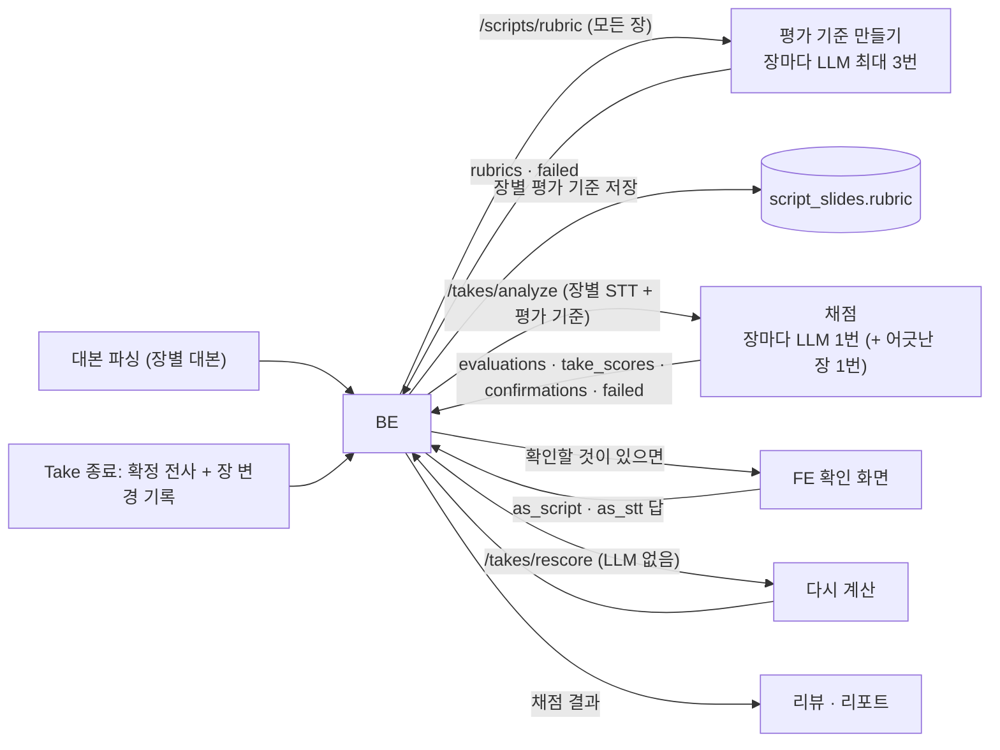
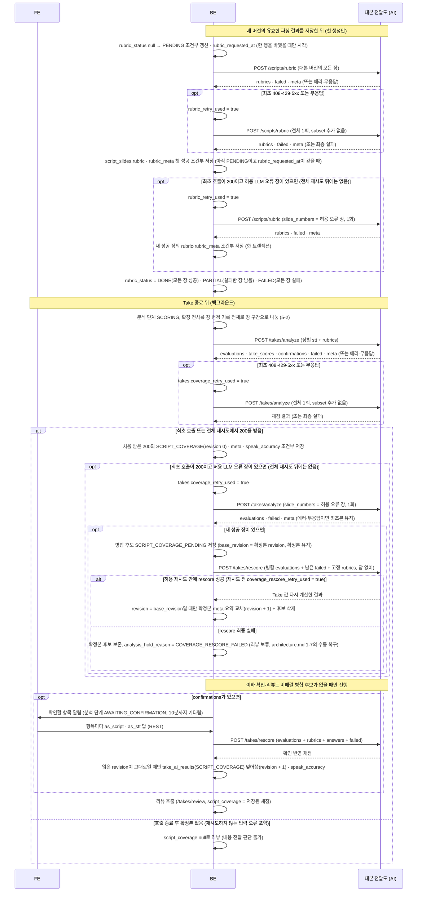

# 대본 전달도 (script_coverage) 설계

> **이 문서는** 대본 전달도 기능의 전체 설명서다. 처음 보는 사람이 이 문서만 읽고 이 기능이 왜 있고, 무엇을 받아 무엇을 내며, 안에서 어떻게 돌고, 어떻게 실행 · 배포하는지 알 수 있게 쓴다.
> **기준 범위**: 대본 전달도의 목표 설계다. 기능 사이 공통 계약(에러 본문 · `meta` · 시간 예산 · LLM 규칙 · 저장 지도)은 `architecture.md`에 따르고, 이 문서에는 이 기능에만 있는 규칙 · 예외만 적는다.
> **한 줄 요약**: 대본을 등록할 때 장마다 평가 기준(핵심 내용 · 핵심 수치 · 전달 단위)을 만들어 두고, Take가 끝나면 장별 발화(STT)를 그 기준과 비교해 무엇을 전달했고 무엇을 빠뜨리거나 다르게 말했는지 채점한다. LLM은 판정만 하고 점수는 코드가 계산한다.
> **기준값**: 판정 수치(규칙 판정 임계값 · 판정 상태별 점수 · 중요도 가중치 · 비슷한 말 거리 기준)는 `config.py`에만 두고 이 문서에는 지표와 방향만 쓴다. 문서의 숫자는 BE와 맞춰야 하는 통신 · 운영 값과 예시뿐이다.
> **관련 Issue**: #160

# 0. 한눈에 보기
| 언제 | 받는 것 | 내는 것 | 쓰는 곳 |
|---|---|---|---|
| 대본 등록 · 수정 뒤 (`POST /scripts/rubric`, 백그라운드) | 장별 대본(모든 장), 다시 만들 장 번호(선택) | 장별 평가 기준 `rubrics`, 실패한 장 `failed` | BE가 장마다 저장했다가 채점 때 그대로 보낸다 |
| Take 종료 뒤 (`POST /takes/analyze`, 백그라운드) | 장별 STT 텍스트, 장별 평가 기준, 다시 채점할 장 번호(선택) | 장별 채점 `evaluations`, Take 점수 `take_scores`, 확인할 항목 `confirmations`, `failed` | FE 확인 화면, 리뷰, 리포트 |
| 사용자 확인 뒤 (`POST /takes/rescore`, LLM 없음) | 저장한 채점 전체, 평가 기준, 확인 답, 실패 장(선택) | 확인을 반영한 채점 (`/takes/analyze` 응답과 같은 모양) | 리뷰, 리포트 |

- **하는 것**: 대본 장마다 문장 역할 · 핵심 주장 · 핵심 내용과 중요도 · 핵심 수치 · 전달 단위를 정한다. 발표 STT를 전달 단위마다 판정하고 코드가 문장 · 핵심 내용 판정으로 모은다. 핵심 수치는 값으로 비교한다(`42%`와 "사십이 퍼센트"를 같게 본다). STT가 발음이 비슷한 다른 말로 적은 곳은 판단을 보류하고 사용자에게 묻는다. 점수(내용 전달 · 수치 정확도 · 대본 충실도)를 코드가 계산한다.
- **하지 않는 것**:
  - 발표 중 내용 누락 지적. 내용 전달은 Take 뒤 이 채점만 맡는다(`architecture.md` 0-3). 그래서 1초 판정 모듈이 아니다.
  - 음성 인식과 장 경계 추정. Deepgram 결과를 BE가 장 변경 기록(`take_slide_events`)으로 나눈 장별 텍스트를 받는다(5-2).
  - 발표자 실수인지 인식 오류인지의 최종 판단. 발음이 비슷한 말은 위치와 함께 넘기고, 사용자 답이 오면 코드로 다시 계산만 한다.
  - LLM이 점수를 매기는 것. LLM은 판정만 하고 점수는 코드가 계산한다(같은 판정에 같은 점수가 나오게).
  - 전달력(말 속도 · 군더더기 · 시선) 평가, 코칭 문장, 결론(좋다 · 나쁘다). 결론은 리뷰가 낸다.
  - 저장. 평가 기준과 채점은 BE가 AI가 낸 모양 그대로 저장해 그대로 돌려보내고, 내용은 해석하지 않는다.

# 1. 왜 필요한가
## 1-1. 배경
발표 연습에서 "대본의 핵심을 빠뜨리지 않고 전달했는가"는 시선 · 말 속도만큼 중요하다. 그런데 대본을 글자 그대로 읽는지만 보면, 같은 내용을 자기 말로 바꿔 말한 좋은 발표가 낮은 점수를 받는다.
반대로 숫자 · 이름을 틀리게 말하면 청중에게 잘못된 정보를 준다. 이것은 빠뜨린 것보다 나쁘다.
STT(음성 인식)는 숫자 · 이름을 비슷한 소리의 다른 말로 적을 때가 있다(예: "노쇼" → "노조"). 글자만 보고는 발표자가 틀린 것인지 STT가 잘못 적은 것인지 가릴 수 없다.
의미가 같은지는 LLM이 판단해야 하지만, LLM에 점수까지 맡기면 같은 판정에도 점수 크기가 흔들린다.

## 1-2. 목표
- 대본의 문장 · 핵심 내용 · 핵심 수치를 발표에서 얼마나 전달했는지 장마다, 그리고 Take 전체로 낸다.
- 바꿔 말한 것은 전달로 보고, 빠뜨린 것과 다르게 말한 것(모순)을 구분한다. 모순을 빠뜨린 것보다 낮게 친다.
- 말한 내용을 빠뜨렸다고 하는 심각한 오판을 피하고, 같은 입력을 다시 돌려도 판정이 같게 한다.
- 발음이 비슷한 말은 점수에서 빼고 사용자에게 물어, 답으로 다시 계산한다(LLM 없이).
- 일부 장이 실패해도 나머지 장의 채점으로 리뷰가 이어지게 하고, 채점된 장의 비율(`scored_ratio`)을 함께 내서 일부 점수를 전체 점수로 오해하지 않게 한다.

## 1-3. 목표가 아닌 것
- 대본의 장 나누기 · 예상 시간. 대본 파싱(`script_parser`)이 한다. 이 기능은 그 결과의 장별 대본을 받는다.
- 발표 중 실시간 피드백. 1초마다 LLM으로 내용을 비교할 수 없다.
- 녹음 구간 찾기 · 재생. 비슷한 말의 원본 STT 위치(`stt_raw_span`)만 넘기고, 녹음과 맞추는 일은 BE · FE가 한다.

# 2. 용어
| 용어 | 뜻 | 예 |
|---|---|---|
| 평가 기준 (rubric) | 장 하나의 대본을 분석해 만든 채점 기준. 문장 · 문장 역할 · 핵심 주장 · 핵심 내용 · 핵심 수치 · 키워드 · 전달 단위를 담는다. 대본 등록 때 한 번 만들어 저장한다 | `EvaluationRubric` |
| 문장 역할 | 대본 문장마다 `claim`(핵심 주장, 장마다 하나를 목표로 만든다. 둘 이상이면 `warnings`에 `too_many_claims`로 남기고 그대로 쓴다) · `evidence`(근거) · `detail`(세부) · `skip`(인사 · 전환, 채점하지 않음) | `["claim", "evidence"]` |
| 핵심 주장 (`core_claim`) | 그 장이 말하려는 것 한 문장 | "지난 분기 매출이 신규 고객 덕분에 크게 늘었다" |
| 핵심 내용 (Key Point, `KP`) | 청중이 꼭 가져가야 할 내용. 중요도 `critical` · `high` · `normal`과 근거 문장 번호를 갖는다 | `KP1` "지난 분기 매출 37% 증가" |
| 핵심 수치 · 사실 (`CF`) | 대본의 숫자 · 날짜 · 시간 · 금액 · 이름. 값으로 비교한다 | `CF1` `37%` |
| 전달 단위 (content unit) | 문장을 더 작게 나눈 내용 조각. LLM이 이 단위마다 전달 여부를 판정하고, 코드가 문장 · 핵심 내용으로 모은다 | `S0-U1` "매출 37% 증가" |
| 채점 (evaluation) | 장 하나의 STT를 평가 기준과 비교한 결과 | `SlideEvaluation` |
| 정규화한 STT 문장 (`stt_sentences`) | 간투사 · 말 반복을 지우고 문장으로 나눈 STT. 근거 번호(`evidence`)가 가리키는 대상이다 | `T0`, `T1` |
| 비슷한 말 (similar item) | STT가 숫자 · 이름을 대본과 발음이 비슷한 다른 말로 적은 곳. 판단을 보류하고 점수에서 뺀다 | `R1` "37%" ↔ "47%" |
| 확인 | 비슷한 말마다 사용자에게 "대본대로 말했다(`as_script`)" · "들린 대로 말했다(`as_stt`)"를 묻는 것 | `{"item_id": "R1", "answer": "as_script"}` |
| 반영한 답 (`applied_answers`) | 그 장의 채점에 이미 반영한 확인 답. Take 단위 확인 목록 `confirmations`와 다르다 | `{"R1": "as_script"}` |
| 교차 검증 (`verification`) | 규칙 판정과 LLM 판정이 어긋난 장만 LLM을 한 번 더 불러 다시 판정하는 것 | `{"required": true}` |
| 대본 충실도 (`script_fidelity`) | 대본 표현(형태소)이 순서대로 나온 정도. 바꿔 말하면 낮아진다 | `0.83` |
| 채점된 장의 비율 (`scored_ratio`) | 대상 장 중 채점에 성공한 장의 비율 | 10장 중 9장 → `0.9` |
| `content_hash` | 정규화한 장 대본의 해시. 대본이 바뀌었는지 볼 때 쓴다 | `<대본 해시>` |
| `rubric_id` | 평가 기준을 가리키는 해시(장 대본 · LLM 설정 · 형식 버전). 채점이 어느 기준으로 됐는지 남는다 | `<평가 기준 해시>` |

# 3. 전체 흐름

1. **대본 등록 · 수정 (BE)**: 새 대본 버전(대본 원문을 올릴 때 생긴다)의 파싱이 끝나 장별 대본이 생기면, BE가 그 대본 버전의 모든 장을 실어 백그라운드로 `/scripts/rubric`을 부른다. 키워드 점수와 이름 판정은 발표 전체를 함께 보고 하기 때문에 늘 모든 장을 싣는다. 같은 대본 버전을 다시 파싱해도(예: 제한 시간만 바뀜) 이미 성공한 평가 기준·meta는 다시 만들지 않는다. 유효한 재파싱의 전체 장 번호·대본이 달라지면 새 결과를 적용하지 않고 새 버전 등록을 안내한다(`architecture.md` 1-7).
2. **평가 기준 만들기 (AI)**: 장마다 1차 분석(LLM) → 코드 초안 → 최종 결론(LLM) → 전달 단위 나누기(LLM)를 차례로 하고, 장은 동시에 처리한다. 실패한 장은 `failed`에 담는다. BE는 장별 평가 기준을 저장하고, 최초 200의 failed 중 네 LLM 오류 코드의 장만 `slide_numbers`로 1회 다시 부른다(8절). 장별 첫 성공 기준·meta를 함께 조건부 저장하며 기존 성공본은 덮지 않는다.
3. **Take 종료 (BE)**: BE가 확정 전사를 장 변경 기록 전체로 장 구간으로 나눠(5-2 `slides`), Take 생성 때 저장한 `script_version_id`의 장마다 STT 텍스트와 저장된 평가 기준을 실어 백그라운드로 `/takes/analyze`를 부른다. 발표에서 넘어간 장도 빈 STT로 싣는다(빠뜨린 장으로 채점되게).
4. **채점 (AI)**: 장마다 STT 정규화 → 대본 문장과 짝짓기 → 수치 확인 → 비슷한 말 찾기 → 전달 단위 판정(LLM) → 문장으로 모으기 → 규칙과 어긋난 장만 교차 검증(LLM) → 핵심 내용으로 모으기 → 점수. 그리고 Take 점수 · 채점된 장의 비율 · 확인할 항목을 계산한다.
4-1. **부분 재시도·저장 (BE)**: 최초 200의 완전한 채점·meta·요약을 먼저 저장한다. 허용 오류 장만 재채점하고 새 성공 장을 병합 후보로 보존한 뒤, 남은 failed 전체·처음 채점에 쓴 기준과 함께 답 없이 rescore를 부른다. 성공할 때만 확정본·meta·요약을 함께 교체하고 후보를 지운다. 끝내 실패하면 확정본·후보를 보존하고 리뷰를 보류한다(`architecture.md` 1-3 '리뷰 보류' · 1-7, 이 문서 12-2).
5. **확인 (FE · BE)**: 확인할 항목이 있으면 BE가 FE에 알리고, FE 확인 화면이 항목마다 답을 받는다. BE는 답을 모아 `/takes/rescore`를 부르고 결과로 채점을 덮는다. 답은 리뷰를 부르기 전까지만 받는다(채점 · 리뷰 · 미션이 서로 다른 채점을 바탕으로 남지 않게). 사용자가 건너뛰거나 화면을 떠나거나 확인을 기다린 지 10분이 지나면(`architecture.md` 1-3) 다시 채점하지 않고 리뷰로 넘어간다.
6. **리뷰**: 리뷰는 Take 점수와 장별 핵심 내용 · 핵심 수치 판정으로 내용 전달을 판단한다(5-3 '채점을 쓰는 쪽').

# 4. 구성과 폴더
## 4-1. 폴더 트리
```
ai/research/script-coverage-evaluation/
├─ README.md                                폴더 · 파일 지도, 실행법, 실험 결과
├─ pyproject.toml · uv.lock                 Python 3.12. 코어 의존성 pydantic · kiwipiepy · scikit-learn, 연구 전용 langchain-openai 등
├─ src/script_coverage/                     코어 → 서비스 features/script_coverage/로 폴더째 옮긴다
│   ├─ schemas.py · core.py · config.py · version.py   모듈 최상위 규약 파일 (API 요청 · 응답, 세 진입 함수, 설정 모음 · 해시, 버전)
│   ├─ examples/                            세 API 요청 · 응답 예시 (계약 테스트가 읽는다)
│   ├─ shared/                              두 단계가 같이 쓰는 도구 (글 정리 · 형태소 · 한글 수 읽기 · 사실 뽑기 · 평가 기준 모양 · LLM 단계)
│   ├─ script_analysis/                     1단계: 대본 → 평가 기준 (prompts/ 포함)
│   └─ stt_evaluation/                      2 · 3단계: STT → 채점, 확인 뒤 다시 계산 (prompts/ 포함)
├─ src/coverage_lab/                        실험 도구 (LLM 연결 · 캐시 · SQLite · 지표). 연구에만 남는다
├─ experiments/                             01 ~ 06 실행 스크립트 (번호 = 실행 순서)
├─ reports/                                 보고용 노트북 + results/*.json (지표)
├─ data/virtual/                            가상 대본 · 연습 STT · 정답 라벨 (커밋)
└─ tests/{unit,lab,live}/                   코어 · 실험 도구 · 실제 LLM
```
하위 패키지 구조(`shared` · `script_analysis` · `stt_evaluation`)는 그대로 두고, 모듈 최상위에 공통 규약 파일(`architecture.md` 8절)을 둔다. 파일마다의 역할은 저장소 `README.md` 3절의 파일 지도에 있다.

## 4-2. 진입 함수
| 함수 · 엔드포인트 | 하는 일 | 부르는 쪽 |
|---|---|---|
| `analyze_script(request, *, llms, model, cache=None)` → `POST /scripts/rubric` | 모든 장을 받아 `slide_numbers`로 고른 장(null이면 전부)의 평가 기준을 만든다. 장마다 성공 · 실패를 나눠 돌려준다 | API 라우터 (연구에서는 `experiments/01_build_rubrics.py`) |
| `evaluate_take(request, *, llms, model, cache=None)` → `POST /takes/analyze` | 고른 장을 채점하고 Take 점수 · 확인할 항목 · `scored_ratio`를 계산한다 | API 라우터 (연구에서는 `experiments/04_evaluate_takes.py`) |
| `rescore_evaluation(request)` → `POST /takes/rescore` | 확인 답을 장마다 반영해 다시 계산하고(LLM 없음), Take 값을 받은 채점 전체로 다시 계산한다 | API 라우터 |
| `take_scores(evaluations, targets)` | 장 점수의 가중 평균과 `scored_ratio` | 위 함수들 · 실험 도구 |
| 하위 함수 `script_analysis.analyze_script` · `stt_evaluation.evaluate_take` · `stt_evaluation.rescore_evaluation` | 장 단위 처리(이름은 최상위와 같고 모듈이 다르다). 최상위 `core.py`가 감싸 API 모양(`failed` · `slide_numbers` · Take 값)으로 바꾼다 | 최상위 `core.py` |

- 최상위 진입 함수 이름은 `architecture.md` 8절의 모듈 표(`analyze_script` · `evaluate_take` · `rescore_evaluation`)와 같다.

- LLM 객체와 캐시는 인자로 받는다. LLM 객체는 출력 스키마마다 하나씩(1차 분석 · 최종 결론 · 전달 단위 · 채점 · 교차 검증, 다섯 개) 서비스의 `common/llm.py`가 만든다(`architecture.md` 9절). 배포에서는 캐시를 쓰지 않는다(`cache=None`).

## 4-3. 규칙과 이유
| 규칙 | 이유 |
|---|---|
| 패키지 안에서는 상대 import만, 파일 · DB · 네트워크 · 환경변수 · 시계를 쓰지 않는다. LLM과 캐시는 인자로 받는다. `tests/unit/test_core_boundary.py`가 코드를 읽어 검사한다 | 서비스로 폴더째 옮겨도 고칠 것이 없고, 같은 입력(LLM 답 포함)에 같은 결과가 나온다 |
| `script_analysis`와 `stt_evaluation`은 서로 import하지 않고 공용은 `shared/`에만 둔다. 두 단계 사이의 약속(평가 기준 모양)은 `shared/rubric.py` 한 곳이다 | 한쪽을 고쳐도 다른 쪽에 숨은 영향이 없다 |
| 숫자 · 이름 · 문장 짝짓기 · 점수는 코드가, 의미 판단(핵심인지, 그 뜻을 전달했는지)은 LLM이 한다. LLM은 점수를 매기지 않는다 | 같은 판정에 같은 점수. 숫자는 입력에 있는 것만 쓴다(`architecture.md` 0-2) |
| 프롬프트는 `.py` 상수다 | 프롬프트 · 출력 스키마 · 모델 이름이 설정 해시에 들어간다. 텍스트 파일은 git이 줄바꿈을 바꿀 수 있어 해시가 달라진다 |
| scikit-learn은 `1.8.x`, kiwipiepy는 `0.23.x`로 고정한다 | 키워드(TF-IDF) · 형태소 결과가 판마다 달라 평가 기준이 바뀐다. 올릴 때는 캐시 재생으로 같은지 먼저 본다 |
| 판정 임계값 · 판정 상태별 점수 · 역할별 중요도 · 중요도 가중치는 최상위 `config.py`가 모아 해시한다(`criteria_version`) | 기준이 바뀐 것을 버전으로 추적한다 |
| 입력 모델은 모르는 필드를 무시하고, 출력 모델은 정해진 필드만 낸다. 단, 평가 기준 · 채점 본문은 AI가 낸 모양 그대로 왕복하므로 BE는 해석하지 않는다 | `architecture.md` 2절 '모르는 필드' |

# 5. 입력 · 출력 계약
요청 · 응답의 원본은 최상위 `schemas.py`의 pydantic 모델이다. 평가 기준 · 채점의 필드 원본은 `shared/rubric.py` · `stt_evaluation/schemas.py`이고, 필드 하나하나의 표는 5-6에 있다. 아래 예시는 필드 일부만 보인다. 장 번호 `slide_number`는 1부터이고(`architecture.md` 6-1) 이어질 필요는 없다. 문장 번호 · 근거 번호는 0부터다.

## 5-1. 호출 목록
| 호출 | 언제 | 누가 | 방식 |
|---|---|---|---|
| `POST /scripts/rubric` | 대본 파싱이 끝나 새 대본 버전의 장별 대본 글이 생겼을 때. 실패한 장은 한 번 더 | BE | 백그라운드, 장마다 LLM 최대 3번(장은 동시에) |
| `POST /takes/analyze` | Take 종료 뒤 (Take 결과와 별도). 실패한 장은 한 번 더 | BE | 백그라운드, 장마다 LLM 1번 + 규칙과 어긋난 장만 1번 더 |
| `POST /takes/rescore` | 사용자가 확인 답을 보냈을 때. 실패한 장을 다시 채점해 합친 뒤 Take 값을 다시 받을 때도(답 없이) | BE | 동기, LLM 없음 |

## 5-2. 입력
**`POST /scripts/rubric`**

| 필드 | 타입 | 필수 | 뜻 | 예 |
|---|---|---|---|---|
| `pitch_id` | string | 예 | 발표 구분 (로그 · 추적용) | `p-1` |
| `script_version_id` | string | 예 | 대본 버전. 코어의 대본 식별자 `script_name`에 들어가 평가 기준 `meta`에 남는다 | `sv-3` |
| `slides` | list | 예 | 그 대본 버전의 모든 장 `[{slide_number, script}]`. `script`는 대본 파싱이 낸 장별 대본(구분자 · 제목 줄을 뺀 글). 빈 장도 싣는다 | `[{"slide_number": 3, "script": "지난 분기 매출은 37% 늘었습니다. ..."}]` |
| `slide_numbers` | list int · null | 아니오 | 평가 기준을 만들 장. null이면 전부. 고르지 않은 장은 발표 전체 맥락(키워드 점수 · 이름 판정)에만 쓴다 | `[4, 7]` |

**`POST /takes/analyze`**

| 필드 | 타입 | 필수 | 뜻 | 예 |
|---|---|---|---|---|
| `take_id` | string | 예 | Take 구분 | `take-123` |
| `slides` | list | 예 | 그 대본 버전의 장마다 `{slide_number, stt}`. `stt`는 확정 전사를 장 변경 기록(`take_slide_events`, `coach-agent.md` 12-1) 전체로 나눈 그 장의 텍스트다. 이벤트 전체를 `started_ms` 순서로 늘어놓으면 장 구간은 `[이 이벤트의 started_ms, 다음 이벤트의 started_ms)`이고 마지막 구간은 Take 끝까지다. 단어 하나는 `started_ms`가 그 단어의 `start_ms` 이하인 이벤트 중 가장 늦은 것의 장에 한 번만 넣는다(코치가 단어 몫을 말한 때의 장에 넣는 것과 같다, `architecture.md` 7절). 다시 온 장은 방문마다의 텍스트를 시각 순서로 이어 붙인다. 발표에서 넘어간 장은 `""`. 대본에 없는 장 번호의 발화는 싣지 않는다 | `[{"slide_number": 3, "stt": "지난 분기 매출은 ..."}]` |
| `rubrics` | list | 예 | 대본 등록 때 받은 장별 평가 기준 그대로. 평가 기준이 없는 장(만들기가 실패한 장)은 빠질 수 있다 | `["<장별 평가 기준>"]` |
| `slide_numbers` | list int · null | 아니오 | 채점할 장. null이면 `slides`의 장 전부 | `[5]` |

- 대본 식별자(`script_name`)는 요청에 따로 없다. 최상위 `core.evaluate_take`가 `rubrics` 중 장 번호가 가장 작은 것의 `meta.script_name`(= 대본 버전)에서 채운다. `rubrics`가 비어 있으면(모든 장의 평가 기준이 없음) 채점하지 않고 모든 대상 장을 `RUBRIC_MISSING`으로 보아 422 `RUBRIC_MISSING`을 돌려준다.

**`POST /takes/rescore`**

| 필드 | 타입 | 필수 | 뜻 | 예 |
|---|---|---|---|---|
| `take_id` | string | 예 | Take 구분 | `take-123` |
| `evaluations` | list | 예 | 저장해 둔 장별 채점 전체 (`/takes/analyze` · `/takes/rescore` 응답의 것, 다시 채점한 장을 합친 것) | `["<저장해 둔 evaluations 전체>"]` |
| `rubrics` | list | 예 | 그 장들의 평가 기준 | `["<장별 평가 기준>"]` |
| `answers` | list | 아니오 | 이번에 받은 확인 답 `[{slide_number, item_id, answer}]`, `slide_number`는 1 이상, `answer`는 `as_script` · `as_stt`. 없으면 Take 값만 다시 계산한다 | `[{"slide_number": 3, "item_id": "R1", "answer": "as_script"}]` |
| `failed` | list | 아니오 | BE가 저장한 실패 장 `[{slide_number, error{code, message}}]`, `slide_number`는 1 이상(0 이하면 422). `scored_ratio`의 대상 장에 넣는다. BE는 `/takes/rescore`를 부를 때마다(사용자 확인 뒤 포함) 저장한 실패 목록 전체를 싣는다(빠지면 실패한 장이 대상에서 빠져 `scored_ratio`가 올라간다) | `[]` |

## 5-3. 출력
**`/scripts/rubric` 응답**: `{rubrics, failed, meta}`

| 필드 | 뜻 |
|---|---|
| `rubrics[]` | 장별 평가 기준. `meta{rubric_id, script_name, slide_number, content_hash, rubric_schema_version, llm_model, ...설정 해시}` · `normalized_script` · `sentences[{index, text, ...}]` · `sentence_roles[]` · `core_claim` · `key_points[{id, content, importance, sentence_indices, key_terms, fact_ids, ...}]` · `critical_facts[{id, type, value, normalized, sentence_indices, ...}]` · `keywords[{term, score, tf}]` · `content_units[{id, sentence_index, text, quote, fact_ids, ...}]` · 검증 경고. 고른 장만 들어간다 |
| `failed[]` | 실패한 장 `[{slide_number, error{code, message}}]` (`architecture.md` 4절) |
| `meta` | `{schema_version, feature_version: "script_coverage-<버전>", model}` (`architecture.md` 5절) |

**`/takes/analyze` · `/takes/rescore` 응답**: `{take_id, evaluations, take_scores, confirmations, failed, meta}`

| 필드 | 뜻 |
|---|---|
| `evaluations[]` | 장별 채점. `slide_number` · `rubric_id` · `scores` · `sentences[{sentence_index, status, units[], evidence, reason, ...}]` · `key_points[{key_point_id, importance, status, evidence, ...}]` · `critical_facts[{fact_id, value, stt_value, status, ...}]` · `similar_items[{item_id, kind, script_text, stt_text, stt_raw_span, fact_id, ...}]` · `verification{required, sentences, conflicts}` · `stt_sentences[]` · `stt_text` · `applied_answers{item_id: answer}`. `/takes/rescore`는 받은 채점을 바꾸지 않고 새로 만든 것을 돌려준다 |
| 장별 `scores` | `content_coverage`(핵심 내용의 중요도 가중 전달률) · `critical_fact_accuracy`(핵심 수치 정확도, 수치가 없거나 모두 보류면 null) · `script_fidelity`(대본 표현 일치) · `similar_words` · `similar_numbers`(판단을 보류한 단어 · 수치 개수) · `_weights{key_points, facts, script_tokens}`(Take 값을 다시 계산할 때 쓰는 가중치) |
| `take_scores` | 채점된 장들의 점수로 낸 Take 값 `content_coverage` · `critical_fact_accuracy` · `script_fidelity`(가중 평균), `similar_words` · `similar_numbers`(합), `scored_ratio` |
| `confirmations[]` | 아직 답을 받지 않은 확인 항목 전체 `[{slide_number, item_id, script_text, stt_text}]`. 받은 채점 전체로 다시 계산한다 |
| `failed[]` | 실패한 장 `[{slide_number, error{code, message}}]` |
| `meta` | `{schema_version, feature_version, criteria_versions: {"script_coverage": "script_coverage-<버전>+<config 해시>"}, model}`. `/takes/rescore`의 `model`은 null |

**채점을 쓰는 쪽** (리뷰, 받는 쪽 문서가 기준이고 여기에는 대본 전달도가 보장할 것만 적는다)
- 리뷰는 `missing` · `contradicted` 핵심 내용으로 내용 전달(`content_delivery` 차원)을 판단하고, `sound_alike` · `unverified` 수치는 문제로 세지 않는다.
- 채점 결과가 없거나(모든 장 실패) `scored_ratio`가 기준 미만이면 리뷰는 내용 전달을 판단 불가로 둔다(일부 장만 채점된 점수로 강점이라 하지 않게).
- 사용자 평가 기준의 `script_similarity`는 `take_scores.content_coverage`로 판정한다(평가 기준 분석의 요소 → 지표 대응). 미션 지표 `content_coverage` · `critical_fact_accuracy`도 `take_scores`에서 찾는다.

**번호와 id**: 문장 번호 · 근거 번호(`evidence`, 정규화한 STT 문장 `stt_sentences`의 번호)는 0부터다. 핵심 내용은 `KP1`, 핵심 수치는 `CF1`, 전달 단위는 `S<문장 번호>-U<순번>`, 비슷한 말은 `R1` 꼴이고 장마다 1부터 다시 센다. 문장 역할은 `sentence_roles`에 문장 순서대로 있다. 글자 위치(`span`)는 `[시작, 끝)` 코드 포인트이고 정규화 텍스트 기준이며, 원본 STT 기준은 `stt_raw_span` 하나다.

## 5-4. 판정 상태
| 대상 | 상태 | 뜻 |
|---|---|---|
| 전달 단위 (LLM이 판정) | `said` · `vague` · `missing` · `contradicted` | 말함 · 흐리게 말함 · 없음 · 다르게 말함 |
| 문장 (코드가 단위를 모음) | `said` · `partial` · `missing` · `contradicted` | 문장 역할이 `skip`이면 채점하지 않는다 |
| 핵심 내용 (코드가 근거 문장을 모음) | `covered` · `partial` · `missing` · `contradicted` | 점수가 큰 순서는 `covered` > `partial` > `missing` > `contradicted` (모순은 빠뜨린 것보다 낮다) |
| 핵심 수치 (코드가 값으로 비교) | `matched` · `approximate` · `mismatched` · `missing` · `sound_alike` · `unverified` | `sound_alike`(발음이 비슷한 다른 말)는 판단 보류로 점수에서 뺀다 |
| 확인 답 | `as_script` · `as_stt` | 대본대로 말함(STT가 잘못 적음) · 들린 대로 말함(발표자가 다른 말을 함) |

## 5-5. 예시
**`POST /scripts/rubric` 요청 · 응답**
```json
{"pitch_id": "p-1", "script_version_id": "sv-3",
 "slides": [{"slide_number": 3, "script": "지난 분기 매출은 37% 늘었습니다. 신규 고객이 늘어난 덕분입니다."}],
 "slide_numbers": null}
```
```json
{
  "rubrics": [
    {
      "meta": {"rubric_id": "<평가 기준 해시>", "script_name": "sv-3", "slide_number": 3, "content_hash": "<대본 해시>", "rubric_schema_version": "<평가 기준 형식 버전>"},
      "core_claim": "지난 분기 매출이 신규 고객 덕분에 크게 늘었다",
      "sentences": [{"index": 0, "text": "지난 분기 매출은 37% 늘었습니다."}, {"index": 1, "text": "신규 고객이 늘어난 덕분입니다."}],
      "sentence_roles": ["claim", "evidence"],
      "key_points": [{"id": "KP1", "content": "지난 분기 매출 37% 증가", "importance": "critical", "sentence_indices": [0], "key_terms": ["매출"], "fact_ids": ["CF1"]}],
      "critical_facts": [{"id": "CF1", "type": "percentage", "value": "37%", "normalized": "37%", "sentence_indices": [0]}],
      "keywords": [{"term": "매출", "score": 0.61, "tf": 1}],
      "content_units": [{"id": "S0-U1", "sentence_index": 0, "text": "매출 37% 증가", "quote": "매출은 37% 늘었습니다", "fact_ids": ["CF1"]}]
    }
  ],
  "failed": [],
  "meta": {"schema_version": "1.0", "feature_version": "script_coverage-1.0", "model": "<응답한 모델>"}
}
```

**`POST /takes/analyze` 요청 · 응답** (`/takes/rescore` 응답도 같은 모양)
```json
{"take_id": "take-123",
 "slides": [{"slide_number": 3, "stt": "지난 분기 매출은 <비슷한 소리의 다른 수> 늘었습니다 신규 고객이 늘어난 덕분입니다"}],
 "rubrics": ["<대본 등록 때 받은 장별 평가 기준>"],
 "slide_numbers": null}
```
```json
{
  "take_id": "take-123",
  "evaluations": [
    {
      "slide_number": 3, "rubric_id": "<평가 기준 해시>",
      "scores": {"content_coverage": 1.0, "critical_fact_accuracy": null, "script_fidelity": 0.83, "similar_words": 0, "similar_numbers": 1,
                 "_weights": {"key_points": 3, "facts": 0, "script_tokens": 12}},
      "sentences": [{"sentence_index": 0, "status": "said", "evidence": [0], "reason": "수치 자리만 다르게 받아 적혔다"}],
      "key_points": [{"key_point_id": "KP1", "importance": "critical", "status": "covered", "evidence": [0]}],
      "critical_facts": [{"fact_id": "CF1", "value": "37%", "stt_value": "<비슷한 소리의 다른 수>", "status": "sound_alike"}],
      "similar_items": [{"item_id": "R1", "kind": "number", "script_text": "37%", "stt_text": "<비슷한 소리의 다른 수>", "fact_id": "CF1"}],
      "verification": {"required": false},
      "stt_sentences": ["지난 분기 매출은 <비슷한 소리의 다른 수> 늘었습니다", "신규 고객이 늘어난 덕분입니다"],
      "applied_answers": {}
    }
  ],
  "take_scores": {"content_coverage": 1.0, "critical_fact_accuracy": null, "script_fidelity": 0.83, "similar_words": 0, "similar_numbers": 1, "scored_ratio": 1.0},
  "confirmations": [{"slide_number": 3, "item_id": "R1", "script_text": "37%", "stt_text": "<비슷한 소리의 다른 수>"}],
  "failed": [],
  "meta": {"schema_version": "1.0", "feature_version": "script_coverage-1.0",
           "criteria_versions": {"script_coverage": "script_coverage-1.0+<config 해시>"}, "model": "<응답한 모델>"}
}
```

**경계 상황: 한 장은 평가 기준이 없고 한 장은 LLM 시간 초과**. 10장 중 8장을 채점했다. 두 장 모두 `scored_ratio`의 대상 장이다.
```json
{"take_scores": {"content_coverage": 0.81, "critical_fact_accuracy": 0.9, "script_fidelity": 0.74, "similar_words": 1, "similar_numbers": 0, "scored_ratio": 0.8},
 "failed": [{"slide_number": 4, "error": {"code": "RUBRIC_MISSING", "message": "4번 장의 평가 기준이 없습니다"}},
            {"slide_number": 7, "error": {"code": "LLM_TIMEOUT", "message": "LLM 응답 시간이 초과되었습니다"}}]}
```
BE는 7번 장만 `slide_numbers: [7]`로 한 번 다시 부르고, 받은 채점을 합친 뒤 `/takes/rescore`(답 없이, `failed`에 4번 장)로 Take 값을 다시 받는다.

**`POST /takes/rescore` 요청**
```json
{"take_id": "take-123",
 "evaluations": ["<저장해 둔 evaluations 전체>"],
 "rubrics": ["<장별 평가 기준>"],
 "answers": [{"slide_number": 3, "item_id": "R1", "answer": "as_script"}],
 "failed": []}
```

## 5-6. 평가 기준 · 채점 필드
5-3의 `rubrics[]` · `evaluations[]` 한 장의 필드다. BE는 이 본문을 해석하지 않고 저장했다 그대로 돌려보내지만(12-2), FE 확인 화면과 리뷰가 읽는 값이 여기서 나온다. 원본은 `shared/rubric.py`(평가 기준) · `stt_evaluation/schemas.py`(채점)이다. 글자 위치(`span`)는 `[시작, 끝)` 코드 포인트이고 정규화 텍스트 기준이다(원본 STT 기준은 `stt_raw_span` 하나). '기본값 있음'은 없어도 되는 필드다.

**평가 기준** (장 하나, `/scripts/rubric`이 만들고 `/takes/analyze`가 읽는다)

| 필드 | 타입 | 뜻 |
|---|---|---|
| `meta` | object | 아래 평가 기준 `meta` |
| `normalized_script` | str | 정규화한 장 대본 전체 |
| `sentences[]` | `{index, text, start, end}` | 정규화한 대본 문장. `index`는 0부터(`[S0]`), `start` · `end`는 정규화 텍스트 위치 |
| `sentence_roles[]` | str | 문장 역할, `sentences`와 같은 순서. `claim`(핵심 주장. LLM에 장마다 한 문장만 고르게 하지만 둘 이상이 나오면 장을 실패로 하지 않고 `warnings`에 `too_many_claims:<개수>`로 남긴 채 그대로 쓴다. `claim` 문장이 든 핵심 내용은 모두 `critical`이 되어 점수 가중치가 커진다) · `evidence`(근거) · `detail`(세부) · `skip`(인사 · 전환, 채점하지 않음) |
| `core_claim` | str | 장의 핵심 주장 한 문장 |
| `key_points[]` | object | 핵심 내용 (아래) |
| `critical_facts[]` | object | 핵심 수치 · 이름 (아래) |
| `keywords[]` | `{term, score, tf}` | TF-IDF 키워드. `score`는 장 안에서 L2 정규화, `tf`는 장 안 등장 횟수 |
| `warnings[]` | str | 최종 검증 경고(`too_many_claims:<개수>` · `uncovered_sentences:<문장 번호>` · `no_key_points` 등). 경고가 있어도 평가 기준은 성공으로 돌려준다 |
| `draft_warnings[]` · `review_changes[]` | str (기본값 있음) | 초안에 대한 코드 검증 경고(최종 결론의 입력) · 최종 결론이 초안에서 바꾼 점 |
| `name_decisions[]` | `{value, source, keep, reason}` (기본값 있음) | 이름 · 용어 후보별 결정. `source`는 `rule` · `llm`, `keep`이 true면 발표자가 그대로 말해야 하는 말이라 핵심 수치(`proper_noun` · `term`)가 된다 |
| `content_units[]` | object (기본값 있음) | 문장별 전달 단위 (아래). `skip` 문장은 나누지 않는다 |

평가 기준 `meta`

| 필드 | 뜻 |
|---|---|
| `rubric_id` | 장 대본 · LLM 설정 · 형식 버전이 같으면 같은 값. 채점이 어느 기준으로 됐는지 가리킨다(9절) |
| `script_name` | 대본 식별자 (= 요청의 `script_version_id`) |
| `slide_number` | 장 번호 |
| `content_hash` | 정규화 대본의 해시. 대본이 바뀌었는지 볼 때 쓴다 |
| `rubric_schema_version` | 평가 기준 형식 버전 (9절) |
| `llm_model` | 분석에 쓴 LLM 모델 |
| `llm_config_hash` | 1차 분석 단계의 설정 해시 (늘 있다) |
| `final_config_hash` · `unit_config_hash` | 최종 결론 · 전달 단위 단계의 설정 해시 (기본값 있음). 그 단계를 거치기 전이면 빈 값 |

핵심 내용 `key_points[]`

| 필드 | 타입 | 뜻 |
|---|---|---|
| `id` | str | `KP1`, `KP2` … (장마다 1부터) |
| `content` | str | 핵심 내용 |
| `importance` | `critical` · `high` · `normal` | 근거 문장 역할로 코드가 정한다: `claim`이 있으면 `critical`, `evidence`면 `high`, 나머지 `normal`. 점수 가중치는 `config.py` |
| `sentence_indices[]` | int | 근거 대본 문장 번호 (LLM이 번호로 지정) |
| `source_quote` · `source_span` | str · `[int, int]` 또는 null | 근거 문장 원문과 위치. 맞는 번호가 없으면 위치는 null |
| `key_terms[]` | str | 핵심 용어 |
| `fact_ids[]` | str | 이 핵심 내용이 직접 말하는 핵심 수치 |

핵심 수치 · 이름 `critical_facts[]`

| 필드 | 타입 | 뜻 |
|---|---|---|
| `id` | str (기본값 있음) | `CF1`, `CF2` … |
| `type` | enum | `percentage` · `money` · `date` · `time` · `duration` · `quantity` · `ratio` · `number` · `proper_noun` · `term` |
| `value` · `normalized` | str | 대본 표기 그대로 · STT와 비교할 정규형 |
| `numeric_value` · `unit` · `qualifier` | float · str · str (기본값 있음, null 가능) | 숫자 값 · 단위 · 한정어(약 · 이상 · 이내) |
| `spans[]` · `sentence_indices[]` | `[int, int]` · int | 등장 위치(첫 번째가 대표) · 나온 문장 번호 |
| `source` | `rule` · `llm` (기본값 있음) | 규칙이 찾음 · LLM이 보탬 |
| `key_point_ids[]` · `importance` | str · enum (기본값 있음) | 연결된 핵심 내용 · 그중 가장 높은 중요도 |

| `type` | 예 (표기 → `normalized`) |
|---|---|
| `percentage` | `약 42퍼센트` → `42%` (한정어 `약`) |
| `money` | `약 24억 원` → `2,400,000,000원` |
| `quantity` | `약 1,240만 건` → `12,400,000건`, `열두 곳` → `12곳` |
| `duration` · `date` · `time` | `8주 동안` → `8주` / `2026년 상반기` → `2026-H1` / `오후 여섯 시 반` → `18:30` |
| `ratio` · `number` | `삼 대 일` → `3:1` / `4 곱하기 6` → `4×6` |
| `proper_noun` · `term` | 영문 이름, 고유명사, LLM이 보탠 핵심 용어 |

전달 단위 `content_units[]`

| 필드 | 타입 | 뜻 |
|---|---|---|
| `id` | str | `S<문장 번호>-U<순번>` |
| `sentence_index` | int | 단위가 속한 대본 문장 |
| `text` · `quote` | str | 단위 내용을 짧게 쓴 것 · 대본 문장 속 해당 표현(대본 표기 그대로) |
| `span` | `[int, int]` | `quote`의 위치 |
| `fact_ids[]` | str (기본값 있음) | 단위 안의 핵심 수치 |
| `source` | `llm` · `fact` · `sentence` | LLM이 나눔 · 어느 단위에도 안 들어간 수치 · 이름을 코드가 보탬 · 나누지 못해 문장 전체 |

**채점** (장 하나, `/takes/analyze` · `/takes/rescore`가 낸다)

| 필드 | 타입 | 뜻 |
|---|---|---|
| `take_id` · `script_name` · `slide_number` | str · str · int | Take · 대본 식별자 · 장 번호 |
| `rubric_id` | str | 채점에 쓴 평가 기준 |
| `scores` | object | 장 점수 (5-3, 계산은 6-4) |
| `sentences[]` | object | 대본 문장별 판정 (아래) |
| `key_points[]` | object | 핵심 내용 판정 = 근거 문장 판정을 모은 것 (아래) |
| `critical_facts[]` | object | 수치별 확인 (아래) |
| `similar_items[]` | object | 비슷한 말 — 비율에서 뺀 판단 보류 항목 (아래). 확인 화면의 항목이다 |
| `fidelity` | object | 대본 충실도 세부 (`recall` · `precision` · `fidelity`, 그리고 `script_tokens` = 보류 자리를 뺀 대본 내용 형태소 수, `skip` 문장 제외. Take 값의 가중치로 쓴다) |
| `alignments[]` | `{sentence_index, stt_ids[], coverage}` | 대본 문장 ↔ 가장 비슷한 STT 문장(연속 1–3개) 짝과, 대본 문장의 내용 형태소 중 STT에 나온 비율 |
| `verification` | `{required, sentences[], conflicts{조건: [문장 번호]}}` | 교차 검증을 했는지, 충돌한 문장, 충돌 조건별 문장 |
| `stt_sentences[]` | str | 정규화한 STT 문장. 근거 번호 `[T0] [T1] …`의 원문 |
| `stt_text` | str (코드 기본값 빈 문자열) | 정규화한 STT 전체. `/takes/rescore`가 다시 계산할 때 쓴다(없으면 422 `STT_TEXT_MISSING`, 7절) |
| `applied_answers` | `{item_id: as_script · as_stt}` | 반영한 확인 답. 처음 채점에는 비어 있다(6-3) |

문장 판정 `sentences[]`

| 필드 | 타입 | 뜻 |
|---|---|---|
| `sentence_index` · `text` · `role` | int · str · str | 대본 문장 번호 · 문장 · 문장 역할 |
| `status` · `first_status` | 문장 상태 (5-4) | 최종 판정 · LLM 1차 판정(전달 단위 판정을 모은 것) |
| `units[]` | `{unit_id, text, fact_ids[], status, first_status, raised_by_rule}` (기본값 있음, `fact_ids` 빈 목록 · `raised_by_rule` false) | 전달 단위별 판정. `status`는 단위 상태(5-4). `raised_by_rule`은 LLM은 `missing`이라 했지만 그 단위의 수치 · 이름이 STT에 있어 `vague`로 올린 것 |
| `confidence` | str (생성 값: `high` · `medium` · `low`) | LLM 확신도 |
| `evidence[]` · `reason` | int · str | 근거 STT 문장 번호(범위 밖 번호는 버림) · 판정 이유(사용자에게 보여 줄 수 있음) |
| `lexical_coverage` · `evidence_coverage` | float | 이 문장의 내용 형태소가 STT 짝 구간에 나온 비율 · LLM 근거 STT 문장에 나온 비율 |
| `fact_statuses` | `{fact_id: 수치 상태}` | 이 문장에 있는 수치별 규칙 확인 결과. `/takes/rescore` 뒤에는 확인 답을 반영한 현재 상태다(사실 목록 `critical_facts` · 핵심 내용과 같은 값, 6-3) |
| `similar_ids[]` · `conflicts[]` · `verified` | str · str · bool (기본값 있음) | 이 문장 자리의 비슷한 말 중 아직 답하지 않은 것(`R` 번호, 답한 것은 `/takes/rescore`가 뺀다. `similar_items`에는 남는다) · 규칙과 LLM 판정이 어긋난 이유(조건 이름과 뜻은 `stt_evaluation/merge.py`의 `CONFLICT_TEXT`. 예: `fact_missing`은 LLM은 말함인데 규칙이 그 수치를 STT에서 못 찾음) · 교차 검증으로 다시 판정했는지 |

문장 판정은 단위 판정을 모아 코드가 정한다: 모두 `said`면 `said`, 모두 `missing`이면 `missing`, 하나라도 `contradicted`면 `contradicted`, 나머지는 `partial`.

핵심 내용 판정 `key_points[]`: `key_point_id` · `content` · `importance` · `sentence_indices[]` · `status`(핵심 내용 상태, 5-4) · `first_status` · `evidence[]` · `evidence_text`(근거 STT 문장 원문) · `reason` · `lexical_coverage` · `fact_statuses` · `similar_ids[]` · `conflicts[]` · `verified`. 뜻은 문장 판정과 같고, 근거 문장들을 모은 값이다.

수치 확인 `critical_facts[]`

| 필드 | 타입 | 뜻 |
|---|---|---|
| `fact_id` · `type` · `value` · `normalized` · `importance` · `key_point_ids[]` | — | 평가 기준의 핵심 수치에서 옮긴 값 |
| `status` | 수치 상태 (5-4) | `matched` 같은 값 · `approximate` 어림해 말함(`40퍼센트 넘게`, 사실은 맞음) · `mismatched` 다른 값(발음이 전혀 다르거나 음절 순서가 바뀜) · `missing` 말하지 않음 · `sound_alike` 발음이 비슷한 다른 말(판단 보류) · `unverified` 규칙으로 못 찾은 영문 이름(LLM 이름 확인으로 확정) |
| `stt_value` · `stt_ids[]` | str 또는 null · int (기본값 있음) | STT에서 찾은 표기(다른 값이면 그 값) · 찾은 STT 문장 번호 |
| `stt_normalized` · `stt_numeric_value` · `stt_qualifier` · `stt_span` | (기본값 있음, null 가능) | STT 쪽 정규형 · 숫자 값 · 한정어 · 위치 |
| `signals[]` · `sound` | str · str 또는 null (기본값 있음) | 원인 판단에 쓴 규칙 신호 · 두 수의 발음 관계(`similar` · `near` · `swap` · `different` · `approx`) |
| `cause` · `rule_cause` | `speaker_error` · `asr_error` · `approximation` 또는 null (기본값 null) | 규칙으로 정한 원인(발음이 비슷하면 정하지 않음) · 규칙 신호만으로 본 원인(비교용) |
| `cause_reason` | str (기본값 빈 문자열) | 원인 판단 이유 |
| `note` | str (기본값 있음) | 메모 |

비슷한 말 `similar_items[]` (확인 화면의 항목, `item_id`가 확인 답의 키)

| 필드 | 타입 | 뜻 |
|---|---|---|
| `item_id` | str | `R1`, `R2` … |
| `kind` | `number` · `word` | 수치 · 단어 |
| `script_text` · `stt_text` | str | 대본 표현 · STT 표현 |
| `script_sentence_index` · `script_span` | int · `[int, int]` | 대본 문장 번호 · 정규화 대본 위치 |
| `stt_sentence_index` · `stt_span` | int · `[int, int]` | 정규화 STT 문장 번호(`T`) · 정규화 STT 위치 |
| `stt_raw_span` | `[int, int]` 또는 null | 간투사를 지우기 전 원본 STT 위치. Deepgram 단어 시각과 맞춰 녹음 구간을 찾을 때 쓴다 |
| `fact_id` · `key_point_ids[]` | str 또는 null (기본값 null) · str | 관련 핵심 수치 · 이 자리가 걸린 핵심 내용 |
| `signals[]` · `rule_guess` | str · `asr_error` · `speaker_error` · `paraphrase` | 규칙 신호(발음 거리 · 읽기 비교 등) · 규칙 신호만으로 본 원인(참고) |

# 6. 처리 — 안에서 어떻게 도는가
## 6-1. 평가 기준 만들기 (`/scripts/rubric`)
장마다 아래를 차례로 하고, 장끼리는 서로 기다리지 않는다. 한 장의 LLM 단계가 끝나면 그 장의 다음 단계를 바로 넣고, 동시에 도는 LLM 호출은 `config.py`의 `RUBRIC_MAX_WORKERS`개까지다. 빈자리에는 이미 시작한 장의 다음 단계(전달 단위 → 최종 결론)를 새 장의 1차 분석보다 먼저 넣는다(마감 안에 끝나는 장을 늘리려고). 캐시 읽기 · 쓰기와 코드 단계는 부르는 스레드에서 하므로, 실행 순서가 달라도 장마다의 결과 · LLM 메시지는 같다. 한 단계라도 실패한 장은 평가 기준을 만들지 않고 `failed`에 담는다.

| 순서 | 하는 일 | LLM |
|---|---|---|
| ① | 대본 정리(따옴표 · 공백)와 문장 나누기, 번호 `[S0] [S1] …` | |
| ② | 키워드: 발표 전체를 문서 묶음으로 본 TF-IDF로 이 장에서 특히 자주 나오는 단어 | |
| ③ | 숫자 · 날짜 · 시간 · 금액 · 영문 이름 뽑기(규칙), 동시에 1차 분석: 문장 역할 · 핵심 내용 | 1번 |
| ④ | 코드 초안: 핵심 내용의 중요도(문장 역할에서), 수치를 핵심 내용에 연결, 이상한 점 경고 | |
| ⑤ | 최종 결론: 초안과 경고를 보여 주고 최종 확인 | 1번 |
| ⑥ | 전달 단위: 문장을 내용 조각으로 나누고 코드가 검증(`skip` 문장은 나누지 않는다) | 1번 |

- 대본이 빈 장은 LLM을 부르지 않고 빈 평가 기준을 만든다. 모든 문장이 `skip`이면 ⑥을 부르지 않는다. 그래서 장마다 LLM은 최대 3번이다.
- 키워드 점수와 이름 판정은 발표 전체를 함께 본다. 그래서 `slide_numbers`로 일부 장만 만들 때도 요청에는 모든 장을 싣고, 고르지 않은 장은 맥락으로만 쓴다.
- `rubric_id`는 그 장의 대본 해시 · LLM 설정 해시 · 형식 버전으로 만든다. 같은 장 글이면 다른 대본 버전에서도 같은 값이 나온다.

## 6-2. 채점 (`/takes/analyze`)
대상 장(`slide_numbers`, null이면 `slides` 전부)마다 아래를 하고, 장은 동시에 처리한다. 평가 기준이 없는 장은 채점하지 않고 `failed`(`RUBRIC_MISSING`)에 담는다(나머지 장은 계속한다).

| 순서 | 하는 일 | LLM |
|---|---|---|
| ① | STT 정규화: 간투사 · 말 반복 지우기, 문장 나누기 `[T0] [T1] …`, 원본 STT 위치 기억 (규칙, LLM으로 다시 쓰지 않음) | |
| ② | 대본 문장 ↔ STT 문장 짝짓기, 대본 충실도 | |
| ③ | 뽑아 둔 수치가 STT에 맞게 나왔는지 값으로 확인, 틀린 원인 추정 | |
| ④ | 발음이 비슷한 말(숫자 · 이름) 찾기 → 판단 보류 | |
| ⑤ | 전달 단위마다 말함 · 흐림 · 없음 · 다름 판정 (근거 → 이유 → 판정 순서, 근거 번호는 코드가 확인) | 1번 |
| ⑥ | 단위 → 문장 판정으로 모으기. 규칙과 LLM이 어긋나면 충돌 표시. 규칙이 확실히 아는 것(그 문장에만 있는 수치 · 이름을 STT에서 찾음)은 LLM 판정을 보정 | |
| ⑦ | 충돌이 있는 장만 교차 검증 | 1번 (필요할 때) |
| ⑧ | 문장 → 핵심 내용 판정으로 모으기 | |
| ⑨ | 장 점수 계산 | |

- 교차 검증이 실패한 장은 그 장 전체를 `failed`로 돌려준다(1차 판정만으로 내지 않는다). 검증 출력이 검증 대상 문장(충돌한 문장)이나 그 문장의 전달 단위를 빠뜨리거나 같은 것을 두 번 내면 잘못된 출력이다(`LLM_INVALID_OUTPUT`). 대상이 아닌 문장 · 단위의 판정은 쓰지 않는다.
- STT가 빈 장(발표에서 넘어감)은 LLM을 부르지 않고 모든 전달 단위를 `missing`으로 판정한다.
- 요청 마감 시각이 지나 LLM을 부르지 못한 장은 `LLM_TIMEOUT`으로 `failed`에 담는다.

## 6-3. 다시 계산 (`/takes/rescore`)
1. `answers`를 장마다 나눈다. 받은 채점은 이미 반영한 답(`applied_answers`)이 적용된 상태이므로, 이미 반영한 `item_id`의 답은 다시 적용하지 않고(같은 답이든 다른 답이든 처음 반영한 답을 유지한다) 새 항목의 답만 적용한다. 모르는 `item_id`의 답은 버린다. `applied_answers`는 이전 답과 새 답을 합친 것이 된다.
2. `as_script`: 그 비슷한 말의 수치 판정을 `matched`로 바꾼다(문장 판정은 그대로). `as_stt`: 수치 판정을 `mismatched`로, 그 자리가 든 전달 단위를 `contradicted`로 바꾸고 문장 · 핵심 내용을 코드로 다시 모은다. 그리고 반영한 답 전체(`applied_answers`)로 문장의 `fact_statuses`를 사실 목록과 같은 현재 상태로 맞추고, 문장의 `similar_ids`에서 답한 항목을 뺀다(`similar_items` · 1차 판정 `first_status` · 교차 검증 기록은 그대로 둔다). LLM은 부르지 않는다.
3. 답하지 않은 항목은 보류로 남는다. 보류 목록 · 핵심 내용 · 점수는 합친 답 전체로 다시 계산한다. 대본 충실도는 보류한 자리와 `as_script` 자리를 계속 빼고, `as_stt` 자리는 넣어 다시 계산한다(발표자가 실제로 다르게 말했으므로).
4. 받은 채점 전체(답이 없는 장 포함)로 Take 값(`take_scores` · `confirmations`)을 다시 계산한다(6-4). 그래서 실패한 장을 다시 채점해 합친 뒤 답 없이 불러 Take 값만 다시 받을 수 있다.
5. 채점의 `rubric_id`가 받은 평가 기준과 다르거나, 채점에 `stt_text` 필드가 없거나(예전 모양), 장의 평가 기준이 없으면 요청 전체를 422로 거절한다(7절). 발표에서 넘어가 `stt_text`가 빈 문자열인 장은 정상 채점이라 거절하지 않는다. 같은 답 · 같은 입력이면 늘 같은 결과가 나온다.

## 6-4. 점수와 Take 값
- **장 점수** (코드가 계산, 기준값은 `config.py`):
  - `content_coverage` = 핵심 내용 판정 점수를 중요도 가중치로 평균한 것. 판정 점수는 `covered` > `partial` > `missing` > `contradicted` 순이고 `contradicted`는 음수일 수 있으며, 결과가 음수면 0이다. 중요도가 높을수록 가중치가 크다. 핵심 내용이 없는 장(빈 대본 · 모두 `skip`)은 0이고 가중치도 0이라 Take 값에는 영향이 없다.
  - `critical_fact_accuracy` = 수치 판정 점수(`matched` > `approximate` > 나머지)의 가중 평균. `sound_alike`는 분자 · 분모에서 뺀다. 수치가 없거나 모두 보류면 null.
  - `script_fidelity` = 순서를 지킨 형태소 일치의 재현율 · 정밀도 조화평균. 처음 채점에서는 비슷한 말 자리의 형태소를 양쪽에서 빼고, 확인 뒤에는 보류 자리와 `as_script` 자리만 뺀다(6-3).
  - `similar_words` · `similar_numbers` = 판단을 보류한 단어 · 수치 개수.
- **Take 값** (받은 채점 전체로 계산):
  - `content_coverage`: 장의 `content_coverage`를 핵심 내용 가중치 합(`_weights.key_points`)으로 가중 평균.
  - `critical_fact_accuracy`: 수치 가중치 합(`_weights.facts`)으로 가중 평균, null인 장은 뺀다. 모두 null이면 null.
  - `script_fidelity`: 대본 형태소 수(`_weights.script_tokens`)로 가중 평균.
  - `similar_words` · `similar_numbers`: 합.
  - `scored_ratio` = 채점된 장 수 ÷ 대상 장 수. 대상 장은 `/takes/analyze`에서는 그 요청의 대상 장, `/takes/rescore`에서는 `evaluations`의 장과 `failed`의 장을 합친 것이다. 평가 기준이 없는 장도 대상 장에 들어간다.
  - `confirmations` = 모든 장의 `similar_items` 중 `applied_answers`에 없는 항목.

## 6-5. 단계별 함수와 LLM 호출
6-1 · 6-2의 단계가 코드에서 어느 함수인지다. `→`는 앞 함수의 출력을 뒤 함수가 받는다는 뜻이다. 사실 확인 · 문장 판정을 그 자리에서 고치는 함수(`annotate_mismatches` · `settle_facts` · `resolve_name_checks` · `apply_verification`)는 값을 돌려주지 않는다.

| 단계 | 함수 (파일) | 출력 |
|---|---|---|
| 6-1 ① | `normalize_script` (`shared/text.py`) | 정규화 텍스트 · 문장 · `content_hash` |
| 6-1 ② | `extract_keywords_tfidf` (`script_analysis/keywords.py`) | 장별 키워드 |
| 6-1 ③ | `extract_critical_facts` (`shared/facts.py`), `analyze_semantics(slide, norm, llm)` (`semantic.py`, 안에서 `semantic_user_message`로 메시지를 만든다) | 핵심 수치 · 이름, 1차 분석 |
| 6-1 ④ | `draft_rubric` (`draft.py`) | 평가 기준 초안 |
| 6-1 ⑤ | `name_candidates` · `final_user_message` → `review_final` → `finalize_rubric` (`final.py`) | 최종 평가 기준 |
| 6-1 ⑥ | `unit_user_message` → `extract_units` → `attach_units` (`units.py`) | 전달 단위가 붙은 평가 기준 |
| 6-2 ① | `normalize_stt` (`stt_evaluation/normalize.py`, `fillers.py`), `positioned_tokens` (`align.py`) | 정규화 STT, 위치가 붙은 내용 형태소 |
| 6-2 ② | `align_sentences` (`align.py`) | 문장 짝 |
| 6-2 ③ | `check_critical_facts` → `annotate_mismatches` (`fact_check.py`) | 수치 확인 (다른 값에는 원인 신호) |
| 6-2 ④ | `find_similar_items` → `settle_facts` (`similar.py`), 그 뒤 `fidelity_excluding` (`align.py`, 비슷한 말 자리를 빼고) | 비슷한 말 (수치 상태도 확정), 대본 충실도 |
| 6-2 ⑤ | `semantic_eval_message` → `evaluate_semantics` (`judge.py`) | 단위 판정 |
| 6-2 ⑥ | `resolve_name_checks` · `merge_sentences` (`merge.py`) | 문장 판정 (충돌 표시 포함) |
| 6-2 ⑦ | `verifier_message` → `verify` → `apply_verification` (`verify.py`) | 교차 검증 반영 |
| 6-2 ⑧ | `aggregate_key_points` (`merge.py`) | 핵심 내용 판정 |
| 6-2 ⑨ | `slide_scores` (`scoring.py`) | 장 점수 |

**LLM 호출**: 코어는 LLM을 `llm.invoke([("system", 프롬프트), ("user", 메시지)])` 한 가지로만 부르고, LLM 객체는 출력 스키마가 고정된 것(구조화 출력)이어야 한다(4-2).

| 단계 | 인자 | 프롬프트 | 출력 스키마 |
|---|---|---|---|
| 1차 분석 | `semantic_llm` | `script_analysis/prompts/semantic.py` | `SlideSemanticAnalysis(sentence_roles[SentenceLabel(id, role)], core_claim, key_points[KeyPointDraft(content, sentence_ids, key_terms)])` |
| 최종 결론 | `final_llm` | `script_analysis/prompts/final.py` | `FinalReview(sentence_roles, core_claim, key_points[FinalKeyPoint(content, sentence_ids)], name_verdicts[NameVerdict(candidate_id, keep, reason)], changes)` |
| 전달 단위 | `unit_llm` | `script_analysis/prompts/units.py` | `SlideUnits(sentences[SentenceUnitsDraft(sentence_id, units[UnitDraft(text, quote)])])` |
| 의미 평가 | `eval_llm` | `stt_evaluation/prompts/semantic.py` | `SemanticEvaluation(sentences[SentenceJudgment(sentence_id, evidence, reason, units[UnitJudgment(unit_id, status)], confidence)], name_checks[NameCheck(name_id, said, evidence)])` |
| 교차 검증 | `verifier_llm` | `stt_evaluation/prompts/verifier.py` | `VerifierResult(judgments[VerifiedSentence(sentence_id, reason, units[UnitJudgment])])` |

- 프롬프트 · 출력 스키마(클래스 이름 · docstring · 필드 순서 · 설명) · 모델 이름은 설정 해시에 들어간다(9절). 바꾸면 `rubric_id`가 바뀌고 연구 캐시를 다시 쓸 수 없다.
- 연구 캐시는 단계마다 종류와 키가 있다: `script.semantic`(대본 `content_hash`), `script.final` · `script.units` · `stt.semantic` · `stt.verifier`(메시지 해시). 배포에서는 캐시를 쓰지 않는다(4-2).

# 7. 실패할 때
| 상황 | 동작 | 응답 (상태 코드 · 에러 코드) | 이유 |
|---|---|---|---|
| 요청 형식이 스키마와 다름 | 거절 | 422 `VALIDATION_ERROR` | 다시 불러도 같다 |
| 한 장의 LLM 호출이 실패 · 시간 초과 · 잘못된 출력 (평가 기준 · 채점 · 교차 검증. 교차 검증이 대상 문장 · 전달 단위를 빠뜨리거나 겹친 것도 잘못된 출력, 6-2) | 그 장만 실패로 담고 나머지 장은 계속한다 | 200, `failed[{slide_number, error{code: LLM_TIMEOUT · LLM_ERROR · LLM_INVALID_OUTPUT · LLM_UNAVAILABLE}}]` | 한 장 때문에 나머지 채점을 잃지 않게. BE는 실패한 장만 다시 부른다 |
| 채점할 장의 평가 기준이 없음 (평가 기준 만들기가 실패한 장) | 그 장은 채점하지 않고 나머지 장은 계속한다. 그 장도 `scored_ratio`의 대상 장이다 | 200, `failed`에 `RUBRIC_MISSING` | 전체를 멈추지 않고, 일부만 채점된 것을 비율로 알린다 |
| 모든 장이 실패 | 결과를 내지 않는다 | `architecture.md` 4절 '장별 API'대로: 다시 부를 수 있는 오류(LLM 5xx: 504 `LLM_TIMEOUT` · 502 `LLM_ERROR` · 502 `LLM_INVALID_OUTPUT` · 503 `LLM_UNAVAILABLE`)가 있으면 그중 장 번호가 가장 작은 장의 오류, 모든 장이 입력 오류(평가 기준 없음)일 때만 422 `RUBRIC_MISSING` | LLM 오류는 BE가 한 번 다시 부를 수 있고, 평가 기준이 없는 것은 다시 불러도 같다 |
| LLM 설정 없음 (`/scripts/rubric` · `/takes/analyze`) | 모든 장이 실패 | 503 `LLM_UNAVAILABLE` | `architecture.md` 9 · 10절 |
| `/takes/rescore`: 채점의 `rubric_id`가 받은 평가 기준과 다름 | 거절 | 422 `RUBRIC_MISMATCH` | 평가 기준이 바뀌었으면 다시 채점해야 한다 |
| `/takes/rescore`: 채점에 `stt_text` 필드가 없음 (예전 모양) | 거절. 빈 문자열(발표에서 넘어간 장)은 정상이다 | 422 `STT_TEXT_MISSING` | 다시 계산에 필요한 STT가 없다 |
| `/takes/rescore`: 채점한 장의 평가 기준이 요청에 없음 | 거절 | 422 `RUBRIC_MISSING` | 다시 계산할 수 없다 |
| 서버 안 모델(형태소 분석기)을 아직 불러오는 중 | 기능 요청을 받지 않는다 | 503 `NOT_READY` | `ai-service.md` 6-3 · 7절 |
| 처리되지 않은 예외 | — | 500 `INTERNAL_ERROR` | `architecture.md` 4절 |

- 에러 본문은 `{"error": {"code", "message"}}`다(`architecture.md` 4절). `failed`의 `error`도 같은 모양이다. `message`에 대본 · STT 원문을 넣지 않는다.
- 최초 호출과 실제 수행한 허용 재시도가 종료된 뒤 확정 SCRIPT_COVERAGE가 없는 경우에만(재시도하지 않는 입력 오류 포함) 대본 전달도를 실패로 두고 리뷰를 `script_coverage: null`로 부른다. 최초 200 이후 부분 재시도가 모두 실패하거나 에러·무응답이면 최초 확정본·meta·요약을 보존하고 리뷰에 그 확정본을 전달한다. 미해결 병합 후보가 있으면 리뷰를 보류한다.

# 8. 시간 예산과 호출 규칙
| 호출 | AI 예산 | BE 시간 제한 | 재시도 | 이유 |
|---|---|---|---|---|
| `/scripts/rubric` · `/takes/analyze` | 120초 | 130초 | 최초 200의 `failed` 중 `LLM_TIMEOUT` · `LLM_ERROR` · `LLM_INVALID_OUTPUT` · `LLM_UNAVAILABLE`인 장만 `slide_numbers`로 1회. `RUBRIC_MISSING` 등 입력 오류 장 제외. 최초 408 · 429 · 5xx 또는 무응답이면 전체 1회. subset·전체는 같은 작업의 1회 한도를 공유하며 서로 추가 호출하지 않는다 | 장별 LLM. AI 예산 안에 끝내지 못한 장은 실패로 돌려준다(`architecture.md` 3절) |
| `/takes/rescore` | — | 10초 | 연결 실패 · 시간 초과 · 408 · 429 · 5xx면 1번 | LLM 없음 |

최초 rubric·analyze와 허용 재시도는 같은 작업이다. 재시도 전송 때 1회 한도를 쓰고, 전체 문맥 입력은 유지하며 대상 번호만 고른다. 부분 재시도가 에러·무응답이면 최초 응답을 보존한다. AI 내부 재시도와 rescore 재시도는 각각 별도다(`architecture.md` 1-7 · 3절).

- **LLM 호출 한 번**: 대본 전달도는 20초에서 끊는다(`SCRIPT_COVERAGE_LLM_TIMEOUT_SECONDS=20`, 평가 기준 만들기 · 채점 모두, `architecture.md` 10절의 기능별 시간 제한). 기본 12초로는 6 luna의 평가 기준 호출이 자주 잘려서다(아래 잰 값: 12초 제한 없이 p95 16.8초 · 최대 18.4초). 요청 마감 시각 안에 남은 시간이 있을 때만 한 번 더 시도한다. 요청 하나의 모든 호출(장별 · 단계별)이 마감 시각 하나를 같이 쓴다(`architecture.md` 9절). 이것은 코어에 넘기는 LLM 객체가 맡고, 코어는 시계를 쓰지 않는다.
- **출력 토큰 상한**: LLM 역할마다 출력 토큰 상한(추론 토큰 포함, `architecture.md` 9절)을 둔다. 값은 잰 최대 × 2를 1,024 단위로 올린 값(최소 2,048)이다. 서비스로 옮길 때 `settings.LLM_ROLES`에 이 역할 이름과 값을 넣는다. 잘리면 그 장은 `LLM_INVALID_OUTPUT`이다(7절).

  | 역할 | 단계 | 잰 최대 (결과 파일) | 상한 |
  |---|---|---|---|
  | `script_coverage.semantic` | 1차 분석 | 1,968 (`timing_capped_concurrent`) | 4,096 |
  | `script_coverage.final` | 최종 결론 | 1,948 (`timing_capped`) | 4,096 |
  | `script_coverage.unit` | 전달 단위 | 2,180 (`timing_capped_concurrent`) | 5,120 |
  | `script_coverage.eval` | 채점(의미 평가) | 1,053 (`output_tokens`) | 3,072 |
  | `script_coverage.verifier` | 교차 검증 | 890 (`output_tokens`) | 2,048 |

  잰 최대는 아래 세 결과 파일(`reports/results/`)에서 끝까지 받은 호출 중 가장 긴 출력이다. 모든 호출의 `finish_reason`은 `stop`이었다(잘린 호출 0). 시간 초과로 버린 호출은 출력 토큰을 받지 못해 세지 않았다.
  - `output_tokens.json`: `experiments/08_output_tokens.py`. 가상대본 두 개 20장 · 가상 Take 18개, 서비스처럼 스트리밍, 추론 강도는 보내지 않음, 캐시 없음, 상한 없이 호출 284번.
  - `timing_capped.json` · `timing_capped_concurrent.json`: 이 상한을 걸고 다시 잰 30장 측정(아래).
  - 세 파일 중 어느 것으로 정해도 상한은 같다(1차 분석은 08만 보면 최대 1,265 → 3,072이지만, 긴 출력이 나온 30장 측정을 따라 4,096으로 둔다).
- **호출 수**: 평가 기준 만들기는 장마다 최대 3번(20장이면 약 60번), 채점은 장마다 1번 + 규칙과 어긋난 장만 1번(가상 데이터에서 장의 약 25%), 다시 계산은 0번.
- **동시 처리**: 평가 기준 만들기는 장끼리 서로 기다리지 않고 장마다 세 단계를 이어 처리하며, 동시에 도는 LLM 호출은 `RUBRIC_MAX_WORKERS`(12)개까지다(6-1). 채점은 `MAX_WORKERS`(4)개다. 두 값은 `config.py`에 있고 결과에 영향이 없어 `criteria_version`에 들어가지 않는다.
- **잰 값** (`experiments/07_timing.py`, 모델 `openai/gpt-6-luna`, 가상 장(대본 평균 205자), 캐시 없음, 서비스와 같은 규칙과 클라이언트: 요청 마감 120초 · 호출 한 번 20초 · 남은 시간이 있으면 1번 더 · 스트리밍 · LLM 실행 스레드 40개, BE 재시도 1번까지):
  - 30장 · 동시 12개: 77초에 30장 모두(재시도 필요 없음). 동시 8개는 108초에 29장 → 재시도 32초로 30장(`timing_20s.json`).
  - 요청 4개가 동시에(20장씩 · 동시 12개, 실행 스레드 40개를 나눠 씀): 4개 모두 76 ~ 87초에 20장 모두(`timing_20s_concurrent.json`). 호출 241번(요청 안 재시도 1번 포함) 중 시간 초과는 1번이고, 그 재시도로 회복해 BE 재시도는 필요 없었다.
  - `/takes/analyze`: 30장 34 ~ 35초(호출 중앙값 약 4초).
  - 12초 제한 없이 잰 평가 기준 호출(20장 · 60번): p50 8.6초 · p95 16.8초 · 최대 18.4초, 20초를 넘은 호출은 없었다. 호출 시간 제한 20초는 이 값으로 정했다. 이 분포는 저장소 밖에서 한 번 돌린 임시 측정이라 결과 JSON을 남기지 않았다(`07_timing.py --call-timeout 90`으로 비슷한 조건을 잴 수 있지만 단계별 백분위는 기록하지 않는다).
  - 고치기 전(호출 12초 · 단계마다 모든 장을 기다림): 10장부터 시간 초과로 실패하는 장이 생겼고 20 · 30장은 동시 4개면 모든 장이 실패했다(`timing.json`, 스트리밍 없이 잰 값이라 조건이 조금 다르다).
  - 출력 토큰 상한을 건 다시 측정(`--cap`, 호출 한 번 20초 · 동시 12개 · BE 재시도 1번):
    - 30장 요청 하나: 103초에 30장 모두(재시도 필요 없음, 호출 92번 중 시간 초과 2번은 요청 안 재시도로 회복). 채점 30장 40초. 상한 전 측정(77초)보다 느렸다. 상한이 원인이라는 증거는 없다(상한은 출력이 잘릴 때만 작동하는데 잘린 호출이 없었다). 느려진 까닭은 가르지 못했다(호출 중앙값 8.9초 대 상한 전 `timing_20s.json` 7.1초, 추측: 측정 때 게이트웨이 응답이 느렸다. 조건마다 한 번씩 잰 값이다)(`timing_capped.json`).
    - **요청 4개가 동시에 30장씩**: 4개 모두 최초 117 ~ 120초에 2 ~ 4장, BE 재시도 뒤에도 6 ~ 10장만 만들었다(호출 527번, 대부분 20초 시간 초과)(`timing_capped_concurrent.json`). 원인은 가르지 못했다. 20장 × 4개(위)도 동시 호출이 48개였는데 모두 성공했으므로 실행 스레드(40개)만으로는 설명되지 않는다(추측: 요청이 길어 동시 호출 48개가 더 오래 이어지면서 게이트웨이 지연이 겹쳤다. 스레드 대기 시간은 따로 재지 않았다). BE의 백그라운드 AI 호출 동시 개수(권장 4, `architecture.md` 3절)로는 긴 대본 여러 개를 동시에 등록할 때 평가 기준 만들기가 실패할 수 있다. 15절 열린 질문에 남긴다.
  - 재지 않은 것: 가상 장보다 긴 실제 대본, 30장이 넘는 대본.
- **백그라운드 동시 개수**: 긴 LLM 요청이 AI 스레드 풀을 채우면 1초마다 오는 `/coach/evaluate`가 늦어진다. BE가 백그라운드 AI 호출의 동시 개수를 제한한다(`architecture.md` 3절, `ai-service.md` 8절).
- **요청 크기**: 평가 기준 · 채점이 장 수에 비례해 커서, `/takes/rescore` 요청(채점 + 평가 기준 전체)이 가상 데이터 기준 10장 약 166 KB · 30장 약 0.5 MB다. 실제 대본이 길면 비례해 커진다(서비스 요청 본문 크기 상한을 정할 때 이 값을 넣는다).

# 9. 버전
| 버전 | 값 | 어디에 | 언제 오르나 |
|---|---|---|---|
| `feature_version` | `script_coverage-1.0` | 최상위 `version.py` → 응답 `meta` | 출력의 의미가 바뀔 때(판정 규칙 · 프롬프트 · 점수 계산) |
| `criteria_version` | `script_coverage-<버전>+<config 해시 12자리>` | 최상위 `config.py`의 해시(하위 config · 판정 임계값 · 판정 상태별 점수 · 중요도 가중치) → `/takes/analyze` · `/takes/rescore` 응답 `meta.criteria_versions.script_coverage` | 채점 기준값을 바꾸면 해시가 바뀐다 |
| `rubric_schema_version` | `1.2` (1.2: 만든 시각 `created_at`을 뺌) | `version.py` → 평가 기준 `meta.rubric_schema_version` | 평가 기준의 모양이 바뀔 때 |
| `rubric_id` | 해시 | 평가 기준 `meta.rubric_id` → 채점 `rubric_id` | 장 대본 · LLM 설정(프롬프트 · 출력 스키마 · 모델) · 형식 버전이 바뀌면 달라진다 |
| 단계별 설정 해시 | 12자리 | 평가 기준 `meta`의 `llm_config_hash` · `final_config_hash` · `unit_config_hash` | 그 단계의 프롬프트 · 스키마 · 모델이 바뀔 때 (연구 캐시 키) |
| `schema_version` | `1.0` | 응답 `meta` (`architecture.md` 5절) | 요청 · 응답 필드 이름 변경 · 삭제 · 뜻 변경 |

- 평가 기준과 채점에는 만든 시각을 넣지 않는다(코어는 시계를 쓰지 않는다). 언제 만들었는지는 BE 행의 시각으로 본다.
- 평가 기준이 바뀌면(`rubric_id`가 다르면) 저장된 채점을 다시 계산할 수 없고 다시 채점해야 한다.

# 10. 실행 · 테스트
준비 (`ai/research/script-coverage-evaluation`에서. Python 3.12, `.venv`는 git에 없어 처음 한 번 만든다)
```bash
cd ai/research/script-coverage-evaluation
uv sync
```
- 실험과 live 테스트는 `ai/.env`의 기본 묶음(`OPENAI_BASE_URL` · `OPENAI_API_KEY` · `OPENAI_MODEL`)을 쓰고 과금된다. 단위 테스트는 LLM을 부르지 않는다.
- Windows에서는 `pytest.exe` · `jupyter` 실행 파일이 막힐 수 있어 `uv run python -m …`으로 부른다. 콘솔 한글이 깨지면 `PYTHONIOENCODING=utf-8`.
- 과금 없이 돌리기: 연구 캐시(`outputs/rubrics.sqlite`)가 있으면 `OPENAI_BASE_URL`을 닿지 않는 주소(예: `http://127.0.0.1:9/v1`)로 두고 실험을 돌린다. 캐시에 있는 호출만 성공한다. 캐시 키에는 프롬프트 · 스키마 · 모델이 들어가므로 하나라도 바꾸면 모두 다시 부른다.

| 하는 일 | 명령 | 기대 결과 |
|---|---|---|
| 테스트 (실제 LLM 제외) | `uv run python -m pytest` | 모두 통과, live 2개 제외 |
| 코어만 · 실험 도구만 | `uv run python -m pytest tests/unit` · `tests/lab` | 통과 |
| 실제 LLM으로 장 하나 끝까지 (과금) | `uv run python -m pytest -m live` | 평가 기준 3번 + 채점 1~2번 호출, 유효한 결과 |
| 평가 기준 만들기 → 채점 → 정확도 | `uv run python experiments/01_build_rubrics.py` → `04_evaluate_takes.py` → `05_accuracy.py` | `reports/results/stt_accuracy.json` (02 · 03 · 06은 선택 · 반복 측정, 과금) |
| API 예시 다시 만들기 (과금 없음, 연구 캐시 재생) | `uv run python -m coverage_lab.examples` | `src/script_coverage/examples/`의 세 API 요청 · 응답이 다시 만들어지고 계약 테스트가 통과 |
| 장 수별 소요 시간 (과금) | 단일 요청 `uv run python experiments/07_timing.py --grid 30:8 30:12 --call-timeout 20 --retry --analyze --name timing_20s`, 동시 요청 `... --grid 20:12 --call-timeout 20 --retry --concurrent 4 --name timing_20s_concurrent` | `reports/results/<name>.json` (장 수 · 동시 개수별 걸린 시간 · 최초 · 재시도 뒤 만든 장 · 호출 수) |

- 계약 테스트: 고정된 가짜 LLM으로 `examples/`의 요청을 코어에 넣어 응답이 기대 응답과 같은지 본다(기대 출력은 반올림 없이 저장, 실수는 허용 오차). 세 API의 요청 · 응답, 일부 장 실패, 평가 기준이 없는 장, 확인 답 반영을 넣는다.
- 단위 테스트가 볼 것: `slide_numbers` 선택, 장별 실패 → `failed` 모양, 모두 실패, `scored_ratio`(analyze · rescore, `failed` 있음 · 없음), 다시 계산의 누적 답, 답 없는 다시 계산, 같은 입력 같은 결과.

# 11. 배포
**어디서 도는가**: 코어 `src/script_coverage/`(`examples/` · `prompts/` 포함)를 AI 서비스의 `features/script_coverage/`로 폴더째 옮기고, 라우터가 세 엔드포인트를 연다. 테스트는 `tests/unit/script_coverage/`로 옮긴다(import 접두어만 바꾸고, `test_core_boundary.py`의 코어 폴더 경로를 새 위치에 맞춘다). 실험 도구(`coverage_lab`) · 실험 · 노트북은 옮기지 않는다. 서비스로 옮기려면 서비스 뼈대(`ai-service.md`)가 먼저 있어야 한다.

| 라우터 · 서비스가 할 일 | 설명 |
|---|---|
| 의존성 | 서비스 `pyproject.toml`에 코어 의존성 `pydantic` · `kiwipiepy>=0.23,<0.24` · `scikit-learn>=1.8,<1.9`를 더한다 |
| 형태소 분석기 미리 불러오기 | 처음 불러오기가 느리므로 lifespan에서 한 번 불러오고, 끝나기 전에는 `/ready`가 503 `NOT_READY`다(`ai-service.md` 6-3 · 7절). 대본 전달도가 서버 안 모델을 쓰는 첫 기능이면 이때 `/ready`와 compose 헬스체크를 함께 바꾼다 |
| LLM 객체 | 요청마다 마감 시각(AI 예산 120초)을 만들어 출력 스키마 다섯 개로 `structured_llm(<스키마>, deadline=…)`을 받는다. 역할 → 모델 묶음은 서비스 `settings.py` 상수(지금은 기본 묶음) |
| 장별 실패 | 장마다 LLM 오류를 잡아 `failed`에 에러 코드로 담는다. 모든 장이 실패했을 때만 에러 상태 코드(7절). 장별로 LLM을 부르는 기능의 예외다(`architecture.md` 9절) |
| 동기 함수 | 코어는 동기 함수이고 안에서 스레드 풀을 쓴다. `def` 라우터로 두어 이벤트 루프를 막지 않는다 |
| 캐시 | 쓰지 않는다(`cache=None`). 평가 기준은 BE가 저장한다 |
| 응답 `meta` | `feature_version` · `criteria_versions`(채점 응답) · 응답한 모델(`architecture.md` 5 · 9절) |
| 로그 | 대본 · STT 원문은 남기지 않고 장 수 · 글자 수 · 실패 장 수 · 걸린 시간만 남긴다(`architecture.md` 11절) |

**환경변수**: 코어는 환경변수를 읽지 않는다. LLM 설정은 서비스 공통 환경변수(`architecture.md` 10절)를 쓰고, 호출 한 번의 시간 제한만 이 기능에서 `SCRIPT_COVERAGE_LLM_TIMEOUT_SECONDS=20`으로 다르다(8절의 잰 값). 이 값은 `ai/.env.example`에 이미 있다(`SCRIPT_COVERAGE_LLM_TIMEOUT_SECONDS=20`). 서비스 설정은 모르는 이름을 무시하므로(`extra="ignore"`) 서비스가 읽기 전에 넣어 두어도 안전하고, 서버의 `ai/.env`(GitHub 시크릿 `AI_ENV`, BE 관리)에도 같은 줄을 미리 넣어 둔다. 서비스로 옮길 때는 서비스 `settings.py`에 이 값을 읽는 칸을 더하고(없으면 `LLM_TIMEOUT_SECONDS`), `structured_llm`이 이 기능의 LLM 객체에 그 값을 쓰게 하며, 서비스 README의 환경변수 표에 더한다. 그때 서버에 이 줄이 없으면 기본 12초로 돌아 장이 많은 대본에서 `LLM_TIMEOUT`이 많아진다(아래 증상 표).

**옮긴 뒤 같은 결과인지 확인**
1. 단위 테스트 · 계약 테스트 통과 (코어 경계 테스트 포함).
2. 연구 캐시로 같은 입력을 넣어, 옮기기 전과 평가 기준 · 채점이 같은지 비교한다(LLM 답은 캐시에서 오므로 바이트까지 같아야 한다).
3. 실제 LLM으로 장 하나 끝까지(live 테스트).
4. 연구 폴더는 `coverage_lab`만 남기고 코어를 서비스에서 import하도록 바꾼다(서비스를 editable로 설치하고 `src/script_coverage/`를 지운다). 이후 코어는 서비스에서만 고친다.

**증상별 원인**

| 증상 | 원인 | 확인 · 해결 |
|---|---|---|
| `failed`에 `LLM_TIMEOUT`이 많음 · 장이 많은 대본에서 뒤쪽 장이 실패 | 장 수에 비해 AI 예산이 모자람, 대본이 긴 장의 호출이 시간 제한(20초)을 넘음, `SCRIPT_COVERAGE_LLM_TIMEOUT_SECONDS`가 빠져 기본 12초로 돎 | AI 로그의 장 수 · 걸린 시간 · 호출 시간 제한. 동시 개수(`RUBRIC_MAX_WORKERS`) · `SCRIPT_COVERAGE_LLM_TIMEOUT_SECONDS` (8절) |
| 모든 응답이 503 `LLM_UNAVAILABLE` | LLM 키 · 모델 설정 없음, `.env` 값에 따옴표 · 줄 끝 주석 | 서버 `ai/.env` (`architecture.md` 10절) |
| 503 `NOT_READY`가 계속됨 | 형태소 분석기 불러오기가 끝나지 않음 · 실패 | AI 로그의 lifespan, 헬스체크 `start_period` |
| 채점 `failed`가 모두 `RUBRIC_MISSING` | 평가 기준 만들기가 끝나기 전에 채점을 부름, 대본 버전이 바뀌어 장 번호가 맞지 않음 | BE의 대본 버전별 평가 기준 상태(`script_versions.rubric_status`) |
| `/takes/rescore`가 422 `RUBRIC_MISMATCH` | 채점 뒤에 평가 기준을 다시 만들어 저장함 | 그 Take를 채점한 평가 기준을 쓰거나 다시 채점 |
| 같은 대본인데 평가 기준이 매번 조금 다름 | 대본 분석(LLM)의 흔들림 | 평가 기준은 대본 버전마다 한 번 만들어 저장한다. 다시 만들지 않는다 |
| API가 너무 많이 불림 (연구) | 프롬프트 · 스키마 · 모델이 바뀌어 캐시가 무효 | 연구 폴더 README 13절 |

# 12. FE · BE · DB 연결과 저장

BE · 리뷰 호출 순서는 `architecture.md` 1-3 · 1-6에 있다. 확인 답을 받는 FE → BE REST 모양은 BE · FE 계약이다.

## 12-1. 저장 (DB)
저장 설계는 AI가 하고, 마이그레이션 · 구현 · 운영은 BE가 한다. 공통 저장 지도는 `architecture.md` 1-1이다. 아래는 대본 전달도가 만드는 것만이다. 잰 크기는 가상 데이터(장마다 대본 평균 205자)의 공백 있는 JSON 기준이고, 실제 대본이 길면 비례해 커진다.

| 데이터 | 언제 생기나 | 저장 위치(테이블.칸) | 형식(JSON · 칸, 크기) | 쓰는 쪽 · 읽는 쪽 | 덮어쓰기 막기 | 보관 기간 · 개인정보 |
|---|---|---|---|---|---|---|
| 장별 평가 기준 | `/scripts/rubric` 응답 | `script_slides.rubric` (JSONB, nullable) | 응답 `rubrics[]`의 그 장 것 그대로. null이면 아직 없거나 만들기가 실패한 장. 잰 크기: 장 하나 평균 약 6.9 KB(5.2–9.4 KB), 10장 약 69 KB · 30장 약 206 KB | BE가 쓴다 · BE가 `/takes/analyze` · `/takes/rescore`의 `rubrics`로 그대로 보낸다 | 대본 버전 · 장마다 하나. 첫 성공 기준과 rubric_meta를 한 트랜잭션에서 조건부 저장한다. 실패 장의 허용 재시도만 채우며 성공본은 덮지 않는다. 종료된 생성 작업의 늦은 출력은 반영하지 않는다 | 대본 버전과 함께. 대본 글에서 나온 값이다 |
| 평가 기준 응답의 `meta` | 같음 | `script_slides.rubric_meta` (JSONB, nullable) | 그 장을 만든 응답의 `meta` (`schema_version` · `feature_version` · `model`). 0.2 KB 안팎 | BE가 쓴다 · 어느 버전 · 모델로 만들었는지 추적 | 위와 같음 | 같음 |
| 대본 버전의 평가 기준 상태 · 작업 기록 | 부르기 전 · 재시도 전 · 끝난 뒤 | `script_versions.rubric_status` (String(16), nullable) · `rubric_requested_at` (timestamptz, nullable) · `rubric_retry_used` (Boolean, NOT NULL, 기본 false) | `rubric_status`: `PENDING`(만드는 중) · `DONE`(모든 장 성공) · `PARTIAL`(다시 부른 뒤에도 실패한 장이 있음) · `FAILED`(모든 장 실패). null은 아직 부르지 않음. `rubric_requested_at`: 작업을 시작한 시각이자 그 작업의 표식. `rubric_retry_used`: 그 버전의 재시도 1회를 썼는가(보내기 전에 true) | BE가 쓰고 읽는다 · Take 종료 뒤 채점을 부를 때 (`PENDING`이면 끝날 때까지 기다린다), BE가 재시작할 때 남은 한도 | 대본 버전마다 하나. null → `PENDING` 조건부 갱신으로 작업을 하나만 시작하고, 출력은 아직 `PENDING`이고 `rubric_requested_at`이 같을 때만 반영한다(`architecture.md` 1-7) | 대본 버전과 함께 |
| 대본 전달도 채점 | `/takes/analyze` · `/takes/rescore` 응답 | `take_ai_results` (`take_id` · `kind` = `SCRIPT_COVERAGE` · `payload` JSONB · `meta` JSONB · `revision` Integer NOT NULL 기본 0) | `payload` = 응답에서 `meta`를 뺀 `{take_id, evaluations, take_scores, confirmations, failed}`, `meta` = 응답의 `meta`. `revision`은 행을 처음 만들 때 0이고, 그 행의 `payload`를 바꿀 때마다 1 올린다(`take_ai_results`의 모든 kind에 같은 규칙. 최신인지 확인하는 데 쓰는 것은 이 kind다). 잰 크기: 장 하나 채점 평균 약 9.8 KB(5.7–14.8 KB), 10장 약 98 KB · 30장 약 293 KB | BE가 쓴다 · 리뷰 `script_coverage` · `previous_takes[].take_scores`, `/takes/rescore`의 `evaluations` | `(take_id, kind)` 유일 제약, 하나만 둔다. 다시 채점하거나 확인을 반영하면 덮는다(최초 200의 완전한 결과를 먼저 저장하고 새 성공 장을 병합 후보로 보존한다. `/takes/rescore` 성공 때만 최신 확정본·meta·요약을 함께 교체한다) | Take와 함께. 장별 STT 텍스트(`stt_text` · `stt_sentences`)는 사용자 발화다 |
| 대본 전달도 병합 후보 (BE 내부용) | 일부 장 재채점 성공 뒤, rescore 전 | `take_ai_results` (`take_id` · `kind`=`SCRIPT_COVERAGE_PENDING` · `payload` JSONB) | `{script_version_id, base_revision, evaluations, failed, retry_meta}`. base_revision은 후보를 만들 때 읽은 확정본(`SCRIPT_COVERAGE` 행)의 `revision`(정수), evaluations는 새 성공 장을 합친 채점, failed는 남은 실패 전체, retry_meta는 재채점 응답 meta. 크기는 evaluations에 비례하며 아직 실측하지 않았다 | BE가 쓴다 · 복구 rescore 입력. FE·리뷰·결과 조회에 확정 채점으로 제공하지 않는다. `kind` 값이 23자라 `take_ai_results.kind` 칸은 그 길이를 담을 수 있어야 한다(지금 BE 칸 `String(20)`은 `String(32)`로 늘린다) | Take 버전과 확정본 `revision` = `base_revision`을 확인한 뒤 저장한다. 후보 저장은 확정본을 바꾸지 않는다. rescore 성공 때 확정본 교체와 후보 삭제를 원자적으로 한다(12-2) | 기존 Take 결과와 같은 보관·삭제. 원문을 로그에 남기지 않는다 |
| Take의 채점 재시도 기록 · 리뷰 보류 사유 | 재시도를 보내기 전 · 병합 rescore가 끝내 실패했을 때 | `takes.coverage_retry_used` · `coverage_rescore_retry_used` (둘 다 Boolean, NOT NULL, 기본 false), `takes.analysis_hold_reason` (String, nullable) | `coverage_retry_used`: `/takes/analyze`의 재시도 1회(부분 · 전체 공유)를 썼는가. `coverage_rescore_retry_used`: 병합 rescore의 재시도 1회를 썼는가. 둘 다 보내기 전에 true로 바꾼다. `analysis_hold_reason`: null = 보류 아님, `COVERAGE_RESCORE_FAILED` = 병합 rescore가 허용된 재시도 뒤에도 실패해 리뷰를 보류함 | BE가 쓰고 읽는다 · BE가 재시작할 때 남은 한도와 이어 갈 Take를 고른다(`architecture.md` 1-3 · 1-7) | Take마다 하나. 사람이 정한 복구도 재시도 칸을 false로 되돌리지 않는다. 복구가 성공하면 `analysis_hold_reason`만 null로 되돌린다 | Take와 함께 |
| 확인 답 | FE 확인 화면에서 답할 때 | 따로 두지 않는다. `/takes/rescore` 결과의 장별 `applied_answers`로 위 `payload` 안에 남는다 | `{item_id: as_script · as_stt}`. 답을 받은 뒤 `/takes/rescore`가 실패하면 BE는 답을 다시 보낼 수 있게 요청 처리 동안 들고 있는다 | FE가 보내고 BE가 `/takes/rescore`에 싣는다 | 같은 `(slide_number, item_id)` 답이 두 번 오면 한 번만 반영한다(이미 반영한 답은 코어도 유지). 리뷰를 부른 뒤에는 받지 않는다 | Take와 함께 |
| 리포트 요약 내용 전달 칸 | 채점을 저장할 때 | `take_summaries.speak_accuracy` (nullable) | `take_scores.content_coverage` × 100 (`architecture.md` 1-1 대응 표). 모든 장이 실패했거나 `content_coverage`가 null이면 null | BE가 쓴다 · FE 리포트 목록 · Take 비교 | Take마다 한 행, 확인 반영으로 덮는다 | Take와 함께 |

## 12-2. 저장 규칙
- 평가 기준 · 채점은 AI가 낸 모양 그대로 저장해 그대로 돌려보낸다. BE는 내용을 해석하지 않고, 필요한 값(`take_scores.content_coverage` · `confirmations`)만 읽는다. 결과는 `meta`와 함께 저장한다.
- 평가 기준 생성 · 재파싱 비교 · 최초 채점 · 장별 재시도 · 병합 후보 · 리뷰 보류 · 수동 복구의 순서와 조건은 `architecture.md` 1-7이 기준이다. 아래는 그 조건을 DB에서 지키는 방법이다.
- 확인 답은 리뷰를 부르기 전까지만 받는다. 리뷰는 미해결 병합 후보가 없을 때 최신 확정 SCRIPT_COVERAGE를 읽는다. 성공한 병합 rescore와 확인 답 반영 결과도 포함한다.
- 한 채점 응답의 `take_ai_results` · `take_summaries.speak_accuracy`는 한 트랜잭션으로 저장한다.
- **최초 저장**: 확정본 행이 없을 때만 `revision` 0으로 넣는다(`(take_id, kind)` 유일 제약이 두 번째 저장을 막는다).
- **확정본을 바꾸는 조건부 갱신**: 확정본(`SCRIPT_COVERAGE` 행)을 바꾸는 쓰기(병합 rescore · 확인 답 rescore)는 모두 그 요청을 만들 때 읽은 `revision`을 조건으로 건다. 병합이면 후보의 `base_revision`이다.
  ```sql
  UPDATE take_ai_results
     SET payload = :payload, meta = :meta, revision = revision + 1
   WHERE take_id = :take_id AND kind = 'SCRIPT_COVERAGE' AND revision = :base_revision
  ```
  한 행을 바꿨을 때만 같은 트랜잭션에서 `take_summaries.speak_accuracy`를 바꾸고, 병합이면 `SCRIPT_COVERAGE_PENDING` 행도 지운 뒤 커밋한다. 0행이면 아무것도 반영하지 않는다(Take별 직렬화 아래에서는 늦게 온 응답일 때만 생긴다). 최신인지는 이 정수로만 보고 JSON을 다시 직렬화해 비교하지 않는다(JSONB는 저장할 때 키 순서 · 공백 · 숫자 표현이 바뀐다).
- **후보 저장**: 후보는 확정본 행의 `revision`을 읽어 `base_revision`에 넣고, 같은 트랜잭션에서 그 `revision`이 그대로이고 후보의 `script_version_id`가 Take의 저장 버전과 같을 때만 `SCRIPT_COVERAGE_PENDING` 행으로 넣는다. 후보 저장은 확정본 · meta · 요약을 바꾸지 않는다.
- **재시도 기록**: `script_versions.rubric_retry_used` · `takes.coverage_retry_used` · `takes.coverage_rescore_retry_used`는 그 재시도 요청을 보내기 전에 true로 커밋한다. 그래서 보낸 뒤 BE가 재시작해도 같은 재시도를 다시 보내지 않는다.
- JSON 칸은 JSONB이고 DB 크기 제약은 두지 않는다. 12-1의 잰 크기(장 수에 비례)보다 크게 벗어나면 BE가 로그로 남긴다.
- 테이블 · 칸이 바뀌면 배포 전에 BE가 마이그레이션한다(`script_slides.rubric` · `rubric_meta` · `script_versions.rubric_status` · `rubric_requested_at` · `rubric_retry_used` · `take_ai_results.revision` · `take_ai_results.kind` 길이(`String(32)`) · `takes.coverage_retry_used` · `coverage_rescore_retry_used` · `analysis_hold_reason` · `take_summaries`의 nullable 칸 포함). 저장 모양이 바뀌면 계약 변경이다.

# 13. 품질 검증
평가 데이터에는 가상 발표와 실제 리허설을 함께 둔다(`architecture.md` 12절). 결과 JSON에는 기능 버전과 config 해시, 잰 모델을 남긴다.

| 평가 데이터 | 지표 | 중점 | 검증 방법 |
|---|---|---|---|
| 장별 발화 + 문장별 정답 라벨 (가상 대본 2개 · 장 20개 · 핵심 내용 80개(6 luna로 다시 만든 평가 기준은 86개) · 연습 18번 · 문장 765개, 실제 리허설 발화 · 라벨을 더한다) | 문장 · 핵심 내용 판정 정확도, 심각한 오판 비율(전달 ↔ 누락 · 모순) | 말한 내용을 빠뜨렸다고 하는 심각한 오판을 피하는 것 | `experiments/05_accuracy.py` → `reports/results/stt_accuracy.json` |
| 같은 STT를 여러 번 채점 | 같은 입력 재실행 판정 일치율, 장 점수 · Take 점수 흔들림 | 다시 돌려도 판정이 같은 것 | `06_stability.py` → `stt_stability.json` |
| 같은 대본을 여러 번 분석 | 문장 역할 일치율 · 핵심 내용 대응률 · 이름 · 용어 일치율 | 평가 기준의 일관성 | `03_rubric_consistency.py` → `rubric_consistency.json` |
| 사용자 확인 (정답 라벨로 답을 대신) | 확인 뒤 판정 정확도 · 심각한 오판 · 보류한 사실 수 | 확인이 점수에 바르게 반영되는 것 | `05_accuracy.py`의 확인 단계 |
| 장 수를 바꾼 대본 | 장 수별 소요 시간 · 실패 장 수 | AI 예산(120초) 안에 끝나는 것 | `07_timing.py` → `timing_20s.json` · `timing_20s_concurrent.json` |

- **지금 결과** (v1, 가상 데이터, 기본 묶음 `openai/gpt-6-luna`, 연구 폴더 README 8절):
  - 문장 판정 정확도 0.984(규칙만 0.850 · LLM 1차 0.963), 핵심 내용 0.983, 심각한 오판 0.5%, 핵심 사실 정확도 0.996, 사용자 확인 뒤 문장 0.988. 가장 낮은 것은 요약형 발표(문장 0.918)다.
  - 예전 모델(`openai/gpt-5.6-luna`)의 같은 지표는 문장 0.992 · 핵심 내용 0.992 · 심각한 오판 0.4% · 사용자 확인 뒤 문장 0.996이었다.
  - 같은 STT 3번 채점의 판정 일치율(0.992)과 같은 대본 반복 분석의 일관성은 예전 모델로만 쟀다.
  - 정확도 차이 ±0.004(2~3문장)는 예전 모델의 반복 채점에서 본, 채점마다 달라지는 폭이라 잡음으로 본다. 6 luna의 반복 변동 폭은 아직 재지 않았다.
- 가상 STT와 정답 라벨을 같은 사람이 만들어 실제보다 쉬울 수 있고, 규칙 임계값 일부는 같은 데이터로 정했다. 실제 Deepgram 출력 · 실제 발표자로는 재지 않았다.
- **모델을 바꾸면 같은 모델끼리 비교한다**: 바꾸기 전 · 후를 같은 모델로 잰다(`architecture.md` 9절). 지금 코드를 기본 묶음(6 luna)으로 다시 잰 위 값이 기준선이다(`01` → `04` → `05`). 반복 측정(`03` · `06`)은 6 luna로 다시 재지 않았다.
- 기준값을 바꾸면 `criteria_version`이 바뀌므로 결과 JSON을 다시 만들어 같은 PR에 넣는다. 기준값은 고정한 채 새 데이터로 먼저 재고, 그다음에 조정한다.

# 14. 지표 정의
- **문장 판정 정확도**: 채점 대상 대본 문장(`skip` 제외) 중 판정(`said` · `partial` · `missing` · `contradicted`)이 정답 라벨과 같은 비율.
- **핵심 내용 판정 정확도**: 핵심 내용 중 판정이 정답(근거 문장 라벨을 같은 규칙으로 모은 것)과 같은 비율.
- **심각한 오판 비율**: 정답이 전달(`said`)인데 `missing` · `contradicted`로, 또는 정답이 `missing` · `contradicted`인데 `said`로 판정한 문장의 비율.
- **같은 입력 재실행 판정 일치율**: 같은 STT를 여러 번 채점했을 때 문장(핵심 내용) 판정이 모든 회차에서 같은 비율.
- **`content_coverage` · `critical_fact_accuracy` · `script_fidelity`**: 6-4의 계산. 장의 `critical_fact_accuracy`는 계산할 수치가 없으면 null이고, 장의 `content_coverage`는 핵심 내용이 없으면 0(가중치 0)이다. Take 값은 그 지표의 가중치 합이 0이면 null이다. null은 계산할 수 없다는 뜻이다.
- **`scored_ratio`**: 채점된 장 수 ÷ 대상 장 수(6-4).
- **장 수별 소요 시간**: `/scripts/rubric` · `/takes/analyze` 요청 하나를 받아 응답할 때까지의 시간을 장 수 · 동시 개수별로 잰 값.

# 15. 열린 질문 · 알려진 한계
**열린 질문** (아직 정하지 않았다)
- 장이 아주 많거나(30장 넘음) 긴 실제 대본에서 평가 기준 만들기가 120초 안에 끝나는지. 가상 장으로는 동시 개수 12에서 30장 요청 하나와 4개 동시 20장 요청이 BE 재시도 없이 끝났다(뒤의 것은 요청 안 재시도 1번, 8절). 넘는 경우가 나오면 AI 예산 늘리기(`architecture.md` 3절)와 BE가 장을 묶어 부르기를 비교한다.
- 긴 대본 여러 개를 동시에 등록할 때: 30장 요청 4개가 동시에 오면 평가 기준 만들기가 대부분 시간 초과로 실패했다(8절 잰 값). 정할 것은 셋 중 하나다. ① BE가 평가 기준 만들기 요청만 동시 개수를 더 낮게(예: 2) 둔다(`architecture.md` 3절, BE와 합의). ② 서비스가 모든 요청에 걸쳐 동시에 도는 LLM 호출 수를 묶는다(서비스 공통, `ai-service.md` 8절 실시간 경로 보호와 함께 정한다). ③ ②의 한 방법으로, 장 동시 개수를 그때 도는 요청 수에 따라 낮춘다. 정하기 전에는 지금 값(요청 안 12개, BE 권장 4개)을 그대로 둔다.

**알려진 한계**
- 실제 데이터로 재지 않았다. 실제 Deepgram 출력의 문장 분리 · 인식 오류 양상 · 실제 발표자의 말투는 가상 데이터와 다를 수 있다.
- 요약형 발표의 경계(세부를 줄여 요약한 말)가 가장 흔들린다. 충돌로 잡지 못하는 1차 오답이 한 번의 채점에 몇 개 남는다.
- 한 장이 채점마다 `covered` ↔ `contradicted`를 오갈 수 있다(장 점수는 크게, Take 점수는 작게 흔들린다). 리뷰는 장 점수 숫자보다 문장 판정과 근거를 보고 말해야 한다.
- 대본 분석(LLM)이 흔들려, 같은 대본을 다시 분석하면 핵심 내용 묶음과 이름 · 용어가 조금 달라진다. 그래서 대본 버전마다 한 번 만들어 저장한다.
- 발음이 비슷한 발표자 실수는 사용자가 확인하기 전까지 점수에 반영되지 않는다.
- 영문 이름의 인식 오류는 비슷한 말로 잡지 않고 LLM 이름 확인에 맡긴다.
- STT 정리용 간투사 목록은 지워도 안전한 소리만이다. "그 · 저"처럼 뜻이 있을 수 있는 말은 지우지 않는다(군더더기 판정과는 다른 목록이다).
- 무대 지시문(괄호 안 동작 설명 등)이 없는 대본을 전제한다. 대본 파싱이 장을 나누지 못하면(구분자 없음) 대본 전체가 한 장으로 와서, 그 장의 호출이 길어진다.
- 평가 기준의 키워드(`keywords`)는 채점에 쓰이지 않는다. 대본 파싱의 장별 키워드(`script_slides.keywords`)와 이름만 같고 다른 값이다.

# 16. 확정 값 한눈에
| 항목 | 값 | 어디서 정하나 |
|---|---|---|
| 경로 | `POST /scripts/rubric` · `/takes/analyze` · `/takes/rescore` | 5-1 |
| 대본 식별자 | 요청 `script_version_id` → 코어 `script_name` → 평가 기준 `meta.script_name` | 5-2 |
| 일부 장 처리 | `slide_numbers` (null이면 전부). 평가 기준 만들기는 늘 모든 장을 싣는다 | 5-2 |
| 장별 실패 | `failed[{slide_number, error{code, message}}]`, 한 장이라도 성공하면 200 | 7절 |
| 기능 에러 코드 | `RUBRIC_MISSING` · `RUBRIC_MISMATCH` · `STT_TEXT_MISSING` | 7절 |
| Take 값 | `take_scores{content_coverage, critical_fact_accuracy, script_fidelity, similar_words, similar_numbers, scored_ratio}`, `confirmations[{slide_number, item_id, script_text, stt_text}]` — 받은 채점 전체로 다시 계산 | 6-4 |
| id 규칙 | 문장 · 근거 0부터, `KP1` · `CF1` · `S<문장>-U<순번>` · `R1`(장마다) | 5-3 |
| LLM 호출 | 평가 기준 장마다 최대 3번, 채점 장마다 1번 + 어긋난 장 1번, 다시 계산 0번 | 8절 |
| 시간 예산 | rubric · analyze AI 120초 / BE 130초 (실패한 장만 1번), rescore BE 10초 (1번), LLM 호출 한 번 20초 (`SCRIPT_COVERAGE_LLM_TIMEOUT_SECONDS`) | 8절 |
| LLM 출력 토큰 상한 | `script_coverage.semantic` 4,096 · `final` 4,096 · `unit` 5,120 · `eval` 3,072 · `verifier` 2,048 (잰 최대 × 2, 1,024 단위, 최소 2,048. 서비스 `settings.LLM_ROLES`에 넣는다) | 8절 |
| 버전 | `schema_version` `1.0` · `feature_version` `script_coverage-1.0` · `criteria_version` `script_coverage-1.0+<config 해시>` · `rubric_schema_version` `1.2` | 9절 |
| 저장 | 평가 기준 `script_slides.rubric` · `rubric_meta`, 상태 · 작업 기록 `script_versions.rubric_status` · `rubric_requested_at` · `rubric_retry_used`, 채점 `take_ai_results` (`take_id`, `kind`=`SCRIPT_COVERAGE`, 바꿀 때마다 `revision` + 1), 병합 후보 `SCRIPT_COVERAGE_PENDING`(`base_revision`), Take 재시도 기록 · 보류 사유 `takes.coverage_retry_used` · `coverage_rescore_retry_used` · `analysis_hold_reason`, 리포트 `take_summaries.speak_accuracy` — 괄호는 유일 제약. 확인 답은 채점 안 `applied_answers` | 12-1 · 12-2 |
| 장 구간 | 장 변경 기록 `take_slide_events` 전체, 단어는 `start_ms`가 든 구간의 장 | 5-2 |
| 의존성 | pydantic · `kiwipiepy>=0.23,<0.24` · `scikit-learn>=1.8,<1.9`, Python 3.12, 서버 안 모델(형태소 분석기) → `/ready` | 4-3 · 11절 |
