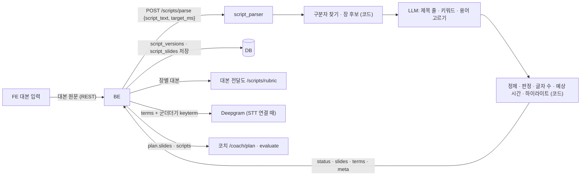
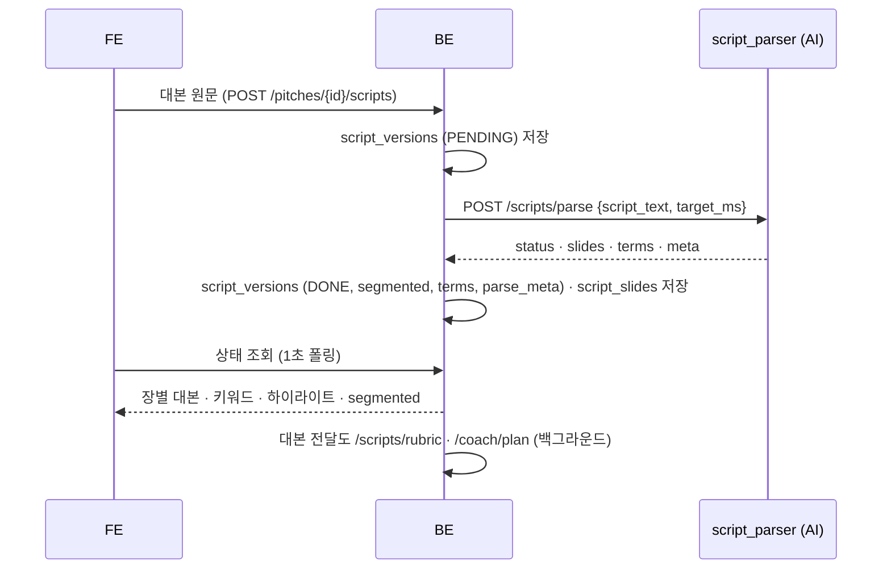

# 대본 파싱 (script_parser) 설계

> **이 문서는** 대본 파싱 기능의 전체 설명서다. 처음 보는 사람이 이 문서만 읽고 이 기능이 왜 있고, 무엇을 받아 무엇을 내며, 안에서 어떻게 돌고, 어떻게 실행 · 배포하는지 알 수 있게 쓴다.
> **기준 범위**: 대본 파싱 모듈(`POST /scripts/parse`)의 목표 설계다. 기능 사이 공통 계약(에러 · `meta` · 시간 예산 · LLM 공통 규칙 · 글자 위치 단위 · 저장 지도)은 `architecture.md`에 따르고, 이 문서에는 이 기능에만 있는 규칙 · 예외만 적는다.
> **관련 Issue**: #156
> **한 줄 요약**: 대본 원문을 코드가 구분자로 장마다 나누고 정제해 장별 글자 수 · 예상 발표 시간 · 하이라이트를 내고, LLM은 장별 키워드 · 제목 줄과 대본 전체의 STT 용어만 고른다.
> **기준값**: 기준 말 속도(CPM) · 키워드 개수 · 용어 상한은 `src/script_parser/config.py`에만 두고, 이 문서에는 BE와 맞춰야 하는 통신 값(구분자 형식 · 용어 50개 · 입력 한도 · 시간 예산)과 예시만 적는다.

# 0. 한눈에 보기
| 언제 | 받는 것 | 내는 것 | 쓰는 곳 |
|---|---|---|---|
| 대본 등록 · 수정 · 다시 파싱 (`POST /scripts/parse`, BE 백그라운드) | 대본 원문 `script_text`, 발표 제한 시간 `target_ms`(없으면 null) | `status`(나눴는가), 장별 `script` · `script_chars` · `keywords` · `highlights` · `expected_ms`, 대본 전체 `terms`, `meta` | 코치 시간 계획(`expected_ms` · `script_chars`) · 코칭 계획(`script`), 대본 전달도 평가 기준(`script`), STT keyterm(`terms`), 리뷰(`expected_ms`를 장별 실제 시간과 비교), FE 발표 화면(`script` · `highlights` · `keywords`) |

- **하는 것**: 줄 맨 앞 구분자로 장을 나눈다. 구분자 · 제목 줄 · 마크다운 표시를 걷어 낸 장 대본과 글자 수 · 예상 시간 · 키워드 위치를 코드로 만든다. LLM에게는 키워드 · 제목 줄 · 용어만 고르게 한다.
- **하지 않는 것**:
  - LLM이 대본 전문을 다시 쓰지 않는다. 장 대본은 원문에서 코드가 잘라 낸 글이라 원문과 어긋나지 않고, LLM 출력 길이가 대본 길이에 거의 비례하지 않는다.
  - 서수 · 전환 표현('첫째' · '다음으로')이나 번호 목록으로 장을 추측해 나누지 않는다. 나누지 못하면 `fail`(장 하나)이다.
  - 처리 상태(대기 · 실패)를 갖지 않는다. 처리 상태 · 재시도 · 저장은 BE 몫이다(`architecture.md` 1-6).
  - STT keyterm을 조립하지 않는다. 용어 목록만 중요한 순서로 내고, 군더더기 단어와 합치는 것은 BE다(`architecture.md` 2절).

# 1. 왜 필요한가
## 1-1. 배경
발표자는 대본을 한 덩어리 글로 올린다. 발표 중 시간 판정은 장마다 목표 시간과 장 대본 글자 수가 있어야 진행도를 잴 수 있고, 대본 전달도는 장마다 평가 기준을 만들며, 발표 화면은 장마다 대본과 강조할 키워드를 보여 준다. 그래서 대본을 장 단위로 나누고 장마다 값이 필요하다.
지금 구현은 LLM이 장을 나누면서 대본 전문을 다시 쓴다. 출력이 대본 길이에 비례해 길어지는 구조이고, 기본 모델(6 luna)에서 808자 대본 하나와 이어 붙인 2,225자 · 4,397자 대본이 실패했다. 이 실패의 직접 원인은 추론이 출력 한도 2,000토큰을 다 쓴 것이다(출력 글자는 0). 장 대본이 원문과 달라질 수도 있다. 장 나누기는 규칙으로 정할 수 있는 일이라 코드가 하고, 사람의 판단이 필요한 키워드 · 용어만 LLM에 맡긴다.

## 1-2. 목표
- 구분자가 있는 대본은 장 나눔이 틀리지 않는다(같은 입력이면 같은 장).
- 장 대본은 원문에서 구분자 · 제목 줄 · 마크다운 표시만 걷어 낸 글이다.
- 장별 예상 시간의 합이 목표 시간과 정확히 같다.
- 긴 대본도 LLM 호출 한 번의 시간 제한 안에 끝난다.

## 1-3. 목표가 아닌 것
- 구분자 없는 대본을 내용으로 나누기. 장을 나누지 못한 결과(`fail`)로 돌려주고 FE가 구분자를 넣도록 안내한다.
- 발표 자료(슬라이드 파일)와 대본 장의 대응 맞추기. 장 번호는 구분자에 적힌 번호를 그대로 쓴다.
- 대본 문장 다듬기 · 요약.

# 2. 용어
| 용어 | 뜻 | 예 |
|---|---|---|
| 구분자 | 장의 시작을 알리는, 줄 맨 앞의 표시. `[N]` · `[슬라이드 N]` · `슬라이드 N:` (N은 숫자) | `[3] 지난 분기 매출은 ...` |
| 장 대본 (`script`) | 구분자 · 제목 줄 · 마크다운 표시를 걷어 낸 그 장의 본문 | `지난 분기 매출은 37% 늘었습니다.` |
| 제목 줄 | 발표할 말이 아니라 제목인 줄. LLM이 고르고 코드가 걷어 낸다 | `# 신규 서비스 성과 보고`, `[2]` 다음 줄의 `시장 현황` |
| `success` · `fail` | 구분자로 대본 전체가 나뉘었는가. `fail`은 처리 실패(에러)가 아니라 '장을 나누지 못한 결과'다 | 구분자가 없으면 `fail` |
| 글자 수 (`script_chars`) | 장 대본에서 공백과 문장부호(유니코드 P 범주: 쉼표 · 마침표 · `%` 등)를 뺀 글자 수(유니코드 코드 포인트 개수). STT 단어에는 문장부호가 없어 말 속도의 글자 수와 같은 기준이다 | `24` |
| 예상 시간 (`expected_ms`) | 그 장의 예상 발표 시간 | `18000` |
| 하이라이트 (`highlights`) | 키워드가 장 대본에 처음 나오는 위치 `{start, end}` (코드 포인트, `end` 미포함, `architecture.md` 6-1) | `{"start": 11, "end": 17}` |
| 용어 (`terms`) | STT가 틀리기 쉬운 고유명사 · 전문 용어. STT keyterm에 쓴다 | `["피치코치", "MAU"]` |

# 3. 전체 흐름

1. **BE**: 대본 버전을 저장하고(처리 상태 `PENDING`) 백그라운드로 `/scripts/parse`를 부른다. 요청에 발표 제한 시간(`pitches.time_limit_sec` × 1000)을 `target_ms`로 싣는다.
2. **구분자 찾기**: 코드가 줄 맨 앞 구분자를 찾아 장 후보와 첫 구분자 앞 글(머리글)을 나눈다.
3. **LLM 한 번**: 대본과 장 후보를 주고, 머리글 · 장마다의 제목 줄, 장마다 키워드, 대본 전체 용어를 고르게 한다. 출력은 짧다(키워드 · 줄 · 용어 목록).
4. **코드 마무리**: 제목 줄을 걷어 낸 뒤 머리글에 본문이 남으면 `fail`로 바꾼다. 장 대본을 정제하고 글자 수 · 예상 시간 · 하이라이트를 계산한다. 대본에 그대로 없는 키워드 · 용어를 버린다.
5. **BE**: 응답을 저장하고(처리 상태 `DONE`, `fail`이면 `segmented` false) 대본 전달도 평가 기준 · 코칭 계획을 부른다. STT keyterm은 Take의 STT를 연결할 때 `terms`와 군더더기 keyterm 단어로 만든다.

# 4. 구성과 폴더
## 4-1. 폴더 트리
```
ai/research/script-parser/
├─ README.md                                폴더 · 파일 지도, 실행법, 실험 결과
├─ pyproject.toml · uv.lock                 Python 3.12. 코어는 pydantic 하나, 연구 도구만 LLM 라이브러리
├─ src/script_parser/                       코어 → 서비스 features/script_parser/로 폴더째 옮긴다
│   ├─ schemas.py                           요청 · 응답 · LLM 출력 pydantic 모델 = 계약
│   ├─ core.py                              parse_script(): 구분자 → LLM → 정제 · 계산
│   ├─ splitter.py · cleaner.py             구분자 찾기 · 판정, 정제 · 글자 수 · 하이라이트 (LLM 없는 순수 함수)
│   ├─ config.py · version.py               기준 말 속도 · 키워드 개수 · 용어 상한, 기능 버전
│   ├─ prompts/                             제목 줄 · 키워드 · 용어 고르기 프롬프트
│   └─ examples/                            요청 · 응답 예시 (계약 테스트가 읽는다)
├─ run.py                                   실험 도구: ai/.env로 LLM을 만들어 data/scripts를 돌림 (build_llm은 여기로)
├─ data/scripts/ · data/labels/             평가 대본과 정답 장 나눔 라벨
├─ tests/ · tests/live/                     구분자 · 정제 · 계산 · 계약(가짜 LLM) / 실제 LLM(live 표시)
└─ reports/results/                         평가 결과 JSON
```
위는 모듈 규약(`architecture.md` 8절)을 따른 모양이다. 파일 이름은 담당자가 정하고 README의 파일 지도에 둔다.

## 4-2. 진입 함수
| 함수 | 하는 일 | 부르는 쪽 |
|---|---|---|
| `parse_script(request, llm)` | 요청 하나를 처리해 응답 모델을 돌려준다. `llm`은 LLM 출력 스키마가 걸린 객체(`.invoke`만 씀)로 필수 인자다. LLM 예외는 잡지 않고 올린다 | 서비스 라우터 `POST /scripts/parse` · `run.py` |
| `find_slides(script_text)` | 구분자로 장 후보 · 머리글을 나눈다(LLM 없음) | `parse_script` · 테스트 |
| `clean_script(text)` · `count_chars(text)` · `find_highlights(script, keywords)` | 정제 · 글자 수 · 하이라이트 | 같음 |

## 4-3. 규칙과 이유
| 규칙 | 이유 |
|---|---|
| 장 나누기 · 정제 · 글자 수 · 예상 시간 · 하이라이트는 코드가 한다 | 같은 입력에 같은 장, 장 대본이 원문과 같고, LLM 출력이 짧다 |
| 코어는 상대 import와 pydantic만 쓰고 파일 · 환경변수 · 네트워크 · 시계를 쓰지 않는다. `ai/.env`를 읽어 LLM을 만드는 코드는 `run.py`로 옮긴다 (`architecture.md` 8절) | 서비스로 옮겨도 코드를 고치지 않고, 가짜 LLM으로 시험한다 |
| LLM이 고른 키워드 · 제목 줄 · 용어는 대본에 그대로 있을 때만 쓴다 | LLM이 바꿔 쓴 말이 하이라이트 · keyterm에 들어가지 않게 |
| 기준 말 속도 · 개수 상한은 `config.py`에 둔다 | 기준값을 한곳에서 관리한다 |

# 5. 입력 · 출력 계약
요청 · 응답의 원본은 `src/script_parser/schemas.py`의 pydantic 모델이다. 요청은 모르는 필드를 무시하고, 응답은 정해진 필드만 낸다(`architecture.md` 2절). 글자 위치는 코드 포인트 `[start, end)`다(`architecture.md` 6-1).

## 5-1. 호출 목록
| 호출 | 언제 | 누가 | 방식 |
|---|---|---|---|
| `POST /scripts/parse` | 대본을 올리거나 고칠 때(새 대본 버전), 사용자가 다시 파싱을 요청할 때 | BE | 백그라운드, LLM 1번(재시도는 요청 마감 안에서만) |

## 5-2. 입력
| 필드 | 타입 | 필수 | 뜻 | 예 |
|---|---|---|---|---|
| `script_text` | string | 예 | 대본 원문, 50,000자 이하(BE 대본 한도와 같다). 넘으면 422 `VALIDATION_ERROR` | `[1] 안녕하세요 ...` |
| `target_ms` | int · null | 아니오 | 발표 제한 시간(ms, 1 이상). 있으면 예상 시간을 이 값에 맞춰 나눈다 | `300000` |

- 구분자와 공백을 빼면 글자가 없는 대본(공백뿐 · 구분자만 있음)은 처리할 수 없는 입력이라 422 `EMPTY_SCRIPT`이고 LLM을 부르지 않는다.

**구분자**: 줄 맨 앞(앞 공백 허용)의 `[N]` · `[슬라이드 N]` · `슬라이드 N:` (N은 숫자)만 구분자다. 구분자 뒤 같은 줄의 글은 그 장의 본문이다(예: "[1] 안녕하세요, …"). 제목이면 LLM이 제목 줄로 골라 코드가 걷어 낸다. '첫째' · '다음으로' 같은 말은 구분자가 아니다. 구분자 형식을 넓힐지는 아직 정하지 않았다(15절 열린 질문).

## 5-3. 출력
| 필드 | 타입 | 뜻 |
|---|---|---|
| `status` | `success` · `fail` | 구분자로 대본 전체가 나뉘고 번호가 바르면(1 이상 · 겹치지 않음 · 앞 장보다 큼, 6-1 2번) `success`. 구분자가 없거나 일부만 있거나(첫 구분자 앞에 제목 줄이 아닌 본문이 있으면) 번호가 바르지 않으면 `fail`이고 장은 정확히 1개(`slide_number` 1)다. 첫 구분자 앞이 LLM이 고른 제목 줄뿐이면 `success`다 |
| `slides[].slide_number` | int | 구분자에 적힌 번호 그대로(1부터, 이어질 필요 없음). 발표 자료의 장 번호와 같아야 시간 판정 · 장별 결과가 맞는다. 겹치지 않는다 |
| `slides[].script` | string | 장 대본. `script_chars` · `highlights`는 이 글 기준 |
| `slides[].script_chars` | int | 공백 · 문장부호를 뺀 글자 수(코드 포인트, 2절) |
| `slides[].keywords` | list string | 대본 표현 그대로의 중요 단어, 장당 3–7개를 고르게 하되(프롬프트), 장 대본이 짧거나 비었거나 대본에 그대로 없는 것을 버린 뒤에는 0–2개일 수 있다(장 대본에 처음 나오는 순서, 중복 없음. 개수는 코드가 상한만 검사하고 최소 개수는 강제하지 않는다). `fail`이면 대본 전체에서 앞쪽에 몰리지 않게 고른다(개수는 `config.py`). 대본에 그대로 없는 단어는 버린다 |
| `slides[].highlights` | list `{start, end}` | 키워드마다 장 대본에서 처음 나오는 위치(코드 포인트, `end` 미포함). 키워드 순서대로 |
| `slides[].expected_ms` | int | 예상 발표 시간. 목표가 있으면 `target_ms × script_chars ÷ 전체 글자 수`, 없으면 `script_chars ÷ 기준 말 속도(CPM) × 60000`. 목표가 있으면 누적으로 반올림한다: i번째 장 = 반올림(`target_ms` × 1~i번째 장 글자 수 합 ÷ 전체) − 반올림(`target_ms` × 1~(i−1)번째 장 글자 수 합 ÷ 전체). 합이 목표와 같고 어느 장도 음수가 되지 않는다(0자 장은 0). 목표가 없으면 장마다 반올림한다 |
| `terms` | list string | STT가 틀리기 쉬운 고유명사 · 용어. 중요한 것부터 최대 50개, 중복 없음, 원문 `script_text`에 그대로 있는 것만(LLM이 낸 것 중 없는 것은 버린다). STT keyterm 한도가 모자라면 BE가 뒤에서부터 뺀다(`architecture.md` 2절) |
| `meta` | object | `{schema_version, feature_version: "script_parser-<버전>", model}` (`architecture.md` 5절). 판정이 아니라 `criteria_versions`는 없다 |

## 5-4. 상태와 에러
| 상황 | 결과 |
|---|---|
| 구분자로 다 나뉘고 번호가 바름 | 200 `success` |
| 구분자가 없거나 일부만 있음 · 번호가 0 · 겹침 · 거꾸로 | 200 `fail`, 장 1개(`slide_number` 1) |
| 공백뿐 · 구분자만 있음 | 422 `EMPTY_SCRIPT` |
| 정제 뒤 0자 (LLM이 모든 줄을 제목 줄로 고름) | 422 `EMPTY_SCRIPT`. LLM을 부른 뒤에도 올 수 있다(BE 참고: 위 줄의 422와 같이 다시 부르지 않으면 된다) |
| 형식이 틀림 (`script_text` 50,000자 초과 포함) | 422 `VALIDATION_ERROR` |
| LLM 실패 | 504 `LLM_TIMEOUT` · 502 `LLM_ERROR` · 502 `LLM_INVALID_OUTPUT` · 503 `LLM_UNAVAILABLE` (`architecture.md` 4 · 9절) |

## 5-5. 예시
**요청**
```json
{"script_text": "# 신규 서비스 성과 보고\n[1] 안녕하세요, 오늘은 신규 서비스 성과를 말씀드리겠습니다.\n[2] 시장 현황\n지난 분기 MAU는 12만 명으로 37% 늘었습니다.", "target_ms": 300000}
```
**응답** (첫 줄과 `[2]` 다음 줄은 LLM이 고른 제목 줄이라 걷어 냈다)
```json
{
  "status": "success",
  "slides": [
    {"slide_number": 1, "script": "안녕하세요, 오늘은 신규 서비스 성과를 말씀드리겠습니다.", "script_chars": 24,
     "keywords": ["오늘", "신규 서비스", "성과"], "highlights": [{"start": 7, "end": 9}, {"start": 11, "end": 17}, {"start": 18, "end": 20}], "expected_ms": 160000},
    {"slide_number": 2, "script": "지난 분기 MAU는 12만 명으로 37% 늘었습니다.", "script_chars": 21,
     "keywords": ["분기", "MAU", "37%"], "highlights": [{"start": 3, "end": 5}, {"start": 6, "end": 9}, {"start": 19, "end": 22}], "expected_ms": 140000}
  ],
  "terms": ["MAU"],
  "meta": {"schema_version": "1.0", "feature_version": "script_parser-1.0", "model": "<응답한 모델>"}
}
```
- `expected_ms`: 1번 장 = 반올림(300000 × 24 ÷ 45) = 160,000, 2번 장 = 300000 − 160000 = 140,000 (누적 반올림이라 합이 목표와 같다). 글자 수는 공백과 문장부호를 빼므로 1번 장은 쉼표 · 마침표, 2번 장은 `%` · 마침표를 세지 않는다(26 → 24, 23 → 21).

**경계 — 구분자가 없음 (`fail`)**
```json
{"status": "fail",
 "slides": [{"slide_number": 1, "script": "피치코치는 발표 연습을 돕는 AI 코치입니다.", "script_chars": 19,
             "keywords": ["피치코치", "발표 연습", "AI 코치"], "highlights": [{"start": 0, "end": 4}, {"start": 6, "end": 11}, {"start": 16, "end": 21}], "expected_ms": 300000}],
 "terms": ["피치코치"],
 "meta": {"schema_version": "1.0", "feature_version": "script_parser-1.0", "model": "<응답한 모델>"}}
```
**경계 — 목표 시간 없음**: `target_ms`가 null이면 장마다 `script_chars ÷ 기준 말 속도 × 60000`을 반올림하고 누적 반올림은 하지 않는다(맞출 합이 없으므로).

# 6. 처리 — 안에서 어떻게 도는가
## 6-1. 요청 하나가 도는 과정
1. **입력 검사**: 코드가 인정하는 구분자와 공백을 빼고 남는 글자가 없으면 422 `EMPTY_SCRIPT`(LLM을 부르지 않는다). 공백뿐인 대본과 구분자만 있는 대본이 여기서 걸린다. 구분자 위치가 있어야 검사할 수 있어서, 코드는 2번 구분자 찾기를 먼저 하고 그 결과로 검사한다(LLM을 부르기 전이라 결과는 같다).
2. **구분자 찾기** (코드): 줄마다 구분자인지 본다. 구분자가 없으면 대본 전체를 장 1개(`slide_number` 1) 후보로 둔다. 있으면 첫 구분자 앞 글을 머리글로, 구분자부터 다음 구분자 전까지를 그 번호의 장 후보로 둔다. 번호가 0이거나 겹치거나 앞 장보다 작으면 장을 나누지 못한 것으로 보고 `fail`이다.
3. **LLM 한 번**: 머리글과 장 후보를 표시한 대본을 주고 출력 스키마 `{preface_title_lines, slides[{slide_number, title_lines, keywords}], terms}`로 받는다. 규칙: 키워드는 대본 표현 그대로 · 요약 금지 · 명사와 명사구만(조사 · 어미는 떼고, 서술어가 든 어구 · 인사말 · 맺음말 제외) · 쉼표로 나열된 말은 하나만, 장당 3–7개(`fail`이면 대본 전체에서 앞쪽에 몰리지 않게). 용어는 표준어 사전에 있는 흔한 말이 아니고 표기가 헷갈릴 만한 고유명사 · 약어 · 전문 용어만, STT가 틀릴 가능성이 높은 순서. 제목 줄은 발표할 말이 아닌 제목과, 장 번호 · 순서만 표시한 줄(`[Slide 1]` · `Slide 03: …` · `슬라이드 4` · `1. 논의의 개요` · 숫자만 있는 줄 등. 구분자 형식이 아니어서 장을 나누지 못한 대본에 남는다).
4. **판정** (코드): 머리글에서 빈 줄과 LLM이 고른 제목 줄(머리글의 줄과 앞뒤 공백을 뺀 글자가 똑같을 때만)을 빼고도 글이 남으면 `fail`로 바꾸고 대본 전체를 장 1개로 다시 정제한다. 이때 머리글과 장마다 고른 제목 줄을 모두 걷어 내고, 키워드는 LLM이 고른 장별 키워드를 장마다 번갈아 하나씩 합쳐 개수 상한까지 쓴다(앞 장부터 이어 붙이면 상한에서 잘릴 때 앞쪽 장에 몰린다).
5. **정제** (코드): 장마다 구분자와 LLM이 고른 제목 줄(그 장 안의 줄과 앞뒤 공백을 뺀 글자가 똑같을 때만)을 빼고, 줄 맨 앞의 `#` 제목 표시 · 굵게와 기울임 표시 · 백틱 · 링크 표시를 걷어 낸다. `#1` 같은 글이나 `4 * 6` 같은 곱셈은 남긴다. 연속 공백을 하나로, 긴 빈 줄을 빈 줄 하나로 줄인다.
6. **계산** (코드): 글자 수, 예상 시간(5-3), 키워드 거르기(장 대본에 그대로 없는 것 · 중복 버림, 개수 상한) 뒤 장 대본에 처음 나오는 순서로 정렬, 하이라이트(키워드의 첫 위치, 키워드 순서), 용어 거르기(원문 `script_text`에 그대로 없는 것 · 중복 버림 · 50개까지, LLM이 준 순서 유지). LLM이 모든 줄을 제목 줄로 골라 정제 뒤 전체 글자 수가 0이면 시간을 나누지 않고 422 `EMPTY_SCRIPT`를 돌려준다(이 경우는 LLM을 이미 부른 뒤다).
7. **응답**: `meta.model`에는 실제로 응답한 모델을 싣는다(서비스 라우터가 넣는다, `architecture.md` 9절).

## 6-2. LLM 출력이 짧은 이유
LLM은 장 대본을 다시 쓰지 않고 키워드 · 제목 줄 · 용어만 낸다. 그래서 출력 길이가 대본 길이에 거의 비례하지 않고, 긴 대본도 호출 한 번의 시간 제한(기본 12초) 안에 드는 것을 목표로 한다. 입력(대본 전체)은 길어지므로 실제 긴 대본으로 시간을 재서 README에 적는다.

# 7. 실패할 때
| 상황 | 동작 | 응답 | 이유 |
|---|---|---|---|
| 공백뿐 · 구분자만 있는 대본 | LLM을 부르지 않는다 | 422 `EMPTY_SCRIPT`, BE는 다시 부르지 않음 | 나눌 글이 없다 |
| 정제 뒤 0자 (LLM이 모든 줄을 제목 줄로 고름) | LLM을 부른 뒤, 시간을 나누지 않는다 | 422 `EMPTY_SCRIPT`, BE는 다시 부르지 않음 | 장 대본에 발표할 글이 남지 않았다 |
| 형식 오류 (`script_text` 50,000자 초과 포함) | 처리하지 않는다 | 422 `VALIDATION_ERROR` | `architecture.md` 4절 |
| 구분자가 없거나 일부만 있음 | 장 1개로 낸다 | 200 `fail` | 처리 실패가 아니다. BE는 처리 상태 `DONE`, `segmented` false로 둔다 |
| LLM 시간 초과 · 실패 · 스키마 위반 (재시도도 실패) | 코어는 예외를 잡지 않는다. 서비스가 상태 코드로 바꾼다 | 504 `LLM_TIMEOUT` · 502 `LLM_ERROR` · 502 `LLM_INVALID_OUTPUT` · 503 `LLM_UNAVAILABLE` | LLM이 결과의 본체다(`architecture.md` 9절). 장 나누기만 코드로 돌려주면 키워드 · 용어가 빈 결과가 저장된다 |
| LLM이 대본에 없는 키워드 · 제목 줄 · 용어를 냄 | 그 항목만 버린다 | 200 | 나머지는 쓸 수 있다 |

# 8. 시간 예산과 호출 규칙
| 호출 | AI 예산 | BE 시간 제한 | BE 재시도 | 이유 |
|---|---|---|---|---|
| `/scripts/parse` | 25초 (호출 한 번 기본 12초, 남은 예산 안에서만 1번 더) | 30초 (호출 전체) | 연결 실패 · 시간 초과 · 408 · 429 · 5xx면 1번 | `architecture.md` 3절 '백그라운드 LLM' |

- 잰 시간 (2026-10-24, 기본 묶음 6 luna, 목표 설계 구현, 평가 대본 15개 · 495~4,198자, 출력 상한은 게이트웨이 기본 2,000토큰): 추론 강도를 정하지 않으면(모델 기본값) 922자 · 2,455자 · 4,440자 대본이 출력 2,000토큰을 추론에 다 써 실패했고(`LengthFinishReasonError`, 옛 평가 대본 20개 기준), 응답한 것도 중앙값 13.2초로 12초를 자주 넘었다. 추론 토큰은 대본 길이와 관계없이 호출마다 달랐다. 추론 강도 `low`에서는 실패 없이 1,000자 미만 13개가 중앙값 6.2초 · 최대 7.9초, 2,052자 7.5초, 4,198자 9.9초였고 최대 출력은 1,283토큰(그중 답은 21장에 약 1,000토큰)이었다. 출력 한도 · 추론 강도는 `architecture.md` 9절대로 역할 `script_parser`의 `settings.py` 상수로 둔다(잰 값: 출력 상한 2,000 · 추론 `low`). 대본별 결과는 연구 폴더 README의 '평가 결과'다.
- 옛 측정 (2026-10-12, 6 luna, LLM이 전문을 다시 쓰던 구현): 595~1,125자 대본 9개는 6.4~10.2초에 응답했고, 808자 대본 1개와 이어 붙인 2,225자 · 4,397자 대본은 출력 2,000토큰이 추론에 다 쓰여 실패했다.
- 모델: 기본 묶음(역할 `script_parser` → 기본 묶음, `architecture.md` 9절).

# 9. 버전
| 버전 | 값 | 어디에 | 언제 오르나 |
|---|---|---|---|
| `feature_version` | `script_parser-<버전>` (첫 판 `script_parser-1.0`) | `src/script_parser/version.py` | 구분자 규칙 · 정제 · 프롬프트 · 출력의 뜻이 바뀔 때 |
| `schema_version` | `1.0` | 응답 `meta` (`architecture.md` 5절) | 필드 이름 변경 · 삭제 · 뜻 변경 (예: `highlights` 모양) |

# 10. 실행 · 테스트
준비 (`ai/research/script-parser`에서. Python 3.12, `.venv`는 git에 없어 처음 한 번 만든다. 실제 LLM을 부르는 일만 `ai/.env`의 기본 묶음이 필요하다)
```bash
cd ai/research/script-parser
uv sync
```
| 하는 일 | 명령 | 기대 결과 |
|---|---|---|
| 테스트 | `uv run python -m pytest` | 구분자 · 판정 · 정제 · 글자 수 · 예상 시간(합 · 누적 반올림) · 하이라이트 · 계약(`examples/`, 가짜 LLM) 통과 |
| 실제 LLM 테스트 | `uv run python -m pytest -m live` | 예시 대본이 스키마를 통과 (과금) |
| 대본 실행 | `uv run python run.py --all` | `results/<이름>.json` (과금) |
| 평가 | `uv run python run.py --eval --out reports/results/script_parser_eval.json` | 장 나눔 정확도 · 예상 시간 오차 · 호출 시간 (13절, 과금) |

- Windows에서는 실행 파일이 막힐 수 있어 `uv run python -m …`으로 부른다.
- 테스트가 볼 것: 구분자 세 형식 · 줄 맨 앞이 아닌 표시 · '첫째' 같은 말, 머리글이 제목 줄뿐(`success`) · 본문 있음(`fail`), 구분자 뒤 같은 줄 본문, 정제(`#1` · `4 * 6` 남김), 코드 포인트 위치(이모지 뒤 하이라이트), 예상 시간 합 · 마지막 장 0자 · 목표 없음, 대본에 없는 키워드 · 용어 버림, 키워드 대본 순서 · `fail`로 바뀐 대본의 키워드가 장마다 고르게 남음, 번호 0 · 겹침 · 거꾸로는 `fail`, 정제 뒤 0자 422, 공백뿐 · 구분자만 있음 422, LLM 예외가 잡히지 않고 올라감, `examples/` 계약(예시 요청을 가짜 LLM으로 돌린 응답이 예시 응답과 같음).

# 11. 배포
**어디서 도는가**: 코어 `src/script_parser/`(`prompts/` · `examples/` 포함)를 AI 서비스의 `features/script_parser/`로 폴더째 옮기고, 라우터가 `POST /scripts/parse`를 연다. 라우터는 요청 마감 시각을 만들고 `structured_llm(LLM 출력 스키마, deadline)`을 `parse_script`에 넘긴다. LLM 에러는 `common/errors.py`가 상태 코드로 바꾼다. 서비스로 옮기려면 서비스 뼈대(`ai-service.md`)가 먼저 있어야 한다.

**BE와 함께 바꿀 것**: 경로 `/scripts/parse` · `X-Request-ID` · 30초 · 재시도 1번 · `target_ms` 싣기 · `script_chars` · `expected_ms` · `meta` 저장. `highlights`를 `{start, end}`로 바꾸면 `"start:end"` 문자열만 받는 BE 검증은 모든 응답을 실패로 본다. 그래서 BE와 AI가 같은 시점에 바꾼다. BE가 두 모양을 먼저 받게 한 뒤 AI가 바꾸는 순서로 할지는 아직 정하지 않았다(15절 열린 질문).

**환경변수**: 서비스 공통의 LLM 묶음과 시간 제한을 쓴다. 대본 파싱만 시간 제한이 달라야 하면 잰 값과 함께 `SCRIPT_PARSER_LLM_TIMEOUT_SECONDS`를 더한다(`architecture.md` 10절).

**로그**: 대본 원문 · 키워드 · 용어는 남기지 않는다. 대본 길이 · 장 수 · `status`만 남긴다(`architecture.md` 11절).

**증상별 원인**

| 증상 | 원인 | 확인 · 해결 |
|---|---|---|
| 구분자를 넣었는데 `fail` | 형식이 세 가지가 아님(`1.` · `## Slide 1` 등), 첫 구분자 앞에 본문이 있음 | 대본의 구분자 줄, FE 안내 문구 |
| 장 대본에 제목이 남음 | LLM이 제목 줄을 고르지 않음, 고른 줄이 대본 줄과 글자가 다름 | LLM 출력의 `title_lines`, 프롬프트 |
| 하이라이트가 한두 글자 밀림 | FE가 코드 포인트를 UTF-16으로 바꾸지 않음 | FE의 코드 포인트 → UTF-16 변환, `architecture.md` 6-1 |
| BE가 모든 응답을 `AI_INVALID_OUTPUT`으로 봄 | `highlights` 새 모양을 BE가 아직 받지 못함 | 배포 순서(11절 'BE와 함께 바꿀 것') |
| 504가 잦음 | 대본이 아주 길어 입력 처리가 김, 모델 출력 한도 | AI 로그의 호출 시간 · 토큰 수, `SCRIPT_PARSER_LLM_TIMEOUT_SECONDS` |

# 12. FE · BE · DB 연결과 저장

## 12-1. 저장 (DB)
저장 설계는 AI가 하고, 마이그레이션 · 구현 · 운영은 BE가 한다. 공통 저장 지도는 `architecture.md` 1-1이다.

| 데이터 | 언제 생기나 | 저장 위치(테이블.칸) | 형식(JSON · 칸, 크기) | 쓰는 쪽 · 읽는 쪽 | 덮어쓰기 막기 | 보관 기간 · 개인정보 |
|---|---|---|---|---|---|---|
| 파싱 결과 (대본 버전) | `/scripts/parse` 응답 | `script_versions` (`parse_status` · `segmented` = `status`가 `success`인가 · `terms` JSONB · 새 칸 `parse_meta` JSONB NULL = 응답의 `meta` · 새 칸 `parse_error` String NULL: null = 차이 없음, `REPARSE_MISMATCH` = 같은 버전을 다시 파싱한 결과의 전체 장 번호 · 대본이 저장본과 달라 적용하지 않음) | `terms`: 문자열 배열 50개 이하, 1 KB 안팎. `parse_meta`: 0.1 KB 안팎 | BE가 쓴다 · BE가 STT keyterm을 만들 때 `terms`를 읽음 | 늦게 온 옛 응답은 버린다(BE의 `parse_requested_at` 표식) | 발표와 함께. 대본은 사용자가 쓴 글이다 |
| 장별 대본 | 같음 | `script_slides` (`slide_number` · `full_content` = `script` · `keywords` JSONB · `highlights` JSONB · 새 칸 `script_chars` Integer NULL · 새 칸 `expected_ms` Integer NULL) | `highlights`는 BE 형식 그대로 `[[start, end], ...]`(코드 포인트). 장 하나에서 대본 글을 뺀 값이 0.3~0.4 KB(`fail`이면 키워드가 많아 약 0.7 KB). 응답 전체는 대본 595~1,125자에 2.3~5.3 KB였고, 대본 글(UTF-8)에 장마다 0.4 KB와 용어 1 KB 안팎을 더한 크기다 | BE가 쓴다 · 코치 `plan.slides`(`expected_ms` → `target_ms`, `script_chars`) · `scripts`, 대본 전달도 `slides[].script`, FE 발표 화면 | `(script_version_id, slide_number)` 유일 제약 | 같음 |

- 새 칸(`script_chars` · `expected_ms` · `parse_meta` · `parse_error`)은 BE가 마이그레이션한다. 이미 저장된 대본 버전의 새 칸은 null이다. `script_chars` · `expected_ms` · `parse_meta`는 다시 파싱한 결과를 적용할 때 채우고(적용할지는 `architecture.md` 1-7의 저장본 비교 규칙), `parse_error`는 적용하지 않을 때 12-2대로 남긴다.
- 잰 크기는 지금 구현의 응답(9개 대본)을 목표 모양(`script_chars` · `expected_ms` · `{start, end}` · `meta`)으로 바꿔 쟀다.

## 12-2. 저장 규칙
- 응답의 `meta`를 `parse_meta`에 함께 저장한다(`architecture.md` 1-1).
- 같은 버전을 다시 파싱한 결과가 저장본과 다르면 새 결과를 적용하지 않고 `parse_error`를 `REPARSE_MISMATCH`로 남긴다(비교 규칙은 `architecture.md` 1-7).
- `status: fail`은 처리 실패가 아니다. 처리 상태 `DONE`, `segmented` false로 두고 장 1개를 저장한다. 처리 실패(에러 상태 코드 · 시간 초과)만 `FAILED`와 에러 코드다.
- AI 응답을 BE 형식(`highlights`의 `[[start, end]]` 등)으로 바꾸는 곳은 BE의 AI 호출 코드 한 곳이다(`architecture.md` 2절).
- 제한 시간만 바뀌면 다시 파싱하지 않는다. 장별 `expected_ms`는 비율로 읽고, 쓰는 쪽이 지금 목표에 맞춰 비율로 늘이거나 줄인다. `parse_meta`에는 파싱 때 요청의 `target_ms`도 함께 남긴다.

# 13. 품질 검증
| 평가 데이터 | 지표 | 중점 | 검증 방법 |
|---|---|---|---|
| 구분자가 있는 · 없는 대본 세트와 정답 장 나눔 라벨 (구분자 형식마다, 일부만 구분자, 마크다운 섞인 대본, 머리글에 제목만 · 본문 있음) | 장 나눔 정확도(`status` · 장 수 · 번호 · 장 경계가 정답과 같은 대본 비율, 14절) | 구분자가 있으면 장 나눔이 틀리지 않는 것 | `run.py --eval` → 결과 JSON |
| 같은 대본으로 발표한 기록(가상 발표와 실제 리허설, 장별 실제 시작 · 끝 시각) | 예상 시간과 실제 장 시간의 오차 | 기록한다(기준 말 속도 고르기의 근거) | 같음 |
| 같은 세트 | 키워드 · 용어가 대본에 그대로 있는 비율(버리기 전), 장 대본에 제목이 남은 수, LLM 호출 시간 (긴 대본 포함) | 정제가 맞고 시간 제한 안에 드는 것 | 같음 |

- 지금 평가 세트는 `data/scripts/` 15개와 `data/labels/`의 라벨 초안(`status`, 장마다 첫 줄 · 마지막 줄, 남으면 안 되는 제목 줄)이다. 원래 대본 5개 중 4개는 5-2의 구분자 형식이 아닌 `fail` 경우(`## Slide 1 —` · `1.` · `[Slide 1]` · 구분자 없음)이고, 나머지 10개는 위 표의 경우마다 분야를 달리해 새로 쓴 대본(구분자 형식마다, 머리글에 제목만 · 본문 있음, 일부만 구분자, 마크다운, 번호 겹침, 구분자 없음, 2,000자대 · 4,000자대)이다. 라벨은 사람이 확인하기 전 초안이다.
- 장별 실제 발표 시간 라벨(`actual_slide_ms`)이 아직 없어 예상 시간 오차는 재지 못했다. 가상 발표와 실제 리허설 기록을 모아 채운다.

# 14. 지표 정의
- **장 나눔 정확도**: 평가 대본 중 `status` · 장 수 · 장 번호 · 장마다 첫 문장과 마지막 문장이 정답과 모두 같은 대본의 비율.
- **예상 시간 오차**: 장마다 `|expected_ms − 실제 장 시간|`의 평균, 그리고 그 값 ÷ 실제 장 시간의 평균.
- **키워드 · 용어가 대본에 있는 비율**: LLM이 낸 키워드 중 장 대본에 그대로 있는 비율과, LLM이 낸 용어 중 원문에 그대로 있는 비율(코드가 버리기 전).
- **LLM 호출 시간**: 요청을 받아 LLM 응답을 받기까지의 시간, 대본 길이별 중앙값 · 최댓값.

# 15. 열린 질문 · 알려진 한계
**정한 것**
- 번호 0 · 겹침 · 거꾸로는 `fail`, 용어도 대본에 있는지로 거름, 정제 뒤 0자 422, `fail` 키워드 합치기, 입력 50,000자 한도, 제한 시간만 바뀌면 다시 파싱하지 않음 · `parse_meta`에 `target_ms`.

**열린 질문** (에이전트 입출력과는 관계없는 FE · BE 쪽)
- 아직 정하지 않았다: 구분자 형식을 넓힐지. 후보 안은 모호하지 않은 형식(`[Slide N]` · `Slide N:` · 줄 전체가 `슬라이드 N`/`Slide N`, 앞의 `#` 제목 표시)만 더하고 번호 목록(`1.` · `1)`)은 넣지 않으며, FE 안내 정규식을 같은 정의로 맞추는 것이다.
- 아직 정하지 않았다: `highlights` 배포 순서. 후보 안은 같은 시점 배포 대신 BE가 `"start:end"`와 `{start, end}`를 모두 받게 한 뒤 AI가 새 모양을 내고, 그다음 BE가 옛 모양 처리를 지우는 것이다.
- 아직 정하지 않았다: FE 예상 시간 표시. 후보 안은 파싱이 끝난 대본은 서버 `expected_ms`를 보이고, 파싱 전 미리보기만 FE 계산을 쓰되 기준 말 속도를 이 문서에 적어 FE 상수를 그 값으로 맞추는 것이다.
- 아직 정하지 않았다: BE의 파싱 오류 안내. 후보 안은 BE가 대본 파싱의 AI 422를 상태 코드만으로 사용자 입력 오류로 남기고, FE가 "대본을 확인해 주세요"로 안내하는 것이다(에러 본문은 읽지 않는다, `architecture.md` 4절).

**알려진 한계**
- `script_chars`는 대본 글의 글자 수라, 숫자 · 기호(`37%`)를 읽은 말("삼십칠 퍼센트")과 글자 수가 다르다. 시간 판정의 진행도(말한 글자 수 ÷ `script_chars`)가 숫자가 많은 장에서 조금 어긋난다.
- 예상 시간은 글자 수 비례라, 장마다 다른 말 속도(인사 · 표 설명)를 반영하지 않는다.
- 지금 평가 대본은 짧고(595~1,125자) 정답 라벨이 없다.

# 16. 확정 값 한눈에
| 항목 | 값 | 어디서 정하나 |
|---|---|---|
| 경로 | `POST /scripts/parse` (백그라운드) | 5-1 |
| 입력 | `script_text` · `target_ms`(null 가능) | 5-2 |
| 구분자 | 줄 맨 앞 `[N]` · `[슬라이드 N]` · `슬라이드 N:` | 5-2 |
| 출력 | `status`(`success` · `fail`) · `slides[{slide_number, script, script_chars, keywords, highlights{start,end}, expected_ms}]` · `terms`(50개까지) · `meta` | 5-3 |
| `fail` | 장 1개, `slide_number` 1 | 5-3 |
| 예상 시간 | 목표 비례(누적 반올림, 합 = 목표 · 음수 없음) · 목표 없으면 기준 말 속도(반올림) | 5-3 |
| 에러 | 422 `EMPTY_SCRIPT` · `VALIDATION_ERROR`, LLM 실패 `LLM_*` | 5-4 |
| 시간 예산 | AI 25초 / BE 30초, BE 재시도 1번 | 8절 |
| 버전 | `script_parser-1.0` · `schema_version` `1.0` | 9절 |
| 저장 | `script_versions`(`parse_meta` · `parse_error` 새 칸) · `script_slides`(`script_chars` · `expected_ms` 새 칸) | 12-1 |
