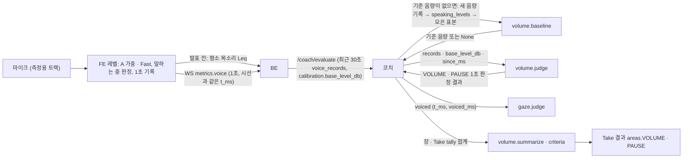
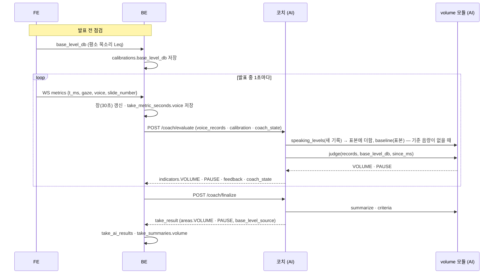

# 소리 크기 · 침묵 (volume) 설계

> **이 문서는** 소리 크기 · 침묵 판정 기능의 전체 설명서다. 처음 보는 사람이 이 문서만 읽고 이 기능이 왜 있고, 무엇을 받아 무엇을 내며, 안에서 어떻게 돌고, 어떻게 실행 · 배포하는지 알 수 있게 쓴다.
> **기준 범위**: 소리 크기 · 침묵 판정 모듈과, 그 입력인 음량 1초 기록을 FE가 재는 법의 목표 설계다(`architecture.md` 6-2: "각 필드를 어떻게 재는지는 측정 기능 문서에 있다"). 기능 사이 공통 계약(1초 원자료 모양 · 1초 판정 결과 형식 · 커서 · 단위 · 저장 지도)은 `architecture.md`에 따르고, 이 문서에는 이 기능에만 있는 규칙 · 예외만 적는다.
> **관련 Issue**: #155
> **한 줄 요약**: 브라우저가 마이크 레벨을 A 가중 · Fast로 재서 1초마다 말한 구간의 음량(Leq) · 말한 시간 · 끝의 무음 길이를 보내면, 이 모듈이 평소 목소리(기준 음량)보다 작게 말하는지(`VOLUME`)와 말이 오래 끊겼는지(`PAUSE`)를 따로 판정한다. 기준 음량이 없으면 Take 첫 발화로 잡는 `baseline`도 이 모듈이 정한다.
> **기준값**: 작음 기준 · 아주 작음 값, 평활 창 길이, 말한 1초의 `voiced_ms` 기준(시선 `config.py`와 같은 값, 계약 테스트), 측정에 필요한 말한 1초 수, 기준 음량 표본 수, 긴 침묵 기준 · 아주 긴 침묵 값은 `src/volume/config.py`에만 둔다. FE가 말소리를 가르는 값(말소리 하한 · 잡음 바닥 여유)은 FE 상수다. 이 문서의 숫자는 BE · FE와 맞춰야 하는 통신 값과 예시뿐이다.

# 0. 한눈에 보기
| 언제 | 받는 것 | 내는 것 | 쓰는 곳 |
|---|---|---|---|
| 발표 전 점검 (FE) | 평소 목소리로 읽는 몇 초 | 기준 음량 `base_level_db`(Leq, dBFS) | BE `calibrations` → 코치 `calibration.base_level_db` |
| 발표 중 1초마다 (FE) | 마이크 | 음량 1초 기록 `{t_ms, duration_ms, level_db, voiced_ms, silence_ms, audio_live}` (WS `metrics.voice`, 시선 기록과 같은 `t_ms`) | BE 창 → `/coach/evaluate`의 `inputs.voice_records`, 시선 판정의 발화 시간 |
| 발표 중 1초마다 (`volume.judge`, `/coach/evaluate` 안) | 최근 30초 음량 1초 기록, 기준 음량, 시각 커서 | 1초 판정 결과 두 개(`VOLUME` 음량 · `PAUSE` 침묵) | 코치: 작은 목소리 · 긴 침묵 지적, 상태 표시, 개입 효과 |
| 기준 음량이 없을 때 (`volume.speaking_levels` · `volume.baseline`, 코치가 부름) | 새 음량 1초 기록 → 말한 1초의 `level_db`(소리 크기가 고름), 코치가 모은 표본 | 기준 음량 또는 None(표본 부족) | 코치가 `coach_state`에 두고 다음 요청의 `base_level_db`로 |
| 장 끝 · Take 끝 (`volume.summarize` · `criteria`) | 장 · Take `tally` 합계 | `level_db` · `voice_diff_db` · `low_ratio` · `long_silence_count` · 측정 비율, 판정 기준 | Take 결과 → 리뷰(`vocal_delivery` · `pacing_rhythm`) · 리포트(`volume`) |

- **하는 것**: 짧은 창의 말한 구간 음량을 기준 음량과 비교해 `LOW` · `VOLUME_LOW`를 내고, 1초 끝의 연속 무음이 기준을 넘으면 `SILENT` · `LONG_SILENCE`를 낸다. 오디오가 끊겼던 시간은 침묵으로 세지 않는다.
- **하지 않는 것**:
  - 절대 음량(dBFS)으로 판정하지 않는다. 마이크 · 거리마다 값이 달라 평소 목소리와의 차이(`voice_diff_db`)로 본다.
  - 크게 말하는 것(고함)을 지적하지 않는다. 문제는 작은 목소리뿐이다.
  - 단어 사이 짧은 멈춤을 세지 않는다(말 속도의 `pause_count`).
  - 상태를 갖지 않는다. 기준 음량 표본과 값은 코치가 `coach_state`에 들고 다닌다.

# 1. 왜 필요한가
## 1-1. 배경
긴장하면 목소리가 작아지고, 말이 막히면 길게 끊긴다. 청중에게 들리지 않는 발표는 내용이 좋아도 전달되지 않는다. 그런데 마이크마다 · 방마다 음량 숫자가 달라 "몇 dB 이하면 작다"로는 판정할 수 없다. 그래서 같은 사람의 평소 목소리를 기준으로 삼고 그보다 얼마나 작은지를 본다.
지금은 같은 규칙이 코치 연구 폴더 안의 연구용 대역(`coach_lab/judges/volume.py`, `volume-0.2`)에만 있고, FE는 누적 Leq와 말하는 중 판정만 있을 뿐 1초 기록을 만들지 않으며 평소 목소리도 재지 않는다.

## 1-2. 목표
- 마이크가 달라도 같은 사람의 같은 발화에 같은 판정을 낸다(평소 목소리 대비).
- 긴 침묵을 바로 알아채되, 마이크 · 오디오가 끊긴 시간은 침묵으로 세지 않는다.
- 시선 판정이 같은 1초의 발화 시간을 쓸 수 있게 시선 기록과 같은 시간축으로 잰다.

## 1-3. 목표가 아닌 것
- 억양 · 강세 · 발음 평가.
- 잡음 제거. 측정용 마이크 트랙은 자동 음량 조절 · 잡음 제거 · 에코 제거를 끈 채로 잰다.

# 2. 용어
| 용어 | 뜻 | 예 |
|---|---|---|
| A 가중 · Fast | 사람 귀에 맞춘 주파수 가중과 125 ms 시간 가중. 음량 단위는 dBFS(0 이하) (`architecture.md` 6-1) | `-31.2` |
| 말하는 중 | FE 판정: 레벨이 말소리 하한을 넘고 잡음 바닥보다 여유 이상 큼 | — |
| Leq | 말한 구간의 에너지 평균을 dB로 바꾼 값 `10·log10(에너지 ÷ 시간)` | `-31.2` |
| 말한 1초 | `voiced_ms`가 기준(`config.py`, 시선과 같은 값) 이상이고 `audio_live`가 true인 1초(`architecture.md` 6-2). 평활 창 · 기준 음량 표본 · 시선의 발화 시간이 모두 이 기준을 쓴다(공통 값은 `architecture.md` 6-2) | `voiced_ms: 820` |
| 기준 음량 (`base_level_db`) | 평소 목소리 Leq. 발표 전 점검에서 재거나(출처 `CALIBRATION`) Take 첫 발화로 잡는다(`TAKE`) | `-29.5` |
| `voice_diff_db` | 말한 구간 음량 − 기준 음량. 음수면 평소보다 작다 | `-1.5` |
| 긴 침묵 | 오디오가 흐르는데 연속 무음이 기준 시간을 넘음 | 6초 무음 |
| 오디오 살아 있음 (`audio_live`) | 마이크 트랙과 오디오 처리가 돌고 있음 | `true` |

# 3. 전체 흐름

1. **발표 전 점검 (FE)**: 평소 목소리로 문장을 읽게 해 말한 구간의 Leq를 재고 BE에 보낸다. BE는 `calibrations.base_level_db`에 저장해 Take 동안 `/coach/evaluate`의 `calibration`으로 싣는다.
2. **발표 중 (FE)**: 1초마다 음량 1초 기록을 시선 기록과 같은 `t_ms`로 만들어 WS `metrics.voice`로 보낸다. 잴 수 없으면 null이다(`architecture.md` 2절).
3. **BE**: 최근 30초 음량 기록을 `inputs.voice_records`로 싣고 1초 원자료(`take_metric_seconds.voice`)로 보관한다.
4. **코치 → 기준 음량**: `calibration.base_level_db`가 없으면 새 음량 기록을 `speaking_levels`에 넘겨 말한 1초의 `level_db`를 받아 표본에 더하고 `baseline`을 부르고, 값이 나오면 고정해 그 요청의 판정부터 쓴다(출처 `TAKE`, `coach-agent.md` 6-1).
5. **`volume.judge`**: `VOLUME` · `PAUSE` 두 결과를 낸다. 코치는 같은 30초 기록의 `voiced_ms`를 시선 판정에도 넘긴다(`gaze-tracking.md` 5-2).
6. **Take 끝**: 코치가 `summarize`로 Take 결과의 `areas.VOLUME` · `areas.PAUSE`를 만들고, `VOLUME`에 기준 음량 출처(`base_level_source`)를 붙인다.

# 4. 구성과 폴더
## 4-1. 폴더 트리
```
ai/research/volume-analysis/
├─ README.md                                폴더 · 파일 지도, 실행법, 실험 결과, 대역과 달라진 점
├─ pyproject.toml · uv.lock                 Python 3.12, 의존성은 pydantic 하나
├─ src/volume/                              판정 모듈 → 서비스 features/volume/로 폴더째 옮긴다
│   ├─ schemas.py · core.py · config.py · version.py
│   └─ examples/                            judge(판정 창 전체) · summarize · criteria · baseline 입력 · 출력 예시
├─ data/                                    평가 데이터: 같은 사람이 평소 · 작게 · 크게 읽은 녹음(마이크 여러 종)과 1초 기록
├─ tools/                                   녹음 → 1초 기록 만들기(FE와 같은 규칙) · 평가 스크립트
├─ tests/                                   판정 규칙 · 침묵 자르기 · 커서 · 계약
└─ reports/results/                         평가 결과 JSON
```
폴더 이름은 `volume-analysis`다. 연구 폴더가 생기기 전에는 같은 규칙이 코치 연구 폴더의 연구용 대역 `ai/research/coach-agent/src/coach_lab/judges/volume.py`에 있다. FE 측정 코드는 `frontend/src/features/rehearsal/media/`(`loudness.ts` · `level.ts`)에 있고 FE가 관리한다.

## 4-2. 진입 함수
| 함수 | 하는 일 | 부르는 쪽 |
|---|---|---|
| `judge(inputs, t_ms, config)` | 1초 판정. `JudgmentResult` 두 개(`VOLUME` · `PAUSE`, 이 순서)를 목록으로 낸다(`architecture.md` 7절) | 코치(`/coach/evaluate` · `/coach/finalize` · `replay`) |
| `speaking_levels(records, config)` | 음량 1초 기록 → 그중 말한 1초(2절)의 `level_db` 목록(시각 순) | 코치(기준 음량이 없을 때 요청마다, 표본 모으기) |
| `baseline(levels, config)` | 말한 1초의 `level_db` 표본 → 기준 음량, 표본이 모자라면 None | 코치(기준 음량이 없을 때 요청마다) |
| `summarize(tally, config)` | 장 · Take `tally` 합계 → `{"VOLUME": {...}, "PAUSE": {...}}` | 코치(장 끝 · Take 끝) |
| `criteria(config)` | `VOLUME_LOW` · `LONG_SILENCE`의 판정 기준 | 코치(Take 결과의 `criteria`를 원인 영역별로 나눠 담음) |

## 4-3. 규칙과 이유
| 규칙 | 이유 |
|---|---|
| 판정은 평소 목소리 대비(`voice_diff_db`)로만 한다 | 마이크 · 거리 · 방마다 절대 음량이 달라서 |
| `VOLUME` · `PAUSE`를 따로 낸다 | 잴 수 있는 조건이 다르다(음량은 기준 음량이 있어야, 침묵은 오디오만 흐르면) |
| 모듈은 상태를 갖지 않는다. 기준 음량 표본 · 값은 코치가 들고 다닌다 | 같은 입력에 같은 결과(`architecture.md` 8절) |
| 같은 1초 기록이 두 번 오면 먼저 온 것을 쓴다 | 시선 · 원자료 저장과 같은 규칙(`architecture.md` 6-2) |
| 음량 평균은 에너지로 낸다(Leq). dB 값을 그대로 평균하지 않는다 | dB 평균은 큰 소리를 덜 반영해 실제 들리는 크기와 다르다 |

# 5. 입력 · 출력 계약
입력 · 출력의 원본은 `src/volume/schemas.py`의 pydantic 모델이다. 시각은 모두 Take 시작 기준 ms다. 1초 판정 결과의 공통 필드와 커서 규칙은 `architecture.md` 7절이 기준이다.

## 5-1. 호출 목록
| 호출 | 언제 | 누가 |
|---|---|---|
| `volume.judge` | `/coach/evaluate` 요청마다 한 번(시선 다음, 시간 판정 앞), `/coach/finalize`의 마지막 창, `replay`의 1초마다 | 코치 |
| `volume.baseline` | 기준 음량이 아직 없는 동안 요청마다 | 코치 |
| `volume.summarize` · `criteria` | 장 끝 · Take 끝, Take 결과를 만들 때 | 코치 |

소리 크기는 자기 HTTP 엔드포인트가 없다.

## 5-2. 입력 — 음량 1초 기록 (FE가 만든다)
`architecture.md` 6-2의 모양이다. 아래는 FE가 각 필드를 재는 법이다.

| 필드 | 타입 | 만드는 법 |
|---|---|---|
| `t_ms` · `duration_ms` | int | 시선 1초 기록과 같은 1초 격자(같은 `t_ms`). `stop` 직전 마지막 조각은 실제 길이(1000 미만일 수 있음) |
| `level_db` | float · null | 그 1초 동안 '말하는 중'이었던 구간의 Leq(A 가중 · Fast, dBFS). 누적 에너지 E와 누적 말한 시간 T의 차분으로 `10·log10((E₁ − E₀) ÷ (T₁ − T₀))`. 말한 구간이 없으면 null |
| `voiced_ms` | int | 그 1초 중 '말하는 중'이었던 ms |
| `silence_ms` | int | 그 1초 끝에서 거꾸로 센 연속 '말하지 않음' 길이(1초를 넘어 이어질 수 있다. 앞 1초들에서 이어진 무음을 더한다) |
| `audio_live` | bool | 그 1초 동안 오디오가 흐르는지: 오디오 컨텍스트가 실행 중이고 측정 트랙이 살아 있으며, 그 1초 안에 측정 갱신 간격이 FE의 한 번 상한(지금 250 ms)을 넘은 공백이 없을 때 true. 공백은 발화 · 침묵으로 누적하지 않는다 |

- **말하는 중**: A 가중 · Fast 레벨이 말소리 하한을 넘고 잡음 바닥보다 여유 이상 클 때. `voiced_ms` · `level_db` · `silence_ms`는 모두 이 한 기준으로 잰다.
- 에너지 E · 시간 T는 반올림하지 않은 누적값으로 차분한다.
- 측정은 자동 음량 조절 · 잡음 제거 · 에코 제거를 끄도록 요청한 별도 마이크 트랙으로 한다. 별도 트랙을 얻지 못하면 녹음용 스트림으로 계속 재고(판정은 유지), 발표 전 점검 결과(`calibrations.result`)에 측정 트랙 실패를 남긴다.

**발표 전 점검의 기준 음량** (FE가 잰다)
- 발표 전 점검에서 평소 목소리를 읽게 해 Leq(dBFS)를 `base_level_db`로 보낸다. 값이 없으면 Take 첫 발화로 잡는다. 정해진 문장을 평소 목소리로 읽게 하고 '말하는 중' 구간만 Leq로 잰다. 말한 시간이 5초 미만이면 null로 보내 Take 첫 발화로 잡게 한다.

**`judge(inputs, t_ms, config)`의 `inputs`** (코치가 만든다)

| 필드 | 타입 | 필수 | 뜻 | 예 |
|---|---|---|---|---|
| `records` | list | 아니오 | 최근 30초 음량 1초 기록. BE가 매 요청 겹쳐 보낸다 | 아래 5-5 |
| `base_level_db` | float · null | 아니오 | 기준 음량. null이면 `VOLUME`은 잴 수 없음 | `-29.5` |
| `since_ms` | int | 예 | 시각 커서. `t_ms`가 이 값 이상인 1초가 새것이다 | `40000` |

**`baseline(levels, config)`**: `levels`는 코치가 모은 말한 1초의 `level_db` 표본(시각 순). 표본이 기준 개수 미만이면 None, 이상이면 앞에서 기준 개수만큼의 중앙값. 코치는 값이 나오면 고정한다. 표본은 말한 1초(2절: `voiced_ms` 기준 이상 · `audio_live` true)의 `level_db`만 쓴다. 말한 1초를 고르는 것은 `speaking_levels(records, config)`가 하고(`level_db`가 null인 1초도 뺀다), 코치는 그 결과를 모으기만 한다. 코치가 판정 기준값을 따로 두지 않게 하기 위해서다(`architecture.md` 0-2).

## 5-3. 출력
**`judge` → `JudgmentResult` 두 개** (`evaluator: "volume"`, `area`는 `VOLUME` · `PAUSE`, 같은 `criteria_version`)

| 필드 | `VOLUME` | `PAUSE` |
|---|---|---|
| `metrics` | `level_db`(짧은 창의 말한 1초들의 Leq), `voice_diff_db`(`level_db − base_level_db`) | `silence_ms`(마지막 1초 끝의 잘린 연속 무음) |
| `tally` (새 1초마다 그 1초의 `t_ms`) | `voiced_ms` · `voiced_energy`(`10^(level_db/10) × voiced_ms`) · `low_ms`(그 1초에서 끝나는 짧은 창의 `voice_diff_db`가 작음 기준 미만이면 그 1초의 `voiced_ms`) · `level_voiced_ms`(기준 음량이 있을 때 그 1초의 `voiced_ms`) · `base_db_ms`(`base_level_db × level_voiced_ms`) · `audio_live_ms` · `total_ms` | `long_silence_count`(그 1초의 잘린 `silence_ms`가 긴 침묵 기준을 넘고, 같은 침묵 안의 앞선 기록 중 이미 기준을 넘은 것이 없으면 1. 아래 목록) · `audio_live_ms` · `total_ms` |
| `state` | `LOW` · `NORMAL`. 잴 수 없으면 `UNKNOWN` | `SILENT` · `NORMAL`. 잴 수 없으면 `UNKNOWN` |
| `measurable` | 마지막 1초에 오디오가 흐르고, 기준 음량이 있고, 짧은 창에 말한 1초가 기준 개수 이상 | 마지막 1초에 오디오가 흐름 |
| `issues[].confidence` | 잴 수 있으면 1 | 잴 수 있으면 1 |

- `tally`는 '말한 1초'로 거르지 않고 기록이 있는 모든 1초를 더한다. 에너지에 `voiced_ms`로 무게를 주므로 짧은 발화는 무게가 작고, '말한 1초' 기준(2절)은 평활 창 · 기준 음량 표본에만 쓴다.
- 기록이 없는 1초(빈 구간)는 `total_ms`만 센다.
- `long_silence_count`는 한 침묵을 한 번만 센다. 이 1초 기록의 무음 시작은 `t_ms + duration_ms − silence_ms`(잘린 값)이고, 받은 창 안의 앞선 기록 중 끝(`t_ms + duration_ms`)이 이 무음 시작보다 뒤이며 잘린 `silence_ms`가 기준을 넘은 기록이 있으면 같은 침묵을 이미 센 것이다. 기준을 넘는 바로 그 1초의 기록이 빠져도 다음 기록에서 센다(`silence_ms − duration_ms ≤ 기준` 같은 '처음 넘음' 조건만 쓰면 그 1초가 빠질 때 놓친다).
- `base_db_ms`는 `summarize`가 `voice_diff_db`를 내는 데 필요해 둔다.

**`summarize(tally)` → 두 영역** (분모가 0이면 null. `measured_ratio`만 분모가 0이면 0, `architecture.md` 7절)

| 영역 | 지표 | 계산 |
|---|---|---|
| `VOLUME` | `level_db` | `10·log10(voiced_energy ÷ voiced_ms)` |
|  | `voice_diff_db` | `level_db − base_db_ms ÷ level_voiced_ms` |
|  | `low_ratio` | `low_ms ÷ level_voiced_ms` (기준 음량이 없던 동안의 발화는 작다고 판정될 수 없으므로 분모에서 뺀다) |
|  | `measured_ratio` | `audio_live_ms ÷ total_ms`와 `level_voiced_ms ÷ voiced_ms` 중 작은 값(기준 음량이 없던 동안의 발화는 잰 것으로 보지 않는다). `voiced_ms`가 0이면(말한 소리가 없음) 0이다 |
| `PAUSE` | `long_silence_count` | 합 |
|  | `measured_ratio` | `audio_live_ms ÷ total_ms` |

- Take 결과의 `VOLUME`에는 코치가 기준 음량 출처 `base_level_source`(`CALIBRATION` · `TAKE`, 못 잡았으면 null)를 붙인다. Take에서 잡은 기준이면 `voice_diff_db`는 Take 안의 변화만 뜻한다.

**`criteria()`** → `{"VOLUME_LOW": {metric: "voice_diff_db", direction: "LOWER_IS_WORSE", ...}, "LONG_SILENCE": {metric: "silence_ms", direction: "HIGHER_IS_WORSE", ...}}`. 코치는 Take 결과의 `criteria`에 원인 영역별로(`VOLUME`에 `VOLUME_LOW`, `PAUSE`에 `LONG_SILENCE`) 나눠 담는다.

## 5-4. 문제 목록
| 문제 | 영역 | 조건 | 판정 지표 (나쁜 방향) | `actionable` |
|---|---|---|---|---|
| `VOLUME_LOW` | `VOLUME` | `voice_diff_db`가 작음 기준 미만 | `voice_diff_db` (낮을수록) | true |
| `LONG_SILENCE` | `PAUSE` | `silence_ms`가 긴 침묵 기준 초과 | `silence_ms` (길수록) | true |

- `VOLUME`은 오디오가 멈췄거나 기준 음량이 없거나 말한 1초가 부족하면 `UNKNOWN`이고 문제를 내지 않는다. `PAUSE`는 오디오가 흐르면 기준 음량 · 말한 1초 수와 관계없이 판정하고, 오디오가 멈추면 `UNKNOWN`이다. 측정 불가 문제 이름은 없다(`architecture.md` 6-3).
- `severity`는 공통 규칙을 따른다. `LONG_SILENCE`의 `persistence_sec`은 `silence_ms ÷ 1000`이다.
- 코치는 `VOLUME_LOW`에 `SPEAK_LOUDER` → `SPEAK_LOUDER`(뒷자리 기준) → 그만둠, `LONG_SILENCE`에 `RESUME`(그만두지 않음)을 쓰고, 효과는 `voice_diff_db` · 다시 말함으로 잰다(`coach-agent.md` 6-1).

## 5-5. 예시
**`judge` 입력** (창의 일부만 적었다)
```json
{
  "t_ms": 41000,
  "since_ms": 40000,
  "records": [{"t_ms": 40000, "duration_ms": 1000, "level_db": -31.2, "voiced_ms": 820, "silence_ms": 0, "audio_live": true}],
  "base_level_db": -29.5
}
```
**`judge` 출력** (기준값은 `config.py`의 값으로 정해진다는 가정의 설명용, 실제 값은 `examples/`)
```json
[
  {
    "evaluator": "volume", "area": "VOLUME", "t_ms": 41000, "counted_until_ms": 41000, "criteria_version": "volume-1.0+<config 해시>",
    "measurable": true, "state": "NORMAL",
    "metrics": {"level_db": -31.0, "voice_diff_db": -1.5},
    "tally": [{"t_ms": 40000, "values": {"voiced_ms": 820, "voiced_energy": 0.622, "low_ms": 0, "level_voiced_ms": 820, "base_db_ms": -24190.0, "audio_live_ms": 1000, "total_ms": 1000}}],
    "issues": []
  },
  {
    "evaluator": "volume", "area": "PAUSE", "t_ms": 41000, "counted_until_ms": 41000, "criteria_version": "volume-1.0+<config 해시>",
    "measurable": true, "state": "NORMAL",
    "metrics": {"silence_ms": 0},
    "tally": [{"t_ms": 40000, "values": {"long_silence_count": 0, "audio_live_ms": 1000, "total_ms": 1000}}],
    "issues": []
  }
]
```
- `voiced_energy` = 10^(−31.2/10) × 820 ≈ 0.622, `base_db_ms` = −29.5 × 820 = −24,190.
- 값이 0인 키는 `tally`에서 뺄 수 있다. 예시는 설명을 위해 남겼다.

**경계 — 오디오가 다시 흐른 직후의 침묵**: 38초에 `audio_live: false`였다가 39초부터 다시 흐르는데 FE가 `silence_ms`를 끊김 전부터 이어 센 큰 값을 보내면, 이 모듈은 오디오가 다시 흐른 뒤의 시간까지만 침묵으로 본다. 다시 흐른 시점은 받은 30초 창 안에서만 찾고, 창 안에 끊긴 기록이 없으면 자르지 않는다. 자르기 시작점은 다시 흐른 첫 1초의 시작이다.

**`summarize` 출력 (Take)**
```json
{"VOLUME": {"level_db": -30.4, "voice_diff_db": -0.9, "low_ratio": 0.08, "measured_ratio": 0.93},
 "PAUSE": {"long_silence_count": 2, "measured_ratio": 0.99}}
```

**`speaking_levels`**: `[{"level_db": -29.5, "voiced_ms": 820, "audio_live": true}, {"level_db": -40.1, "voiced_ms": 120, "audio_live": true}, {"level_db": null, "voiced_ms": 0, "audio_live": false}]`(기록의 나머지 필드는 줄임) → `[-29.5]`. 둘째는 말한 시간이 기준 미만, 셋째는 오디오가 끊겼다.

**`baseline`**: 표본이 기준 개수 미만이면 `null`, 이상이면 예: `-29.5`.

# 6. 처리 — 안에서 어떻게 도는가
## 6-1. `judge` 요청 하나가 도는 과정
1. **기록 정리**: 같은 `t_ms`가 두 번 오면 먼저 온 것만 쓴다. `t_ms + duration_ms`가 판정 시각 이하인 기록만 본다.
2. **`VOLUME`**: 판정 시각 앞 짧은 창(평활 창) 안의 말한 1초들로 에너지 Leq를 내 `level_db`로, 기준 음량이 있으면 `voice_diff_db`를 낸다. 마지막 1초에 오디오가 흐르지 않거나, 기준 음량이 없거나, 말한 1초가 기준 개수 미만이면 잴 수 없다. `voice_diff_db`가 작음 기준 미만이면 `LOW`와 `VOLUME_LOW`다.
3. **`PAUSE`**: 마지막 기록의 `silence_ms`를 오디오가 다시 흐른 뒤 시간으로 자른 값을 `silence_ms`로 낸다. 오디오가 흐르지 않으면 잴 수 없다. 긴 침묵 기준을 넘으면 `SILENT`와 `LONG_SILENCE`다.
4. **새 몫 세기 (`tally`)**: `since_ms` 이상의 새 1초마다 5-3 표의 값을 그 1초의 `t_ms`로 낸다. `low_ms`는 그 1초에서 끝나는 짧은 창으로 잰다(그 1초 시점까지의 기록만). 한 번 센 몫은 바꾸지 않는다.
5. **커서**: `counted_until_ms = max(t_ms, since_ms)`로 돌려주어 커서를 되돌리지 않는다. 같은 입력이면 같은 결과다.

## 6-2. 기준 음량 잡기
- 발표 전 점검의 값이 있으면 그것을 쓴다(출처 `CALIBRATION`, 코치가 요청마다 덮는다).
- 없으면 코치가 새 기록을 `speaking_levels`에 넘겨 말한 1초의 `level_db`를 모으고 요청마다 `baseline`을 부른다. 값이 나오면 고정하고(출처 `TAKE`) 표본을 비운다. 그 전까지 `VOLUME`은 잴 수 없다. 처음부터 작게 말하면 기준도 낮게 잡혀 `VOLUME_LOW`를 놓친다(15절 한계).
- 기준 음량이 Take 중간에 생기면 그 요청의 짧은 창 전체에 그 값을 쓴다. 앞선 요청에서 기준 음량 없이 이미 센 발화는 `level_voiced_ms`에 들어가지 않아 측정 비율에서 빠진다. 이번 요청에서 처음 세는 새 기록(요청이 빠져 여러 1초를 한 번에 세는 경우 포함)은 이번 요청의 기준 음량으로 `level_voiced_ms` · `base_db_ms`를 센다.

## 6-3. 시선 판정과의 연결
코치는 같은 30초 음량 기록에서 `{t_ms, voiced_ms}`를 골라 시선 판정의 `voiced`로 넘긴다. 시선은 `voiced_ms`가 기준 이상인 1초를 말한 1초로 보고 대본 의존(`reading_ms` · `reading_runs`)을 잰다(`gaze-tracking.md` 5-2 · 6-3). 같은 1초 격자 · 같은 '말하는 중' 기준으로 재야 두 판정이 같은 발화를 가리킨다. 그래서 말한 1초는 시선 · 소리 크기 · 기준 음량 표본이 같은 기준(`voiced_ms` 기준 이상 · `audio_live` true, `architecture.md` 6-2)을 쓴다. 표본은 `speaking_levels`가 고르고, 오디오가 끊긴 1초는 코치가 시선에 넘기는 `voiced`에서 뺀다.

# 7. 실패할 때
| 상황 | 동작 | 결과 | 이유 |
|---|---|---|---|
| 마지막 1초에 오디오가 흐르지 않음 | 두 영역 모두 잴 수 없음 | `UNKNOWN`, 문제 없음. `tally`는 1초마다 그 기록의 `audio_live`로 세므로, 오디오가 흐르지 않은 1초만 `total_ms`에 들고 `audio_live_ms`에는 들지 않는다 | 마이크가 끊긴 것을 작은 목소리 · 침묵으로 보지 않는다 |
| 기준 음량 없음 | `VOLUME`만 잴 수 없음 | `VOLUME` `UNKNOWN`, `PAUSE`는 그대로 | 비교할 기준이 없다 |
| 기록이 오지 않은 1초 | 그 1초는 `total_ms`만 | 측정 비율이 줄어든다 | 없는 값을 추측하지 않는다 |
| 오디오가 다시 흐른 직후 | `silence_ms`를 다시 흐른 뒤로 자른다 | 끊긴 시간은 침묵이 아니다 | 같음 |
| `baseline` 표본 부족 | None | 코치가 다음 요청에서 다시 부른다 | — |
| 판정 모듈 예외 | 코치가 두 영역 모두 잴 수 없음으로 두고 커서를 이번 창 끝으로 넘긴다 | evaluate 200, `indicators.VOLUME` · `PAUSE`는 `UNKNOWN` | 한 영역 고장으로 나머지 코칭을 멈추지 않게 (`coach-agent.md` 6-1) |

# 8. 시간 예산과 호출 규칙
| 호출 | AI 예산 | BE 시간 제한 | 재시도 | 이유 |
|---|---|---|---|---|
| `volume.judge` · `baseline` (`/coach/evaluate` 안) | evaluate 전체가 BE 약 300 ms 안. 30초 기록에 비례하는 계산 | `/coach/evaluate`를 따른다 | 없음 | 실시간 경로. LLM · 네트워크를 쓰지 않는다 |
| `volume.judge` · `summarize` (`/coach/finalize` · `replay` 안) | finalize를 따른다 | 10초, `replay`를 붙인 호출은 60초 | finalize를 따른다 | `coach-agent.md` 8절 |

- **창**: BE는 음량 기록을 최근 30초씩 보낸다. 시선 판정이 같은 30초의 발화 시간을 쓰므로 음량도 30초다(`architecture.md` 2절). 짧은 창(평활)은 이 안에서 `config.py`로 정한다.

# 9. 버전
| 버전 | 값 | 어디에 | 언제 오르나 |
|---|---|---|---|
| `feature_version` | `volume-<버전>` (첫 판 `volume-1.0`, 지금 대역은 `volume-0.2`) | `src/volume/version.py` | 판정 규칙 · 출력의 뜻이 바뀔 때 |
| `criteria_version` | `volume-<버전>+<config 해시 12자리>` | 두 결과 공통 → `coach_state` → 응답 `meta.criteria_versions.volume` | 기준값을 바꾸면 해시가 바뀐다 |
| `schema_version` | `1.0` | 코치 응답 `meta` | 판정 결과 · 음량 1초 기록의 필드 이름 변경 · 삭제 · 뜻 변경 |

- FE의 측정 규칙(말소리 하한 · 잡음 바닥 여유 · A 가중 필터)을 바꾸면 같은 발화의 1초 기록이 달라진다. 그런 FE 변경은 이 모듈 담당을 리뷰어로 지정하고 평가 데이터로 다시 잰다.

# 10. 실행 · 테스트
준비 (`ai/research/volume-analysis`에서. Python 3.12, `.venv`는 git에 없어 처음 한 번 만든다. LLM을 쓰지 않는다)
```bash
cd ai/research/volume-analysis
uv sync
```
| 하는 일 | 명령 | 기대 결과 |
|---|---|---|
| 테스트 | `uv run python -m pytest` | 판정 규칙 · 침묵 자르기 · 긴 침묵 한 번만 세기 · 커서 · 계약(`examples/`, 공통 계약 테스트 틀) 통과 |
| 평가 | `uv run python tools/evaluate.py --out reports/results/volume_eval.json` | `VOLUME_LOW` 정밀도 · 재현율, 침묵 감지 지연 (13절) |
| 린트 | `uv run ruff check . && uv run ruff format --check .` | 지적 없음 |

- 연구 폴더가 생기기 전에는 같은 규칙이 코치 연구 폴더의 연구용 대역에 있다. 대역 테스트(`tests/lab/test_judge_volume.py`와 코치 쪽 연결 `tests/unit/test_judges.py`의 기준 음량 · 실패 시험)는 말 속도와 같은 명령으로 돈다(`pace.md` 10절).
- 테스트가 볼 것: 작음 · 기준과 같을 때, 기준 음량 없음 · 오디오 멈춤 · 말한 1초 부족, 에너지 Leq(dB 평균이 아님), 침묵 자르기와 창 안에 끊김이 없을 때, 긴 침묵을 한 번만 셈 · 기준을 넘는 1초의 기록이 빠져도 셈, `low_ratio` 분모에서 기준 음량 전 발화 빼기, 같은 1초 두 번(먼저 온 것), `baseline` 표본 부족 · 충분, 마지막 조각(1000 미만).

# 11. 배포
**어디서 도는가**: 판정 모듈 `src/volume/`(`examples/` 포함)를 AI 서비스의 `features/volume/`로 폴더째 옮기고, 테스트는 `tests/unit/volume/`로 옮긴다. 자기 HTTP 엔드포인트는 없고, 라우터가 `Judges` 묶음에 `judge` · `summarize` · `criteria` · `speaking_levels` · `baseline`을 넣어 코치에 넘긴다(`architecture.md` 8절). 의존성은 pydantic 하나다.

**FE와 함께 할 것**: 음량 1초 기록 만들기(에너지 차분 · 한 기준의 '말하는 중' · `audio_live`), WS `metrics.voice` 전송, 발표 전 점검의 평소 목소리 측정. BE는 `calibrations.base_level_db` 새 칸과 `take_metric_seconds.voice`를 마이그레이션한다.

**환경변수**: 소리 크기 모듈은 환경변수를 읽지 않는다.

**옮긴 뒤 같은 결과인지 확인**
1. 서비스: 옮긴 `tests/unit/volume/`가 그대로 통과한다.
2. 코치 연구 폴더: 대역 대신 이 모듈로 재생 · 실험을 다시 돌리고 달라진 판정(에너지 Leq 등)을 README에 기록한다.

**증상별 원인**

| 증상 | 원인 | 확인 · 해결 |
|---|---|---|
| `indicators.VOLUME`이 계속 `UNKNOWN` | 기준 음량이 없고 Take 첫 발화 표본이 모이지 않음(`level_db`가 늘 null), 오디오가 멈춤 | evaluate 요청의 `calibration.base_level_db`, `voice_records`의 `level_db` · `audio_live` |
| 조용한데 `LONG_SILENCE`가 안 뜸 | FE가 `silentMs()`(가공 없는 RMS < 0.005)를 그대로 `silence_ms`로 보내면, 말하지 않아도 RMS가 그 이상인 방에서는 무음 시간이 0으로 남는다 | 실제로 보내는 측정값과 FE 측정 기준(5-2 '말하는 중') |
| 작게 말해도 `VOLUME_LOW`가 안 뜸 | 처음부터 작게 말해 기준 음량이 낮게 잡힘(출처 `TAKE`) | Take 결과의 `base_level_source`, 발표 전 점검(5-2) |
| 시선의 대본 의존이 늘 0 | 음량 기록이 오지 않아 `voiced`가 빔 | `take_metric_seconds.voice`, FE `metrics.voice` |

# 12. FE · BE · DB 연결과 저장

## 12-1. 저장 (DB)
저장 설계는 AI가 하고 AI 리드가 정하며, 마이그레이션 · 구현 · 운영은 BE가 한다. 공통 저장 지도는 `architecture.md` 1-1이다.

| 데이터 | 언제 생기나 | 저장 위치(테이블.칸) | 형식(JSON · 칸, 크기) | 쓰는 쪽 · 읽는 쪽 | 덮어쓰기 막기 | 보관 기간 · 개인정보 |
|---|---|---|---|---|---|---|
| 기준 음량 | 발표 전 점검 | `calibrations.base_level_db` (새 칸 Float NULL, dBFS 음수). 기존 `base_volume`(0 이상 1000 미만, 조용한 환경의 소음 기준)은 뜻이 달라 NULL 허용으로 두고 AI 요청에 쓰지 않는다 | 숫자 하나 | FE가 재고 BE가 쓴다 · BE가 evaluate의 `calibration`으로 | Take마다 마지막 것 | Take와 함께. 파생값(음량)이다 |
| 음량 1초 기록 (원자료) | Take 동안 1초마다 | `take_metric_seconds.voice` (JSONB) | `{t_ms, duration_ms, level_db, voiced_ms, silence_ms, audio_live}` 0.1 KB 안팎, 1시간 Take면 3,600행 | BE가 쓴다 · `replay`, 기준값 다시 고르기(동의한 Take만) | `(take_id, t_ms)` 유일 제약, 먼저 저장한 것을 둔다 | Take와 함께. 음성 파형이 아닌 파생값이다 |
| 소리 크기 Take 지표 · 판정 기준 | `/coach/finalize` 응답 | `take_ai_results.payload`(`TAKE_RESULT`)의 `areas.VOLUME` · `areas.PAUSE`(`take` · `slides`) · `criteria.VOLUME` · `criteria.PAUSE` | 코치가 고치지 않고 담는다. 영역 · 장 하나에 0.1 KB 안팎 | 코치가 만들고 BE가 쓴다 · 리뷰 · 리포트 | `(take_id, kind)` 유일 | Take와 함께 |
| 리포트 요약 칸 | Take 결과를 저장할 때 | `take_summaries.volume` (VOLUME `voice_diff_db`) | 숫자, 잴 수 없었으면 null | BE · FE 리포트 목록 | Take마다 한 행 | Take와 함께 |
| 소리 크기 · 침묵 개입 | evaluate 응답이 `INTERVENE`이고 영역이 `VOLUME` · `PAUSE`일 때 | `live_feedbacks` | `coach-agent.md` 12-1 | 코치 | `coach-agent.md` 12-1 | Take와 함께 |

## 12-2. 저장 규칙
- `base_level_db`는 dBFS(0 이하)다. 0 이상만 받는 기존 `base_volume` 검증(0 이상 1000 미만)에 넣지 않는다.
- 이미 저장된 Take의 `calibrations`는 `base_volume = 0.0`뿐이고 `base_level_db`는 null이다. `base_volume`을 기준 음량으로 읽지 않는다.
- 결과는 코치 응답의 `meta`(`criteria_versions.volume`)와 함께 저장된다.
- 칸이 바뀌는 것은 배포 전 BE 마이그레이션이다.

# 13. 품질 검증
| 평가 데이터 | 지표 | 중점 | 검증 방법 |
|---|---|---|---|
| 같은 사람이 평소 · 작게 · 크게 읽은 녹음(마이크 여러 종, 방 여러 곳)을 FE와 같은 규칙으로 1초 기록으로 바꾼 세트, 1초마다 작음 정답 | `VOLUME_LOW` 정밀도 · 재현율, 마이크별 판정 일치 | 마이크가 달라도 같은 판정을 내는 것 | `tools/evaluate.py` → 결과 JSON |
| 같은 녹음에 넣은 침묵(길이 여러 개)과 오디오 끊김 | 침묵 감지 지연, 끊김을 침묵으로 본 수 | 침묵을 바로 알아채고 끊김을 침묵으로 세지 않는 것 | 같음 |
| 같은 세트 | 기준 음량 오차(발표 전 점검 값 vs Take 첫 발화 값) | 기록한다 | 같음 |

- 기준값(작음 −6 dB · 긴 침묵 5초 등)은 옛 평가기 값이고 실제 데이터로 고르지 않았다.

# 14. 지표 정의
- **`level_db`** (판정 결과): 짧은 창 안 말한 1초들의 `10·log10(Σ 10^(level_db/10) × voiced_ms ÷ Σ voiced_ms)`.
- **`voice_diff_db`** (판정 결과): `level_db − base_level_db`.
- **`level_db`** (Take · 장): `10·log10(voiced_energy ÷ voiced_ms)`.
- **`voice_diff_db`** (Take · 장): `level_db − base_db_ms ÷ level_voiced_ms`.
- **`low_ratio`**: 작다고 판정된 1초의 발화 시간 ÷ 기준 음량이 있던 동안의 발화 시간(`level_voiced_ms`).
- **`long_silence_count`**: 오디오가 흐르는 동안 연속 무음이 긴 침묵 기준을 넘은 횟수(한 침묵은 한 번).
- **`measured_ratio`**: 5-3 표.
- **침묵 감지 지연**: 정답 침묵이 긴 침묵 기준 길이에 닿은 시각부터 `LONG_SILENCE`가 처음 나온 판정 시각까지의 차이 평균.

# 15. 열린 질문 · 알려진 한계
**정한 것**
- 말한 1초 = `voiced_ms` 기준(`config.py`, 시선과 같은 값) 이상 · `audio_live` true, 코치 표본 · 시선 `voiced`에도 같은 기준(공통 값은 `architecture.md` 6-2), FE 1초 기록 만드는 법(누적값 차분 · 한 기준의 '말하는 중' · 측정 공백은 `audio_live` false · 트랙 실패 때 녹음용 스트림), 발표 전 점검의 측정법과 5초 미만이면 null, 침묵 자르기 시작점.

**알려진 한계**
- Take 첫 발화로 잡은 기준 음량은 처음부터 작게 말하면 낮게 잡힌다(그때 `voice_diff_db`는 Take 안의 변화만 뜻한다).
- 기준 음량이 잡히기 전(첫 발화 십여 초) `VOLUME`은 잴 수 없다.
- 1초 기록은 마이크 레벨의 파생값이라 마이크 자동 조절을 끄지 못한 기기(일부 브라우저 · 블루투스 마이크)에서는 판정이 흔들린다.
- FE가 음량 1초 기록을 만들지 않거나 BE가 `metrics`를 받지 않으면 이 모듈은 입력이 없다(잴 수 없음으로 둔다).

# 16. 확정 값 한눈에
| 항목 | 값 | 어디서 정하나 |
|---|---|---|
| 음량 1초 기록 | `{t_ms, duration_ms, level_db(null 가능), voiced_ms, silence_ms, audio_live}`, A 가중 · Fast dBFS, 시선 기록과 같은 `t_ms` | 5-2, `architecture.md` 6-2 |
| 입력 | `records`(BE 창 30초) · `base_level_db`(null 가능) · `since_ms` | 5-2 |
| 진입 함수 | `judge` · `summarize` · `criteria` · `speaking_levels` · `baseline` (자기 HTTP 엔드포인트 없음) | 4-2 |
| 영역 · 상태 · 문제 | `VOLUME`(`LOW` · `NORMAL` · `UNKNOWN`, `VOLUME_LOW`), `PAUSE`(`SILENT` · `NORMAL` · `UNKNOWN`, `LONG_SILENCE`) | 5-3 · 5-4 |
| Take 지표 | `level_db` · `voice_diff_db` · `low_ratio` · `measured_ratio` (+ 코치가 붙이는 `base_level_source`), `long_silence_count` · `measured_ratio` | 5-3 |
| 버전 | `volume-1.0` · `criteria_version` `volume-1.0+<config 해시 12자리>` | 9절 |
| 저장 | `calibrations.base_level_db`(새 칸), `take_metric_seconds.voice`, Take 결과 `areas.VOLUME` · `PAUSE`, `take_summaries.volume` | 12-1 |
| 의존성 | pydantic 하나, Python 3.12, 폴더 `ai/research/volume-analysis/` | 4절 · 11절 |
