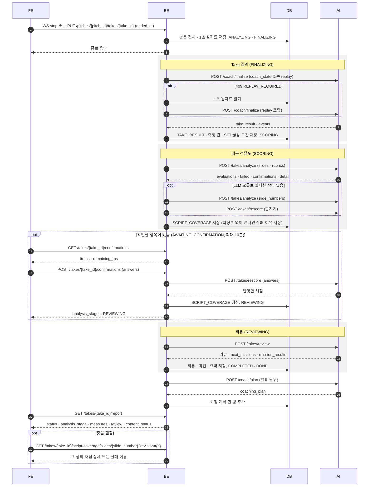

## 개요
* 이 문서는 Take가 끝난 이후, /coach/finalize에서 종료 후, /takes/analyze로 분석, /takes/review로 리뷰를 전달하며 끝으로 /coach/plan으로 다음 coach 계획을 진행하는 과정에 대한 문서입니다.
* AI 호출은 모두 BE가 백그라운드에서 합니다. FE는 Take를 끝낸 뒤 리포트 조회로 진행 상황(`status` · `analysis_stage`)을 확인하고, 확인할 항목이 있을 때만 확인 화면을 거칩니다.
* Take 상태는 `RUNNING` → `ANALYZING` → `COMPLETED` / `FAILED` 로, 분석 단계는 아래 순서로 바뀝니다.

| 분석 단계 (`analysis_stage`) | 뜻 | 다음 단계로 넘기는 곳 |
|---|---|---|
| `FINALIZING` | Take 결과(측정값)를 만드는 중 | `coach/finalize.py` |
| `SCORING` | 대본 전달도를 채점하는 중 | `module/take/service/coverage.py` |
| `AWAITING_CONFIRMATION` | 사용자 확인을 기다리는 중 (최대 10분) | `module/take/service/confirmation.py` |
| `REVIEWING` | 리뷰를 만드는 중 | `module/take/service/analysis_runner.py` |
| `DONE` | 리뷰까지 끝남 (리뷰 실패도 포함) | `module/take/service/review.py` |

## 흐름 순서
1. **Take 종료**: FE가 WS `stop` 을 보내거나, 자동 종료(침묵 · 시간 제한)되거나, 연결이 끊긴 채 끝낸 FE가 `PUT /api/pitches/{pitch_id}/takes/{take_id}` 에 `ended_at` 을 보냅니다. BE는 남은 전사 · 1초 원자료를 저장하고 Take를 `ANALYZING` · `FINALIZING` 으로 적은 뒤 finalize를 백그라운드로 띄웁니다.
2. **Take 결과 만들기 (`/coach/finalize`)**: 발표 중 코치 세션의 `coach_state` 와 마지막 창으로 부릅니다. 세션이 없으면(코칭이 꺼져 있었거나 BE가 다시 떠서 잃음) 처음부터 `replay` 를 붙여 부릅니다.
    * 409 `REPLAY_REQUIRED` 면 DB의 1초 원자료로 `replay` 를 만들어 한 번 더 부릅니다.
    * 성공하면 한 트랜잭션으로 코치 이벤트 · `TAKE_RESULT` · 리포트 측정 칸 · Take 길이 · STT 끊김 구간(`takes.stt_gap_ranges`)을 저장하고 `SCORING` 으로 넘깁니다. 원자료 사용 동의가 없는 Take는 STT 끊김 구간을 남긴 뒤 1초 원자료를 지웁니다.
    * STT 끊김 구간은 1초 기록의 STT 상태가 `ok` 가 아니던 구간(`not_ok`)과 1초 기록이 없던 구간(`unobserved`)입니다. 1초 기록이 하나도 없으면 null(모름)입니다.
    --
    * 끝내 실패하면 Take를 `FAILED` 로 두고 원자료는 7일 동안 남깁니다. 이후 단계는 진행하지 않습니다.
3. **대본 전달도 채점 (`/takes/analyze`)**: Take 결과를 저장하면 분석 실행기(`analysis_runner`)가 시작합니다. 장마다 전사 · 장 길이 · STT 끊김 시간 · 1초 기록이 없던 시간 · 대본 글과 평가 기준(rubric)을 보내 채점합니다.
    * 장 길이와 두 시간은 장 이벤트로 나눈 장 구간과 STT 끊김 구간이 겹친 길이입니다. STT 끊김 구간이 null 이면 셋 다 null 로 보내고, AI 는 지금처럼 채점합니다.
    * 평가 기준이 아직 만들어지는 중이면 최대 5분까지 기다립니다.
    * 실패한 장 중 LLM 오류 코드인 장만 `slide_numbers` 로 한 번 다시 부르고, 결과를 `/takes/rescore` 로 합칩니다. 합치기가 실패하면 리뷰를 보류합니다(`analysis_hold_reason` = `COVERAGE_RESCORE_FAILED`).
    * 모든 장이 실패해도 간이 값이 있으면 AI 는 200 으로 답합니다(`evaluations` 빈 목록). 그대로 확정본으로 저장하고, 리뷰에는 채점 없음(null)으로 보냅니다.
    * 확정본 없이 끝나면 마지막 실패 이유를 `takes.coverage_failure_code` 에 남깁니다(아래 '리포트의 대본 전달도'). 확정본을 저장하면 지웁니다.
4. **사용자 확인 (선택)**: 채점 결과에 확인할 항목(`confirmations`)이 있으면 `AWAITING_CONFIRMATION` 으로 넘깁니다. FE는 항목을 받아 답하거나 건너뜁니다.
    * 답이 있으면 `/takes/rescore` 로 반영한 뒤 `REVIEWING` 으로 넘깁니다. 빈 답은 건너뛰기입니다.
    * 10분 안에 답이 없으면 확인 없이 리뷰로 넘어갑니다.
    * 확인할 항목이 없으면 이 단계를 건너뛰고 바로 `REVIEWING` 으로 넘깁니다.
5. **리뷰 (`/takes/review`)**: Take 결과 · 대본 전달도 · 이전 Take 결과 · 이전 반복 문제 · 이번 Take의 미션 · 사용자 평가 기준을 묶어 보냅니다.
    * 성공하면 한 트랜잭션으로 리뷰 · 다음 미션 · 미션 결과 · 리포트 요약을 저장하고 Take를 `COMPLETED`(`review_status` = `DONE`) · `DONE` 으로 둡니다.
    * 실패하면 Take를 `COMPLETED`(`review_status` = `FAILED`) · `DONE` 으로 둡니다. 측정 결과는 그대로 볼 수 있습니다.
6. **다음 코칭 계획 (`/coach/plan`)**: 리뷰를 저장했거나 리뷰가 실패하면 발표 단위로 다음 Take의 코칭 계획을 요청해 쌓아 둡니다. 다음 Take를 시작할 때 가장 최근 계획을 골라 씁니다. 실패해도 계획 없이 코칭합니다.
7. **복구**: BE가 다시 뜨거나 5분마다 도는 주기 작업이 `FINALIZING` · 분석 중으로 10분 넘게 남은 Take를 찾아 멈춘 단계부터 이어 갑니다.

## 리뷰 전달 파이프라인 도식

## API 명세
* FE -> BE, BE -> AI로 진행하는 API 인터페이스들입니다.
* FE -> BE 경로 앞에는 `/api` 가 붙습니다.

### FE -> BE

| 메서드 | 경로 | 용도 | 요청 | 응답 |
|---|---|---|---|---|
| WS | `/ws/takes/{take_id}` `stop` | 발표를 끝냄 (보통의 종료) | `stop` 메시지 | 마지막 전사까지 저장한 뒤 연결 종료 |
| PUT | `/pitches/{pitch_id}/takes/{take_id}` | 연결이 끊긴 채 발표를 끝냄 | `{started_at?, ended_at?, event_logs?}` | `{message, take_id}` |
| GET | `/takes/{take_id}/report` | 진행 상황 · 리포트 조회 | — | `{take_id, pitch_id, pitch_title, is_demo, take_number, script_mode, ended_at, status, analysis_stage, review_status, analysis_hold_reason, measures, review, content_status}`. `content_status` 는 아래 '리포트의 대본 전달도' |
| GET | `/takes/{take_id}/script-coverage/slides/{slide_number}` | 대본 전달도 장별 상세 (장을 펼칠 때) | `revision` (선택, 리포트 `content_status.revision`) | 아래 '장별 상세' |
| GET | `/takes/{take_id}/confirmations` | 확인할 항목 조회 | — | `{take_id, analysis_stage, remaining_ms, items}`. 확인 대기가 아니면 `items` 가 비고 `remaining_ms` 가 null |
| POST | `/takes/{take_id}/confirmations` | 확인 답 보내기 · 건너뛰기 | `{answers: [{slide_number, item_id, answer: "as_script" \| "as_stt"}]}`. 빈 배열이면 건너뛰기 | `{analysis_stage: "REVIEWING"}` |

### BE -> AI

| 경로 | 부르는 때 | 시간 상한 | 다시 부르기 | 주요 요청 | 주요 응답 |
|---|---|---|---|---|---|
| `POST /coach/finalize` | Take 종료 직후 | 10초 (`replay` 포함이면 60초) | 일시 오류면 1번. 409 `REPLAY_REQUIRED` 면 `replay` 를 붙여 1번 | 상수 · `t_end_ms` · 마지막 창 · `coach_state` 또는 `replay` · 코치 이벤트 | `take_result` · `events` · `meta` |
| `POST /takes/analyze` | Take 결과 저장 뒤 (`SCORING`) | 130초 | 일시 오류면 1번. LLM 오류로 실패한 장만 `slide_numbers` 로 1번 | `take_id` · `slides[{slide_number, stt, duration_ms, stt_gap_ms, stt_unobserved_ms, script}]` · `rubrics` · `slide_numbers` | `evaluations` · `failed` · `confirmations` · `take_scores` · `detail` · `meta` |
| `POST /takes/rescore` | 실패한 장 다시 채점한 결과 합치기, 사용자 확인 답 반영 | 10초 | 일시 오류면 1번 | `take_id` · `evaluations` · `rubrics` · `answers` · `failed` | 반영한 채점 결과 (`/takes/analyze` 와 같은 모양) |
| `POST /takes/review` | `REVIEWING` 이 된 뒤 | 30초 | 일시 오류(연결 실패 · 시간 초과 · 408 · 429 · 5xx)면 1번 | `take_result` · `script_coverage` · `previous_takes` · `previous_recurring_issues` · `missions` · `user_criteria` | `overall_summary` · `score` · `dimensions` · `strengths` · `improvements` · `comparison` · `mission_results` · `criteria_results` · `next_missions` · `recurring_issues` |
| `POST /coach/plan` | 리뷰 저장 뒤 (리뷰 실패 포함) | 30초 | 일시 오류면 1번 | 발표의 대본 · 미션 · 직전 Take 결과 · 직전 리뷰 | `coaching_plan` · `fallback_reason` · `meta` |

## 리포트의 대본 전달도
* 대본 전달도 내용은 AI 가 낸 모양 그대로 전달합니다. BE 는 상태를 정하고, 확정본(`SCRIPT_COVERAGE`)의 `payload.detail` 을 싣거나 장별 채점에서 이름만 골라 싣습니다. 병합 후보(`SCRIPT_COVERAGE_PENDING`)는 읽지 않습니다.
* 필드 뜻과 예시는 AI 계약(#1152, `docs/ai/features/script-coverage-evaluation.md`)에 있습니다.

### `content_status` (리포트 응답)
키는 늘 있고 값은 `{state, reason_code, revision, criteria_version, summary, previous}` 입니다. 위에서부터 먼저 맞는 줄을 씁니다.

| 조건 | `state` | `reason_code` |
|---|---|---|
| Take 상태 `FAILED` | `NOT_MEASURED` | `TAKE_FAILED` |
| 확정본에 `payload.detail` 이 있음 (확인 대기 · 리뷰 보류 중이어도) | `MEASURED` | null |
| 확정본은 있지만 `payload.detail` 이 없음 (예전 결과) | `NOT_MEASURED` | `LEGACY_RESULT` |
| 확정본이 없고 Take 가 `ANALYZING` 이며 분석 단계가 `FINALIZING` · `SCORING` (전체 재시도 중 포함) | `ANALYZING` | null |
| 확정본이 없고 `takes.coverage_failure_code` 가 있음 | `FAILED` | 그 코드 |
| 그 밖 | `NOT_MEASURED` | `NO_RESULT` |

* `summary` 는 확정본 `payload.detail` 그대로, `revision` 은 그 행의 `revision`, `criteria_version` 은 `meta.criteria_versions.script_coverage` 입니다. `MEASURED` 가 아니면 셋 다 null 입니다.
* `previous` 는 리뷰의 이전 Take 와 같은 규칙으로 고른 바로 앞 Take 하나입니다(같은 발표 · `COMPLETED` · 번호가 더 작은 것 중 가장 큰 것). 그 Take 의 확정본에 `payload.detail` 이 있으면 `{take_id, take_number, criteria_version, delivery, contradiction, scope}` 이고, 없으면 null 입니다. FE 는 `criteria_version` 의 기능 버전(`+` 앞)이 같을 때만 비교를 보입니다.
* `previous` 도 `MEASURED` 일 때만 싣습니다. 이번 `criteria_version` 이 없으면 비교하지 않고, 분석이 끝날 때까지 FE 가 리포트를 2초마다 다시 읽기 때문입니다.
* 실패 이유 코드(`takes.coverage_failure_code`)는 AI 에러 본문을 읽지 않고 호출 오류와 상태 코드로만 나눕니다.

| 상황 | 코드 |
|---|---|
| BE 시간 제한(130초) 초과 · 504 | `AI_TIMEOUT` |
| 연결 실패(연결 시간 초과 포함) · 연결이 끊김 · 503 | `AI_UNAVAILABLE` |
| 500 · 502 · 그 밖 5xx · 408 · 429 · 계약에 없는 상태 코드 | `AI_ERROR` |
| 422 (평가 기준 · 대본 글이 모두 없음 등 입력 오류) | `AI_REJECTED` |
| 200 인데 본문을 읽지 못했거나 응답 검사에 걸림 | `AI_INVALID_RESPONSE` |

### 장별 상세
`GET /takes/{take_id}/script-coverage/slides/{slide_number}?revision={n}`. 권한은 리포트와 같습니다. 본문에 사용자 발화(`stt_sentences`)가 있어 Take 주인만 읽고, 로그에 남기지 않습니다.

| 응답 | 조건 |
|---|---|
| 200 | `{take_id, revision, slide_number, state, detail, offscript, failure, sentences, key_points, critical_facts, stt_sentences}` |
| 404 `TAKE_NOT_FOUND` | 리포트와 같음 |
| 404 `COVERAGE_NOT_FOUND` | 확정본 없음 |
| 409 `COVERAGE_REVISION_CHANGED` | `revision` 을 줬는데 지금 확정본 `revision` 과 다름. 장을 찾기 전에 봅니다. FE 는 리포트를 다시 읽습니다 |
| 404 `SLIDE_NOT_FOUND` | 그 장이 확정본의 `evaluations` · `failed` 어디에도 없음 |

* `state`: `evaluations` 에 있으면 `SCORED`, `failed` 에 있고 `fallback` 이 있으면 `ESTIMATED`, 없으면 `FAILED` 입니다.
* `SCORED` 면 그 장 채점에서 아래 이름만 골라 싣고 `failure` 는 null 입니다. 저장본에 없는 키는 null 로 채워 늘 둡니다(예전 결과에는 `expression_mode` 가 없습니다).
    * `sentences[]`: `sentence_index` · `text` · `role` · `status` · `expression_mode` · `reason` · `evidence` · `units[]`(`unit_id` · `text` · `status`, 없으면 `[]`)
    * `key_points[]`: `key_point_id` · `content` · `importance` · `status` · `reason` · `evidence`
    * `critical_facts[]`: `fact_id` · `type` · `value` · `stt_value` · `status`
    * `stt_sentences` · `detail` · `offscript`
* `ESTIMATED` · `FAILED` 면 `failure` 에 그 `failed[]` 항목의 `{error, fallback}` 을 싣습니다. `fallback` 키가 없는 예전 항목은 null 입니다. 목록 칸은 `[]`, `detail` · `offscript` 는 null 입니다.
* 채점 payload 는 수 MB 일 수 있어 그 장 항목만 DB 에서 꺼냅니다(`jsonb_path_query_first`).
