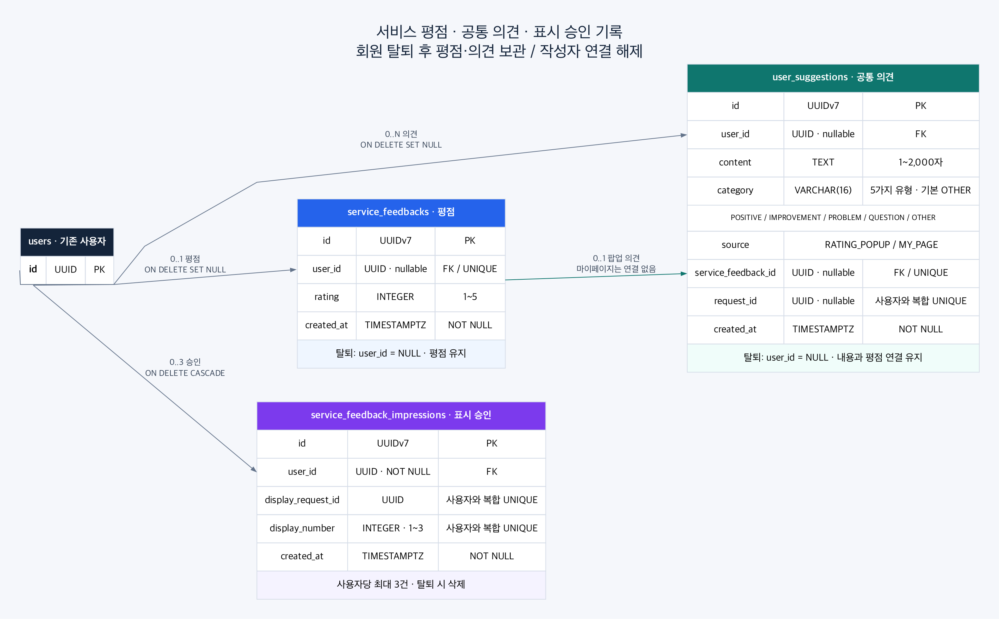
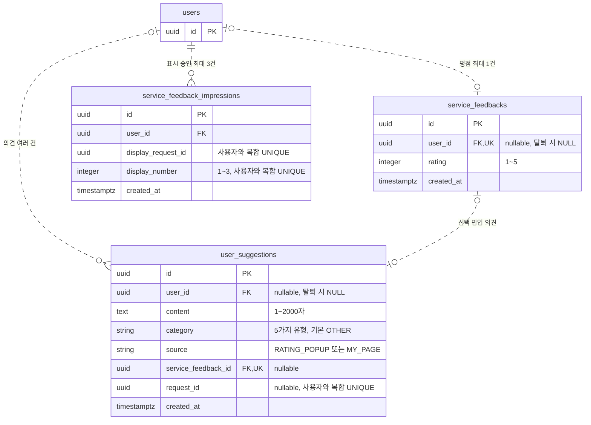

# 평점 팝업·마이페이지 의견 보내기 BE 작업 계획 (#540)

- 작성일: 2026-10-26 / 재검토: 2026-10-27
- 관련 이슈: [#540](https://github.com/kakaotechcampus-4/ktc4-pusan-2/issues/540)
- 계획 검토 기준: `refactor/be-stream-split`, `fc5fd312`
- 구현 기준: `origin/develop-next`, `e6c9b365` / `feat/be-service-feedback-540`
- BE 작업 이슈: [#575](https://github.com/kakaotechcampus-4/ktc4-pusan-2/issues/575)
- 상태: 이 계획에 따라 BE API·테이블·관리자 조회·테스트를 구현했다. 검증 결과는 아래 구현 결과에 기록한다.

## 1. 재검토 결과

기능에 필요한 기록만 저장하고, 동시 요청과 재시도는 기존 DB 트랜잭션으로 처리한다.

| 검토한 문제 | 개선한 설계 | 이유 |
|---|---|---|
| 누적 횟수와 노출 기록을 별도 저장 | 신규 테이블을 4개에서 3개로 줄이고 노출 기록의 `COUNT(*)`로 횟수 계산 | 사용자당 최대 3행이라 별도 카운터의 이점이 작고 값이 어긋날 위험이 있음 |
| 잠금을 위해 사용자별 상태 행 생성 | 기존 `users` 행을 잠금 기준으로 사용 | 최초 상태 행 생성·충돌 처리와 상태 전용 테이블 제거 |
| 홈에서 상태 조회 후 표시 승인 요청 | 홈 진입 시 표시 승인 POST 한 번 호출 | 사전 GET은 승인을 보장하지 못하므로 필수 흐름에서 제외 |
| 잠금 뒤에도 평점 UPSERT·충돌 재조회 반복 | 사용자 잠금 → 기존 평점 확인 → 일반 INSERT | 같은 사용자 작업이 이미 직렬화되어 중복 분기 불필요. UNIQUE는 유지 |
| 평점·의견의 재시도 비교가 불명확 | 기존 평점과 연결된 팝업 의견만 비교 | 마이페이지 의견을 나중에 보냈어도 팝업 재시도 결과가 바뀌면 안 됨 |
| 표시 기록이 복합 PK | 다른 신규 테이블처럼 UUIDv7 PK 사용, 요청 ID는 복합 UNIQUE | 저장소의 PK 관례를 따르고 멱등 키와 PK의 역할을 구분 |
| 관리자용 커서 형식까지 선행 설계 | 기존 콘솔에 맞춘 `limit`·`offset` 조회 | 초기 운영 조회에 별도 커서 인코딩·파싱까지 필요하지 않음 |
| 승인과 실제 화면 표시를 같은 의미로 표현 | 서버 승인 횟수와 실제 표시의 차이를 명시 | 탭 종료·응답 유실 상황에서 보장 가능한 범위를 정확히 설명 |

## 2. 확정 요구와 범위

### 홈 팝업

- 본인에게 남아 있는 리포트가 하나 이상이고 아직 서비스 별점을 제출하지 않은 사용자가 대상이다.
- 홈 진입 시 표시하며 사용자당 최초 포함 최대 3회다. 기간 제한 없이 모든 탭·기기에서 합산한다.
- 별점은 정수 1~5점 필수, 의견은 선택이다. 별점은 사용자당 한 번 제출한다.
- 닫기·나중에·Escape·제출 실패 후 이탈도 승인한 1회를 사용한다. 제출 성공 후 자동 요청을 중단한다.
- 같은 팝업의 제출 재시도는 새 노출이 아니다. 세 번째 팝업에서도 제출·재시도할 수 있다.

### 마이페이지 의견

- 인증 사용자라면 리포트가 없거나 이미 별점을 제출했거나 팝업을 3회 봤어도 의견을 보낼 수 있다.
- 별점 없이 의견을 여러 번 보낼 수 있다. 새 제출은 새 행을 만든다.
- 의견만 보내도 평점 완료 여부나 팝업 노출 횟수는 바뀌지 않는다.
- 의견 내용은 앞뒤 공백 제거 후 1~2,000자 필수다.

평점은 서비스 만족도이며 Take 점수·AI 리뷰와 구분한다. 평점 수정, 의견 수정·삭제, 운영자 답변,
푸시·실시간 기기 동기화, 노출 기록의 만료·초기화는 이번 범위에 넣지 않는다.

### 기존 이슈와의 차이

2026-10-26에 읽은 이슈와 [FE 댓글](https://github.com/kakaotechcampus-4/ktc4-pusan-2/issues/540#issuecomment-6409043739)은
리포트를 읽은 뒤 이동할 때 별점만 받는 흐름이다. 이번 사용자 요청을 우선해 아래 차이를 FE에 전달한다.

| 항목 | 이번 계획 |
|---|---|
| 위치·시점 | 리포트 이탈 시점에서 홈 진입 시점으로 변경 |
| 대상 | 첫 Take·리포트 읽음 여부 대신 현재 리포트 보유 여부 |
| 입력 | 팝업 선택 의견과 마이페이지 의견 접수 추가 |
| 재노출 | 기존과 동일하게 사용자당 최초 포함 최대 3회 |
| Take 연결 | 서비스 평점·의견에 특정 Take FK를 두지 않음 |

이 문서가 원격 이슈나 FE 계약을 이미 바꾼 것은 아니다. 구현 착수 시 변경점을 공유한다.

## 3. 현재 코드와 리포트 판정

| 확인한 위치 | 현재 상태·구현에 반영할 점 |
|---|---|
| [user/entity.py](../../backend/src/pitch_coach_backend/module/user/entity.py) | 기존 사용자 테이블 사용. 별점 여부·노출 카운터 컬럼은 추가하지 않음 |
| [user/service.py](../../backend/src/pitch_coach_backend/module/user/service.py), [repository.py](../../backend/src/pitch_coach_backend/module/user/repository.py) | 공개 service를 거쳐 사용자 행 잠금을 추가할 위치. 이 함수는 commit하지 않음 |
| [pitch/service/pitch.py](../../backend/src/pitch_coach_backend/module/pitch/service/pitch.py) | 기존 `get_pitch_ids_of_user()`로 본인 발표 범위를 구할 수 있음 |
| [take/entity.py](../../backend/src/pitch_coach_backend/module/take/entity.py) | 별도 `reports` 테이블이 없고 Take·AI 결과로 보유 여부를 판단해야 함 |
| [리뷰 실패 테스트](../../backend/tests/test_take_review_failures.py) | AI 리뷰 실패여도 `COMPLETED`이며 `TAKE_RESULT`는 남을 수 있음 |
| [admin/controller.py](../../backend/src/pitch_coach_backend/module/admin/controller.py) | 기존 Basic 인증과 BE 소유 정적 콘솔을 재사용 |
| [backend/README.md](../../backend/README.md) | 도메인 간에는 service만 호출. controller → service → repository → entity 방향 유지 |

리포트 보유는 다음 조건을 모두 만족하는 Take의 존재로 판정한다.

1. Take의 Pitch 소유자가 인증 사용자다.
2. `takes.status = 'COMPLETED'`다.
3. 해당 Take에 `take_ai_results.kind = 'TAKE_RESULT'`가 존재한다.

`READY`·`RUNNING`·`ANALYZING`·`FAILED` 또는 결과 없는 완료 Take는 제외한다.
AI 리뷰가 `FAILED`·`SKIPPED`여도 위 조건을 만족하면 포함한다. 점수·AI 리뷰 성공·리포트 읽음은 추가 조건이 아니다.
Pitch·Take를 모두 삭제하면 미평가자는 대상에서 빠진다. 새 리포트가 생겨도 이미 사용한 노출 횟수는 유지한다.

계획을 검토했던 커밋에는 리포트 조회 API가 없었지만 구현 기준인 `origin/develop-next`에는
`GET /api/takes/{take_id}/report`가 있다. 기존 API는 유지하고 DB의 완료 상태·결과 존재로 대상을 판정한다.
팝업의 실제 운영 활성화 전에는 FE와 홈 진입 트리거·리포트 표시 범위를 확인한다.
BE 평가 기능 완료와 이슈 전체 완료를 구분한다.

## 4. DB: 신규 테이블 3개

모두 `module/service_feedback/`에서 관리한다. 평점과 의견은 별도 테이블로 나누되 같은 트랜잭션에서 저장할 수 있게 한다.

| 테이블 | 역할 | 사용자당 건수 |
|---|---|---|
| `users` | 기존 사용자·동시 요청의 잠금 기준 | 기존 1건 |
| `service_feedbacks` | 서비스 별점 | 0~1건 |
| `user_suggestions` | 팝업·마이페이지 공통 의견 | 0~N건 |
| `service_feedback_impressions` | 팝업 표시 요청 승인·재시도 확인 | 0~3건 |

`display_count`는 응답용 계산 값이다. 저장 컬럼이나 누적 횟수 전용 테이블을 만들지 않는다.

### ERD



이미지 원본은 `images/service-feedback-erd.dot`이며 `dot -Tpng -Gdpi=150`으로 다시 만들 수 있다.



`users`에는 관계에 필요한 PK만 표시했다. PK는 기본 키, FK는 외래 키, UK는 단일 컬럼 UNIQUE다.
ERD의 다건 표기 자체는 3건 상한을 표현하지 않으므로 아래 CHECK·UNIQUE를 함께 적용한다.

### `service_feedbacks`

| 컬럼 | 타입·제약 |
|---|---|
| `id` | UUIDv7 PK, 기존 `UUIDPrimaryKeyMixin` |
| `user_id` | nullable UUID, UNIQUE, FK → `users.id`, `ON DELETE SET NULL` |
| `rating` | Integer NOT NULL, `CHECK (rating BETWEEN 1 AND 5)` |
| `created_at` | timestamptz NOT NULL, 기존 `CreatedAtMixin` |

평가 완료 여부는 이 행의 존재로 판정한다. `users.has_rated`는 두지 않는다.

### `user_suggestions`

| 컬럼 | 타입·제약 |
|---|---|
| `id` | UUIDv7 PK, 기존 mixin |
| `user_id` | nullable UUID, FK → `users.id`, `ON DELETE SET NULL` |
| `content` | Text NOT NULL, `CHECK (char_length(content) BETWEEN 1 AND 2000)` |
| `category` | String(16) NOT NULL, 다섯 유형 CHECK, 기본값 `OTHER` |
| `source` | String NOT NULL, `RATING_POPUP`·`MY_PAGE` CHECK |
| `service_feedback_id` | nullable UUID, UNIQUE, FK → `service_feedbacks.id`, `ON DELETE CASCADE` |
| `request_id` | nullable UUID, `(user_id, request_id)` UNIQUE |
| `created_at` | timestamptz NOT NULL, 기존 mixin |

출처별 조합도 CHECK로 제한한다.

```sql
CHECK (
    (source = 'RATING_POPUP' AND service_feedback_id IS NOT NULL AND request_id IS NULL)
    OR
    (source = 'MY_PAGE' AND service_feedback_id IS NULL AND request_id IS NOT NULL)
)
```

팝업 의견은 서버가 같은 요청에서 만든 본인 평점에만 연결한다. 의견이 없으면 의견 행도 만들지 않는다.
평점 하나에 팝업 의견은 최대 한 건이며 마이페이지 의견은 평점과 연결하지 않는다.
`user_id`·`source`·평점 연결 ID는 서버가 채운다. 기존 평점에 나중에 팝업 의견을 추가하는 API는 두지 않는다.

### `service_feedback_impressions`

| 컬럼 | 타입·제약 |
|---|---|
| `id` | UUIDv7 PK, 기존 mixin |
| `user_id` | UUID NOT NULL, FK → `users.id`, `ON DELETE CASCADE` |
| `display_request_id` | UUID NOT NULL, `(user_id, display_request_id)` UNIQUE |
| `display_number` | Integer NOT NULL, 1~3 CHECK, `(user_id, display_number)` UNIQUE |
| `created_at` | timestamptz NOT NULL, 기존 mixin |

승인한 요청만 저장한다. `display_number`가 NOT NULL이고 1~3 중 하나이며 사용자 안에서 유일하므로
DB에서도 사용자당 최대 3행을 제한한다. 단순히 `COUNT(*) < 3`을 확인하는 것만으로 동시성을 보장하지 않는다.
기록을 개별 삭제하거나 TTL로 지우지 않는다. 지우면 사용한 횟수와 재시도 판별 정보가 사라진다.

각 UNIQUE는 자동 생성되는 인덱스를 활용한다. 같은 컬럼의 중복 인덱스는 추가하지 않는다.
관리자 최신순 조회에 사용하는 평점·의견 테이블에는 `(created_at, id)` 인덱스를 둔다.
회원 탈퇴 시 평점·의견은 삭제하지 않고 `user_id`를 NULL로 바꿔 작성자 연결을 해제한다.
평점과 팝업 의견의 연결·내용·제출 시각은 유지한다. 표시 승인 기록만 CASCADE로 삭제한다.
NULL 사용자끼리는 UNIQUE 충돌이 나지 않으므로 여러 탈퇴자의 평점·의견을 함께 보관할 수 있다.
관리자 응답의 `user_id`는 nullable이며 화면에 “탈퇴한 사용자”로 표시한다.
재가입은 새 사용자 ID로 처리하며 보관한 평가를 새 계정에 자동 연결하지 않는다.
기존 사용자 백필은 없으며 리포트 삭제는 평점·의견·노출 기록을 지우지 않는다.

이미 추가한 `f54000000001`은 수정하지 않고 `f54000000002`에서 NULL 허용·FK 동작을 변경한다.
보관 데이터가 있는 상태에서는 NOT NULL·CASCADE로 되돌리는 downgrade를 거절해 자료 유실을 막는다.

## 5. 동시 처리·트랜잭션

### 표시 승인과 평점 제출의 공통 잠금

두 API 모두 기존 `users`의 본인 행에 `SELECT ... FOR UPDATE`를 건 뒤 업무 조회·저장을 수행한다.
사용자 도메인에 공개 잠금 함수를 추가하고 평가 도메인은 그 service만 호출한다.
함수는 매번 SQL을 실행해 잠금을 얻어야 하며 인증 단계에서 읽은 ORM 객체를 그대로 반환하는 것으로 대신하지 않는다.

- 같은 요청의 DB 세션과 트랜잭션을 끝까지 사용한다. 인증 조회로 이미 시작한 트랜잭션 안에 새 `db.begin()`을 중첩하지 않는다.
- 잠금 순서는 사용자 → 평가·노출 기록으로 통일한다. 승인·평점 저장은 commit 성공 후에만 성공 응답한다.
- 잠금 동안 AI·외부 HTTP·파일 I/O를 호출하지 않는다. 다른 도메인 service가 중간 commit하지 않게 한다.
- 승인 거절·이미 제출·재전송 응답도 트랜잭션을 끝내 잠금을 즉시 해제한다. 예외 경로는 rollback한다.
- 잠금 대기 뒤 사용자가 사라졌으면 401로 처리한다. 이미 읽은 사용자 객체만으로 저장하지 않는다.

PostgreSQL 17의 기본 `READ COMMITTED`를 전제로, 잠금 **이후 별도 SQL**로 평점·노출을 조회한다.
잠금 전 조회 값이나 오래된 ORM 관계 캐시를 판단에 쓰지 않는다.
서로 다른 사용자는 서로 다른 행을 잠가 처리한다.
동시성 테스트에서 `SHOW transaction_isolation`이 `read committed`인지 확인한다.
이 방식은 [행 잠금](https://www.postgresql.org/docs/17/explicit-locking.html#LOCKING-ROWS)과
[READ COMMITTED의 문장별 가시성](https://www.postgresql.org/docs/17/transaction-iso.html#XACT-READ-COMMITTED)을 활용한 설계다.

### 최대 3회와 제출 경쟁

| 상황 | 순서와 결과 |
|---|---|
| 현재 2회, 서로 다른 표시 요청 A·B | A가 잠금 → 3번째 행 저장·commit → B가 잠금 → 3행 확인 후 거절 |
| 같은 표시 요청의 재전송 | 기존 `(user_id, display_request_id)`를 찾아 새 행 없이 처리 |
| 평점 제출이 먼저 commit | 이후 표시 승인 요청은 제출 완료로 거절 |
| 표시 승인이 먼저 commit | 이미 승인한 팝업은 열릴 수 있음. 이후 평점 제출이 새 표시 승인을 차단 |
| 평점과 팝업 의견 중 한 저장 실패 | 둘 다 rollback. 평점 완료로 처리하지 않음 |

마이페이지 의견은 노출과 독립적이므로 이 사용자 잠금을 사용하지 않는다.
`(user_id, request_id)` UNIQUE와 `ON CONFLICT DO NOTHING` 후 기존 내용 비교로 같은 요청만 중복 방지한다.
다른 DB 오류를 중복 성공으로 숨기지 않는다.
마이페이지 저장이 회원 탈퇴와 경쟁해 사용자 FK 위반으로 실패하면 rollback 후 사용자 service로 존재를 재확인한다.
실제로 탈퇴한 경우에만 401로 변환하고, 다른 제약 위반·DB 오류를 인증 오류로 바꾸지 않는다.

## 6. API 계약안

일반 API는 `CurrentUser` Bearer 인증을 사용한다.
의견에는 `category`를 추가한다. 전송 위치를 뜻하는 `source`와 별개이며 하나의 의견에 유형 하나를 저장한다.

| `category` | 화면 의미 |
|---|---|
| `POSITIVE` | 좋았던 점 |
| `IMPROVEMENT` | 개선할 점 |
| `PROBLEM` | 문제가 있었던 점 |
| `QUESTION` | 질문 |
| `OTHER` | 기타 |

Python `SuggestionCategory(StrEnum)`으로 검증하고 DB에는 저장소 관례대로 문자열+CHECK를 사용한다.
팝업·마이페이지 요청에서 생략하면 `OTHER`이며 null·알 수 없는 값은 422다.
`f54000000003`이 기존 의견도 `OTHER`로 채운다. 팝업에 의견이 없으면 유형만 별도로 저장하지 않는다.
같은 내용이어도 유형을 바꾸어 재전송하면 기존 평점 409 또는 의견 요청 충돌 409이며 덮어쓰지 않는다.
 DTO는 미정의 필드를 거절한다.
별점은 엄격한 정수 1~5만 받고 문자열·실수·불리언은 거절한다.
의견은 저장 가능한 UTF-8인지 검증하고 NUL·잘못된 유니코드를 거절한 뒤 앞뒤 공백을 제거한다.
정규화한 내용의 길이를 검사하며 팝업의 생략·null·공백은 모두 의견 없음으로 비교한다.
기존 [문자열 검증](../../backend/src/pitch_coach_backend/core/validation.py)은 NUL만 검사하므로 UTF-8 저장 가능 검사도 보완해야 한다.

| 메서드·경로 | 역할 | 최초 성공·재전송 |
|---|---|---|
| `POST /api/service-feedback/impressions` | 홈의 표시 승인과 기록 | 200 |
| `POST /api/service-feedback` | 별점과 선택 팝업 의견 저장 | 201 / 같은 내용은 200 |
| `POST /api/suggestions` | 마이페이지 의견 저장 | 201 / 같은 ID·내용은 200 |
| `GET /api/service-feedback/me` | 읽기 전용 상태 확인 | 200, 홈 표시 전 필수 호출 아님 |

### 홈 표시 승인

```json
{"display_request_id": "6a7e3e8c-021c-4ab4-8e72-20d47fa34e61"}
```

잠금 후 처리 순서는 다음과 같다.

1. 평점이 있으면 `ALREADY_SUBMITTED`로 거절한다.
2. 동일 표시 요청의 승인 기록을 찾고 현재 기록 개수를 센다.
3. 신규 요청이고 이미 3행이면 `DISPLAY_LIMIT_REACHED`로 거절한다.
4. 본인 리포트가 없으면 `NO_REPORT`로 거절한다.
5. 기존 승인 요청이면 행 추가 없이 허용한다. 신규 요청이면 `display_number = 기록 개수 + 1`로 추가·commit한다.

```json
{
  "should_open": true,
  "submitted": false,
  "display_count": 3,
  "display_limit": 3,
  "reason": null
}
```

모든 정상 판단은 200으로 반환한다. 거절도 같은 구조에 `should_open=false`와 위 `reason`을 사용한다.
`submitted`는 평점 존재 여부이고, `display_count`는 현재 기록 개수다.
거절은 행을 만들지 않는다. 세 번째 승인의 `display_count=3`을 보고 FE가 다시 차단하면 안 된다.

동일 ID의 재전송은 저장을 중복하지 않는다. 다만 이후 평점을 제출했거나 리포트를 삭제했다면
현재 상태에 따라 열기를 거절하므로 과거 응답 본문까지 항상 같다는 보장은 아니다.

이 기능은 **서버가 승인한 서로 다른 표시 요청을 최대 3개로 제한**한다.
화면을 열기 직전 승인받고 같은 방문에서 같은 승인을 한 번만 사용하는 것은 FE 책임이다.
commit 후 응답 유실·탭 종료가 발생하면 실제 표시하지 못해도 1회가 소비될 수 있다.
같은 ID로 재시도하되 자동 환불·표시 완료 ACK·예약 만료 처리는 넣지 않는다.
이는 승인 횟수 보장과 실제 UI 표시 사이의 한계다.

### 평점 제출

```json
{"rating": 4, "suggestion": "리포트에서 지난 연습과 비교하기가 더 쉬우면 좋겠어요.", "category": "IMPROVEMENT"}
```

사용자 잠금 후 기존 평점이 있으면 **별점과 그 평점에 연결된 팝업 의견의 내용·유형만** 비교한다.
같으면 200, 다르면 409다. 기존 행 확인을 리포트 검사보다 먼저 해 성공 요청의 재전송을 보장한다.

신규 제출이면 현재 본인 리포트 존재를 확인하고 평점을 INSERT한다.
평점을 flush해 생성된 ID를 확보하고 의견이 있으면 `RATING_POPUP` 의견도 INSERT한 뒤 한 번 commit한다.
중간 commit은 하지 않는다.
잠금으로 순서를 보장하므로 평점 저장에 UPSERT·충돌 후 재조회 분기를 중복 구현하지 않는다. DB UNIQUE는 유지한다.

```json
{"submitted": true, "rating": 4, "created_at": "2026-10-27T06:00:00Z"}
```

노출 3회와 승인 기록 유무는 평점 제출의 거절 조건이 아니다.
리포트 존재는 제출 트랜잭션의 조회 시점 기준이며 이후 삭제가 저장한 평가를 취소하지 않는다.

### 마이페이지 의견

```json
{
  "request_id": "9745c85a-8155-463e-a8e6-633d40066936",
  "content": "발표 기록을 날짜별로 찾아볼 수 있으면 좋겠어요.",
  "category": "IMPROVEMENT"
}
```

서버가 `user_id`와 `source=MY_PAGE`를 채운다. 리포트·평점·노출을 조회·변경하지 않는다.
같은 사용자·요청 ID·정규화한 내용·유형은 기존 결과를 반환하고, 같은 ID에 다른 내용이나 유형은 409다.
새 ID이면 같은 내용이라도 의도적인 새 의견으로 저장한다. 다른 사용자의 동일 UUID와는 충돌하지 않는다.

```json
{"id": "24f4ea6e-086b-4e42-9659-f1e76d3ee898", "source": "MY_PAGE", "category": "IMPROVEMENT", "created_at": "2026-10-27T06:00:00Z"}
```

### 읽기 전용 상태

```json
{"has_report": true, "submitted": false, "display_count": 1, "display_limit": 3, "should_prompt": true}
```

`should_prompt = has_report && !submitted && display_count < 3`이다. GET은 DB를 변경하거나 행을 잠그지 않는다.
조회 시점의 참고 값이며 표시 권한은 POST가 판단한다. 사용자별 상태 응답에 `Cache-Control: no-store`를 적용한다.

### 오류·입력 보존

| 상황 | 응답·처리 |
|---|---|
| 미인증·만료·탈퇴한 사용자 | 401, 기존 인증 오류 |
| 별점·의견·UUID·추가 필드 검증 실패 | 422 `VALIDATION_ERROR` |
| 신규 평점인데 본인 리포트 없음 | 409 `SERVICE_FEEDBACK_NOT_ELIGIBLE` |
| 기존 평점과 다른 별점·팝업 의견 제출 | 409 `SERVICE_FEEDBACK_ALREADY_SUBMITTED` |
| 같은 마이페이지 요청 ID에 다른 내용 | 409 `SUGGESTION_REQUEST_CONFLICT` |
| DB 실패·결과를 알 수 없는 통신 실패 | 성공으로 추정하지 않고 같은 요청을 재시도 |

오류는 기존 `{ "code": "...", "message": "...", "detail": null }`을 따르되 422의 detail은 기존 필드 오류 목록이다.
성공 응답에는 의견 원문을 반복하지 않는다. 입력 원문을 애플리케이션 로그로 남기지 않는다.

## 7. FE 연동과 운영자 조회

### FE 담당에게 요청할 작업

FE 파일은 BE에서 수정하지 않는다. 아래 내용을 전달할 계약으로 정리한다.

- 홈 화면·인증이 준비되면 표시 승인 POST를 한 번 호출한다. 필수 사전 GET·별도 타이머는 두지 않는다.
- 홈 방문마다 `display_request_id`를 한 번 생성하고 중복 effect·쿼리 재실행·네트워크 재시도에서 유지한다.
  재시도 응답도 같은 방문에서 팝업을 두 번 열지 않게 한다. 다른 탭의 방문은 별도 ID를 사용한다.
- 승인 재시도는 GET의 `should_prompt`가 false여도 기존 ID로 가능해야 한다. 세 번째 승인의 응답 유실을 복구하기 위해서다.
- 승인 실패·거절은 홈 이용을 막지 않는다. 포커스 복귀·재렌더만으로 새 ID를 만들지 않는다.
- 팝업·마이페이지는 선택한 `category`를 내용과 함께 전송하고 재시도에도 같은 유형을 유지한다.
- 팝업 제출 실패 시 별점·의견을 유지하고 닫기·재시도를 허용한다. 별점 제출 재시도는 표시 API를 다시 부르지 않는다.
- 평점 이미 제출 409는 상태를 갱신하고 종료한다. 마이페이지 요청 충돌 409는 저장 성공으로 취급하거나 자동 새 ID로 바꾸지 않는다.
- 마이페이지는 내용만 필수로 받고 요청 ID는 제출 버튼을 누를 때 한 번 만든다. 응답 유실 재시도에서는 같은 ID·내용을 유지한다.
  성공 후 입력을 비우고 다음 의견부터 새 ID를 사용한다. 새 ID·수정한 내용으로 보내면 별도 의견이 될 수 있음을 구분한다.
- 계정 전환 시 이전 사용자 캐시·진행 중 승인·입력을 분리하고 늦게 온 이전 사용자 응답을 적용하지 않는다.
- 키보드·Escape·포커스 복귀·모바일을 확인한다. 다음 Take의 기존 장치 점검 이동과 Take 생성 시점은 유지한다.

이미 승인한 다른 탭의 팝업을 즉시 닫거나 여러 탭 중 한 곳에만 모달을 여는 기능은 포함하지 않는다.
여러 탭이 각각 승인받아도 사용자 전체 승인 기록은 3개를 넘지 않아야 한다.

### BE 관리자 콘솔

기존 `require_admin`과 BE 소유 `admin/static/`을 재사용한다.

| API | 반환·필터 |
|---|---|
| `GET /admin/api/service-feedbacks` | 평점·연결된 팝업 의견·제출 시각·사용자 ID |
| `GET /admin/api/suggestions` | 의견·출처·평점 연결 ID·제출 시각·사용자 ID, 선택 `source`·`category` 필터 |

공통으로 `limit` 기본 50·최대 200, `offset` 기본 0·최소 0, `(created_at DESC, id DESC)` 정렬을 사용한다.
응답은 `items`·`next_offset`이며 `limit+1`건 조회로 다음 페이지 존재를 판단해 마지막에는 null을 반환한다.
초기 운영 조회이므로 동시 삽입 중 페이지 이동의 스냅샷 일관성·내보내기는 보장하지 않는다.
의견 원문은 `textContent`로 표시하고 이메일 등 불필요한 개인정보를 추가하지 않는다.
평점 목록의 팝업 의견은 한 번에 조인해 N+1 조회를 피한다. 관리자 미설정 404·잘못된 인증 401 규칙을 유지한다.

## 8. 구현 순서와 파일

| 순서 | 변경 대상·작업 | 끝났다고 볼 기준 |
|---|---|---|
| 1 | FE와 위치·리포트 기준·마이페이지 계약 공유 | 기존 이슈와의 차이 확인 |
| 2 | `module/service_feedback/{entity,repository,service,dto,exception,controller,__init__}.py` | 신규 3개 테이블과 공개 함수·라우터 구성 |
| 3 | `module/user/{repository,service}.py` | 본인 행을 잠그는 공개 함수, commit하지 않음 |
| 4 | `module/take/service/take.py`, `module/take/repository.py` | 본인 발표 ID 목록으로 완료 결과 존재 여부 조회 |
| 5 | `entities.py`, `main.py`, Alembic revision | 엔티티 등록·일반 API `/api` 라우터 연결·단일 head |
| 6 | `module/admin/`·`static/` | 인증된 운영자 평점·의견 조회 |
| 7 | 테스트·`backend/README.md`·이 문서 | 검증 통과·실제 구현 계약 반영 |

의존 방향은 `service_feedback.service → user/pitch/take.service`다.
본인 발표 ID는 기존 pitch service로 구하고 take service의 공개 존재 조회 함수에 전달한다.
발표가 없으면 false, 결과 조회는 `EXISTS`로 처리하며 AI payload나 발표별 결과를 반복 로드하지 않는다.
현재 규모에서는 이 두 단계로 시작하고 소유권 조인을 위해 다른 도메인 entity를 직접 import하지 않는다.
라우터는 같은 모듈에서 `/service-feedback`와 `/suggestions`를 각각 내보내며 `/api`는 `main.py`에서만 붙인다.

실제 구현 시 최신 `origin/develop-next`·마이그레이션 head를 다시 확인한다. 확인 커밋의 head를 고정해 쓰지 않는다.
다른 사람의 열린 PR에 의존이 생기면 저장소 지침대로 구현 기준을 먼저 정한다.
평점·의견 기능에 AI 분석 상태나 payload 변경은 필요하지 않다.

## 9. 검증·완료 기준

새 테스트는 `tests/test_service_feedback_entity.py`, `tests/test_service_feedback.py`,
`tests/test_service_feedback_concurrency.py`, `tests/test_user_suggestions.py`를 제안한다.
관리자 조회와 탈퇴 후 보관은 `tests/service_feedback/`에서 검증한다. 기존 회원 탈퇴의 인증·삭제 계약은 `tests/auth/test_withdraw.py`를 유지한다.

| 검증 | 반드시 확인할 결과 |
|---|---|
| 대상 | 리포트·평점 유무 × 승인 0~3회, 다른 사용자 결과 제외, 결과 없는 완료·분석 중·Take 실패 제외 |
| 측정 결과 | AI 리뷰 실패·건너뜀이어도 완료 Take와 `TAKE_RESULT`가 있으면 대상 |
| DB 제약 | 평점 중복·범위·의견 출처 조합·요청 UNIQUE·표시 번호 0/4/중복을 DB가 거절 |
| 3회 제한 | 1~3번째 승인, 4번째 새 요청 거절, GET·제출 재시도·닫기로 추가 기록 없음 |
| 표시 재시도 | 같은 ID 한 행, 세 번째 응답 유실 후 같은 ID 재승인, 새로 평점 제출·리포트 삭제 시 열기 거절 |
| 동시 표시 | 2행에서 여러 독립 연결 요청 → 추가 1행·총 3행, 같은 ID의 경쟁 → 한 행 |
| 표시·평점 경쟁 | 평점 먼저 commit하면 승인 거절, 승인 먼저면 최대 3행 유지 후 평점 성공 |
| 평점 재시도 | 같은 별점·팝업 의견은 200, 다른 내용은 409, 마이페이지 의견이 추가돼도 기존 비교 동일 |
| 원자성 | 팝업 의견 저장 실패 시 평점도 없음, 노출 INSERT 실패 시 사용 횟수 증가 없음 |
| 마이페이지 | 리포트 없음·기평가·3회 승인 후에도 접수, 평점·노출 불변, 새 요청은 새 행 |
| 의견 재시도 | 같은 ID·내용 한 행, 같은 ID·다른 내용 409, 사용자별 ID 격리, 동시 재전송 한 행 |
| 입력 | 엄격한 1~5 정수, 의견 공백 정규화·1/2000/2001자·NUL·잘못된 유니코드·추가 필드 |
| 삭제·인증 | 리포트 삭제 후 승인 횟수 유지, 탈퇴 시 평점·의견 보관/작성자 연결 해제·표시 기록 삭제, 미인증·만료·탈퇴 후 요청 401, 마이페이지 저장과 탈퇴 경쟁 시 FK 오류를 500으로 노출하지 않음 |
| 관리자·FE | 관리자 인증·출처 필터·offset·정렬·텍스트 출력, 홈 방문당 1회 열기·계정 전환·오류 후 재시도 |

동시성 테스트는 savepoint fixture 하나를 여러 작업에서 공유하지 않는다.
테스트 전용 DB에 준비 데이터를 commit하고 독립 연결·세션을 사용한다.
이벤트·배리어와 제한 시간을 사용해 두 경쟁 순서를 재현하며 단순 sleep에 기대지 않는다.
테스트 데이터는 finally에서 정리한다. SQLite나 mock으로 PostgreSQL 잠금을 검증했다고 처리하지 않는다.

구현 검증은 `backend/`에서 저장소·CI 규칙에 따라 실행한다.

```bash
uv run ruff check src
uv run python -c "import pitch_coach_backend.main"
uv run alembic heads
```

head 하나를 확인하고 **별도 빈 임시 DB를 지정한 상태에서만** 다음을 수행한 뒤 임시 DB를 삭제한다.
개발·운영 DB를 비우지 않는다.

```bash
uv run alembic upgrade head
uv run alembic check
```

`No new upgrade operations`를 확인하고 테스트용 PostgreSQL·Redis로 전체 회귀 검증을 한다.

```bash
uv run pytest -q
```

기존 [conftest.py](../../backend/tests/conftest.py)는 `<DB이름>_test`를 사용하고 관리자 환경변수를 비운다.
실제 구현 브랜치에서 이 동작을 확인하고, 포맷은 추가·수정한 Python 파일에만 적용한다.
BE 저장·API·관리자·검증 완료 후 FE 실연동에서 홈 팝업·마이페이지·기기 간 반영을 확인한다.
이번 문서 재검토는 이 구현 검증을 수행한 것이 아니다.

## 10. 계획 단계의 근거·문서 검사 기록

- 실행 위치: 저장소 루트.
- `git branch --show-current`, `git rev-parse --short HEAD`: 코드 기준이 `refactor/be-stream-split`, `fc5fd312`임을 재확인했다.
- `rg`, `sed`, `cat`: 사용자 세션·서비스 경계·리뷰 실패·검증 함수·관리자 인증·테스트 DB 설정을 확인했다.
- 이전 이슈 본문·댓글은 2026-10-26의 `gh issue view 540` 결과를 기준으로 비교했다. 이번에는 원격 이슈를 수정하거나 다시 조회하지 않았다.
- PostgreSQL 17 공식 문서의 [행 잠금](https://www.postgresql.org/docs/17/explicit-locking.html#LOCKING-ROWS),
  [격리 수준](https://www.postgresql.org/docs/17/transaction-iso.html#XACT-READ-COMMITTED),
  [CHECK·UNIQUE·FK](https://www.postgresql.org/docs/17/ddl-constraints.html)를 검토했다.
- 저장소 루트에서 Python 표준 라이브러리로 문서 2개의 상대 링크 18개·JSON 예시 7개·코드 블록·공백을 검사해 통과했다.
- 같은 검사에서 ERD의 엔티티 4개·관계 4개와 신규 테이블 3개의 컬럼 정의가 일치함을 확인했다.
  제거한 상태 테이블·과거 잠금 설명이 남지 않았고 기존 변경 대상 파일이 존재함을 확인했다.
- `git diff --check`를 실행해 통과했다. 미추적 계획 파일도 위 Python 검사에 포함했다.
- 미확인 범위: PostgreSQL 실제 경쟁·마이그레이션·API 실행·FE/관리자 화면·Mermaid 렌더링. 구현 시 위 검증으로 확인한다.

## 11. 구현 결과 (2026-10-27)

- `origin/develop-next`의 `e6c9b365`에서 구현했다. API 경로·3개 테이블·ERD는 위 계약과 같다.
- 평점·표시 승인은 기존 사용자 행 잠금을 공유하고 의견 저장은 요청 ID로 중복을 막는다.
- 관리자 콘솔에 평점·의견 조회와 출처 필터·이전/다음 페이지를 추가했다.
- FE 화면은 수정하지 않았다. #540의 홈 진입 트리거·마이페이지 입력 UI·실 API 연결은 FE 연동 항목으로 남긴다.
- 첫 전체 검증에서 잘못된 유니코드를 포함한 422 응답의 직렬화 실패를 발견했다.
  공통 검증 오류 응답을 안전하게 직렬화하도록 보완하고 문자열·중첩 객체·목록 회귀 테스트를 추가했다.

### 구현 검증 결과

실행 위치는 구현 worktree의 `backend/`이며 `uv sync --locked`로 준비한 `.venv`의 실행 파일을 사용했다.
개발·운영 DB 대신 별도 로컬 임시 DB와 그 `_test` DB를 사용하고 완료 후 둘 다 삭제했다.

| 실제 실행 명령 | 결과 |
|---|---|
| `uv sync --locked` | 잠금 파일에 맞는 환경 준비 완료 |
| `.venv/bin/ruff check src tests/service_feedback` | 통과 |
| `.venv/bin/python -c "import pitch_coach_backend.main"` | 통과 |
| `.venv/bin/alembic heads` | 초기 구현은 `f54000000001`, 탈퇴 보관 변경은 `f54000000002` 단일 head |
| `.venv/bin/alembic upgrade head` | 빈 임시 DB 적용 통과 |
| `.venv/bin/alembic check` | `No new upgrade operations detected.` |
| `.venv/bin/python -m pytest -q --tb=short` | 1,399 passed · 1 skipped |

저장소 루트에서 관리자 JS의 `node --check`와 `git diff --check origin/develop-next...HEAD`도 통과했다.
문서의 상대 링크·JSON 예시·ERD와 정의표의 컬럼 일치를 검사했다.

### 자체 리뷰

| 구분 | 검토·처리 |
|---|---|
| 고침 | 사용자 상태 전용 테이블을 제거하고 노출 기록으로 횟수를 계산 |
| 고침 | 동일 사용자 행 잠금 뒤 신규 SQL로 조회해 최대 3회·평점 중복 경쟁을 방지 |
| 고침 | 평점·팝업 의견을 한 트랜잭션으로 저장하고 의견 저장 실패 시 함께 rollback |
| 고침 | 잘못된 유니코드 입력의 검증 오류가 500으로 바뀌던 공통 응답 경로 보완·회귀 검증 |
| 고침 | 기존 파일의 관계없는 포맷 변경을 제외하고 새 코드의 import 정렬 반영 |
| 넘김 | 실제 홈 팝업·마이페이지 UI 연결과 기기 간 UI 확인은 FE 담당 범위로 유지 |
| 넘김 | 승인 뒤 탭 종료 시 1회 소비 가능. 합의한 승인 집계 방식의 한계이며 ACK·환불을 추가하지 않음 |

미확인 범위는 FE 실연동, 관리자 브라우저 시각 확인, Mermaid 렌더링이다.
관리자 API의 인증·출처 필터·페이지 조회와 독립 PostgreSQL 연결의 경쟁 처리는 테스트로 확인했다.

## 12. PR 추가 요청 반영 (2026-10-27)

- 평점·공통 의견은 탈퇴 후 보관하고 사용자 FK를 `SET NULL`로 변경했다. 표시 승인 기록만 삭제한다.
- 관리자 DTO의 nullable 작성자와 “탈퇴한 사용자” 표시를 반영했다.
- 기존 데이터 → 추가 migration → 탈퇴 → 평점/의견 보관과 표시 기록 삭제를 독립 임시 DB에서 검증한다.
- 보관한 행이 있으면 이전 NOT NULL 스키마로의 downgrade는 실패시키며 임의로 데이터를 지우지 않는다.
- PR #576 본문에 ERD PNG, 원래 FE 이슈/PR과의 차이와 FE 변경 체크리스트를 추가한다.
- 추가 검증: Ruff·앱 import·`f54000000002` 단일 head·빈 DB migration·`alembic check` 통과.
- 전체 테스트는 1,402 passed · 1 skipped다. 기존 데이터의 migration 전후 보관과 안전한 downgrade도 검증했다.
- Graphviz로 만든 ERD PNG의 컬럼·FK·탈퇴 정책을 직접 확인했다. 관리자 JS 문법과 문서 링크 검사도 통과했다.

## 13. 의견 유형 추가 (2026-10-27)

- `POSITIVE`, `IMPROVEMENT`, `PROBLEM`, `QUESTION`, `OTHER`를 `SuggestionCategory`로 추가했다.
- 팝업·마이페이지의 `category`를 저장하며 생략한 요청과 기존 데이터는 `OTHER`다.
- 마이페이지 성공 응답과 관리자 평점/의견 조회에 유형을 추가하고 관리자 의견은 출처·유형을 함께 필터링한다.
- 동일 요청의 내용 또는 유형 변경을 충돌로 처리한다. 탈퇴 뒤에도 유형은 내용과 함께 보관한다.
- 검증: Ruff·앱 import·`f54000000003` 단일 head·빈 DB migration·스키마 일치 검사 통과.
- 전체 테스트 1,431 passed · 1 skipped. 유형 저장·기본 OTHER·유형 변경 재시도·관리자 조합 필터를 확인했다.
- 갱신한 ERD PNG를 직접 확인했고 관리자 JS 문법·문서 링크 검사도 통과했다.
