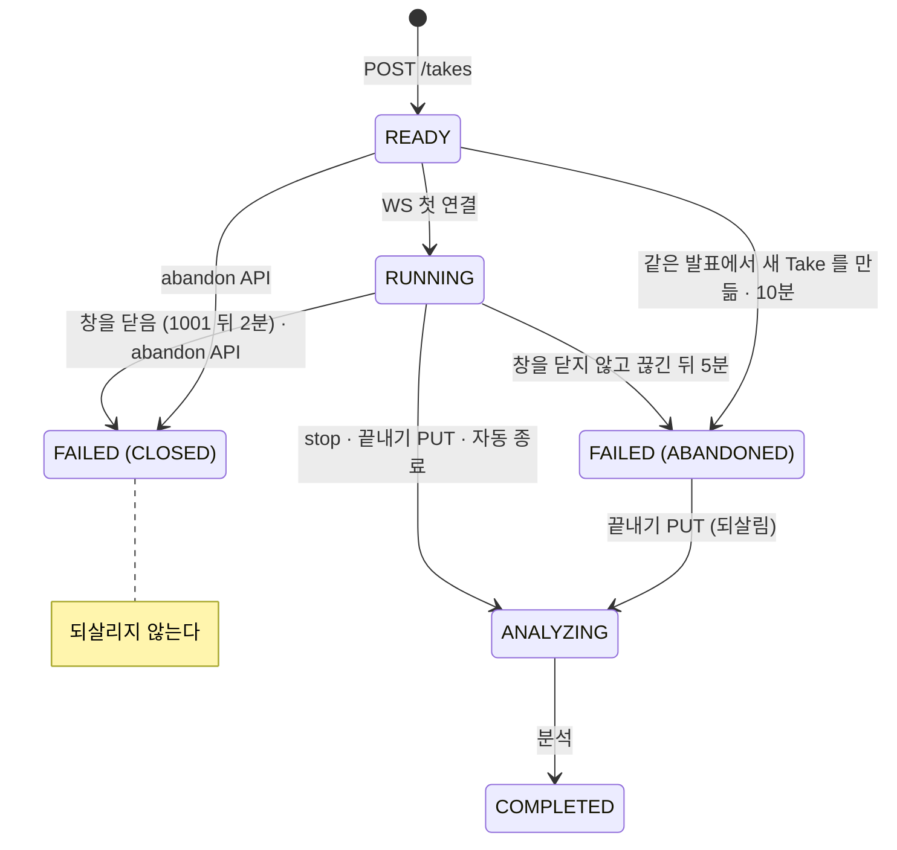

# Take 연결 · 재연결 · 종료 조건

발표(Take) 하나가 실시간 STT 에 어떻게 붙고, 끊기면 어떻게 다시 붙고, 언제 어떤 상태로 끝나는지 정리합니다.
숫자는 모두 코드의 상수이고, 마지막 절에 위치를 적었습니다.

## 0. 한눈에 보기



| 상태 | 뜻 | WS 연결 |
|---|---|---|
| `READY` | Take 를 만들었고 아직 WS 가 붙지 않았습니다. FE 는 첫 연결이 `ready` 를 받은 뒤에 발표를 시작하므로 시작하지 않은 Take 입니다 | 받음 (붙으면 `RUNNING`) |
| `RUNNING` | 발표 중입니다 | 받음 |
| `ANALYZING` | 끝났고 분석 중입니다 | `TAKE_ENDED` 로 거절 |
| `COMPLETED` | 분석이 끝났습니다 | `TAKE_ENDED` 로 거절 |
| `FAILED` | 실패입니다. BE 가 끝냈으면 `end_reason` 에 이유가 있습니다 | `TAKE_ENDED` 로 거절 |

`end_reason` 은 BE 가 Take 를 끝낸 이유입니다. 사용자가 끝냈으면 비어 있습니다.

| `end_reason` | 상태 | 언제 |
|---|---|---|
| `SILENCE` | `ANALYZING` | 오래 말이 없어 자동 종료 |
| `TIME_LIMIT` | `ANALYZING` | 최대 시간(1시간)이 지나 자동 종료 |
| `CLOSED` | `FAILED` | 창을 닫았습니다 |
| `ABANDONED` | `FAILED` | 창을 닫지 않고 끊긴 채 돌아오지 않았습니다. FE 는 살아 있을 수도 있습니다. 또는 시작하지 않은 채(`READY`) 같은 발표에서 새 Take 를 만들었거나 10분이 지났습니다 |

## 1. 발표 중 연결이 끊기면

연결은 두 구간입니다. 어느 쪽이 끊겨도 **발표는 멈추지 않습니다.** 끊긴 동안 빠지는 것은 말하기 분석(속도 ·
군더더기 · 대본 일치)뿐이고, 시선 · 시간 · 슬라이드는 브라우저(IndexedDB)에 계속 쌓입니다.

### 1-1. FE ↔ BE (WebSocket)

**FE 가 다시 붙습니다.**

- 먼저 0.5초 · 1초 · 2초 간격으로 세 번 붙어 봅니다.
- 그 뒤로는 횟수로 포기하지 않고 4~6초(5초 ± 1초)마다 붙어 봅니다.
- 끊긴 지 5분 30초가 지나면 멈춥니다. 서버가 그때 Take 를 끝내서(3절) 그 뒤로는 붙어도 `TAKE_ENDED` 입니다.
- 아래 경우는 다시 붙어도 같은 이유로 닫히므로 **바로 포기합니다.** 발표 중이면 STT 없이 이어 가고, 첫 `ready` 전이면 발표를 시작하지 않습니다 (FE 는 첫 `ready` 를 받은 뒤에 시계를 돌립니다).
  - 에러 `UNAUTHORIZED`(토큰을 한 번 갱신해 다시 붙어 본 뒤) · `TAKE_NOT_FOUND` · `TAKE_ENDED` · `FORBIDDEN` · `TAKE_TAKEN_OVER`
  - 닫힘 코드 1000 · 1008

**BE 는 30초(grace) 동안 Deepgram 세션을 살려 둡니다.**

- 그 안에 다시 붙으면 같은 세션에 이어 붙이고, 떨어져 있던 동안 온 확정 전사를 다시 보냅니다.
- 30초가 지나면 스트림만 정리합니다 (남은 오디오를 Deepgram 에 흘려 마지막 전사까지 저장). **Take 는 끝나지
  않습니다.** 그 뒤에 붙는 연결은 새 스트림을 열고 전사 번호를 이어 받습니다.
- 오디오가 한 번도 오지 않은 연결은 grace 없이 바로 정리합니다.

**BE 는 끊긴 방식을 닫힘 코드로 구분합니다.**

| 닫힘 코드 | 뜻 | 이후 (3절) |
|---|---|---|
| 1001 (going away) | 브라우저가 창을 닫거나 새로고침했습니다 | 2분 기다리고 `CLOSED` |
| 그 밖 (1006 · 서버가 닫음 등) | 네트워크 장애, FE 가 재연결을 포기함 등 | 5분 기다리고 `ABANDONED` |

새로고침도 1001 이라 BE 는 둘을 바로 구분하지 못합니다. 2분 안에 다시 붙으면 새로고침으로 봅니다.
모바일 브라우저처럼 탭을 닫을 때 닫힘 프레임을 보내지 않으면 1006 이 되어 긴 대기를 탑니다.

### 1-2. BE ↔ Deepgram

BE 가 0.5 · 1 · 2 · 5 · 10초 백오프로 계속 다시 붙습니다. 이어서 실패해도 **FE 연결은 끊지 않고** `stt_status`
로 `reconnecting` · `degraded` 만 알립니다. 끊긴 동안의 오디오는 큐에 담았다가 다시 붙으면 보내고, 큐가
넘치면 버린 만큼 무음으로 메워 전사 시각이 밀리지 않게 합니다.

## 2. 다시 열었을 때

FE 는 같은 탭인지를 라우터 state 로 압니다. 장치 점검이 넘긴 `clientSessionId` 는 새로고침해도 · 닫은
탭을 복원해도 남고, 주소를 새 창에 직접 열면 비어 있습니다 (`frontend/src/features/rehearsal/stage/resume.ts`
`leftWindow`).

| 경우 | FE 가 아는 법 | 동작 |
|---|---|---|
| 새로고침 | 라우터 state 가 남아 있음 | 무대 시계를 이어받아 계속 연습합니다 |
| 창을 닫았다 다시 엶 | 라우터 state 가 없고 하트비트가 멈춤 (이 브라우저에 기록이 없어도) | 무대를 열지 않고 abandon API 를 부른 뒤 실패 화면 |
| 다른 창이 아직 발표 중 | 라우터 state 가 없고 하트비트가 10초 안, 또는 abandon API 가 409 | "다른 창에서 연습 중" 안내만 |
| 닫은 탭 복원 (Ctrl+Shift+T) | 라우터 state 가 살아 새로고침처럼 보임 | 2분 안이면 이어 갑니다. 지났으면 첫 연결이 `TAKE_ENDED`(`CLOSED`)를 받고 실패 화면 |
| 끊긴 지 5분 지나 새로고침 | 첫 연결이 `TAKE_ENDED`(`ABANDONED`) | STT 없이 발표를 이어 가고 끝내기 PUT 으로 되살립니다 |
| 실패 화면을 본 뒤 새로고침 | 세션 행이 `ABORTED` | 무대를 다시 열지 않고 실패 화면 |

끝난 Take 로 붙으면 BE 는 `TAKE_ENDED` 로 거절하고, BE 가 끝냈으면 이유를 `end_reason` 에 싣습니다.
FE 는 이걸로 무엇을 할지 가릅니다.

```json
{"type": "error", "code": "TAKE_ENDED", "message": "이미 끝난 연습입니다.", "end_reason": "CLOSED"}
```

| `end_reason` | FE |
|---|---|
| `CLOSED` | 실패 화면. 이어 가지 않습니다 |
| `ABANDONED` | STT 없이 발표를 이어 가고, 끝내기 PUT 으로 되살립니다 |
| `SILENCE` · `TIME_LIMIT` | 앞서 `auto_end` 가 옵니다. 끝내기 버튼과 같은 종료 흐름 |
| 없음 | 사용자가 이미 끝낸 Take. 종료 흐름 |

### abandon API

```
POST /api/pitches/{pitch_id}/takes/{take_id}/abandon
→ 200 {"message": "...", "take_id": "...", "status": "FAILED"}
```

- `READY` · `RUNNING` 이면 `FAILED`(`CLOSED`)로 바꿉니다. 끝난 시각은 마지막 활동 시각(만든 시각 · 시작 시각 ·
  마지막 확정 전사 저장 시각 중 가장 늦은 것)입니다.
- 바꿨으면 떠난 Take 타이머를 끄고, 남은 스트림을 끊습니다. 서버가 아직 붙어 있다고 믿는 연결(닫힘 프레임 없이
  사라진 브라우저)에는 `TAKE_ENDED` 를 보내고 1008 로 닫습니다.
- 이미 끝났으면 바꾸지 않고 지금 상태를 돌려줍니다. `ANALYZING` 이면 끝내기가 이미 닿은 것입니다.
- 연결이 붙어 있고 최근 10초 안에 오디오가 왔으면 다른 창이 발표 중입니다. 바꾸지 않고
  409 `TAKE_IN_PROGRESS` 로 거절합니다 — FE 의 하트비트 판정이 늦어도 발표 중인 Take 를 끝내지 않습니다.
- 다시 불러도 결과가 같습니다. 남의 Take 는 404 입니다.

## 3. 아무도 다시 붙지 않을 때

스트림이 Take 를 끝내지 않은 채 정리되면(1-1) BE 가 타이머를 겁니다. 시간이 지날 때까지 아무도 붙지 않으면
`FAILED` 로 바꾸고, 그 뒤로 붙는 연결은 `TAKE_ENDED` 로 거절합니다. 그 안에 다시 붙으면 타이머가 꺼지고
이어서 연습합니다.

| 끊긴 방식 | 기다리는 시간 (스트림이 정리된 뒤부터) | 이유 |
|---|---|---|
| 닫힘 코드 1001 | **2분** | `CLOSED` |
| 그 밖 | **5분** | `ABANDONED` |
| 앱이 다시 뜸 | 마지막 활동 시각부터 **5분** | `ABANDONED` |
| abandon API | 바로 | `CLOSED` |

- `ABANDONED` 는 FE 가 STT 없이 발표를 이어 가는 중일 수 있습니다 (재연결을 포기했거나 네트워크가 오래 끊김).
  5분 뒤에 끝내도 그 FE 가 발표를 마치고 보내는 끝내기 PUT 이 되살립니다 (4절). 다만 5분 넘게 끊겼다가
  네트워크가 돌아온 FE 는 다시 붙을 때 `TAKE_ENDED` 를 받아 남은 발표의 STT 가 빠집니다.
- 타이머는 메모리에만 있습니다. 앱이 다시 뜨면 닫힘 코드를 모르므로 `ABANDONED` 로 적습니다.
- 끝난 시각(`ended_at`)은 타이머가 울린 때가 아니라 스트림이 정리된 시각입니다.
- 관리자 콘솔의 "멈춘 Take" 는 마지막 활동 뒤 5분 대기보다 10분 넘게 `RUNNING` 인 Take 입니다.

## 4. Take 가 끝나는 방법

| 방법 | 누가 | 결과 |
|---|---|---|
| 끝내기 버튼 | FE 가 WS `stop` | 마지막 확정 전사와 1초 원자료(`metrics`)까지 저장한 뒤 `ANALYZING`. 이어서 FE 가 PUT 으로 시작 · 끝 시각을 보냄 |
| STT 없이 끝냄 | FE 가 PUT `ended_at` | 발표 중(`RUNNING`)이면 `ANALYZING`. 시작하지 않은 Take(`READY`)는 409 `TAKE_NOT_STARTED`. 연결이 붙어 있으면 그 연결에 맡기고, 끊긴 뒤 30초 안이라 스트림이 남아 있으면 `stop` 처럼 전사 · 1초 원자료까지 저장한 뒤 바꿈 |
| 자동 종료 `SILENCE` | BE | 최근 2분 동안 말이 없고 직전 5분 중 80% 이상이 말 없음. 소리 크기가 아니라 전사로 판단하고, STT 가 죽어 있던 구간은 세지 않음 → `ANALYZING` |
| 자동 종료 `TIME_LIMIT` | BE | 프레임의 Take 시각이 1시간을 넘음. 시각이 멈춘 Take 는 서버 시계(스트림이 열려 있던 시간의 합)가 1시간 + 60초에서 끝냄 → `ANALYZING` |
| 창을 닫음 | BE (3절) · FE (abandon) | `FAILED`(`CLOSED`) |
| 끊긴 채 안 돌아옴 | BE (3절) | `FAILED`(`ABANDONED`) |
| 새 Take 를 만듦 | BE (Take 생성) | 같은 발표에서 `READY` 로 남은 Take 를 모두 `FAILED`(`ABANDONED`). 끝난 시각은 만든 시각 |
| 시작하지 않은 채 10분 | BE (1분마다 정리) | 만든 지 10분 지나도 `READY` 인 Take 를 `FAILED`(`ABANDONED`). 끝난 시각은 만든 시각 |

`READY` 는 시작하지 않은 Take 입니다. FE 는 마이크를 열고 첫 연결이 `ready` 를 받은 뒤에 발표 시계를 돌리고,
그 연결이 `RUNNING` 으로 바꿉니다. 바꾸지 못하면(DB 오류) BE 는 연결을 1011 로 닫고 FE 는 다시 붙습니다.
Take 는 장치 점검에서 시작을 누를 때 만들어 곧바로 연결이 붙으므로, `READY` 로 남은 Take 는 다시 쓰이지 않습니다.
새 Take 를 만들 때 같은 발표의 것을 끝내고, 다시 연습하지 않아도 10분이 지나면 끝냅니다. 정리와 첫 연결은 둘 다
조건부 UPDATE 라 먼저 적은 쪽이 남고, 정리가 먼저면 그 연결은 `TAKE_ENDED`(`ABANDONED`) 를 받습니다.

자동 종료는 `auto_end` 를 보내고 `stop` 과 같은 순서로 정리합니다. FE 는 끝내기 버튼과 같은 종료 흐름을 탑니다.

`ANALYZING` 으로 끝낸 Take 는 분석 단계(`analysis_stage`)가 `FINALIZING` 이고, BE 가 백그라운드로 Take 결과
(`/coach/finalize`)를 만듭니다. 만들면 `SCORING`, 끝내 못 만들면 `FAILED` 입니다. 떠난 것으로 끝낸 Take
(`FAILED` · `CLOSED` · `ABANDONED`)는 결과를 만들지 않습니다 — `ABANDONED` 를 끝내기 PUT 이 되살리면 그때
만듭니다.

현재 자동 처리는 `SCORING` 진입까지입니다. 그 뒤 대본 전달도 채점 · 재시도 · 확인 · 리뷰를 잇는
분석 파이프라인은 후속 구현입니다. 채점 중인 `SCORING` 에서는 리뷰 API 를 409
`TAKE_NOT_REVIEWABLE` 로 거절합니다. 전체 자동 완료가 필요한 배포에는 후속 파이프라인도 필요합니다.

### 되살리기

`ABANDONED` 로 끝난 Take 에 `ended_at` 이 든 끝내기 PUT 이 오면 기록을 받고 `ANALYZING` 으로 되살립니다
(`end_reason` 은 지웁니다). 화면은 살아 있는데 STT 만 끊겨 5분 넘게 발표를 이어 간 경우입니다.

`CLOSED` 는 되살리지 않습니다. 창을 닫은 Take 는 이어 가지 않습니다.

## 5. Take PUT 이 받는 것

`PUT /api/pitches/{pitch_id}/takes/{take_id}`

| Take 상태 | 받는 것 | 아니면 |
|---|---|---|
| `READY` | `ended_at` 을 뺀 것 | `ended_at` 이 있으면 409 `TAKE_NOT_STARTED` (시작하지 않은 Take 는 끝내지 않음) |
| `RUNNING` | 전부 | — |
| `ANALYZING` | 시각(`started_at` · `ended_at`)만 | `event_logs` 는 409 |
| `FAILED`(`ABANDONED`) | `ended_at` 이 있는 끝내기 (되살림) | 409 |
| `FAILED`(`CLOSED`) · 그 밖의 `FAILED` · `COMPLETED` | 없음 | 409 `TAKE_ENDED` |

`ended_at` 이 `started_at` 보다 앞서면 400 `INVALID_TAKE_TIME` 입니다.

## 6. 상수 위치

| 값 | 상수 | 위치 |
|---|---|---|
| grace 30초 | `GRACE_SEC` | `backend/src/pitch_coach_backend/realtime/stream/runtime.py` |
| 창을 닫은 뒤 2분 | `CLOSED_TAB_WAIT_SEC` | `backend/src/pitch_coach_backend/realtime/stream/abandon.py` |
| 발표 중으로 보는 오디오 간격 10초 | `LIVE_AUDIO_SEC` | `backend/src/pitch_coach_backend/realtime/stream/runtime.py` |
| 떠난 Take 5분 | `ABANDON_AFTER_SEC` | `backend/src/pitch_coach_backend/module/take/service/lifecycle.py` |
| 시작하지 않은 Take 10분 · 정리 간격 1분 | `READY_EXPIRE_AFTER` · `SWEEP_INTERVAL_SEC` | `backend/src/pitch_coach_backend/module/take/service/lifecycle.py` · `module/take/ready_sweep.py` |
| Deepgram 재접속 백오프 | `BACKOFF_SEC` | `backend/src/pitch_coach_backend/realtime/stt/loop.py` |
| 최대 시간 1시간 | `take_max_duration_sec` | `backend/src/pitch_coach_backend/core/config.py` |
| 서버 시계 여유 60초 | `SERVER_CLOCK_SLACK_MS` | `backend/src/pitch_coach_backend/realtime/stream/auto_end.py` |
| 말 없음 2분 · 5분 · 80% | `take_silence_*` | `backend/src/pitch_coach_backend/core/config.py` |
| FE 재연결 간격 · 5분 30초 | `RETRY_DELAYS_MS` · `SLOW_RETRY_MS` · `GIVE_UP_AFTER_MS` | `frontend/src/features/rehearsal/lib/sttSocket.ts` |
| FE 가 다른 창이 발표 중으로 보는 하트비트 10초 | `LIVE_BEAT_MS` | `frontend/src/features/rehearsal/stage/resume.ts` |
| FE 가 바로 포기하는 에러 | `FATAL_CODES` | `frontend/src/features/rehearsal/lib/sttProtocol.ts` |
