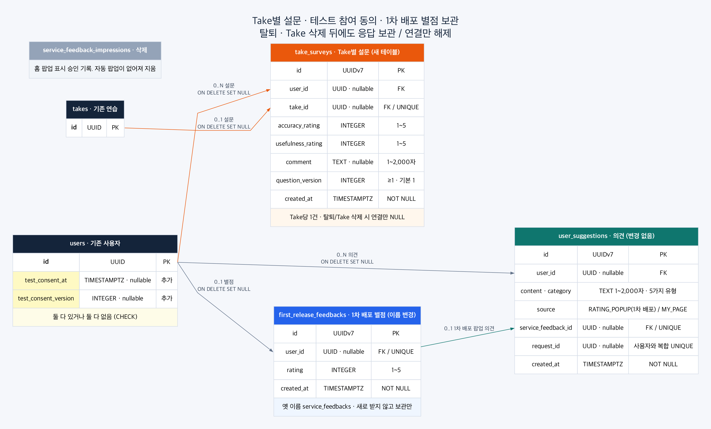

# Take별 설문 (#776)

사용자 테스트 회의에서 설문을 리포트마다 받기로 했다. 이 문서는 그 BE 계약과 정한 이유를 담는다.
2차 설문(실제 발표 수업 뒤)은 구글폼으로 받으므로 BE 작업이 없다.

## 1. 바뀐 것

| 전 (#540, 1차 배포) | 지금 |
|---|---|
| 홈 진입 때 팝업으로 서비스 별점을 사용자당 한 번, 최대 3회 요청 | 리포트마다 설문을 한 번. 자동으로 띄우지 않는다 |
| `service_feedbacks` (사용자당 별점 1건) | `first_release_feedbacks` 로 이름을 바꿔 보관만 한다 |
| `service_feedback_impressions` (팝업 표시 승인) | 지웠다. 띄운 횟수만 담은 기록이라 옮기지 않았다 |
| `/api/service-feedback`, `/impressions`, `/me` | 없앴다 |
| 마이페이지 의견 `POST /api/suggestions` | 그대로다 |

1차 배포 별점은 Take 와 이어져 있지 않아 새 설문으로 옮길 수 없다. 지우지 않고 테이블 이름만 바꿨다.
그때 팝업에서 같이 받은 의견(`user_suggestions.source = 'RATING_POPUP'`)도 그대로 별점과 이어져 있다.

## 2. 저장



이미지 원본은 `images/take-survey-erd.dot`이며 `dot -Tpng -Gdpi=150`으로 다시 만들 수 있다.

### `take_surveys`

| 칸 | 제약 · 뜻 |
|---|---|
| `id`, `created_at` | UUIDv7 PK, 저장 시각 |
| `user_id` | FK `users`, `SET NULL`. 탈퇴해도 응답은 남긴다 |
| `take_id` | FK `takes`, `SET NULL`, UNIQUE. Take 당 한 번. 발표·Take 를 지워도 응답은 남긴다 |
| `accuracy_rating` | 1~5. 분석 결과의 체감 정확도 |
| `usefulness_rating` | 1~5. 피드백의 구체성·유용성 |
| `comment` | 선택, 1~2,000자. 부정확하거나 아쉬웠던 점 |
| `question_version` | 정수 ≥1, 기본 1. FE 가 보여 준 문항 문구의 버전 |

문항 문구를 고칠 예정이라(회의록 3절 "문구 수정") 버전을 같이 남긴다. 고친 앞뒤 응답을 섞어 평균 내지 않는다.
척도나 문항 수가 바뀌면 칸을 고치는 마이그레이션이 필요하다.

### `users` 의 테스트 참여 동의

| 칸 | 뜻 |
|---|---|
| `test_consent_at` | 수집 항목·목적·보관 기간 안내를 보고 동의한 시각 |
| `test_consent_version` | 그 안내문의 버전. 둘 다 있거나 둘 다 없다 (CHECK) |

1초 원자료를 Take 가 끝난 뒤에도 남기는 선택 동의 `raw_data_consent` 와 다르다.
BE 는 동의를 기록만 하고 Take 생성을 막지 않는다. 동의 화면을 거치게 하는 것은 FE 가 한다.

## 3. API

| API | 계약 |
|---|---|
| `POST /api/takes/{take_id}/survey` | 저장. 최초 201, 같은 답 재전송 200, 다른 답 409 `TAKE_SURVEY_ALREADY_SUBMITTED` |
| `GET /api/takes/{take_id}/survey` | `{submitted, survey}`. 제출 전 `survey` 는 null |
| `GET /api/take-surveys/pending` | 홈 알림용 미작성 목록 `{items: [{take_id, pitch_id, pitch_title, take_number, completed_at}]}` |
| `PATCH /api/users/me` | `{test_consent_version: 1}` 로 동의. 응답에 `test_consent_at`·`test_consent_version` |

```json
{"accuracy_rating": 4, "usefulness_rating": 3, "comment": "말 빠르기가 실제보다 느리게 나왔어요", "question_version": 1}
```

- 본인 Take 가 아니거나 없으면 404 `TAKE_NOT_FOUND`, 리포트가 없는 Take 는 409 `TAKE_SURVEY_NOT_ELIGIBLE` 이다.
  리포트가 있다는 것은 `COMPLETED` 이고 `TAKE_RESULT` 가 남은 것이다. AI 리뷰가 실패해도 리포트는 있다.
- 별점은 엄격한 정수만 받는다. 의견은 앞뒤 공백을 지우고 비면 남기지 않은 것으로 본다. 모르는 칸은 422 다.
- 같은 Take 를 동시에 보내도 `ON CONFLICT (take_id)` 로 한 행만 남고 나머지는 저장된 답과 비교한다.
- 미작성 목록은 **동의한 뒤 끝난** Take 만 넣는다. 동의하지 않았으면 비어 있다. 그 전 연습까지 넣으면 처음 들어온
  홈이 알림으로 가득 찬다. 목록에 없는 Take 도 리포트에서 직접 설문을 남길 수 있다.
- 같은 버전으로 다시 동의하면 처음 시각을 유지하고 버전이 바뀔 때만 새로 적는다. 철회는 아직 받지 않는다.

## 4. FE 에 전달할 것

FE 파일은 BE 가 고치지 않는다. 아래를 FE 담당에게 전달한다.

- 홈 팝업(`HomeServiceReview`·`ServiceReviewDialog`)이 부르는 `/api/service-feedback*` 는 이 변경과 함께 404 가 된다.
  **FE 교체가 같은 release 에 들어가야 한다.**
- 리포트 하단 버튼: `GET /api/takes/{id}/survey` 로 제출 여부를 보고 `POST` 로 보낸다. 실패하면 입력을 남겨 두고 같은 답으로 다시 보낸다.
- 홈 알림: `GET /api/take-surveys/pending` 의 항목을 누르면 그 리포트로 보낸다.
- 동의: 안내를 보여 준 뒤 `PATCH /api/users/me {test_consent_version}`. 안내문이 바뀌면 버전을 올린다.
- 문항 문구를 바꾸면 `question_version` 을 올려 보낸다.

## 5. 남은 일

- 보관 기한(12/31) 뒤 무엇을 지울지(설문·동의 기록·분석 결과) 팀이 정하면 삭제 스크립트와 실행 절차를 만든다.
- 운영 서버 오류 로그는 docker json-file `10m × 3` 순환이라 날짜가 아니라 용량에 따라 사라진다. 안내 문구에 반영한다.
- 안내 문구에 "음성·영상 원본은 저장하지 않는다"와 함께 STT 결과 텍스트(`take_transcript_segments`)와 분석 결과는
  저장한다는 것을 적어야 한다.
