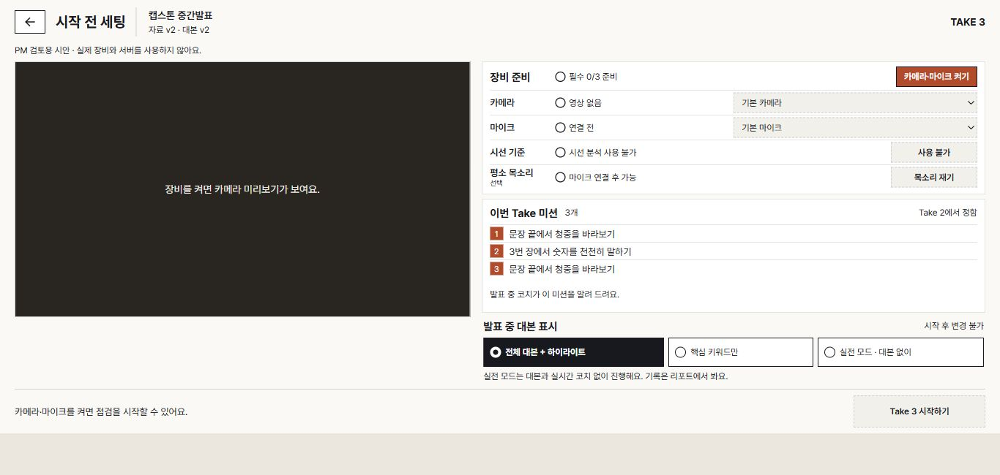
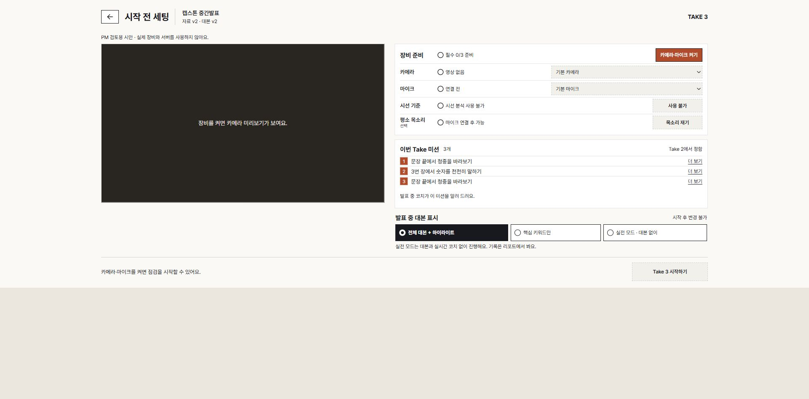

# 시작 전 세팅 · PM 검토 시안

**디자인 검토 전용 · PM 승인 전.** 닫힌 제품 구현 PR #789를 대체한다. 이 변경은 `docs/fe/design/` 안의 문서와 독립 시안만 담는다. `frontend/` 제품 코드·테스트·설정은 변경하지 않는다. 기존 구현 커밋은 보존하지만 제품 반영 근거로 사용하지 않는다.

## 검토할 디자인

발표 직전에 장비 상태와 필요한 조작을 빠르게 읽도록 정리한다. 사용자가 확인한 사진 기준 배치와 선택창 너비를 유지한다.

| 영역 | 시안의 결정 |
| --- | --- |
| 전체 | 카메라 자리 하나를 왼쪽, 장비·미션·대본 표시를 오른쪽에 둔다. 자체 제목과 시작 버튼을 쓴다. |
| 장비 행 | 항목명 바로 옆에 원형 상태 표시와 설명, 오른쪽 끝에 해당 조작만 둔다. 공통 4열로 나누지 않는다. |
| 카메라·마이크 | 두 선택창을 박스 중앙부터 오른쪽 끝까지 같은 폭으로 늘린다. 긴 이름은 줄여 보이고 도움말로 전체 이름을 읽는다. |
| 시선·목소리 | 버튼은 118px로 짧게 두되 선택창과 오른쪽 끝을 맞춘다. 평소 목소리는 선택 항목이다. |
| 장비 제목 | 제목 옆에 필수 준비 수, 오른쪽에 카메라·마이크 켜기 버튼을 둔다. |
| 미션 | 실제 항목만 3개씩 표시한다. 1·2·3개 및 마지막 페이지의 카드 높이는 같다(노트북 156px / 데스크톱 164px). |
| 긴 미션 | 실제로 잘리는 설명에만 더 보기를 둔다. 전문 창은 이전/다음·Esc·닫은 뒤 초점 복귀를 지원한다. |
| 목소리 읽기 | 문단, 고정 예시 음량, 완료 버튼을 간결하게 표시한다. 미션은 요약하되 전문 접근을 유지한다. |
| 대본 표시 | 장비 연결 전에도 선택 가능하다. 선택 상태는 진한 바탕·밝은 글자·원형 표시로 구분하고, 비활성 조작은 읽을 수 있는 대비를 유지한다. |

## 시안 화면과 렌더링 확인

| 화면 크기 | 두 선택창 폭 | 미션 높이 | 시작 버튼 영역 하단 |
| --- | --- | --- | --- |
| 1366×650 | 332.87px | 156px | 585px |
| 1920×950 | 358.70px | 164px | 669px |
| 1093×614 | 261.21px | 156px | 585px |

세 크기 모두 시안 페이지의 가로·세로 스크롤 없이 확인했다. 선택창 왼쪽은 장비 박스의 정중앙이며, 아래 버튼은 118px와 오른쪽 정렬을 유지한다. 1093×614에서 미션 1·2·3개와 마지막 페이지 1·2개의 높이가 모두 156px이고, 목소리 읽기·권한 오류의 의도적인 요약 높이는 38px다. 500자 전문과 닫은 뒤 초점 복귀도 확인했다.

수치는 **공용 제품 헤더를 넣지 않은 독립 시안** 기준이다. 제품 공용 헤더 추가나 제품 코드 이관은 PM 승인 이후 별도로 정할 일이다.

배율 참고: 911×433(1366의 150%)에서는 가로 넘침 없이 세로 흐름으로 바뀌며, 상태에 따라 약 470~580px 세로 스크롤이 생겨 시작 버튼까지 그만큼 내려가야 한다. PM 검토 때 이 수치로 판단한다.

## 독립 상태와 동작의 한계

뷰어에서 `시작 전 세팅 · PM 검토 시안`을 고른다. 18개 상태는 `src/screens/prepareDraftFixtures.ts`의 고정 예시다. 버튼은 예시 상태 또는 설계서 샘플 화면만 바꾼다.

| 조작 | 시안에서 보이는 변화 | 실제로 하지 않는 일 |
| --- | --- | --- |
| 카메라·마이크 켜기 | 연결됨 예시와 시선 기준 전 상태 | 장비 권한 요청·촬영·녹음 |
| 장치 선택 | 예시 선택값 변경 | 실제 장치 열기·교체 |
| 시선 기준 잡기 | 3/3 완료 예시 | 시선 엔진·전체 화면 보정 |
| 목소리 재기 / 다 읽었어요 | 읽기 / 완료 예시 | 오디오 측정·시간 판정·저장 |
| 시작 | 기존 리허설 또는 실전 **설계서 샘플**로 이동 | API 요청·Take 생성·실제 리허설 시작 |

카메라·마이크·시선 기준을 필수, 평소 목소리를 선택으로 표현한다. 시작 중 상태는 비활성 모습만 보여 준다. 다른 곳에서 연습 중인지 확인·종료하는 서버 동작은 새로 구현하지 않는다.

## PM 검토와 이후 작업

주 검토 크기는 1366×650과 1920×950, 배율 참고 크기는 1093×614다. 시작 버튼 접근, 긴 이름과 설명, 미션 수·마지막 페이지, 장비 오류와 목소리 읽기 중 배치를 확인한다. 폭이 좁으면 세로 흐름을 허용한다.

PM이 배치·문구·상태별 화면을 승인한 뒤에 제품 이관 범위와 실제 장비·권한·서버·시선 보정 검증을 별도로 정한다. 이 PR은 그 승인을 대신하지 않는다. `PRODUCT_CHECKED`·기존 제품 샘플·#788의 제품 코드는 변경하지 않는다.
